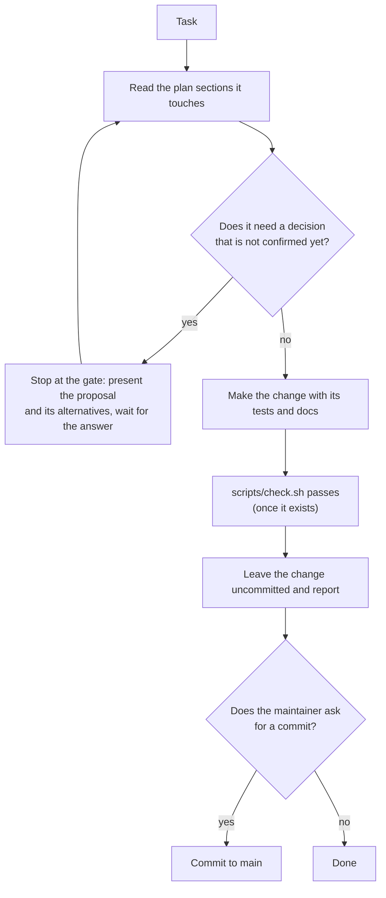

# CLAUDE.md

Instructions for AI coding agents working in this repository. [AGENTS.md](AGENTS.md) points here; this file is the only copy of the rules.

## The project

`cc-media-probe` is a pure Rust library that inspects multimedia files and reports what they contain: container format, streams, codec parameters, chapters, tags and attachments. It never decodes audio or video. One universal API serves every supported format. The companion crate `cc-media-probe-cli` is the command-line tool. Licence: Apache-2.0.

**Status on 2026-11-21:** planning. The development plan, [docs/plans/plan-init-project.md](docs/plans/plan-init-project.md), is at draft 6 and awaits approval. No code exists yet; work starts with Phase 1 once the plan is approved.

The plan is the authority, and this file summarizes the rules that apply to every change. Section numbers (§), requirement IDs (R…), decision IDs (D…) and gate IDs (G…) below refer to the plan. The plan is long (about 3,000 lines), so read the sections a task touches rather than the whole file. If this file and the plan disagree, stop and ask.

## Working rules

- **No commits, pushes, branches or sub-agents unless the maintainer asks for them in the current session** (R10). Leave changes uncommitted for review. A request in one session does not carry over to the next.
- **Gates** (§1.1; all of them are listed in §14):
  - **[CONFIRM]**: present the proposal and its alternatives, then wait for an explicit answer.
  - **[MANUAL]**: give exact instructions, then wait until the maintainer reports the step done.
  - **[OPTIONAL]**: never blocks; the next phase-gate summary records the outcome.
- Nothing that depends on an unconfirmed decision is added to the workspace, the library or CI. Evidence for a decision comes from a disposable spike in `spikes/<name>/`, never from adopted code (§1.2).
- **Standing gates** can arise at any time: a crate or tool outside the approved allow-list (GS.1); a specification source that changes, disappears or is newly proposed (GS.2); the crate name at risk (GS.3); a confirmed requirement of §3 that cannot be met as written (GS.4).
- **Ask, don't guess.** Ask the maintainer about any decision that belongs to a gate or that the plan leaves open. Search online before proposing a technical decision.
- Record gate decisions in `docs/decisions.md` with the date and the reasoning.
- When the plan turns out wrong or incomplete, amend it in the same change and call the amendment out at the phase gate (§1.2). A change to a requirement of §3 goes through GS.4 first.
- When a plan revision changes a rule summarized here, update this file in the same change.

## Clean room and sources

- Parsing behaviour comes only from the specifications listed in §5 and Appendices A and B. Normative prose, tables, syntax tables, syntax pseudocode and worked examples count as specification (§1.3, R16).
- **Never read for implementation** the source code of any third-party multimedia project, nor a reference encoder or decoder attached to a specification. Never copy, translate or paraphrase such code. When an approved document is hosted inside an implementation's source repository, open only that document.
- **Never name** an existing multimedia tool or library in this repository: not in code, comments, documentation, changelog entries or commit messages. Do not choose identifiers that coincide with the name of one; the main result type is called `MediaReport` for this reason.
- No multimedia parsing or demuxing library may be used anywhere (R2). General-purpose crates are allowed, and only those on the allow-list approved at G1.3; anything else goes through GS.1.
- **Synthetic test media only** (R8): hand-annotated hex fixtures and in-repository builders. No third-party samples, no external tool to generate or validate fixtures, and no real media in the repository.
- **Traceability** (§5.5): every parser module starts with a doc comment naming its specification and section; every field read from a file carries the specification's field name in a comment, in the specification's own spelling (the identifier itself is spelled out, R32); every entry of a signature or registry table carries a source reference; every constant whose value a specification defines names that specification and section in its doc comment.
- RFC text in `docs/rfc/` is committed verbatim. Other specifications are fetched into the git-ignored `docs/specs/files/` and are never committed.

## Code rules

These rules hold in every crate of the repository (§7.2). Clippy lints and the structure check of D23 enforce them.

- **Highly modular (R29).** One concern per file. Walking a structure, mapping it to the normalized model and building its typed details are separate files. A format, codec or tag family becomes a directory as soon as it has more than one concern. A structure that several formats read lives in one shared module, never inside one of its consumers.
- **Module roots only declare (R30).** `lib.rs` and every `mod.rs` contain only:
  - module declarations without a body (`mod segment;`, `pub mod tracks;`);
  - `use` imports and `pub use` re-exports;
  - attributes on those items, crate-level attributes, and `//!` documentation.

  Nothing else: no function, type, trait, `impl`, constant, static, type alias, macro definition, macro call, inline module body or inline test module. Tests that belong to a module root go in `tests.rs`, declared with `#[cfg(test)] mod tests;`. A binary's `main.rs` follows the same rule and may in addition hold a `main` function that only hands over to the crate's modules.
- **Directories use `mod.rs` (R30).** A module with submodules is `name/mod.rs`, never `name.rs` beside a `name/` directory.
- **At most 500 lines per Rust file, excluding embedded tests (R31).**
  - Every physical line of the formatted file counts: code, comments, documentation and blank lines.
  - The embedded tests are one `#[cfg(test)] mod tests { … }` block at the end of the file. Lines from its start onward do not count.
  - A file that holds only tests (a `tests.rs`, an integration test, a benchmark) counts in full.
  - There are no exceptions. Static tables are split into files by group. Do not use `#[path]`, and do not pull in Rust source with `include!`.
- **Names are whole words; no abbreviations (R32).** Every name in the code is human-readable English made of whole words: items, fields, variants, variables, parameters, generic parameters, lifetimes, modules, crates, and the names in scripts.
  - Spell words out: `identifier`, not `id`; `information`, not `info`; `maximum`, not `max`; `buffer`, not `buf`; `index`, not `idx`.
  - No single-letter names anywhere: not for loop counters or closure arguments, not for generic parameters (`Source`, not `S`), not for lifetimes (`'input`, not `'a`).
  - Exempt are only names that Rust, its standard library, a dependency or an external tool fixes (`std::io`, `fmt`, `str`, `u8`, trait and conventional method names such as `len`, `iter` and `from_str`, Cargo and workflow keys), and proper names of formats, codecs, standards and products as commonly written (`Ebml`, `Mp4`, `H264`, `Id3v2`, `Crc32`, `serde`, `tokio`, the `cc` of the crate names).
  - A specification's spelling of a field (`pic_width_in_mbs_minus1`) goes in the traceability comment; the identifier is spelled out (`picture_width_in_macroblocks_minus_one`).
  - The name check of D23 knows only the abbreviations on its list, so passing it is not proof. When a review finds an abbreviation it missed, the abbreviation joins the list.
- **Magic numbers and strings are named constants in dedicated modules (R33).** Every numeric, string, character and byte-string literal in Rust code is a named constant.
  - Constants live in a constants module beside the code that uses them: `constants.rs`, or a `constants/` directory split by group once it nears 500 lines. A constant that several modules use lives in the constants module of their nearest common parent. A constants module holds only `const` and `static` items, their imports and their documentation. The data tables (detection signatures, registries, element schemas) count as constants modules.
  - Literals may stay inline only in test code (embedded test blocks, `tests.rs`, integration tests, benchmarks), in documentation, doc examples and the example programs, in attribute arguments and other places where Rust accepts only a literal, and as the numbers 0 and 1.
  - Message text is a constant too. A `format!` or `write!` template keeps only placeholders, spacing and punctuation and names the constant inline: `write!(formatter, "{UNEXPECTED_END}: {element}")`.
- **Pure Rust, no `unsafe`** (R15, D4): `forbid(unsafe_code)` in every crate, and nothing in the published crates' dependency graph compiles or links C or C++.
- **No panics on input** (§7.6): no `unwrap`, `expect`, unchecked indexing or unchecked arithmetic on values derived from input. Every loop over file structure is bounded by the probe budget (§7.5). Walkers are iterative, with explicit stacks; there is no input-driven recursion. A failing source is an error that keeps its original cause (R19), never "unsupported format".
- **Stable API** (§8.1, §8.10): private fields with accessors; `#[non_exhaustive]` on public enums and options types; builders instead of struct literals; a missing value is `None`, never a zero or an empty string; estimates only through the separate estimate accessors (R25); Cargo features are additive.

## Quality bars

- **Coverage (R28):** line coverage **above 90%**, where exactly 90.0% fails. It applies to each published crate as a whole and to each library area: `containers/`, `codecs/`, `tags/`, `text/`, `disc/`, `detect/`, `registry/`, `input/` and `utilities/`. A crate or area is held to it from the first change that gives it executable code, so write the tests together with the code.
- Zero warnings from the compiler, Clippy and rustdoc. Every public item has rustdoc with an example; `missing_docs` is denied.
- A bug found after a format ships gets a minimized synthetic fixture before it is fixed.
- A change to reported output updates its expectation files and is listed in `CHANGELOG.md` under "Changed output" and in the phase-gate summary (§9.6).
- **Diagrams (R14, §10):** in Markdown documents (the plan, this file, guides, design documents), draw workflows and processes as Mermaid diagrams in fenced `mermaid` blocks. Directory trees and byte layouts stay as text. A diagram restates the prose beside it and adds no rule of its own; when the prose changes, update the diagram in the same change. Rustdoc stays prose, because it renders no Mermaid without an extra crate (GS.1).
- `scripts/check.sh` must pass on every change once it exists; Phase 1, task 3 creates it. CI repeats it on Linux, macOS and Windows.

## Layout and toolchain

The planned workspace is in §7.1, and the library's module tree is in §7.2.

- `crates/cc-media-probe/`: the library (published).
- `crates/cc-media-probe-cli/`: the command-line tool (published; binary `cc-media-probe`).
- `crates/cc-media-probe-testkit/`, `crates/cc-media-probe-doctest/`, `crates/cc-media-probe-compatibility/`: unpublished support crates. Fixtures live in the test kit under `fixtures/<format>/`.
- `fuzz/`, `spikes/<name>/`, `readers/<version>/`: workspaces of their own, excluded from the root workspace.
- `docs/`: `plans/`, `rfc/`, `specs/`, `guide/`, `design/`, `releases/` and `decisions.md`.

Toolchain: Rust 1.100, edition 2024, pinned to one exact release in `rust-toolchain.toml` (D1). The machine currently has Rust 1.96.0; upgrading is the maintainer's step at gate G1.1, so do not work around it.
