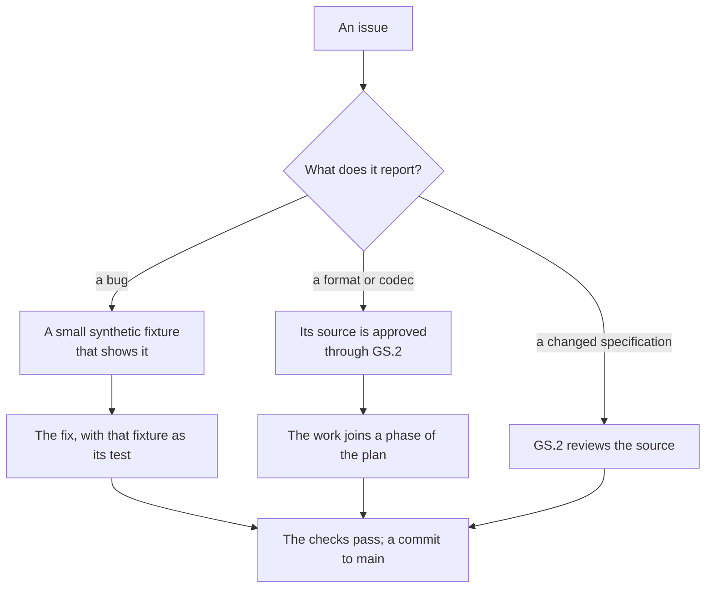
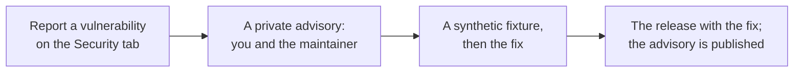
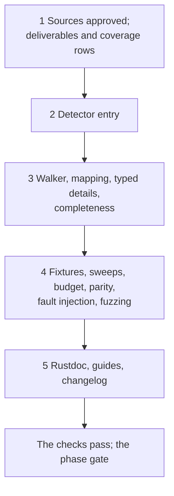
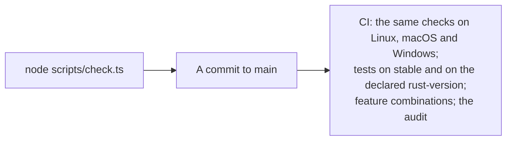

# Contributing to cc-media-probe

`cc-media-probe` is developed by its maintainer, phase by phase, along the [development plan](docs/plans/plan-init-project.md). Commits go directly to `main`, and there are no pull requests (plan section 1.2). Contributions from outside the project come as **issues**. This file says how to write a useful one, how to report a vulnerability, and which rules every change to the repository follows, so that what you propose fits them.

The plan is the authority. Where this file and the plan disagree, the plan wins, and this file is corrected. Coding agents follow the same rules through [CLAUDE.md](CLAUDE.md).

## Issues

Three kinds of issue help the most:

- **A bug.** Name the version, the command or call, what was reported and what you expected, with the section of the specification that says so. The repository holds only synthetic test files (R8), so a bug is turned into a small, hand-written fixture that shows it, and only then fixed. Please attach no media file. The bytes that matter, as a hex dump with their offsets, are the most useful evidence.
- **A format or codec.** Name its specification: a public, normative document if one exists. A format without one needs a public description that the maintainer approves through GS.2 before any work starts. Approved work then joins a phase of the plan.
- **A changed specification.** A new edition, an erratum, a moved document or a better public description of a format. The maintainer reviews the source through GS.2.

Please do not paste source code of other multimedia projects into an issue. Describe the expected values and cite the specification instead (see [Clean room](#clean-room)).

## Reporting a vulnerability

Report a vulnerability privately, through GitHub's private vulnerability reporting: the **Report a vulnerability** button on the repository's [Security tab](https://github.com/caoccao/cc-media-probe/security). Please do not open a public issue for it.

The library reads untrusted files, so each of these is a vulnerability:

- a panic, whatever the input;
- a hang: a probe that does not end within its work-unit limit;
- reading more bytes, holding more memory or retaining more data than a configured limit allows;
- opening a file that the caller did not allow.

Companion lookup, planned for release 0.7.0, opens files that belong to a probed file only when the caller enables it, and only inside the trusted folder the caller names (R18). That containment is guaranteed on one condition: **nobody else changes the folder tree while the probe runs.** An escape that needs such a change is outside the guarantee. Any other escape is a vulnerability.

The report stays private between you and the maintainer. The problem gets a synthetic fixture and a fix, like every bug, and the advisory is published with the release that contains the fix.

## The rules

Each rule names its source in the plan: a requirement (R…) of [section 3](docs/plans/plan-init-project.md#3-confirmed-requirements), a decision (D…) of [section 6](docs/plans/plan-init-project.md#6-technical-decisions), or a gate (G…) of [section 1.1](docs/plans/plan-init-project.md#11-gates).

### Clean room

- Parsing behavior comes only from the specifications that the plan lists (section 5, Appendices A and B). Normative prose, tables, syntax tables, syntax pseudocode and worked examples count as specification (R16, [section 1.3](docs/plans/plan-init-project.md#13-clean-room-rule)).
- The source code of other multimedia projects is never read for implementation, and never copied, translated or paraphrased. The same holds for a reference encoder or decoder attached to a specification.
- The repository never names an existing multimedia tool or library: not in code, comments, documentation, the changelog or commit messages.

### Sources and traceability

- RFC texts are committed verbatim in `docs/specs/rfc/`, fetched with `node scripts/fetch-rfcs.ts`. Other specifications are listed in `docs/specs/manifest.tsv` and fetched with `node scripts/fetch-specs.ts` into `docs/specs/files/`, which is never committed. Ask other sites slowly: the fetch scripts wait between requests and back off when a site refuses.
- Every planned feature has a row in `docs/specs/deliverables.tsv` and its source in `docs/specs/coverage.tsv` (section 5.2).
- Every parser module starts with a doc comment naming its specification and section. Every field read from a file carries the specification's field name in a comment, in the specification's spelling. Every entry of a signature or registry table, and every constant whose value a specification defines, names its source ([section 5.5](docs/plans/plan-init-project.md#55-spec-traceability)).

### Dependencies

- No multimedia parsing or demuxing library may be used anywhere (R2). The published crates and everything they depend on are pure Rust: nothing is compiled or linked from C or C++, and no crate of this project contains `unsafe` code (R15, D4). The one exception is the system libraries that the Rust standard library itself links, such as the C runtime; the check allows only those in [`system-libraries.tsv`](crates/cc-media-probe-checks/data/system-libraries.tsv).
- Only the crates and tools approved at G1.3 are used. They are listed with their versions in the [dependency dossier](docs/design/dependency-dossier.md) and enforced by `deny.toml`. Anything else goes through GS.1 first, and a manifest gains a dependency only in the phase that first uses it.

### Test media and fixtures

- Test media is synthetic only (R8): hand-annotated hex fixtures and the byte-level builders of the test kit. No third-party sample, no external tool to make or check a fixture, and no real media in the repository ([section 9.1](docs/plans/plan-init-project.md#91-fixtures-synthetic-only)).
- A bug found after a format ships gets a minimized synthetic fixture before it is fixed.
- A change to what a probe reports updates its expectation files and is listed in the changelog under "Changed output" ([section 9.6](docs/plans/plan-init-project.md#96-reviewing-changes-in-reported-output)).

### Code

The rules of [section 7.2](docs/plans/plan-init-project.md#72-library-module-layout) and [section 7.6](docs/plans/plan-init-project.md#76-robustness-rules) hold in every crate. The lints and the structure check enforce most of them.

- **Modules (R29, R30).** One concern per file. A format, codec or tag family becomes a directory as soon as it has more than one concern, and a structure that several formats read lives in one shared module. `lib.rs` and every `mod.rs` hold only module declarations, imports and re-exports, with their attributes and documentation. A module with submodules is `name/mod.rs`.
- **File size (R31).** At most 500 lines per Rust file, counted up to its one embedded `#[cfg(test)] mod tests` block at the end. Every line counts, comments and blank lines included, and there are no exceptions.
- **Names (R32).** Whole English words: `identifier`, not `id`; `buffer`, not `buf`; no single-letter names, generic parameters or lifetimes. Names that Rust, a dependency or a tool fixes, and proper names such as `H264` or `Id3v2`, are exempt.
- **Constants (R33).** Every literal outside tests, documentation, attribute arguments and the numbers 0 and 1 is a named constant in a constants module beside the code that uses it. Message text is a constant too.
- **Header.** Every `.rs` and `.ts` file starts with the copyright header and the Apache-2.0 notice. Copy it from any existing file.
- **Robustness.** No `unwrap`, `expect`, unchecked indexing or unchecked arithmetic on values that come from input. Every loop over file structure is bounded by the probe budget, and walkers use explicit stacks, never recursion driven by the input.

### Scripts

Every script is TypeScript, run by Node.js on a long-term-support release, and imports only Node.js built-in modules: no shell, Python or JavaScript (R34, D24). The code rules apply where they fit, and each module with logic of its own has tests in a `*.test.ts` file beside it. File-system paths are built with `path.join`, and programs start without a shell, so the scripts run the same on Linux, macOS and Windows.

### Language

Everything is written in American English: `color`, `behavior`, `license`, `analyze`, `catalog` (R35). Titles, quoted text and a specification's field names keep their own spelling.

### Coverage and documentation

- Line coverage is **above 90%**, where exactly 90.0% fails, for each published crate and for each area of the library (R28). Tests arrive together with the code they cover.
- Zero warnings from the compiler, the linter and rustdoc. Every public item has rustdoc with an example.
- In Markdown documents, workflows and processes are drawn as Mermaid diagrams that restate the prose beside them (R14).
- Every change that users of the published crates can notice is entered in [CHANGELOG.md](CHANGELOG.md) in the same commit.

## How a format is added

A format is done when it meets the checklist of [section 11](docs/plans/plan-init-project.md#11-definition-of-done-for-a-format), in this order:

1. **Sources.** Every document it needs is approved and in a manifest, and the deliverables and coverage tables have its rows.
2. **Detection.** A detector entry with its signature, source, confidence and extension hints.
3. **Probing.** The walker, with every loop charged to the budget; the stream inventory and when it is reached; header parsing for every stream; the mapping to the normalized model and the typed details; completeness with its evidence; behavior on forward-only sources and with each feature disabled.
4. **Tests.** Hex fixtures and builder matrices, truncation and mutation sweeps, budget tests, source parity, fault injection, a fuzz target, the cross-container pairs, serialization and the command-line output.
5. **Documentation.** Rustdoc, the rows of the guides and the changelog entry.

The checks pass at every step, and the phase that adds the format ends at its gate.

## The checks

`node scripts/check.ts` runs every check of the repository, and every commit passes it. It needs:

- the Rust toolchain that `rust-toolchain.toml` pins: `rustup toolchain install`;
- a long-term-support release of Node.js, which `.nvmrc` names: `nvm install` reads it;
- the type checker of the scripts: `npm ci` in `scripts/`;
- `cargo-llvm-cov` 0.9.1: `cargo install --locked --version 0.9.1 cargo-llvm-cov`.

It runs, in order: the Node.js version, file hygiene, Markdown links, the specification tables, the structure, types and tests of the scripts, formatting, lints, the Rust structure check, the tests, coverage, documentation, target ownership, the package contents, the joint packaging of both crates and the pure-Rust verification. It stops at the first step that fails.

**Never set `RUSTFLAGS`.** It replaces the flag that marks a repository build, and a guard test then fails. Warnings are denied by the workspace's lint table instead.

CI ([section 9.8](docs/plans/plan-init-project.md#98-continuous-integration)) runs the same checks on Linux, macOS and Windows on every push to `main` and to every `release/*` branch. It also runs the tests on current stable Rust and on the `rust-version` that the crates declare, builds every feature combination with `cargo-hack` 0.6.46, and audits licenses, advisories and the crate allow-list with `cargo-deny` 0.21.0.

