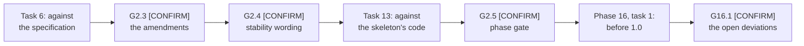

# Rust API Guidelines checklist

| | |
|---|---|
| **Status** | Written on 2026-11-25 for plan Phase 2, task 6, against [`api.md`](api.md) at revision 56 of the plan. The amendments that it made (section 13) are confirmed at G2.3, and the mark of a breaking change in the changelog at G2.4. Task 13 re-ran the checklist against the skeleton's code on 2026-11-27 (section 15), and Phase 16, task 1, runs it again before 1.0. |
| **Guidelines** | The [Rust API Guidelines](https://rust-lang.github.io/api-guidelines/) and their [checklist](https://rust-lang.github.io/api-guidelines/checklist.html), read on 2026-11-25. The repository `rust-lang/api-guidelines` was at commit `97a0969` of 2025-07-08, and its checklist, `src/checklist.md`, last changed at commit `b2f62d6` of 2021-08-23. It has 54 items in 11 groups. |
| **Scope** | The public Rust API of the library, `cc-media-probe`, as `api.md` specifies it, and the plan's rules where an item reaches beyond the API: the manifests, the release notes and the license. The command-line tool has no public Rust API: its contract is its command line ([`cli.md`](cli.md)), so only the items on manifests, release notes and licenses apply to it. |

This checklist says, item by item, how the specification meets the Rust API Guidelines. Plan section 8.1 makes following them a principle of the API, and plan section 10 keeps the checklist here.

## Contents

1. [How to read it](#1-how-to-read-it)
2. [Naming](#2-naming)
3. [Interoperability](#3-interoperability)
4. [Macros](#4-macros)
5. [Documentation](#5-documentation)
6. [Predictability](#6-predictability)
7. [Flexibility](#7-flexibility)
8. [Type safety](#8-type-safety)
9. [Dependability](#9-dependability)
10. [Debuggability](#10-debuggability)
11. [Future proofing](#11-future-proofing)
12. [Necessities](#12-necessities)
13. [What the checklist changed](#13-what-the-checklist-changed)
14. [Gate decisions and remaining checks](#14-gate-decisions-and-remaining-checks)
15. [The run against the code](#15-the-run-against-the-code)

## 1. How to read it

Each item has one verdict:

- **Met.** `api.md`, the plan or a guide already met the item. The row names where.
- **Amended.** The specification did not meet the item, or did not say that it did, and this task changed `api.md`, the plan or a guide so that it does. Section 13 lists every amendment.
- **Deviation.** The project departs from the item on purpose. The row gives the reason and the decision or gate behind it.
- **Not applicable.** The API has nothing that the item is about.

"Where" names sections of `api.md` unless it names another document. The last column says what task 13 checks in the skeleton's code: a lint that the workspace denies, a test, or a review by reading.

The checklist runs three times:

## 2. Naming

| Item | Verdict | Where | How | Task 13 checks |
|---|---|---|---|---|
| **C-CASE** Casing conforms to RFC 430 | Met | 2; R32 | Types and variants in `UpperCamelCase`, with an acronym as one word (`H264`, `Bcp47`, `Utf8`, `Guid`, `UtcTime`); functions, methods and modules in `snake_case`; constants in `SCREAMING_SNAKE_CASE` (`SchemaVersion::CURRENT`). R32 is stricter than RFC 430 and allows no name of a single letter, which `Chromaticity::x()` and `y()` broke; they are now `x_coordinate()` and `y_coordinate()` (6.5; section 13). | rustc's casing lints, with warnings denied; the name check of D23 |
| **C-CONV** Ad-hoc conversions follow `as_`, `to_`, `into_` | Met | 1, 6.1, 6.15, 10.1, 12 | `as_str()`, `as_bytes()`, `as_written()` and `Seconds::as_rational()` give a view for free, the last a `Copy` value as `Duration::as_secs()` does. `to_f64()`, `to_integer()`, `to_i64()`, `to_u64()`, `to_duration()`, `to_system_time()`, `to_native()` and `Error::to_record()` convert with work. `Error::into_partial_report()`, `DeriveOutcomeError::into_report()` and `into_detection()` consume. | Review of every public method's name |
| **C-GETTER** Getter names follow Rust convention | Met | 2, 4.5, 6.14 | No getter has `get_`. `Limits::get(&Limit)` and `Usage::get(&Limit)` look a counter up by its name, the one thing there is to get, as `HashMap::get` looks up a key. No getter has an `_unchecked` twin, since no function is `unsafe` (R15). | Review |
| **C-ITER** Collection methods produce iterators with `iter`, `iter_mut`, `into_iter` | Not applicable | 6 | No public type is a collection. The report's lists are slices, which have their own `iter()`. | — |
| **C-ITER-TY** Iterator types match the methods that produce them | Met | 2, 6.9 | `file_tags()` returns `FileTags<'report>`, `stream_tags()` returns `StreamTags<'report>` and `tags_with_key()` returns `TagsWithKey<'report>`. | Review |
| **C-FEATURE** Feature names are free of placeholder words | Met | 3.1 | `zlib`, `serde`, `tokio` and `futures-io`: no `use-` or `with-`, no negative feature, every one additive. `serde` has the name that Cargo gives the optional dependency. | `cargo-hack` over every combination (plan section 9.8) |
| **C-WORD-ORDER** Names use a consistent word order | Amended | 3.2, 12 | The error type of `DocumentEntry::from_report` and `from_detection` was `UnderivableOutcome`. It is now `DeriveOutcomeError`, after the verb-object-error order of the standard library's error types (`ParseIntError`, `FromUtf8Error`), as the maintainer chose on 2026-11-25. The crate's other error type is `Error` with its `ErrorKind`, as `std::io` names its own. The status types put the part's name before `Status`: `DetectionStatus`, `HeadersStatus`, `SectionStatus`. | Review |

## 3. Interoperability

| Item | Verdict | Where | How | Task 13 checks |
|---|---|---|---|---|
| **C-COMMON-TRAITS** Types eagerly implement common traits | Amended | 3.3 | `Debug`, `Clone`, `PartialEq`, `Eq`, `Hash` and `Display` were fixed, and `Copy`, `Ord`, `PartialOrd` and `Default` were not. Now `Copy` holds for the ten value types that accessors return by value, `Ord` and `PartialOrd` for the six whose values have one order, and `Default` for `Prober` and `Limits`, each with its `new()`. The section gives the reasons where a trait is left out: no enum is `Copy`, and no model type or option enum has `Default`. `Prober` is `Clone` only, and `Error` has none of the four, since `std::io::Error` has none. | A test that asserts each trait on each type that section 3.3 names; review for the types it leaves out |
| **C-CONV-TRAITS** Conversions use `From`, `AsRef`, `AsMut` | Met | 10.1 | `ErrorRecord` implements `From<&Error>` and `From<Error>`, and no type implements `Into` directly. The other conversions take more than one value, as `Rational::new` does, or can fail for a reason that the method's name states, as `Seconds::to_duration()` is absent for a negative time, so they are methods. A later release can add `TryFrom` beside such a method; adding an implementation is compatible. | Review |
| **C-COLLECT** Collections implement `FromIterator` and `Extend` | Not applicable | 6, 12 | No public type is a collection. `Document` holds its entries with its generator and never gains an entry later (section 12), so it implements neither trait; `Document::serialize_results` takes any `IntoIterator` of entries. | — |
| **C-SERDE** Data structures implement `Serialize` and `Deserialize` | Met | 3.1, 3.3, 12 | Behind the optional feature `serde`, with Serde's derive: every model type, `Detection`, `ErrorRecord` and the types of `document`, except the seven of `api.md` section 3.3: the six that what holds them writes, and `TimecodeLabel`, which `Timecode::label()` computes and no record holds. The live `Error` has no form, since its cause cannot be rebuilt from text (10.1). `Prober` and `Limits` are configuration, not results, and have none in `0.1.0`; a later minor release can add a form of `Limits` compatibly, once `json-output.md` defines it. | The contract tests of task 13 |
| **C-SEND-SYNC** Types are `Send` and `Sync` where possible | Met | 3.3, 9.1 | Every model type, `Prober`, `Limits`, `Detection` and `ErrorRecord` is `Send` and `Sync`. `Error` and `DeriveOutcomeError` are also `'static`. An async probe is `Send` exactly when its reader or source is. No `unsafe` code (R15) can claim either trait by hand. | Compile-time assertions, as the spike's `tests/bounds.rs` makes them |
| **C-GOOD-ERR** Error types are meaningful and well-behaved | Amended | 3.3, 10, 12 | `Error` implements `std::error::Error`, is `Send`, `Sync` and `'static`, and gives its I/O cause through `source()` (R19). `DeriveOutcomeError` implemented `std::error::Error`, and section 3.3 now makes it `Send`, `Sync` and `'static` too. The message style was not stated: an error's text begins in lowercase unless a proper name begins it, and ends without punctuation, as `cli.md` section 8.6 already writes. No error type is `()`, and none implements the deprecated `description()`. | Compile-time assertions; review of the message constants |
| **C-NUM-FMT** Binary number types provide `Hex`, `Octal`, `Binary` | Not applicable | 6.1, 11 | No public type is a number that supports bitwise operations. A coded value of the details is a plain integer, which has these formats. | — |
| **C-RW-VALUE** Generic reader functions take `R: Read` by value | Amended | 4.1, 4.4, 9.3 | Only `probe_reader` said that it takes its reader by value and accepts `&mut reader`. Section 4.1 now says it of every entry point that takes a reader or a source, blocking and async, with the implementations for `&mut` that make it work: the standard library's for `Read` and `Seek`, the library's for its source traits, and those of Tokio and futures-io for `AsyncRead` and `AsyncSeek`. | A test that probes through `&mut` of each kind of reader and source; review of each function's rustdoc |

## 4. Macros

The crate exports no macro (3.2, since this task), so none of the five items applies. A macro that the library uses inside itself, such as the one with which the spike derives its strict reading, stays private.

| Item | Verdict | Where | Task 13 checks |
|---|---|---|---|
| **C-EVOCATIVE** Input syntax is evocative of the output | Not applicable | 3.2 | Review: no `#[macro_export]` |
| **C-MACRO-ATTR** Macros compose well with attributes | Not applicable | 3.2 | — |
| **C-ANYWHERE** Item macros work anywhere that items are allowed | Not applicable | 3.2 | — |
| **C-MACRO-VIS** Item macros support visibility specifiers | Not applicable | 3.2 | — |
| **C-MACRO-TY** Type fragments are flexible | Not applicable | 3.2 | — |

## 5. Documentation

| Item | Verdict | Where | How | Task 13 checks |
|---|---|---|---|---|
| **C-CRATE-DOC** Crate-level docs are thorough and include examples | Met | Plan section 10; 3.4 | The crate's front page gives the overview and the quick start of plan section 9.7. Section 3.4 adds the features and the links to the guides. | Review of the front page |
| **C-EXAMPLE** All items have a rustdoc example | Met | Plan section 10; 3.4 | Every public item is documented with an example, and `missing_docs` is denied. Section 3.4 says how "within reason" applies: one example can serve a type and its accessors. An example that calls a probe function is compile-only until the format phases. | The doc tests compile; review |
| **C-QUESTION-MARK** Examples use `?`, not `unwrap` | Amended | 3.4, 15.6 | Scenario 15.6, which becomes a shipped example, called `expect` on the entry of a report. It now returns the refusal with `?` once the document is closed, and section 3.4 states the rule for every example, scenario and program. | Clippy's `unwrap_used` and `expect_used` on every target, examples included; review of the doc tests, which Clippy does not read |
| **C-FAILURE** Function docs include error, panic and safety considerations | Amended | 3.4, 9.2 | Only Tokio's panic outside a runtime was stated (9.2). Section 3.4 now gives every function that returns a `Result` an "Errors" section, says that no function of the library panics, and that none needs "Safety", since no function is `unsafe` (R15). | Clippy's `missing_errors_doc` and `missing_panics_doc`, denied with the `pedantic` group |
| **C-LINK** Prose contains hyperlinks to relevant things | Amended | 3.4 | Section 3.4 asks for intra-doc links wherever prose names an item. | rustdoc's `broken_intra_doc_links` and `private_intra_doc_links`, which the workspace denies; review |
| **C-METADATA** `Cargo.toml` includes all common metadata | Deviation | Plan Phase 8, task 5; plan Appendix C.2.1 | Each published crate gets its description, license, repository, documentation, readme, keywords and categories, at most five of each, and its docs.rs metadata; the library's manifest holds the first four and the readme today, and Phase 8 adds the rest. `authors` is left out, since Cargo's manifest reference marks the field deprecated. `homepage` is left out too, as the guideline asks when it would repeat the repository or the documentation. `documentation` names docs.rs, which the guideline leaves optional, and Appendix C.2.1 keeps it. | — (Phase 8 and Appendix C.2) |
| **C-RELNOTES** Release notes document all significant changes | Amended | `CHANGELOG.md`; plan section 10, D13; [`stability.md`](../guide/stability.md) section 1 | The changelog follows Keep a Changelog with "Changed output", gets its entry in the commit that makes the change, and every release has an annotated tag on its commit (D13). A breaking change was listed and not marked. Each one now begins its entry with **Breaking**, under its kind of change, so the six kinds of Keep a Changelog stay as they are. | — (every release, Appendix C.6) |
| **C-HIDDEN** Rustdoc does not show unhelpful implementation details | Met | 3.2, 3.4; plan section 7.1 | The repository-only entry points are built only with the repository marker and the fuzzing entry points only with `cfg(fuzzing)`, so no published build has them. What only the library uses stays private, never `#[doc(hidden)]`. | Review of the rendered rustdoc |

## 6. Predictability

| Item | Verdict | Where | How | Task 13 checks |
|---|---|---|---|---|
| **C-SMART-PTR** Smart pointers do not add inherent methods | Not applicable | — | The API has no smart pointer. | — |
| **C-CONV-SPECIFIC** Conversions live on the most specific type involved | Met | 6.1, 6.15, 10.1 | `PortablePath::from_path(&Path)` and `PortablePath::to_native()` live on the portable path, `Seconds::to_duration()` on the time, and `Error::to_record()` and `ErrorRecord::from(&Error)` on the error's two types. | Review |
| **C-METHOD** Functions with a clear receiver are methods | Met | 4.1, 4.2 | The ten functions at the crate root probe or detect with the default options and have no receiver; each is a method of `Prober` as well, as `std::fs::read` sits beside the methods of `File`. Every operation on a value is a method of its type. | Review |
| **C-NO-OUT** Functions do not take out-parameters | Met | 4.4, 9.3 | The source traits read into the caller's buffer, the case that the guideline names as its exception. Nothing else takes an out-parameter. | Review |
| **C-OVERLOAD** Operator overloads are unsurprising | Amended | 3.3 | No type overloads an operator of `std::ops`, which section 3.3 now states. | Review |
| **C-DEREF** Only smart pointers implement `Deref` and `DerefMut` | Amended | 3.3 | No type implements either, which section 3.3 now states. | Review |
| **C-CTOR** Constructors are static, inherent methods | Amended | 3.3, 4.5, 6.1, 12, 13 | Every constructor is an associated function: `Prober::new()`, `Rational::new`, `Size::new`, `Generator::new`, `UsageError::new`, `PortablePath::from_path`, `Document::from_results`, the entry constructors and `SourceIdentityToken::new`. `Limits` had `default()` and no `new()`; it now has both, with the same value, as `Prober` has. | The spike's `tests/bounds.rs` shows `Limits::new()` equal to `Limits::default()`; the same test |

## 7. Flexibility

| Item | Verdict | Where | How | Task 13 checks |
|---|---|---|---|---|
| **C-INTERMEDIATE** Functions expose intermediate results | Amended | 5.3, 8, 10.1, 12 | An error keeps what the probe found before it stopped: its partial report or its observations, the candidates with their checks, its usage and its record. A detection keeps its candidates and the bytes it needs, and a report lists the candidates it did not use in a diagnostic. `DeriveOutcomeError` kept the input and the record it was given but gave neither back, so a caller who could not give an outcome lost them. It now has `input()`, `report()` and `detection()`, and `into_report()` and `into_detection()`, as `String::from_utf8` gives back its bytes. | The spike's `tests/catch_alls.rs` and `tests/forwarding.rs`; the same tests |
| **C-CALLER-CONTROL** Caller decides where to copy and place data | Met | 4.1 to 4.3, 12, 13 | A function that keeps a value takes it by value: `with_limits(Limits)`, `DocumentEntry::from_report(input, report)`, `Document::from_results(generator, results)`, `CompanionLookup::custom(resolver)`, `declined(reason: impl Into<String>)` and `with_file_name_hint(impl Into<OsString>)`. One that only reads borrows: `probe_bytes(&[u8])`, which copies only what the report keeps, `tags_with_key(&TagKey)` and `Limits::get(&Limit)`. No bound asks for `Copy`. | Review |
| **C-GENERIC** Functions minimize assumptions about parameters | Met | 4.1, 12 | `probe_file(impl AsRef<Path>)`, `probe_reader<Reader: Read + Seek>`, `probe_source<Source: PositionalSource>`, `serialize_results(entries: impl IntoIterator<Item = DocumentEntry>)` and `with_file_name_hint(impl Into<OsString>)`. `Document::from_results` takes the `Vec` that it keeps. | Review |
| **C-OBJECT** Traits are object-safe if they may be useful as trait objects | Met | 4.4, 9.3, 13, 14 | `PositionalSource` and `AsyncPositionalSource` are passed as `Box<dyn …>` and `Pin<Box<dyn …>>`, and the resolver traits as `Arc<dyn …>`. Section 14 keeps every new method dispatchable or bounded by `where Self: Sized`. The async resolver returns a boxed future, since an `async fn` in a trait cannot be called through `dyn` in stable Rust. | A test that boxes each trait as `dyn` |

## 8. Type safety

| Item | Verdict | Where | How | Task 13 checks |
|---|---|---|---|---|
| **C-NEWTYPE** Newtypes provide static distinctions | Met | 6.1, 6.15, 7, 8 | `Seconds` wraps a `Rational`, `SourceIdentifier` a `u64` and `Confidence` its number, and `Identifier`, `MediaType` and `SchemaVersion` are types of their own. Units are in the types (7). Offsets and counts stay `u64`, and indexes into the report's lists `usize`, where the accessor's name says what they count. | Review |
| **C-CUSTOM-TYPE** Arguments convey meaning through types, not `bool` or `Option` | Amended | 4.3, 13 | The options are enums, `SectionRequest` and `AttachmentHandling`, and a limit is named by `Limit`; no argument is a `bool`. The companion design's `Resolution::found(source, identity: Option<SourceIdentityToken>)` took an `Option`, so a call site passed a bare `None`. It is now `found(source)` and `found_with_identity(source, identity)`. An accessor that returns `Option<bool>` is a result, which the item does not cover. | Phase 14, where lookup ships |
| **C-BITFLAG** Sets of flags are `bitflags`, not enums | Not applicable | 6.3, 11 | No argument takes a set of flags. A bit field that a file stores becomes one value per bit in the normalized model, as Matroska's `ContentEncodingScope` gives one declaration per bit it sets (6.3), and the details keep the coded value. The `bitflags` crate is not on the allow-list (GS.1). | — |
| **C-BUILDER** Builders enable construction of complex values | Met | 4.2, 4.5 | `Prober` and `Limits` take their options through setters named `with_`, each of which consumes the value and returns it, the consuming style that the guideline describes. The guideline prefers setters on `&mut self` where building needs no ownership. Here the value is complete at every step, with no `build()` to call, and it is then shared by any number of probes through `&self`, so each setter gives a new configuration, and a changed copy reads as one expression, as `prober.clone().with_companion_lookup(…)` in section 13. | Review |

## 9. Dependability

| Item | Verdict | Where | How | Task 13 checks |
|---|---|---|---|---|
| **C-VALIDATE** Functions validate their arguments | Met | 4.3, 4.5, 6.1, 12 | Static where a type can say it: the options and the limits are enums. Dynamic otherwise: `Rational::new` and `Size::new` return `None` for a value out of range, and `with_outcome` refuses an outcome that the record does not allow and gives the refusal back. Every limit accepts any value from 0 to `u64::MAX`, so a limit cannot be invalid. Reading checks every rule of section 12. No function has an `_unchecked` twin. | The tests of each constructor |
| **C-DTOR-FAIL** Destructors never fail | Met | 3.3; plan section 7.6 | No public type has a destructor of its own beyond dropping its data. A tree of chapters or tags drops with an explicit stack, so no input can exhaust the stack while a report is dropped. | The deep-tree tests of plan section 7.6 |
| **C-DTOR-BLOCK** Destructors that may block have alternatives | Met | 6, 9.1 | No public type owns a file or another resource of the operating system: a report owns only data, and a probe closes the file that it opened before it returns. Dropping an async probe does not wait for work that Tokio's blocking pool still runs (9.1). | Review |

## 10. Debuggability

| Item | Verdict | Where | How | Task 13 checks |
|---|---|---|---|---|
| **C-DEBUG** All public types implement `Debug` | Met | 3.3 | Every public type implements `Debug`. | Rust's `missing_debug_implementations` lint, which rustc allows by default, so the skeleton denies it in the library (task 11) |
| **C-DEBUG-NONEMPTY** `Debug` representation is never empty | Met | 3.3, 6.15 | `SourceIdentifier(1)` shows the form. The trees write their `Debug` with an explicit stack (3.3). | A test that formats each public type's value and finds it nonempty |

## 11. Future proofing

| Item | Verdict | Where | How | Task 13 checks |
|---|---|---|---|---|
| **C-SEALED** Sealed traits protect against downstream implementations | Amended | 14 | A trait that callers are not meant to implement is sealed, and section 14 now asks its rustdoc to say so, as the guideline does. In `0.1.0` callers implement every public trait: the two source traits, and from the release of lookup the two resolver traits. So no trait is sealed yet. | Review |
| **C-STRUCT-PRIVATE** Structs have private fields | Met | 1 (rule 1), 14 | Every public struct has private fields, read through accessors and built through constructors and builders. | The compile-fail tests of plan section 8.10, which show that no struct can be built from its fields, and the structure check of plan D23, which keeps each field private |
| **C-NEWTYPE-HIDE** Newtypes encapsulate implementation details | Met | 2, 6.9, 9.1 | The tag lookups and the async handles are named types, never a nested iterator type. An `async fn` returns an opaque future, which hides its type as `impl Trait` does and still carries `Send` (9.1); a caller who stores one boxes it. | Review |
| **C-STRUCT-BOUNDS** Data structures do not duplicate derived trait bounds | Amended | 3.3 | No generic type bounds its parameters: `Estimate<Value>`, `StoredValue<Value>`, the payloads of the catch-alls, the iterators and the handles. Each implementation carries the bounds it needs, which section 3.3 now states. | Review |

## 12. Necessities

| Item | Verdict | Where | How | Task 13 checks |
|---|---|---|---|---|
| **C-STABLE** Public dependencies of a stable crate are stable | Deviation | 14; `stability.md` section 2.4; plan Phase 16, G16.1 | The public API names the standard library and, behind their features, the traits of Serde 1, Tokio 1 and futures-io 0.3. futures-io is below 1.0, and by this item a crate at 1.0 cannot name it. Before 1.0 the item does not bind, and a later futures-io gets a new module beside `asynchronous::futures` (`stability.md` section 2.4). G16.1 decides whether that module stays at 1.0 while futures-io is below 1.0; plan Phase 16 names the question since this task. | — (G16.1) |
| **C-PERMISSIVE** Crate and its dependencies have a permissive license | Deviation | R13; `deny.toml` | The item recommends `MIT OR Apache-2.0` and discourages Apache-2.0 alone, whose terms can keep a crate out of some projects, such as those under GPLv2. R13 fixes Apache-2.0, as the brief chose, and on 2026-11-25 the maintainer kept it. The dependencies are permissive: `deny.toml` allows only Apache-2.0, MIT and Unicode-3.0. | `cargo-deny` (plan section 9.8) |

## 13. What the checklist changed

| Verdict | Items |
|---|---|
| Met | 26 |
| Amended | 15 |
| Deviation | 3: C-METADATA, C-STABLE and C-PERMISSIVE |
| Not applicable | 10: the five items on macros, C-ITER, C-COLLECT, C-NUM-FMT, C-SMART-PTR and C-BITFLAG |

The 15 items marked "Amended" changed these documents:

- **`api.md` section 3.2:** the crate exports no macro.
- **Section 3.3:** `Copy`, `Ord` and `PartialOrd`, and `Default` with `new()`, each for the types it names and with the reasons for those it leaves out; `Clone`, `PartialEq`, `Eq` and `Hash` for `Limits`, `Detection`, `ErrorRecord`, `DeriveOutcomeError` and the document types; `DeriveOutcomeError` `Send`, `Sync` and `'static`; the style of an error's text; no bounds on a type's parameters; no `Deref` and no operators.
- **Section 3.4,** new: the rules of the rustdoc, its examples, its "Errors" and "Panics" sections, its links and what it hides.
- **Section 4.1:** every reader and source by value, or by `&mut`.
- **Section 4.5:** `Limits::new()`.
- **Section 6.5:** `Chromaticity::x_coordinate()` and `y_coordinate()`, with their provenance, in place of `x()` and `y()`, and the members of `json-output.md` section 7.4 after them. R32 required this; C-CASE alone did not.
- **Section 11.4:** `MatroskaDetails::stored_duration()` returns `Option<&FloatingPointValue>`, since a type that holds an enum is not `Copy`.
- **Section 12:** `UnderivableOutcome` renamed `DeriveOutcomeError`, as the maintainer chose, with `input()`, `report()`, `detection()`, `into_report()` and `into_detection()`.
- **Section 13:** `Resolution::found(source)` and `found_with_identity(source, identity)`, and the same for `AsyncResolution`.
- **Section 14:** a sealed trait says so in its rustdoc.
- **Section 15.6:** the scenario passes a refusal on with `?` instead of calling `expect`.
- **`CHANGELOG.md`, `stability.md` section 1 and plan section 10:** a breaking change begins its entry with **Breaking**.
- **Plan Phase 16, G16.1:** whether `asynchronous::futures` stays at 1.0 while futures-io is below 1.0.

The spike `spikes/api-scenarios/` followed the parts of these changes that its stub held, until task 13 deleted it: the new name with its accessors, `Limits::new()` and the scenario of section 15.6, which its example program type-checks.

## 14. Gate decisions and remaining checks

- **G2.3** approved the amendments of `api.md` and `json-output.md` on 2026-11-25, with the other amendments since G2.2.
- **G2.4** approved the changelog's **Breaking** mark and the stability wording on 2026-11-25.
- **Task 13** re-ran this checklist against the skeleton on 2026-11-27, through the checks of the last column; section 15 records the results, for G2.5.
- **G16.1** decides C-STABLE for futures-io. Phase 16, task 1, re-runs the checklist before 1.0.
- **Phase 8** completes the manifests of C-METADATA (plan Appendix C.2.1).

## 15. The run against the code

Task 13 ran the checklist against the skeleton's code on 2026-11-27, at the first slice's data model, the second slice's entry points and the third slice's serialized form, through the check that the last column of each item names. Where that check is a test that did not exist yet, the run wrote it: the integration tests of `tests/surface/` assert the traits of `api.md` section 3.3 and the entry points through `&mut`, as a crate that depends on the library sees them, and the doc tests of `src/downstream/` are the compile-fail tests of plan section 8.10. The non-exhaustiveness of the 70 public enums, which no item names, has its compile-fail tests there too: each lists every variant, with a twin that adds a wildcard arm, and the crate's own tests match the same lists exhaustively, so a variant that a later phase adds joins them.

The run found three shortfalls of the code against the specification, each fixed in the same change, and one gap of the specification, which `api.md` section 3.3 now closes:

- **`Language` had no `Display`,** which section 3.3 promises. It displays its BCP 47 tag, or the code as written where it has none, as its own example did by hand.
- **The front page had no links to the guides,** which section 3.4 requires (C-CRATE-DOC).
- **`asynchronous::detect_source` named no example** (C-EXAMPLE).
- **The specification did not say** that the options and `DeriveOutcomeError` have no serialized form (C-SERDE).

The maintainer's review of tasks 12 and 13, the same day, found two rows that claimed more than their check showed, C-STRUCT-PRIVATE and C-RW-VALUE. Each now says what its check proves, and a check was added for the rest: the structure check keeps each field of the library private, and the surface tests compare a forward-only reader's cursor with the bytes counted. Its second review found the evidence of C-DEBUG-NONEMPTY inexact, though the row's conclusion holds: a derived `Debug` of an enum writes the name of its variant, not of its type.

| Item | In the code | Evidence |
|---|---|---|
| C-CASE | Holds | The workspace denies warnings, rustc's casing lints among them; the name check of D23 reports no finding. |
| C-CONV | Holds | `as_str()`, `as_written()` and `as_rational()` take `&self` and give a view or a `Copy` value; `to_f64()`, `to_i64()`, `to_u64()`, `to_integer()`, `to_rational()`, `to_duration()`, `to_system_time()`, `to_native()` and `to_record()` take `&self` and convert; `into_report()`, `into_detection()` and `into_partial_report()` take `self`. `as_bytes()` belongs to `SourceIdentityToken`, which ships with lookup in Phase 14. |
| C-GETTER | Holds | No public function's name begins with `get_`; `Limits::get()` and `Usage::get()` look a counter up by its `Limit`. |
| C-ITER | Not applicable | — |
| C-ITER-TY | Holds | `file_tags()`, `stream_tags()` and `tags_with_key()` return `FileTags<'_>`, `StreamTags<'_>` and `TagsWithKey<'_>`. |
| C-FEATURE | Holds | `cargo hack` builds, lints and documents every combination of the three features, all targets included. |
| C-WORD-ORDER | Holds | Review: the error types are `Error`, `ErrorKind`, `ErrorRecord` and `DeriveOutcomeError`, verb before object as the standard library orders them. |
| C-COMMON-TRAITS | Holds | The integration test `tests/surface/traits.rs` asserts, as a dependent crate sees them, `Clone`, `PartialEq`, `Eq`, `Hash`, `Debug`, `Send` and `Sync` on all 171 model types, records and types of `document`, and the `Copy`, `Ord`, `Default` and `Display` lists of `api.md` section 3.3. It found `Display` missing on `Language`, which now displays its BCP 47 tag, or the code as written where it has none. Review: no other public type derives `Copy` or `Ord`. |
| C-CONV-TRAITS | Holds | `From<Error>` and `From<&Error>` for `ErrorRecord`; the path functions take `impl AsRef<Path>`. |
| C-COLLECT | Not applicable | — |
| C-SERDE | Holds | The 283 serialization tests, and a compile-time test that 160 types read and write their form, every type of the model and of `document` but the seven of section 3.3, the options and `DeriveOutcomeError`, which section 3.3 now names (`api.md` section 16). |
| C-SEND-SYNC | Holds | The surface test asserts `Send` and `Sync` on every model type, `Prober`, its handles and the lookups; the unit tests of `asynchronous` assert that the probe futures are `Send` for a `Send` source. |
| C-GOOD-ERR | Holds | The surface test asserts that `Error` and `DeriveOutcomeError` are `std::error::Error + Send + Sync + 'static` and display; of the 447 string constants, only two proper names begin in uppercase, and none ends in punctuation. |
| C-NUM-FMT | Not applicable | — |
| C-RW-VALUE | Holds | `tests/surface/readers.rs` probes and detects through `&mut` of a seekable reader, a forward-only reader, a positional source, an async source, and the readers of futures-io and Tokio, and uses each one afterwards. A forward-only reader, blocking or of either runtime, is left with its cursor at exactly the bytes that the probe or the detection counts as read, as the maintainer's review of tasks 12 and 13 asked: comparing the rest of the input after the cursor alone passed even for a probe that consumed more than it counts. |
| C-EVOCATIVE | Not applicable | No `#[macro_export]`; the library's macros are private. |
| C-MACRO-ATTR | Not applicable | — |
| C-ANYWHERE | Not applicable | — |
| C-MACRO-VIS | Not applicable | — |
| C-MACRO-TY | Not applicable | — |
| C-CRATE-DOC | Holds, after a fix | The front page gives the overview, the quick start in its two parts, the modules and the features. It lacked the links to the guides that section 3.4 requires; it now links the field guide, the JSON contract, the stability guide and the examples. |
| C-EXAMPLE | Holds, after a fix | A count of the rendered rustdoc: 176 of the 203 public items have an example of their own, and 26 of the others name the item whose example serves them. `asynchronous::detect_source` named none; it now names `AsyncPositionalSource`, whose example detects a source both ways. Every doc test compiles. |
| C-QUESTION-MARK | Holds | Clippy's `unwrap_used` and `expect_used` pass on every target, the examples included; no doc test calls `unwrap` or `expect`. |
| C-FAILURE | Holds | Clippy's `missing_errors_doc` and `missing_panics_doc` pass, denied with the `pedantic` group. |
| C-LINK | Holds | The documentation builds with `broken_intra_doc_links` and `private_intra_doc_links` denied, for every combination of features. |
| C-METADATA | Deviation, as recorded | Phase 8 and Appendix C.2. |
| C-RELNOTES | Holds | `CHANGELOG.md` lists the skeleton under Unreleased. |
| C-HIDDEN | Holds | No item is `#[doc(hidden)]`; the downstream tests and the test-only constructors are not compiled into a build that rustdoc documents. |
| C-SMART-PTR | Not applicable | — |
| C-CONV-SPECIFIC | Holds | Review: each conversion is a method of the more specific type, such as `Seconds::to_duration()` and `Error::to_record()`. |
| C-METHOD | Holds | Review: no free function takes a value of the library as its first argument; the ten entry points take an input. |
| C-NO-OUT | Holds | Review: no function takes an out parameter; the source traits fill the caller's buffer, as `Read` does. |
| C-OVERLOAD | Holds | No type implements an operator of `std::ops`. |
| C-DEREF | Holds | No type implements `Deref` or `DerefMut`. |
| C-CTOR | Holds | The surface test checks that `Limits::new()` equals `Limits::default()`, and that `Prober::new()` and `Prober::default()` debug alike. |
| C-INTERMEDIATE | Holds | `DeriveOutcomeError::into_report()` and `into_detection()` give back what was refused, tested in `newer_entries.rs`, `identities.rs` and `document_outcomes.rs`. |
| C-CALLER-CONTROL | Holds | Review: every input is taken by value, so a caller passes ownership or `&mut`, and a report owns copies of what it keeps. |
| C-GENERIC | Holds | Review: the readers and sources are generic parameters, and a path is `impl AsRef<Path>`. |
| C-OBJECT | Holds | The unit tests of `source/positional.rs` and `asynchronous/source.rs` box each source trait as `dyn`. |
| C-NEWTYPE | Holds | Review: `Seconds`, `Confidence`, `SourceIdentifier`, `MediaType` and `Identifier` are newtypes of their values. |
| C-CUSTOM-TYPE | Phase 14 | Lookup and its resolution ship then. |
| C-BITFLAG | Not applicable | — |
| C-BUILDER | Holds | Review: `Prober` and `Limits` take each option through a `with_*` method that returns the value. |
| C-VALIDATE | Holds | `Size::new()` and `Rational::new()` return `None` beyond 2^53 − 1 or for a zero denominator, and `DocumentEntry::from_report()` and `from_detection()` refuse an outcome that this version cannot derive; their unit and serialization tests reach the edge of each range. |
| C-DTOR-FAIL | Holds | Only `Chapter` and `Tag` implement `Drop`, and neither can fail; a tree of 200,000 levels is dropped in the unit tests of `model/tree/operations.rs` and read in `tests/serialization/trees.rs`. |
| C-DTOR-BLOCK | Holds | Neither `Drop` blocks: each walks its tree with an explicit stack in memory. |
| C-DEBUG | Holds | The library denies `missing_debug_implementations`, and the surface test asserts `Debug` on every public type. |
| C-DEBUG-NONEMPTY | Holds | No derived `Debug` writes an empty string: a struct's writes the struct's name, and an enum's the name of its variant, so `Format::Matroska` writes `Matroska` (the standard library's documentation of `Debug`), as the maintainer's second review of tasks 12 and 13 corrected. The three written by hand, of `Chapter`, `Tag` and a catch-all's text, have unit tests of their text. |
| C-SEALED | Holds | The two public traits, `PositionalSource` and `AsyncPositionalSource`, are for callers to implement, and no trait is sealed. |
| C-STRUCT-PRIVATE | Holds | Two checks, each with its own claim. Construction: `src/downstream/` gives each of the 109 public structs a compile-fail doc test of a struct literal, with a twin that compiles, and a struct whose fields are all public fails its test, which a mutation of `Size` confirmed. That test passes while one field stays private, so it proves nothing of the others: `Size` with only `width` public still refused the literal, as the maintainer's review of tasks 12 and 13 found. Each field: the structure check refuses a field of the library's source declared `pub` without a restriction, outside the embedded tests, and gave that finding for `Size::width` (plan D23 and section 8.10). |
| C-NEWTYPE-HIDE | Holds | Review: no public type exposes the type that it wraps, such as the `OwnedText` of a catch-all's payload. |
| C-STRUCT-BOUNDS | Holds | No public struct bounds its parameters: `Estimate`, `StoredValue`, the three payloads, the lookups and the handles. |
| C-STABLE | Deviation, as recorded | G16.1. |
| C-PERMISSIVE | Deviation, as recorded | `cargo-deny` checks the licenses of `deny.toml`. |
