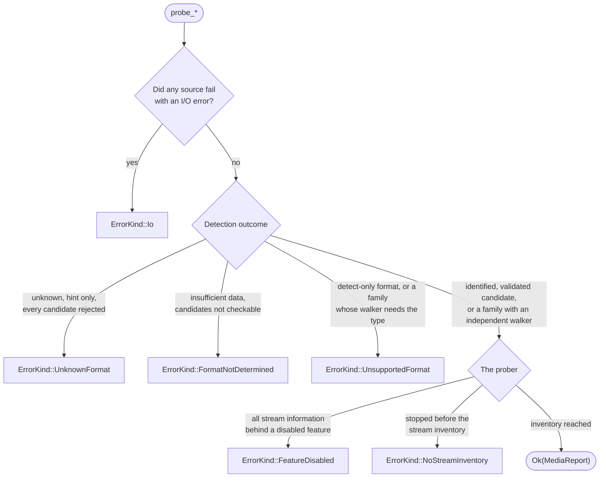
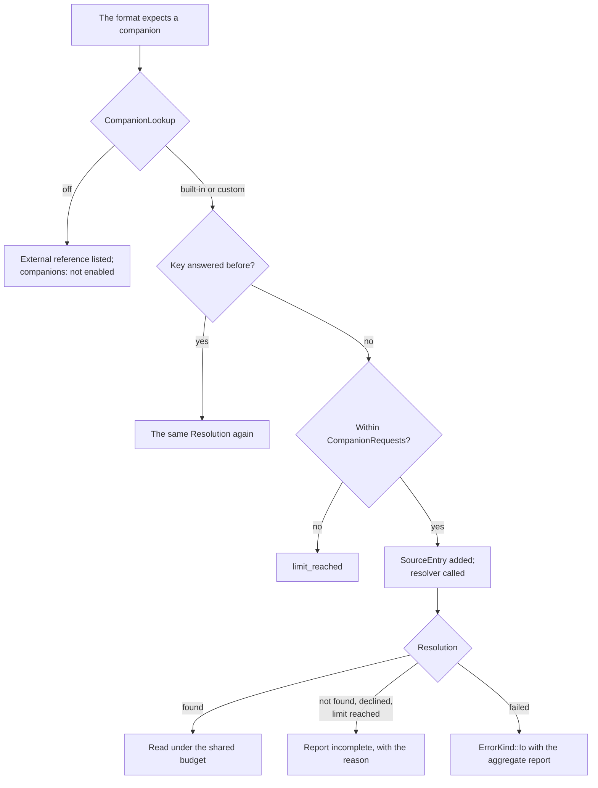

# API specification

| | |
|---|---|
| **Status** | Draft of Phase 2, task 2, written on 2026-11-22. Presented for review before the usage scenarios of task 3 are added. Names are working names until G2.1; the API is confirmed at G2.2. |
| **Plan** | [Section 8](../plans/plan-init-project.md#8-public-api-design) fixes the principles and the behavior. This document fixes the types, accessors and entry points that carry them. |
| **Fields** | [`docs/guide/fields.md`](../guide/fields.md) is the normative table of every normalized field. Section 6 below gives each of its fields an accessor. |

This specification describes the public surface of the `cc-media-probe` library: what a caller can call, which types come back, and which rules keep that surface compatible from `0.1.0` to `1.0` and beyond. It decides the shape of every type that section 8 of the plan names and of every field that the field guide lists. It does not decide how the library computes a value; the plan and the field guide do that.

On 2026-11-22 the maintainer chose the baseline that this draft follows:

- **Field guide proposals.** The fifteen API proposals of the field guide (findings F1 to F8, F14, F18 and F22 to F26) are specified as written. G2.2 confirms or changes them.
- **Async sources.** The async positional source trait is poll-based, like `AsyncRead` (section 9.3).
- **Thoroughness.** The builder has no thoroughness option in `0.1.0` (section 4.3).
- **Usage summary.** It is public (section 6.14).
- **Path-based async convenience.** Tokio gets `probe_file` and `detect_file`. They need Tokio's `fs` feature, which goes through GS.1 (section 9.2).

## Contents

1. [Principles](#1-principles)
2. [Naming conventions](#2-naming-conventions)
3. [Crate surface](#3-crate-surface)
4. [Entry points, options and limits](#4-entry-points-options-and-limits)
5. [Outcomes and completeness](#5-outcomes-and-completeness)
6. [The report model](#6-the-report-model)
7. [Normalized values](#7-normalized-values)
8. [Detection](#8-detection)
9. [The async surface](#9-the-async-surface)
10. [Errors](#10-errors)
11. [Typed details](#11-typed-details)
12. [Serialization](#12-serialization)
13. [Companion lookup](#13-companion-lookup)
14. [Compatibility](#14-compatibility)
15. [Decisions for the gates](#15-decisions-for-the-gates)

## 1. Principles

The nine principles of plan section 8.1 hold. Six design rules make them concrete:

1. **Accessors only.** Every public struct has private fields. A caller reads it through methods and builds it only through constructors and builders (plan section 8.10).
2. **Absent is `None`.** Every accessor of a value that a file may not state, or that may not be established, returns `Option`. A zero, an empty string or an empty list never stands for "unknown". A list accessor returns a slice. An empty slice means that no such item was found; the completeness record says whether the search was complete (section 5.3).
3. **One meaning per accessor.** A normalized accessor returns exactly the field of the field guide, in its unit, after its precedence. Raw values, observed lower bounds, values beyond the exact range and estimates each have their own place (sections 7 and 11).
4. **Wide types from the start.** Counts, sizes and byte quantities are `u64`. Signed quantities are `i64`. Fractions, rates and times are exact rationals. A later format with a larger value therefore never forces a new return type.
5. **Open sets everywhere.** Every public enum is `#[non_exhaustive]`. Every enum that is serialized has a catch-all variant `Unrecognized`, which keeps the text that a newer version wrote (section 14).
6. **No fields in variants.** An enum variant carries at most one value: a struct with private fields, or a value that is complete by its nature, such as a tag's text or the catch-all's text. A later release adds data as a new accessor of that struct, never as a new field of a variant.

Indexes into the report's own lists, such as a stream's index, are `usize`. Fields of the typed details keep their coded width (section 11.2).

## 2. Naming conventions

The names follow the Rust API Guidelines and the code rules of the repository (R32, R35).

| Kind | Convention | Examples |
|---|---|---|
| Words | Whole words in American English; no abbreviations, no single letters, also in generic parameters and lifetimes. Proper names of formats, codecs and standards as commonly written. | `identifier`, `information`, `maximum`; `Reader`, `Source`, `'report`; `Matroska`, `H264`, `Bcp47` |
| Getters | The field name, without `get_` (C-GETTER). The name of the field guide where it has one. | `duration()`, `coded_size()`, `sample_rate()` |
| Yes-or-no facts | `is_` or `has_` with `Option<bool>` where the file may not say; plain `bool` only where the answer is always known. | `is_default()`, `has_linked_chapters()`, `is_complete()` |
| Provenance | The field's name with `_provenance`. | `duration_provenance()` |
| Estimates | `estimated_` with the field's name. | `estimated_duration()` |
| Counts | The counted thing with `_count`. | `packet_count()`, `channel_count()` |
| Builder setters | `with_` with the option's name; each consumes and returns the builder. | `with_limits()`, `with_file_name_hint()` |
| Iterators | A named type per method, after the method (C-ITER-TY). | `file_tags()` returns `FileTags<'report>` |
| Detail types | The format or codec's name with `Details`; a part of it adds the part's name. | `MatroskaDetails`, `MatroskaTrackDetails`, `H264Details` |
| Detail accessors | The specification's field name, spelled out in American English (R32, R35); the specification's spelling goes in the rustdoc. | `pic_width_in_mbs_minus1` becomes `picture_width_in_macroblocks_minus_one()` |
| Serialized names | `snake_case` member names; enum values as `snake_case` strings; a detail's `kind` as the lowercase format or codec name. | `"coded_size"`, `"top_field_first"`, `"kind": "matroska"` |

## 3. Crate surface

### 3.1 Features

| Feature | Default | Adds |
|---|---|---|
| `zlib` | on | Inflating with `miniz_oxide`: Matroska content compression and the compressed movie box of the ISO family. Off, such data has the status "compression unavailable" (section 5.4). |
| `serde` | off | `Serialize` and `Deserialize` for every model type, and the `document` module (section 12). |
| `tokio` | off | `asynchronous::tokio` (section 9.2). |
| `futures-io` | off | `asynchronous::futures` (section 9.2). |

Features are additive: enabling one never removes or changes an item. The async positional source trait and its entry points need no feature (section 9.3).

### 3.2 Public paths

The crate root holds what most callers need. Everything else lives in modules named after its subject.

| Path | Items |
|---|---|
| `cc_media_probe` | The ten blocking entry points (section 4.1); `Prober`, `Limits`, `Limit`; `MediaReport`, `Stream`, `StreamKind`; `Format`, `Codec`; `Detection`; `Error`, `ErrorKind` |
| `cc_media_probe::model` | Every other type of the report model (section 6) and the value types (section 6.1) |
| `cc_media_probe::completeness` | `Completeness`, `HeaderStatus`, the status and reason types, `LimitRecord` (section 5) |
| `cc_media_probe::diagnostics` | `Diagnostic`, `Severity`, `DiagnosticCode` (section 6.13) |
| `cc_media_probe::details` | `FormatDetails`, `CodecDetails` and the shared detail types; one submodule per format and per codec, such as `details::matroska` and `details::h264` (section 11) |
| `cc_media_probe::source` | `PositionalSource`; `SourceEntry`, `SourceIdentifier`, `PortablePath` (sections 4.4 and 6.15) |
| `cc_media_probe::error` | `ErrorRecord`, `CandidateCheck`, `Observations`, `Reason` (section 10) |
| `cc_media_probe::asynchronous` | `AsyncPositionalSource`, `probe_source`, `detect_source`; the submodules `tokio` and `futures` behind their features (section 9) |
| `cc_media_probe::document` | `Document`, `DocumentEntry`, `Generator`, `SchemaVersion` (`serde` feature; section 12) |
| `cc_media_probe::companion` | From the release that ships lookup: `CompanionLookup`, the resolver traits and their types (section 13) |

The internal module tree of plan section 7.2 may differ from these paths; the public paths are re-exports. Neither the repository-only entry points nor the fuzzing entry points are ever part of the public surface.

### 3.3 Common traits

- Every public type implements `Debug`, with a representation that is never empty (C-DEBUG, C-DEBUG-NONEMPTY).
- Every model type implements `Clone`, `PartialEq`, `Eq` and `Hash`. A floating-point value is stored by its bits (section 6.1), so equality is exact everywhere.
- Every model type, `Prober`, `Limits`, `Detection` and `ErrorRecord` is `Send` and `Sync`. `Error` is `Send`, `Sync` and `'static` (C-GOOD-ERR).
- `Display` exists where a single line of text is useful: `Format`, `Codec`, `Rational`, `Seconds`, `Size`, `MediaType`, `Language`, `Identifier`, `Profile`, `Level`, `Timecode`, `Guid`, `HeaderStatus`, `Completeness`, `DiagnosticCode`, `Error` and `ErrorRecord`. Display text is for people. It is not part of the stability contract, except where its documentation says so.
- With the `serde` feature, every model type implements `Serialize` and `Deserialize` (C-SERDE).

## 4. Entry points, options and limits

### 4.1 Blocking functions

Ten functions at the crate root probe or detect with the default options. Each has the same method on `Prober` (section 4.2).

| Function | Input | Notes |
|---|---|---|
| `probe_file(path: impl AsRef<Path>) -> Result<MediaReport, Error>` | A path | Opens only that file (R18). Its final component is the file-name hint unless the builder sets one. A file that cannot be opened is the error of kind I/O. |
| `probe_reader<Reader: Read + Seek>(reader: Reader) -> Result<MediaReport, Error>` | Any `Read + Seek` | Taken by value (C-RW-VALUE); pass `&mut reader` to keep it. |
| `probe_stream<Reader: Read>(reader: Reader) -> Result<MediaReport, Error>` | Any `Read`, forward only | The sliding window of D9. Standard input uses this. |
| `probe_bytes(bytes: &[u8]) -> Result<MediaReport, Error>` | In-memory data | The report owns copies of what it keeps; it does not borrow `bytes`. |
| `probe_source<Source: PositionalSource>(source: Source) -> Result<MediaReport, Error>` | The caller's own positional source | Section 4.4. |
| `detect_file`, `detect_reader`, `detect_stream`, `detect_bytes`, `detect_source` | The same five inputs | Return `Result<Detection, Error>` (section 8). The only error is a source failure. |

A report never borrows its input: `MediaReport` is `'static`. No function panics on any input (plan section 7.6).

### 4.2 The `Prober` builder

`Prober` carries the options. It is built once and used for any number of probes, from any number of threads.

```rust
use cc_media_probe::{Limits, Prober};
use cc_media_probe::model::AttachmentHandling;

let prober = Prober::new()
    .with_limits(Limits::default().with_bytes_read(16 * 1024 * 1024))
    .with_attachments(AttachmentHandling::WithData);
let report = prober.probe_file("movie.mkv")?;
```

- `Prober::new()` and `Prober::default()` give the default options. Every setter consumes the builder and returns it (C-BUILDER). Every option also has a getter with the option's name.
- The probing methods take `&self`: `probe_file`, `probe_reader`, `probe_stream`, `probe_bytes`, `probe_source`, and the five `detect_*` methods, with the signatures of section 4.1.
- The async methods are reached through three borrowing handles: `prober.tokio()`, `prober.futures()` and `prober.asynchronous()` (section 9). The first two exist only with their features. Adding them is additive.
- `Prober` is `Clone`, `Send` and `Sync`.

### 4.3 Options

| Option | Type | Default | Effect |
|---|---|---|---|
| Format hint | `Format` | none | Orders the candidates that the bytes allow, ahead of the file-name hint. It never overrides a conclusive signature and never selects a prober for bytes that matched nothing: with no candidate it gives the "hint only" outcome (plan section 8.6). |
| File-name hint | `OsString` | none; the path's final component for `probe_file` | Orders candidates as plan section 8.6 says. The name is never opened. |
| Limits | `Limits` | `Limits::default()` | Section 4.5. |
| Tags | `SectionRequest`: `Read` or `Skip` | `Read` | `Skip` leaves the tags section "not requested" (section 5.3). |
| Chapters | `SectionRequest` | `Read` | As tags. |
| Attachments | `AttachmentHandling`: `Skip`, `MetadataOnly` or `WithData` | `MetadataOnly` | `Skip` leaves the section "not requested". `WithData` keeps the payloads within the retained-payload limit. |
| Cover art | `AttachmentHandling` | `MetadataOnly` | The same choice for attachments whose role is cover art, whatever their carriage (F8). |
| Legacy text encoding | `TextEncoding` | decided at G3.4 (D22) | The encoding of text that a format stores without naming one. |
| Companion lookup | `CompanionLookup` | off | From the release that ships lookup (section 13). |

The plan's list of builder options names a "thoroughness level" without defining one. On 2026-11-22 the maintainer chose to leave it out of `0.1.0`: each format phase fixes the bounded work it does, and the limits tune it. A release can add the option when a format needs an opt-in deeper scan, such as the transport-stream scan windows of G10.1. A new setter is a compatible change.

The tags and chapters options are new in this specification. Plan section 8.3 lets a section be "not requested", which only an option can cause; the plan's list of options names only the attachments for that. G2.2 confirms them.

### 4.4 Custom blocking sources

A source that is neither a file nor a reader, such as ranges of a remote object, implements one trait. It is kept minimal, because callers implement it (plan section 8.10).

```rust
pub trait PositionalSource {
    /// Reads at most `buffer.len()` bytes starting at `position`. Returns 0 only at or past the end.
    fn read_at(&mut self, position: u64, buffer: &mut [u8]) -> std::io::Result<usize>;

    /// The total length, or `None` when the source does not know it.
    fn length(&mut self) -> std::io::Result<Option<u64>>;
}
```

- A short read is allowed. The library asks again for the rest, and retries `ErrorKind::Interrupted` as the standard library's `read_exact` does.
- Any other error ends the probe with the error of kind I/O, which keeps it as its cause (R19).
- A source of unknown length has ended only when a read returned no bytes (plan section 7.5).
- The library implements the trait for `&mut Source` and `Box<Source>` where `Source: PositionalSource + ?Sized`. So a caller can keep the source, or pass a `Box<dyn PositionalSource + Send>`.
- Every read is charged to the shared budget and clamped to the remaining read allowance before it is issued (plan section 7.5).

### 4.5 Limits

`Limits` is `#[non_exhaustive]` and has one counter per row of plan section 7.5. `Limits::default()` holds the proposed defaults; G3.3 confirms them. Each counter has a getter (`bytes_read()`) and a setter (`with_bytes_read(value)`). `Limits::get(limit: Limit) -> u64` and `Limits::with(limit: Limit, value: u64) -> Limits` reach a counter by name.

| `Limit` | Getter | Unit | Proposed default |
|---|---|---|---|
| `BytesRead` | `bytes_read()` | bytes | 64 MiB |
| `WorkingMemory` | `working_memory()` | bytes | 32 MiB |
| `HeaderBytesPerStream` | `header_bytes_per_stream()` | bytes | 1 MiB |
| `RetainedData` | `retained_data()` | bytes | 16 MiB |
| `RetainedPayloads` | `retained_payloads()` | bytes | 64 MiB |
| `DecompressedOutput` | `decompressed_output()` | bytes | 16 MiB |
| `WorkUnits` | `work_units()` | units | 2,000,000 |
| `NestingDepth` | `nesting_depth()` | levels | 64 |
| `Streams` | `streams()` | declarations | 4,096 |
| `Diagnostics` | `diagnostics()` | diagnostics | 1,000 |
| `CompanionRequests` | `companion_requests()` | requests | 256 |
| `SourcesOpened` | `sources_opened()` | sources | 64 |

Every limit accepts any value from 0 to `u64::MAX`. The same `Limit` enum names the counters of the usage summary (section 6.14), the fixed-size record (section 5.3) and the reasons (section 5.5).

## 5. Outcomes and completeness

### 5.1 The ordered procedure

One procedure decides between an error and a report; the first rule that applies wins (plan section 8.3). Each ending maps to one `ErrorKind`, or to `Ok`.



| Ending | Result | What it carries |
|---|---|---|
| A source failed | `ErrorKind::Io` | The `std::io::Error` as its source; the source's identifier; the partial report or observations (R19) |
| Nothing matched, a hint only, or every candidate rejected | `ErrorKind::UnknownFormat` | The hint, or the rejected candidates |
| Too few bytes, or no candidate could be checked | `ErrorKind::FormatNotDetermined` | Whether the input ended or which limit was reached; the surviving candidates and why each could not be checked |
| A detect-only format, or a family whose walker depends on the specific type | `ErrorKind::UnsupportedFormat` | The format or family (R20) |
| All stream information behind a disabled feature | `ErrorKind::FeatureDisabled` | The feature and the format |
| The probe stopped before the stream inventory | `ErrorKind::NoStreamInventory` | The format, the reason, and the observations made so far, such as the track identifiers and raw ticks of an ISO media segment (R20) |
| The stream inventory was reached | `Ok(MediaReport)` | Diagnostics and completeness; nothing short of a source failure turns it into an error |

With several validated candidates, the one with the highest confidence is used, and a diagnostic records the others (plan section 8.3).

### 5.2 Stream inventory

The three classes of plan section 8.3 decide when the inventory is reached: a declared structure that lists the streams, a single-stream file whose primary structure was validated, or the first stream-carrying unit of an observed format. Each format's class and threshold are part of its entry in `formats.md`. The API exposes the class as `MediaReport::inventory_class() -> InventoryClass`, with the values `Declared`, `SingleStream` and `Observed`. A report can list zero streams when a declared inventory was reached and declares none.

### 5.3 Completeness

`MediaReport::completeness() -> &Completeness` tells what was established, what was not, and why (R23). Every shortfall is recorded against the part it stopped, so none can exist without changing `is_complete()`.

| Accessor | Returns | Values |
|---|---|---|
| `is_complete()` | `bool` | The definition of plan section 8.3, which `--strict` uses |
| `discovery()` | `DiscoveryStatus` | `Complete`, `Incomplete` |
| `tags()`, `chapters()`, `attachments()` | `SectionStatus` | `Complete` (including proven empty), `Incomplete`, `NotRequested`, `NotApplicable` |
| `timing()` | `TimingStatus` | `Established`, `NotAvailableByDesign`, `CutShort`, `NotApplicable` |
| `companions()` | `CompanionStatus` | `NotApplicable`, `Complete`, `NotEnabled`, `CutShort` |
| `reasons()` | `&[PartReason]` | Each with `part() -> &Part`, `stream() -> Option<usize>` for a stream's headers, and `reason() -> &Reason` (section 5.5) |
| `record()` | `&LimitRecord` | The fixed-size record below |

`Part` names what a reason stopped: `Discovery`, `Headers`, `Tags`, `Chapters`, `Attachments`, `Timing` and `Companions`. The header statuses of the streams count as well (section 5.4); `Completeness` does not repeat them. `Display` writes a one-line summary, such as "incomplete: discovery stopped by the stream limit".

**The fixed-size record.** `LimitRecord` exists under any limits and is never charged to a counter (plan section 7.5). It holds:

- the status of each part;
- `exhausted(limit: Limit) -> bool` for every counter;
- `first_stopped(limit: Limit) -> Option<Part>`, the part that a counter stopped first;
- `omitted_diagnostics() -> u64`, the diagnostics counted but not stored;
- `omitted_declarations() -> u64`, the stream declarations seen but not retained.

An error carries the same record (section 10).

### 5.4 Header status

`Stream::header_status() -> &HeaderStatus` gives the outcome of header parsing for one stream.

| `HeaderState` | Final | Meaning |
|---|---|---|
| `Parsed` | yes | Every header field read |
| `PartiallyParsedByDesign` | yes | Some fields lie behind decoding, as implicit spectral-band replication does |
| `Identified` | yes | `identification() -> Option<Identification>` says why: `IdentificationOnly` (by design), `UnknownCodec` or `PendingParser` (a pair of a later phase) |
| `Protected` | yes | The configuration itself is encrypted. A clear configuration with protected packets is `Parsed`, and `Stream::protection()` says that the packets are protected (F22). |
| `NotFoundWithinBudget` | no | A limit ended the search; `reason()` names it |
| `PartiallyParsedForLackOfBytes` | no | Some fields read; the input or a limit ended first |
| `Malformed` | no | The bytes contradict the syntax |
| `CompressionUnavailable` | no | The `zlib` feature is off |
| `NotAttempted` | no | The probe stopped before the stream's turn |

`HeaderStatus` has `state()`, `identification()`, `reason() -> Option<&Reason>`, `is_final() -> bool` and `is_parsed() -> bool`. A state that a newer version wrote, `HeaderState::Unrecognized`, is not final. `Display` writes the state with its reason, such as "not found within the budget (per-stream header limit)".

### 5.5 Reasons

`Reason` is a struct, so that a later reason can carry more data without a breaking change. It has `kind() -> &ReasonKind`, `limit() -> Option<&Limit>`, `feature() -> Option<&Feature>` and `detail() -> Option<&str>`. `ReasonKind` is the open set of plan section 8.3:

- `RangeUnavailable`, `TruncatedInput`, `LimitExhausted`, `EndOfInputNotObserved`;
- `FeatureDisabled`, `CompanionsNotEnabled`, `CompanionNotFound`, `CompanionDeclined`, `CompanionLimited`;
- `UnsupportedStructure`, `DamagedStructure`;
- `FurtherSegmentsNotExamined`, `MediaSegmentWithoutInitializationData`.

A format phase adds the reasons it needs; adding a variant is compatible. `Feature` names a Cargo feature: `Zlib`, `Serde`, `Tokio`, `FuturesIo`.

## 6. The report model

### 6.1 Value types

These types hold the values of the normalized fields. They are in `model`, except `Seconds` and `Rational`, which the root also re-exports.

| Type | Holds | Accessors and rules |
|---|---|---|
| `Rational` | An exact fraction | `numerator() -> i64`, `denominator() -> u64`. Always reduced, with a denominator of at least 1, and both parts at most 2^53 − 1 in magnitude (R24). `Rational::new(numerator, denominator) -> Option<Rational>` reduces and returns `None` for a zero denominator or a part out of range. `to_f64()`, `to_integer() -> Option<i64>`. `Ord` compares by value. `Display` writes `48000` or `30000/1001`. |
| `Seconds` | A time on a presentation timeline, or a length of time | `as_rational() -> Rational`. `to_duration() -> Option<std::time::Duration>`, rounded to the nanosecond with ties away from zero, and `None` when negative. `Ord` compares by value. `Display` writes the exact decimal when it terminates within nine digits, otherwise the fraction, followed by " s". |
| `Size` | A width and a height in whole pixels | `width() -> u64`, `height() -> u64`, `Size::new(width, height)`. `Display` writes `1920x1080`. |
| `Identifier` | A value whose meaning is identity | `as_str() -> &str`. An integer in decimal, a binary value in lowercase hexadecimal (R24). |
| `MediaType` | A media type | `as_str() -> &str`, as `video/mp4`. |
| `Language` | A language as the file writes it, and its BCP 47 form | `tag() -> Option<&str>`, the BCP 47 tag. It is absent for `und`, while `mis`, `mul` and `zxx` stay as written (field guide section 2). `as_written() -> &str`. `code_system() -> &LanguageCodeSystem`: `Bcp47`, `Iso639Alpha3`, `MatroskaLegacy`, `QuickTimePacked` and the others that formats define. |
| `LocalizedText` | A text with the languages and countries it applies to | `text() -> &str`, `languages() -> &[Language]`, `countries() -> &[String]` (ISO 3166 codes as written) |
| `Provenance` | Where a value came from | `Declared`, `Bitstream`, `Derived` (plan section 8.4). A default that a specification states is `Declared` (F1). |
| `Estimate<Value>` | An estimated value and how it was made | `value() -> Value`, `method() -> &EstimateMethod`: `ConstantBitRateOverSize`, `DeliveryClockSpan`, `EndpointTimestamps`, `LastUnitStart`, `IndexSizeTotals` (plan section 8.4, R25) |
| `UtcTime` | An instant in UTC | `seconds_since_unix_epoch() -> i64`, `nanoseconds() -> u32`, `to_system_time() -> Option<SystemTime>`. Serialized as RFC 3339 text with the suffix `Z`. |
| `FloatingPointValue` | A floating-point number exactly as stored | `bits() -> u64`, `width() -> FloatingPointWidth` (`Single`, `Double`), `to_f64()`, `to_rational() -> Option<Rational>` (`None` when not finite or out of range). Used in the details and in tag values; normalized fields never hold one (F2). |
| `Guid` | A 16-byte GUID | `bytes() -> [u8; 16]`; `Display` in the registry form with hyphens |
| `TimeRange` | A start and an end | `start() -> Seconds`, `end() -> Seconds` |

### 6.2 `MediaReport`

| Accessor | Returns | Field guide (section 3.1) and notes |
|---|---|---|
| `format()` | `&Format` | `format`; the family for a family-only detection (section 6.4) |
| `media_type()` | `Option<&MediaType>` | `media_type`. F3 lets an approved specification of the format name a type that the IANA registry lacks, which amends plan section 8.2 at G2.2. |
| `size()` | `Option<u64>` | `size`, in bytes, from the source |
| `duration()`, `duration_provenance()` | `Option<Seconds>`, `Option<Provenance>` | `duration` |
| `bit_rate()`, `bit_rate_provenance()` | `Option<Rational>`, `Option<Provenance>` | `bit_rate`, in bits per second |
| `estimated_duration()` | `Option<Estimate<Seconds>>` | R25 |
| `estimated_bit_rate()` | `Option<Estimate<Rational>>` | R25 |
| `creation_time()` | `Option<UtcTime>` | `creation_time`, only from a source that states UTC (F4) |
| `streams()`, `stream(index)` | `&[Stream]`, `Option<&Stream>` | In index order |
| `programs()` | `&[Program]` | Section 6.11 |
| `chapter_editions()` | `&[ChapterEdition]` | Section 6.8 |
| `tag_sets()` | `&[TagSet]` | Section 6.9, with the lookups `file_tags()`, `stream_tags(index)`, `tags_with_key(key)` and `tag(key)` |
| `attachments()` | `&[Attachment]` | Section 6.10 |
| `external_references()` | `&[ExternalReference]` | Section 6.12 |
| `diagnostics()` | `&[Diagnostic]` | Section 6.13 |
| `completeness()` | `&Completeness` | Section 5.3 |
| `inventory_class()` | `InventoryClass` | Section 5.2 |
| `usage()` | `&Usage` | Section 6.14 |
| `sources()` | `&[SourceEntry]` | Section 6.15 |
| `format_details()` | `Option<&FormatDetails>` | Section 11 |

### 6.3 `Stream`

| Accessor | Returns | Field guide (section 3.2) and notes |
|---|---|---|
| `index()` | `usize` | `index` |
| `native_identifier()` | `Option<&Identifier>` | `native_identifier`; absent for an embedded stream (F14) |
| `unique_identifier()` | `Option<&Identifier>` | `unique_identifier` |
| `kind()` | `&StreamKind` | `kind`: `Video`, `Audio`, `Subtitle`, `Buttons`, `Data`, `Unknown` |
| `codec()` | `&CodecInformation` | Section 6.4 |
| `header_status()` | `&HeaderStatus` | Section 5.4 |
| `protection()` | `Option<&Protection>` | `protection` (F22), below |
| `language()` | `Option<&Language>` | `language`, the primary language |
| `languages()` | `&[StreamLanguage]` | `languages` (F24): each with `language() -> &Language` and `roles() -> &[LanguageRole]` (`CleanEffects`, `HearingImpaired`, `VisuallyImpairedCommentary` and the roles that formats define) |
| `title()`, `titles()` | `Option<&str>`, `&[LocalizedText]` | `title`, `titles` |
| `duration()`, `duration_provenance()` | `Option<Seconds>`, `Option<Provenance>` | `duration` |
| `start_time()`, `start_time_provenance()` | `Option<Seconds>`, `Option<Provenance>` | `start_time`, an offset from the report's zero |
| `bit_rate()`, `bit_rate_provenance()` | `Option<Rational>`, `Option<Provenance>` | `bit_rate` |
| `estimated_duration()`, `estimated_bit_rate()` | `Option<Estimate<…>>` | R25 |
| `packet_count()`, `frame_count()`, `sample_count()` | `Option<u64>` | With `_provenance()` each |
| `disposition()` | `&Disposition` | `is_default()`, `is_enabled()`, `is_forced()`, `is_hearing_impaired()`, `is_visually_impaired()`, `has_text_descriptions()`, `is_original_language()`, `is_commentary()`, each `Option<bool>`: absent when the format states nothing, never assumed false |
| `declaration_range()` | `Option<&DeclarationRange>` | `declaration_range`: `first_offset()`, `last_offset()`, `start()`, `end()`, each optional. No format of `0.1.0` uses it. |
| `embedded_in()` | `Option<usize>` | `embedded_in` (F14) |
| `start_timecode()` | `Option<&Timecode>` | `start_timecode` (F23), below |
| `video()`, `audio()`, `subtitle()` | `Option<&VideoInformation>`, … | Present exactly when the kind is video, audio or subtitle; all fields inside may still be absent |
| `codec_details()` | `Option<&CodecDetails>` | Section 11 |

**`Protection`** (F22): `scheme() -> Option<&ProtectionScheme>`, with the scheme as written and its namespace, such as an ISO `schm` code or a Matroska `ContentEncAlgo` value; `protected_parts() -> &[ProtectedPart]` (`Packets`, `SampleDescription`, `CodecPrivateData`); `is_configuration_clear() -> Option<bool>`.

**`Timecode`** (F23): `frame_number() -> i64`, `rate() -> Rational`, `nominal_frames_per_second() -> u64`, `is_drop_frame() -> bool`, `wraps_at_24_hours() -> bool`, and `label() -> TimecodeLabel` with `is_negative()`, `hours()`, `minutes()`, `seconds()` and `frames()`. `Display` writes `01:00:00:00`, with `;` before the frames of a drop-frame timecode.

### 6.4 Codec and format identity

**`CodecInformation`**, from `Stream::codec()`:

| Accessor | Returns | Field guide (section 3.3) and notes |
|---|---|---|
| `codec()` | `&Codec` | `codec` |
| `name()` | `Option<&str>` | `name`: the library's name for a known codec; absent for an unknown one |
| `raw_identifiers()` | `&[RawCodecIdentifier]` | `raw_identifiers`: each with `namespace() -> &CodecNamespace` (`MatroskaCodecId`, `RiffFourCharacterCode`, `WaveFormatTag`, `IsoSampleEntry`, `Mpeg4ObjectType`, `QuickTimeCode` and the namespaces of later phases) and `value() -> &str` as written |
| `profile()`, `profile_provenance()` | `Option<&Profile>`, `Option<Provenance>` | `profile` |
| `level()`, `level_provenance()` | `Option<&Level>`, `Option<Provenance>` | `level` |
| `tier()`, `tier_provenance()` | `Option<&Tier>`, `Option<Provenance>` | `tier` |
| `codec_string()` | `Option<&str>` | `codec_string` (F5) |

`Profile`, `Level` and `Tier` are the same shape for every codec: `name() -> Option<&str>`, the specification's name such as "High", "3.1" or "1b"; and `code() -> Option<&str>`, the coded value as written, such as `100`. `Display` writes the name, or the code without one. The codec-specific values stay in the codec details.

**`Codec`** has one variant per codec of plan sections 4.2 and 4.3, named as commonly written: `H264`, `H265`, `H266`, `Av1`, `Vp8`, `Vp9`, `Mpeg1Video`, `Mpeg2Video`, `Aac`, `MpegAudio`, `Ac3`, `EnhancedAc3`, `Ac4`, `Dts`, `TrueHd`, `MeridianLosslessPacking`, `Flac`, `Opus`, `Vorbis`, `Pcm`, `WebVtt`, `Pgs`, and so on. The registry of Phase 4 fixes the list for `0.1.0`, and each later phase adds its codecs. Two variants are special:

- `Codec::Unknown`: the file names a codec that this version does not know. `raw_identifiers()` keeps what it wrote.
- `Codec::Unrecognized(UnrecognizedValue)`: a serialized name that a newer version wrote. The library never produces it itself.

`Codec` has `name() -> &str` for its known variants and `kind() -> Option<StreamKind>`, the kind a codec implies when the container states none.

**`Format`** has one variant per entry of the detection inventory frozen at G3.5, and one per family: `Matroska`, `WebM`, `Mp4`, `ThreeGpp`, `ThreeGpp2`, `F4v`, `QuickTime`, `Avi`, and the formats of the later phases. The families `IsoBaseMedia` and `Riff` are reported when detection is certain of the family only (plan section 8.6). `Format::Unrecognized` is the catch-all. Its accessors:

- `name() -> &str`;
- `support() -> SupportLevel`, which is `Probed` or `DetectOnly`;
- `is_family() -> bool`;
- `family() -> Option<Format>`, such as `IsoBaseMedia` for `Mp4`.

### 6.5 `VideoInformation`

| Accessor | Returns | Field guide (section 3.4) and notes |
|---|---|---|
| `coded_size()`, `visible_size()`, `display_size()` | `Option<Size>` | With `_provenance()` each. For single-track stereo, `display_size` describes one view. |
| `pixel_aspect_ratio()` | `Option<Rational>` | The shape of a visible pixel as presented (F26), with `_provenance()` |
| `display_aspect_ratio()` | `Option<Rational>` | With `_provenance()`; never from a rounded size |
| `frame_rate()`, `frame_rate_mode()`, `frame_rate_provenance()` | `Option<Rational>`, `FrameRateMode`, `Option<Provenance>` | Frames per second. `FrameRateMode` is `Constant`, `Variable` or `Unknown`. |
| `bit_depth()` | `Option<&BitDepth>` | `common() -> Option<u64>`, the shared precision; `components() -> &[ComponentDepth]`, each with `component() -> &Component` (`Luma`, `Chroma`, `Red`, `Green`, `Blue`, `Alpha`) and `bits() -> u64` |
| `chroma_format()` | `Option<&ChromaFormat>` | `Monochrome`, `Chroma420`, `Chroma422`, `Chroma444`, `Chroma411`, and `Other(ChromaSubsampling)` for a subsampling kept as written |
| `scan_type()`, `field_order()` | `Option<&ScanType>`, `Option<&FieldOrder>` | `Progressive` or `Interlaced`; `TopFieldFirst` or `BottomFieldFirst` |
| `color()` | `Option<&ColorDescription>` | `primaries()`, `transfer_characteristics()`, `matrix_coefficients()`, each `Option<u8>`, an ITU-T H.273 code point; `range() -> Option<&ColorRange>` (`Limited`, `Full`) |
| `mastering_display()` | `Option<&MasteringDisplay>` | `red()`, `green()`, `blue()` and `white_point()`, each a `Chromaticity` with `x()` and `y()` as `Rational`; `maximum_luminance()` and `minimum_luminance()` as `Option<Rational>` candelas per square meter |
| `content_light_level()` | `Option<&ContentLightLevel>` | `maximum_content() -> Option<u64>`, `maximum_frame_average() -> Option<u64>`, candelas per square meter |
| `dynamic_range()` | `Option<&DynamicRange>` | F6: `transfer() -> Option<&DynamicRangeTransfer>` (`Standard`, `PerceptualQuantizer`, `HybridLogGamma`); `marks() -> &[DynamicRangeMark]` (`DolbyVision` and later marks), whose profile and level stay in the details |
| `rotation()` | `Option<Rotation>` | F7: `Upright`, `Clockwise90`, `Clockwise180`, `Clockwise270`, with `degrees() -> u16`; reported, never applied |
| `stereo_mode()` | `Option<&StereoMode>` | `layout() -> &StereoLayout`, one variant per value of the Matroska stereo table, and `code() -> &str` as written |
| `projection()` | `Option<&Projection>` | `kind() -> &ProjectionKind` (`Rectangular`, `Equirectangular`, `Cubemap`, `Mesh`); `yaw()`, `pitch()` and `roll()` in degrees as `Option<Rational>` |
| `embedded_alpha()`, `supplemental_alpha()` | `Option<bool>` | `alpha`: the two carriages, side by side |

### 6.6 `AudioInformation`

| Accessor | Returns | Field guide (section 3.5) and notes |
|---|---|---|
| `sample_rate()`, `output_sample_rate()` | `Option<Rational>` | Hertz, with `_provenance()` each |
| `channel_count()` | `Option<u64>` | With `_provenance()`; the decoder's output |
| `channel_layout()` | `Option<&ChannelLayout>` | Below, with `_provenance()` |
| `bit_depth()` | `Option<u64>` | Bits per sample, with `_provenance()` |
| `sample_format()` | `Option<&SampleFormat>` | `encoding() -> &SampleEncoding` (`Integer`, `FloatingPoint`), `is_signed() -> Option<bool>`, `byte_order() -> Option<&ByteOrder>` (`LittleEndian`, `BigEndian`) |
| `encoder_delay()`, `padding()` | `Option<u64>` | Samples per channel, with `_provenance()` each |
| `immersive()` | `Option<&ImmersiveAudio>` | `kinds() -> &[ImmersiveKind]` (`Objects`, `IntermediateSpatialFormat`, `HeightChannels`); empty when the source states the signaling without its kind, as AC-4's indicator does |

**`ChannelLayout`**: `channels() -> &[ChannelPosition]`, one entry per channel in stream order, and `ambisonics() -> Option<&Ambisonics>`. A `ChannelPosition` has:

- `speaker() -> Option<&Speaker>`, an open set of named positions such as `FrontLeft` and `LowFrequency`;
- `azimuth()` and `elevation()`, signed degrees as `Option<Rational>`, where the format gives coordinates;
- `ambisonic_component() -> Option<u64>`;
- `is_unassigned() -> bool`, for a channel that has no assigned position.

`Ambisonics` has `order() -> u64`, `channel_ordering() -> &AmbisonicChannelOrdering` and `normalization() -> &AmbisonicNormalization`. A layout that a format states only by a standardized code without an approved mapping stays in the details (F11).

### 6.7 `SubtitleInformation`

| Accessor | Returns | Field guide (section 3.6) |
|---|---|---|
| `subtitle_kind()` | `Option<&SubtitleKind>` | `Text` or `Bitmap` |
| `text_encoding()` | `Option<&TextEncoding>` | `Utf8`, `Utf16LittleEndian`, `Utf16BigEndian`, `Utf32LittleEndian`, `Utf32BigEndian`, `Iso8859Part1`, `Windows1252`, `MacRoman`, and `Other(EncodingName)` for an encoding named as written |
| `canvas_size()` | `Option<Size>` | With `_provenance()` |
| `event_count()` | `Option<u64>` | Only when every event was examined |
| `time_range()` | `Option<TimeRange>` | Only when every event's end is established (F20) |

### 6.8 Chapters and their two timelines

A chapter keeps two kinds of time apart (plan section 8.5):

- **Segment time.** Every chapter reports its `start()` and `end()` as written, on the timeline of the segment that holds its media.
- **Playback time.** For ordered editions only. The edition has a `playback_duration()`, and each chapter a `playback_position()` on it.

The report's `duration()` is the segment's and is never replaced by an edition's playback duration.

**`ChapterEdition`**:

| Accessor | Returns | Field guide (section 3.7) and notes |
|---|---|---|
| `unique_identifier()` | `Option<&Identifier>` | Absent for structures without one (F18) |
| `origin()` | `&ChapterOrigin` | F18: the structure the edition came from: `MatroskaEdition`, `QuickTimeChapterTrack`, and from later phases `FlacCueSheet`, `VorbisChapterComments`, `AsfMarkers`, `DvdProgramChain` |
| `is_default()`, `is_ordered()`, `is_hidden()` | `Option<bool>` | |
| `has_linked_chapters()` | `Option<bool>` | `None` is "unknown" in the field guide's sense |
| `playback_duration()`, `playback_duration_provenance()` | `Option<Seconds>`, `Option<Provenance>` | |
| `chapters()` | `&[Chapter]` | The top level, in stored order |

**`Chapter`**:

| Accessor | Returns | Notes |
|---|---|---|
| `unique_identifier()`, `string_identifier()` | `Option<&Identifier>`, `Option<&str>` | |
| `start()`, `end()` | `Option<Seconds>` | Segment time; with `_provenance()` each. A point without an end keeps the end absent. |
| `segment_reference()` | `Option<&SegmentReference>` | `segment() -> &Identifier`, `edition() -> Option<&Identifier>`; the segment is never opened |
| `titles()` | `&[LocalizedText]` | |
| `is_hidden()`, `is_enabled()` | `Option<bool>` | |
| `playback_position()` | `Option<Seconds>` | Ordered editions only |
| `children()` | `&[Chapter]` | Nesting is bounded by the nesting-depth limit, so no input can make the tree deeper than the limit allows |

### 6.9 Tags

**Identity and targets.** A `TagSet` keeps its target level and four lists of target references; all four empty means the whole file (plan section 8.5).

| Accessor of `TagSet` | Returns | Notes |
|---|---|---|
| `target_level()` | `Option<&TargetLevel>` | `value() -> Option<u64>`, `type_name() -> Option<&str>` |
| `stream_targets()`, `edition_targets()`, `chapter_targets()`, `attachment_targets()` | `&[TargetReference]` | |
| `native_scope()` | `Option<&NativeScope>` | The ISO family's scope (`File`, `Movie`, `Track`, `Media`) with its owner and its `meta` or `udta` source |
| `tags()` | `&[Tag]` | The top level, in stored order |

A `TargetReference` is one of three things, told apart by `kind() -> &TargetReferenceKind`:

- `Resolved`: a specific identifier that matches an entity of the report. `location()` gives the entity: an index, and for a chapter, the edition's index and the path of child indexes.
- `Unmatched`: a specific identifier that matches no entity, kept as written.
- `Wildcard`: every entity of the kind, which Matroska writes as the identifier zero. It never resolves to a single entity.

`identifier() -> Option<&Identifier>` and `namespace() -> Option<&IdentifierNamespace>` keep the reference as written.

| Accessor of `Tag` | Returns | Field guide (section 3.8) and notes |
|---|---|---|
| `name()` | `&TagName` | `as_written() -> &str`; `namespace() -> Option<&str>` for keys with a namespace, such as QuickTime's `mdta` |
| `key()` | `Option<&TagKey>` | The normalized key, below |
| `languages()`, `countries()` | `&[Language]`, `&[String]` | Sets that may be empty |
| `is_default()` | `Option<bool>` | |
| `value()` | `Option<&TagValue>` | F25: `Text(String)`, `Binary(BinaryValue)`, `Integer(IntegerValue)`, `FloatingPoint(FloatingPointValue)`, `Boolean(bool)`, `Guid(Guid)`. `IntegerValue` holds any 64-bit signed or unsigned value, with `to_i64()` and `to_u64()`. |
| `native_type()` | `Option<&str>` | The value's type name as written |
| `children()` | `&[Tag]` | A node may have children and no value |

**Lookups.** The flat views most callers want keep the hierarchy intact. A wildcard target applies to every entity of its kind. Nodes without a value are skipped by the value lookups.

- `MediaReport::file_tags()`: the tags of every tag set that targets the whole file, as `FileTags<'report>`.
- `MediaReport::stream_tags(index)`: the tags that target that stream, directly or by a wildcard, as `StreamTags<'report>`.
- `MediaReport::tags_with_key(key: &TagKey)`: every tag with that key, at any target, as `TagsWithKey<'report>`.
- `MediaReport::tag(key: &TagKey) -> Option<&Tag>`: the first file-level tag with that key and a value.

**Normalized keys (F4).** A key is given by a tag's name alone, never by its target level. Matroska uses one name at several levels with different meanings: `TITLE` at level 50 names an album in audio and a movie in video (tags draft section 3.3). So a key never says which level a tag describes; its tag set does. The first keys, with their source names in the formats of `0.1.0`:

| `TagKey` | Matroska (`ietf-draft-cellar-tags`) | QuickTime metadata keys, `mdta` | QuickTime user data | RIFF `INFO` (`microsoft-riff-mci-1-0`) |
|---|---|---|---|---|
| `Title` | `TITLE` (4.3) | `com.apple.quicktime.title` | `©nam` | `INAM` |
| `Artist` | `ARTIST` (4.5) | `com.apple.quicktime.artist` | — | `IART` |
| `Album` | — (an album's title is `TITLE` in a tag set of an album level) | `com.apple.quicktime.album` | — | — (`IPRD` is the product a file was made for) |
| `Date` | — (`DATE_RELEASED`, `DATE_RECORDED`, `DATE_ENCODED` and `DATE_TAGGED` are four different dates, 4.7) | `com.apple.quicktime.creationdate` | `©day` | `ICRD` |
| `Genre` | `GENRE` (4.6) | `com.apple.quicktime.genre` | — | `IGNR` |
| `Comment` | `COMMENT` (4.9) | `com.apple.quicktime.comment` | — | `ICMT` |
| `Copyright` | `COPYRIGHT` (4.13) | `com.apple.quicktime.copyright` | `©cpy` | `ICOP` |
| `Encoder` | `ENCODER` (4.10) | `com.apple.quicktime.software` | `©swr` | `ISFT` |
| `TrackNumber` | — (`PART_NUMBER` counts parts of its own level, 4.2) | — | — | — |
| `DiscNumber` | — | — | — | — |

The QuickTime names are those of QT "Metadata atoms and types" and "Atoms for user data". A name with no key keeps its name and is reached through `name()`. Track and disc numbers have no source in `0.1.0`: the formats of later phases fill them, such as ID3v2, Vorbis comments and APEv2, and each phase lists its names here. A writing application that a format stores as a header element, such as Matroska's `WritingApp`, stays in the details (F4).

### 6.10 Attachments

| Accessor | Returns | Field guide (section 3.9) and notes |
|---|---|---|
| `unique_identifier()` | `Option<&Identifier>` | |
| `name()`, `description()` | `Option<&str>` | |
| `media_type()`, `media_type_provenance()` | `Option<&MediaType>`, `Option<Provenance>` | |
| `size()` | `Option<u64>` | Embedded data only |
| `link()` | `Option<&str>` | A linked picture's URI as written, never fetched; also listed as an external reference |
| `data()` | `Option<&[u8]>` | Only with `AttachmentHandling::WithData`, within the retained-payload limit |
| `width()`, `height()` | `Option<u64>` | With `_provenance()` each |
| `role()` | `Option<&AttachmentRole>` | F8: `CoverArt` or `Other` |
| `picture_type()` | `Option<&str>` | The native picture type as written, such as FLAC's `3` for a front cover |

Cover art whose layout an approved source gives is always an attachment, whatever its carriage, and the tag lists do not repeat it (F8).

### 6.11 Programs

`Program`, from `MediaReport::programs()`, has:

- `program_identifier() -> Option<&Identifier>`;
- `name()` and `provider()`, each `Option<&str>`;
- `streams() -> &[usize]`;
- `clock_reference_identifier() -> Option<&Identifier>`;
- `duration() -> Option<Seconds>`, with `duration_provenance()`;
- `map_state() -> &MapState`, which is `Complete` or `Incomplete`.

No format of `0.1.0` has programs.

### 6.12 External references

`ExternalReference`, from `MediaReport::external_references()`, has:

- `kind() -> &ReferenceKind`: `LinkedSegment`, `DataReference`, `LinkedPicture`, `ExpectedCompanion`, `PlaylistEntry` and later kinds;
- `identifier() -> Option<&Identifier>`;
- `location() -> Option<&str>`, as written and never dereferenced;
- `role() -> Option<&ReferenceRole>`, such as `PreviousSegment`, `NextSegment` or `TrackData`;
- `owner() -> Option<&ReferenceOwner>`. The owner is an attachment by index, a chapter by its edition index and child path, or a stream by index with its sample-description index. It is absent for a reference of the whole file.

### 6.13 Diagnostics

`Diagnostic`, from `MediaReport::diagnostics()`, has:

- `severity() -> &Severity`, which is `Error`, `Warning` or `Information`;
- `code() -> &DiagnosticCode`;
- `message() -> &str`;
- `source_identifier() -> SourceIdentifier`;
- `offset() -> Option<u64>`, relative to that source's own start;
- `logical_offset() -> Option<u64>`, where several files form one stream;
- `stream() -> Option<usize>`.

`Error` severity marks a structure that was damaged and skipped. The probe still returned a report.

`DiagnosticCode` is an open set of stable strings, such as `matroska.seek_head_disagrees`. A code keeps its meaning across releases. A message may change at any time. Beyond the diagnostics limit, diagnostics are counted in the fixed-size record and not stored.

### 6.14 Usage summary

`Usage`, from `MediaReport::usage()` and `Error::usage()`, is public, as the maintainer chose on 2026-11-22. It reports what the budget accounted for, so a caller can tune the limits from real numbers. Each counter is `u64`:

- `bytes_read()`;
- `peak_working_memory()`;
- `retained_data()` and `retained_payloads()`;
- `decompressed_output()`;
- `work_units()`;
- `companion_requests()` and `sources_opened()`.

`Usage::get(limit: Limit) -> Option<u64>` reaches a counter by name. It returns `None` for the counters that have no usage value, such as the nesting depth. In JSON each counter has an `_exact` twin (section 12).

### 6.15 Source table and portable paths

`MediaReport::sources() -> &[SourceEntry]` lists every source the probe requested (plan section 7.7). Until lookup ships, it has one entry, the primary input. A `SourceEntry` has:

- `identifier() -> SourceIdentifier`, where 0 is the primary input. `SourceIdentifier` wraps a `u32` and is serialized as a string, like every identifier.
- `role() -> &SourceRole`, which is `Primary` or a companion role.
- `attempted_identity() -> Option<&AttemptedIdentity>`, with the validated identifier and the requested name.
- `outcome() -> &SourceOutcome`: `Opened`, `NotFound`, `Declined`, `LimitReached` or `Failed`.
- `bytes_read() -> Option<u64>`.
- `alias_of() -> Option<SourceIdentifier>`.
- `path() -> Option<&PortablePath>`.

**`PortablePath`** keeps a file-system path that no JSON string may represent exactly (plan section 8.8):

- `display() -> &str`;
- `is_lossy() -> bool`;
- `raw() -> Option<&RawPath>`, which has `encoding()` (`UnixBytes` or `WindowsWide`) and `data()`;
- `to_native() -> Option<PathBuf>`, which returns the path only when the raw encoding belongs to the running platform.

Reading never fails because a path is foreign.

## 7. Normalized values

The rules of plan section 8.4 and the field guide's section 2 decide every value. They reach the API like this:

- **Units are in the types.** Times are `Seconds`. Rates and ratios are `Rational`: hertz, frames per second, bits per second. Sizes are whole pixels in `Size`. The report's zero is the start of the format's presentation timeline.
- **Floating point.** A Matroska time in fractional ticks is scaled to nanoseconds, then rounded to the nearest nanosecond, with exact ties away from zero (F2). Any other finite floating-point value becomes the exact rational of its binary value. A non-finite or out-of-range stored value leaves the field absent with a diagnostic, and its `FloatingPointValue` stays in the details.
- **Precedence and conflicts.** The accessor returns the value of the first source that establishes one. On a conflict, both raw values stay in the details and a diagnostic records it.
- **Provenance.** Each field whose origin can vary has its `_provenance()` accessor: declared, bitstream or derived. A specification's default for an absent element is declared. The details record whether the element was stored (F1, section 11.3).
- **Estimates are separate.** Only duration and bit rate, on the report and on each stream, have estimates. They come from `estimated_duration()` and `estimated_bit_rate()`, never from the normalized accessors (R25). A value that could only be computed from an estimate is not reported.
- **Totals and observations.** A total is `Some` only when it was established for the whole. When only part was seen, the total is `None`, and the observed lower bound is in the details (section 11.3).
- **The exact range.** A quantity beyond 2^53 − 1 in magnitude is absent, with a diagnostic, and its exact value is kept in the details as a decimal string (R24, section 11.3). `Rational` cannot hold such a part, so no accessor can return one.
- **Media type** (F3). Reported when the IANA registry holds it or an approved specification of the format names it, and only on the evidence of plan section 8.2.
- **Codec string** (F5). The rules of the field guide's finding F5; absent where a binding's mandatory parameters cannot be established.
- **Rotation** (F7). The clockwise angle a player applies, a multiple of 90 degrees; anything else leaves it absent, with the raw values in the details.

## 8. Detection

`detect_*` returns `Detection`, a root record (plan sections 8.6 and 8.8):

| Accessor | Returns | Notes |
|---|---|---|
| `outcome()` | `&DetectionOutcome` | `Identified`, `FamilyOnly`, `Ambiguous`, `HintOnly`, `InsufficientData`, `Unknown` |
| `format()` | `Option<&Format>` | The identified format or the family. A hinted format is under `hint()`, never here. |
| `confidence()` | `Option<Confidence>` | For an identification |
| `candidates()` | `&[Candidate]` | For an ambiguous outcome, by falling confidence; each with `format()` and `confidence()` |
| `hint()` | `Option<&Hint>` | `format() -> &Format` and `origin() -> &HintOrigin` (`FileName`, `FormatOption`). Marked as not verified. |
| `bytes_needed()` | `Option<u64>` | For insufficient data, when known |
| `insufficient_reason()` | `Option<&Reason>` | Whether the input ended or a named limit was reached |
| `usage()` | `&Usage` | |

`Confidence` wraps a number from 0 to 100, with named constants for its levels. A number keeps the candidates ordered and leaves room for finer levels later. `Format::support()` says whether an identified format is probed or detect-only. Detection never opens a companion, and on a forward-only source it reads only from the pinned prefix.

## 9. The async surface

### 9.1 Shape

Tokio and futures-io define different `AsyncRead` and `AsyncSeek` traits, so each has its own module (plan section 8.7). Both modules offer detection as well as probing. No function is generic over "either runtime", and enabling both features changes neither module. The features add the I/O traits only. No runtime, file API or executor is pulled in, with the one exception of section 9.2.

| Path | Seekable input | Forward-only input | Path input |
|---|---|---|---|
| `asynchronous::tokio` (feature `tokio`) | `probe_reader`, `detect_reader`: `AsyncRead + AsyncSeek + Unpin` | `probe_stream`, `detect_stream`: `AsyncRead + Unpin` | `probe_file`, `detect_file` |
| `asynchronous::futures` (feature `futures-io`) | `probe_reader`, `detect_reader` | `probe_stream`, `detect_stream` | — |
| `asynchronous` (no feature) | `probe_source`, `detect_source`: `AsyncPositionalSource + Unpin` | — | — |

- Every function is an `async fn` that returns the same `Result` as its blocking twin.
- The future is `Send` exactly when the reader or source is `Send`.
- Dropping the future cancels the probe. No task is spawned in the background.
- A reader that is not `Unpin` can be passed as `Box::pin(reader)`.
- The same functions exist on the handles of `Prober`: `prober.tokio().probe_reader(reader).await`, `prober.futures().detect_stream(reader).await`, `prober.asynchronous().probe_source(source).await`. Each handle borrows the prober (`TokioProber<'prober>`, `FuturesProber<'prober>`, `AsynchronousProber<'prober>`).
- The seekable path reads positionally, as a seek followed by a read, through the block cache. The forward-only path uses the sliding window of D9.

### 9.2 Opening a file with Tokio

`asynchronous::tokio::probe_file(path: impl AsRef<Path>)` and `detect_file` open the file with `tokio::fs::File` and hand it to `probe_reader`. The maintainer chose them on 2026-11-22. They need Tokio's `fs` feature, so they go through GS.1: the dossier approved Tokio with no features.

The spike [`spikes/tokio-file-access/`](../../spikes/tokio-file-access/README.md) shows what the feature costs. It adds no crate and enables no other feature, and no runtime is pulled in. The opened file meets the bounds of `probe_reader`. The function must run inside a Tokio runtime, because Tokio runs file operations on the runtime's blocking pool; outside one, Tokio itself panics on the first poll. The rustdoc states this under "Panics".

The futures-io module has no such function: futures-io defines no file type.

### 9.3 Custom async sources

The async source trait is poll-based, as the maintainer chose on 2026-11-22. Return type notation is still unstable, so an `async fn` in a public trait cannot let a caller require a `Send` future. A poll-based trait is object-safe, and the probe future is `Send` exactly when the source is.

```rust
pub trait AsyncPositionalSource {
    /// Reads at most `buffer.len()` bytes starting at `position`. Ready with 0 only at or past the end.
    fn poll_read_at(
        self: Pin<&mut Self>,
        context: &mut Context<'_>,
        position: u64,
        buffer: &mut [u8],
    ) -> Poll<std::io::Result<usize>>;

    /// The total length, or `None` when the source does not know it.
    fn poll_length(self: Pin<&mut Self>, context: &mut Context<'_>) -> Poll<std::io::Result<Option<u64>>>;
}
```

The rules of section 4.4 apply unchanged. The library implements the trait for `&mut Source` and `Pin<Box<Source>>`. A caller with an `async` read function can keep its future in the source and poll it from `poll_read_at`. The trait needs neither runtime feature. Its companion-resolver counterpart arrives with lookup (section 13).

## 10. Errors

### 10.1 The live error

`Error` is what `probe_*` and `detect_*` return. It implements `std::error::Error`, `Display`, `Debug`, `Send`, `Sync` and `'static`, and keeps its data behind one pointer, so that returning an error never moves a large value. It is not serializable: an arbitrary cause cannot be rebuilt from text (plan section 8.8).

| Accessor | Returns | Notes |
|---|---|---|
| `kind()` | `&ErrorKind` | Section 5.1: `Io`, `UnknownFormat`, `FormatNotDetermined`, `UnsupportedFormat`, `FeatureDisabled`, `NoStreamInventory` |
| `format()` | `Option<&Format>` | The detected format or family |
| `candidates()` | `&[CandidateCheck]` | Each with `format()`, `confidence()`, `state() -> &CheckState` (`Validated`, `Rejected`, `NotCheckable`) and `reason() -> Option<&Reason>` |
| `hint()` | `Option<&Hint>` | For an unknown format with a hint |
| `reason()` | `Option<&Reason>` | Including a named limit or a disabled feature |
| `source_identifier()`, `attempted_identity()` | `Option<SourceIdentifier>`, `Option<&AttemptedIdentity>` | The source concerned |
| `io_error()` | `Option<&std::io::Error>` | Also returned by `source()` of `std::error::Error`, so the cause chain is preserved (R19) |
| `partial_report()`, `into_partial_report()` | `Option<&MediaReport>`, `Option<MediaReport>` | When the inventory was reached before a source failed |
| `observations()` | `Option<&Observations>` | What was seen before an inventory: `format_details()`, `diagnostics()` and `sources()`. The track identifiers and raw ticks of an ISO media segment are in its format details. |
| `usage()`, `record()` | `&Usage`, `&LimitRecord` | Always present and fixed-size (plan section 7.5) |
| `to_record()` | `ErrorRecord` | Also `From<&Error>` and `From<Error>` |

### 10.2 The error record

`ErrorRecord` is the serializable description of an error, and a root record. It has every accessor of `Error` except `io_error()`, `into_partial_report()` and `to_record()`. In their place it has:

- `message() -> &str`;
- `io_error_kind() -> Option<&str>`, the `std::io::ErrorKind` as a stable string such as `permission_denied`;
- `os_error_code() -> Option<i32>`;
- `cause_messages() -> &[String]`, the messages of the cause chain in order.

Reading an `ErrorRecord` gives an `ErrorRecord`. No API offers to turn it back into an `Error`. The CLI and the archives use only the record.

## 11. Typed details

### 11.1 The two open enums

```rust
#[non_exhaustive]
pub enum FormatDetails {
    Matroska(MatroskaDetails),
    // One variant per probed format, added in its phase.
    Unrecognized(UnrecognizedDetails),
}

#[non_exhaustive]
pub enum CodecDetails {
    H264(H264Details),
    // One variant per parsed codec, added in its phase.
    Unrecognized(UnrecognizedDetails),
}
```

- `MediaReport::format_details()` returns the format's details. The container's per-stream details live inside them, reached by stream index, such as `MatroskaDetails::track(index)`.
- `Stream::codec_details()` returns the codec header's details.
- `UnrecognizedDetails` is what a reader gets for a `kind` that a newer version wrote. It keeps the kind name through `kind() -> &str`. The library never produces it while probing.
- In `0.1.0` the skeleton of task 11 has only the catch-all. Each format and codec phase adds its variant. Adding a variant to a non-exhaustive enum is a compatible change.

Each phase designs its own detail type within these conventions and has it reviewed at its gate.

### 11.2 Naming and form

- A detail type is named after its format or codec with `Details`, in the submodule of that name: `details::matroska::MatroskaDetails`, `details::h264::H264Details`. A part adds the part's name: `MatroskaTrackDetails`, `H264SequenceParameterSetDetails`.
- Accessors are named after the specification's fields, spelled out in American English (R32, R35), with the specification's own spelling and section in the rustdoc. A detail keeps every field the library read, at its stored type: integers at their coded width, strings as decoded, floating-point values as `FloatingPointValue`. A value derived from a field goes to the normalized model, not here.
- An element that a specification gives a default is returned as `StoredValue<Value>`: `value() -> &Value` and `is_stored() -> bool`. So a caller can tell a stored `FlagDefault` from the effective default (F1).
- Serialized, a detail is a map with a `kind` member, the lowercase name: `"kind": "matroska"`, `"kind": "h264"`. The same rules as every other model type apply (section 12).

### 11.3 Where the other values go

Three kinds of value are not normalized fields but must not be lost. Each has one place, reached the same way for every format and codec through methods of the two enums. A caller therefore finds them without matching on a variant:

| Value | Accessor on `FormatDetails` and `CodecDetails` | Each entry |
|---|---|---|
| Raw values of a conflict | `conflicts() -> &[Conflict]` | `field() -> &str` (the field guide's name), `stream() -> Option<usize>`, and `values() -> &[ConflictingValue]`, each with its source's name and the value as text. The diagnostic of the conflict names the same field. |
| Observed lower bounds | `observed_lower_bounds() -> &[ObservedBound]` | `field()`, `stream()`, `value() -> &ObservedValue` (`Count(u64)` or `Time(Seconds)`). A partial count is never a total (plan section 8.3). |
| Values beyond the exact range | `exact_values() -> &[ExactValue]` | `field()`, `stream()`, `numerator() -> &str` and `denominator() -> Option<&str>` as decimal strings, and `inputs() -> &[ExactInput]`, the named inputs they were computed from (plan section 8.8) |

The format-specific fields that the conflict compared also stay in their detail type, as read.

### 11.4 Worked example: Matroska

`MatroskaDetails` keeps what the segment and its tracks state beyond the normalized model (plan Phase 5, task 14). Its main accessors:

| Accessor | Returns | Source (RFC 9559) |
|---|---|---|
| `document_type()` | `&str` | `DocType`: `matroska` or `webm` |
| `document_type_version()`, `document_type_read_version()` | `Option<u64>` | `DocTypeVersion`, `DocTypeReadVersion` |
| `segment_unique_identifier()` | `Option<&Identifier>` | `SegmentUUID`, 16 bytes in hexadecimal |
| `previous_segment()`, `next_segment()` | `Option<&LinkedSegment>` | `PrevUUID` with `PrevFilename`; `NextUUID` with `NextFilename` |
| `segment_families()` | `&[Identifier]` | `SegmentFamily` |
| `timestamp_scale()` | `StoredValue<u64>` | `TimestampScale`, default 1,000,000 |
| `stored_duration()` | `Option<FloatingPointValue>` | `Duration` as stored (F2) |
| `date_utc()` | `Option<i64>` | `DateUTC`, nanoseconds since 2001-01-01, as stored |
| `title()`, `muxing_application()`, `writing_application()` | `Option<&str>` | `Title`, `MuxingApp`, `WritingApp`; header elements, so not tags (F4) |
| `further_segments()` | `&[FurtherSegment]` | The position of each further segment (plan Phase 5, task 4) |
| `tracks()`, `track(stream_index)` | `&[MatroskaTrackDetails]`, `Option<&MatroskaTrackDetails>` | One per reported track |

`MatroskaTrackDetails` has `stream_index()`, `track_number()` and `track_unique_identifier()`. Its other accessors:

- `codec_identifier() -> &str` and `codec_name() -> Option<&str>`;
- `codec_private_data() -> Option<&[u8]>`, charged to the retained data;
- `codec_delay()`, `seek_pre_roll()` and `default_duration()` in nanoseconds as stored;
- `flag_default()` and `flag_enabled()` as `StoredValue<bool>`;
- `content_encodings() -> &[MatroskaContentEncoding]`, each with its order, scope, type and algorithm;
- `video() -> Option<&MatroskaVideoDetails>`, with the pixel, crop and display elements, `DisplayUnit`, the stereo, alpha and color elements, and a discarded `OldStereoMode`;
- `audio() -> Option<&MatroskaAudioDetails>`, with `SamplingFrequency` and `OutputSamplingFrequency` as `FloatingPointValue`, and `Channels`, `BitDepth` and `Emphasis`;
- `version_notes() -> &[ElementVersionNote]`, each an element stored above the file's version (read, with a diagnostic) or past its maximum version (discarded and kept here).

```rust
if let Some(FormatDetails::Matroska(matroska)) = report.format_details() {
    if let Some(track) = matroska.track(stream.index()) {
        let flag = track.flag_default();
        println!("FlagDefault {} ({})", flag.value(), if flag.is_stored() { "stored" } else { "default" });
    }
}
```

### 11.5 Worked example: H.264

`H264Details` keeps the parameter sets and the configuration record (ITU-T H.264 7.3.2.1.1 and Annex E; ISO/IEC 14496-15 through its committed description):

| Accessor | Returns | Source |
|---|---|---|
| `profile_indication()` | `u8` | `profile_idc` |
| `constraint_set_flags()` | `u8` | `constraint_set0_flag` to `constraint_set5_flag`, bit 7 first |
| `level_indication()` | `u8` | `level_idc` |
| `sequence_parameter_sets()` | `&[H264SequenceParameterSetDetails]` | Each set read, with `sequence_parameter_set_identifier()`, `chroma_format_indication()`, `bit_depth_luma_minus_eight()`, `bit_depth_chroma_minus_eight()`, `picture_width_in_macroblocks_minus_one()`, `frame_macroblocks_only_flag()`, the frame cropping offsets and `video_usability_information()` |
| `configuration_record()` | `Option<&H264ConfigurationRecordDetails>` | `AVCDecoderConfigurationRecord`: `configuration_version()`, `profile_compatibility()`, `length_size_minus_one()` and the counts of parameter sets |

The normalized profile and level, such as "High" and "1b", are in `CodecInformation`. The codec details keep the coded values from which they came:

```rust
if let Some(CodecDetails::H264(h264)) = stream.codec_details() {
    println!("profile_idc {}, level_idc {}", h264.profile_indication(), h264.level_indication());
}
```

## 12. Serialization

With the `serde` feature, every model type implements `Serialize` and `Deserialize`, and the form is part of the public API (plan section 8.8). Task 5 writes its full contract in `docs/guide/json-output.md`. What this specification fixes:

- **Root records.** `Document`, `MediaReport`, `Detection` and `ErrorRecord` carry `schema_version`, a `SchemaVersion` with `major()` and `minor()`, serialized as `"1.0"`. `SchemaVersion::CURRENT` is the version this release writes. Reading a root record checks the version before anything else is decoded, wherever the member appears, also through plain Serde on a bare `MediaReport`. Every other type is nested only, carries no version and has no guarantee across major versions when read alone.
- **Shape.** A struct is a map. A field that is absent is omitted, and reads as `None`. A unit-like enum value is a `snake_case` string. A catch-all reads any unknown string and writes it back unchanged. A typed detail is a map with `kind`.
- **Numbers.** Identifiers are strings (R24). Quantities are numbers within 2^53 − 1. A `Rational` is a map of `numerator` and `denominator`, and so is `Seconds`. The quantities that a record cannot omit have an `_exact` twin: offsets in diagnostics and errors, the usage counters and the bytes read in the source table. A tag's integer value is data, not a measured quantity, so it gets the same twin when it lies beyond the range.
- **Unknown members** are ignored on input. No type denies unknown fields.
- **`Document`** is what the CLI writes and what a library user can write too. `Document::new(generator: Generator)` builds one. `with_usage_error(message)` adds a usage error, and `push(entry: DocumentEntry)` adds an entry. An entry is built by `DocumentEntry::report(index, input: PortablePath, report)`, `DocumentEntry::detection(…)` or `DocumentEntry::error(…)`. The entry's `outcome` (`ok`, `partial` or `error`) follows from what it holds (plan section 8.9).

## 13. Companion lookup

Lookup ships in the release of its first consumer, `0.7.0` with VobSub (R18, plan section 7.7). `0.1.0` has none of these items. This design shows that the earlier surface leaves room for it: lookup adds a builder option, a module and source-table entries, and changes nothing that exists.

- **Option.** `Prober::with_companion_lookup(CompanionLookup)`. `CompanionLookup::off()` is the default. `CompanionLookup::built_in()` turns on the resolver with the trusted root, containment and the second check. `CompanionLookup::custom(resolver)` takes `Arc<dyn CompanionResolver>`, and `CompanionLookup::custom_async(resolver)` takes `Arc<dyn AsyncCompanionResolver>`.
- **Request.** A `CompanionRequest` has `source_identifier()`, assigned before anything is opened; `role() -> &CompanionRole`, such as `VobSubData`; `identifier() -> &str`, the validated identifier; and `name() -> &str`, built from a fixed folder and extension. A request never carries a path taken from the media.
- **Resolver.** `CompanionResolver` is `Send + Sync` and has one method: `resolve(&self, request: &CompanionRequest) -> Resolution`. `AsyncCompanionResolver` has `poll_resolve`, which is poll-based like section 9.3.
- **Resolution.** A `Resolution` is one of five results:
  - `Resolution::found(source, identity)`, with `Box<dyn PositionalSource + Send>` and an optional `SourceIdentityToken`;
  - `Resolution::not_found()`;
  - `Resolution::declined(reason)`;
  - `Resolution::limit_reached()`;
  - `Resolution::failed(io_error)`.
- **Results in the report.** Each request becomes a `SourceEntry` (section 6.15). Its outcome sets the companions status (section 5.3), or the error of kind I/O for a failure (R19).



The built-in resolver's containment holds on one condition: nobody else changes the folder tree while the probe runs. Its rustdoc states the condition, as do the README and the vulnerability section of `CONTRIBUTING.md` (plan section 7.7).

## 14. Compatibility

The rules of plan section 8.10 apply to every item above. This section names the mechanisms that keep a field usable from `0.1.0` to `1.0` without a breaking change.

**In Rust:**

| Change a later release may need | Why it is compatible |
|---|---|
| A new field of an existing type | A new accessor; fields are private and no type has a public constructor of its fields |
| A new format, codec, reason, kind or key | A new variant of a `#[non_exhaustive]` enum |
| More data about an existing variant | A new accessor of the struct that the variant carries (section 1, rule 6) |
| A value larger than any `0.1.0` format writes | Counts and sizes are `u64` and rationals hold both parts up to 2^53 − 1 from the start |
| A field that a format may now leave unknown | Every such accessor already returns `Option` |
| A new option or limit | A new `with_` setter; the options types are `#[non_exhaustive]` with defaults |
| A new provided method of a trait callers implement | A method with a default body; the traits are otherwise kept minimal |
| A new kind of input | A new entry point; existing ones keep their signatures |

Traits the library does not intend callers to implement are sealed. Compile-fail tests prove that an exhaustive match and a struct literal on a public type do not compile (plan section 8.10). `cargo-semver-checks` compares the API with the last release at the level "no breaking change", with all features, the defaults and none.

**In the serialized form:** a field added after `0.1.0` is optional and defaults to absent. No field is removed, renamed or given a new meaning within a schema major version. An old reader ignores unknown members, reads unknown enum strings into the catch-all, and reads unknown detail kinds into `UnrecognizedDetails`. Root records reject another major version before decoding anything else.

**Reported values can improve.** A later release that parses more fills more fields and can change a header status. `docs/guide/stability.md` defines these output changes as compatible, and each is listed in the changelog (plan section 9.6).

**Public dependencies.** The public API names only the standard library and, behind their features, Serde's traits, Tokio's I/O traits and futures-io's I/O traits. futures-io is at version 0.3. If a later futures-io release changes its traits, a new module beside `asynchronous::futures` will serve it, and the existing module stays as it is.

## 15. Decisions for the gates

**G2.1, naming:**

- The binary name `cc-media-probe`.
- The feature names of section 3.1.
- The async module names `asynchronous::tokio` and `asynchronous::futures`.
- The names `MediaReport` and `Stream`, and the other names of this document.

**G2.2, API approval:**

- This specification as a whole, with D10 (errors, section 10), D11 (stability mechanics, section 14), D20 (companion files, section 13) and D21 (normalized values, section 7).
- The fifteen field-guide proposals as specified, and the amendment of plan section 8.2 that F3 implies.
- The public usage summary (section 6.14).
- The tags and chapters options (section 4.3).
- The Tokio path convenience (section 9.2), with its GS.1 request for Tokio's `fs` feature.

**Open points found while writing:**

- **Item-list track and disc numbers.** Plan Phase 6, task 12 reads the item list "including cover art, track and disc numbers". The approved QuickTime documentation defines the item list only with keys from a `keys` table, and none of its keys is a track or disc number. No approved source defines the four-character item codes that carry them. Until one is approved through GS.2, `TrackNumber` and `DiscNumber` have no source in `0.1.0`, and such items keep their names (section 6.9).
- **The first normalized keys.** `Date` is the date of the content's creation, and Matroska's four dates stay unmapped. The QuickTime key `com.apple.quicktime.year` has no key. G2.2 can add keys; a new key is a compatible change.
