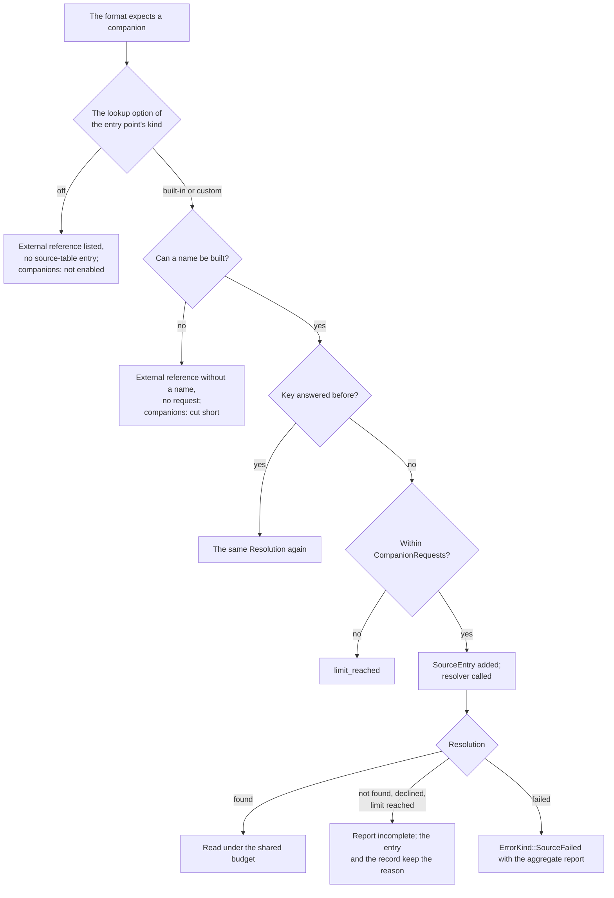

# API specification

| | |
|---|---|
| **Status** | Approved at G2.2 on 2026-11-23, at revision 38 of the plan (`198991f`). Written in Phase 2, tasks 2 and 3, on 2026-11-22. The maintainer chose to review the specification together with the usage scenarios of task 3, which are in section 15. Writing them revised the specification where section 15.12 says, and the first five reviews revised it where section 16 lists. The maintainer approved the names at G2.1 on 2026-11-22 and the names added since at G2.2. Writing the CLI contract of task 4 added one reason after the approval, as the maintainer chose (section 5.5). |
| **Plan** | [Section 8](../plans/plan-init-project.md#8-public-api-design) fixes the principles and the behavior. This document fixes the types, accessors and entry points that carry them. |
| **Fields** | [`docs/guide/fields.md`](../guide/fields.md) is the normative table of every normalized field. Section 6 below gives each of its fields an accessor. |

This specification describes the public surface of the `cc-media-probe` library: what a caller can call, which types come back, and which rules keep that surface compatible from `0.1.0` to `1.0` and beyond. It decides the shape of every type that section 8 of the plan names and of every field that the field guide lists. It does not decide how the library computes a value; the plan and the field guide do that.

On 2026-11-22 the maintainer chose the baseline that this draft follows:

- **Field guide proposals.** The fifteen API proposals of the field guide (findings F1 to F8, F14, F18 and F22 to F26) are specified as written. G2.2 confirmed them as specified.
- **Async sources.** The async positional source trait is poll-based, like `AsyncRead` (section 9.3).
- **Thoroughness.** The builder has no thoroughness option in `0.1.0` (section 4.3).
- **Usage summary.** It is public (section 6.14).
- **Path-based async convenience.** Tokio gets `probe_file` and `detect_file`. They need Tokio's `fs` feature, which the maintainer approved through GS.1 on 2026-11-22 (section 9.2).

At the first review, on the same day, the maintainer made three more choices:

- **Attachments and cover art.** The two options split the attachments by role, and each applies on its own (section 4.3).
- **Companion lookup.** Blocking and async probes have an option each, so a resolver never meets an entry point that cannot call it (section 13).
- **Wide integers in JSON.** A detail integer of 64 bits is always a decimal string (section 12).

At the second review, also on 2026-11-22, the maintainer made three more:

- **Protection.** A stream without `Protection` has been examined in full and declares none. A stream whose structures were not all examined says so (section 6.3).
- **An unresolved codec.** `CodecInformation::codec()` is absent while the description of the first sample is unproven and the candidates name different codecs (section 6.4).
- **Lookup off.** An expected companion is listed only as an external reference; the source table lists requested sources only (section 13).

At the third review, the same day, the maintainer made three more:

- **The stem of a VobSub index.** It comes from the path, or else from the file-name hint. With neither, no request is made, and the companion is listed without a name (section 13).
- **Image headers of attachments.** An attachment's image header is read within the per-stream header limit, and the rest of its data is not kept (section 4.3).
- **The scope of a tag set.** `TagSet::target_scope()` says whether the set describes the whole file, the entities its lists name, or a scope the probe did not establish (section 6.9).

At the fourth review, the same day, the maintainer approved G2.1 for the names of revision 36 of the plan, and made three more choices:

- **A document written as it goes.** `document` gains a writer that takes the entries one at a time, which answers the question that G2.3 had left open (section 12).
- **An outcome that cannot be derived.** `DocumentEntry::from_report` and `from_detection` refuse a record that holds a value of a newer version that decides the outcome, and the refusal takes the outcome that the caller gives (section 12).
- **Detection as a part.** A limit that stops detection is recorded against `Part::Detection` (section 5.3).

At the fifth review, the same day, the maintainer made one more choice:

- **A candidate's check that a limit stopped.** When a limit stops one candidate's validation check while another candidate validates, the report is incomplete: `Completeness::detection()` is `Incomplete`, and the reason names the limit against `Part::Detection` (section 5.3).

On 2026-11-23 the maintainer approved G2.2 for revision 38 of the plan, which this specification follows. While the CLI contract of task 4 was written, the maintainer made one more choice:

- **A source that failed.** A part that a source failure stopped carries the reason `SourceFailed` in the error's partial report, with the source named (section 5.5).

## Contents

1. [Principles](#1-principles)
2. [Naming conventions](#2-naming-conventions)
3. [Crate surface](#3-crate-surface)
4. [Entry points, options and limits](#4-entry-points-options-and-limits)
5. [Outcomes and completeness](#5-outcomes-and-completeness)
6. [The report model](#6-the-report-model)
7. [Normalized values](#7-normalized-values)
8. [Detection](#8-detection)
9. [The async surface](#9-the-async-surface)
10. [Errors](#10-errors)
11. [Typed details](#11-typed-details)
12. [Serialization](#12-serialization)
13. [Companion lookup](#13-companion-lookup)
14. [Compatibility](#14-compatibility)
15. [Usage scenarios](#15-usage-scenarios)
16. [Decisions for the gates](#16-decisions-for-the-gates)

## 1. Principles

The nine principles of plan section 8.1 hold. Seven design rules make them concrete:

1. **Accessors only.** Every public struct has private fields. A caller reads it through methods and builds it only through constructors and builders (plan section 8.10).
2. **Absent is `None`.** Every accessor of a value that a file may not state, or that may not be established, returns `Option`. A zero, an empty string or an empty list never stands for "unknown". A list accessor returns a slice. An empty slice means that no such item was found; the completeness record says whether the search was complete (section 5.3).
3. **One meaning per accessor.** A normalized accessor returns exactly the field of the field guide, in its unit, after its precedence. Raw values, observed lower bounds, values beyond the exact range and estimates each have their own place (sections 7 and 11).
4. **Wide types from the start.** Counts, sizes and byte quantities are `u64`. Signed quantities are `i64`. Fractions, rates and times are exact rationals. A later format with a larger value therefore never forces a new return type.
5. **Open sets everywhere.** Every public enum is `#[non_exhaustive]`. Every enum that is serialized has a catch-all variant `Unrecognized`, which keeps the text that a newer version wrote (section 14).
6. **No fields in variants.** An enum variant carries at most one value: a struct with private fields, or a value that is complete by its nature, such as a tag's text or the catch-all's text. A later release adds data as a new accessor of that struct, never as a new field of a variant.
7. **Enums by reference, with stable names.** The catch-all of rule 5 holds text, so no enum that has one is `Copy`. An accessor therefore returns a stored enum by reference: `&StreamKind`, `Option<&Provenance>`. A pattern matches through the reference without `*` or `&`, as in `matches!(stream.kind(), StreamKind::Audio)` or `Some(Provenance::Declared)`. A value that the library computes rather than stores, such as `Format::family()`, is returned by value. Every enum with a catch-all has `as_str() -> &str`: its serialized name, which is stable, or the text the catch-all keeps.

Indexes into the report's own lists, such as a stream's index, are `usize`. Fields of the typed details keep their coded width (section 11.2).

## 2. Naming conventions

The names follow the Rust API Guidelines and the code rules of the repository (R32, R35).

| Kind | Convention | Examples |
|---|---|---|
| Words | Whole words in American English; no abbreviations, no single letters, also in generic parameters and lifetimes. Proper names of formats, codecs and standards as commonly written. | `identifier`, `information`, `maximum`; `Reader`, `Source`, `'report`; `Matroska`, `H264`, `Bcp47` |
| Getters | The field name, without `get_` (C-GETTER). The name of the field guide where it has one. | `duration()`, `coded_size()`, `sample_rate()` |
| Yes-or-no facts | `is_` or `has_` with `Option<bool>` where the file may not say; plain `bool` only where the answer is always known. | `is_default()`, `has_linked_chapters()`, `is_complete()` |
| Provenance | The field's name with `_provenance`. | `duration_provenance()` |
| Estimates | `estimated_` with the field's name. | `estimated_duration()` |
| Counts | The counted thing with `_count`. | `packet_count()`, `channel_count()` |
| Builder setters | `with_` with the option's name; each consumes and returns the builder. | `with_limits()`, `with_file_name_hint()` |
| Iterators | A named type per method, after the method (C-ITER-TY). | `file_tags()` returns `FileTags<'report>` |
| Detail types | The format or codec's name with `Details`; a part of it adds the part's name. | `MatroskaDetails`, `MatroskaTrackDetails`, `H264Details` |
| Detail accessors | The specification's field name, spelled out in American English (R32, R35); the specification's spelling goes in the rustdoc. | `pic_width_in_mbs_minus1` becomes `picture_width_in_macroblocks_minus_one()` |
| Serialized names | `snake_case` member names; enum values as `snake_case` strings; a detail's `kind` as the lowercase format or codec name. | `"coded_size"`, `"top_field_first"`, `"kind": "matroska"` |
| Stable text of an enum | `as_str()`, the serialized name (rule 7) | `stream.kind().as_str()` is `"video"` |

## 3. Crate surface

### 3.1 Features

| Feature | Default | Adds |
|---|---|---|
| `zlib` | on | Inflating with `miniz_oxide`: Matroska content compression and the compressed movie box of the ISO family. Off, such data has the status "compression unavailable" (section 5.4). |
| `serde` | off | `Serialize` and `Deserialize` for every model type, and the `document` module (section 12). |
| `tokio` | off | `asynchronous::tokio` (section 9.2). |
| `futures-io` | off | `asynchronous::futures` (section 9.2). |

Features are additive: enabling one never removes or changes an item. The async positional source trait and its entry points need no feature (section 9.3).

### 3.2 Public paths

The crate root holds what most callers need. Everything else lives in modules named after its subject.

| Path | Items |
|---|---|
| `cc_media_probe` | The ten blocking entry points (section 4.1); `Prober`, `Limits`, `Limit`; `MediaReport`, `Stream`, `StreamKind`; `Format`, `Codec`; `Detection`; `Error`, `ErrorKind` |
| `cc_media_probe::model` | Every other type of the report model (section 6) and the value types (section 6.1) |
| `cc_media_probe::completeness` | `Completeness`, `HeaderStatus`, the status and reason types, `LimitRecord` (section 5) |
| `cc_media_probe::diagnostics` | `Diagnostic`, `Severity`, `DiagnosticCode` (section 6.13) |
| `cc_media_probe::details` | `FormatDetails`, `CodecDetails` and the shared detail types; one submodule per format and per codec, such as `details::matroska` and `details::h264` (section 11) |
| `cc_media_probe::source` | `PositionalSource`; `SourceEntry`, `SourceIdentifier`, `PortablePath`, `RawPath`, `RawPathEncoding` (sections 4.4 and 6.15) |
| `cc_media_probe::error` | `ErrorRecord`, `CandidateCheck`, `Observations`, `Reason` (section 10) |
| `cc_media_probe::asynchronous` | `AsyncPositionalSource`, `probe_source`, `detect_source`; the submodules `tokio` and `futures` behind their features (section 9) |
| `cc_media_probe::document` | `Document`, `DocumentEntry`, `EntryOutcome`, `UnderivableOutcome`, `Generator`, `UsageError`, `SchemaVersion` (`serde` feature; section 12) |
| `cc_media_probe::companion` | From the release that ships lookup: `CompanionLookup`, `AsyncCompanionLookup`, the resolver traits and their types, including `SourceIdentityToken` (section 13) |

The internal module tree of plan section 7.2 may differ from these paths; the public paths are re-exports. Neither the repository-only entry points nor the fuzzing entry points are ever part of the public surface.

### 3.3 Common traits

- Every public type implements `Debug`, with a representation that is never empty (C-DEBUG, C-DEBUG-NONEMPTY).
- Every model type implements `Clone`, `PartialEq`, `Eq` and `Hash`. A floating-point value is stored by its bits (section 6.1), so equality is exact everywhere.
- Every model type, `Prober`, `Limits`, `Detection` and `ErrorRecord` is `Send` and `Sync`. `Error` is `Send`, `Sync` and `'static` (C-GOOD-ERR).
- `Display` exists where a single line of text is useful: `Format`, `Codec`, `CodecInformation`, `CodecCandidate`, `IntegerValue`, `Rational`, `Seconds`, `Size`, `MediaType`, `Language`, `Identifier`, `Profile`, `Level`, `Timecode`, `Guid`, `HeaderStatus`, `Completeness`, `DiagnosticCode`, `Error`, `ErrorRecord` and `UnderivableOutcome`. Display text is for people. It is not part of the stability contract, except where its documentation says so. Stable text comes from `as_str()` (rule 7).
- With the `serde` feature, every model type implements `Serialize` and `Deserialize` (C-SERDE).

## 4. Entry points, options and limits

### 4.1 Blocking functions

Ten functions at the crate root probe or detect with the default options. Each has the same method on `Prober` (section 4.2).

| Function | Input | Notes |
|---|---|---|
| `probe_file(path: impl AsRef<Path>) -> Result<MediaReport, Error>` | A path | Opens only that file (R18). Its final component is the file-name hint unless the builder sets one. A file that cannot be opened is the error of kind `SourceFailed`. |
| `probe_reader<Reader: Read + Seek>(reader: Reader) -> Result<MediaReport, Error>` | Any `Read + Seek` | Taken by value (C-RW-VALUE); pass `&mut reader` to keep it. |
| `probe_stream<Reader: Read>(reader: Reader) -> Result<MediaReport, Error>` | Any `Read`, forward only | The sliding window of D9. Standard input uses this. |
| `probe_bytes(bytes: &[u8]) -> Result<MediaReport, Error>` | In-memory data | The report owns copies of what it keeps; it does not borrow `bytes`. |
| `probe_source<Source: PositionalSource>(source: Source) -> Result<MediaReport, Error>` | The caller's own positional source | Section 4.4. |
| `detect_file`, `detect_reader`, `detect_stream`, `detect_bytes`, `detect_source` | The same five inputs | Return `Result<Detection, Error>` (section 8). The only error is a source failure. |

A report never borrows its input: `MediaReport` is `'static`. No function panics on any input (plan section 7.6).

### 4.2 The `Prober` builder

`Prober` carries the options. It is built once and used for any number of probes, from any number of threads.

```rust
use cc_media_probe::{Limits, Prober};
use cc_media_probe::model::AttachmentHandling;

let prober = Prober::new()
    .with_limits(Limits::default().with_bytes_read(16 * 1024 * 1024))
    .with_attachments(AttachmentHandling::WithData);
let report = prober.probe_file("movie.mkv")?;
```

- `Prober::new()` and `Prober::default()` give the default options. Every setter consumes the builder and returns it (C-BUILDER). Every option also has a getter with the option's name.
- The probing methods take `&self`: `probe_file`, `probe_reader`, `probe_stream`, `probe_bytes`, `probe_source`, and the five `detect_*` methods, with the signatures of section 4.1.
- The async methods are reached through three borrowing handles: `prober.tokio()`, `prober.futures()` and `prober.asynchronous()` (section 9). The first two exist only with their features. Adding them is additive.
- `Prober` is `Clone`, `Send` and `Sync`.

### 4.3 Options

| Option | Type | Default | Effect |
|---|---|---|---|
| Format hint | `Format` | none | Orders the candidates that the bytes allow, ahead of the file-name hint. It never overrides a conclusive signature and never selects a prober for bytes that matched nothing: with no candidate it gives the "hint only" outcome (plan section 8.6). |
| File-name hint | `OsString`, set from any `impl Into<OsString>` | none; the path's final component for `probe_file` | Orders candidates as plan section 8.6 says. The name is never opened. |
| Limits | `Limits` | `Limits::default()` | Section 4.5. |
| Tags | `SectionRequest`: `Read` or `Skip` | `Read` | `Skip` leaves the tags section "not requested" (section 5.3). |
| Chapters | `SectionRequest` | `Read` | As tags. |
| Attachments | `AttachmentHandling`: `Skip`, `MetadataOnly` or `WithData` | `MetadataOnly` | Every attachment whose role is not cover art. `Skip` leaves them out. `WithData` keeps their payloads within the retained-payload limit. |
| Cover art | `AttachmentHandling` | `MetadataOnly` | Every attachment whose role is cover art, whatever its carriage (F8), including a picture inside a tag structure while the tags option is `Skip` |
| Legacy text encoding | `TextEncoding` | decided at G3.4 (D22) | The encoding of text that a format stores without naming one. |
| Companion lookup | `CompanionLookup` and `AsyncCompanionLookup` | off | From the release that ships lookup; one option for the blocking entry points and one for the async ones (section 13) |

**Attachments and cover art.** The two options split the attachments by role (F8), and each applies on its own, as the maintainer chose on 2026-11-22. A picture that a tag structure carries, such as an item of the ISO item list or an ID3v2 picture frame, follows the cover-art option even when the tags option is `Skip`. The tags section then stays "not requested". The probe reads the metadata of an attachment whose role is skipped only as far as it needs to learn that role, such as a Matroska attachment's file name. Such an attachment is never listed.

**Data that is not kept.** The data of a skipped attachment, and the data of any attachment under `MetadataOnly`, is never kept. That does not mean it is never read:

- **The image header.** An embedded picture of a listed attachment may not declare its pixel size or its media type. The probe then reads its image header, as field guide section 3.9 requires (plan Phase 4, milestone 4C). It reads only the bytes that the image parser asks for, from the start of the data, and holds at most the per-stream header limit for that attachment, as the maintainer chose on 2026-11-22. Those bytes count toward `BytesRead` and working memory. A header that the limit cuts short leaves the width, height or media type absent, and the attachments section incomplete, with the limit named.
- **The rest of the data.** A seekable source passes over it without reading it.
- **On a forward-only source,** the probe has to read the data and discard it to reach what follows. Those bytes count toward the read allowance like any other (plan section 7.5).
- So a payload that is not kept, but lies before requested metadata, can still use up `BytesRead`. The part that the metadata belongs to then records that limit.

**Completeness of attachments.** The attachments section of the completeness record (section 5.3) covers the requested roles only. It is "not requested" when both options are `Skip`. Otherwise it is complete when both hold:

- every attachment of a requested role was found and listed, with every image header it needed;
- for a role whose option is `WithData`, every embedded payload was kept.

A payload that the retained-payload limit or the read limit stopped leaves that attachment's `data()` absent. It also leaves the section incomplete, with that limit named, so a requested payload that was not kept always makes `is_complete()` false. A skipped role never does.

The plan's list of builder options names a "thoroughness level" without defining one. On 2026-11-22 the maintainer chose to leave it out of `0.1.0`: each format phase fixes the bounded work it does, and the limits tune it. A release can add the option when a format needs an opt-in deeper scan, such as the transport-stream scan windows of G10.1. A new setter is a compatible change.

The tags and chapters options are new in this specification. Plan section 8.3 lets a section be "not requested", which only an option can cause; the plan's list of options names only the attachments for that. G2.2 confirmed them on 2026-11-23.

### 4.4 Custom blocking sources

A source that is neither a file nor a reader, such as ranges of a remote object, implements one trait. It is kept minimal, because callers implement it (plan section 8.10).

```rust
pub trait PositionalSource {
    /// Reads at most `buffer.len()` bytes starting at `position`. Returns 0 only at or past the end.
    fn read_at(&mut self, position: u64, buffer: &mut [u8]) -> std::io::Result<usize>;

    /// The total length, or `None` when the source does not know it.
    fn length(&mut self) -> std::io::Result<Option<u64>>;
}
```

- A short read is allowed. The library asks again for the rest, and retries `ErrorKind::Interrupted` as the standard library's `read_exact` does.
- Any other error ends the probe with the error of kind `SourceFailed`, which keeps it as its cause (R19).
- A source of unknown length has ended only when a read returned no bytes (plan section 7.5).
- The library implements the trait for `&mut Source` and `Box<Source>` where `Source: PositionalSource + ?Sized`. So a caller can keep the source, or pass a `Box<dyn PositionalSource + Send>`.
- Every read is charged to the shared budget and clamped to the remaining read allowance before it is issued (plan section 7.5).

### 4.5 Limits

`Limits` is `#[non_exhaustive]` and has one counter per row of plan section 7.5. `Limits::default()` holds the proposed defaults; G3.3 confirms them. Each counter has a getter (`bytes_read()`) and a setter (`with_bytes_read(value)`). `Limits::get(limit: &Limit) -> Option<u64>` and `Limits::with(limit: &Limit, value: u64) -> Limits` reach a counter by name. `Limit` has a catch-all (rule 5), so `get` returns `None` for a limit that a newer version wrote, and `with` leaves the limits unchanged for it.

| `Limit` | Getter | Unit | Proposed default |
|---|---|---|---|
| `BytesRead` | `bytes_read()` | bytes | 64 MiB |
| `WorkingMemory` | `working_memory()` | bytes | 32 MiB |
| `HeaderBytesPerStream` | `header_bytes_per_stream()` | bytes | 1 MiB |
| `RetainedData` | `retained_data()` | bytes | 16 MiB |
| `RetainedPayloads` | `retained_payloads()` | bytes | 64 MiB |
| `DecompressedOutput` | `decompressed_output()` | bytes | 16 MiB |
| `WorkUnits` | `work_units()` | units | 2,000,000 |
| `NestingDepth` | `nesting_depth()` | levels | 64 |
| `Streams` | `streams()` | declarations | 4,096 |
| `Diagnostics` | `diagnostics()` | diagnostics | 1,000 |
| `CompanionRequests` | `companion_requests()` | requests | 256 |
| `SourcesOpened` | `sources_opened()` | sources | 64 |

The per-stream header limit bounds the bytes held for one header: a stream's codec header, or the image header of one attachment (section 4.3). Every limit accepts any value from 0 to `u64::MAX`. The same `Limit` enum names the counters of the usage summary (section 6.14), the fixed-size record (section 5.3) and the reasons (section 5.5).

## 5. Outcomes and completeness

### 5.1 The ordered procedure

One procedure decides between an error and a report; the first rule that applies wins (plan section 8.3). Each ending maps to one `ErrorKind`, or to `Ok`.


| Ending | Result | What it carries |
|---|---|---|
| A source failed | `ErrorKind::SourceFailed` | The `std::io::Error` as its source; the source's identifier; the partial report or observations (R19) |
| Nothing matched, a hint only, or every candidate rejected | `ErrorKind::UnknownFormat` | The hint, or the rejected candidates |
| Too few bytes to decide; or no candidate validated and at least one could not be checked, whether or not others were rejected | `ErrorKind::FormatNotDetermined` | Whether the input ended or which limit was reached, with the record naming `Part::Detection` as the part that limit stopped (section 5.3); the candidates that were not rejected, each in the state `NotCheckable` with the reason it could not be checked (plan section 8.3) |
| A detect-only format, or a family whose walker depends on the specific type | `ErrorKind::UnsupportedFormat` | The format or family (R20) |
| All stream information behind a disabled feature | `ErrorKind::FeatureDisabled` | The feature and the format |
| The probe stopped before the stream inventory | `ErrorKind::NoStreamInventory` | The format, the reason, and the observations made so far, such as the track identifiers and raw ticks of an ISO media segment (R20) |
| The stream inventory was reached | `Ok(MediaReport)` | Diagnostics and completeness; nothing short of a source failure turns it into an error |

With several validated candidates, the one with the highest confidence is used, and a diagnostic records the others (plan section 8.3). A candidate whose check a limit stopped, beside one that validated, leaves the report incomplete, with the limit named against `Part::Detection` (section 5.3).

### 5.2 Stream inventory

The three classes of plan section 8.3 decide when the inventory is reached: a declared structure that lists the streams, a single-stream file whose primary structure was validated, or the first stream-carrying unit of an observed format. Each format's class and threshold are part of its entry in `formats.md`. The API exposes the class as `MediaReport::inventory_class() -> &InventoryClass`, with the values `Declared`, `SingleStream` and `Observed`. A report can list zero streams when a declared inventory was reached and declares none.

An observed format can also reach its inventory with no unit at all, where its entry says so. An FLV file that ends cleanly after its header reports zero streams, while a program stream without a map needs one elementary-stream packet (plan section 8.3). A clean end means that the end of the input was observed at the point where the next unit would start, and how it is observed depends on the source (plan section 7.5):

- **Known length.** The end is where the source's known length ends, as for the slice of `probe_bytes`, a file, or a positional source that states its length. No further read is needed. A header-only FLV file therefore gives its zero-stream report even when its last header byte used up the read allowance.
- **Unknown length.** The end is observed only when a read at that point returned no bytes. A limit that stops the read at the same byte is not an end. That probe stopped before its inventory, with the error of kind `NoStreamInventory`, which names the limit.

### 5.3 Completeness

`MediaReport::completeness() -> &Completeness` tells what was established, what was not, and why (R23). Every shortfall is recorded against the part it stopped, so none can exist without changing `is_complete()`.

| Accessor | Returns | Values |
|---|---|---|
| `is_complete()` | `bool` | The definition of plan section 8.3, which `--strict` uses |
| `detection()` | `&DetectionStatus` | `Complete`, `Incomplete` (below) |
| `discovery()` | `&DiscoveryStatus` | `Complete`, `Incomplete` |
| `tags()`, `chapters()`, `attachments()` | `&SectionStatus` | `Complete` (including proven empty), `Incomplete`, `NotRequested`, `NotApplicable` |
| `timing()` | `&TimingStatus` | `Established`, `NotAvailableByDesign`, `CutShort`, `NotApplicable` |
| `companions()` | `&CompanionStatus` | `NotApplicable`, `Complete`, `NotEnabled`, `CutShort` |
| `reasons()` | `&[PartReason]` | Each with `part() -> &Part`, `stream() -> Option<usize>` for a stream's headers, `source_identifier() -> Option<SourceIdentifier>` for a companion's request or a source that failed, which names its entry in the source table (section 6.15), and `reason() -> &Reason` (section 5.5) |
| `record()` | `&LimitRecord` | The fixed-size record below |

Each status is a stored enum with a catch-all, so its getter returns it by reference (section 1, rule 7), as `matches!(report.completeness().chapters(), SectionStatus::Complete)` in section 15.5 shows.

`Part` names what a reason stopped: `Detection`, `Discovery`, `Headers`, `Tags`, `Chapters`, `Attachments`, `Timing` and `Companions`. The header statuses of the streams count as well (section 5.4); `Completeness` does not repeat them. `Display` writes a one-line summary, such as "incomplete: discovery stopped by the stream limit".

**Detection** is a part of its own, as the maintainer chose on 2026-11-22: detection, with the validation checks of the candidates (section 8; plan section 8.3). A limit that stops it is recorded against it, in an error or in a report:

- **A limit that ends detection** gives an error. With `BytesRead` at 0, for example, `probe_bytes` reads nothing and ends with `ErrorKind::FormatNotDetermined`. The error's `reason()` names `BytesRead`, `record().exhausted(&Limit::BytesRead)` is true, and `record().first_stopped(&Limit::BytesRead)` is `Some(&Part::Detection)`, since stream discovery never began. Section 15.9 prints such an error.
- **A limit that stops one candidate's check while another validates** gives a report, once the validated candidate's probe reaches its inventory. The candidate that was not checked might have validated with a higher confidence and been chosen instead, so the report is incomplete, as the maintainer chose at the fifth review. `detection()` is `Incomplete`, and `reasons()` holds a `PartReason` whose `part()` is `Part::Detection` and whose reason names the limit. `record().first_stopped(&limit)` is `Some(&Part::Detection)`, since detection comes first. If the same limit stops discovery later, discovery has its own status and reason, and the record still names detection. The diagnostic that lists the other candidates names the one that was not checked. The nesting depth can do this, when one candidate's structure is deeper than the limit and the other's is not.

`detection()` is `Complete` when every check that detection began ran to its end, as in every report whose detection was not ambiguous.

**The fixed-size record.** `LimitRecord` exists under any limits and is never charged to a counter (plan section 7.5). It holds:

- the status of each part of a report;
- `exhausted(limit: &Limit) -> bool` for every counter;
- `first_stopped(limit: &Limit) -> Option<&Part>`, the part that a counter stopped first;
- `omitted_diagnostics() -> u64`, the diagnostics counted but not stored;
- `omitted_declarations() -> u64`, the stream declarations seen but not retained.

An error carries the same record (section 10).

### 5.4 Header status

`Stream::header_status() -> &HeaderStatus` gives the outcome of header parsing for one stream.

| `HeaderState` | Final | Meaning |
|---|---|---|
| `Parsed` | yes | Every header field read |
| `PartiallyParsedByDesign` | yes | Some fields lie behind decoding, as implicit spectral-band replication does |
| `Identified` | yes | `identification() -> Option<&Identification>` says why: `IdentificationOnly` (by design), `UnknownCodec`, `PendingParser` (a pair of a later phase) or `UnsupportedCompression` (below) |
| `Protected` | yes | The bytes that hold the codec header are encrypted: the configuration itself, or the packets that carry an in-band header. Protection sets no other state. A clear configuration beside protected packets is parsed like any other, so its state is its parser's outcome, from `Parsed` to `Malformed`, and `Stream::protection()` reports the packets' protection separately (F22). |
| `NotFoundWithinBudget` | no | No header field was read before the input, a limit or the reach of a forward-only source ended the search. `reason()` says which: truncated input; the limit by name; or `RangeUnavailable`, when the header's bytes had already left the window of a forward-only source, as for a stream discovered after its in-band header passed (plan sections 7.4 and 7.6). |
| `PartiallyParsedForLackOfBytes` | no | Some fields read before the input, a limit or the reach of a forward-only source ended; `reason()` says which, with the same three reasons |
| `Malformed` | no | The bytes contradict the syntax |
| `CompressionUnavailable` | no | The `zlib` feature is off |
| `NotAttempted` | no | The probe stopped before the stream's turn |

**Compression the library cannot undo.** A Matroska track can compress its codec private data, or the blocks that carry an in-band header, with `bzlib` or `lzo1x`. RFC 9559 discourages both and lets a reader leave them unsupported (5.1.4.1.31.6), and this version cannot undo them, with or without `zlib` (plan section 6.2). When such an algorithm covers the bytes that hold the codec header:

- the stream is reported from its container fields;
- its state is `Identified`, with the identification `UnsupportedCompression`;
- a diagnostic names the algorithm, and the content encoding stays in the details (section 11.4).

The state is final, as `PendingParser` is: the probe did everything this version can do, so it does not make `is_complete()` false. `CompressionUnavailable` is different. It stays for `zlib`, which enabling the feature would undo, so it is not final.

`HeaderStatus` has `state()`, `identification()`, `reason() -> Option<&Reason>`, `is_final() -> bool` and `is_parsed() -> bool`. A state that a newer version wrote, `HeaderState::Unrecognized`, is not final. `Display` writes the state with its reason, such as "not found within the budget (per-stream header limit)".

### 5.5 Reasons

`Reason` is a struct, so that a later reason can carry more data without a breaking change. It has `kind() -> &ReasonKind`, `limit() -> Option<&Limit>`, `feature() -> Option<&Feature>` and `detail() -> Option<&str>`. `ReasonKind` is the open set of plan section 8.3:

- `RangeUnavailable`, `TruncatedInput`, `LimitExhausted`, `EndOfInputNotObserved`;
- `FeatureDisabled`, `CompanionsNotEnabled`, `CompanionNotFound`, `CompanionDeclined`, `CompanionLimited`, `CompanionNameUnavailable`;
- `UnsupportedStructure`, `DamagedStructure`;
- `FurtherSegmentsNotExamined`, `MediaSegmentWithoutInitializationData`;
- `SourceFailed`.

**A source that failed.** A source failure after the inventory ends the probe with an error of kind `SourceFailed`, which carries the report established so far (R19, section 10.1). In that partial report, each part that the failure stopped is incomplete with the reason `SourceFailed`, and `PartReason::source_identifier()` names the source that failed, the primary input or a companion. The error keeps the I/O error itself. So the rule of section 5.3 holds in a partial report too: every shortfall names its reason. A report that a probe returns never holds this reason, since a source failure always gives an error. The maintainer chose this on 2026-11-23, while the CLI contract was written; it adds a variant to an open set, which is compatible.

A format phase adds the reasons it needs; adding a variant is compatible. `Feature` names a Cargo feature that gates parsing. In `0.1.0` that is only `Zlib`: the serialization and async features never make information unavailable. A later feature that gates parsing adds its variant.

## 6. The report model

### 6.1 Value types

These types hold the values of the normalized fields. They are in `model`, except `Seconds` and `Rational`, which the root also re-exports.

| Type | Holds | Accessors and rules |
|---|---|---|
| `Rational` | An exact fraction | `numerator() -> i64`, `denominator() -> u64`. Always reduced, with a denominator of at least 1, and both parts at most 2^53 − 1 in magnitude (R24). `Rational::new(numerator, denominator) -> Option<Rational>` reduces and returns `None` for a zero denominator or a part out of range. `to_f64()`, `to_integer() -> Option<i64>`. `Ord` compares by value. `Display` writes `48000` or `30000/1001`. |
| `Seconds` | A time on a presentation timeline, or a length of time | `as_rational() -> Rational`. `to_duration() -> Option<std::time::Duration>`, rounded to the nanosecond with ties away from zero, and `None` when negative. `Ord` compares by value. `Display` writes the exact decimal when it terminates within nine digits, otherwise the fraction, followed by " s". |
| `Size` | A width and a height in whole pixels | `width() -> u64`, `height() -> u64`, `Size::new(width, height)`. `Display` writes `1920x1080`. |
| `Identifier` | A value whose meaning is identity | `as_str() -> &str`. An integer in decimal, a binary value in lowercase hexadecimal (R24). |
| `MediaType` | A media type | `as_str() -> &str`, as `video/mp4`. |
| `Language` | A language as the file writes it, and its BCP 47 form | `tag() -> Option<&str>`, the BCP 47 tag. It is absent for `und`, while `mis`, `mul` and `zxx` stay as written (field guide section 2). `as_written() -> &str`. `code_system() -> &LanguageCodeSystem`: `Bcp47`, `Iso639Alpha3`, `MatroskaLegacy`, `QuickTimePacked` and the others that formats define. |
| `LocalizedText` | A text with the languages and countries it applies to | `text() -> &str`, `languages() -> &[Language]`, `countries() -> &[String]` (ISO 3166 codes as written) |
| `Provenance` | Where a value came from | `Declared`, `Bitstream`, `Derived` (plan section 8.4). A default that a specification states is `Declared` (F1). |
| `Estimate<Value>` | An estimated value and how it was made | `value() -> Value`, for the `Copy` types it holds (`Seconds`, `Rational`); `method() -> &EstimateMethod`: `ConstantBitRateOverSize`, `DeliveryClockSpan`, `EndpointTimestamps`, `LastUnitStart`, `IndexSizeTotals` (plan section 8.4, R25) |
| `UtcTime` | An instant in UTC, from the start of year 0 to the end of year 9999 | `seconds_since_unix_epoch() -> i64`, `nanoseconds() -> u32`, `to_system_time() -> Option<SystemTime>`. Serialized as RFC 3339 text with the suffix `Z`. RFC 3339 writes a year in four digits (section 5.6), so the type holds no instant that it cannot write. A stated instant outside that range is implausible (section 7). |
| `FloatingPointValue` | A floating-point number exactly as stored | `bits() -> u64`, `width() -> &FloatingPointWidth` (`Single`, `Double`), `to_f64()`, `to_rational() -> Option<Rational>` (`None` when not finite or out of range). Used in the details and in tag values; normalized fields never hold one (F2). |
| `Guid` | A 16-byte GUID | `bytes() -> [u8; 16]`; `Display` in the registry form with hyphens |
| `TimeRange` | A start and an end | `start() -> Seconds`, `end() -> Seconds` |

### 6.2 `MediaReport`

| Accessor | Returns | Field guide (section 3.1) and notes |
|---|---|---|
| `format()` | `&Format` | `format`; the family for a family-only detection (section 6.4) |
| `media_type()` | `Option<&MediaType>` | `media_type`. F3 lets an approved specification of the format name a type that the IANA registry lacks, as plan section 8.2 says since G2.2 approved it. |
| `size()` | `Option<u64>` | `size`, in bytes, from the source |
| `duration()`, `duration_provenance()` | `Option<Seconds>`, `Option<&Provenance>` | `duration` |
| `bit_rate()`, `bit_rate_provenance()` | `Option<Rational>`, `Option<&Provenance>` | `bit_rate`, in bits per second |
| `estimated_duration()` | `Option<&Estimate<Seconds>>` | R25 |
| `estimated_bit_rate()` | `Option<&Estimate<Rational>>` | R25 |
| `creation_time()` | `Option<UtcTime>` | `creation_time`, only from a source that states UTC (F4) |
| `streams()`, `stream(index)` | `&[Stream]`, `Option<&Stream>` | In index order |
| `programs()` | `&[Program]` | Section 6.11 |
| `chapter_editions()` | `&[ChapterEdition]` | Section 6.8 |
| `tag_sets()` | `&[TagSet]` | Section 6.9, with the lookups `file_tags()`, `stream_tags(index)`, `tags_with_key(key)` and `tag(key)` |
| `attachments()` | `&[Attachment]` | Section 6.10 |
| `external_references()` | `&[ExternalReference]` | Section 6.12 |
| `diagnostics()` | `&[Diagnostic]` | Section 6.13 |
| `completeness()` | `&Completeness` | Section 5.3 |
| `inventory_class()` | `&InventoryClass` | Section 5.2 |
| `usage()` | `&Usage` | Section 6.14 |
| `sources()` | `&[SourceEntry]` | Section 6.15 |
| `format_details()` | `Option<&FormatDetails>` | Section 11 |

### 6.3 `Stream`

| Accessor | Returns | Field guide (section 3.2) and notes |
|---|---|---|
| `index()` | `usize` | `index` |
| `native_identifier()` | `Option<&Identifier>` | `native_identifier`; absent for an embedded stream (F14) |
| `unique_identifier()` | `Option<&Identifier>` | `unique_identifier` |
| `kind()` | `&StreamKind` | `kind`: `Video`, `Audio`, `Subtitle`, `Buttons`, `Data`, `Unknown` |
| `codec()` | `&CodecInformation` | Section 6.4 |
| `header_status()` | `&HeaderStatus` | Section 5.4 |
| `protection()` | `Option<&Protection>` | `protection` (F22), below |
| `language()` | `Option<&Language>` | `language`, the primary language |
| `languages()` | `&[StreamLanguage]` | `languages` (F24): each with `language() -> &Language` and `roles() -> &[LanguageRole]` (`CleanEffects`, `HearingImpaired`, `VisuallyImpairedCommentary` and the roles that formats define) |
| `title()`, `titles()` | `Option<&str>`, `&[LocalizedText]` | `title`, `titles` |
| `duration()`, `duration_provenance()` | `Option<Seconds>`, `Option<&Provenance>` | `duration` |
| `start_time()`, `start_time_provenance()` | `Option<Seconds>`, `Option<&Provenance>` | `start_time`, an offset from the report's zero |
| `bit_rate()`, `bit_rate_provenance()` | `Option<Rational>`, `Option<&Provenance>` | `bit_rate` |
| `estimated_duration()`, `estimated_bit_rate()` | `Option<&Estimate<…>>` | R25 |
| `packet_count()`, `frame_count()`, `sample_count()` | `Option<u64>` | With `_provenance()` each |
| `disposition()` | `&Disposition` | `is_default()`, `is_enabled()`, `is_forced()`, `is_hearing_impaired()`, `is_visually_impaired()`, `has_text_descriptions()`, `is_original_language()`, `is_commentary()`, each `Option<bool>`: absent when the format states nothing, never assumed false |
| `declaration_range()` | `Option<&DeclarationRange>` | `declaration_range`: `first_offset()`, `last_offset()`, `start()`, `end()`, each optional. No format of `0.1.0` uses it. |
| `embedded_in()` | `Option<usize>` | `embedded_in` (F14) |
| `start_timecode()` | `Option<&Timecode>` | `start_timecode` (F23), below |
| `video()`, `audio()`, `subtitle()` | `Option<&VideoInformation>`, … | Present exactly when the kind is video, audio or subtitle; all fields inside may still be absent |
| `codec_details()` | `Option<&CodecDetails>` | Section 11 |

**`Protection`** (F22) says what a stream declares protected, and where. A declaration establishes a protection mechanism for its scope. It does not say that every byte in that scope is encrypted, because a scheme can leave samples, or parts of them, clear (field guide, `protection`). A track can also hold a clear sample description beside a protected one, so each scheme stays with the scope it covers.

**Absence is proof**, as the maintainer chose on 2026-11-22. `Stream::protection()` is absent only when every structure of the stream that can declare protection was examined and none does. A probe can stop before such a structure, or fail to keep a declaration within the retained-data limit. Its `Protection` then says so, even when it holds no declaration. `Protection` has:

- `declarations() -> &[ProtectionDeclaration]`, in stored order. It is empty only when `is_fully_examined()` is false.
- `is_fully_examined() -> bool`: whether every structure that can declare protection was examined and every declaration kept.
- `sample_description_count() -> Option<u64>`, the number of sample descriptions that the file declares, such as the `entry_count` of an ISO `stsd` box. It is absent for a format without sample descriptions, and when the count was not read.
- `sample_descriptions() -> &[SampleDescriptionProtection]`, the descriptions whose state was established and kept, in index order. The list is sparse: a description that it does not hold is unknown, so no entry is ever made for an unknown one. Like every list of the report, it is charged to the retained-data limit. A file that declares more descriptions than the limit can hold therefore gives a shorter list, and `is_fully_examined()` is then false. Each entry has:
  - `index() -> u64`, the index as the file numbers it, from 1 in the ISO family;
  - `state() -> &SampleDescriptionState`, which is `Clear` (examined, and it declares no protection) or `Declared` (the declarations name its index).
- `sample_description_state(index: u64) -> Option<&SampleDescriptionState>`, the state of one description:
  - the state of its entry, where the list holds that index;
  - `Unknown` for any other index from 1 to the declared count, and for any index from 1 on while the count is unknown, since such a description was not read or its declaration not kept;
  - `None` for an index outside the declared count, and for every index of a format without sample descriptions.
- `is_configuration_clear() -> Option<bool>`, whether the configuration that the header status describes is clear.

A `ProtectionDeclaration` has:

- `scheme() -> Option<&ProtectionScheme>`, the scheme as written with its namespace, such as an ISO `schm` code or a Matroska `ContentEncAlgo` value;
- `scope() -> &ProtectionScope`, which is one of:
  - `Packets`, every packet of the stream;
  - `CodecPrivateData`;
  - `SampleDescription`, the packets that use one sample description;
  - `EncodingSettings`, the settings of another content encoding;
  - `Other`, a scope that the file states and this version does not know;
- `sample_description_index() -> Option<u64>`, for the scope `SampleDescription`;
- `encoding_order() -> Option<u64>`, for the scope `EncodingSettings`. It is the `ContentEncodingOrder` of the next encoding, whose `ContentCompression` or `ContentEncryption` the declaration protects, and is absent when the track has no next encoding.

**Matroska.** Only an encryption declares protection: a `ContentEncoding` whose `ContentEncodingType` is 1, with a nonzero `ContentEncAlgo` (RFC 9559 5.1.4.1.31.4 and 5.1.4.1.31.9; field guide section 4.1).

- Its `ContentEncodingScope` is a bit field (5.1.4.1.31.3, Table 21), so such an encoding gives one declaration for each bit it sets, each with the same scheme.
- RFC 9559 discourages the "next" scope and still permits it, so it is read (plan Phase 5, task 8).
- A bit that a later registration defines, and that this version does not know, gives a declaration of the scope `Other`, and the bit stays in the details.
- A compression, header stripping included, declares no protection, and neither does an encryption whose algorithm is 0, "not encrypted". Both stay in the details (section 11.4), so a clear track that is only compressed has no `Protection`.
- An encoding whose settings the probe cannot read, such as one whose settings a "next" encryption covers, leaves its own scope unknown, so `is_fully_examined()` is false.

A later format that protects a range of packets adds an accessor to `ProtectionDeclaration` (rule 6).

**`Timecode`** (F23): `frame_number() -> i64`, `rate() -> Rational`, `nominal_frames_per_second() -> u64`, `is_drop_frame() -> bool`, `wraps_at_24_hours() -> bool`, and `label() -> TimecodeLabel` with `is_negative()`, `hours()`, `minutes()`, `seconds()` and `frames()`. `Display` writes `01:00:00:00`, with `;` before the frames of a drop-frame timecode.

### 6.4 Codec and format identity

**`CodecInformation`**, from `Stream::codec()`:

| Accessor | Returns | Field guide (section 3.3) and notes |
|---|---|---|
| `codec()` | `Option<&Codec>` | `codec`; absent only while the codec is unresolved, or when the first sample's description is established and the probe could not read or keep it (below) |
| `candidates()` | `&[CodecCandidate]` | While the description of the first sample is unproven, each description that could hold it and that the probe read and kept, in index order; empty otherwise (below) |
| `has_every_candidate()` | `bool` | Whether the probe read and kept every description that could hold the first sample: false when one is missing, including the one that the first sample is known to use, and true otherwise (below) |
| `name()` | `Option<&str>` | `name`: the library's name for a known codec; absent for an unknown or unresolved one |
| `raw_identifiers()` | `&[RawCodecIdentifier]` | `raw_identifiers`: those of the reported description, and while it is unproven, every candidate's, in candidate order. Each has `namespace() -> &CodecNamespace` (`MatroskaCodecIdentifier`, `RiffFourCharacterCode`, `WaveFormatTag`, `IsoSampleEntry`, `Mpeg4ObjectType`, `QuickTimeCode` and the namespaces of later phases) and `value() -> &str` as written |
| `profile()`, `profile_provenance()` | `Option<&Profile>`, `Option<&Provenance>` | `profile` |
| `level()`, `level_provenance()` | `Option<&Level>`, `Option<&Provenance>` | `level` |
| `tier()`, `tier_provenance()` | `Option<&Tier>`, `Option<&Provenance>` | `tier` |
| `codec_string()` | `Option<&str>` | `codec_string` (F5) |

**Which description the codec fields describe.** An ISO track can declare several sample descriptions. Plan Phase 6, task 7 decides which one the codec fields describe, in three cases:

- **The first sample's description is established.** The fields describe it, and `candidates()` is empty. The probe may still have failed to read that description, or to keep it within the retained-data limit, as when the first fragment selects description 2 after the limit kept only description 1. No other description can hold the first sample, so a kept one is no candidate and lends nothing. `codec()`, `name()` and every field that the description supplies are absent, `candidates()` is empty, `has_every_candidate()` is false, and the details keep the index (below).
- **The track is proven to have no sample,** as an initialization segment on its own is once the probe has examined all of it: empty sample tables, and no fragment up to the end of the input. The fields describe the first declared description, as a fallback that the details label, and `candidates()` is empty. Nothing is unresolved: no sample exists that could select another description.
- **Otherwise the first sample's description is unproven.** A description may have been observed in use while the first sample's selection was not, or the probe stopped before it could establish either, as a read limit that ends before the first fragment does. The fields that depend on the first sample are unresolved. `candidates()` lists each description that could hold the first sample, and the details say which descriptions were observed in use. A stopped probe has not observed a description in use, yet the first sample can still select any declared one, so no fallback applies.

Any declared description can hold the first sample until the selection is established. A probe can fail to read a description, because the input or a limit cut the sample descriptions short, or fail to keep one within the retained-data limit. `candidates()` then lacks it, and `has_every_candidate()` is false.

**The index in the details.** The ISO family's details keep the selection once it is established, whether or not the probe kept the description it selects. `IsoBaseMediaDetails::track(stream_index)` gives a track's details. Their `first_sample_description_index() -> Option<u32>` is the `sample_description_index` that selects the first sample's description, at its coded width: from the sample-to-chunk table, the track-extends default or a track-fragment override (ISO/IEC 14496-12:2015, 8.7.4, 8.8.3 and 8.8.7). It is absent while the selection is unproven, and for a track proven to have no sample, whose fallback the details label. So a known description that was lost reads apart from an unresolved selection whose candidates were all lost: both have no codec, no candidates and `has_every_candidate()` false, and only the first has an index. Phase 6 designs the rest of these details.

A `CodecCandidate` has `sample_description_index() -> u64`, `codec() -> &Codec` and `raw_identifiers() -> &[RawCodecIdentifier]`. Its identifiers are its own, so a protected entry's code and the code of its original format stay with their description. In the third case, as the maintainer chose on 2026-11-22, a missing codec is `None`, as every missing value is (section 1, rule 2):

- **Every candidate is listed, and they name one codec.** `codec()` is that codec, and only the fields on which the candidates differ stay absent. Two candidates of `Codec::Unknown` name one codec only when their raw identifiers are the same as well.
- **Otherwise.** `codec()` and `name()` are absent. Profile, level, tier, codec string and every field that a codec header supplies stay absent. So two different codecs that this version does not know never merge into one, and a description that the probe did not read never counts as agreeing.

`Codec::Unknown` keeps its one meaning: the file named a codec that this version does not know.

`Profile`, `Level` and `Tier` are the same shape for every codec: `name() -> Option<&str>`, the specification's name such as "High", "3.1" or "1b"; and `code() -> Option<&str>`, the coded value as written, such as `100`. `Display` writes the name, or the code without one. The codec-specific values stay in the codec details.

**`Codec`** has one variant per codec of plan sections 4.2 and 4.3, named as commonly written: `H264`, `H265`, `H266`, `Av1`, `Vp8`, `Vp9`, `Mpeg1Video`, `Mpeg2Video`, `Aac`, `MpegAudio`, `Ac3`, `EnhancedAc3`, `Ac4`, `Dts`, `TrueHd`, `MeridianLosslessPacking`, `Flac`, `Opus`, `Vorbis`, `Pcm`, `WebVtt`, `Pgs`, and so on. The registry of Phase 4 fixes the list for `0.1.0`, and each later phase adds its codecs. Two variants are special:

- `Codec::Unknown`: the file names a codec that this version does not know. `raw_identifiers()` keeps what it wrote.
- `Codec::Unrecognized(UnrecognizedValue)`: a serialized name that a newer version wrote. The library never produces it itself.

`Codec` has `name() -> Option<&str>`, the library's name, which is absent for `Unknown` and `Unrecognized`; `CodecInformation::name()` returns the same. `kind() -> Option<StreamKind>` is the kind a codec implies when the container states none. `CodecInformation` displays the codec's name, or else its first raw identifier as written, so a listing shows an unknown codec by what the file called it (section 15.1). An unresolved codec displays each candidate in the same way, by its codec's name or else its own first raw identifier, separated by " or ", such as "H.264 or H.265". When a candidate is missing, the display ends with "or a description that was not read". With no candidate kept, as for a known description that was lost, the display is "a description that was not read".

**`Format`** has one variant per entry of the detection inventory frozen at G3.5, and one per family: `Matroska`, `WebM`, `Mp4`, `ThreeGpp`, `ThreeGpp2`, `F4v`, `QuickTime`, `Avi`, and the formats of the later phases. The families `IsoBaseMedia` and `Riff` are reported when detection is certain of the family only (plan section 8.6). `Format::Unrecognized` is the catch-all. Its accessors:

- `name() -> &str`;
- `support() -> Option<SupportLevel>`, which is `Probed` or `DetectOnly`, and absent for a format that a newer version wrote;
- `is_family() -> bool`, false for such a format;
- `family() -> Option<Format>`, such as `IsoBaseMedia` for `Mp4`.

### 6.5 `VideoInformation`

| Accessor | Returns | Field guide (section 3.4) and notes |
|---|---|---|
| `coded_size()`, `visible_size()`, `display_size()` | `Option<Size>` | With `_provenance()` each. For single-track stereo, `display_size` describes one view. |
| `pixel_aspect_ratio()` | `Option<Rational>` | The shape of a visible pixel as presented (F26), with `_provenance()` |
| `display_aspect_ratio()` | `Option<Rational>` | With `_provenance()`; never from a rounded size |
| `frame_rate()`, `frame_rate_mode()`, `frame_rate_provenance()` | `Option<Rational>`, `&FrameRateMode`, `Option<&Provenance>` | Frames per second. `FrameRateMode` is `Constant`, `Variable` or `Unknown`. |
| `bit_depth()` | `Option<&BitDepth>` | `common() -> Option<u64>`, the shared precision; `components() -> &[ComponentDepth]`, each with `component() -> &Component` (`Luma`, `Chroma`, `Red`, `Green`, `Blue`, `Alpha`) and `bits() -> u64` |
| `chroma_format()` | `Option<&ChromaFormat>` | `Monochrome`, `Chroma420`, `Chroma422`, `Chroma444`, `Chroma411`, and `Other(ChromaSubsampling)` for a subsampling kept as written |
| `scan_type()`, `field_order()` | `Option<&ScanType>`, `Option<&FieldOrder>` | `Progressive` or `Interlaced`; `TopFieldFirst` or `BottomFieldFirst` |
| `color()` | `Option<&ColorDescription>` | `primaries()`, `transfer_characteristics()`, `matrix_coefficients()`, each `Option<u8>`, an ITU-T H.273 code point; `range() -> Option<&ColorRange>` (`Limited`, `Full`). Each component has its own provenance: `primaries_provenance()`, `transfer_characteristics_provenance()`, `matrix_coefficients_provenance()` and `range_provenance()`, each `Option<&Provenance>`. An override supplies only the components it states (field guide section 2), so a QuickTime `nclc` atom can declare the first three while the codec header gives the range. |
| `mastering_display()` | `Option<&MasteringDisplay>` | `red()`, `green()`, `blue()` and `white_point()`, each `Option<&Chromaticity>`, absent when the file states neither coordinate; a `Chromaticity` has `x()` and `y()`, each `Option<Rational>`. `maximum_luminance()` and `minimum_luminance()` are `Option<Rational>` candelas per square meter. Matroska stores every one of these values as an element of its own (RFC 9559 5.1.4.1.28.31 to 5.1.4.1.28.40), so any subset can be present. |
| `content_light_level()` | `Option<&ContentLightLevel>` | `maximum_content() -> Option<u64>`, `maximum_frame_average() -> Option<u64>`, candelas per square meter |
| `dynamic_range()` | `Option<&DynamicRange>` | F6: `transfer() -> Option<&DynamicRangeTransfer>` (`Standard`, `PerceptualQuantizer`, `HybridLogGamma`); `marks() -> &[DynamicRangeMark]` (`DolbyVision` and later marks), whose profile and level stay in the details |
| `rotation()` | `Option<&Rotation>` | F7: `Upright`, `Clockwise90`, `Clockwise180`, `Clockwise270`, with `degrees() -> Option<u16>`, absent for a value that a newer version wrote; reported, never applied |
| `stereo_mode()` | `Option<&StereoMode>` | `layout() -> &StereoLayout`, one variant per value of the Matroska stereo table, and `code() -> &str` as written |
| `projection()` | `Option<&Projection>` | `kind() -> &ProjectionKind` (`Rectangular`, `Equirectangular`, `Cubemap`, `Mesh`); `yaw()`, `pitch()` and `roll()` in degrees as `Option<Rational>` |
| `embedded_alpha()`, `supplemental_alpha()` | `Option<bool>` | `alpha`: the two carriages, side by side |

### 6.6 `AudioInformation`

| Accessor | Returns | Field guide (section 3.5) and notes |
|---|---|---|
| `sample_rate()`, `output_sample_rate()` | `Option<Rational>` | Hertz, with `_provenance()` each |
| `channel_count()` | `Option<u64>` | With `_provenance()`; the decoder's output |
| `channel_layout()` | `Option<&ChannelLayout>` | Below, with `_provenance()` |
| `bit_depth()` | `Option<u64>` | Bits per sample, with `_provenance()` |
| `sample_format()` | `Option<&SampleFormat>` | `encoding() -> &SampleEncoding` (`Integer`, `FloatingPoint`), `is_signed() -> Option<bool>`, `byte_order() -> Option<&ByteOrder>` (`LittleEndian`, `BigEndian`) |
| `encoder_delay()`, `padding()` | `Option<u64>` | Samples per channel, with `_provenance()` each |
| `immersive()` | `Option<&ImmersiveAudio>` | `kinds() -> &[ImmersiveKind]` (`Objects`, `IntermediateSpatialFormat`, `HeightChannels`); empty when the source states the signaling without its kind, as AC-4's indicator does |

**`ChannelLayout`**: `channels() -> &[ChannelPosition]`, one entry per channel in stream order, and `ambisonics() -> Option<&Ambisonics>`. A `ChannelPosition` has:

- `speaker() -> Option<&Speaker>`, an open set of named positions such as `FrontLeft` and `LowFrequency`;
- `azimuth()` and `elevation()`, signed degrees as `Option<Rational>`, where the format gives coordinates;
- `ambisonic_component() -> Option<u64>`;
- `is_unassigned() -> bool`, for a channel that has no assigned position.

`Ambisonics` has `order() -> u64`, `channel_ordering() -> &AmbisonicChannelOrdering` and `normalization() -> &AmbisonicNormalization`. A layout that a format states only by a standardized code without an approved mapping stays in the details (F11).

### 6.7 `SubtitleInformation`

| Accessor | Returns | Field guide (section 3.6) |
|---|---|---|
| `subtitle_kind()` | `Option<&SubtitleKind>` | `Text` or `Bitmap` |
| `text_encoding()` | `Option<&TextEncoding>` | `Utf8`, `Utf16LittleEndian`, `Utf16BigEndian`, `Utf32LittleEndian`, `Utf32BigEndian`, `Iso8859Part1`, `Windows1252`, `MacRoman`, and `Other(EncodingName)` for an encoding named as written |
| `canvas_size()` | `Option<Size>` | With `_provenance()` |
| `event_count()` | `Option<u64>` | Only when every event was examined |
| `time_range()` | `Option<TimeRange>` | Only when every event's end is established (F20) |

### 6.8 Chapters and their two timelines

A chapter keeps two kinds of time apart (plan section 8.5):

- **Segment time.** Every chapter reports its `start()` and `end()` as written, on the timeline of the segment that holds its media.
- **Playback time.** For ordered editions only. The edition has a `playback_duration()`, and each chapter a `playback_position()` on it.

The report's `duration()` is the segment's and is never replaced by an edition's playback duration.

**`ChapterEdition`**:

| Accessor | Returns | Field guide (section 3.7) and notes |
|---|---|---|
| `unique_identifier()` | `Option<&Identifier>` | Absent for structures without one (F18) |
| `origin()` | `&ChapterOrigin` | F18: the structure the edition came from: `MatroskaEdition`, `QuickTimeChapterTrack`, and from later phases `FlacCueSheet`, `VorbisChapterComments`, `AsfMarkers`, `DvdProgramChain` |
| `is_default()`, `is_ordered()`, `is_hidden()` | `Option<bool>` | |
| `has_linked_chapters()` | `Option<bool>` | `None` is "unknown" in the field guide's sense |
| `playback_duration()`, `playback_duration_provenance()` | `Option<Seconds>`, `Option<&Provenance>` | |
| `chapters()` | `&[Chapter]` | The top level, in stored order |
| `chapter_at(path: &[usize])` | `Option<&Chapter>` | The chapter that a path of child indexes names, from the top level down; a tag target's location gives such a path (section 6.9) |

**`Chapter`**:

| Accessor | Returns | Notes |
|---|---|---|
| `unique_identifier()`, `string_identifier()` | `Option<&Identifier>`, `Option<&str>` | |
| `start()`, `end()` | `Option<Seconds>` | Segment time; with `_provenance()` each. A point without an end keeps the end absent. |
| `segment_reference()` | `Option<&SegmentReference>` | `segment() -> &Identifier`, `edition() -> Option<&Identifier>`; the segment is never opened |
| `titles()` | `&[LocalizedText]` | |
| `is_hidden()`, `is_enabled()` | `Option<bool>` | |
| `playback_position()` | `Option<Seconds>` | Ordered editions only |
| `children()` | `&[Chapter]` | Nesting is bounded by the nesting-depth limit, so no input can make the tree deeper than the limit allows |

### 6.9 Tags

**Identity and targets.** A `TagSet` keeps its target level, four lists of target references and its scope. All four lists empty means the whole file, but only once the probe read the target structure in full (plan section 8.5).

| Accessor of `TagSet` | Returns | Notes |
|---|---|---|
| `target_level()` | `Option<&TargetLevel>` | `value() -> Option<u64>`, `type_name() -> Option<&str>` |
| `stream_targets()`, `edition_targets()`, `chapter_targets()`, `attachment_targets()` | `&[TargetReference]` | The targets kept |
| `target_scope()` | `&TargetScope` | What the set describes, below |
| `native_scope()` | `Option<&NativeScope>` | The ISO family's scope (`File`, `Movie`, `Track`, `Media`) with its owner and its `meta` or `udta` source |
| `tags()` | `&[Tag]` | The top level, in stored order |

**The scope.** A tag set can be cut short, by the input or by a limit, before its target structure was read. RFC 9559 sets no order for the children of a `Tag`, and a `Tag` whose `Targets` is empty or omitted describes the whole segment (5.1.8.1.1). So tags can be read while their targets are not, and only a tag read in full shows that its targets are absent. The four lists are then empty, or hold only the targets kept, and that must not read as the whole file. So, as the maintainer chose on 2026-11-22, `TargetScope` says what the lists mean:

- `WholeFile`: the target structure was read in full and names no entity.
- `Entities`: the target structure was read in full, and the lists hold every target it names.
- `Incomplete`: the probe stopped before the target structure was read in full, or could not keep every target. The lists hold the targets kept, and empty lists say nothing about the scope. The tags section is then incomplete.

A format whose tags have a fixed place, such as RIFF `INFO` or an ISO `udta` box, gives `WholeFile` or `Entities` once the structure was read.

A `TargetReference` is one of three things, told apart by `kind() -> &TargetReferenceKind`:

- `Resolved`: a specific identifier that matches an entity of the report. `location() -> Option<&EntityLocation>` gives the entity:
  - `kind() -> &EntityKind` is `Stream`, `Edition`, `Chapter`, `Attachment` or `Program`;
  - `index()` is the index of the stream, edition, attachment or program, or for a chapter the index of its edition;
  - `chapter_path() -> &[usize]` is, for a chapter, the path that `ChapterEdition::chapter_at` takes, and empty otherwise.

  The typed details locate the owner of a value the same way (section 11.3).
- `Unmatched`: a specific identifier that matches no entity of the report, kept as written. The entity can still be in the file: chapters that were not requested, or that a limit cut short, are not in the report, so their identifiers stay unmatched. An unmatched target is therefore unresolved in this report, not proven absent from the file.
- `Wildcard`: every entity of the kind, which Matroska writes as the identifier zero. It never resolves to a single entity.

`identifier() -> Option<&Identifier>` and `namespace() -> Option<&IdentifierNamespace>` keep the reference as written.

| Accessor of `Tag` | Returns | Field guide (section 3.8) and notes |
|---|---|---|
| `name()` | `&TagName` | `as_written() -> &str`, the name decoded by the rules of its format or namespace, with U+FFFD for any byte those rules cannot decode; `namespace() -> Option<&str>` for keys with a namespace, such as QuickTime's `mdta`; `bytes() -> Option<&[u8]>`, the key exactly as stored, where the format defines a key as bytes that its namespace interprets. QuickTime metadata keys, user-data codes and item-list codes are such keys, and their bytes always survive (QT "Metadata item keys atom"). Matroska stores a name as text, so its `bytes()` is absent. Two keys that decode alike but differ in their bytes stay distinct. |
| `key()` | `Option<&TagKey>` | The normalized key, below |
| `languages()`, `countries()` | `&[Language]`, `&[String]` | Sets that may be empty |
| `is_default()` | `Option<bool>` | |
| `value()` | `Option<&TagValue>` | F25: `Text(String)`, `Binary(BinaryValue)`, `Integer(IntegerValue)`, `FloatingPoint(FloatingPointValue)`, `Boolean(bool)`, `Guid(Guid)`, and the catch-all `Unrecognized` of rule 5. `BinaryValue` has `size() -> u64` and `data() -> Option<&[u8]>`, the bytes when they were kept within the retained-data limit. `IntegerValue` holds any 64-bit signed or unsigned value, with `to_i64()` and `to_u64()`, each an `Option`. |
| `native_type()` | `Option<&str>` | The value's type name as written |
| `children()` | `&[Tag]` | A node may have children and no value |

**Lookups.** The flat views most callers want keep the hierarchy intact. A wildcard target applies to every entity of its kind. Nodes without a value are skipped by the value lookups.

- `MediaReport::file_tags()`: the tags of every tag set whose scope is `WholeFile`, as `FileTags<'report>`. A set of the scope `Incomplete` is never among them, so a track's title cut off from its target never becomes the file's title.
- `MediaReport::stream_tags(index)`: the tags that target that stream, directly or by a wildcard, as `StreamTags<'report>`. A set of the scope `Incomplete` takes part through the targets it kept.
- `MediaReport::tags_with_key(key: &TagKey)`: every tag with that key, at any target and of any scope, as `TagsWithKey<'report>`.
- `MediaReport::tag(key: &TagKey) -> Option<&Tag>`: the first file-level tag with that key and a value, from `file_tags()`.

**Normalized keys (F4).** A key is given by a tag's name alone, never by its target level. Matroska uses one name at several levels with different meanings: `TITLE` at level 50 names an album in audio and a movie in video (tags draft section 3.3). So a key never says which level a tag describes; its tag set does. The first keys, with their source names in the formats of `0.1.0`:

| `TagKey` | Matroska (`ietf-draft-cellar-tags`) | QuickTime metadata keys, `mdta` | QuickTime user data | RIFF `INFO` (`microsoft-riff-mci-1-0`) |
|---|---|---|---|---|
| `Title` | `TITLE` (4.3) | `com.apple.quicktime.title` | `©nam` | `INAM` |
| `Artist` | `ARTIST` (4.5) | `com.apple.quicktime.artist` | — | `IART` |
| `Album` | — (an album's title is `TITLE` in a tag set of an album level) | `com.apple.quicktime.album` | — | — (`IPRD` is the product a file was made for) |
| `Date` | — (`DATE_RELEASED`, `DATE_RECORDED`, `DATE_ENCODED` and `DATE_TAGGED` are four different dates, 4.7) | `com.apple.quicktime.creationdate` | `©day` | `ICRD` |
| `Genre` | `GENRE` (4.6) | `com.apple.quicktime.genre` | — | `IGNR` |
| `Comment` | `COMMENT` (4.9) | `com.apple.quicktime.comment` | — | `ICMT` |
| `Copyright` | `COPYRIGHT` (4.13) | `com.apple.quicktime.copyright` | `©cpy` | `ICOP` |
| `Encoder` | `ENCODER` (4.10) | `com.apple.quicktime.software` | `©swr` | `ISFT` |
| `TrackNumber` | — (`PART_NUMBER` counts parts of its own level, 4.2) | — | — | — |
| `DiscNumber` | — | — | — | — |

The QuickTime names are those of QT "Metadata atoms and types" and "Atoms for user data". A name with no key keeps its name and is reached through `name()`. Track and disc numbers have no source in `0.1.0`: the formats of later phases fill them, such as ID3v2, Vorbis comments and APEv2, and each phase lists its names here. A writing application that a format stores as a header element, such as Matroska's `WritingApp`, stays in the details (F4).

### 6.10 Attachments

| Accessor | Returns | Field guide (section 3.9) and notes |
|---|---|---|
| `unique_identifier()` | `Option<&Identifier>` | |
| `name()`, `description()` | `Option<&str>` | |
| `media_type()`, `media_type_provenance()` | `Option<&MediaType>`, `Option<&Provenance>` | |
| `size()` | `Option<u64>` | Embedded data only |
| `link()` | `Option<&str>` | A linked picture's URI as written, never fetched; also listed as an external reference |
| `data()` | `Option<&[u8]>` | Only with `AttachmentHandling::WithData`, within the retained-payload limit. An empty payload gives an empty slice. A payload that a limit stopped is absent, and the attachments section is then incomplete (section 4.3). |
| `width()`, `height()` | `Option<u64>` | With `_provenance()` each |
| `role()` | `Option<&AttachmentRole>` | F8: `CoverArt` or `Other` |
| `picture_type()` | `Option<&str>` | The native picture type as written, such as FLAC's `3` for a front cover |

Cover art whose layout an approved source gives is always an attachment, whatever its carriage, and the tag lists do not repeat it (F8).

### 6.11 Programs

`Program`, from `MediaReport::programs()`, has:

- `program_identifier() -> Option<&Identifier>`;
- `name()` and `provider()`, each `Option<&str>`;
- `streams() -> &[usize]`;
- `clock_reference_identifier() -> Option<&Identifier>`;
- `duration() -> Option<Seconds>`, with `duration_provenance()`;
- `map_state() -> &MapState`, which is `Complete` or `Incomplete`.

No format of `0.1.0` has programs.

### 6.12 External references

`ExternalReference`, from `MediaReport::external_references()`, has:

- `kind() -> &ReferenceKind`: `LinkedSegment`, `DataReference`, `LinkedPicture`, `ExpectedCompanion`, `PlaylistEntry` and later kinds;
- `identifier() -> Option<&Identifier>`;
- `location() -> Option<&str>`, as written and never dereferenced;
- `role() -> Option<&ReferenceRole>`, such as `PreviousSegment`, `NextSegment` or `TrackData`;
- `owner() -> Option<&ReferenceOwner>`. The owner is an attachment by index, a chapter by its edition index and child path, or a stream by index with its sample-description index. It is absent for a reference of the whole file.

For `ExpectedCompanion`, `identifier()` is the validated identifier, and `location()` is the name that a request to a resolver would carry (section 13). The library builds that name from a fixed folder and extension, so it is not taken from the media. Both are absent when no name can be built, as for a VobSub index probed with neither a path nor a file-name hint; `kind()` and `role()` still say what is missing.

### 6.13 Diagnostics

`Diagnostic`, from `MediaReport::diagnostics()`, has:

- `severity() -> &Severity`, which is `Error`, `Warning` or `Information`;
- `code() -> &DiagnosticCode`;
- `message() -> &str`;
- `source_identifier() -> SourceIdentifier`;
- `offset() -> Option<u64>`, relative to that source's own start;
- `logical_offset() -> Option<u64>`, where several files form one stream;
- `stream() -> Option<usize>`.

`Error` severity marks a structure that was damaged and skipped. The probe still returned a report.

`DiagnosticCode` is an open set of stable strings, such as `matroska.seek_head_disagrees`. A code keeps its meaning across releases. A message may change at any time. Beyond the diagnostics limit, diagnostics are counted in the fixed-size record and not stored.

### 6.14 Usage summary

`Usage`, from `MediaReport::usage()` and `Error::usage()`, is public, as the maintainer chose on 2026-11-22. It reports what the budget accounted for, so a caller can tune the limits from real numbers. Each counter is `u64`:

- `bytes_read()`;
- `peak_working_memory()`;
- `retained_data()` and `retained_payloads()`;
- `decompressed_output()`;
- `work_units()`;
- `companion_requests()` and `sources_opened()`.

`Usage::get(limit: &Limit) -> Option<u64>` reaches a counter by name. It returns `None` for the counters that have no usage value, such as the nesting depth. In JSON each counter has an `_exact` twin (section 12).

### 6.15 Source table and portable paths

`MediaReport::sources() -> &[SourceEntry]` lists every source the probe requested (plan section 7.7). Until lookup ships, it has one entry, the primary input. A `SourceEntry` has:

- `identifier() -> SourceIdentifier`, where 0 is the primary input. `SourceIdentifier` wraps a `u32` and is serialized as a string, like every identifier.
- `role() -> &SourceRole`, which is `Primary` or a companion role.
- `attempted_identity() -> Option<&AttemptedIdentity>`, with the validated identifier and the requested name.
- `outcome() -> &SourceOutcome`: `Opened`, `NotFound`, `Declined`, `LimitReached` or `Failed`.
- `reason() -> Option<&Reason>`, why a requested companion was not opened: `CompanionNotFound`; `CompanionDeclined`, with the reason that the resolver gave as its detail; or `CompanionLimited`, with the limit named. So two companions declined for different reasons keep their reasons apart. It is absent for the primary input, for an opened source, and for a failed one, whose cause the error keeps (R19). The completeness record names the same entry (section 5.3).
- `bytes_read() -> Option<u64>`.
- `alias_of() -> Option<SourceIdentifier>`.
- `path() -> Option<&PortablePath>`.

**`PortablePath`** keeps a file-system path that no JSON string may represent exactly (plan section 8.8):

- `display() -> &str`;
- `is_lossy() -> bool`, whether `display()` lost information;
- `raw() -> Option<&RawPath>`, present exactly when the path is lossy, which has `encoding() -> &RawPathEncoding` (`UnixBytes` or `WindowsWide`) and `data() -> &str`, the path's bytes or its 16-bit units in lowercase hexadecimal, two digits a byte or four a unit (plan section 8.8), and for an encoding that a newer version wrote, the data as written;
- `to_native() -> Option<PathBuf>`. A path that is not lossy is rebuilt from its display string on every platform, since Unicode text converts to a native path without loss. A lossy path is rebuilt from its raw form only when that encoding belongs to the running platform, and gives `None` otherwise.

Reading never fails because a path is foreign, but it checks the data of a known encoding wherever it was written: whole units of lowercase hexadecimal digits, two for each byte of `unix_bytes` and four for each unit of `windows_wide`. Other data fails as malformed input does, so a path of the running platform's encoding always rebuilds. A foreign path that passes is kept, and the data of an encoding that a newer version wrote is kept as written. Serialized, a path is not a value of its own: the map that holds it writes its display string under the path's name, and a lossy path adds its flag and its raw form beside it (section 12).

## 7. Normalized values

The rules of plan section 8.4 and the field guide's section 2 decide every value. They reach the API like this:

- **Units are in the types.** Times are `Seconds`. Rates and ratios are `Rational`: hertz, frames per second, bits per second. Sizes are whole pixels in `Size`. The report's zero is the start of the format's presentation timeline.
- **Floating point.** A Matroska time in fractional ticks is scaled to nanoseconds, then rounded to the nearest nanosecond, with exact ties away from zero (F2). Any other finite floating-point value becomes the exact rational of its binary value. A non-finite or out-of-range stored value leaves the field absent with a diagnostic, and its `FloatingPointValue` stays in the details.
- **Precedence and conflicts.** The accessor returns the value of the first source that establishes one. On a conflict, both raw values stay in the details and a diagnostic records it.
- **Provenance.** Each field whose origin can vary has its `_provenance()` accessor: declared, bitstream or derived. A specification's default for an absent element is declared. The details record whether the element was stored (F1, section 11.3).
- **Estimates are separate.** Only duration and bit rate, on the report and on each stream, have estimates. They come from `estimated_duration()` and `estimated_bit_rate()`, never from the normalized accessors (R25). A value that could only be computed from an estimate is not reported.
- **Totals and observations.** A total is `Some` only when it was established for the whole. When only part was seen, the total is `None`, and the observed lower bound is in the details (section 11.3).
- **The exact range.** A quantity beyond 2^53 − 1 in magnitude is absent, with a diagnostic, and its exact value is kept in the details as a decimal string (R24, section 11.3). `Rational` cannot hold such a part, so no accessor can return one.
- **Instants.** An instant outside years 0 to 9999, which a 64-bit movie timestamp can state, is implausible in the same way. The normalized time is absent with a diagnostic, and the raw timestamp stays in the details as stored, so the serializer never meets an instant that RFC 3339 cannot write (section 6.1).
- **Media type** (F3). Reported when the IANA registry holds it or an approved specification of the format names it, and only on the evidence of plan section 8.2.
- **Codec string** (F5). The rules of the field guide's finding F5; absent where a binding's mandatory parameters cannot be established.
- **Rotation** (F7). The clockwise angle a player applies, a multiple of 90 degrees; anything else leaves it absent, with the raw values in the details.

## 8. Detection

`detect_*` returns `Detection`, a root record (plan sections 8.6 and 8.8):

| Accessor | Returns | Notes |
|---|---|---|
| `outcome()` | `&DetectionOutcome` | `Identified`, `FamilyOnly`, `Ambiguous`, `HintOnly`, `InsufficientData`, `Unknown` |
| `format()` | `Option<&Format>` | The identified format or the family. A hinted format is under `hint()`, never here. |
| `confidence()` | `Option<Confidence>` | For an identification |
| `candidates()` | `&[Candidate]` | For an ambiguous outcome, by falling confidence; each with `format()` and `confidence()` |
| `hint()` | `Option<&Hint>` | `format() -> &Format` and `origin() -> &HintOrigin` (`FileName`, `FormatOption`). Marked as not verified. |
| `bytes_needed()` | `Option<u64>` | For insufficient data, when known |
| `insufficient_reason()` | `Option<&Reason>` | Whether the input ended or a named limit was reached |
| `usage()` | `&Usage` | |

`Confidence` wraps a number from 0 to 100, with named constants for its levels. A number keeps the candidates ordered and leaves room for finer levels later. `Format::support()` says whether an identified format is probed or detect-only. Detection never opens a companion, and on a forward-only source it reads only from the pinned prefix.

## 9. The async surface

### 9.1 Shape

Tokio and futures-io define different `AsyncRead` and `AsyncSeek` traits, so each has its own module (plan section 8.7). Both modules offer detection as well as probing. No function is generic over "either runtime", and enabling both features changes neither module. The features add the I/O traits only. No runtime, file API or executor is pulled in, with the one exception of section 9.2.

| Path | Seekable input | Forward-only input | Path input |
|---|---|---|---|
| `asynchronous::tokio` (feature `tokio`) | `probe_reader`, `detect_reader`: `AsyncRead + AsyncSeek + Unpin` | `probe_stream`, `detect_stream`: `AsyncRead + Unpin` | `probe_file`, `detect_file` |
| `asynchronous::futures` (feature `futures-io`) | `probe_reader`, `detect_reader` | `probe_stream`, `detect_stream` | — |
| `asynchronous` (no feature) | `probe_source`, `detect_source`: `AsyncPositionalSource + Unpin` | — | — |

- Every function is an `async fn` that returns the same `Result` as its blocking twin.
- The future is `Send` exactly when the reader or source is `Send`.
- **Cancellation.** Dropping the future stops the probe: nothing is polled again, and no further read is issued. Work that was already handed elsewhere is not recalled:
  - Tokio runs every file operation on its blocking pool. An open or read that `asynchronous::tokio::probe_file` started, or that a caller's `tokio::fs::File` started, keeps running there until it ends. Its result is discarded, and the file closes once no operation is in flight (Tokio's `fs` documentation, "Cancellation"; `tokio::fs::File`).
  - A caller's own source or resolver decides the same for its own work.
  - The library spawns no task of its own.
- A reader that is not `Unpin` can be passed as `Box::pin(reader)`.
- The same functions exist on the handles of `Prober`: `prober.tokio().probe_reader(reader).await`, `prober.futures().detect_stream(reader).await`, `prober.asynchronous().probe_source(source).await`. Each handle borrows the prober (`TokioProber<'prober>`, `FuturesProber<'prober>`, `AsynchronousProber<'prober>`).
- The seekable path reads positionally, as a seek followed by a read, through the block cache. The forward-only path uses the sliding window of D9.

### 9.2 Opening a file with Tokio

`asynchronous::tokio::probe_file(path: impl AsRef<Path>)` opens the file with `tokio::fs::File` and hands it to `probe_reader`. `detect_file(path)` opens it the same way and hands it to `detect_reader`, so it returns `Result<Detection, Error>` and never fails for a recognized detect-only format. Both take the path's final component as the file-name hint unless the builder sets one, as the blocking `probe_file` and `detect_file` do (section 4.1). The maintainer chose them on 2026-11-22 and approved Tokio's `fs` feature for them through GS.1 the same day; the dependency dossier lists it.

The spike [`spikes/tokio-file-access/`](../../spikes/tokio-file-access/README.md) shows what the feature costs. It adds no crate and enables no other feature, and no runtime is pulled in. The opened file meets the bounds of `probe_reader`. The function must run inside a Tokio runtime, because Tokio runs file operations on the runtime's blocking pool; outside one, Tokio itself panics on the first poll. The rustdoc states this under "Panics".

The futures-io module has no such function: futures-io defines no file type.

### 9.3 Custom async sources

The async source trait is poll-based, as the maintainer chose on 2026-11-22. Return type notation is still unstable, so an `async fn` in a public trait cannot let a caller require a `Send` future. A poll-based trait is object-safe, and the probe future is `Send` exactly when the source is.

```rust
pub trait AsyncPositionalSource {
    /// Reads at most `buffer.len()` bytes starting at `position`. Ready with 0 only at or past the end.
    fn poll_read_at(
        self: Pin<&mut Self>,
        context: &mut Context<'_>,
        position: u64,
        buffer: &mut [u8],
    ) -> Poll<std::io::Result<usize>>;

    /// The total length, or `None` when the source does not know it.
    fn poll_length(self: Pin<&mut Self>, context: &mut Context<'_>) -> Poll<std::io::Result<Option<u64>>>;
}
```

The rules of section 4.4 apply unchanged.

**Repeated requests.** Within one probe, after a call returns `Poll::Pending`, the probe's next call to the same method repeats the request: the same `position` and a buffer of the same length. The probe makes no other request of that source in between, and it gives up a pending request only by being dropped. The promise ends with the probe. A dropped probe never calls again, and nothing tells the source that its request was abandoned. A source that outlives a probe, as one passed as `&mut source` does, can be handed to a second probe while it still holds the first probe's request. Such a source therefore keeps the range of its request in flight and starts a new request when a call asks for another range, as the source of section 15.7 does. The I/O spike of Phase 3 confirms that the block cache and the forward-only window keep this promise (G3.1).

The library implements the trait for `&mut Source` and `Pin<Box<Source>>`. A caller with an `async` read function can keep its future in the source and poll it from `poll_read_at`. The trait needs neither runtime feature. Its companion-resolver counterpart arrives with lookup (section 13).

## 10. Errors

### 10.1 The live error

`Error` is what `probe_*` and `detect_*` return. It implements `std::error::Error`, `Display`, `Debug`, `Send`, `Sync` and `'static`, and keeps its data behind one pointer, so that returning an error never moves a large value. It is not serializable: an arbitrary cause cannot be rebuilt from text (plan section 8.8).

| Accessor | Returns | Notes |
|---|---|---|
| `kind()` | `&ErrorKind` | Section 5.1: `SourceFailed`, `UnknownFormat`, `FormatNotDetermined`, `UnsupportedFormat`, `FeatureDisabled`, `NoStreamInventory` |
| `format()` | `Option<&Format>` | The detected format or family |
| `candidates()` | `&[CandidateCheck]` | Each with `format()`, `confidence()`, `state() -> &CheckState` (`Validated`, `Rejected`, `NotCheckable`) and `reason() -> Option<&Reason>` |
| `hint()` | `Option<&Hint>` | For an unknown format with a hint |
| `reason()` | `Option<&Reason>` | Including a named limit or a disabled feature |
| `source_identifier()`, `attempted_identity()` | `Option<SourceIdentifier>`, `Option<&AttemptedIdentity>` | The source concerned |
| `offset()`, `logical_offset()` | `Option<u64>` each | Where the failure or the stop happened, when it is known: relative to the start of the source that `source_identifier()` names, and, where several files form one stream, in that stream (plan section 7.7). A failed range read gives the position it asked for. |
| `source_failure()` | `Option<&std::io::Error>` | The I/O error with which the source failed. Also returned by `source()` of `std::error::Error`, so the cause chain is preserved (R19) |
| `partial_report()`, `into_partial_report()` | `Option<&MediaReport>`, `Option<MediaReport>` | When the inventory was reached before a source failed |
| `observations()` | `Option<&Observations>` | What was seen before an inventory: `format_details()`, `diagnostics()` and `sources()`. The track identifiers and raw ticks of an ISO media segment are in its format details. |
| `usage()`, `record()` | `&Usage`, `&LimitRecord` | Always present and fixed-size (plan section 7.5) |
| `to_record()` | `ErrorRecord` | Also `From<&Error>` and `From<Error>` |

### 10.2 The error record

`ErrorRecord` is the serializable description of an error, and a root record. It has every accessor of `Error` except `source_failure()`, `into_partial_report()` and `to_record()`. In their place it has:

- `message() -> &str`;
- `source_failure_kind() -> Option<&str>`, the `std::io::ErrorKind` as a stable string such as `permission_denied`;
- `operating_system_error_code() -> Option<i32>`, the code that `std::io::Error::raw_os_error()` gives;
- `cause_messages() -> &[String]`, the messages of the cause chain in order.

Reading an `ErrorRecord` gives an `ErrorRecord`. No API offers to turn it back into an `Error`. The CLI and the archives use only the record.

## 11. Typed details

### 11.1 The two open enums

```rust
#[non_exhaustive]
pub enum FormatDetails {
    Matroska(MatroskaDetails),
    // One variant per probed format, added in its phase.
    Unrecognized(UnrecognizedDetails),
}

#[non_exhaustive]
pub enum CodecDetails {
    H264(H264Details),
    // One variant per parsed codec, added in its phase.
    Unrecognized(UnrecognizedDetails),
}
```

- `MediaReport::format_details()` returns the format's details. The container's per-stream details live inside them, reached by stream index, such as `MatroskaDetails::track(index)`.
- `Stream::codec_details()` returns the codec header's details.
- `UnrecognizedDetails` is what a reader gets for a `kind` that a newer version wrote. It keeps the kind name through `kind() -> &str`. The library never produces it while probing.
- In `0.1.0` the skeleton of task 11 has only the catch-all. Each format and codec phase adds its variant. Adding a variant to a non-exhaustive enum is a compatible change.

Each phase designs its own detail type within these conventions and has it reviewed at its gate.

### 11.2 Naming and form

- A detail type is named after its format or codec with `Details`, in the submodule of that name: `details::matroska::MatroskaDetails`, `details::h264::H264Details`. A part adds the part's name: `MatroskaTrackDetails`, `H264SequenceParameterSetDetails`.
- Accessors are named after the specification's fields, spelled out in American English (R32, R35), with the specification's own spelling and section in the rustdoc. A detail keeps every field the library read, at its stored type: integers at their coded width, strings as decoded, floating-point values as `FloatingPointValue`. A value derived from a field goes to the normalized model, not here.
- A structure can be cut short, and a part read keeps the fields read before the cut (plan section 7.4). So every field that the input can cut off returns `Option`. A plain value is returned only where the detail exists solely after that field was read, such as a Matroska `DocType`, without which the format is not identified. Where several structures supply the same field, such as several parameter sets, each keeps its own value. The detail then names the structure that supplied the normalized fields.
- An element that a specification gives a default is returned as `Option<&StoredValue<Value>>`. A `StoredValue` has `value() -> &Value` and `is_stored() -> bool`, so a caller can tell a stored `FlagDefault` from the effective default (F1). The effective default holds only once the element's omission is established: its parent was read in full without it. A parent cut short before the element was read leaves it absent, since an unread stored value and an omitted one cannot be told apart. The EBML versions follow the same rule.
- Serialized, a detail is a map with a `kind` member, the lowercase name: `"kind": "matroska"`, `"kind": "h264"`. The same rules as every other model type apply (section 12).

### 11.3 Where the other values go

Three kinds of value are not normalized fields but must not be lost. Each has one place, reached the same way for every format and codec through methods of the two enums. A caller therefore finds them without matching on a variant:

| Value | Accessor on `FormatDetails` and `CodecDetails` | Each entry |
|---|---|---|
| Raw values of a conflict | `conflicts() -> &[Conflict]` | `field() -> &str` (the field guide's name), `owner()`, `stream()`, and `values() -> &[ConflictingValue]`, each with its source's name and the value as text. The diagnostic of the conflict names the same field. |
| Observed lower bounds | `observed_lower_bounds() -> &[ObservedBound]` | `field()`, `owner()`, `stream()`, `value() -> &ObservedValue` (`Count(u64)` or `Time(Seconds)`). A partial count is never a total (plan section 8.3). |
| Values beyond the exact range | `exact_values() -> &[ExactValue]` | `field()`, `owner()`, `stream()`, `numerator() -> &str` and `denominator() -> Option<&str>` as decimal strings, and `inputs() -> &[ExactInput]`, the named inputs they were computed from (plan section 8.8) |

Each entry names the entity whose field it is, so that an archive reader can match it to that entity:

- `owner() -> Option<&EntityLocation>`, the stream, edition, chapter, attachment or program, with the location of section 6.9. It is absent for a field of the whole report. Two chapters whose start times both lie beyond the exact range therefore keep one exact value each, each with its chapter's edition index and path.
- `stream() -> Option<usize>`, the owner's index when the owner is a stream.

The format-specific fields that the conflict compared also stay in their detail type, as read.

### 11.4 Worked example: Matroska

`MatroskaDetails` keeps what the segment and its tracks state beyond the normalized model (plan Phase 5, task 14). Its main accessors:

| Accessor | Returns | Source (RFC 9559) |
|---|---|---|
| `document_type()` | `&str` | `DocType`: `matroska` or `webm` |
| `document_type_version()`, `document_type_read_version()` | `Option<&StoredValue<u64>>` | `DocTypeVersion`, `DocTypeReadVersion`, default 1 (RFC 8794 11.2.7, 11.2.8). Absent only when the input ended inside the EBML header, as it can for the observations of an error. |
| `segment_unique_identifier()` | `Option<&Identifier>` | `SegmentUUID`, 16 bytes in hexadecimal |
| `previous_segment()`, `next_segment()` | `Option<&LinkedSegment>` | `PrevUUID` with `PrevFilename`; `NextUUID` with `NextFilename` |
| `segment_families()` | `&[Identifier]` | `SegmentFamily` |
| `timestamp_scale()` | `Option<&StoredValue<u64>>` | `TimestampScale`, default 1,000,000; absent when the segment information was cut short before it was read, or not reached |
| `stored_duration()` | `Option<FloatingPointValue>` | `Duration` as stored (F2) |
| `date_utc()` | `Option<i64>` | `DateUTC`, nanoseconds since 2001-01-01, as stored |
| `title()`, `muxing_application()`, `writing_application()` | `Option<&str>` | `Title`, `MuxingApp`, `WritingApp`; header elements, so not tags (F4) |
| `further_segments()` | `&[FurtherSegment]` | The position of each further segment (plan Phase 5, task 4) |
| `tracks()`, `track(stream_index)` | `&[MatroskaTrackDetails]`, `Option<&MatroskaTrackDetails>` | One per reported track |

`MatroskaTrackDetails` has `stream_index()`, `track_number()` and `track_unique_identifier()`. Its other accessors:

- `codec_identifier() -> &str` and `codec_name() -> Option<&str>`;
- `codec_private_data() -> Option<&[u8]>`, charged to the retained data;
- `codec_delay()` and `seek_pre_roll()`, default 0, as `Option<&StoredValue<u64>>`, and `default_duration() -> Option<u64>`, which has no default, each in nanoseconds as stored;
- `flag_default()` and `flag_enabled()`, default 1, as `Option<&StoredValue<bool>>`. A track entry cut short before `FlagEnabled` leaves `flag_enabled()` absent, and with it the normalized `is_enabled()`;
- `content_encodings() -> &[MatroskaContentEncoding]`, each with its order, scope, type and algorithm, the compressions among them;
- `video() -> Option<&MatroskaVideoDetails>`, with the pixel, crop and display elements, `DisplayUnit`, the stereo, alpha and color elements, and a discarded `OldStereoMode`;
- `audio() -> Option<&MatroskaAudioDetails>`, with `SamplingFrequency` and `OutputSamplingFrequency` as `FloatingPointValue`, and `Channels`, `BitDepth` and `Emphasis`;
- `version_notes() -> &[ElementVersionNote]`, each an element stored above the file's version (read, with a diagnostic) or past its maximum version (discarded and kept here).

```rust
if let Some(FormatDetails::Matroska(matroska)) = report.format_details() {
    if let Some(flag) = matroska.track(stream.index()).and_then(|track| track.flag_default()) {
        println!("FlagDefault {} ({})", flag.value(), if flag.is_stored() { "stored" } else { "default" });
    }
}
```

### 11.5 Worked example: H.264

`H264Details` keeps every parameter set read and the configuration record (ITU-T H.264 7.3.2.1.1 and Annex E; ISO/IEC 14496-15 through its committed description). A set cut short keeps the fields read before the cut, so each of its fields is an `Option` (section 11.2). A truncated sequence parameter set can thus give `profile_idc` without `level_idc`.

| Accessor | Returns | Source |
|---|---|---|
| `sequence_parameter_sets()` | `&[H264SequenceParameterSetDetails]` | Each set read, in the order read. Each set has `profile_indication()` (`profile_idc`) and `constraint_set_flags()` (`constraint_set0_flag` to `constraint_set5_flag`, bit 7 first). It also has `level_indication()` (`level_idc`), `sequence_parameter_set_identifier()`, `chroma_format_indication()`, `bit_depth_luma_minus_eight()`, `bit_depth_chroma_minus_eight()`, `picture_width_in_macroblocks_minus_one()`, `frame_macroblocks_only_flag()`, the frame cropping offsets and `video_usability_information()`, each an `Option`. |
| `primary_sequence_parameter_set()` | `Option<&H264SequenceParameterSetDetails>` | The set that the first picture activates, which supplied the normalized fields, one of `sequence_parameter_sets()`. Absent until it is established, below. |
| `configuration_record()` | `Option<&H264ConfigurationRecordDetails>` | `AVCDecoderConfigurationRecord`: `configuration_version()`, `profile_indication()` (`AVCProfileIndication`), `profile_compatibility()`, `level_indication()` (`AVCLevelIndication`), `length_size_minus_one()` and the counts of parameter sets, each an `Option` |

**Which set is primary.** H.264 activates a sequence parameter set in one of two ways: the first coded slice of a picture refers to a picture parameter set that names it, or a buffering-period SEI message of an IDR access unit names it. The set then stays active for the whole coded video sequence. A set must be available to the decoding process before its activation, and a later set with the same identifier replaces the earlier one's content (ITU-T H.264 7.4.1.2.1). So the primary set is the one that the first picture activates.

**The candidates.** The sets that the first picture could activate are those of the configuration record and those that precede the first picture's first slice in the bitstream. The probe has **every candidate** in one of two cases:

- the binding keeps parameter sets out of the samples, as `avc1` does, and the probe read the configuration record in full;
- or the probe read the first access unit up to its first slice, with every parameter set before it. `avc3` lets samples carry parameter sets, so it needs this case (ISO/IEC 14496-15 through its committed description; W3C ISO BMFF byte stream format, initialization segments).

The H.264 phase states for each binding which case applies. For `avc3`, sets that agree prove nothing on their own: a set in the first sample can replace the record's, and a probe that stopped before that sample has only seen sets that agree.

**The primary set** is established in one of two ways:

- **Observed.** The probe read the first slice header of the first picture, or that access unit's buffering-period SEI message, and so knows which set it activates.
- **One candidate.** The probe has every candidate, and they are one set. Copies with the same content count as one.

Otherwise `primary_sequence_parameter_set()` is absent, and no set is chosen by its position, which could describe a picture that was never coded:

- **Every candidate, several sets.** A normalized field comes from the sets only where every candidate gives the same value; the identity of the primary set stays unknown. The others stay absent, and a diagnostic names them.
- **Candidates missing.** No normalized field comes from the sets, since a set that the probe never read could hold the first picture's values. A diagnostic says so, and the details keep every set read.

The normalized profile and level, such as "High" and "1b", are in `CodecInformation`. They come from the primary set, or from a value on which every candidate agrees, or else from the record, and their provenance says which. The codec details keep the coded values of each source:

```rust
if let Some(CodecDetails::H264(h264)) = stream.codec_details() {
    if let Some(set) = h264.primary_sequence_parameter_set() {
        match (set.profile_indication(), set.level_indication()) {
            (Some(profile), Some(level)) => println!("profile_idc {profile}, level_idc {level}"),
            (Some(profile), None) => println!("profile_idc {profile}; the set ends before level_idc"),
            _ => println!("the set ends before profile_idc"),
        }
    }
}
```

## 12. Serialization

With the `serde` feature, every model type implements `Serialize` and `Deserialize`, and the form is part of the public API (plan section 8.8). Task 5 writes its full contract in `docs/guide/json-output.md`. What this specification fixes:

- **Root records.** `Document`, `MediaReport`, `Detection` and `ErrorRecord` carry `schema_version`, a `SchemaVersion` with `major()` and `minor()`, serialized as `"1.0"`. `SchemaVersion::CURRENT` is the version this release writes. Reading a root record checks the version before anything else is decoded, wherever the member appears, also through plain Serde on a bare `MediaReport`. Every other type is nested only, carries no version and has no guarantee across major versions when read alone.
- **Shape.** A struct is a map. A field that is absent is omitted, and reads as `None`. A unit-like enum value is a `snake_case` string. A catch-all reads any unknown string and writes it back unchanged. A typed detail is a map with `kind`.
- **Numbers.** Identifiers are strings at every coded width (R24): a value whose meaning is identity is a decimal string, or lowercase hexadecimal for a binary one, wherever it appears. In the typed details this rule comes before the rule for narrower integers below. A 32-bit ISO `track_ID` that the observations of an inventory error keep is therefore `"4294967295"`, while its Rust accessor returns the `u32`. So is `SourceIdentifier`, although it wraps a `u32`. Quantities are numbers within 2^53 − 1. A `Rational` is a map of `numerator` and `denominator`, and so is `Seconds`. Every other number stays exact by one of three rules, as RFC 7493 section 2.2 recommends for values beyond that range:
  - *Twins.* The quantities that a record cannot omit are numbers when they fit. Beyond that, the number is omitted and an `_exact` twin carries the decimal string. This covers the offsets in diagnostics and errors, the usage counters and the bytes read in the source table (plan section 8.8). A tag's integer value is data, not a measured quantity, so it gets the same twin when it lies beyond the range.
  - *Wide fields are strings.* In the typed details, every integer whose type is 64 bits wide (`u64`, `i64`) is always a decimal string, so its JSON type never depends on its value. Matroska's `DateUTC` in nanoseconds is an example, and so is an observed count. Narrower integers that are not identifiers are numbers. The fixed-size record's `omitted_diagnostics` and `omitted_declarations` are decimal strings too. The maintainer chose this on 2026-11-22.
  - *Bit patterns are hexadecimal.* A `FloatingPointValue` is a map of its `width` and its `bits` in lowercase hexadecimal: 8 digits for single precision and 16 for double, as in `"3ff0000000000000"` for 1.0.
- **Paths.** A `PortablePath` is written as its display string under the member's own name, so an entry's input reads `"input": "movie.mkv"`, as plan section 8.9 shows. A lossy path adds two members beside it, named after it, as the twins of large quantities are: `<name>_lossy` with `true`, and `<name>_raw`, a map of `encoding` (`unix_bytes` or `windows_wide`) and `data` (plan section 8.8). A path that is not lossy has neither, so an entry has `input`, `input_lossy` and `input_raw`, and a source-table entry `path`, `path_lossy` and `path_raw`. Reading takes the flag and the raw form only together, and a member with one but not the other fails as malformed input does. So does the data of a known encoding that is not whole units of lowercase hexadecimal digits, two a byte or four a unit, such as `"gg"`, an odd number of digits for `unix_bytes`, or a sign (section 6.15).
- **Unknown members** are ignored on input. No type denies unknown fields.
- **`Document`** is what the CLI writes and what a library user can write too. A document holds either results or a usage error, never both (plan section 8.9). Its two constructors keep it so, and it has no method that adds an entry later:
  - `Document::from_results(generator: Generator, results: Vec<DocumentEntry>)`. With no entries it is the document of `--json --version`.
  - `Document::from_usage_error(generator, error: UsageError)`, whose `results` array is empty.

  `Generator::new(name, version)` and `UsageError::new(message)` build the parts. A `UsageError` is an object with `message() -> &str`, as plan section 8.9 writes it, so that it can gain members later.
- **Entries.** An entry is built by one of three constructors. They are not named `report`, `detection` and `error`, because those are the names of the getters below. `PortablePath::from_path(path: &Path)` gives the input.
  - `DocumentEntry::from_report(index: usize, input: PortablePath, report: MediaReport) -> Result<DocumentEntry, UnderivableOutcome>`;
  - `DocumentEntry::from_detection(index, input, detection: Detection) -> Result<DocumentEntry, UnderivableOutcome>`;
  - `DocumentEntry::from_error(index, input, record: ErrorRecord) -> DocumentEntry`.

  The entry's `outcome` follows from what it holds, by the table of plan section 8.9:
  - a report gives `ok` when it is complete and `partial` otherwise;
  - a detection gives `ok` when the format was identified, `partial` for a family only, an ambiguous result or a hint only, and `error` for insufficient data or an unknown format;
  - an error record gives `error`. A source that fails during detection is such a record.
- **An outcome that cannot be derived.** A record read from a newer version can hold a value that decides the outcome and that this version does not know: a completeness status of a report, or a detection outcome. A newer table may decide it differently, so a derived outcome could make a newer reader reject the document. As the maintainer chose on 2026-11-22, `from_report` and `from_detection` then return `UnderivableOutcome` instead of guessing. It keeps the entry's parts behind one pointer. Its `with_outcome(outcome: EntryOutcome) -> DocumentEntry` builds the entry with an outcome that the caller gives, such as the one that a document recorded for the same record. It implements `std::error::Error`. A report or detection that this version's own probe made always gives its outcome.
- **Reading a document.** `Document` has `schema_version() -> SchemaVersion`, `generator() -> &Generator` with `name()` and `version()`, `usage_error() -> Option<&UsageError>` and `results() -> &[DocumentEntry]`. A `DocumentEntry` has `index() -> usize` and `input() -> &PortablePath`. It also has `outcome() -> &EntryOutcome` (`Ok`, `Partial`, `Error` and the catch-all of rule 5), and `report()`, `detection()` and `error()`, of which exactly one is `Some` for an outcome this version knows. Section 15.6 reads a document back. Reading checks three rules, and input that breaks one fails as malformed input does:
  - A document with a usage error has an empty `results` array.
  - An entry of a known outcome holds exactly one of the three records.
  - That record warrants the outcome, by the table above. An error record labeled `ok` fails, and so does an incomplete report labeled `ok` or a detection of a family only labeled `error`. The check applies where this version can derive the outcome. A report whose statuses include one from a newer version, and a detection outcome from a newer version, keep the outcome that was written, since a newer table may decide them differently. So does an outcome from a newer version, whatever its entry holds.
- **Nested root records.** A report, detection result or error record inside a document carries the document's version as its own `schema_version` (plan section 8.8), and so does the partial report inside an error record, through `ErrorRecord::partial_report()`. A document gives each record it holds its own version, whatever version the record was read with: `from_results` and the writer below set it on every entry, down to the partial report. So a document rebuilt from the entries of a document of version 1.1 is a document of version 1.0 throughout. Reading checks every nested record of every entry against the document's version, the partial report of an error record included, and each record of an entry of a newer outcome that holds several. A nested record of another version is the version error.
- **Writing as it goes.** `Document::serialize_results(generator: &Generator, entries: impl IntoIterator<Item = DocumentEntry>, serializer: impl Serializer)` writes a document of results to any Serde serializer, one entry at a time, as the maintainer chose on 2026-11-22. It answers the question that G2.3 had left open:
  - it writes what `Document::from_results` with the same entries writes, also for no entries;
  - each entry is written with the document's version, and released before the next one is taken;
  - the first error of the serializer ends the document, and no further entry is taken, so a caller who probes in the sequence stops probing;
  - the results are a sequence of unknown length, so a serializer that needs the length of a sequence up front cannot write them (Serde, `Serializer::serialize_seq`);
  - it writes nothing after the document's closing. A caller who ends the document with a line break, or whose output is buffered, writes the break and flushes through the same output, and returns a failure of either as it returns a failure of the writer. An output that fails at its last byte therefore fails as one that fails inside an entry does (section 15.6).

  The CLI writes its document with it, so a scan of any length holds one report at a time and has the framing of every other document (plan section 8.9). `from_results` stays for callers who hold their entries.

The stub of section 15 writes this form for every member that its document carries: the version as `"1.0"`, an input as its display string with its flag and raw form for a lossy path, outcomes and error kinds as `snake_case` strings with their catch-alls, a version on each nested record, the stable I/O error kind, identifiers as strings, and no member for an absent value. Its tests read the entry form of plan section 8.9 back, including a lossy input and a 32-bit identifier kept in an error's observations. They check the three rules and every nested version, the partial report of an error record included, in a document that is read and in one rebuilt from version 1.1 by either writer. A raw path of a known encoding whose data is not whole units of lowercase hexadecimal digits fails, while a foreign path and an encoding of a newer version are kept. They also check that the writer writes what `from_results` writes, for no entries and for mixed ones, and that an output failure leaves the next entry untaken. The rest of the stub's model keeps the default form of Serde's derive, the detail enums' tagging included, since the stub builds no report; task 5 fixes the complete form.

## 13. Companion lookup

Lookup ships in the release of its first consumer, `0.7.0` with VobSub (R18, plan section 7.7). `0.1.0` has none of these items. This design shows that the earlier surface leaves room for it: lookup adds a builder option, a module and source-table entries, and changes nothing that exists.

- **Options.** Each kind of entry point has an option of its own, as the maintainer chose on 2026-11-22. A resolver therefore never meets an entry point that cannot call it, and a mismatch cannot be configured:
  - `Prober::with_companion_lookup(CompanionLookup)` serves the blocking entry points. `CompanionLookup::off()` is the default. `CompanionLookup::built_in()` turns on the resolver with the trusted root, containment and the second check. `CompanionLookup::custom(resolver)` takes `Arc<dyn CompanionResolver>`.
  - `Prober::with_async_companion_lookup(AsyncCompanionLookup)` serves the async entry points of section 9. `AsyncCompanionLookup::off()` is the default, and `AsyncCompanionLookup::custom(resolver)` takes `Arc<dyn AsyncCompanionResolver>`.
  - An async probe reads only the async option. Without it, its companions are "not enabled", whatever the blocking option says, so a blocking resolver never blocks an async task. A built-in async resolver, such as one on Tokio's file type, can come later as a new constructor of `AsyncCompanionLookup`.
- **Lookup off.** No request is made, as the maintainer chose on 2026-11-22. So an expected companion gets no source identifier and no source-table entry, and the source table lists requested sources only (plan section 7.7). The companion is listed as an external reference of kind `ExpectedCompanion`, with its validated identifier and the name a request would carry where one can be built (section 6.12), and the companions status is "not enabled".
- **Request.** A `CompanionRequest` has:
  - `source_identifier()`, assigned before anything is opened;
  - `role() -> &CompanionRole`, such as `VobSubData`;
  - `identifier() -> &str`, the validated identifier;
  - `name() -> &str`, built from a fixed folder and extension;
  - `primary_path() -> Option<&Path>`, the path that the caller gave to the blocking or Tokio `probe_file`, absent for a reader, a stream, bytes or a source.

  A request never carries a path taken from the media. The primary path is the caller's own.
- **The stem of a VobSub index.** The data file of an index has the index's stem (plan section 7.7). As the maintainer chose on 2026-11-22, the stem comes from the final component of the probed path, or else from the file-name hint (section 4.3). Both are the caller's own names, and the hint is still never opened. It is validated like any identifier.
  - A probe with neither, such as `probe_bytes` without a hint, cannot build a name, so it makes no request. The resolver is not called, and the source table gets no entry.
  - The companion is still listed as an external reference of kind `ExpectedCompanion`, without an identifier or a location (section 6.12).
  - With lookup on, the companions status is cut short with the reason `CompanionNameUnavailable`. With lookup off, it is "not enabled", as for any companion.
  - A caller who probes an index from memory and wants its data file gives the hint, as in `Prober::new().with_file_name_hint("movie.idx")`. A per-probe resolver then receives the request for `movie.sub`.
- **Context for a shared resolver.** One `Prober` can probe `A/movie.idx` and `B/movie.idx` at the same time. Both ask for the role `VobSubData` with the identifier `movie` and the name `movie.sub`. A resolver shared by both tells the two requests apart by their primary paths. A caller whose input has no path, or who needs other context, gives each probe a resolver of its own. `Prober` holds its resolver in an `Arc` and is cheap to clone, so `prober.clone().with_companion_lookup(CompanionLookup::custom(resolver))` serves one probe.
- **The built-in resolver needs a folder.** Its trusted root is the folder of the probed file, or a folder that the plan derives from it (plan section 7.7), so it serves `probe_file` only. An input without a path gives it no root. It then declines each request: the source table lists the request with the outcome `Declined`, the reason says that the input has no folder, and the companions status is cut short. A later constructor that takes an explicit root would be a compatible change.
- **Resolvers.** Both traits are `Send + Sync`, and each has one method.
  - `CompanionResolver::resolve(&self, request: &CompanionRequest) -> Resolution`.
  - `AsyncCompanionResolver::resolve<'request>(&'request self, request: &'request CompanionRequest) -> Pin<Box<dyn Future<Output = AsyncResolution> + Send + 'request>>`. Each request keeps its state in its own future, so one shared resolver serves concurrent probes. A poll method on a shared resolver would have nowhere to keep that state, and an `async fn` in a trait still cannot be called through `dyn` in stable Rust. The companion-request limit bounds the allocations: one per request.
- **Resolution.** A `Resolution` and an `AsyncResolution` each give one of five results, with the same constructors. They differ only in the source that `found` takes:
  - `found(source, identity: Option<SourceIdentityToken>)`, with `Box<dyn PositionalSource + Send>` for `Resolution` and `Pin<Box<dyn AsyncPositionalSource + Send>>` for `AsyncResolution`;
  - `not_found()`;
  - `declined(reason: impl Into<String>)`, the resolver's reason, which the source entry keeps as the detail of its `CompanionDeclined` reason (section 6.15);
  - `limit_reached(limit: Limit)`, naming the limit that does not allow the request: `CompanionRequests`, `SourcesOpened` or `BytesRead`. The report names it (plan section 7.7).
  - `failed(failure)`, with the `std::io::Error`.
- **The identity of a source.** Two requests can lead to one underlying source, and plan section 7.7 then keeps the first and records the second as its alias (D20). A custom resolver says so with a `SourceIdentityToken`:
  - `SourceIdentityToken::new(bytes: impl Into<Vec<u8>>)` builds one from bytes of the resolver's choosing, such as an object store's key with its version, or a device and a file number. `as_bytes() -> &[u8]` returns them.
  - Two tokens are equal exactly when their bytes are, and that is the only rule: equal tokens name one source. The token derives `Clone`, `PartialEq`, `Eq` and `Hash`.
  - The library compares a found source's token with the tokens of the sources already open in the same probe, which all come from the probe's one resolver. On a match, the new source is closed again, its entry's `alias_of()` names the first source's identifier, and all further reading uses the first source.
  - A source found without a token is distinct from every other.
  - The token is held for the rest of the probe and charged to working memory. A token that cannot be charged closes its source again, with the outcome `LimitReached` and the limit named.
  - It is never written to the report; `alias_of()` is what the source table keeps.

  The built-in resolver uses an identity of its own, the resolved real path with the device and file numbers where the standard library gives them (plan section 7.7).
- **Results in the report.** Each request becomes a `SourceEntry` (section 6.15), with the reason of any outcome but `Opened` and `Failed`. Its outcome sets the companions status (section 5.3), whose reason names the entry by its source identifier. A failure gives the error of kind `SourceFailed` (R19).



The built-in resolver's containment holds on one condition: nobody else changes the folder tree while the probe runs. Its rustdoc states the condition, as do the README and the vulnerability section of `CONTRIBUTING.md` (plan section 7.7).

## 14. Compatibility

The rules of plan section 8.10 apply to every item above. This section names the mechanisms that keep a field usable from `0.1.0` to `1.0` without a breaking change.

**In Rust:**

| Change a later release may need | Why it is compatible |
|---|---|
| A new field of an existing type | A new accessor; fields are private and no type has a public constructor of its fields |
| A new format, codec, reason, kind or key | A new variant of a `#[non_exhaustive]` enum |
| More data about an existing variant | A new accessor of the struct that the variant carries (section 1, rule 6) |
| A value larger than any `0.1.0` format writes | Counts and sizes are `u64` and rationals hold both parts up to 2^53 − 1 from the start |
| A field that a format may now leave unknown | Every such accessor already returns `Option` |
| A new option or limit | A new `with_` setter; the options types are `#[non_exhaustive]` with defaults |
| A new provided method of a trait callers implement | A method with a default body; the traits are otherwise kept minimal |
| A new kind of input | A new entry point; existing ones keep their signatures |

Traits the library does not intend callers to implement are sealed. Compile-fail tests prove that an exhaustive match and a struct literal on a public type do not compile (plan section 8.10). `cargo-semver-checks` compares the API with the last release at the level "no breaking change", with all features, the defaults and none.

**In the serialized form:** a field added after `0.1.0` is optional and defaults to absent. No field is removed, renamed or given a new meaning within a schema major version. An old reader ignores unknown members, reads unknown enum strings into the catch-all, and reads unknown detail kinds into `UnrecognizedDetails`. Root records reject another major version before decoding anything else.

**Reported values can improve.** A later release that parses more fills more fields and can change a header status. `docs/guide/stability.md` defines these output changes as compatible, and each is listed in the changelog (plan section 9.6).

**Public dependencies.** The public API names only the standard library and, behind their features, Serde's traits, Tokio's I/O traits and futures-io's I/O traits. futures-io is at version 0.3. If a later futures-io release changes its traits, a new module beside `asynchronous::futures` will serve it, and the existing module stays as it is.

## 15. Usage scenarios

Each scenario below is a program that a caller would write. Together they cover the list of plan Phase 2, task 3. The spike [`spikes/api-scenarios/`](../../spikes/api-scenarios/README.md) type-checks them against a stub of this specification. The stub has the signatures of sections 3 to 13 and parses nothing. The code here is the spike's, without its file headers. Clippy passes with warnings denied, with no feature, with each feature alone and with all of them. Each program also runs to an ordinary error, since the stub parses nothing. Task 12 turns the approved scenarios into the shipped examples.

Where a scenario read awkwardly, the specification was revised, and section 15.12 lists each change. The comments in the code are the annotations: they say which rule of this specification a line relies on.

### 15.1 List the streams

The rendering half of the quick start is `print_report`, a function of its own, which a test calls with a complete and an incomplete report (plan section 9.7). A kind prints by its stable name, and a codec by its name, or by the identifier the file wrote when the library does not know it.

```rust
use cc_media_probe::{Error, MediaReport, probe_file};

fn main() -> Result<(), Error> {
  let report = probe_file("movie.mkv")?;
  print_report(&report);
  Ok(())
}

fn print_report(report: &MediaReport) {
  println!("{}", report.format());
  if let Some(media_type) = report.media_type() {
    println!("media type: {media_type}");
  }
  match report.duration() {
    Some(duration) => println!("duration: {duration}"),
    None => println!("duration: unknown"),
  }
  for stream in report.streams() {
    // The codec displays its name, or for an unknown codec the identifier that the file wrote.
    print!("#{} {} {}", stream.index(), stream.kind().as_str(), stream.codec());
    if let Some(tag) = stream.language().and_then(|language| language.tag()) {
      print!(" [{tag}]");
    }
    if let Some(title) = stream.title() {
      print!(" \"{title}\"");
    }
    println!();
    // A header that was not parsed says why.
    if !stream.header_status().is_parsed() {
      println!("    headers: {}", stream.header_status());
    }
  }
  // An incomplete report names what stopped it.
  if !report.completeness().is_complete() {
    println!("note: {}", report.completeness());
  }
}
```

### 15.2 Video size and frame rate, with absent values

`video()` is present for every video stream, and any field inside it may be absent. The frame-rate mode is returned by reference, and the tuple pattern matches through it.

```rust
use cc_media_probe::model::{FrameRateMode, VideoInformation};
use cc_media_probe::{Error, probe_file};

fn main() -> Result<(), Error> {
  let report = probe_file("movie.mkv")?;
  for stream in report.streams() {
    // `video()` is present exactly for a video stream, but every field inside it may still be absent.
    let Some(video) = stream.video() else {
      continue;
    };
    println!("#{}: {}, {}", stream.index(), size(video), frame_rate(video));
  }
  Ok(())
}

fn size(video: &VideoInformation) -> String {
  match (video.display_size(), video.visible_size()) {
    (Some(display), _) => format!("{display} as displayed"),
    (None, Some(visible)) => format!("{visible} visible, display size not stated"),
    (None, None) => "size unknown".to_owned(),
  }
}

fn frame_rate(video: &VideoInformation) -> String {
  // A rate and its mode are separate: a declared rate can stand while the mode stays unknown.
  match (video.frame_rate(), video.frame_rate_mode()) {
    (Some(rate), FrameRateMode::Constant) => format!("{rate} fps ({:.3})", rate.to_f64()),
    (Some(rate), _) => format!("{rate} fps, constancy not shown"),
    (None, FrameRateMode::Variable) => "variable frame rate".to_owned(),
    (None, _) => "frame rate unknown".to_owned(),
  }
}
```

### 15.3 The default audio language

A disposition flag is `Option<bool>`. `None` means that the format states nothing, so the search asks for `Some(true)` and falls back to the first audio stream.

```rust
use cc_media_probe::{Error, MediaReport, Stream, StreamKind, probe_file};

fn main() -> Result<(), Error> {
  let report = probe_file("movie.mkv")?;
  let Some(stream) = default_audio(&report) else {
    println!("no audio stream");
    return Ok(());
  };
  match stream.language() {
    Some(language) => match language.tag() {
      Some(tag) => println!("default audio: #{} in {tag}", stream.index()),
      // `und` has no BCP 47 tag; `as_written()` still gives what the file stored.
      None => println!("default audio: #{}, language {}", stream.index(), language.as_written()),
    },
    None => println!("default audio: #{}, language not stated", stream.index()),
  }
  Ok(())
}

/// The audio stream marked as the default, or else the first audio stream. A format that states no default leaves
/// `is_default()` absent, which is not the same as "not the default".
fn default_audio(report: &MediaReport) -> Option<&Stream> {
  let audio = || {
    report
      .streams()
      .iter()
      .filter(|stream| matches!(stream.kind(), StreamKind::Audio))
  };
  audio()
    .find(|stream| stream.disposition().is_default() == Some(true))
    .or_else(|| audio().next())
}
```

### 15.4 Tags with their targets

A tag set describes the whole file, or the entities its four target lists name, and the program prints all four. A resolved reference gives a location in the report. For a chapter, `ChapterEdition::chapter_at` turns that location into the chapter itself. An unmatched identifier is unresolved in this report, not proven absent from the file, since a skipped section leaves its entities out. The flat lookup `tag()` serves the common case of one file-level value.

```rust
use cc_media_probe::model::{Tag, TagKey, TagSet, TagValue, TargetReference, TargetReferenceKind, TargetScope};
use cc_media_probe::{Error, MediaReport, probe_file};

fn main() -> Result<(), Error> {
  let report = probe_file("concert.mka")?;
  for tag_set in report.tag_sets() {
    println!("{}", describe_targets(&report, tag_set));
    for tag in tag_set.tags() {
      print_tag(tag, 1);
    }
  }
  // The flat view: the file-level title, whatever name the format gives it.
  if let Some(TagValue::Text(title)) = report.tag(&TagKey::Title).and_then(Tag::value) {
    println!("title: {title}");
  }
  Ok(())
}

fn describe_targets(report: &MediaReport, tag_set: &TagSet) -> String {
  let level = tag_set
    .target_level()
    .and_then(|level| level.type_name())
    .unwrap_or("no level");
  // Empty lists mean the whole file only once the probe read the targets in full.
  let note = match tag_set.target_scope() {
    TargetScope::WholeFile => return format!("the whole file ({level})"),
    TargetScope::Entities => "",
    _ => ", and targets that were not read",
  };
  let mut targets = Vec::new();
  for reference in tag_set.stream_targets() {
    targets.push(describe(reference, "stream", |index, _| {
      report.stream(index).map(|stream| stream.codec().to_string())
    }));
  }
  for reference in tag_set.edition_targets() {
    targets.push(describe(reference, "edition", |index, _| {
      let edition = report.chapter_editions().get(index)?;
      edition
        .unique_identifier()
        .map(|identifier| identifier.as_str().to_owned())
    }));
  }
  for reference in tag_set.chapter_targets() {
    targets.push(describe(reference, "chapter", |edition, path| {
      let chapter = report.chapter_editions().get(edition)?.chapter_at(path)?;
      chapter.titles().first().map(|title| title.text().to_owned())
    }));
  }
  for reference in tag_set.attachment_targets() {
    targets.push(describe(reference, "attachment", |index, _| {
      report.attachments().get(index)?.name().map(str::to_owned)
    }));
  }
  format!("{}{note} ({level})", targets.join(", "))
}

/// One reference: resolved to an entity of the report, a wildcard, or an identifier that matches nothing the report
/// holds. Such an entity can still be in the file: chapters that were skipped or cut short are not in the report.
fn describe(reference: &TargetReference, entity: &str, name: impl Fn(usize, &[usize]) -> Option<String>) -> String {
  match (reference.kind(), reference.location()) {
    (TargetReferenceKind::Resolved, Some(location)) => {
      let name = name(location.index(), location.chapter_path()).unwrap_or_default();
      format!("{entity} {} {name}", location.index())
    }
    (TargetReferenceKind::Wildcard, _) => format!("every {entity}"),
    _ => {
      let written = reference.identifier().map_or("?", |identifier| identifier.as_str());
      format!("{entity} {written}, unresolved in this report")
    }
  }
}

fn print_tag(tag: &Tag, depth: usize) {
  let value = match tag.value() {
    Some(TagValue::Text(text)) => text.clone(),
    Some(TagValue::Integer(integer)) => integer.to_string(),
    Some(TagValue::Binary(binary)) => format!("{} bytes", binary.size()),
    Some(other) => format!("{other:?}"),
    // A node that only groups its children.
    None => String::new(),
  };
  let key = tag.key().map(|key| format!(" ({})", key.as_str())).unwrap_or_default();
  println!(
    "{:indent$}{}{key} = {value}",
    "",
    tag.name().as_written(),
    indent = depth * 2
  );
  for child in tag.children() {
    print_tag(child, depth + 1);
  }
}
```

### 15.5 Chapters and their two timelines

Every chapter has its segment time. An ordered edition adds a playback duration, and each of its chapters a playback position. The report's duration is never replaced by either.

```rust
use cc_media_probe::completeness::SectionStatus;
use cc_media_probe::model::Chapter;
use cc_media_probe::{Error, Seconds, probe_file};

fn main() -> Result<(), Error> {
  let report = probe_file("movie.mkv")?;
  for (index, edition) in report.chapter_editions().iter().enumerate() {
    let ordered = edition.is_ordered() == Some(true);
    print!("edition {index}");
    // Playback time exists only for an ordered edition. The report's duration stays the segment's.
    if ordered {
      match edition.playback_duration() {
        Some(duration) => print!(", ordered, plays for {duration}"),
        None => print!(", ordered, playback length unknown"),
      }
    }
    println!();
    print_chapters(edition.chapters(), ordered, 1);
  }
  if !matches!(report.completeness().chapters(), SectionStatus::Complete) {
    println!("chapters: {}", report.completeness().chapters().as_str());
  }
  Ok(())
}

fn print_chapters(chapters: &[Chapter], ordered: bool, depth: usize) {
  for chapter in chapters {
    let title = chapter.titles().first().map_or("(untitled)", |title| title.text());
    // Segment time, as written; a chapter that marks a point has no end.
    print!(
      "{:indent$}{title}: {} to {}",
      "",
      time(chapter.start()),
      time(chapter.end()),
      indent = depth * 2
    );
    if ordered && let Some(position) = chapter.playback_position() {
      print!(", at {position} of playback");
    }
    if chapter.is_hidden() == Some(true) {
      print!(" (hidden)");
    }
    println!();
    print_chapters(chapter.children(), ordered, depth + 1);
  }
}

fn time(value: Option<Seconds>) -> String {
  value.map_or_else(|| "?".to_owned(), |seconds| seconds.to_string())
}
```

### 15.6 JSON

A report is a root record on its own. The document form is the one the CLI writes, and a library caller writes it the same way, one entry at a time, so a scan holds one report at a time. An error enters a document as its record. Standard output carries only the document, so it stays valid JSON, and the summaries go to standard error. The line break after the document and the flush fail as the document does, so an output that fails at its last byte ends the program with an error, not a panic. An earlier catalog read back gives each entry's input and what it holds: a report, a detection or an error record. Only an outcome that a newer version wrote falls to the catch-all. A missing catalog is skipped, and one that cannot be read is an error.

```rust
use std::io::{self, Write};
use std::path::Path;

use cc_media_probe::document::{Document, DocumentEntry, EntryOutcome, Generator};
use cc_media_probe::source::PortablePath;
use cc_media_probe::{MediaReport, probe_file};

fn main() -> Result<(), Box<dyn std::error::Error>> {
  // A report is a root record: it carries `schema_version`.
  match probe_file("movie.mkv") {
    Ok(report) => {
      let text = serde_json::to_string_pretty(&report)?;
      // Reading checks the version before anything else, so a report of another major version fails here.
      let again: MediaReport = serde_json::from_str(&text)?;
      assert_eq!(again, report);
    }
    Err(error) => eprintln!("movie.mkv: {error}"),
  }

  // Several inputs in the document form that the CLI writes, an error among them. The writer takes one entry at a
  // time and releases it before the next input is probed, so a scan of any length holds one report at a time.
  let entries = ["movie.mkv", "notes.txt"].into_iter().enumerate().map(|(index, path)| {
    let input = PortablePath::from_path(Path::new(path));
    match probe_file(path) {
      Ok(report) => match DocumentEntry::from_report(index, input, report) {
        Ok(entry) => entry,
        // Only a report read from a newer version can hold a status that decides the outcome, never one that this
        // version's probe made. Refused, it takes the outcome given, as this version would label it.
        Err(refused) => refused.with_outcome(EntryOutcome::Partial),
      },
      Err(error) => DocumentEntry::from_error(index, input, error.to_record()),
    }
  });
  let generator = Generator::new("media-catalog", env!("CARGO_PKG_VERSION"));
  // Standard output carries the document and nothing else, so it stays valid JSON. An output error stops the scan,
  // and so does one in the final line break or the flush, which return their errors as the document does.
  let mut output = io::stdout().lock();
  Document::serialize_results(&generator, entries, &mut serde_json::Serializer::pretty(&mut output))?;
  writeln!(output)?;
  output.flush()?;

  // An earlier catalog, read back, gives each entry's input and what it holds. Each nested record has the
  // document's version. Only a missing catalog is skipped; one that cannot be read is an error.
  let text = match std::fs::read_to_string("catalog.json") {
    Ok(text) => text,
    Err(error) if error.kind() == io::ErrorKind::NotFound => {
      eprintln!("catalog.json: none yet");
      return Ok(());
    }
    Err(error) => return Err(error.into()),
  };
  let document: Document = serde_json::from_str(&text)?;
  for entry in document.results() {
    let input = entry.input().display();
    match (entry.outcome(), entry.report(), entry.detection(), entry.error()) {
      (EntryOutcome::Unrecognized(outcome), ..) => eprintln!("{input}: {}, from a newer version", outcome.as_str()),
      (_, Some(report), _, _) => eprintln!("{input}: {}, {}", report.format(), report.completeness()),
      (outcome, _, Some(detection), _) => eprintln!("{input}: {}, {}", outcome.as_str(), detection.outcome().as_str()),
      (_, _, _, Some(record)) => eprintln!("{input}: {}", record.message()),
      // Reading checks that an entry of a known outcome holds exactly one record, so nothing else remains.
      (_, None, None, None) => {}
    }
  }
  Ok(())
}
```

### 15.7 Async probing

**Tokio.** The path convenience of section 9.2 runs inside the caller's runtime. A file that the caller opened goes through the prober's handle. The future is `Send`, so it can run on another task.

```rust
use cc_media_probe::asynchronous::tokio::probe_file;
use cc_media_probe::{Limits, Prober};

#[tokio::main(flavor = "current_thread")]
async fn main() -> Result<(), Box<dyn std::error::Error>> {
  // The path convenience opens the file with Tokio's file type, so it must run inside a Tokio runtime.
  let report = probe_file("movie.mkv").await?;
  println!("{}: {} streams", report.format(), report.streams().len());

  // A reader the caller opened, probed with options through the prober's Tokio handle.
  let prober = Prober::new().with_limits(Limits::default().with_bytes_read(4 * 1024 * 1024));
  let file = tokio::fs::File::open("clip.mp4").await?;
  let report = prober.tokio().probe_reader(file).await?;
  println!("{}: {} streams", report.format(), report.streams().len());

  // The future is `Send` because the path and the file are, so it can run on another task.
  let task = tokio::spawn(probe_file("song.webm"));
  let report = task.await??;
  println!("{}: {} streams", report.format(), report.streams().len());
  Ok(())
}
```

**futures-io.** Any executor can poll the probe. `futures-lite`, a development dependency of the dossier, supplies one and the adapters.

```rust
use cc_media_probe::asynchronous::futures::{probe_reader, probe_stream};
use futures_lite::io::{AssertAsync, Cursor};

fn main() -> Result<(), Box<dyn std::error::Error>> {
  futures_lite::future::block_on(run())
}

async fn run() -> Result<(), Box<dyn std::error::Error>> {
  // Any reader with futures-io's `AsyncRead` and `AsyncSeek` will do, such as a runtime's own file type.
  // `AssertAsync` wraps a blocking file, which suits a small program.
  let file = AssertAsync::new(std::fs::File::open("movie.mkv")?);
  let report = probe_reader(file).await?;
  println!("{}: {} streams", report.format(), report.streams().len());

  // A forward-only reader: here, bytes already in memory.
  let bytes = std::fs::read("clip.webm")?;
  let report = probe_stream(Cursor::new(bytes)).await?;
  println!("{}: {} streams", report.format(), report.streams().len());
  Ok(())
}
```

**A custom async source.** No feature is needed. The source keeps one range request in flight, together with the range it asks for. Within one probe the library repeats a request after `Pending` (section 9.3). A probe that was dropped can leave a request behind, and the next probe may ask for another range, so the source keeps its request only while the range matches. A file that cannot be read is reported as itself, before any probe.

```rust
use std::future::Future;
use std::io;
use std::pin::Pin;
use std::sync::Arc;
use std::task::{Context, Poll, ready};

use cc_media_probe::asynchronous::{AsyncPositionalSource, probe_source};

/// A stand-in for a store's client, whose `fetch` resolves to the bytes of one range.
#[derive(Clone)]
struct Store {
  object: Arc<Vec<u8>>,
}

impl Store {
  fn fetch(&self, position: u64, length: usize) -> impl Future<Output = io::Result<Vec<u8>>> + Send + 'static {
    let object = Arc::clone(&self.object);
    async move {
      let start = usize::try_from(position).unwrap_or(usize::MAX).min(object.len());
      let end = start.saturating_add(length).min(object.len());
      Ok(object[start..end].to_vec())
    }
  }
}

/// One range request in flight.
type RangeRequest = Pin<Box<dyn Future<Output = io::Result<Vec<u8>>> + Send>>;

/// One range request in flight, with the range it asks for.
struct PendingRange {
  position: u64,
  length: usize,
  request: RangeRequest,
}

/// The source: one range request in flight at a time.
struct RemoteObject {
  store: Store,
  length: u64,
  pending: Option<PendingRange>,
}

impl AsyncPositionalSource for RemoteObject {
  fn poll_read_at(
    self: Pin<&mut Self>,
    context: &mut Context<'_>,
    position: u64,
    buffer: &mut [u8],
  ) -> Poll<io::Result<usize>> {
    let this = self.get_mut();
    // Within one probe the library repeats a request after `Pending`. A dropped probe can leave a request for
    // another range behind, so the request in flight is kept only while it asks for this range.
    if this
      .pending
      .as_ref()
      .is_some_and(|pending| (pending.position, pending.length) != (position, buffer.len()))
    {
      this.pending = None;
    }
    let pending = this.pending.get_or_insert_with(|| PendingRange {
      position,
      length: buffer.len(),
      request: Box::pin(this.store.fetch(position, buffer.len())),
    });
    let bytes = ready!(pending.request.as_mut().poll(context));
    this.pending = None;
    let bytes = bytes?;
    let count = bytes.len().min(buffer.len());
    buffer[..count].copy_from_slice(&bytes[..count]);
    Poll::Ready(Ok(count))
  }

  fn poll_length(self: Pin<&mut Self>, _context: &mut Context<'_>) -> Poll<io::Result<Option<u64>>> {
    // The store gave the length when the object was opened.
    Poll::Ready(Ok(Some(self.length)))
  }
}

fn main() -> Result<(), Box<dyn std::error::Error>> {
  // A file that cannot be read is reported as itself, never as a format the probe could not recognize.
  let object = Arc::new(std::fs::read("movie.mkv")?);
  let source = RemoteObject {
    length: object.len() as u64,
    store: Store { object },
    pending: None,
  };
  let report = futures_lite::future::block_on(probe_source(source))?;
  println!("{}: read {} bytes", report.format(), report.usage().bytes_read());
  Ok(())
}
```

### 15.8 Bytes, standard input and a source that serves ranges

The report owns what it keeps, so the bytes can be dropped as soon as the probe returns. Standard input is forward-only, and a name hint only orders the candidates. A custom blocking source answers positional reads, and a short read is allowed.

```rust
use std::fs::File;
use std::io::{self, Read, Seek, SeekFrom};

use cc_media_probe::source::PositionalSource;
use cc_media_probe::{Prober, probe_bytes, probe_source};

fn main() -> Result<(), Box<dyn std::error::Error>> {
  // Bytes in memory. The report copies what it keeps, so the bytes can go once the probe returns.
  let bytes = std::fs::read("clip.webm")?;
  let from_bytes = probe_bytes(&bytes)?;
  drop(bytes);
  println!("bytes: {}", from_bytes.format());

  // Standard input is forward-only. A name hint orders the candidates; it is never opened.
  let prober = Prober::new().with_file_name_hint("upload.mkv");
  let from_input = prober.probe_stream(io::stdin().lock())?;
  println!("standard input: {}", from_input.format());

  // A source that is neither a file nor a reader.
  let from_ranges = probe_source(RangedObject::open("movie.mkv")?)?;
  println!(
    "ranges: {}, read {} bytes",
    from_ranges.format(),
    from_ranges.usage().bytes_read()
  );
  Ok(())
}

/// Each read is one range request, as against an object store; a local file stands in for the store.
struct RangedObject {
  file: File,
  length: u64,
}

impl RangedObject {
  fn open(path: &str) -> io::Result<RangedObject> {
    let file = File::open(path)?;
    let length = file.metadata()?.len();
    Ok(RangedObject { file, length })
  }
}

impl PositionalSource for RangedObject {
  fn read_at(&mut self, position: u64, buffer: &mut [u8]) -> io::Result<usize> {
    // A short read is fine: the library asks again for the rest.
    self.file.seek(SeekFrom::Start(position))?;
    self.file.read(buffer)
  }

  fn length(&mut self) -> io::Result<Option<u64>> {
    Ok(Some(self.length))
  }
}
```

### 15.9 Scanning a directory

One prober serves every file and every thread. A fixed number of workers, one per available processor, shares the files, so a directory of any size starts no more threads than that. An error says what kind of failure stopped the probe and carries what was established before it. A limit that ended detection names the part `Detection` in the error's record (section 5.3). The usage counters are there for an error too.

```rust
use std::num::NonZeroUsize;
use std::path::Path;
use std::sync::atomic::{AtomicUsize, Ordering};
use std::thread;

use cc_media_probe::completeness::{Part, Reason};
use cc_media_probe::{Error, ErrorKind, Limits, Prober};

fn main() -> std::io::Result<()> {
  // One prober serves every file. It is `Sync`, so the threads share it.
  let prober = Prober::new().with_limits(Limits::default().with_bytes_read(8 * 1024 * 1024));
  let mut paths = Vec::new();
  for entry in std::fs::read_dir("media")? {
    let path = entry?.path();
    if path.is_file() {
      paths.push(path);
    }
  }
  // A fixed number of workers, however many files there are: each takes the next path until none is left.
  let workers = thread::available_parallelism().map_or(1, NonZeroUsize::get);
  let next = AtomicUsize::new(0);
  thread::scope(|scope| {
    for _ in 0..workers.min(paths.len()) {
      scope.spawn(|| {
        while let Some(path) = paths.get(next.fetch_add(1, Ordering::Relaxed)) {
          scan(&prober, path);
        }
      });
    }
  });
  Ok(())
}

fn scan(prober: &Prober, path: &Path) {
  match prober.probe_file(path) {
    Ok(report) => {
      let status = if report.completeness().is_complete() {
        "complete"
      } else {
        "incomplete"
      };
      println!(
        "{}: {} with {} streams, {status}",
        path.display(),
        report.format(),
        report.streams().len()
      );
    }
    Err(error) => {
      println!("{}: {error}", path.display());
      print_partial_data(&error);
    }
  }
}

fn print_partial_data(error: &Error) {
  match error.kind() {
    // The source failed. If the stream inventory was reached first, the report so far comes with the error.
    ErrorKind::SourceFailed => {
      if let Some(partial) = error.partial_report() {
        println!("  before the failure: {} streams", partial.streams().len());
      }
    }
    // The probe stopped before any stream list; what it saw is kept as observations.
    ErrorKind::NoStreamInventory => {
      for diagnostic in error
        .observations()
        .map_or(&[][..], |observations| observations.diagnostics())
      {
        println!("  {}: {}", diagnostic.code(), diagnostic.message());
      }
    }
    // Detection could not decide. A limit that ended it, such as a read limit of zero, stopped the part `Detection`,
    // before stream discovery began.
    ErrorKind::FormatNotDetermined => {
      if let Some(limit) = error.reason().and_then(Reason::limit) {
        let part = error.record().first_stopped(limit).map_or("no part", Part::as_str);
        println!("  the {} limit stopped {part}", limit.as_str());
      }
    }
    // Not a media file, or none this version reads, and the kinds of later versions: nothing more to show.
    _ => {}
  }
  // The usage is known for an error too, so a scan can total its reads.
  println!("  read {} bytes", error.usage().bytes_read());
}
```

### 15.10 Format-specific details

The details are reached through the two open enums. A caller matches the variant it knows, and a stored flag tells a stored value from a default. A parameter set cut short keeps the fields read before the cut, so each of them is optional. Conflicts are read the same way for every format.

```rust
use cc_media_probe::details::{CodecDetails, FormatDetails};
use cc_media_probe::{Error, probe_file};

fn main() -> Result<(), Error> {
  let report = probe_file("movie.mkv")?;
  // The container's own facts. Its per-track details are found by stream index.
  if let Some(FormatDetails::Matroska(matroska)) = report.format_details() {
    let writer = matroska.writing_application().unwrap_or("not stated");
    println!("DocType {}, WritingApp {writer}", matroska.document_type());
    for stream in report.streams() {
      let Some(track) = matroska.track(stream.index()) else {
        continue;
      };
      // A track entry cut short leaves an unread flag absent: the effective default holds only after an omission.
      let flag = match track.flag_default() {
        Some(flag) if flag.is_stored() => format!("{} (stored)", flag.value()),
        Some(flag) => format!("{} (the default)", flag.value()),
        None => "unknown, the track entry was cut short".to_owned(),
      };
      println!(
        "#{}: TrackNumber {}, FlagDefault {flag}",
        stream.index(),
        track.track_number()
      );
    }
  }
  for stream in report.streams() {
    // The coded values of the set that supplied the normalized profile and level, which are in `stream.codec()`.
    let Some(CodecDetails::H264(h264)) = stream.codec_details() else {
      continue;
    };
    if let Some(set) = h264.primary_sequence_parameter_set() {
      // A set cut short keeps the fields read before the cut.
      match (set.profile_indication(), set.level_indication()) {
        (Some(profile), Some(level)) => println!("#{}: profile_idc {profile}, level_idc {level}", stream.index()),
        (Some(profile), None) => println!("#{}: profile_idc {profile}, cut before level_idc", stream.index()),
        _ => println!("#{}: cut before profile_idc", stream.index()),
      }
    }
  }
  // Conflicts are reached the same way for every format, without matching on its variant.
  for conflict in report.format_details().into_iter().flat_map(FormatDetails::conflicts) {
    let values: Vec<String> = conflict
      .values()
      .iter()
      .map(|value| format!("{} says {}", value.source(), value.value()))
      .collect();
    println!("{} disagrees: {}", conflict.field(), values.join("; "));
  }
  Ok(())
}
```

### 15.11 An estimated duration

The normalized duration and the estimate are separate accessors, so an estimate can never be mistaken for a stated value. The estimate names its method.

```rust
use cc_media_probe::model::Provenance;
use cc_media_probe::{Error, probe_file};

fn main() -> Result<(), Error> {
  let report = probe_file("broadcast.ts")?;
  // The normalized duration is never an estimate; the estimate is a separate accessor (R25).
  match (report.duration(), report.estimated_duration()) {
    (Some(duration), _) => {
      let origin = report
        .duration_provenance()
        .map_or("origin not recorded", Provenance::as_str);
      println!("duration {duration} ({origin})");
    }
    (None, Some(estimate)) => println!("about {} (estimated: {})", estimate.value(), estimate.method().as_str()),
    (None, None) => println!("duration unknown"),
  }
  // The streams have the same pair of accessors.
  for stream in report.streams() {
    if let (None, Some(estimate)) = (stream.duration(), stream.estimated_duration()) {
      println!("#{}: about {}", stream.index(), estimate.value());
    }
  }
  Ok(())
}
```

### 15.12 What the scenarios changed

Writing and checking the scenarios revised the specification as follows. G2.1 approved the names, and G2.2 the rest.

| Change | Found in | Sections |
|---|---|---|
| **Enums by reference.** No enum with a catch-all can be `Copy`, because the catch-all holds text. Accessors that the draft gave as `Option<Provenance>`, `FrameRateMode`, `InventoryClass`, `Option<Rotation>`, `FloatingPointWidth`, `StoredValue<…>` and `Option<Estimate<…>>` now return references, and `first_stopped()` returns `Option<&Part>`. A pattern still matches without `*` or `&`. | 15.2, 15.10, 15.11 | 1 (rule 7), 5.2, 5.3, 6.1 to 6.5, 11.2, 11.4 |
| **Stable names.** Printing a kind needed text that does not change. `Debug` is not stable, and `Display` is for people. Every enum with a catch-all now has `as_str()`, its serialized name. | 15.1, 15.5, 15.11 | 1 (rule 7), 2 |
| **A codec's display.** Listing streams needed the name of an unknown codec. `CodecInformation` displays its name, or else the first raw identifier as written. `Codec::name()` returns `Option<&str>`, which is absent for `Unknown` and `Unrecognized`. The draft did not say what those two variants give. | 15.1 | 3.3, 6.4 |
| **Whole-file tag sets.** A caller had to test four lists to see whether a set describes the whole file. `TagSet::targets_whole_file()` did it, until the third review replaced it by `target_scope()` (section 16). | 15.4 | 6.9 |
| **Locations of targets.** The draft said what a resolved reference locates, but not as a type. `EntityLocation` has `index()` and `chapter_path()`. `ChapterEdition::chapter_at()` turns a path into a chapter, which a caller would otherwise walk by hand. | 15.4 | 6.8, 6.9 |
| **Tag values.** The draft named `BinaryValue` without accessors. It now has `size()` and `data()`, the bytes kept within the retained-data limit. `IntegerValue` displays itself, and `TagValue` has the catch-all of rule 5. | 15.4 | 3.3, 6.9 |
| **What a catch-all implies.** A value that a newer version wrote has no counter, no angle and no support level in this version. So `Limits::get()` returns `Option<u64>`, and `with()` leaves the limits unchanged for such a limit. `Rotation::degrees()` returns `Option<u16>`, and `Format::support()` returns `Option<SupportLevel>`. Limits are passed as `&Limit`, as tag keys are. | the stub | 4.5, 5.3, 6.4, 6.5, 6.14 |
| **Repeated requests.** A poll-based source that keeps one request in flight needs to know that the next call asks for the same range. The library now promises it. | 15.7 | 9.3 |
| **Building a document.** The draft named the constructors without their arguments. They are now `Generator::new(name, version)`, `PortablePath::from_path(&Path)` and `DocumentEntry::error(index, input, ErrorRecord)`, which the first review renamed `DocumentEntry::from_error` (section 16). An entry's index is a `usize`. The scenario's `push(&mut self)` gave way at the second review to `Document::from_results`, so that a usage error cannot stand beside results. | 15.6 | 12 |
| **Whole words (R32).** The name check of D23 rejected the spike's `Io`, `io` and `Id`. `ErrorKind::Io` becomes `ErrorKind::SourceFailed`, and `io_error()` becomes `source_failure()`. `io_error_kind()` becomes `source_failure_kind()`, and `os_error_code()` becomes `operating_system_error_code()`. The namespace `MatroskaCodecId` becomes `MatroskaCodecIdentifier`. `Feature` keeps only `Zlib`, the one feature that can make information unavailable, so `FuturesIo` is gone too. | the check of the spike | 4.1, 4.4, 5.1, 5.5, 6.4, 10, 13 |

**Left open by the scenarios:**

- **A document written as it goes (G2.3).** `Document` holds all its entries, while the CLI writes its document incrementally and keeps one report at a time (plan section 8.9). The fourth review settled it: `Document::serialize_results` writes the entries one at a time (section 12).
- **Repeated requests in the I/O layer (G3.1).** The promise of section 9.3 has to hold for the block cache and the forward-only window as well. The I/O spike of Phase 3 confirms it.

## 16. Decisions for the gates

**G2.1, naming:** approved by the maintainer on 2026-11-22, at the fourth review, for these names, which are those of revision 36 of the plan. The names that the fourth review added are confirmed at G2.2.

- The binary name `cc-media-probe`.
- The feature names of section 3.1.
- The async module names `asynchronous::tokio` and `asynchronous::futures`.
- The names `MediaReport` and `Stream`, and the other names of this document.
- The names that replace abbreviations (section 15.12): `ErrorKind::SourceFailed`, `source_failure()`, `source_failure_kind()`, `operating_system_error_code()` and `CodecNamespace::MatroskaCodecIdentifier`.
- The names of the first review, below: the constructors `DocumentEntry::from_report`, `from_detection` and `from_error`; `AsyncCompanionLookup`, `Prober::with_async_companion_lookup` and `AsyncResolution`; `ProtectionDeclaration` and `ProtectionScope`; `EntryOutcome`; and `H264Details::primary_sequence_parameter_set()`.
- The names of the second review, below:
  - protection: `Protection::is_fully_examined()` and `sample_descriptions()`, `SampleDescriptionProtection`, `SampleDescriptionState`, `ProtectionScope::EncodingSettings` and `Other`, and `ProtectionDeclaration::encoding_order()`;
  - codecs: `Identification::UnsupportedCompression`; the third review replaced `CodecInformation::candidate_codecs()`;
  - details: `EntityKind`, `EntityLocation::kind()` and the `owner()` of the three detail entries;
  - documents: `Document::from_results`, `Document::from_usage_error` and `UsageError`;
  - lookup: `CompanionRequest::primary_path()`.
- The names of the third review, below:
  - protection: `Protection::sample_description_count()` and `sample_description_state()`;
  - codecs: `CodecCandidate` with `sample_description_index()`, and `CodecInformation::candidates()`, which replaces `candidate_codecs()`;
  - tags: `TargetScope` with `WholeFile`, `Entities` and `Incomplete`, and `TagSet::target_scope()`, which replaces `targets_whole_file()`;
  - lookup: `SourceEntry::reason()`, `PartReason::source_identifier()` and `ReasonKind::CompanionNameUnavailable`.

**G2.2, API approval:** approved by the maintainer on 2026-11-23 for revision 38 of the plan (`198991f`), after the fifth review, for:

- This specification as a whole, with D10 (errors, section 10), D11 (stability mechanics, section 14), D20 (companion files, section 13) and D21 (normalized values, section 7).
- The fifteen field-guide proposals as specified, and the amendment of plan section 8.2 that F3 implies.
- The public usage summary (section 6.14).
- The tags and chapters options (section 4.3).
- The Tokio path convenience (section 9.2). Tokio's `fs` feature was approved through GS.1 on 2026-11-22.
- The usage scenarios (section 15), and the revisions they made (section 15.12).
- The revisions of the first review, below, with the three choices that the maintainer made at it.
- The revisions of the second review, below, with the three choices that the maintainer made at it, and the plan amendments of revision 35 that they need.
- The revisions of the third review, below, with the three choices that the maintainer made at it, and the plan amendments of revision 36 that they need.
- The revisions of the fourth review, below, with the three choices that the maintainer made at it, and the plan amendments of revision 37 that they need.
- The revisions of the fifth review, below, with the choice that the maintainer made at it, and the plan amendments of revision 38 that they need.
- The names that the fifth review added:
  - completeness: `Completeness::detection()` and `DetectionStatus`;
  - details: `IsoBaseMediaDetails::track()`, and `IsoBaseMediaTrackDetails` with `first_sample_description_index()`.
- The names that the fourth review added, after G2.1:
  - completeness: `Part::Detection`;
  - codecs: `CodecInformation::has_every_candidate()`;
  - documents: `Document::serialize_results`, and `UnderivableOutcome` with `with_outcome()`;
  - paths: `RawPathEncoding`, and the members `input_lossy`, `input_raw`, `path_lossy` and `path_raw` with the encodings `unix_bytes` and `windows_wide`;
  - lookup: `SourceIdentityToken::new()` and `as_bytes()`.

**After G2.2.** Writing the CLI contract (plan Phase 2, task 4) found that a partial report could not name why a source failure left its parts incomplete, since no reason said that a source failed. On 2026-11-23 the maintainer chose to add `ReasonKind::SourceFailed`, with `PartReason::source_identifier()` naming the source (section 5.5). A new variant of an open set is compatible, so the approval stands.

**The first review.** On 2026-11-22 the maintainer's review held back the approval on 21 findings. Each was checked against the plan, the field guide and the stored sources, and each one holds. The specification changed as follows:

| Finding | Change | Sections |
|---|---|---|
| A dropped probe left its pending request with a source that a second probe could reuse, which could copy bytes from the wrong offset | The repeated-request promise holds within one probe. A source that outlives a probe keeps the range of its request in flight, as the scenario now does. A spike test drops a probe while its request is pending and reuses the source. | 9.3, 15.7 |
| One scheme and a list of protected parts could not tell a clear sample description from an encrypted one on the same track (F22) | `Protection` lists its declarations, each with its scheme and scope; a sample-description scope names the description's index | 6.3 |
| One rejected candidate beside one that could not be checked matched neither error | That case is `FormatNotDetermined`, with the candidates that were not rejected and why each could not be checked | 5.1 |
| A valid FLV file that ends after its header would have been `NoStreamInventory` | An observed end of input reaches an observed format's inventory where its entry says so; a limit that stops at the same byte does not | 5.2 |
| No header state fit an input that ends before the first header field | `NotFoundWithinBudget` takes truncated input as its reason, as plan section 7.4 says | 5.4 |
| The attachments option and the cover-art option promised different things for the same picture | The options split the attachments by role, and the section status covers the requested roles (the maintainer's choice) | 4.3 |
| Tokio's `detect_file` went through `probe_reader` | It goes through `detect_reader`, with the file-name hint | 9.2 |
| The async resolver could return only a blocking source, and one option served both kinds of entry point | Each kind of entry point has its option. The async resolver returns a boxed future of an `AsyncResolution`, whose source is async (the maintainer's choice). | 13 |
| `limit_reached()` named no limit | `limit_reached(limit)` | 13 |
| The mastering display needed every primary and both coordinates | Each primary and each coordinate is optional | 6.5 |
| One provenance could not describe color components from two sources | Each component has its provenance | 6.5 |
| A metadata key's bytes could not survive as `&str` | `TagName::bytes()` keeps them | 6.9 |
| A truncated parameter set could not be represented | Each field of a parameter set is optional, and the set that supplied the normalized fields is named. Section 11.2 states the rule for every detail. | 11.2, 11.5, 15.10 |
| The EBML versions did not follow the stored-default convention | `Option<&StoredValue<u64>>`, as for `TimestampScale` | 11.4 |
| Raw 64-bit values and floating-point bit patterns had no exact wire form | Detail integers of 64 bits and the two omitted counts are decimal strings, and floating-point bits are hexadecimal (the maintainer's choice) | 12 |
| An instant after year 9999 had no RFC 3339 form | `UtcTime` holds years 0 to 9999. A stated instant outside them is absent, with a diagnostic, and its raw timestamp stays in the details. | 6.1, 7 |
| Errors exposed no offsets, although the wire contract has twins for them | `offset()` and `logical_offset()` on `Error` and so on `ErrorRecord` | 10.1 |
| A path that was not lossy has no raw form, so it could not be rebuilt | `to_native()` rebuilds it from the display string | 6.15 |
| A document read back had no getters | Getters for the document and each entry; nested records carry the document's version, which reading checks. The spike showed that the constructors `report`, `detection` and `error` would clash with the getters, so they are `from_report`, `from_detection` and `from_error`. | 12, 15.6 |
| The directory scenario started one thread per file | A fixed number of workers | 15.9 |
| The async scenario turned a missing file into an empty object | It returns the file's error | 15.7 |

**The second review.** Later on 2026-11-22 the maintainer's review of the revision held back the approval on 14 findings. Each was checked against the plan, the field guide, RFC 9559, ITU-T H.264 and Tokio's documentation, and each one holds. The run of section 15.6 through `jq` failed as the review said. The specification changed as follows:

| Finding | Change | Sections |
|---|---|---|
| A sample description that the probe never read, or whose declaration it could not keep, was labeled clear, and a declaration read as if every sample were encrypted | Absence of `Protection` is proof, and a description is `Clear`, `Declared` or `Unknown`. A declaration establishes a mechanism, not that every byte is encrypted (the maintainer's choice). | 6.3 |
| With `WithData` and a retained-payload limit of zero, a section without any payload was still complete | A requested payload that a limit stopped leaves the section incomplete, with the limit named | 4.3, 6.10 |
| On a forward-only source, the data of a skipped attachment cannot go unread | It is never kept; on such a source it is read and discarded, and those bytes count toward `BytesRead` | 4.3 |
| A header-only FLV file read through `probe_bytes` needed a further read that a known length makes unnecessary | A known length establishes the end; only a source of unknown length needs the read that returns no bytes | 5.2 |
| An unproven first-sample description whose candidates name different codecs had no representation | `codec()` returns `Option<&Codec>`, and `candidate_codecs()` lists the candidates (the maintainer's choice); the third review made them `candidates()` | 6.4 |
| A header under a compression that the library cannot undo had no header state | `Identified` with `UnsupportedCompression`, final like `PendingParser` | 5.4 |
| Matroska's "next encoding" scope fitted none of the scopes | `ProtectionScope::EncodingSettings` with `encoding_order()`, and `Other` for a scope this version does not know | 6.3 |
| Nothing said which parameter set is primary when several disagree | The set that the first picture activates (ITU-T H.264 7.4.1.2.1), or none; no set is chosen by its position | 11.5 |
| An exact value of a chapter named no chapter | The three detail entries have `owner()`, an `EntityLocation` that now has a kind | 6.9, 11.3 |
| A resolver shared by concurrent probes could not tell their companions apart, and the built-in resolver had no root for a reader or bytes | `CompanionRequest::primary_path()`, a resolver per probe for other context, and the built-in resolver declines when the input has no folder | 13 |
| The plan put an expected companion in the source table when lookup is off; this specification did not | External reference only; plan section 8.3 is amended to match section 7.7 (the maintainer's choice) | 6.12, 13 |
| Dropping an async probe was said to cancel it, while Tokio's blocking pool keeps running a file operation | What stops and what runs to its end are stated | 9.1 |
| A document could hold a usage error beside results | `Document::from_results` and `Document::from_usage_error`, with no `push`. Reading refuses such a document, and an entry without exactly one record. The usage error is the object of plan section 8.9. | 12, 15.6 |
| The JSON scenario wrote its summaries after the document on standard output, and read a detection entry as one from a newer version | Summaries go to standard error, and detection entries have their own arm | 15.6 |

**The third review.** Later on 2026-11-22 the maintainer's review of revision `ed2f78a` held back the approval on 12 findings. Each was checked against the plan, the field guide, RFC 9559, ITU-T H.264, the committed description of ISO/IEC 14496-15 and the W3C ISO BMFF byte stream format, and each one holds. The spike's display of an unresolved codec paired identifiers with candidates by position, as the review said. The specification changed as follows:

| Finding | Change | Sections |
|---|---|---|
| One entry for every declared sample description could exceed the retained-data limit | The list is sparse and bounded. `sample_description_count()` gives the declared count, and `sample_description_state(index)` tells an unknown index from one outside it. | 6.3 |
| For `avc3`, sets read from the record can all agree while the first sample carries another | Agreement counts only once the probe has every candidate: the record of a binding that keeps sets out of the samples, or the first access unit up to its first slice. Agreeing sets give their common fields without naming a primary set. | 11.5 |
| Every `ContentEncoding` gave protection declarations, compression included | Only an encryption with a nonzero `ContentEncAlgo` declares protection, as field guide section 4.1 says | 6.3 |
| A clear configuration beside protected packets was always `Parsed` | The header status is the parser's outcome, and protection is reported separately | 5.4 |
| A seekable source skipped all attachment data, so a picture without declared dimensions could not get them | The image header is read within the per-stream header limit (the maintainer's choice); the rest is skipped | 4.3, 4.5 |
| The unresolved-codec rule read as covering an initialization segment, for which the plan picks the first declared description | The three cases of plan Phase 6, task 7 are stated; only an observed use with an unproven first sample leaves fields unresolved | 6.4 |
| A flat list of identifiers could not be paired with the candidates, and two unknown codecs merged into one | `CodecCandidate` keeps each description's index, codec and identifiers. Two unknown codecs name one codec only when their identifiers match. | 6.4, 15 |
| Empty target lists of a tag set cut short read as the whole file | `TagSet::target_scope()`, and the whole-file lookups take only an established `WholeFile` (the maintainer's choice) | 6.9, 15.4 |
| A track entry cut short forced a choice between an unread flag and its default | Every defaulted detail element is `Option<&StoredValue<…>>`, absent until its omission is established | 11.2, 11.4, 15.10 |
| Reading accepted an entry whose outcome its record did not warrant | Reading derives the outcome where this version can, and fails on a mismatch | 12 |
| A VobSub index without a path had no stem for its companion | The stem comes from the path or the file-name hint; with neither, no request is made, and the companion is listed without a name (the maintainer's choice) | 6.12, 13 |
| Two companions declined for different reasons could not be told apart | `SourceEntry::reason()`, and `PartReason::source_identifier()` names the entry | 5.3, 6.15, 13 |

The review also noted that the spike's document was not in the wire form of section 12. It now is, for every member it writes, and its tests read that form back (section 12).

**The fourth review.** Later on 2026-11-22 the maintainer's review of revision `dbeec40` approved G2.1, answered G2.3's open question with the writer of section 12, and held back G2.2 and G2.3 on nine findings. Each was checked against the plan, Serde's documentation and the spike. Each one holds, and the spike reproduced the four problems of the document that its tests had missed. While revising, `from_report` turned out to share the flaw of `from_detection`: a report whose statuses include one from a newer version got `partial`, which a newer reader may reject. The specification changed as follows:

| Finding | Change | Sections |
|---|---|---|
| A probe that read two sample descriptions and stopped before the first fragment took the fallback of an initialization segment, and agreement could count a description that the probe never read | The fallback needs a track proven to have no sample. A stopped probe leaves the selection unresolved, `has_every_candidate()` says whether a candidate is missing, and the candidates name a codec only when none is | 6.4 |
| A header whose bytes had left the window of a forward-only source had no reason in its state | `NotFoundWithinBudget` and `PartiallyParsedForLackOfBytes` take `RangeUnavailable` | 5.4 |
| A limit that stopped detection had no part to be recorded against | `Part::Detection` (the maintainer's choice), shown for a read limit of zero and printed by the scan | 5.1, 5.3, 15.9 |
| A custom resolver had no way to build an identity token, and no rule said when two tokens are one source | `SourceIdentityToken::new(bytes)`; equal bytes are one source, which becomes an alias | 13 |
| `from_detection` turned a detection outcome of a newer version into `error` | `from_report` and `from_detection` refuse an outcome that this version cannot derive, and `UnderivableOutcome::with_outcome()` takes a recorded one (the maintainer's choice) | 12 |
| The tag example skipped editions and attachments, and called an unmatched identifier absent from the file | All four lists are printed, and an unmatched identifier is unresolved in this report, as `Unmatched` now says | 6.9, 15.4 |
| A document rebuilt from entries of version 1.1 wrote a 1.0 document around 1.1 records, and reading checked only the first record of an entry | A document gives every nested record its version, in `from_results` and in the writer, and reading checks every record | 12 |
| The spike wrote an input as an object, and its reader refused the string of plan section 8.9 | An input is its display string; a lossy one has `input_lossy` and `input_raw` beside it. The tests read the plan's entries and a lossy input back. | 6.15, 12 |
| An identifier of the typed details narrower than 64 bits met both the rule for identifiers and the rule for integers | Identifiers are strings at every width, and that rule comes first; a test keeps a 32-bit `track_ID` in an error's observations | 12 |

**The fifth review.** Later on 2026-11-22 the maintainer's review of revision `69f83bb` held back G2.2 on three findings. It confirmed the two caveats of the fourth revision, the 32-bit identifier and the refused report, and carried three findings and a smaller one into the joint review of G2.3. Each was checked against the plan, ISO/IEC 14496-12:2015 and the spike, and each one holds. Tests written first failed on the partial report, read and rebuilt by either writer, and on the raw data `"gg"`. The scenario exited 0 with a catalog that is not UTF-8. While revising, two more turned up: `HeaderStatus::identification()` returned a stored enum by value as well, and the spike's reading of hexadecimal data took a leading `+` and uppercase digits. The specification changed as follows:

| Finding | Change | Sections |
|---|---|---|
| The completeness table returned its statuses by value, while rule 7 and the spike borrow a stored enum | Every status getter returns a reference, and so does `HeaderStatus::identification()`; a spike test fixes the types | 5.3, 5.4 |
| A limit could stop one candidate's check while another validated, and the text said that only an error names `Part::Detection` | The report is incomplete: `Completeness::detection()` is `Incomplete`, a reason names the limit against `Part::Detection`, and the record names detection as the part stopped first (the maintainer's choice) | 5.1, 5.3 |
| A first sample known to use a description that the probe could not keep fitted none of the three cases | The codec is absent, no other description is a candidate, `has_every_candidate()` is false, and `IsoBaseMediaTrackDetails::first_sample_description_index()` keeps the index | 6.4 |
| A document of version 1.0 accepted an error record whose partial report was of version 2.0, and a rebuilt document kept a partial report of version 1.1 with either writer | The partial report is a nested root record too: the writers give it the document's version, and reading checks it | 12 |
| The JSON scenario panicked when standard output failed at its last byte | The line break and the flush go through the locked output and return their errors | 12, 15.6 |
| Reading took the `unix_bytes` data `"gg"`, which `to_native()` then could not rebuild on its own platform | The data of a known encoding is whole units of lowercase hexadecimal digits, or the input is malformed. A foreign path and the data of a newer encoding are kept. | 6.15, 12 |
| A catalog that could not be read was treated as missing | Only a missing catalog is skipped, and any other failure to read it is returned | 15.6 |

The review raised the last four under G2.3. Three of them carry into the joint review of tasks 4 and 5: the last-byte failure is a test of the CLI contract, and the partial report's version and the raw data are rules of the JSON contract (plan sections 8.8 and 8.9).

**Open points found while writing:**

- **Item-list track and disc numbers.** Plan Phase 6, task 12 reads the item list "including cover art, track and disc numbers". The approved QuickTime documentation defines the item list only with keys from a `keys` table, and none of its keys is a track or disc number. No approved source defines the four-character item codes that carry them. Until one is approved through GS.2, `TrackNumber` and `DiscNumber` have no source in `0.1.0`, and such items keep their names (section 6.9).
- **Repeated requests** (G3.1, section 9.3): the I/O spike confirms that the block cache and the forward-only window keep the promise.
- **The first normalized keys.** `Date` is the date of the content's creation, and Matroska's four dates stay unmapped. The QuickTime key `com.apple.quicktime.year` has no key. G2.2 added none; a later release can, since a new key is a compatible change.
