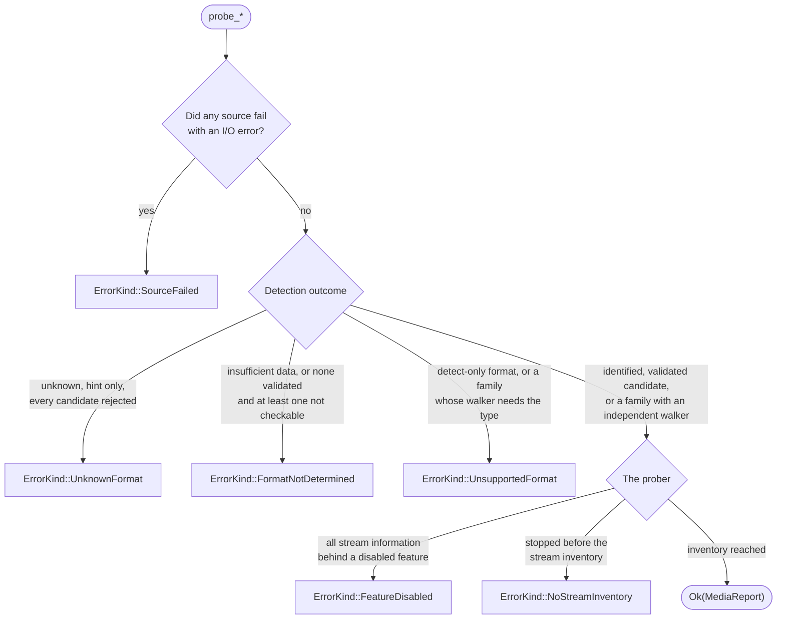
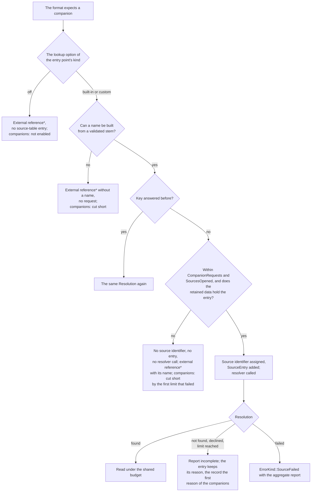

# API specification

| | |
|---|---|
| **Status** | Approved at G2.2 on 2026-11-23, at revision 38 of the plan (`198991f`). Written in Phase 2, tasks 2 and 3, on 2026-11-22. The maintainer chose to review the specification together with the usage scenarios of task 3, which are in section 15. Writing them revised the specification where section 15.12 says, and the first five reviews revised it where section 16 lists. The maintainer approved the names at G2.1 on 2026-11-22 and the names added since at G2.2. Writing the CLI contract of task 4 added one reason after the approval, as the maintainer chose (section 5.5). The sixth review, of revision 39, the seventh, of revision 40, the eighth, of revision 41, the ninth, of revision 42, the tenth, of revision 43, the eleventh, of revision 44, and the twelfth, of revision 45, amended the approved specification where section 16 lists; G2.3 confirms the amendments with the JSON contract. Task 5 drafted that contract in [`docs/guide/json-output.md`](../guide/json-output.md) and changed section 12 where section 16 says. The thirteenth review, of the contract with this specification and `cli.md`, amended sections 3.1, 3.3, 6.3, 6.4, 6.9, 12 and 14 on the same day, and the fourteenth, on 2026-11-24, sections 5.3, 6.4, 8, 10.2, 11.3, 12 and 14. The fifteenth, of revision 49, amended sections 3.3, 5.1, 5.3, 5.5, 8, 10.2, 12 and 14 on the same day. The draft of [`docs/guide/stability.md`](../guide/stability.md), at revision 51, added a sentence to sections 4.5 and 14. The sixteenth review, of revision 50 with the drafts of revision 51, amended sections 5.3, 10.2, 12 and 14 on the same day, at revision 52. The seventeenth, of revision 52, amended sections 5.3, 12 and 14 on the same day, at revision 53. The eighteenth, of revision 53, amended the baseline above section 1 and sections 5.3, 6.12, 12 and 14 on the same day, at revision 54. The nineteenth, of revision 54, amended sections 3.3, 5.3, 6.1, 6.12, 12 and 14 on the same day, at revision 55. |
| **Plan** | [Section 8](../plans/plan-init-project.md#8-public-api-design) fixes the principles and the behavior. This document fixes the types, accessors and entry points that carry them. |
| **Fields** | [`docs/guide/fields.md`](../guide/fields.md) is the normative table of every normalized field. Section 6 below gives each of its fields an accessor. |

This specification describes the public surface of the `cc-media-probe` library: what a caller can call, which types come back, and which rules keep that surface compatible from `0.1.0` to `1.0` and beyond. It decides the shape of every type that section 8 of the plan names and of every field that the field guide lists. It does not decide how the library computes a value; the plan and the field guide do that.

On 2026-11-22 the maintainer chose the baseline that this draft follows:

- **Field guide proposals.** The fifteen API proposals of the field guide (findings F1 to F8, F14, F18 and F22 to F26) are specified as written. G2.2 confirmed them as specified.
- **Async sources.** The async positional source trait is poll-based, like `AsyncRead` (section 9.3).
- **Thoroughness.** The builder has no thoroughness option in `0.1.0` (section 4.3).
- **Usage summary.** It is public (section 6.14).
- **Path-based async convenience.** Tokio gets `probe_file` and `detect_file`. They need Tokio's `fs` feature, which the maintainer approved through GS.1 on 2026-11-22 (section 9.2).

At the first review, on the same day, the maintainer made three more choices:

- **Attachments and cover art.** The two options split the attachments by role, and each applies on its own (section 4.3).
- **Companion lookup.** Blocking and async probes have an option each, so a resolver never meets an entry point that cannot call it (section 13).
- **Wide integers in JSON.** A detail integer of 64 bits is always a decimal string (section 12).

At the second review, also on 2026-11-22, the maintainer made three more:

- **Protection.** A stream without `Protection` has been examined in full and declares none. A stream whose structures were not all examined says so (section 6.3).
- **An unresolved codec.** `CodecInformation::codec()` is absent while the description of the first sample is unproven and the candidates name different codecs (section 6.4).
- **Lookup off.** An expected companion is listed only as an external reference; the source table lists requested sources only (section 13).

At the third review, the same day, the maintainer made three more:

- **The stem of a VobSub index.** It comes from the path, or else from the file-name hint. With neither, no request is made, and the companion is listed without a name (section 13).
- **Image headers of attachments.** An attachment's image header is read within the per-stream header limit, and the rest of its data is not kept (section 4.3).
- **The scope of a tag set.** `TagSet::target_scope()` says whether the set describes the whole file, the entities its lists name, or a scope the probe did not establish (section 6.9).

At the fourth review, the same day, the maintainer approved G2.1 for the names of revision 36 of the plan, and made three more choices:

- **A document written as it goes.** `document` gains a writer that takes the entries one at a time, which answers the question that G2.3 had left open (section 12).
- **An outcome that cannot be derived.** `DocumentEntry::from_report` and `from_detection` refuse a record that holds a value of a newer version that decides the outcome, and the refusal takes the outcome that the caller gives (section 12).
- **Detection as a part.** A limit that stops detection is recorded against `Part::Detection` (section 5.3).

At the fifth review, the same day, the maintainer made one more choice:

- **A candidate's check that a limit stopped.** When a limit stops one candidate's validation check while another candidate validates, the report is incomplete: `Completeness::detection()` is `Incomplete`, and the reason names the limit against `Part::Detection` (section 5.3).

On 2026-11-23 the maintainer approved G2.2 for revision 38 of the plan, which this specification follows. While the CLI contract of task 4 was written, the maintainer made one more choice:

- **A source that failed.** A part that a source failure stopped carries the reason `SourceFailed` in the error's partial report, with the source named (section 5.5).

At the sixth review, also on 2026-11-23, the maintainer made four more choices:

- **Ranked candidates.** The candidates of an ambiguous detection are ranked, checked in that order, and the first that validates is used. Only a candidate ranked ahead of it that a limit or an unavailable range left unchecked makes detection incomplete (section 5.1).
- **A full budget.** The fixed-size record keeps the first reason of each part, so an incomplete report always says why (section 5.3).
- **An entry's index.** It is the entry's position in the document, which the document writes (section 12).
- **Trees in JSON.** A tree of chapters or tags is one flat array with a parent position on each node, so the trees add no depth to a document, whose depth the schema fixes for what it defines (section 12).

At the seventh review, also on 2026-11-23, the maintainer made four more choices:

- **A kind of a newer version.** The catch-all of an enum that carries data keeps the value's other members as written and writes them back unchanged, so the version that knows the kind reads its value again (section 12).
- **No null.** The form never writes null, and a member that holds null fails as malformed input wherever it stands (section 12).
- **The primary H.264 set.** It is established only by following the chain from the first picture's slice to the set. A sole candidate gives its values by agreement, without being named primary, and a reference to a set that no candidate has is a damaged stream (section 11.5).
- **A standalone chapter or tag.** It is the flat array of its subtree, the node itself first and without a parent (section 12).

At the eighth review, also on 2026-11-23, the maintainer made four more choices:

- **The headers status.** `Completeness::headers()` keeps whether every stream's header state is final, so `is_complete()` sees the header states. Beside a state of a newer version, it is the verdict of the version that wrote the state (section 5.3).
- **A check that the input's end cut short.** When the input ends inside the check of a candidate ranked ahead of the one used, detection is incomplete, with the reason `TruncatedInput` (section 5.1).
- **References beyond the retained data.** An external reference that the retained-data limit cannot hold is not listed. The record counts it in `omitted_references()`, and the part that found it is incomplete (section 6.12).
- **The stem of a VobSub index.** One rule decides which stems are valid, the same on every platform (section 13).

At the ninth review, also on 2026-11-23, the maintainer made four more choices, and stated one rule while the revision was under way:

- **A catch-all and its enum.** The payload of a catch-all names its enum as a type parameter, as in `UnrecognizedKind<TagValue>`, so it goes back only into the enum that read it (section 1, rule 5; section 3.3).
- **Records in kept members.** A minor version puts a root record only where every reader reads it, so a document that an older version rebuilds has one version throughout (sections 12 and 14).
- **A seekable reader** is the whole input from its byte 0, wherever it stands when it is passed (section 4.1).
- **Bytes needed** is the least length of the input, from its start, that detection needs (section 8).
- **The last known good value.** A property that structures of several versions of a specification state keeps the value of the older one when the newer one is damaged or cut short (section 7).

At the tenth review, also on 2026-11-23, the maintainer made three more choices:

- **Shortfalls of protection.** Discovery records each of them and names the stream, since protection belongs to the stream's declaration (section 6.3).
- **Tag lookups.** Every lookup sees the top level only, since a nested tag is an attribute of its parent (section 6.9).
- **A high dynamic range.** Each coordinate, luminance and light level has its own provenance (section 6.5).

At the eleventh review, also on 2026-11-23, the maintainer made one more choice:

- **A companion that is the primary input.** Only the built-in resolver can find a companion to be an alias of source 0, through the identity of the file that `probe_file` opened. A custom resolver's tokens are compared with those of earlier companions only (section 13).

At the twelfth review, also on 2026-11-23, the maintainer made four more choices:

- **Reasons that disagree.** `is_complete()` reads only the statuses and the record. Reading a report fails as malformed input when its reasons, the record's first reasons and the statuses disagree part by part (section 5.3).
- **Tags of a live stream.** A tag set that a later Tags element of a live Matroska segment replaced stays in `tag_sets()`, marked by `TagSet::is_superseded()`, and no lookup sees it (section 6.9).
- **A codec of a newer version.** It displays the serialized name that the newer version wrote, or else its first raw identifier. "A codec that was not read" is only for an absent codec (section 6.4).
- **A parameter-set track.** The H.264 parameter sets of a track that an `avc1` track links through `avcp` are candidates too, read once a public source describes that track (section 11.5).

At the thirteenth review, also on 2026-11-23, the maintainer made two more choices:

- **Raw codes in hexadecimal.** `RawCodecIdentifier::value()` spells a code by its namespace: a byte code, such as a four-character code, as its bytes in lowercase hexadecimal, a text code as its text, and a coded number in canonical decimal (section 6.4).
- **`IntegerValue` written by its owner.** It has no serialized form of its own; a tag value writes it and checks its bounds (sections 3.3 and 12).

At the fourteenth review, on 2026-11-24, the maintainer made four more choices:

- **`bytes_needed` with a twin.** `Detection::bytes_needed()` beyond 2^53 − 1 is written as `bytes_needed_exact` (sections 8 and 12).
- **Only values that JSON carries.** A non-finite number or a byte string fails as malformed input, in every format and in a catch-all too (section 12).
- **`CodecNamespace::WaveSubformat`** names the `SubFormat` GUID of an extensible WAVE format in `0.1.0` (section 6.4).
- **No detail in a first reason.** Reading refuses a first reason of the record that carries a detail (section 5.3).

At the fifteenth review, also on 2026-11-24, the maintainer made four more choices:

- **The payload of a newer outcome kept.** A `Detection` of a newer outcome and an `ErrorRecord` of a newer kind keep every member that they do not read and write it back, as an entry of a newer outcome does (sections 8, 10.2 and 12).
- **Numbers of arbitrary precision.** The private map in which serde_json's `arbitrary_precision` feature hands over a number reads as the number that a build without the feature reads (section 12).
- **Fixed-size as a probe builds it.** `LimitRecord` is fixed-size as a probe builds it; read back, it keeps the values of a newer version as written (section 5.3).
- **R21 amended.** Exit status 1 also covers a standard output that could not be written (plan section 3, through GS.4; `cli.md` section 5).

At the sixteenth review, also on 2026-11-24, the maintainer made four more choices, two of them for this specification:

- **The private map a number only where no type is known.** A catch-all, a kept member and a member that no type reads take the map of serde_json's `arbitrary_precision` feature as its number; a member of a known type takes it as the object it is, before the version as after it (section 12).
- **The nearest double, stated.** Through the private map the number is the correctly rounded nearest `f64`, which a build without the feature gives only with serde_json's `float_roundtrip` feature (section 12).
- **A deprecated option's warning** goes to standard error in either mode, before anything else (`cli.md` sections 7 and 8.8), and **a minor line's MSRV** is the stable Rust current on the day its release candidate is built, R12 amended through GS.4 (`stability.md` section 7).

At the seventeenth review, also on 2026-11-24, the maintainer made two more choices, one of them for this specification:

- **The private map's name reserved.** No object of a known type, a record, an enum written as an object or a map that a type reads, has a member named `$serde_json::private::Number`; one that has it is malformed input in every build and either order. Where no type is known, the map stays its number (section 12).
- **Deprecation warnings once each,** in the order of the option table, whatever the order or repetition on the command line (`cli.md` section 8.8).

At the eighteenth review, also on 2026-11-24, the maintainer chose for this specification:

- **Members held until the outcome is known.** An entry, a detection and an error record hold a member that they do not read only until their outcome, or the error record's kind, is known, then keep it for an outcome of a newer version and pass it by as it comes for one that this version knows (section 12).

At the nineteenth review, also on 2026-11-24, the maintainer chose for this specification:

- **A number at the root.** At the root of a root record, read alone or nested, the private map that serde_json's `arbitrary_precision` gives for a number, one member `$serde_json::private::Number` with a number's text, is the number it spells, so the root is no object and fails before the version in every build, as it does without the feature (section 12).

## Contents

1. [Principles](#1-principles)
2. [Naming conventions](#2-naming-conventions)
3. [Crate surface](#3-crate-surface)
4. [Entry points, options and limits](#4-entry-points-options-and-limits)
5. [Outcomes and completeness](#5-outcomes-and-completeness)
6. [The report model](#6-the-report-model)
7. [Normalized values](#7-normalized-values)
8. [Detection](#8-detection)
9. [The async surface](#9-the-async-surface)
10. [Errors](#10-errors)
11. [Typed details](#11-typed-details)
12. [Serialization](#12-serialization)
13. [Companion lookup](#13-companion-lookup)
14. [Compatibility](#14-compatibility)
15. [Usage scenarios](#15-usage-scenarios)
16. [Decisions for the gates](#16-decisions-for-the-gates)

## 1. Principles

The nine principles of plan section 8.1 hold. Seven design rules make them concrete:

1. **Accessors only.** Every public struct has private fields. A caller reads it through methods and builds it only through constructors and builders (plan section 8.10).
2. **Absent is `None`.** Every accessor of a value that a file may not state, or that may not be established, returns `Option`. A zero, an empty string or an empty list never stands for "unknown". A list accessor returns a slice. An empty slice means that no such item was found; the completeness record says whether the search was complete (section 5.3).
3. **One meaning per accessor.** A normalized accessor returns exactly the field of the field guide, in its unit, after its precedence. Raw values, observed lower bounds, values beyond the exact range and estimates each have their own place (sections 7 and 11).
4. **Wide types from the start.** Counts, sizes and byte quantities are `u64`. Signed quantities are `i64`. Fractions, rates and times are exact rationals. A later format with a larger value therefore never forces a new return type.
5. **Open sets everywhere.** Every public enum is `#[non_exhaustive]`. Every enum that is serialized has a catch-all variant `Unrecognized`, which keeps the text that a newer version wrote (section 14), in an `UnrecognizedValue<Owner>`. For an enum that carries data, the catch-all holds an `UnrecognizedKind<Owner>`: the kind's name through `as_str()`, and the value's other members as written, which only serialization reads (section 12). `Owner` is the enum itself, as in `StreamKind::Unrecognized(UnrecognizedValue<StreamKind>)`, as the maintainer chose at the ninth review. Only the reader of that enum makes such a payload, and only for a name that the enum does not know, so a payload never carries a name into another enum, where it could name a known value without that value's members. Moving one there does not compile, and matching stays `StreamKind::Unrecognized(value)`.
6. **No fields in variants.** An enum variant carries at most one value: a struct with private fields, or a value that is complete by its nature, such as a tag's text or the catch-all's text. A later release adds data as a new accessor of that struct, never as a new field of a variant.
7. **Enums by reference, with stable names.** The catch-all of rule 5 holds text, so no enum that has one is `Copy`. An accessor therefore returns a stored enum by reference: `&StreamKind`, `Option<&Provenance>`. A pattern matches through the reference without `*` or `&`, as in `matches!(stream.kind(), StreamKind::Audio)` or `Some(Provenance::Declared)`. A value that the library computes rather than stores, such as `Format::family()`, is returned by value. Every enum with a catch-all has `as_str() -> &str`: its serialized name, which is stable, or the text the catch-all keeps.

Indexes into the report's own lists, such as a stream's index, are `usize`. Fields of the typed details keep their coded width (section 11.2).

## 2. Naming conventions

The names follow the Rust API Guidelines and the code rules of the repository (R32, R35).

| Kind | Convention | Examples |
|---|---|---|
| Words | Whole words in American English; no abbreviations, no single letters, also in generic parameters and lifetimes. Proper names of formats, codecs and standards as commonly written. | `identifier`, `information`, `maximum`; `Reader`, `Source`, `'report`; `Matroska`, `H264`, `Bcp47` |
| Getters | The field name, without `get_` (C-GETTER). The name of the field guide where it has one. | `duration()`, `coded_size()`, `sample_rate()` |
| Yes-or-no facts | `is_` or `has_` with `Option<bool>` where the file may not say; plain `bool` only where the answer is always known. | `is_default()`, `has_linked_chapters()`, `is_complete()` |
| Provenance | The field's name with `_provenance`. | `duration_provenance()` |
| Estimates | `estimated_` with the field's name. | `estimated_duration()` |
| Counts | The counted thing with `_count`. | `packet_count()`, `channel_count()` |
| Builder setters | `with_` with the option's name; each consumes and returns the builder. | `with_limits()`, `with_file_name_hint()` |
| Iterators | A named type per method, after the method (C-ITER-TY). | `file_tags()` returns `FileTags<'report>` |
| Detail types | The format or codec's name with `Details`; a part of it adds the part's name. | `MatroskaDetails`, `MatroskaTrackDetails`, `H264Details` |
| Detail accessors | The specification's field name, spelled out in American English (R32, R35); the specification's spelling goes in the rustdoc. | `pic_width_in_mbs_minus1` becomes `picture_width_in_macroblocks_minus_one()` |
| Serialized names | `snake_case` member names; enum values as `snake_case` strings; a detail's `kind` as the lowercase format or codec name. | `"coded_size"`, `"top_field_first"`, `"kind": "matroska"` |
| Stable text of an enum | `as_str()`, the serialized name (rule 7) | `stream.kind().as_str()` is `"video"` |

## 3. Crate surface

### 3.1 Features

| Feature | Default | Adds |
|---|---|---|
| `zlib` | on | Inflating with `miniz_oxide`: Matroska content compression and the compressed movie box of the ISO family. Off, such data has the status "compression unavailable" (section 5.4). |
| `serde` | off | `Serialize` and `Deserialize` for every model type but the six that section 3.3 lists, and the `document` module (section 12). |
| `tokio` | off | `asynchronous::tokio` (section 9.2). |
| `futures-io` | off | `asynchronous::futures` (section 9.2). |

Features are additive: enabling one never removes or changes an item. The async positional source trait and its entry points need no feature (section 9.3).

### 3.2 Public paths

The crate root holds what most callers need. Everything else lives in modules named after its subject.

| Path | Items |
|---|---|
| `cc_media_probe` | The ten blocking entry points (section 4.1); `Prober`, `Limits`, `Limit`; `MediaReport`, `Stream`, `StreamKind`; `Format`, `Codec`; `Detection`; `Error`, `ErrorKind` |
| `cc_media_probe::model` | Every other type of the report model (section 6) and the value types (section 6.1) |
| `cc_media_probe::completeness` | `Completeness`, `HeaderStatus`, the status and reason types, `LimitRecord` (section 5) |
| `cc_media_probe::diagnostics` | `Diagnostic`, `Severity`, `DiagnosticCode` (section 6.13) |
| `cc_media_probe::details` | `FormatDetails`, `CodecDetails` and the shared detail types; one submodule per format and per codec, such as `details::matroska` and `details::h264` (section 11) |
| `cc_media_probe::source` | `PositionalSource`; `SourceEntry`, `SourceIdentifier`, `SourceOffset`, `PortablePath`, `RawPath`, `RawPathEncoding` (sections 4.4, 6.3 and 6.15) |
| `cc_media_probe::error` | `ErrorRecord`, `CandidateCheck`, `Observations`, `Reason` (section 10) |
| `cc_media_probe::asynchronous` | `AsyncPositionalSource`, `probe_source`, `detect_source`; the submodules `tokio` and `futures` behind their features (section 9) |
| `cc_media_probe::document` | `Document`, `DocumentEntry`, `EntryOutcome`, `UnderivableOutcome`, `Generator`, `UsageError`, `SchemaVersion` (`serde` feature; section 12) |
| `cc_media_probe::companion` | From the release that ships lookup: `CompanionLookup`, `AsyncCompanionLookup`, the resolver traits and their types, including `SourceIdentityToken` (section 13) |

The internal module tree of plan section 7.2 may differ from these paths; the public paths are re-exports. Neither the repository-only entry points nor the fuzzing entry points are ever part of the public surface.

### 3.3 Common traits

- Every public type implements `Debug`, with a representation that is never empty (C-DEBUG, C-DEBUG-NONEMPTY).
- Every model type implements `Clone`, `PartialEq`, `Eq` and `Hash`. A floating-point value is stored by its bits (section 6.1), so equality is exact everywhere.
- Every model type, `Prober`, `Limits`, `Detection` and `ErrorRecord` is `Send` and `Sync`. `Error` is `Send`, `Sync` and `'static` (C-GOOD-ERR).
- `Display` exists where a single line of text is useful: `Format`, `Codec`, `CodecInformation`, `CodecCandidate`, `Confidence`, `IntegerValue`, `Rational`, `Seconds`, `Size`, `MediaType`, `Language`, `Identifier`, `Profile`, `Level`, `Tier`, `Timecode`, `Guid`, `SourceIdentifier`, `HeaderStatus`, `Completeness`, `DiagnosticCode`, `Error`, `ErrorRecord` and `UnderivableOutcome`. Display text is for people. It is not part of the stability contract, except where its documentation says so. Stable text comes from `as_str()` (rule 7).
- With the `serde` feature, every model type implements `Serialize` and `Deserialize` (C-SERDE), except the six below. This list is the only one: section 3.1 and section 12 refer to it. The six have no form of their own, because what holds them writes them:
  - `PortablePath`, written as its display string with its flag and raw form beside it;
  - `IntegerValue`, which a tag value writes as `integer`, or beyond 2^53 − 1 in magnitude as the twin `integer_exact`, and reads back only from −2^63 to 2^64 − 1, as the maintainer chose at the thirteenth review. A form of its own would let a value outside both `i64` and `u64` in, which neither `to_i64()` nor `to_u64()` returns;
  - `DocumentEntry`, written with its position in the document as its `index`;
  - `UnrecognizedValue`, `UnrecognizedKind` and `UnrecognizedDetails`, the payloads of the catch-alls of a string enum, of an enum that carries data and of a typed detail (section 1, rule 5). Their enum writes the text, or the kind and the kept members, as its own value. A payload read on its own could hold a name that its enum knows, such as `error` for an `EntryOutcome`, and the enum would then write a value that no reader takes. So a payload comes only from reading its enum, as the type parameter that binds it to the enum promises.

  None of the six implements the two traits. A `Chapter` or `Tag` alone implements both, as the flat array of its subtree (section 12).
- **Every entry point reads by the same rules.** A type that implements `Deserialize` follows every rule of section 12 that it follows inside a root record, whether it is read alone, such as a bare `Rational`, or as part of a report, as the thirteenth review asked: a member that holds null, a map that names a member twice and a record written as an array fail at both entry points. Only the version error is for root records alone, since no other type carries a version. Every check that needs only the type's own members runs at both entry points too, as the fifteenth review asked: a bare `Candidate` keeps its confidence within 100, a bare `Reason` holds the members of its kind (section 5.5), and a bare `Completeness` agrees with its record (section 5.3), as they do inside a detection and a report. A check that needs more than the value runs where the value is held: a stream's index against its position, and the headers status against the streams. A type has no other way in, as the nineteenth review asked: no inherent `deserialize` or `serialize` stands beside the two traits, such as Serde's derive gives a type with `serde(remote = "Self")`, through which the review read `Generator::deserialize` of the positional array `["catalog", "1"]`. A value that one of Serde's own value deserializers gives in place of a read under way, a map, a sequence, a string or a number, is read alone from that value, so a `Chapter` reads its flat array from `SeqDeserializer`, and no sequence passes for a read under way, where the review read `["unused", {"name": "catalog", "version": "1"}]` as a generator and refused `[{"titles": []}]` as a chapter (section 12).
- No operation on a tree of the report recurses on its depth. Dropping, cloning, comparing, hashing and `Debug` walk a tree of chapters or tags with an explicit stack, and so does its serialized form (plan section 7.6). A document can hold a tree of any depth (section 12), so no input can exhaust the stack. The scenarios of sections 15.4 and 15.5, which become shipped examples, print their trees with a stack of their own for the same reason.

## 4. Entry points, options and limits

### 4.1 Blocking functions

Ten functions at the crate root probe or detect with the default options. Each has the same method on `Prober` (section 4.2).

| Function | Input | Notes |
|---|---|---|
| `probe_file(path: impl AsRef<Path>) -> Result<MediaReport, Error>` | A path | Opens only that file (R18). Its final component is the file-name hint unless the builder sets one. A file that cannot be opened is the error of kind `SourceFailed`. |
| `probe_reader<Reader: Read + Seek>(reader: Reader) -> Result<MediaReport, Error>` | Any `Read + Seek` | Taken by value (C-RW-VALUE); pass `&mut reader` to keep it. The input is the reader from its byte 0, wherever it stands (below). |
| `probe_stream<Reader: Read>(reader: Reader) -> Result<MediaReport, Error>` | Any `Read`, forward only | The sliding window of D9. Standard input uses this. The input starts where the reader stands. |
| `probe_bytes(bytes: &[u8]) -> Result<MediaReport, Error>` | In-memory data | The report owns copies of what it keeps; it does not borrow `bytes`. |
| `probe_source<Source: PositionalSource>(source: Source) -> Result<MediaReport, Error>` | The caller's own positional source | Section 4.4. |
| `detect_file`, `detect_reader`, `detect_stream`, `detect_bytes`, `detect_source` | The same five inputs | Return `Result<Detection, Error>` (section 8). The only error is a source failure. |

A report never borrows its input: `MediaReport` is `'static`. No function panics on any input (plan section 7.6).

**Where the input starts.** As the maintainer chose at the ninth review:

- **A seekable reader** is the whole input, from its byte 0, wherever it stands when it is passed. So a `Cursor` at byte 100, or a file of which the caller has already read a few bytes, gives the same report as the same reader at byte 0. Detection and probing seek to positions from byte 0, and the pinned prefix starts there. Every offset of the primary input in the report is such a position. The offsets of a companion count from that companion's own start, and a logical offset from the start of the stream that several files form (section 6.3). `size()` is the reader's length, where it lies within the exact range of section 7. That is all the guarantee says. A reader is not a path, so it has no file-name hint unless the builder sets one, and the built-in resolver has no folder to look in (section 13). The report of `probe_file` for the same bytes can therefore differ in what a hint or a companion decides. As the tenth review asked, the guarantee covers only where the input starts.
- **A forward-only reader** starts where it stands, since it cannot go back. Its offsets count from there, and its length is unknown.
- **A positional source** (section 4.4) and the bytes of `probe_bytes` start at their own position 0.
- **Afterwards.** The position of a seekable reader passed as `&mut reader` is unspecified, so a caller who uses it again seeks first. A forward-only reader is left after exactly the bytes read from it, which the primary input's entry in the source table counts (`SourceEntry::bytes_read()`, section 6.15), since every byte it delivers is counted (plan section 7.5).
- **An embedded range,** such as a file stored inside another, is probed through a positional source that serves that range from its own position 0.

The same holds for the async readers of section 9.

### 4.2 The `Prober` builder

`Prober` carries the options. It is built once and used for any number of probes, from any number of threads.

```rust
use cc_media_probe::{Limits, Prober};
use cc_media_probe::model::AttachmentHandling;

let prober = Prober::new()
    .with_limits(Limits::default().with_bytes_read(16 * 1024 * 1024))
    .with_attachments(AttachmentHandling::WithData);
let report = prober.probe_file("movie.mkv")?;
```

- `Prober::new()` and `Prober::default()` give the default options. Every setter consumes the builder and returns it (C-BUILDER). Every option also has a getter with the option's name.
- The probing methods take `&self`: `probe_file`, `probe_reader`, `probe_stream`, `probe_bytes`, `probe_source`, and the five `detect_*` methods, with the signatures of section 4.1.
- The async methods are reached through three borrowing handles: `prober.tokio()`, `prober.futures()` and `prober.asynchronous()` (section 9). The first two exist only with their features. Adding them is additive.
- `Prober` is `Clone`, `Send` and `Sync`.

### 4.3 Options

| Option | Type | Default | Effect |
|---|---|---|---|
| Format hint | `Format` | none | Orders the candidates that the bytes allow, ahead of the file-name hint. It never overrides a conclusive signature and never selects a prober for bytes that matched nothing: with no candidate it gives the "hint only" outcome (plan section 8.6). |
| File-name hint | `OsString`, set from any `impl Into<OsString>` | none; the path's final component for `probe_file` | Orders candidates as plan section 8.6 says. The name is never opened. |
| Limits | `Limits` | `Limits::default()` | Section 4.5. |
| Tags | `SectionRequest`: `Read` or `Skip` | `Read` | `Skip` leaves the tags section "not requested" (section 5.3). |
| Chapters | `SectionRequest` | `Read` | As tags. |
| Attachments | `AttachmentHandling`: `Skip`, `MetadataOnly` or `WithData` | `MetadataOnly` | Every attachment whose role is not cover art. `Skip` leaves them out. `WithData` keeps their payloads within the retained-payload limit. |
| Cover art | `AttachmentHandling` | `MetadataOnly` | Every attachment whose role is cover art, whatever its carriage (F8), including a picture inside a tag structure while the tags option is `Skip` |
| Legacy text encoding | `TextEncoding` | decided at G3.4 (D22) | The encoding of text that a format stores without naming one. |
| Companion lookup | `CompanionLookup` and `AsyncCompanionLookup` | off | From the release that ships lookup; one option for the blocking entry points and one for the async ones (section 13) |

**Attachments and cover art.** The two options split the attachments by role (F8), and each applies on its own, as the maintainer chose on 2026-11-22. A picture that a tag structure carries, such as an item of the ISO item list or an ID3v2 picture frame, follows the cover-art option even when the tags option is `Skip`. The tags section then stays "not requested". The probe reads the metadata of an attachment whose role is skipped only as far as it needs to learn that role, such as a Matroska attachment's file name. Such an attachment is never listed.

**Data that is not kept.** The data of a skipped attachment, and the data of any attachment under `MetadataOnly`, is never kept. That does not mean it is never read:

- **The image header.** An embedded picture of a listed attachment may not declare its pixel size or its media type. The probe then reads its image header, as field guide section 3.9 requires (plan Phase 4, milestone 4C). It reads only the bytes that the image parser asks for, from the start of the data, and holds at most the per-stream header limit for that attachment, as the maintainer chose on 2026-11-22. Those bytes count toward `BytesRead` and working memory. A header that the limit cuts short leaves the width, height or media type absent, and the attachments section incomplete, with the limit named.
- **The rest of the data.** A seekable source passes over it without reading it.
- **On a forward-only source,** the probe has to read the data and discard it to reach what follows. Those bytes count toward the read allowance like any other (plan section 7.5).
- So a payload that is not kept, but lies before requested metadata, can still use up `BytesRead`. The part that the metadata belongs to then records that limit.

**Completeness of attachments.** The attachments section of the completeness record (section 5.3) covers the requested roles only. It is "not requested" when both options are `Skip`. Otherwise it is complete when both hold:

- every attachment of a requested role was found and listed, with every image header it needed;
- for a role whose option is `WithData`, every embedded payload was kept.

A payload that the retained-payload limit or the read limit stopped leaves that attachment's `data()` absent. It also leaves the section incomplete, with that limit named, so a requested payload that was not kept always makes `is_complete()` false. A skipped role never does.

The plan's list of builder options names a "thoroughness level" without defining one. On 2026-11-22 the maintainer chose to leave it out of `0.1.0`: each format phase fixes the bounded work it does, and the limits tune it. A release can add the option when a format needs an opt-in deeper scan, such as the transport-stream scan windows of G10.1. A new setter is a compatible change.

The tags and chapters options are new in this specification. Plan section 8.3 lets a section be "not requested", which only an option can cause; the plan's list of options names only the attachments for that. G2.2 confirmed them on 2026-11-23.

### 4.4 Custom blocking sources

A source that is neither a file nor a reader, such as ranges of a remote object, implements one trait. It is kept minimal, because callers implement it (plan section 8.10).

```rust
pub trait PositionalSource {
    /// Reads at most `buffer.len()` bytes starting at `position`. Returns 0 for an empty buffer, and for a nonempty
    /// one only at or past the end. The library never asks for zero bytes.
    fn read_at(&mut self, position: u64, buffer: &mut [u8]) -> std::io::Result<usize>;

    /// The total length, or `None` when the source does not know it.
    fn length(&mut self) -> std::io::Result<Option<u64>>;
}
```

- A short read is allowed. The library asks again for the rest, and retries `ErrorKind::Interrupted` as the standard library's `read_exact` does.
- Any other error ends the probe with the error of kind `SourceFailed`, which keeps it as its cause (R19).
- **An empty buffer.** A read into an empty buffer returns 0, at any position, and says nothing about the end, as `Read::read` with an empty buffer does. The library never makes such a read: a read that the remaining allowance clamps to zero bytes is not issued (plan section 7.5). So every 0 that the library receives answers a read of at least one byte.
- A source of unknown length has ended only when a read of at least one byte returned no bytes (plan section 7.5). Such a read at position `P` says only that the source ends at or before `P`, since the trait returns 0 for any read at or past the end. The length is `P` exactly when the source also delivered the byte at `P − 1`, or when `P` is 0. As the tenth review asked, a read that returns 0 beyond a gap, such as one at byte 4096 after a prefix of 1,000 bytes, establishes no length: the source can end anywhere between them. `size()` then stays absent, and no total, clean end or proof that nothing follows rests on that read (section 5.2). A length that the source states, through `length()`, is exact without such a read.
- The library implements the trait for `&mut Source` and `Box<Source>` where `Source: PositionalSource + ?Sized`. So a caller can keep the source, or pass a `Box<dyn PositionalSource + Send>`.
- Every read is charged to the shared budget and clamped to the remaining read allowance before it is issued (plan section 7.5).

### 4.5 Limits

`Limits` is `#[non_exhaustive]` and has one counter per row of plan section 7.5. `Limits::default()` holds the proposed defaults; G3.3 confirms them. Once a default has shipped, a later release raises it only in a minor release and lowers it only to fix a security problem (`stability.md` section 4.3, the maintainer's choice on 2026-11-24). Each counter has a getter (`bytes_read()`) and a setter (`with_bytes_read(value)`). `Limits::get(limit: &Limit) -> Option<u64>` and `Limits::with(limit: &Limit, value: u64) -> Limits` reach a counter by name. `Limit` has a catch-all (rule 5), so `get` returns `None` for a limit that a newer version wrote, and `with` leaves the limits unchanged for it.

| `Limit` | Getter | Unit | Proposed default |
|---|---|---|---|
| `BytesRead` | `bytes_read()` | bytes | 64 MiB |
| `WorkingMemory` | `working_memory()` | bytes | 32 MiB |
| `HeaderBytesPerStream` | `header_bytes_per_stream()` | bytes | 1 MiB |
| `RetainedData` | `retained_data()` | bytes | 16 MiB |
| `RetainedPayloads` | `retained_payloads()` | bytes | 64 MiB |
| `DecompressedOutput` | `decompressed_output()` | bytes | 16 MiB |
| `WorkUnits` | `work_units()` | units | 2,000,000 |
| `NestingDepth` | `nesting_depth()` | levels | 64 |
| `Streams` | `streams()` | declarations | 4,096 |
| `Diagnostics` | `diagnostics()` | diagnostics | 1,000 |
| `CompanionRequests` | `companion_requests()` | requests | 256 |
| `SourcesOpened` | `sources_opened()` | sources | 64 |

The per-stream header limit bounds the bytes held for one header: a stream's codec header, or the image header of one attachment (section 4.3). Every limit accepts any value from 0 to `u64::MAX`. The same `Limit` enum names the counters of the usage summary (section 6.14), the fixed-size record (section 5.3) and the reasons (section 5.5).

## 5. Outcomes and completeness

### 5.1 The ordered procedure

One procedure decides between an error and a report; the first rule that applies wins (plan section 8.3). Each ending maps to one `ErrorKind`, or to `Ok`.



| Ending | Result | What it carries |
|---|---|---|
| A source failed | `ErrorKind::SourceFailed` | The `std::io::Error` as its source; the source's identifier; the partial report or observations (R19) |
| Nothing matched, a hint only, or every candidate rejected | `ErrorKind::UnknownFormat` | The hint, or the rejected candidates |
| Too few bytes to decide | `ErrorKind::FormatNotDetermined` | `reason()` says whether the input ended (`TruncatedInput`) or names the limit that was reached, with the record naming `Part::Detection` as the part that limit stopped (section 5.3) |
| No candidate validated and at least one could not be checked, whether or not others were rejected | `ErrorKind::FormatNotDetermined` | The candidates that were not rejected, each in the state `NotCheckable` with its own cause (plan section 8.3): `RangeUnavailable` for bytes outside the readable range, `TruncatedInput` for a check that the input's end cut short, or the limit by name; a candidate without a check has no reason, and its format's `support()` is detect-only. Each candidate carries its own cause, so the error's `reason()` is absent. Neither an end of the input nor a limit needs to have occurred; where a limit stopped a check, the record names `Part::Detection` as the part it stopped. |
| A detect-only format, or a family whose walker depends on the specific type | `ErrorKind::UnsupportedFormat` | The format or family (R20) |
| All stream information behind a disabled feature | `ErrorKind::FeatureDisabled` | The feature and the format |
| The probe stopped before the stream inventory | `ErrorKind::NoStreamInventory` | The format, the reason, and the observations made so far, such as the track identifiers and raw ticks of an ISO media segment (R20) |
| The stream inventory was reached | `Ok(MediaReport)` | Diagnostics and completeness; nothing short of a source failure turns it into an error |

**The rank of the candidates.** As the maintainer chose at the sixth review, the candidates of an ambiguous detection are ranked, so no two of them tie:

1. a higher confidence first;
2. then the format that the format hint names (section 4.3);
3. then the format that the file-name hint names;
4. then the order of the release's detection inventory (`formats.md`, plan section 4.4).

Each candidate is a different format, so the rank decides between formats and every pair differs at the fourth step at the latest. Reading refuses a list that names a format twice, in a `Detection` and in an `ErrorRecord`, as the fifteenth review asked: two copies of one format would tie on every step and name one possible format.

The probe checks the candidates in that order and uses the first that validates (plan section 8.3). It does not check the candidates ranked behind that one: their state is `Outranked`, which says that a candidate ranked ahead of them validated, so their check never ran. They neither validated nor were rejected, and nothing stopped them, so they leave detection complete. A candidate ranked ahead of the one used that could not be checked decides whether detection is complete:

- **A limit stopped its check, or its check needs bytes outside the readable range,** such as beyond the pinned prefix of a forward-only source. A full check could have chosen it, so the report is incomplete, with the limit or `RangeUnavailable` named against `Part::Detection` (section 5.3).
- **The input ended inside its check.** The check found no contradiction before the end, so the input may be a file of that format that was cut short, which the report would then misdescribe. As the maintainer chose at the eighth review, the report is incomplete, with `TruncatedInput` named against `Part::Detection`, as a header that the input's end cut short is not final either (section 5.4). No counter stopped the check, so no counter is exhausted. The record keeps the reason as the first reason of detection, and `--strict` exits with 1 (`cli.md` section 6.3).
- **It has no check,** as a detect-only format does. This version can do nothing more for it, so detection stays complete, as it does for a codec whose parser is pending.

A diagnostic lists the candidates that were not used, each with its state: `Rejected` or `NotCheckable` with its cause for one ranked ahead, and `Outranked` for one ranked behind. It is kept within the diagnostics limit. `Detection::candidates()` lists the candidates in the same rank (section 8).

### 5.2 Stream inventory

The three classes of plan section 8.3 decide when the inventory is reached: a declared structure that lists the streams, a single-stream file whose primary structure was validated, or the first stream-carrying unit of an observed format. Each format's class and threshold are part of its entry in `formats.md`. The API exposes the class as `MediaReport::inventory_class() -> &InventoryClass`, with the values `Declared`, `SingleStream` and `Observed`. A report can list zero streams when a declared inventory was reached and declares none.

An observed format can also reach its inventory with no unit at all, where its entry says so. An FLV file that ends cleanly after its header reports zero streams, while a program stream without a map needs one elementary-stream packet (plan section 8.3). A clean end means that the end of the input was observed at the point where the next unit would start, and how it is observed depends on the source (plan section 7.5):

- **Known length.** The end is where the source's known length ends, as for the slice of `probe_bytes`, a file, or a positional source that states its length. No further read is needed. A header-only FLV file therefore gives its zero-stream report even when its last header byte used up the read allowance.
- **Unknown length.** The end is observed only when a read at that point returned no bytes, after the source had delivered the byte before it, so the end lies exactly there (section 4.4). A limit that stops the read at the same byte is not an end. That probe stopped before its inventory, with the error of kind `NoStreamInventory`, which names the limit.

### 5.3 Completeness

`MediaReport::completeness() -> &Completeness` tells what was established, what was not, and why (R23). Every shortfall is recorded against the part it stopped, so none can exist without changing `is_complete()`.

| Accessor | Returns | Values |
|---|---|---|
| `is_complete()` | `bool` | The definition of plan section 8.3, which `--strict` uses. True exactly when no part fell short: every status below is complete, final or not applicable as that definition says, the headers status among them, which says whether every stream's header state is final (below), no status holds a value of a newer version, and the record holds no first reason, which a part of a newer version that fell short also leaves (below). It reads the statuses and the record, which every limit leaves in place, and never depends on `reasons()`, which a full budget can leave empty, or on the streams. Reading a report checks that `reasons()` agrees with them (below). `Display`, the quick start and an entry's outcome (section 12) use this same test. |
| `detection()` | `&DetectionStatus` | `Complete`, `Incomplete` (below) |
| `discovery()` | `&DiscoveryStatus` | `Complete`, `Incomplete` |
| `headers()` | `&HeadersStatus` | `Complete` when every stream's header state is final, as in a report of no streams; `Incomplete` when one is not (below) |
| `tags()`, `chapters()`, `attachments()` | `&SectionStatus` | `Complete` (including proven empty), `Incomplete`, `NotRequested`, `NotApplicable` |
| `timing()` | `&TimingStatus` | `Established`, `NotAvailableByDesign`, `CutShort`, `NotApplicable` |
| `companions()` | `&CompanionStatus` | `NotApplicable`, `Complete`, `NotEnabled`, `CutShort` |
| `reasons()` | `&[PartReason]` | Each with `part() -> &Part`, `stream() -> Option<usize>` for a stream's headers, and for discovery where a reported stream's declaration fell short, as when its protection was not established or one of its content encodings was cut short (section 6.3), `source_identifier() -> Option<SourceIdentifier>` for a companion's request or a source that failed, which names its entry in the source table (section 6.15), and `reason() -> &Reason` (section 5.5). Kept within the retained-data limit, in the order recorded; the record keeps the first reason of each part whatever the limits (below). |
| `record()` | `&LimitRecord` | The fixed-size record below |

Each status is a stored enum with a catch-all, so its getter returns it by reference (section 1, rule 7), as `matches!(report.completeness().chapters(), SectionStatus::Complete)` in section 15.5 shows.

`Part` names what a reason stopped: `Detection`, `Discovery`, `Headers`, `Tags`, `Chapters`, `Attachments`, `Timing` and `Companions`. The header statuses of the streams count as well (section 5.4). `Completeness` does not repeat them; its headers status sums them up. `Display` writes a one-line summary, such as "incomplete: discovery stopped by the stream limit".

**The headers status.** A stream's header state belongs to the stream, and `Completeness` holds no stream. As the maintainer chose at the eighth review, `Completeness` therefore keeps the status of the headers part among its fixed-size data, as it keeps the status of every other part (below):

- **Values.** `HeadersStatus::Complete` when every stream's header state is final (section 5.4), as in a report of no streams, and `Incomplete` when at least one is not. The library sets it as it builds the report. It is fixed-size, so every limit leaves it in place, and `is_complete()` reads it.
- **Reading a report** checks it against the streams. `complete` beside a header state that this version knows and that is not final fails as malformed input. So does `incomplete` while every state is known and final.
- **Beside a headers status of a newer version,** a stream whose header state this version knows and that is not final still records a shortfall of the headers, which the newer status cannot erase, as the fourteenth review found: the record must hold the first reason of the headers, and the entry's outcome is `partial`.
- **Beside a state of a newer version,** either value reads. `HeaderStatus::is_final()` takes such a state as not final, but only the version that wrote it knows, and that version wrote the headers status from it. The status is that version's verdict: `incomplete` gives `partial`, and `complete` gives `ok`. A headers status of a newer version leaves the outcome open, as any status of a newer version does (section 12).

**Reasons, first reasons and statuses agree.** `is_complete()` reads the statuses and the record, and `reasons()` never decides it. A report whose reasons say otherwise would contradict itself, as the twelfth review found: two reports with the same complete statuses and the same empty record, one of which lists a reason of the tags. So, as the maintainer chose at that review, reading a report checks the three against each other, part by part:

- **A reason in `reasons()`** needs a first reason of its part in the record, since the record keeps one for every part that fell short, whatever the limits.
- **A part that this version knows** has a first reason exactly when its status records a shortfall: `Incomplete` for detection, discovery, the headers and the three sections, `CutShort` for the timing, and `NotEnabled` or `CutShort` for the companions. Its other values record none.
- **A part or a status of a newer version.** A part that this version does not know has no status here, so its first reason alone says that it fell short. Beside a status of a newer version, either case reads, since only the version that wrote the status knows whether it records a shortfall, except for the headers beside a known header state that is not final (above).
- **The record agrees with itself,** as the fourteenth review asked: a part that `first_stopped()` names for a limit has its first reason, so a report whose statuses are all complete never says that a limit stopped one of its parts; a reason of the kind `LimitExhausted` that names a limit, in `reasons()` and among the first reasons, names one that `exhausted()` holds; the limits and the parts that this version knows keep their declared order in the record; and a first reason carries no detail, as the maintainer chose, so one with a detail is malformed. Since the fifteenth review the rule of the limit holds for `CompanionLimited` too, which names its limit (section 13), and for an error's own `reason()` (section 10.2).
- **The omitted count covers what `reasons()` lacks or changes,** as the fifteenth and sixteenth reviews asked. `reasons()` keeps the reasons in the order recorded, and each one that it does not keep is counted in `omitted_reasons()` (below). So each `first_reason()` that `reasons()` lacks or changes was counted, on its own: one whose part has no reason in `reasons()`, and one whose part's first reason in `reasons()` differs from it in its part, stream, source, kind, limit or feature, since that part's first reason was then not kept; only the detail, which the record drops, may differ. `omitted_reasons()` is at least the number of such first reasons, so when it is 0, the first reason of each part in `reasons()` is that part's `first_reason()`. A reason omitted belongs to a part that fell short, so an `omitted_reasons()` above 0 needs at least one first reason. Both values belong to `LimitRecord`, so it checks that rule itself wherever it is read: alone, in a `Completeness`, and in an `ErrorRecord` without a partial report, where the seventeenth review found it unchecked. The sixteenth review read one reason omitted beside complete statuses and no first reason, which `is_complete()` took as complete, and two parts whose first kept reasons both differed with one reason omitted. The CLI relies on these rules: it prints the record's reason of a part that `reasons()` does not cover, and counts it among the reasons not printed (`cli.md` section 8.4).
- **Where it is checked.** Every rule above that needs only the completeness is checked wherever a `Completeness` is read, also on its own, as the fifteenth review asked (section 3.3). The rules that need the streams, of the headers status against the header states, are checked by the report that holds both.

A report that breaks one of these fails as malformed input: read on its own, as the partial report of an error record, or inside a document, which then fails as a whole, whatever outcome its entry states. So two reports that read with the same statuses and the same record never differ in `is_complete()`, an entry's outcome or `--strict`, whatever their `reasons()` hold.

**Detection** is a part of its own, as the maintainer chose on 2026-11-22: detection, with the validation checks of the candidates (section 8; plan section 8.3). A limit that stops it is recorded against it, in an error or in a report:

- **A limit that ends detection** gives an error from `probe_*`. With `BytesRead` at 0, for example, `probe_bytes` reads nothing and ends with `ErrorKind::FormatNotDetermined`. `detect_*` returns a `Detection` instead, whose outcome is `InsufficientData` and whose `insufficient_reason()` names the limit (section 8); a detection result has no completeness record. The error's `reason()` names `BytesRead`, `record().exhausted(&Limit::BytesRead)` is true, and `record().first_stopped(&Limit::BytesRead)` is `Some(&Part::Detection)`, since stream discovery never began. Section 15.9 prints such an error.
- **A limit that stops the check of a candidate ranked ahead of the one used** gives a report, once the used candidate's probe reaches its inventory (section 5.1). The candidate that was not checked might have validated and been chosen instead, so the report is incomplete, as the maintainer chose at the fifth review. `detection()` is `Incomplete` whatever the limits. Each such check gives a `PartReason` whose `part()` is `Part::Detection` and whose reason names its limit; `reasons()` holds it within the retained-data limit (below). The record keeps the first of them, whatever the limits, as the first reason of detection: one slot, so when two checks stopped for different reasons, only the first is sure to survive a full budget. `record().first_stopped(&limit)` is `Some(&Part::Detection)` for each counter that stopped a check, since detection comes first. If the same limit stops discovery later, discovery has its own status and reason, and the record still names detection. The diagnostic that lists the other candidates names the one that was not checked, within the diagnostics limit. The nesting depth can do this, when the structure of the candidate ranked first is deeper than the limit and the other's is not.
- **A check that needs bytes outside the readable range** does the same, with the reason `RangeUnavailable` in place of the limit, and no counter in the record.
- **A check that the input's end cut short** does the same too, with the reason `TruncatedInput`, and no counter in the record (section 5.1).

`detection()` is `Complete` when no candidate ranked ahead of the one used was left unchecked by a limit, an unavailable range or the input's end, as in every report whose detection was not ambiguous.

**The fixed-size data.** Two things exist under any limits and are never charged to a counter (plan section 7.5): the status of each part, which `Completeness` holds and its getters above return, and the record. `LimitRecord` holds:

- `exhausted(limit: &Limit) -> bool` for every counter;
- `first_stopped(limit: &Limit) -> Option<&Part>`, the part that a counter stopped first;
- `first_reason(part: &Part) -> Option<&PartReason>`, the first reason recorded against each part, with its kind, limit, feature, stream and source, and without its detail text;
- `omitted_diagnostics() -> u64`, the diagnostics counted but not stored;
- `omitted_declarations() -> u64`, the stream declarations seen but not retained;
- `omitted_reasons() -> u64`, the reasons recorded but not kept in `reasons()`;
- `omitted_references() -> u64`, the external references found but not kept in `MediaReport::external_references()`; above 0 only beside `RetainedData` exhausted and the first reason of a part that finds references, and, in a completeness, beside that part's reason `LimitExhausted` naming `RetainedData`, kept, first or counted among the omitted reasons (section 6.12).

**The fixed-size data of an error.** An error carries a record too, through `Error::record()` (section 10). The statuses are a report's, so as the tenth review asked:

- **An error without a partial report** has no statuses: no report exists whose parts could have one, and nothing reports a status for a part that never started. Its record says what stopped the probe. `first_reason(part)` names the reason of each part that a stop reached, as `Part::Detection` for the error of section 15.9, and is absent for a part that never started. `first_stopped(limit)`, `exhausted(limit)` and the four omitted counts hold as in a report. Where one reason stopped the probe, the error's `reason()` gives it. As the eleventh review asked, the causes can lie elsewhere instead: in the error of kind `FormatNotDetermined` whose candidates did not validate and at least one could not be checked (section 5.1), each candidate carries its own cause, so `reason()` is absent, and a caller reads the causes from `candidates()`, in their rank. The record's first reason of detection is then the cause of the first candidate in that rank that has one, and is absent when none has one, as for candidates without a check.
- **An error that carries a partial report** has that report's `Completeness`, with the status of every part, and the error's record is that report's record. Reading an `ErrorRecord` checks it, and refuses one whose record differs from its partial report's, as the fourteenth review asked.

**When the budget is full.** Every limit can be zero, and the retained-data and diagnostics limits can already be full when a part falls short (plan section 7.5). As the maintainer chose at the sixth review, the record then still says why each part fell short:

- **Kept whatever the limits:** the status of each part, the headers status among them, the first reason of each part, the counters and the four omitted counts. They are fixed-size: one slot per counter and one per part, and a reason without its text. That holds for the record that a probe builds, which knows only its own version's limits and parts. A record read back keeps each limit and part of a newer version as written, so its size is bounded by the input that it was read from, as that of every value read is, and no longer fixed, as the maintainer chose at the fifteenth review.
- **Kept only within their limits:** the entries of `reasons()`, charged to the retained data, with a reason that cannot be charged counted in `omitted_reasons()`; the detail text of a reason, such as a resolver's decline text (section 13); and the diagnostics, among them the one that names an unchecked candidate.

Wherever this specification says that `reasons()` holds a reason, or that a reason or a source entry keeps a detail, it means within these limits; at a full budget, what survives is the first list. So `reasons()` can be empty while `is_complete()` is false, and the record still names the reason of each part that fell short. A part with several reasons keeps only its first in the record, and a stream's header state keeps its own reason (section 5.4). The CLI prints the record's reason for a part that `reasons()` does not cover, and the number of reasons that remain unprinted (`cli.md` section 8.4).

### 5.4 Header status

`Stream::header_status() -> &HeaderStatus` gives the outcome of header parsing for one stream.

| `HeaderState` | Final | Meaning |
|---|---|---|
| `Parsed` | yes | Every header field read |
| `PartiallyParsedByDesign` | yes | Some fields lie behind decoding, as implicit spectral-band replication does |
| `Identified` | yes | `identification() -> Option<&Identification>` says why: `IdentificationOnly` (by design), `UnknownCodec`, `PendingParser` (a pair of a later phase) or `UnsupportedCompression` (below) |
| `Protected` | yes | The bytes that hold the codec header are encrypted: the configuration itself, or the packets that carry an in-band header. Protection sets no other state. A clear configuration beside protected packets is parsed like any other, so its state is its parser's outcome, from `Parsed` to `Malformed`, and `Stream::protection()` reports the packets' protection separately (F22). |
| `NotFoundWithinBudget` | no | No header field was read before the input, a limit, the reach of a forward-only source or a source failure ended the search. `reason()` says which: truncated input; the limit by name; `RangeUnavailable`, when the header's bytes had already left the window of a forward-only source, as for a stream discovered after its in-band header passed (plan sections 7.4 and 7.6); or `SourceFailed`, in the partial report of an error (below). |
| `PartiallyParsedForLackOfBytes` | no | Some fields read before the input, a limit, the reach of a forward-only source or a source failure ended; `reason()` says which, with the same four reasons |
| `Malformed` | no | The bytes contradict the syntax, or a reference that the specification requires to resolve has nothing to resolve to, as an H.264 slice that names a parameter set that no candidate has (section 11.5). `reason()` is `DamagedStructure`. |
| `CompressionUnavailable` | no | The `zlib` feature is off |
| `NotAttempted` | no | The probe stopped before the stream's turn. In the partial report of an error, `reason()` is `SourceFailed` when the failure stopped it. |

**A source that fails during a header.** A source failure after the inventory gives an error that carries the partial report (section 5.5). In that report, each stream whose header the failure stopped has the state that its parser had reached: `NotFoundWithinBudget` when no header field was read, `PartiallyParsedForLackOfBytes` when some were, with the fields read kept in the details (section 11.2), and `NotAttempted` when its header was not begun. Each has the reason `SourceFailed` in its own header status, whatever the limits, since the stream holds it. Within the retained-data limit, `reasons()` also holds a `PartReason` of `Part::Headers` for each, with the stream and the source that failed; the record keeps the first reason of the headers, and the error keeps the source's identifier and the I/O error (section 10.1). A report that a probe returns never holds these, since a source failure always gives an error.

**Compression the library cannot undo.** A Matroska track can compress its codec private data, or the blocks that carry an in-band header, with `bzlib` or `lzo1x`. RFC 9559 discourages both and lets a reader leave them unsupported (5.1.4.1.31.6), and this version cannot undo them, with or without `zlib` (plan section 6.2). When such an algorithm covers the bytes that hold the codec header:

- the stream is reported from its container fields;
- its state is `Identified`, with the identification `UnsupportedCompression`;
- a diagnostic names the algorithm, and the content encoding stays in the details (section 11.4).

The state is final, as `PendingParser` is: the probe did everything this version can do, so it does not make `is_complete()` false. `CompressionUnavailable` is different. It stays for `zlib`, which enabling the feature would undo, so it is not final.

`HeaderStatus` has `state()`, `identification()`, `reason() -> Option<&Reason>`, `is_final() -> bool` and `is_parsed() -> bool`. A state that a newer version wrote, `HeaderState::Unrecognized`, is not final for `is_final()`; the headers status of section 5.3 carries the verdict of the version that wrote it. `Display` writes the state with its reason, such as "not found within the budget (per-stream header limit)".

### 5.5 Reasons

`Reason` is a struct, so that a later reason can carry more data without a breaking change. It has `kind() -> &ReasonKind`, `limit() -> Option<&Limit>`, `feature() -> Option<&Feature>` and `detail() -> Option<&str>`. `ReasonKind` is the open set of plan section 8.3:

- `RangeUnavailable`, `TruncatedInput`, `LimitExhausted`, `EndOfInputNotObserved`;
- `FeatureDisabled`, `CompanionsNotEnabled`, `CompanionNotFound`, `CompanionDeclined`, `CompanionLimited`, `CompanionNameUnavailable`;
- `UnsupportedStructure`, `DamagedStructure`;
- `FurtherSegmentsNotExamined`, `MediaSegmentWithoutInitializationData`;
- `SourceFailed`.

**The members of each kind.** As the fifteenth review asked, a reason of a known kind has exactly the members that its kind defines, and reading refuses one that lacks them or has another kind's, alone and wherever it stands: `LimitExhausted` has `limit()`, the limit exhausted; `CompanionLimited` has `limit()`, the first limit that refused the companion (section 13); `FeatureDisabled` has `feature()`; and every other kind has neither. A reason of a newer kind may have either, since only its version knows. `detail()` is optional for every kind. `json-output.md` section 7.2 tabulates the rule.

**A source that failed.** A source failure after the inventory ends the probe with an error of kind `SourceFailed`, which carries the report established so far (R19, section 10.1). In that partial report, each part that the failure stopped is incomplete with the reason `SourceFailed`, and `PartReason::source_identifier()` names the source that failed, the primary input or a companion. A stream whose header read it stopped has a header state with the same reason (section 5.4). The error keeps the I/O error itself. So the rule of section 5.3 holds in a partial report too: every shortfall names its reason. A report that a probe returns never holds this reason, since a source failure always gives an error. The maintainer chose this on 2026-11-23, while the CLI contract was written; it adds a variant to an open set, which is compatible.

A format phase adds the reasons it needs; adding a variant is compatible. `Feature` names a Cargo feature that gates parsing. In `0.1.0` that is only `Zlib`: the serialization and async features never make information unavailable. A later feature that gates parsing adds its variant.

## 6. The report model

### 6.1 Value types

These types hold the values of the normalized fields. They are in `model`, except `Seconds` and `Rational`, which the root also re-exports.

| Type | Holds | Accessors and rules |
|---|---|---|
| `Rational` | An exact fraction | `numerator() -> i64`, `denominator() -> u64`. Always reduced, with a denominator of at least 1, and both parts at most 2^53 − 1 in magnitude (R24). `Rational::new(numerator, denominator) -> Option<Rational>` reduces and returns `None` for a zero denominator or a part out of range. `to_f64()`, `to_integer() -> Option<i64>`. `Ord` compares by value. `Display` writes `48000` or `30000/1001`. |
| `Seconds` | A time on a presentation timeline, or a length of time | `as_rational() -> Rational`. `to_duration() -> Option<std::time::Duration>`, rounded to the nanosecond with ties away from zero, and `None` when negative. `Ord` compares by value. `Display` writes the exact decimal when it terminates within nine digits, otherwise the fraction, followed by " s". |
| `Size` | A width and a height in whole pixels | `width() -> u64`, `height() -> u64`. Both are at most 2^53 − 1 (R24), as a normalized dimension is (section 7). `Size::new(width, height) -> Option<Size>` returns `None` when either is beyond that, and a size reads back only in that range (section 12). `Display` writes `1920x1080`. |
| `Identifier` | A value whose meaning is identity | `as_str() -> &str`. An integer in decimal, a binary value in lowercase hexadecimal (R24). |
| `MediaType` | A media type | `as_str() -> &str`, as `video/mp4`. |
| `Language` | A language as the file writes it, and its BCP 47 form | `tag() -> Option<&str>`, the BCP 47 tag. It is absent for `und`, while `mis`, `mul` and `zxx` stay as written (field guide section 2). `as_written() -> &str`. `code_system() -> &LanguageCodeSystem`: `Bcp47`, `Iso639Alpha3`, `MatroskaLegacy`, `QuickTimePacked` and the others that formats define. |
| `LocalizedText` | A text with the languages and countries it applies to | `text() -> &str`, `languages() -> &[Language]`, `countries() -> &[String]` (ISO 3166 codes as written) |
| `Provenance` | Where a value came from | `Declared`, `Bitstream`, `Derived` (plan section 8.4). A default that a specification states is `Declared` (F1). A provenance is present exactly when its value is, and reading refuses one without the other, as the nineteenth review asked (section 12). |
| `Estimate<Value>` | An estimated value and how it was made | `value() -> Value`, for the `Copy` types it holds (`Seconds`, `Rational`); `method() -> &EstimateMethod`: `ConstantBitRateOverSize`, `DeliveryClockSpan`, `EndpointTimestamps`, `LastUnitStart`, `IndexSizeTotals` (plan section 8.4, R25) |
| `UtcTime` | An instant in UTC, from the start of year 0 to the end of year 9999 | `seconds_since_unix_epoch() -> i64`, `nanoseconds() -> u32`, `to_system_time() -> Option<SystemTime>`. Serialized as RFC 3339 text with the suffix `Z`. RFC 3339 writes a year in four digits (section 5.6), so the type holds no instant that it cannot write. A stated instant outside that range is implausible (section 7). |
| `FloatingPointValue` | A floating-point number exactly as stored | `bits() -> u64`, `width() -> &FloatingPointWidth` (`Single`, `Double`), `to_f64()`, `to_rational() -> Option<Rational>` (`None` when not finite or out of range). Used in the details and in tag values; normalized fields never hold one (F2). |
| `Guid` | A 16-byte GUID | `bytes() -> [u8; 16]`; `Display` in the registry form with hyphens |
| `TimeRange` | A start and an end | `start() -> Seconds`, `end() -> Seconds` |

### 6.2 `MediaReport`

| Accessor | Returns | Field guide (section 3.1) and notes |
|---|---|---|
| `format()` | `&Format` | `format`; the family for a family-only detection (section 6.4) |
| `media_type()` | `Option<&MediaType>` | `media_type`. F3 lets an approved specification of the format name a type that the IANA registry lacks, as plan section 8.2 says since G2.2 approved it. |
| `size()` | `Option<u64>` | `size`, in bytes, from the source |
| `duration()`, `duration_provenance()` | `Option<Seconds>`, `Option<&Provenance>` | `duration` |
| `bit_rate()`, `bit_rate_provenance()` | `Option<Rational>`, `Option<&Provenance>` | `bit_rate`, in bits per second |
| `estimated_duration()` | `Option<&Estimate<Seconds>>` | R25 |
| `estimated_bit_rate()` | `Option<&Estimate<Rational>>` | R25 |
| `creation_time()` | `Option<UtcTime>` | `creation_time`, only from a source that states UTC (F4) |
| `streams()`, `stream(index)` | `&[Stream]`, `Option<&Stream>` | In index order |
| `programs()` | `&[Program]` | Section 6.11 |
| `chapter_editions()` | `&[ChapterEdition]` | Section 6.8 |
| `tag_sets()` | `&[TagSet]` | Section 6.9, with the lookups `file_tags()`, `stream_tags(index)`, `tags_with_key(key)` and `tag(key)` |
| `attachments()` | `&[Attachment]` | Section 6.10 |
| `external_references()` | `&[ExternalReference]` | Section 6.12 |
| `diagnostics()` | `&[Diagnostic]` | Section 6.13 |
| `completeness()` | `&Completeness` | Section 5.3 |
| `inventory_class()` | `&InventoryClass` | Section 5.2 |
| `usage()` | `&Usage` | Section 6.14 |
| `sources()` | `&[SourceEntry]` | Section 6.15 |
| `format_details()` | `Option<&FormatDetails>` | Section 11 |

### 6.3 `Stream`

| Accessor | Returns | Field guide (section 3.2) and notes |
|---|---|---|
| `index()` | `usize` | `index` |
| `native_identifier()` | `Option<&Identifier>` | `native_identifier`; absent for an embedded stream (F14) |
| `unique_identifier()` | `Option<&Identifier>` | `unique_identifier` |
| `kind()` | `&StreamKind` | `kind`: `Video`, `Audio`, `Subtitle`, `Buttons`, `Data`, `Unknown` |
| `codec()` | `&CodecInformation` | Section 6.4 |
| `header_status()` | `&HeaderStatus` | Section 5.4 |
| `protection()` | `Option<&Protection>` | `protection` (F22), below |
| `language()` | `Option<&Language>` | `language`, the primary language |
| `languages()` | `&[StreamLanguage]` | `languages` (F24): each with `language() -> &Language` and `roles() -> &[LanguageRole]` (`CleanEffects`, `HearingImpaired`, `VisuallyImpairedCommentary` and the roles that formats define) |
| `title()`, `titles()` | `Option<&str>`, `&[LocalizedText]` | `title`, `titles` |
| `duration()`, `duration_provenance()` | `Option<Seconds>`, `Option<&Provenance>` | `duration` |
| `start_time()`, `start_time_provenance()` | `Option<Seconds>`, `Option<&Provenance>` | `start_time`, an offset from the report's zero |
| `bit_rate()`, `bit_rate_provenance()` | `Option<Rational>`, `Option<&Provenance>` | `bit_rate` |
| `estimated_duration()`, `estimated_bit_rate()` | `Option<&Estimate<…>>` | R25 |
| `packet_count()`, `frame_count()`, `sample_count()` | `Option<u64>` | With `_provenance()` each |
| `disposition()` | `&Disposition` | `is_default()`, `is_enabled()`, `is_forced()`, `is_hearing_impaired()`, `is_visually_impaired()`, `has_text_descriptions()`, `is_original_language()`, `is_commentary()`, each `Option<bool>`: absent when the format states nothing, never assumed false |
| `declaration_range()` | `Option<&DeclarationRange>` | `declaration_range`: `first_offset()` and `last_offset()`, each an `Option<&SourceOffset>`, and `start()` and `end()`, each optional. A `SourceOffset` names its source, as every byte offset does (plan section 7.7): `source_identifier() -> SourceIdentifier`, `offset() -> u64` from that source's start, and `logical_offset() -> Option<u64>` where several files form one stream. The two endpoints can lie in different sources, as in the object files of a DVD title set. No format of `0.1.0` uses it. |
| `embedded_in()` | `Option<usize>` | `embedded_in` (F14) |
| `start_timecode()` | `Option<&Timecode>` | `start_timecode` (F23), below |
| `video()`, `audio()`, `subtitle()` | `Option<&VideoInformation>`, … | Present exactly when the kind is video, audio or subtitle; all fields inside may still be absent |
| `codec_details()` | `Option<&CodecDetails>` | Section 11 |

**`Protection`** (F22) says what a stream declares protected, and where. A declaration establishes a protection mechanism for its scope. It does not say that every byte in that scope is encrypted, because a scheme can leave samples, or parts of them, clear (field guide, `protection`). A track can also hold a clear sample description beside a protected one, so each scheme stays with the scope it covers.

**Absence is proof**, as the maintainer chose on 2026-11-22. `Stream::protection()` is absent only when every structure of the stream that can declare protection was examined and none does. A probe can stop before such a structure, or fail to keep a declaration within the retained-data limit. Its `Protection` then says so, even when it holds no declaration. `Protection` has:

- `declarations() -> &[ProtectionDeclaration]`, in stored order. It is empty only when `is_fully_examined()` is false.
- `is_fully_examined() -> bool`: whether every structure that can declare protection was examined and every declaration kept.
- `sample_description_count() -> Option<u64>`, the number of sample descriptions that the file declares, such as the `entry_count` of an ISO `stsd` box. It is absent for a format without sample descriptions, and when the count was not read.
- `sample_descriptions() -> &[SampleDescriptionProtection]`, the descriptions whose state was established and kept, in index order. The list is sparse: a description that it does not hold is unknown, so no entry is ever made for an unknown one. Like every list of the report, it is charged to the retained-data limit. A file that declares more descriptions than the limit can hold therefore gives a shorter list, and `is_fully_examined()` is then false. Each entry has:
  - `index() -> u64`, the index as the file numbers it, from 1 in the ISO family;
  - `state() -> &SampleDescriptionState`, which is `Clear` (examined, and it declares no protection) or `Declared` (the declarations name its index).
- `sample_description_state(index: u64) -> Option<&SampleDescriptionState>`, the state of one description:
  - the state of its entry, where the list holds that index;
  - `Unknown` for any other index from 1 to the declared count, and for any index from 1 on while the count is unknown, since such a description was not read or its declaration not kept;
  - `None` for an index outside the declared count, and for every index of a format without sample descriptions.
- `is_configuration_clear() -> Option<bool>`, whether the configuration that the header status describes is clear. One declaration is enough to protect it, so, as the tenth review asked, the value is:
  - `Some(false)` when a kept declaration covers the configuration, whatever else stays unknown;
  - `Some(true)` when every structure that could cover it was examined and none does;
  - `None` otherwise: no kept declaration covers it, and a structure that the probe could not examine, keep or read could.

**What falls short, and where it is recorded.** As the maintainer chose at the tenth review, protection belongs to the stream's declaration: a Matroska `TrackEntry` holds its `ContentEncodings`, and an ISO sample entry holds its `sinf`. So discovery records every shortfall of protection, as it records a declaration that it could not keep (plan section 8.3). This covers each of these causes:

- the input's end, a limit, the reach of a forward-only source or a source failure kept the probe from examining a structure that can declare protection in full;
- the retained-data limit kept it from keeping a declaration, or the state of a sample description;
- the settings that a "next" encoding covers stayed undecoded although this build could decode them: the feature that would undo their compression is off, the decompression limit stopped their inflate, or their data do not inflate, which makes them damaged (below).

Then:

- discovery is incomplete;
- its `PartReason` names the stream with `stream()`, and a reason of `TruncatedInput`, `RangeUnavailable`, `LimitExhausted` with the limit named, `FeatureDisabled` with the feature named, `DamagedStructure` for covered data that do not inflate, as the twelfth review asked, or `SourceFailed`;
- the record keeps the first reason of discovery, and the counter's `first_stopped()` names discovery unless an earlier part met it first.

**A source that fails during protection.** As the eleventh review asked, a source failure is one of these causes. It ends the probe with an error, and the partial report of that error (section 5.5) has discovery incomplete with the reason `SourceFailed`. That `PartReason` names the stream with `stream()` and the source that failed with `source_identifier()`, so the partial report says both which stream's protection was left unknown and which source failed. The error keeps the I/O error (section 10.1). A report that a probe returns never holds this reason.

So `is_complete()`, an entry's outcome and `--strict` agree, since each reads the discovery status. `is_fully_examined()` is false for each such cause, unless what the probe did read already settles the protection that the unread part could declare, as an encryption algorithm read as 0 does (below). Discovery records the cut all the same, since the declaration was not read in full. `is_fully_examined()` can also be false by design, for a declaration that this version cannot read at all, as an encryption under a "next" encryption below. Nothing fell short there, so no part records it, and the report can still be complete, as plan section 8.3 lets a file with an encrypted stream be.

A `ProtectionDeclaration` has:

- `scheme() -> Option<&ProtectionScheme>`, the scheme as written with its namespace. A `ProtectionScheme` has `namespace() -> &ProtectionSchemeNamespace` and `value() -> &str`, spelled as a raw code is (section 6.4), as the thirteenth review asked. The namespaces of `0.1.0` are `IsoSchemeType`, the `scheme_type` of an ISO `schm` box, four bytes in lowercase hexadecimal, and `MatroskaContentEncryptionAlgorithm`, a `ContentEncAlgo` in canonical decimal, such as `"5"` for AES (RFC 9559 section 5.1.4.1.31.9). G5.2 and G6.2 confirm them, and later phases add theirs;
- `scope() -> &ProtectionScope`, which is one of:
  - `Packets`, every packet of the stream;
  - `CodecPrivateData`;
  - `SampleDescription`, the packets that use one sample description;
  - `EncodingSettings`, the settings of another content encoding;
  - `Other`, a scope that the file states and this version does not know;
  - `Unread`, a scope that the probe could not read, because the input, a limit, the reach of a forward-only source or a source failure ended the structure before it (below);
- `sample_description_index() -> Option<u64>`, for the scope `SampleDescription`;
- `encoding_order() -> Option<u64>`, for the scope `EncodingSettings`. It is the `ContentEncodingOrder` of the next encoding, whose `ContentCompression` or `ContentEncryption` the declaration protects, and is absent when the track has no next encoding.

**Matroska.** Only an encryption declares protection: a `ContentEncoding` whose `ContentEncodingType` is 1, with a nonzero `ContentEncAlgo` (RFC 9559 5.1.4.1.31.4 and 5.1.4.1.31.9; field guide section 4.1).

- Its `ContentEncodingScope` is a bit field (5.1.4.1.31.3, Table 21), so such an encoding gives one declaration for each bit it sets, each with the same scheme.
- RFC 9559 discourages the "next" scope and still permits it, so it is read (plan Phase 5, task 8).
- A bit that a later registration defines, and that this version does not know, gives a declaration of the scope `Other`, and the bit stays in the details.
- A compression, header stripping included, declares no protection, and neither does an encryption whose algorithm is 0, "not encrypted". Both stay in the details (section 11.4), so a clear track that is only compressed has no `Protection`.
- **An encoding whose settings a "next" encoding covers.** The "next" bit covers only the data inside the next encoding's `ContentCompression` or `ContentEncryption` (Table 21). Its `ContentEncodingType` and `ContentEncodingScope` are siblings of those elements, so the probe reads them whatever covers the rest. Plan Phase 5, task 8 decodes the covered settings first, before that encoding is used. As the eleventh review asked, what the probe can then read depends on the encoding whose "next" bit covers them, called the first encoding here:
  - **Settings that this build recovers.** The first encoding is a compression that this build undoes, zlib with the `zlib` feature on or header stripping, which needs no feature (plan Phase 5, task 8), or an encryption whose algorithm is 0, which changes nothing (Table 24). The probe undoes it on the covered data, charged to the budget as every transformation is, and reads the next encoding's settings as those of any encoding: an encryption with a nonzero algorithm declares protection for its own scope, and the details keep its algorithm. An inflate that the decompression limit stops leaves the settings unread, a shortfall with `LimitExhausted` naming `DecompressedOutput`. Covered data that do not inflate are damaged, a shortfall with `DamagedStructure` and a diagnostic.
  - **A disabled feature.** The first encoding is a zlib compression, and the `zlib` feature is off. Enabling the feature would read the settings, so their loss is a shortfall, as `CompressionUnavailable` is not final (section 5.4): discovery is incomplete for the stream, with `FeatureDisabled` naming `Zlib`.
  - **An encoding that this version cannot undo.** The first encoding is an encryption with a nonzero algorithm, which this version never undoes, or a compression by bzlib or lzo1x (section 5.4). No option of this version would read the settings, so nothing falls short, and no part records it.

  Where the settings stay undecoded, in the last two cases or after a recovery that failed, or where a cut left the first encoding's type or algorithm unread (below), the details keep the next encoding's order, type and scope, with its algorithm absent (section 11.4). What the settings would decide stays unknown:
  - **An encryption** declares protection only with a nonzero `ContentEncAlgo`, which the covered data holds. So it gives no declaration, and `is_fully_examined()` is false: by design under an encoding that this version cannot undo, and as the recorded shortfall otherwise. A first encoding that is itself an encryption declares protection of its own only as any encryption does, with a nonzero `ContentEncAlgo` that the probe read, as the twelfth review asked: its declaration is of the scope `EncodingSettings` with this encoding's order, and still says that the settings are protected. A first encoding of type encryption whose algorithm a cut left unread gives no declaration, since its algorithm can still be 0 (below), and one whose algorithm is 0 is a recovery (above). A compression declares nothing of its own. Where the covered encoding's scope includes `CodecPrivate`, `is_configuration_clear()` is absent, unless another declaration already covers the configuration. Then it is `Some(false)`, as the tenth review asked. A first encoding whose scope sets both `Private` and `Next` is such a case: its own declaration of the scope `CodecPrivateData` protects the configuration, whatever the next encoding would add (Table 21).
  - **A compression** declares no protection whatever its algorithm, so `Protection` is as complete as the other encodings leave it. Its algorithm is unknown, so the bytes it covers cannot be undone. Where its scope covers the bytes that hold the codec header, Phase 5 fixes the header state. The diagnostic cannot name the algorithm, which the probe never read. It says that the algorithm lies under the encoding before it, and names only what the probe observed: each encoding's order where it was read, and the first encoding's algorithm, or the feature that would undo it, where those are known. A field of the first encoding that a cut left unread is named as unread, never given a value, as the twelfth review asked.
- **Each field as observed.** As the tenth review asked, the probe keeps every field of an encoding that it read, whatever it could not read, and the details keep them (section 11.4). A diagnostic names each field that it could not read, with the encoding's order where that was read. As the twelfth review asked, two cases are kept apart:
  - **A field that a cut left unread.** The input, a limit, the reach of a forward-only source or a source failure ended the `ContentEncoding` before it, so the element that holds the field was interrupted while it was read. The rules below apply, and the reason is the cut's.
  - **Settings that stayed undecoded.** The element that holds them, a `ContentCompression` or `ContentEncryption` that a "next" encoding covers, was read in full, and its payload could not be interpreted: the feature that would undo the first encoding is off (`FeatureDisabled`), the decompression limit stopped the inflate (`LimitExhausted` naming `DecompressedOutput`), the data do not inflate (`DamagedStructure`), this version cannot undo the first encoding, which records nothing (above), or a cut left the first encoding's type or algorithm unread, which is that encoding's cut, recorded with its reason. The fields inside the payload are absent, and the diagnostic says why they could not be decoded. No field of the covered element was cut off.

  A field that an encoding read in full omits takes its default (section 11.3): `ContentEncodingType` 0, a compression, and `ContentEncodingScope` 1, the block (5.1.4.1.31.3 and 5.1.4.1.31.4). So:
  - **The type was read, and the scope was not.** A compression still declares no protection, so `Protection` is as complete as the other encodings leave it. The bytes it covers are unknown, so Phase 5 fixes the header state of a stream whose codec header it might cover. An encryption whose nonzero algorithm was read gives a declaration of the scope `Unread`, with its scheme. `is_fully_examined()` is then false, and `is_configuration_clear()` is absent unless another declaration covers the configuration. An encryption whose algorithm was not read gives no declaration, since its algorithm can still be 0.
  - **The scope was read, and the type was not.** Unless an algorithm of 0 settles it (below), the encoding could be an encryption, so it gives no declaration, and `is_fully_examined()` is false. The details keep the scope. Where it includes `CodecPrivate`, `is_configuration_clear()` is absent unless another declaration covers the configuration.
  - **Neither was read.** The encoding gives no declaration. Unless an algorithm of 0 settles it (below), `is_fully_examined()` is false, and `is_configuration_clear()` is absent unless another declaration covers the configuration.
  - **An algorithm of 0 read before the cut.** EBML fixes no order among the children of a master element (RFC 8794 fixes only where a `CRC-32` element stands), so a `ContentEncryption` can come before its sibling `ContentEncodingType`. As the eleventh review asked, an encoding whose `ContentEncryption` was read with a `ContentEncAlgo` of 0, or read in full without one, which then takes its default 0 (5.1.4.1.31.9), declares no protection whatever its type: as an encryption its data are not encrypted (Table 24), and as a compression it ignores its `ContentEncryption` (5.1.4.1.31.8). So, whether its type, its scope or both were cut off, it gives no declaration, and it leaves `is_fully_examined()` and `is_configuration_clear()` to the other encodings and to the rest of what the cut left unread, such as a later encoding of the same `ContentEncodings`. An encoding whose type was not read can still be a compression, so Phase 5 fixes the header state of a stream whose codec header it might cover.

  In each case the cut is a shortfall, which discovery records with the stream (above), and a diagnostic names each unread field.

A later format that protects a range of packets adds an accessor to `ProtectionDeclaration` (rule 6).

**`Timecode`** (F23): `frame_number() -> i64`, `rate() -> Rational`, `nominal_frames_per_second() -> u64`, `is_drop_frame() -> bool`, `wraps_at_24_hours() -> bool`, and `label() -> TimecodeLabel` with `is_negative()`, `hours()`, `minutes()`, `seconds()` and `frames()`. `Display` writes `01:00:00:00`, with `;` before the frames of a drop-frame timecode.

### 6.4 Codec and format identity

**`CodecInformation`**, from `Stream::codec()`:

| Accessor | Returns | Field guide (section 3.3) and notes |
|---|---|---|
| `codec()` | `Option<&Codec>` | `codec`; absent only while the codec is unresolved, when the description that the fields describe is established and the probe could not read or keep it, or when the input never named a codec (below) |
| `candidates()` | `&[CodecCandidate]` | While the description of the first sample is unproven, each description that could hold it and that the probe read and kept, in index order; empty otherwise (below) |
| `has_every_candidate()` | `bool` | Whether the probe read and kept every description that the fields need: false when one is missing, including the one that the first sample is known to use and the fallback of a track without samples, and true otherwise (below) |
| `name()` | `Option<&str>` | `name`: the library's name for a known codec; absent for an unknown or unresolved one |
| `raw_identifiers()` | `&[RawCodecIdentifier]` | `raw_identifiers`: those of the reported description, and while it is unproven, every candidate's, in candidate order. Each has `namespace() -> &CodecNamespace` (`MatroskaCodecIdentifier`, `RiffFourCharacterCode`, `WaveFormatTag`, `WaveSubformat`, `IsoSampleEntry`, `Mpeg4ObjectType`, `QuickTimeCode` and the namespaces of later phases) and `value() -> &str`, the code as written in the spelling of its namespace (below) |
| `profile()`, `profile_provenance()` | `Option<&Profile>`, `Option<&Provenance>` | `profile` |
| `level()`, `level_provenance()` | `Option<&Level>`, `Option<&Provenance>` | `level` |
| `tier()`, `tier_provenance()` | `Option<&Tier>`, `Option<&Provenance>` | `tier` |
| `codec_string()` | `Option<&str>` | `codec_string` (F5) |

**The spelling of a raw code.** As the maintainer chose at the thirteenth review, `value()` spells each code by its namespace, so a code has exactly one spelling and keeps every byte:

- a text code, a Matroska `CodecID`, is its text, as in `V_MPEG4/ISO/AVC`, once the null octets that may end an EBML string are removed (RFC 8794 section 13), so `A_OPUS` followed by a null octet is `A_OPUS` and names Opus, as the fourteenth review found;
- a code of bytes, the four bytes of an ISO sample entry, a QuickTime code or a RIFF four-character code, or the 16 bytes of the `SubFormat` GUID of an extensible WAVE format, `WaveSubformat`, which the maintainer chose at the fourteenth review to name in `0.1.0`, is those bytes as stored in lowercase hexadecimal, two digits a byte: `61766331` for `avc1`, and `00000000` for the code of an uncompressed RIFF bitmap, which no text would keep;
- a coded number, a WAVE format tag of 16 bits or an MPEG-4 object type of 8 bits, is canonical decimal, as in `85`.

A namespace that a later phase adds spells its codes by the same three rules.

Two raw identifiers are therefore equal exactly when their namespaces and values are, which is the test of two candidates of `Codec::Unknown` below. What remains of a `CodecID` holds printable ASCII only (RFC 8794 section 7.4). A remainder with any other byte is damaged: its value has U+FFFD in place of each such byte and the typed details keep the stored bytes, and since a Matroska track has no sample descriptions, it never decides whether two candidates name one codec. A code of a namespace that a newer version wrote is kept as written. Reading checks the spelling of every known namespace (section 12): a `MatroskaCodecIdentifier` holds printable ASCII and U+FFFD only, the one text that its decoder writes, so an emoji or a null there fails.

**Which description the codec fields describe.** An ISO track can declare several sample descriptions. Plan Phase 6, task 7 decides which one the codec fields describe, in three cases:

- **The first sample's description is established.** The fields describe it, and `candidates()` is empty. The probe may still have failed to read that description, or to keep it within the retained-data limit, as when the first fragment selects description 2 after the limit kept only description 1. No other description can hold the first sample, so a kept one is no candidate and lends nothing. `codec()`, `name()` and every field that the description supplies are absent, `candidates()` is empty, `has_every_candidate()` is false, and the details keep the index (below).
- **The track is proven to have no sample,** as an initialization segment on its own is once the probe has examined all of it: empty sample tables, and no fragment up to the end of the input. The fields describe the first declared description, as a fallback that the details label, and `candidates()` is empty. Nothing is unresolved: no sample exists that could select another description. The probe can still have failed to keep that description within the retained-data limit, while the sample tables proved the track empty. Then `codec()`, `name()` and every field that the description supplies are absent, `candidates()` is empty and `has_every_candidate()` is false, as for a known description that was lost; the details still label the fallback.
- **Otherwise the first sample's description is unproven.** A description may have been observed in use while the first sample's selection was not, or the probe stopped before it could establish either, as a read limit that ends before the first fragment does. The fields that depend on the first sample are unresolved. `candidates()` lists each description that could hold the first sample, and the details say which descriptions were observed in use. A stopped probe has not observed a description in use, yet the first sample can still select any declared one, so no fallback applies.

Any declared description can hold the first sample until the selection is established. A probe can fail to read a description, because the input or a limit cut the sample descriptions short, or fail to keep one within the retained-data limit. `candidates()` then lacks it, and `has_every_candidate()` is false.

**The index in the details.** The ISO family's details keep the selection once it is established, whether or not the probe kept the description it selects. `IsoBaseMediaDetails::track(stream_index)` gives a track's details. Their `first_sample_description_index() -> Option<u32>` is the `sample_description_index` that selects the first sample's description, at its coded width: from the sample-to-chunk table, the track-extends default or a track-fragment override (ISO/IEC 14496-12:2015, 8.7.4, 8.8.3 and 8.8.7). It is absent while the selection is unproven, and for a track proven to have no sample, whose fallback the details label. So three cases that all have no codec, no candidates and `has_every_candidate()` false read apart in the details: a known description that was lost has its index, a lost fallback of a track without samples has its label, and an unresolved selection whose candidates were all lost has neither. In each, the stream's headers are cut short with the limit or the truncation named (section 5.4). Phase 6 designs the rest of these details.

A `CodecCandidate` has `sample_description_index() -> u64`, `codec() -> &Codec` and `raw_identifiers() -> &[RawCodecIdentifier]`. Its identifiers are its own, so a protected entry's code and the code of its original format stay with their description. In the third case, as the maintainer chose on 2026-11-22, a missing codec is `None`, as every missing value is (section 1, rule 2):

- **Every candidate is listed, and they name one codec.** `codec()` is that codec, and only the fields on which the candidates differ stay absent. Two candidates of `Codec::Unknown` name one codec only when their raw identifiers are the same as well.
- **Otherwise.** `codec()` and `name()` are absent. Profile, level, tier, codec string and every field that a codec header supplies stay absent. So two different codecs that this version does not know never merge into one, and a description that the probe did not read never counts as agreeing.

`Codec::Unknown` keeps its one meaning: the file named a codec that this version does not know.

`Profile`, `Level` and `Tier` are the same shape for every codec: `name() -> Option<&str>`, the specification's name such as "High", "3.1" or "1b"; and `code() -> Option<&str>`, the coded value as written, such as `100`. `Display` writes the name, or the code without one. The codec-specific values stay in the codec details.

**`Codec`** has one variant per codec of plan sections 4.2 and 4.3, named as commonly written: `H264`, `H265`, `H266`, `Av1`, `Vp8`, `Vp9`, `Mpeg1Video`, `Mpeg2Video`, `Aac`, `MpegAudio`, `Ac3`, `EnhancedAc3`, `Ac4`, `Dts`, `TrueHd`, `MeridianLosslessPacking`, `Flac`, `Opus`, `Vorbis`, `Pcm`, `WebVtt`, `Pgs`, and so on. The registry of Phase 4 fixes the list for `0.1.0`, and each later phase adds its codecs. Two variants are special:

- `Codec::Unknown`: the file names a codec that this version does not know. `raw_identifiers()` keeps what it wrote.
- `Codec::Unrecognized(UnrecognizedValue)`: a serialized name that a newer version wrote. The library never produces it itself.

`Codec` has `name() -> Option<&str>`, the library's name, which is absent for `Unknown` and `Unrecognized`; `CodecInformation::name()` returns the same. `kind() -> Option<StreamKind>` is the kind a codec implies when the container states none. `CodecInformation` displays the codec's name, or for a codec that a newer version wrote, the serialized name that it wrote, as the maintainer chose at the twelfth review. Without either, it displays the first raw identifier as written, so a listing shows an unknown codec by what the file called it, in the spelling of its namespace, such as `66757431` for the ISO code `fut1` (section 15.1). A codec of a newer version can have no raw identifier, as a codec identified from its content has none, so its own name keeps it from reading as unread: `Unrecognized("future_codec")` displays `future_codec`. An `Unknown` codec without a raw identifier, which the library never produces and a record of another writer can hold, displays "an unknown codec". "A codec that was not read" is only for an absent codec (below). An unresolved codec displays each candidate in the same way, by its codec's name or serialized name, or else its own first raw identifier, separated by " or ", such as "H.264 or H.265". When a candidate is missing, the display ends with "or a description that was not read". With no candidate kept, as for a known description or a fallback that was lost, the display is "a description that was not read".

**A codec that the input never named.** A Matroska track entry cut short before its `CodecID` is still reported (section 11.4), and so is any stream of a format without sample descriptions whose codec identifier the input, a limit, the reach of a forward-only source or a source failure cut off. As the tenth review asked, its `CodecInformation` is:

- `codec()` and `name()` absent, and `raw_identifiers()` empty, since the file named nothing;
- `candidates()` empty and `has_every_candidate()` true, since the stream has no sample descriptions;
- every field that a codec would supply absent;
- displayed as "a codec that was not read", which the CLI's stream line shows (`cli.md` section 8.3).

`Codec::Unknown` never stands for this case, since the file named no codec that this version could fail to know. The stream's header state says that the header was cut short (section 5.4), and the details keep the elements read before the cut.

**A description cut off before its format code.** As the eleventh review asked, the rule above never applies to a track with sample descriptions, such as an ISO track. There the codec identifier is a description's format code, and a description cut off before it is a description that the probe could not read. The three cases of the description that the fields describe decide (above). A track whose first sample is known to select that description has no codec, no name, no identifiers and no candidates, `has_every_candidate()` false and the index in the details, and displays "a description that was not read". While the selection is unproven, the description is a missing candidate.

**`Format`** has one variant per entry of the detection inventory frozen at G3.5, and one per family: `Matroska`, `WebM`, `Mp4`, `ThreeGpp`, `ThreeGpp2`, `F4v`, `QuickTime`, `Avi`, and the formats of the later phases. The families `IsoBaseMedia` and `Riff` are reported when detection is certain of the family only (plan section 8.6). `Format::Unrecognized` is the catch-all. Its accessors:

- `name() -> &str`;
- `support() -> Option<SupportLevel>`, which is `Probed` or `DetectOnly`, and absent for a format that a newer version wrote;
- `is_family() -> bool`, false for such a format;
- `family() -> Option<Format>`, such as `IsoBaseMedia` for `Mp4`.

### 6.5 `VideoInformation`

| Accessor | Returns | Field guide (section 3.4) and notes |
|---|---|---|
| `coded_size()`, `visible_size()`, `display_size()` | `Option<Size>` | With `_provenance()` each. For single-track stereo, `display_size` describes one view. |
| `pixel_aspect_ratio()` | `Option<Rational>` | The shape of a visible pixel as presented (F26), with `_provenance()` |
| `display_aspect_ratio()` | `Option<Rational>` | With `_provenance()`; never from a rounded size |
| `frame_rate()`, `frame_rate_mode()`, `frame_rate_provenance()` | `Option<Rational>`, `&FrameRateMode`, `Option<&Provenance>` | Frames per second. `FrameRateMode` is `Constant`, `Variable` or `Unknown`. |
| `bit_depth()` | `Option<&BitDepth>` | `common() -> Option<u64>`, the shared precision; `components() -> &[ComponentDepth]`, each with `component() -> &Component` (`Luma`, `Chroma`, `Red`, `Green`, `Blue`, `Alpha`) and `bits() -> u64` |
| `chroma_format()` | `Option<&ChromaFormat>` | `Monochrome`, `Chroma420`, `Chroma422`, `Chroma444`, `Chroma411`, and `Other(ChromaSubsampling)` for a subsampling kept as written |
| `scan_type()`, `field_order()` | `Option<&ScanType>`, `Option<&FieldOrder>` | `Progressive` or `Interlaced`; `TopFieldFirst` or `BottomFieldFirst` |
| `color()` | `Option<&ColorDescription>` | `primaries()`, `transfer_characteristics()`, `matrix_coefficients()`, each `Option<u8>`, an ITU-T H.273 code point; `range() -> Option<&ColorRange>` (`Limited`, `Full`). Each component has its own provenance: `primaries_provenance()`, `transfer_characteristics_provenance()`, `matrix_coefficients_provenance()` and `range_provenance()`, each `Option<&Provenance>`. An override supplies only the components it states (field guide section 2), so a QuickTime `nclc` atom can declare the first three while the codec header gives the range. |
| `mastering_display()` | `Option<&MasteringDisplay>` | `red()`, `green()`, `blue()` and `white_point()`, each `Option<&Chromaticity>`, absent when the file states neither coordinate; a `Chromaticity` has `x()` and `y()`, each `Option<Rational>`, with `x_provenance()` and `y_provenance()`, each `Option<&Provenance>`. `maximum_luminance()` and `minimum_luminance()` are `Option<Rational>` candelas per square meter, with `maximum_luminance_provenance()` and `minimum_luminance_provenance()`. Matroska stores every one of these values as an element of its own (RFC 9559 5.1.4.1.28.31 to 5.1.4.1.28.40), so any subset can be present, and each value has its own provenance (below). |
| `content_light_level()` | `Option<&ContentLightLevel>` | `maximum_content() -> Option<u64>`, `maximum_frame_average() -> Option<u64>`, candelas per square meter, with `maximum_content_provenance()` and `maximum_frame_average_provenance()`, each `Option<&Provenance>` (below) |
| `dynamic_range()` | `Option<&DynamicRange>` | F6: `transfer() -> Option<&DynamicRangeTransfer>` (`Standard`, `PerceptualQuantizer`, `HybridLogGamma`); `marks() -> &[DynamicRangeMark]` (`DolbyVision` and later marks), whose profile and level stay in the details |
| `rotation()` | `Option<&Rotation>` | F7: `Upright`, `Clockwise90`, `Clockwise180`, `Clockwise270`, with `degrees() -> Option<u16>`, absent for a value that a newer version wrote; reported, never applied |
| `stereo_mode()` | `Option<&StereoMode>` | `layout() -> &StereoLayout`, one variant per value of the Matroska stereo table, and `code() -> &str` as written |
| `projection()` | `Option<&Projection>` | `kind() -> &ProjectionKind` (`Rectangular`, `Equirectangular`, `Cubemap`, `Mesh`); `yaw()`, `pitch()` and `roll()` in degrees as `Option<Rational>` |
| `embedded_alpha()`, `supplemental_alpha()` | `Option<bool>` | `alpha`: the two carriages, side by side |

**The origin of each value of a high dynamic range.** The container comes first for the mastering display and the content light level, then the parsed header (field guide section 3.4), and an override supplies only the values it states (field guide section 2). So one structure can hold values from both sources. A Matroska track can state `MaxCLL` while an HEVC header's SEI message supplies the maximum frame-average light level, or state only `PrimaryRChromaticityX` of the red primary. As the maintainer chose at the tenth review, each value therefore has its own provenance accessor, as each component of `color()` has: each coordinate of each `Chromaticity`, each luminance and each light level. A value that is absent has no provenance. The details keep each source's own values (section 11.3).

### 6.6 `AudioInformation`

| Accessor | Returns | Field guide (section 3.5) and notes |
|---|---|---|
| `sample_rate()`, `output_sample_rate()` | `Option<Rational>` | Hertz, with `_provenance()` each |
| `channel_count()` | `Option<u64>` | With `_provenance()`; the decoder's output |
| `channel_layout()` | `Option<&ChannelLayout>` | Below, with `_provenance()` |
| `bit_depth()` | `Option<u64>` | Bits per sample, with `_provenance()` |
| `sample_format()` | `Option<&SampleFormat>` | `encoding() -> &SampleEncoding` (`Integer`, `FloatingPoint`), `is_signed() -> Option<bool>`, `byte_order() -> Option<&ByteOrder>` (`LittleEndian`, `BigEndian`) |
| `encoder_delay()`, `padding()` | `Option<u64>` | Samples per channel, with `_provenance()` each |
| `immersive()` | `Option<&ImmersiveAudio>` | `kinds() -> &[ImmersiveKind]` (`Objects`, `IntermediateSpatialFormat`, `HeightChannels`); empty when the source states the signaling without its kind, as AC-4's indicator does |

**`ChannelLayout`**: `channels() -> &[ChannelPosition]`, one entry per channel in stream order, and `ambisonics() -> Option<&Ambisonics>`. A `ChannelPosition` has:

- `speaker() -> Option<&Speaker>`, an open set of named positions such as `FrontLeft` and `LowFrequency`;
- `azimuth()` and `elevation()`, signed degrees as `Option<Rational>`, where the format gives coordinates;
- `ambisonic_component() -> Option<u64>`;
- `is_unassigned() -> bool`, for a channel that has no assigned position.

`Ambisonics` has `order() -> u64`, `channel_ordering() -> &AmbisonicChannelOrdering` and `normalization() -> &AmbisonicNormalization`. A layout that a format states only by a standardized code without an approved mapping stays in the details (F11).

### 6.7 `SubtitleInformation`

| Accessor | Returns | Field guide (section 3.6) |
|---|---|---|
| `subtitle_kind()` | `Option<&SubtitleKind>` | `Text` or `Bitmap` |
| `text_encoding()` | `Option<&TextEncoding>` | `Utf8`, `Utf16LittleEndian`, `Utf16BigEndian`, `Utf32LittleEndian`, `Utf32BigEndian`, `Iso8859Part1`, `Windows1252`, `MacRoman`, and `Other(EncodingName)` for an encoding named as written |
| `canvas_size()` | `Option<Size>` | With `_provenance()` |
| `event_count()` | `Option<u64>` | Only when every event was examined |
| `time_range()` | `Option<TimeRange>` | Only when every event's end is established (F20) |

### 6.8 Chapters and their two timelines

A chapter keeps two kinds of time apart (plan section 8.5):

- **Segment time.** Every chapter reports its `start()` and `end()` as written, on the timeline of the segment that holds its media.
- **Playback time.** For ordered editions only. The edition has a `playback_duration()`, and each chapter a `playback_position()` on it.

The report's `duration()` is the segment's and is never replaced by an edition's playback duration.

**`ChapterEdition`**:

| Accessor | Returns | Field guide (section 3.7) and notes |
|---|---|---|
| `unique_identifier()` | `Option<&Identifier>` | Absent for structures without one (F18) |
| `origin()` | `&ChapterOrigin` | F18: the structure the edition came from: `MatroskaEdition`, `QuickTimeChapterTrack`, and from later phases `FlacCueSheet`, `VorbisChapterComments`, `AsfMarkers`, `DvdProgramChain` |
| `is_default()`, `is_ordered()`, `is_hidden()` | `Option<bool>` | |
| `has_linked_chapters()` | `Option<bool>` | `None` is "unknown" in the field guide's sense |
| `playback_duration()`, `playback_duration_provenance()` | `Option<Seconds>`, `Option<&Provenance>` | |
| `chapters()` | `&[Chapter]` | The top level, in stored order |
| `chapter_at(path: &[usize])` | `Option<&Chapter>` | The chapter that a path of child indexes names, from the top level down; a tag target's location gives such a path (section 6.9) |

**`Chapter`**:

| Accessor | Returns | Notes |
|---|---|---|
| `unique_identifier()`, `string_identifier()` | `Option<&Identifier>`, `Option<&str>` | `string_identifier()` is a textual identifier as written, such as a Matroska `ChapterStringUID` (RFC 9559 5.1.7.1.4.2), and stays its own text in JSON (section 12) |
| `start()`, `end()` | `Option<Seconds>` | Segment time; with `_provenance()` each. A point without an end keeps the end absent. |
| `segment_reference()` | `Option<&SegmentReference>` | `segment() -> &Identifier`, `edition() -> Option<&Identifier>`; the segment is never opened |
| `titles()` | `&[LocalizedText]` | |
| `is_hidden()`, `is_enabled()` | `Option<bool>` | |
| `playback_position()` | `Option<Seconds>` | Ordered editions only |
| `children()` | `&[Chapter]` | A probe bounds the nesting by the nesting-depth limit, which a caller can raise, and a document can hold a tree of any depth (section 12). No operation on the tree recurses on its depth (section 3.3). |

### 6.9 Tags

**Identity and targets.** A `TagSet` keeps its target level, four lists of target references and its scope. All four lists empty means the whole file, but only once the probe read the target structure in full (plan section 8.5).

| Accessor of `TagSet` | Returns | Notes |
|---|---|---|
| `target_level()` | `Option<&TargetLevel>` | `value() -> Option<u64>`, `type_name() -> Option<&str>` |
| `stream_targets()`, `edition_targets()`, `chapter_targets()`, `attachment_targets()` | `&[TargetReference]` | The targets kept |
| `target_scope()` | `&TargetScope` | What the set describes, below |
| `native_scope()` | `Option<&NativeScope>` | The ISO family's scope (`File`, `Movie`, `Track`, `Media`) with its owner and its `meta` or `udta` source |
| `tags()` | `&[Tag]` | The top level, in stored order |
| `is_superseded()` | `bool` | Whether a later element replaced the one that holds this set, as in a live Matroska segment (below). The set stays as history, and no lookup sees it |

**The scope.** A tag set can be cut short, by the input or by a limit, before its target structure was read. RFC 9559 sets no order for the children of a `Tag`, and a `Tag` whose `Targets` is empty or omitted describes the whole segment (5.1.8.1.1). So tags can be read while their targets are not, and only a tag read in full shows that its targets are absent. The four lists are then empty, or hold only the targets kept, and that must not read as the whole file. So, as the maintainer chose on 2026-11-22, `TargetScope` says what the lists mean:

- `WholeFile`: the target structure was read in full and names no entity.
- `Entities`: the target structure was read in full, and the lists hold every target it names.
- `Incomplete`: the probe stopped before the target structure was read in full, or could not keep every target. The lists hold the targets kept, and empty lists say nothing about the scope. The tags section is then incomplete.

A format whose tags have a fixed place, such as RIFF `INFO` or an ISO `udta` box, gives `WholeFile` or `Entities` once the structure was read.

A `TargetReference` is one of three things, told apart by `kind() -> &TargetReferenceKind`:

- `Resolved`: a specific identifier that matches an entity of the report. `location() -> Option<&EntityLocation>` gives the entity:
  - `kind() -> &EntityKind` is `Stream`, `Edition`, `Chapter`, `Attachment` or `Program`;
  - `index()` is the index of the stream, edition, attachment or program, or for a chapter the index of its edition;
  - `chapter_path() -> &[usize]` is, for a chapter, the path that `ChapterEdition::chapter_at` takes, and empty otherwise.

  The typed details locate the owner of a value the same way (section 11.3).
- `Unmatched`: a specific identifier that matches no entity of the report, kept as written. The entity can still be in the file: chapters that were not requested, or that a limit cut short, are not in the report, so their identifiers stay unmatched. An unmatched target is therefore unresolved in this report, not proven absent from the file.
- `Wildcard`: every entity of the kind, which Matroska writes as the identifier zero. It never resolves to a single entity.

`identifier() -> Option<&Identifier>` and `namespace() -> Option<&IdentifierNamespace>` keep the reference as written. The one `IdentifierNamespace` of `0.1.0` is `MatroskaUniqueIdentifier`, as the thirteenth review asked to define: the `TagTrackUID`, `TagEditionUID`, `TagChapterUID` or `TagAttachmentUID` of a Matroska tag target, which names the `TrackUID`, `EditionUID`, `ChapterUID` or `FileUID` of an entity of its list (RFC 9559 sections 5.1.8.1.1.3 to 5.1.8.1.1.6). Its identifier is a 64-bit integer, serialized in canonical decimal, and zero is the wildcard. G5.2 confirms it, and a phase that adds targets of its own adds its namespace.

| Accessor of `Tag` | Returns | Field guide (section 3.8) and notes |
|---|---|---|
| `name()` | `&TagName` | `as_written() -> &str`, the name decoded by the rules of its format or namespace, with U+FFFD for any byte those rules cannot decode; `namespace() -> Option<&str>` for keys with a namespace, such as QuickTime's `mdta`; `bytes() -> Option<&[u8]>`, the key exactly as stored, where the format defines a key as bytes that its namespace interprets. QuickTime metadata keys, user-data codes and item-list codes are such keys, and their bytes always survive (QT "Metadata item keys atom"). Matroska stores a name as text, so its `bytes()` is absent. Two keys that decode alike but differ in their bytes stay distinct. |
| `key()` | `Option<&TagKey>` | The normalized key, below |
| `languages()`, `countries()` | `&[Language]`, `&[String]` | Sets that may be empty |
| `is_default()` | `Option<bool>` | |
| `value()` | `Option<&TagValue>` | F25: `Text(String)`, `Binary(BinaryValue)`, `Integer(IntegerValue)`, `FloatingPoint(FloatingPointValue)`, `Boolean(bool)`, `Guid(Guid)`, and the catch-all `Unrecognized` of rule 5. `BinaryValue` has `size() -> u64` and `data() -> Option<&[u8]>`, the bytes when they were kept within the retained-data limit. `IntegerValue` holds any 64-bit signed or unsigned value, with `to_i64()` and `to_u64()`, each an `Option`. Serialized, a value is a map of its kind and the member named after it (section 12); the catch-all keeps the name of a kind that a newer version wrote, and `as_str()` gives the kind's name. |
| `native_type()` | `Option<&str>` | The value's type name as written |
| `children()` | `&[Tag]` | A node may have children and no value. As for chapters, no operation on the tree recurses on its depth (section 3.3). |

**Lookups.** The flat views most callers want keep the hierarchy intact. A wildcard target applies to every entity of its kind. Nodes without a value are skipped by the value lookups.

**The top level only.** As the maintainer chose at the tenth review, every lookup sees only the top level of each tag set, the tags that `TagSet::tags()` returns. A nested tag "becomes an attribute of its parent" (Matroska tags draft, section 3), so a key below the top level does not mean what it means there. A `TITLE` inside `ORIGINAL` is the title of the original work (draft section 4.1), never the file's title. A nested tag is reached through its parent's `children()`. Each lookup visits the tag sets that are not superseded (below), in report order, and each set's top-level tags in stored order, and "first" means first in that order:

- `MediaReport::file_tags()`: the top-level tags of every tag set whose scope is `WholeFile`, as `FileTags<'report>`. A set of the scope `Incomplete` is never among them, so a track's title cut off from its target never becomes the file's title.
- `MediaReport::stream_tags(index)`: the top-level tags of every set that targets that stream, directly or by a wildcard, as `StreamTags<'report>`. A set of the scope `Incomplete` takes part through the targets it kept.
- `MediaReport::tags_with_key(key: &TagKey)`: every top-level tag with that key, at any target and of any scope, with a value or without one, as `TagsWithKey<'report>`.
- `MediaReport::tag(key: &TagKey) -> Option<&Tag>`: the first tag of `file_tags()` with that key and a value. A whole-file set whose only `TITLE` is nested has no file title.

**Tags of a live stream.** RFC 9559 lets a live Matroska stream tag its content while it plays: a `Tags` element can stand between the `Cluster` elements whenever needed, and "the new Tags element MUST reset the previously encountered Tags elements and use the new values instead" (section 23.2). A live stream's segment has an unknown size, all bits of its size set to 1 (same section). The probe keeps every `Tags` element that it read, as plan Phase 5, task 10 requires, so the report is the stream's history. As the maintainer chose at the twelfth review:

- **Superseded sets.** In a segment of unknown size, a `Tags` element read after a `Cluster` replaces every `Tags` element read before it. Each tag set of a replaced element has `is_superseded()` true. Every other set has it false, and so does every set of a segment of known size, whose `Tags` elements all hold together wherever they stand.
- **Lookups.** `file_tags()`, `stream_tags()`, `tags_with_key()` and `tag()` skip the superseded sets. When the first `Tags` element of a live stream holds a `TITLE` and its replacement holds only an `ARTIST`, `tag(&TagKey::Title)` is absent, and `tag(&TagKey::Artist)` gives the new artist.
- **History.** `tag_sets()` keeps every set read, superseded ones included, in report order, so a caller who wants the earlier values reads them there.
- **Completeness.** A live stream can hold later `Tags` elements than the probe read, so plan Phase 5, task 10 marks the tags section incomplete when later ones may exist. A set that is not superseded is the newest that the probe read, not proof that no later element replaces it.

**Tags of several versions.** A file can hold tags of several versions of one specification, as an MP3 file can hold an ID3v2 tag and an ID3v1 tag. Each is a tag set of its own, and the set of the newer version comes first. A tag that a damaged or truncated structure left without a value is skipped by the value lookups, so `tag(key)` gives the last known good value: the newer version's where it read, and otherwise the older version's (section 7). `tags_with_key(key)` still lists both, and the diagnostic of the damaged structure says why the newer one gave nothing. Phase 11 fixes the order for ID3v2, ID3v1 and APEv2.

**Normalized keys (F4).** A key is given by a tag's name alone, never by its target level. Matroska uses one name at several levels with different meanings: `TITLE` at level 50 names an album in audio and a movie in video (tags draft section 3.3). So a key never says which level a tag describes; its tag set does. The first keys, with their source names in the formats of `0.1.0`:

| `TagKey` | Matroska (`ietf-draft-cellar-tags`) | QuickTime metadata keys, `mdta` | QuickTime user data | RIFF `INFO` (`microsoft-riff-mci-1-0`) |
|---|---|---|---|---|
| `Title` | `TITLE` (4.3) | `com.apple.quicktime.title` | `©nam` | `INAM` |
| `Artist` | `ARTIST` (4.5) | `com.apple.quicktime.artist` | — | `IART` |
| `Album` | — (an album's title is `TITLE` in a tag set of an album level) | `com.apple.quicktime.album` | — | — (`IPRD` is the product a file was made for) |
| `Date` | — (`DATE_RELEASED`, `DATE_RECORDED`, `DATE_ENCODED` and `DATE_TAGGED` are four different dates, 4.7) | `com.apple.quicktime.creationdate` | `©day` | `ICRD` |
| `Genre` | `GENRE` (4.6) | `com.apple.quicktime.genre` | — | `IGNR` |
| `Comment` | `COMMENT` (4.9) | `com.apple.quicktime.comment` | — | `ICMT` |
| `Copyright` | `COPYRIGHT` (4.13) | `com.apple.quicktime.copyright` | `©cpy` | `ICOP` |
| `Encoder` | `ENCODER` (4.10) | `com.apple.quicktime.software` | `©swr` | `ISFT` |
| `TrackNumber` | — (`PART_NUMBER` counts parts of its own level, 4.2) | — | — | — |
| `DiscNumber` | — | — | — | — |

The QuickTime names are those of QT "Metadata atoms and types" and "Atoms for user data". A name with no key keeps its name and is reached through `name()`. Track and disc numbers have no source in `0.1.0`: the formats of later phases fill them, such as ID3v2, Vorbis comments and APEv2, and each phase lists its names here. A writing application that a format stores as a header element, such as Matroska's `WritingApp`, stays in the details (F4).

### 6.10 Attachments

| Accessor | Returns | Field guide (section 3.9) and notes |
|---|---|---|
| `unique_identifier()` | `Option<&Identifier>` | |
| `name()`, `description()` | `Option<&str>` | |
| `media_type()`, `media_type_provenance()` | `Option<&MediaType>`, `Option<&Provenance>` | |
| `size()` | `Option<u64>` | Embedded data only |
| `link()` | `Option<&str>` | A linked picture's URI as written, never fetched; also listed as an external reference |
| `data()` | `Option<&[u8]>` | Only with `AttachmentHandling::WithData`, within the retained-payload limit. An empty payload gives an empty slice. A payload that a limit stopped is absent, and the attachments section is then incomplete (section 4.3). |
| `width()`, `height()` | `Option<u64>` | With `_provenance()` each |
| `role()` | `Option<&AttachmentRole>` | F8: `CoverArt` or `Other` |
| `picture_type()` | `Option<&str>` | The native picture type as written, such as FLAC's `3` for a front cover |

Cover art whose layout an approved source gives is always an attachment, whatever its carriage, and the tag lists do not repeat it (F8).

### 6.11 Programs

`Program`, from `MediaReport::programs()`, has:

- `program_identifier() -> Option<&Identifier>`;
- `name()` and `provider()`, each `Option<&str>`;
- `streams() -> &[usize]`;
- `clock_reference_identifier() -> Option<&Identifier>`;
- `duration() -> Option<Seconds>`, with `duration_provenance()`;
- `map_state() -> &MapState`, which is `Complete` or `Incomplete`.

No format of `0.1.0` has programs.

### 6.12 External references

`ExternalReference`, from `MediaReport::external_references()`, has:

- `kind() -> &ReferenceKind`: `LinkedSegment`, `DataReference`, `LinkedPicture`, `ExpectedCompanion`, `PlaylistEntry` and later kinds;
- `identifier() -> Option<&Identifier>`;
- `location() -> Option<&str>`, as written and never dereferenced;
- `role() -> Option<&ReferenceRole>`, such as `PreviousSegment`, `NextSegment` or `TrackData`;
- `owner() -> Option<&ReferenceOwner>`. The owner is an attachment by index, a chapter by its edition index and child path, or a stream by index with its sample-description index. It is absent for a reference of the whole file.

For `ExpectedCompanion`, `identifier()` is the validated identifier, and `location()` is the name that a request to a resolver would carry (section 13). The library builds that name from a fixed folder and extension, so it is not taken from the media. Both are absent when no name can be built, as for a VobSub index probed with neither a path nor a file-name hint, or whose stem fails validation; `kind()` and `role()` still say what is missing.

**When the retained data is full.** An external reference, with its identifier and location, is data that the report owns, so it is charged to the retained-data limit (plan section 7.5). The record cannot hold a reference's text. As the maintainer chose at the eighth review, a reference that the limit cannot hold is therefore not listed:

- the record counts it in `omitted_references()`, whatever the limits;
- the part that found it is incomplete, with a `PartReason` whose reason is `LimitExhausted` naming `RetainedData`. That part is the companions for an expected companion, the attachments for a reference that an attachment owns, the chapters for one that a chapter owns, and discovery for a reference of the whole file or of a stream, since such a reference says where more of the media lies;
- the record keeps that part's first reason, and `exhausted(&Limit::RetainedData)` is true.

Reading checks the record's side of this, as the eighteenth review asked, since a caller trusts an entry's outcome: a record whose `omitted_references()` is above 0 has `RetainedData` among its exhausted limits and the first reason of a part that finds references, the four above or a part of a newer version. Through the rules of section 5.3 that part's status records a shortfall, so a complete report omits no reference. The review read one reference omitted beside an empty record in an `ok` document (`json-output.md` section 7.2). A completeness checks the part's own reason too, as the nineteenth review asked: the `LimitExhausted` reason naming `RetainedData` of a part that finds references is among the kept reasons, is that part's first reason, or is counted in `omitted_reasons()` beyond the first reasons that the kept ones lack, so with no reason omitted it is kept or first. The review read one reference omitted, the retained data exhausted and no reason omitted, with a truncation as discovery's only reason.

So a caller can rely on the part's status, its first reason, the exhausted counter and the count, never on the identifier or the name of a reference that was not kept. With lookup off, the companions status stays "not enabled", which already leaves the report incomplete, and the reason is recorded beside it. The same holds for a companion that a limit refuses before its request and for one whose stem fails validation (section 13): each is listed within the retained-data limit, and counted beyond it.

### 6.13 Diagnostics

`Diagnostic`, from `MediaReport::diagnostics()`, has:

- `severity() -> &Severity`, which is `Error`, `Warning` or `Information`;
- `code() -> &DiagnosticCode`;
- `message() -> &str`;
- `source_identifier() -> SourceIdentifier`;
- `offset() -> Option<u64>`, relative to that source's own start;
- `logical_offset() -> Option<u64>`, where several files form one stream;
- `stream() -> Option<usize>`.

`Error` severity marks a structure that was damaged and skipped. The probe still returned a report.

`DiagnosticCode` is an open set of stable strings, such as `matroska.seek_head_disagrees`. A code keeps its meaning across releases. A message may change at any time. Beyond the diagnostics limit, diagnostics are counted in the fixed-size record and not stored.

### 6.14 Usage summary

`Usage`, from `MediaReport::usage()` and `Error::usage()`, is public, as the maintainer chose on 2026-11-22. It reports what the budget accounted for, so a caller can tune the limits from real numbers. Each counter is `u64`:

- `bytes_read()`;
- `peak_working_memory()`;
- `retained_data()` and `retained_payloads()`;
- `decompressed_output()`;
- `work_units()`;
- `companion_requests()` and `sources_opened()`.

`Usage::get(limit: &Limit) -> Option<u64>` reaches a counter by name. It returns `None` for the counters that have no usage value, such as the nesting depth. In JSON each counter has an `_exact` twin (section 12).

### 6.15 Source table and portable paths

`MediaReport::sources() -> &[SourceEntry]` lists every source the probe requested (plan section 7.7). Until lookup ships, it has one entry, the primary input. A `SourceEntry` has:

- `identifier() -> SourceIdentifier`, where 0 is the primary input. `SourceIdentifier` wraps a `u64` and is serialized as a string in canonical decimal, like every identifier (section 12). As the tenth review asked, `value() -> u64` returns the number, and `Display` writes it in the same canonical decimal, such as `1`, which the CLI prints after `source` (`cli.md` section 8.6). `Debug` is no such text: it writes `SourceIdentifier(1)`. It is 64 bits wide since the ninth review, so every request that the companion-request limit allows has an identifier of its own: the limit is at most `u64::MAX`, and requests take 1 to `u64::MAX`. No probe therefore runs out of identifiers, and no check of its own is needed.
- `role() -> &SourceRole`, which is `Primary` or a companion role.
- `attempted_identity() -> Option<&AttemptedIdentity>`, with the validated identifier and the requested name.
- `outcome() -> &SourceOutcome`: `Opened`, `NotFound`, `Declined`, `LimitReached` or `Failed`.
- `reason() -> Option<&Reason>`, why a requested companion was not opened: `CompanionNotFound`; `CompanionDeclined`, with the reason that the resolver gave as its detail within the retained-data limit; or `CompanionLimited`, with the limit named. The kind of the reason is fixed-size and always kept, while the resolver's text of any length is kept only within that limit (section 5.3). So two companions declined for different reasons keep their entries and their kinds apart, and their texts while the budget allows. It is absent for the primary input, for an opened source, and for a failed one, whose cause the error keeps (R19). Each such entry also gives a `PartReason` of `Part::Companions` with its source identifier, kept in `reasons()` within the retained-data limit. The record has one slot for the companions, so it names only the entry whose reason came first in the probe (section 13). As the twelfth review asked: the reason of a second entry, such as a second request that a resolver declined, is in `reasons()` while the budget allows, and on the entry itself whatever the limits, since the source table keeps each requested entry with the kind of its reason.
- `bytes_read() -> Option<u64>`.
- `alias_of() -> Option<SourceIdentifier>`.
- `path() -> Option<&PortablePath>`.

**`PortablePath`** keeps a file-system path that no JSON string may represent exactly (plan section 8.8):

- `display() -> &str`;
- `is_lossy() -> bool`, whether `display()` lost information;
- `raw() -> Option<&RawPath>`, present exactly when the path is lossy, which has `encoding() -> &RawPathEncoding` (`UnixBytes` or `WindowsWide`) and `data() -> &str`, the path's bytes or its 16-bit units in lowercase hexadecimal, two digits a byte or four a unit (plan section 8.8), and for an encoding that a newer version wrote, the data as written;
- `to_native() -> Option<PathBuf>`. A path that is not lossy is rebuilt from its display string on every platform, since Unicode text converts to a native path without loss. A lossy path is rebuilt from its raw form only when that encoding belongs to the running platform, and gives `None` otherwise.

**One path.** A path is lossy exactly when its native form is not valid Unicode: bytes that are not UTF-8 for `unix_bytes`, or 16-bit units with an unpaired surrogate for `windows_wide`. Its display string is then that form decoded with U+FFFD in place of what is not valid, as the standard library's `String::from_utf8_lossy` and `String::from_utf16_lossy` decode it. The display string, the flag and the raw form therefore describe one path, and reading checks that they do (section 12).

Reading never fails because a path is foreign, but it checks the data of a known encoding wherever it was written, on every platform: whole units of lowercase hexadecimal digits, two for each byte of `unix_bytes` and four for each unit of `windows_wide`, that are not valid Unicode and that decode to the display string. Other data fails as malformed input does, so a path of the running platform's encoding always rebuilds, and to the path that its display string shows. A foreign path that passes is kept, and the data of an encoding that a newer version wrote is kept as written. Serialized, a path is not a value of its own and has neither trait: the map that holds it writes its display string under the path's name, and a lossy path adds its flag and its raw form beside it (section 12).

## 7. Normalized values

The rules of plan section 8.4 and the field guide's section 2 decide every value. They reach the API like this:

- **Units are in the types.** Times are `Seconds`. Rates and ratios are `Rational`: hertz, frames per second, bits per second. Sizes are whole pixels in `Size`. The report's zero is the start of the format's presentation timeline.
- **Floating point.** A Matroska time in fractional ticks is scaled to nanoseconds, then rounded to the nearest nanosecond, with exact ties away from zero (F2). Any other finite floating-point value becomes the exact rational of its binary value. A non-finite or out-of-range stored value leaves the field absent with a diagnostic, and its `FloatingPointValue` stays in the details.
- **Precedence and conflicts.** The accessor returns the value of the first source that establishes one. On a conflict, both raw values stay in the details and a diagnostic records it.
- **The last known good value.** As the maintainer chose at the ninth review, a property holds its last known good value. A file can state one property, for the same scope, in structures of several versions of its specification, such as Matroska's `LanguageBCP47` of version 4 beside the older `Language`, or an ID3v2 tag beside an ID3v1 tag. The newer structure comes first. When it is damaged, so that its bytes contradict its syntax, or cut short before the value, it establishes no value, and the value that the older structure read well is reported, with that structure's provenance. A diagnostic names the damaged structure, and the details keep what it held. So `Language` gives the track's language when its `LanguageBCP47` is not a well-formed BCP 47 tag. A rule by which the newer element suppresses the older one, as RFC 9559 says of `Language` "if the LanguageBCP47 element is used" (5.1.4.1.19), applies when the newer element establishes a value, `und` included. When both read and disagree, the newer one takes precedence, and the conflict is recorded. An older structure that covers less, such as a count of the first part of a file only, is a different property and is never such a fallback (plan section 8.4).
- **Provenance.** Each field whose origin can vary has its `_provenance()` accessor: declared, bitstream or derived. A specification's default for an absent element is declared. The details record whether the element was stored (F1, section 11.3).
- **Estimates are separate.** Only duration and bit rate, on the report and on each stream, have estimates. They come from `estimated_duration()` and `estimated_bit_rate()`, never from the normalized accessors (R25). A value that could only be computed from an estimate is not reported.
- **Totals and observations.** A total is `Some` only when it was established for the whole. When only part was seen, the total is `None`, and the observed lower bound is in the details (section 11.3).
- **The exact range.** A quantity beyond 2^53 − 1 in magnitude is absent, with a diagnostic, and its exact value is kept in the details as a decimal string (R24, section 11.3). `Rational` cannot hold such a part, so no accessor can return one.
- **Instants.** An instant outside years 0 to 9999, which a 64-bit movie timestamp can state, is implausible in the same way. The normalized time is absent with a diagnostic, and the raw timestamp stays in the details as stored, so the serializer never meets an instant that RFC 3339 cannot write (section 6.1).
- **Media type** (F3). Reported when the IANA registry holds it or an approved specification of the format names it, and only on the evidence of plan section 8.2.
- **Codec string** (F5). The rules of the field guide's finding F5; absent where a binding's mandatory parameters cannot be established.
- **Rotation** (F7). The clockwise angle a player applies, a multiple of 90 degrees; anything else leaves it absent, with the raw values in the details.

## 8. Detection

`detect_*` returns `Detection`, a root record (plan sections 8.6 and 8.8):

| Accessor | Returns | Notes |
|---|---|---|
| `outcome()` | `&DetectionOutcome` | `Identified`, `FamilyOnly`, `Ambiguous`, `HintOnly`, `InsufficientData`, `Unknown` |
| `format()` | `Option<&Format>` | The identified format or the family. A hinted format is under `hint()`, never here. |
| `confidence()` | `Option<Confidence>` | For an identification |
| `candidates()` | `&[Candidate]` | For an ambiguous outcome, in the rank of section 5.1, which falls with the confidence, each a different format; each with `format()` and `confidence()` |
| `hint()` | `Option<&Hint>` | `format() -> &Format` and `origin() -> &HintOrigin` (`FileName`, `FormatOption`). Marked as not verified. |
| `bytes_needed()` | `Option<u64>` | For insufficient data, when known: the least length of the input, counted from its start, that detection needs to decide, as the maintainer chose at the ninth review. Three bytes of an eight-byte signature give 8, whatever was read. It is a length of the input, not a read budget: `BytesRead` counts the bytes delivered (plan section 7.5), and detection can seek to the end of a long input for a few bytes, or read a range twice, so the bytes it delivers can be fewer or more than this length. So, as the tenth review asked, it prescribes no value for `BytesRead`. |
| `insufficient_reason()` | `Option<&Reason>` | Whether the input ended (`TruncatedInput`) or a named limit was reached (`LimitExhausted`) |
| `usage()` | `&Usage` | |

Each outcome has its own accessors, as the fourteenth review asked to fix: `Identified` has `format()`, which is no family, and `confidence()`; `FamilyOnly` has `format()`, a family; `Ambiguous` has at least two `candidates()`; `HintOnly` has `hint()`; `InsufficientData` has `bytes_needed()` and `insufficient_reason()` when they are known; and `Unknown` has none of them. Every other of these accessors is absent or empty for that outcome, and reading refuses a detection that breaks this, which `json-output.md` section 4.3 tabulates. `bytes_needed()` beyond 2^53 − 1 is written as the twin `bytes_needed_exact`, as the maintainer chose (section 12).

As the fifteenth review asked, reading also refuses candidates that name a format twice (section 5.1), and an insufficient detection whose reason is of a known kind other than `TruncatedInput` and `LimitExhausted`, such as `RangeUnavailable`; a reason of a newer kind reads. `usage()` is always present, so a serialized detection always holds `usage`. A detection of a newer outcome keeps every member that it does not read and writes it back after its own, as the maintainer chose, so the version that wrote the outcome reads its record again, as an entry of a newer outcome does (section 12). A detection of a known outcome ignores a member it does not know.

`Confidence` wraps a number from 0 to 100, with named constants for its levels. `value() -> u8` returns the number, `Display` writes it, as in `100`, and JSON holds it as a number. A number keeps the candidates ordered and leaves room for finer levels later. The CLI prints it for an identified format and for each candidate (`cli.md` section 8.5). `Format::support()` says whether an identified format is probed or detect-only. Detection never opens a companion, and on a forward-only source it reads only from the pinned prefix.

## 9. The async surface

### 9.1 Shape

Tokio and futures-io define different `AsyncRead` and `AsyncSeek` traits, so each has its own module (plan section 8.7). Both modules offer detection as well as probing. No function is generic over "either runtime", and enabling both features changes neither module. The features add the I/O traits only. No runtime, file API or executor is pulled in, with the one exception of section 9.2.

| Path | Seekable input | Forward-only input | Path input |
|---|---|---|---|
| `asynchronous::tokio` (feature `tokio`) | `probe_reader`, `detect_reader`: `AsyncRead + AsyncSeek + Unpin` | `probe_stream`, `detect_stream`: `AsyncRead + Unpin` | `probe_file`, `detect_file` |
| `asynchronous::futures` (feature `futures-io`) | `probe_reader`, `detect_reader` | `probe_stream`, `detect_stream` | — |
| `asynchronous` (no feature) | `probe_source`, `detect_source`: `AsyncPositionalSource + Unpin` | — | — |

- Every function is an `async fn` that returns the same `Result` as its blocking twin.
- The future is `Send` exactly when the reader or source is `Send`.
- **Cancellation.** Dropping the future stops the probe: nothing is polled again, and no further read is issued. Work that was already handed elsewhere is not recalled:
  - Tokio runs every file operation on its blocking pool. An open or read that `asynchronous::tokio::probe_file` started, or that a caller's `tokio::fs::File` started, keeps running there until it ends. Its result is discarded, and the file closes once no operation is in flight (Tokio's `fs` documentation, "Cancellation"; `tokio::fs::File`).
  - A caller's own source or resolver decides the same for its own work.
  - The library spawns no task of its own.
- A reader that is not `Unpin` can be passed as `Box::pin(reader)`, and so can a source of section 9.3, which can also be pinned in place.
- The same functions exist on the handles of `Prober`: `prober.tokio().probe_reader(reader).await`, `prober.futures().detect_stream(reader).await`, `prober.asynchronous().probe_source(source).await`. Each handle borrows the prober (`TokioProber<'prober>`, `FuturesProber<'prober>`, `AsynchronousProber<'prober>`).
- The seekable path reads positionally, as a seek followed by a read, through the block cache. The forward-only path uses the sliding window of D9.

### 9.2 Opening a file with Tokio

`asynchronous::tokio::probe_file(path: impl AsRef<Path>)` opens the file with `tokio::fs::File` and hands it to `probe_reader`. `detect_file(path)` opens it the same way and hands it to `detect_reader`, so it returns `Result<Detection, Error>` and never fails for a recognized detect-only format. Both take the path's final component as the file-name hint unless the builder sets one, as the blocking `probe_file` and `detect_file` do (section 4.1). The maintainer chose them on 2026-11-22 and approved Tokio's `fs` feature for them through GS.1 the same day; the dependency dossier lists it.

The spike [`spikes/tokio-file-access/`](../../spikes/tokio-file-access/README.md) shows what the feature costs. It adds no crate and enables no other feature, and no runtime is pulled in. The opened file meets the bounds of `probe_reader`. The function must run inside a Tokio runtime, because Tokio runs file operations on the runtime's blocking pool; outside one, Tokio itself panics on the first poll. The rustdoc states this under "Panics".

The futures-io module has no such function: futures-io defines no file type.

### 9.3 Custom async sources

The async source trait is poll-based, as the maintainer chose on 2026-11-22. Return type notation is still unstable, so an `async fn` in a public trait cannot let a caller require a `Send` future. A poll-based trait is object-safe, and the probe future is `Send` exactly when the source is.

```rust
pub trait AsyncPositionalSource {
    /// Reads at most `buffer.len()` bytes starting at `position`. Ready with 0 for an empty buffer, and for a
    /// nonempty one only at or past the end. The library never asks for zero bytes.
    fn poll_read_at(
        self: Pin<&mut Self>,
        context: &mut Context<'_>,
        position: u64,
        buffer: &mut [u8],
    ) -> Poll<std::io::Result<usize>>;

    /// The total length, or `None` when the source does not know it.
    fn poll_length(self: Pin<&mut Self>, context: &mut Context<'_>) -> Poll<std::io::Result<Option<u64>>>;
}
```

The rules of section 4.4 apply unchanged, the rule for an empty buffer included.

**Repeated requests.** Within one probe, after a call returns `Poll::Pending`, the probe's next call to the same method repeats the request: the same `position` and a buffer of the same length. The probe makes no other request of that source in between, and it gives up a pending request only by being dropped. The promise ends with the probe. A dropped probe never calls again, and nothing tells the source that its request was abandoned. A source that outlives a probe, as one passed as `&mut source` does, can be handed to a second probe while it still holds the first probe's request. Such a source therefore keeps the range of its request in flight and starts a new request when a call asks for another range, as the source of section 15.7 does. The I/O spike of Phase 3 confirms that the block cache and the forward-only window keep this promise (G3.1).

The library implements the trait three times, with the bounds that futures-io gives its own `AsyncRead`:

- for `&mut Source` and `Box<Source>`, where `Source: AsyncPositionalSource + Unpin + ?Sized`, since a borrowed or boxed source is polled through `Pin::new`;
- for `Pin<Pointer>`, where `Pointer: DerefMut + Unpin` and `Pointer::Target: AsyncPositionalSource`. This covers `Pin<Box<Source>>` and `Pin<&mut Source>` for a source that is not `Unpin`, so such a source is passed as `Box::pin(source)`, or pinned in place with `std::pin::pin!` and passed as `pinned.as_mut()`.

A caller with an `async` read function can keep its future in the source and poll it from `poll_read_at`; such a source is often not `Unpin`. The trait needs neither runtime feature. Its companion-resolver counterpart arrives with lookup (section 13).

## 10. Errors

### 10.1 The live error

`Error` is what `probe_*` and `detect_*` return. It implements `std::error::Error`, `Display`, `Debug`, `Send`, `Sync` and `'static`, and keeps its data behind one pointer, so that returning an error never moves a large value. It is not serializable: an arbitrary cause cannot be rebuilt from text (plan section 8.8).

| Accessor | Returns | Notes |
|---|---|---|
| `kind()` | `&ErrorKind` | Section 5.1: `SourceFailed`, `UnknownFormat`, `FormatNotDetermined`, `UnsupportedFormat`, `FeatureDisabled`, `NoStreamInventory` |
| `format()` | `Option<&Format>` | The detected format or family |
| `candidates()` | `&[CandidateCheck]` | Each with `format()`, `confidence()`, `state() -> &CheckState` (`Validated`, `Rejected`, `NotCheckable`, `Outranked`) and `reason() -> Option<&Reason>`. `Outranked` is the state of a candidate whose check never ran because one ranked ahead of it validated (section 5.1); an error of kind `UnknownFormat` or `FormatNotDetermined` holds none, since no candidate validated. |
| `hint()` | `Option<&Hint>` | For an unknown format with a hint |
| `reason()` | `Option<&Reason>` | Including a named limit or a disabled feature |
| `source_identifier()`, `attempted_identity()` | `Option<SourceIdentifier>`, `Option<&AttemptedIdentity>` | The source concerned |
| `offset()`, `logical_offset()` | `Option<u64>` each | Where the failure or the stop happened, when it is known: relative to the start of the source that `source_identifier()` names, and, where several files form one stream, in that stream (plan section 7.7). A failed range read gives the position it asked for. |
| `source_failure()` | `Option<&std::io::Error>` | The I/O error with which the source failed. Also returned by `source()` of `std::error::Error`, so the cause chain is preserved (R19) |
| `partial_report()`, `into_partial_report()` | `Option<&MediaReport>`, `Option<MediaReport>` | When the inventory was reached before a source failed |
| `observations()` | `Option<&Observations>` | What was seen before an inventory: `format_details()`, `diagnostics()` and `sources()`. The track identifiers and raw ticks of an ISO media segment are in its format details. |
| `usage()`, `record()` | `&Usage`, `&LimitRecord` | Always present and fixed-size (plan section 7.5) |
| `to_record()` | `ErrorRecord` | Also `From<&Error>` and `From<Error>` |

### 10.2 The error record

`ErrorRecord` is the serializable description of an error, and a root record. It has every accessor of `Error` except `source_failure()`, `into_partial_report()` and `to_record()`. In their place it has:

- `message() -> &str`;
- `source_failure_kind() -> Option<&str>`, the `std::io::ErrorKind` as a stable string such as `permission_denied`;
- `operating_system_error_code() -> Option<i32>`, the code that `std::io::Error::raw_os_error()` gives;
- `cause_messages() -> &[String]`, the messages of the cause chain in order.

Reading an `ErrorRecord` gives an `ErrorRecord`. No API offers to turn it back into an `Error`. The CLI and the archives use only the record. A partial report and observations are two stopping points, after the inventory and before it, so reading refuses a record that holds both, and one whose record is not its partial report's (section 5.3), as the fourteenth review asked. As the fifteenth review asked, reading also refuses a partial report beside a known kind other than `SourceFailed`, since nothing else turns a probe that reached its inventory into an error (section 5.1), and a `reason()` that names a limit that the record does not hold as exhausted. As the sixteenth review asked, reading refuses a `SourceFailed` record without `source_failure_kind()`, which every source failure has, and a record of another known kind with `source_failure_kind()` or `operating_system_error_code()`; the review read both. A kind of a newer version may hold either, and may carry a partial report, and an `ErrorRecord` of such a kind keeps every member that it does not read and writes it back, as the maintainer chose, as a detection of a newer outcome does (section 8).

## 11. Typed details

### 11.1 The two open enums

```rust
#[non_exhaustive]
pub enum FormatDetails {
    Matroska(MatroskaDetails),
    // One variant per probed format, added in its phase.
    Unrecognized(UnrecognizedDetails<FormatDetails>),
}

#[non_exhaustive]
pub enum CodecDetails {
    H264(H264Details),
    // One variant per parsed codec, added in its phase.
    Unrecognized(UnrecognizedDetails<CodecDetails>),
}
```

- `MediaReport::format_details()` returns the format's details. The container's per-stream details live inside them, reached by stream index, such as `MatroskaDetails::track(index)`.
- `Stream::codec_details()` returns the codec header's details.
- `UnrecognizedDetails` is what a reader gets for a `kind` that a newer version wrote. It keeps the kind name through `kind() -> &str`, and the detail's other members as written, unread, which writing the enclosing detail gives back unchanged (section 12). Like `UnrecognizedKind`, it has no serialized form of its own (section 3.3), and its type parameter names the enum that read it (section 1, rule 5), so a format's catch-all never becomes a codec's, where its kind could name a codec that this version knows. The library never produces it while probing.
- In `0.1.0` the skeleton of task 11 has only the catch-all. Each format and codec phase adds its variant. Adding a variant to a non-exhaustive enum is a compatible change.

Each phase designs its own detail type within these conventions and has it reviewed at its gate.

### 11.2 Naming and form

- A detail type is named after its format or codec with `Details`, in the submodule of that name: `details::matroska::MatroskaDetails`, `details::h264::H264Details`. A part adds the part's name: `MatroskaTrackDetails`, `H264SequenceParameterSetDetails`.
- Accessors are named after the specification's fields, spelled out in American English (R32, R35), with the specification's own spelling and section in the rustdoc. A detail keeps every field the library read, at its stored type: integers at their coded width, strings as decoded, floating-point values as `FloatingPointValue`. A value derived from a field goes to the normalized model, not here.
- A structure can be cut short, and a part read keeps the fields read before the cut (plan section 7.4). So every field that the input can cut off returns `Option`. A plain value is returned only where the detail exists solely after that field was read, such as a Matroska `DocType`, without which the format is not identified. Where several structures supply the same field, such as several parameter sets, each keeps its own value. The detail then names the structure that supplied the normalized fields.
- An element that a specification gives a default is returned as `Option<&StoredValue<Value>>`. A `StoredValue` has `value() -> &Value` and `is_stored() -> bool`, so a caller can tell a stored `FlagDefault` from the effective default (F1). The effective default holds only once the element's omission is established: its parent was read in full without it. A parent cut short before the element was read leaves it absent, since an unread stored value and an omitted one cannot be told apart. The EBML versions follow the same rule.
- Serialized, a detail is a map with a `kind` member, the lowercase name: `"kind": "matroska"`, `"kind": "h264"`. The same rules as every other model type apply (section 12).

### 11.3 Where the other values go

Three kinds of value are not normalized fields but must not be lost. Each has one place, reached the same way for every format and codec through methods of the two enums. A caller therefore finds them without matching on a variant:

| Value | Accessor on `FormatDetails` and `CodecDetails` | Each entry |
|---|---|---|
| Raw values of a conflict | `conflicts() -> &[Conflict]` | `field() -> &str` (the field guide's name), `owner()`, `stream()`, and `values() -> &[ConflictingValue]`, each with its source's name and the value as text. The diagnostic of the conflict names the same field. |
| Observed lower bounds | `observed_lower_bounds() -> &[ObservedBound]` | `field()`, `owner()`, `stream()`, `value() -> &ObservedValue` (`Count(u64)` or `Time(Seconds)`). A partial count is never a total (plan section 8.3). |
| Values beyond the exact range | `exact_values() -> &[ExactValue]` | `field()`, `owner()`, `stream()`, `numerator() -> &str` and `denominator() -> Option<&str>` as decimal strings, the denominator present exactly when the field is a rational, `"1"` for a whole one, and absent for an integer field, as the fourteenth review asked, and `inputs() -> &[ExactInput]`, the named inputs they were computed from (plan section 8.8) |

Each entry names the entity whose field it is, so that an archive reader can match it to that entity:

- `owner() -> Option<&EntityLocation>`, the stream, edition, chapter, attachment or program, with the location of section 6.9. It is absent for a field of the whole report. Two chapters whose start times both lie beyond the exact range therefore keep one exact value each, each with its chapter's edition index and path.
- `stream() -> Option<usize>`, the owner's index when the owner is a stream.

The format-specific fields that the conflict compared also stay in their detail type, as read.

### 11.4 Worked example: Matroska

`MatroskaDetails` keeps what the segment and its tracks state beyond the normalized model (plan Phase 5, task 14). Its main accessors:

| Accessor | Returns | Source (RFC 9559) |
|---|---|---|
| `document_type()` | `&str` | `DocType`: `matroska` or `webm` |
| `document_type_version()`, `document_type_read_version()` | `Option<&StoredValue<u64>>` | `DocTypeVersion`, `DocTypeReadVersion`, default 1 (RFC 8794 11.2.7, 11.2.8). Absent only when the input ended inside the EBML header, as it can for the observations of an error. |
| `segment_unique_identifier()` | `Option<&Identifier>` | `SegmentUUID`, 16 bytes in hexadecimal |
| `previous_segment()`, `next_segment()` | `Option<&LinkedSegment>` | `PrevUUID` with `PrevFilename`; `NextUUID` with `NextFilename` |
| `segment_families()` | `&[Identifier]` | `SegmentFamily` |
| `timestamp_scale()` | `Option<&StoredValue<u64>>` | `TimestampScale`, default 1,000,000; absent when the segment information was cut short before it was read, or not reached |
| `stored_duration()` | `Option<FloatingPointValue>` | `Duration` as stored (F2) |
| `date_utc()` | `Option<i64>` | `DateUTC`, nanoseconds since 2001-01-01, as stored |
| `title()`, `muxing_application()`, `writing_application()` | `Option<&str>` | `Title`, `MuxingApp`, `WritingApp`; header elements, so not tags (F4) |
| `further_segments()` | `&[FurtherSegment]` | The position of each further segment (plan Phase 5, task 4) |
| `tracks()`, `track(stream_index)` | `&[MatroskaTrackDetails]`, `Option<&MatroskaTrackDetails>` | One per reported track |

`MatroskaTrackDetails` has `stream_index() -> usize`, the library's own, and the elements of the track entry. A track entry cut short keeps the elements read before the cut, and EBML fixes no order among the children of a master element, so the cut can fall before any of them. RFC 9559 makes `TrackNumber`, `TrackUID` and `CodecID` mandatory (5.1.4.1.1, 5.1.4.1.2 and 5.1.4.1.21), and each can still be absent from a track entry cut short:

- `track_number() -> Option<u64>` and `track_unique_identifier() -> Option<&Identifier>`;
- `codec_identifier() -> Option<&str>` and `codec_name() -> Option<&str>`;
- `codec_private_data() -> Option<&[u8]>`, charged to the retained data;
- `codec_delay()` and `seek_pre_roll()`, default 0, as `Option<&StoredValue<u64>>`, and `default_duration() -> Option<u64>`, which has no default, each in nanoseconds as stored;
- `flag_default()` and `flag_enabled()`, default 1, as `Option<&StoredValue<bool>>`. A track entry cut short before `FlagEnabled` leaves `flag_enabled()` absent, and with it the normalized `is_enabled()`;
- `content_encodings() -> &[MatroskaContentEncoding]`, each with its order, scope, type and algorithm, the compressions among them. Each is an `Option<&StoredValue<…>>`, kept as observed whatever else the probe could not read: absent when the input, a limit, the reach of a forward-only source or a source failure ended the encoding before it, and the algorithm also when a "next" encoding covers it and the settings it covers stayed undecoded (section 6.3, tenth to twelfth reviews);
- `video() -> Option<&MatroskaVideoDetails>`, with the pixel, crop and display elements, `DisplayUnit`, the stereo, alpha and color elements, and a discarded `OldStereoMode`;
- `audio() -> Option<&MatroskaAudioDetails>`, with `SamplingFrequency` and `OutputSamplingFrequency` as `FloatingPointValue`, and `Channels`, `BitDepth` and `Emphasis`;
- `version_notes() -> &[ElementVersionNote]`, each an element stored above the file's version (read, with a diagnostic) or past its maximum version (discarded and kept here).

```rust
if let Some(FormatDetails::Matroska(matroska)) = report.format_details() {
    if let Some(flag) = matroska.track(stream.index()).and_then(|track| track.flag_default()) {
        println!("FlagDefault {} ({})", flag.value(), if flag.is_stored() { "stored" } else { "default" });
    }
}
```

### 11.5 Worked example: H.264

`H264Details` keeps every parameter set read and the configuration record (ITU-T H.264 7.3.2.1.1 and Annex E; ISO/IEC 14496-15 through its committed description). A set cut short keeps the fields read before the cut, so each of its fields is an `Option` (section 11.2). A truncated sequence parameter set can thus give `profile_idc` without `level_idc`.

| Accessor | Returns | Source |
|---|---|---|
| `sequence_parameter_sets()` | `&[H264SequenceParameterSetDetails]` | Each set read, in the order read. Each set has `origin()` (below), `profile_indication()` (`profile_idc`) and `constraint_set_flags()` (`constraint_set0_flag` to `constraint_set5_flag`, bit 7 first). It also has `level_indication()` (`level_idc`), `sequence_parameter_set_identifier()`, `chroma_format_indication()`, `bit_depth_luma_minus_eight()`, `bit_depth_chroma_minus_eight()`, `picture_width_in_macroblocks_minus_one()`, `frame_macroblocks_only_flag()`, the frame cropping offsets and `video_usability_information()`, each an `Option`. |
| `picture_parameter_sets()` | `&[H264PictureParameterSetDetails]` | Each picture parameter set read, in the order read, as the twelfth review asked. Each set has `origin()`, `picture_parameter_set_identifier()` (`pic_parameter_set_id`) and `sequence_parameter_set_identifier()` (`seq_parameter_set_id`), each identifier an `Option`. The set's own identifier comes first (7.3.2.2), so a set cut short after it keeps it without the sequence set that it names. Phase 4 adds the rest of its fields. |
| `primary_sequence_parameter_set()` | `Option<&H264SequenceParameterSetDetails>` | The set that the first picture activates, which supplied the normalized fields, one of `sequence_parameter_sets()`. Absent until the probe has observed that activation, below. |
| `activation()` | `Option<&H264ActivationDetails>` | What the first picture's activation named, as read: `picture_parameter_set_identifier()`, the first slice header's `pic_parameter_set_id` (7.3.3), and `buffering_period_sequence_parameter_set_identifier()`, the `seq_parameter_set_id` of the access unit's buffering-period SEI message (D.1.2), each an `Option`. Absent when no picture was read. |
| `configuration_record()` | `Option<&H264ConfigurationRecordDetails>` | `AVCDecoderConfigurationRecord`: `configuration_version()`, `profile_indication()` (`AVCProfileIndication`), `profile_compatibility()`, `level_indication()` (`AVCLevelIndication`), `length_size_minus_one()` and the counts of parameter sets, each an `Option` |

**What the details show of an activation.** As the twelfth review asked, a caller who meets a link that resolved to nothing, or that the probe could not follow, reads in `activation()` what the first picture named and in the two lists what was available, with the identifiers of each set as read. `origin() -> &H264ParameterSetOrigin` says where a set of either list was read: `ConfigurationRecord`, `Sample`, or `ParameterSetTrack` (below), with the catch-all of rule 5. A slice that names picture parameter set 0, whose only copy names sequence parameter set 1 beside a record that holds only set 0, shows all three identifiers.

**Which set is primary.** H.264 activates a sequence parameter set in one of two ways: the first coded slice of a picture refers to a picture parameter set that names it, or a buffering-period SEI message of an IDR access unit names it. The set then stays active for the whole coded video sequence. A set must be available to the decoding process before its activation, and a later set with the same identifier replaces the earlier one's content (ITU-T H.264 7.4.1.2.1). So the primary set is the one that the first picture activates.

**The candidates.** The sets that the first picture could activate are those of the configuration record, those that precede the first picture's first slice in the bitstream, and, for an ISO track that links a parameter-set track, those of that track that are available to the first picture (below). The probe has **every candidate** in one of two cases:

- the binding keeps parameter sets out of the samples, as `avc1` does, the probe read the configuration record in full, and it read every set that a linked parameter-set track makes available to the first picture, or read the track's references in full and found no such link (below);
- or the probe read the first access unit up to its first slice, with every parameter set before it. `avc3` lets samples carry parameter sets, so it needs this case (ISO/IEC 14496-15 through its committed description; W3C ISO BMFF byte stream format, initialization segments).

The H.264 phase states for each binding which case applies. For `avc3`, sets that agree prove nothing on their own: a set in the first sample can replace the record's, and a probe that stopped before that sample has only seen sets that agree.

**A linked parameter-set track.** The MP4RA registries, which are public, list an AVC parameter-set stream, the sample entry `avcp` ("Advanced Video Coding Parameters"), and a track reference of type `avcp` that links a track to one ("AVC parameter set stream link"). So the sets that a track's pictures use may lie in a linked track, outside its configuration record, and the record alone is not every candidate of such a track: a slice reference that only the linked track could answer may be valid. No public source describes that stream further, and the project reads public specifications only, never a paid standard. As the maintainer chose at the twelfth review:

- **The linked sets are candidates.** Plan Phase 6 reads the linked track's samples under the shared budget and takes each parameter set that the first picture can use as a candidate, of the origin `ParameterSetTrack`, in decoding order with the sets of the stream. Which samples of the linked track the first picture can use needs a public source that states it, which Phase 6 adds through GS.2 before it reads them.
- **Until the probe has them all,** the track does not have every candidate: when the link is found and its sets were not all read, while no public source states which samples count, and when the track's references were not read in full, so a link may exist unseen. No link is then called broken, and no set establishes a value that a missing candidate could contradict, as for any missing candidate (below). A diagnostic says that the linked track's sets were not read, and why.
- **The linked track's own stream** is reported as Phase 6 decides for a track of the sample entry `avcp`.

**The primary set** is established only by observation, as the maintainer chose at the seventh review. The probe followed the chain of identifiers that the first picture activates, each link to a set that it read and kept. Each link is resolved where its activation happens, since a set must be available before it is activated (7.4.1.2.1), and the set of an identifier there is the last one with that identifier in decoding order, those of the configuration record first:

- **From the buffering-period SEI message** of that access unit, whose `seq_parameter_set_id` names the sequence parameter set directly (D.1.2). The message precedes the first slice (7.4.1.2.3), and the set it names is activated at the message (7.4.1.2.1, D.2.2), so the link resolves to the last set with that identifier before the message. A parameter set may come after the message and before the slice in the same access unit, and such a set was not available when the message activated its identifier.
- **From the first slice header,** its `pic_parameter_set_id` (7.3.3), to the last picture parameter set with that identifier before the slice, and from that set's `seq_parameter_set_id` (7.3.2.2) to the last sequence parameter set with that identifier before the slice, unless the SEI message already activated it.

The two links name one set. A buffering-period SEI message's `seq_parameter_set_id` equals that of the picture parameter set that its picture refers to (D.2.2), an activated set stays active for the whole coded video sequence, and a set with its identifier keeps its content within that sequence (7.4.1.2.1). Where the probe followed both, the primary set is the one that the SEI message activated. A link that the probe could not follow, because the picture parameter set was not read or kept, or was cut short before its `seq_parameter_set_id`, establishes nothing: the slice header alone never chooses a sequence parameter set. Neither does a sole candidate. With no picture read, as in an initialization segment without samples, no set has been activated, so none is primary.

**A reference that no candidate answers.** The probe has every candidate, and a link that it read cannot be resolved at its activation point:

- a slice's `pic_parameter_set_id` without a picture parameter set of that identifier before the slice;
- a picture parameter set's `seq_parameter_set_id` without a sequence parameter set of that identifier before the slice;
- a buffering-period SEI message's `seq_parameter_set_id` without a sequence parameter set of that identifier before the message, even where one follows between the message and the slice;
- the SEI message and the slice's picture parameter set naming different sequence parameter sets (D.2.2);
- a sequence parameter set with the identifier that the SEI message activated, between the message and the slice, whose content differs from the activated set's (7.4.1.2.1). The content is the RBSP: the bytes of the NAL unit after its header, with every `emulation_prevention_three_byte` removed (7.3.1, 7.4.1), compared byte for byte. The header is not compared: `nal_ref_idc` of a parameter set needs only to be nonzero (7.4.1), so two copies of one set can carry 1 and 3 and still agree.

The stream then breaks the rules of activation, so it is damaged:

- no normalized field comes from the sets;
- the stream's header state is `Malformed`, with the reason `DamagedStructure` (section 5.4);
- a diagnostic names the identifier and the sets that were available;
- the details keep every set read.

An `avc1` record whose only sequence parameter set is 0, while its picture parameter set names 1, is such a stream. So is an `avc3` access unit whose buffering-period SEI message names set 1, followed by the only set 1 and then the slice. Without every candidate, the missing set may simply not have been read, so the link establishes nothing, as above.

Otherwise `primary_sequence_parameter_set()` is absent, and no set is chosen by its position, which could describe a picture that was never coded:

- **Every candidate.** A normalized field comes from the sets only where every candidate gives the same value. A sole candidate always does, and so do copies with the same content, so an initialization segment without samples still gives its set's values. The identity of the primary set stays unknown. Where the candidates disagree on a field, the disagreement rules the sets out as evidence for it, and a diagnostic names the field. As the tenth and eleventh reviews asked, the field then follows its own precedence in the field guide without the sets, and takes the next source there that gives it: the configuration record for the profile and the level, as declared values (below), and the container for the coded size, the bit depth and the chroma format, where it declares them (field guide section 3.4). Two sets that disagree on the coded size of a track whose container declares it therefore give the container's size, as declared. A field stays absent only where no later source of its precedence gives it.
- **Candidates missing.** No normalized field comes from the sets, since a set that the probe never read could hold the first picture's values. A diagnostic says so, and the details keep every set read.

The normalized profile and level, such as "High" and "1b", are in `CodecInformation`. They come from the primary set, or from a value on which every candidate agrees, or else from the record. The provenance alone cannot tell the first two apart, since both are read from codec headers, so a caller combines it with the details:

| `profile_provenance()` | `primary_sequence_parameter_set()` | Where the profile came from |
|---|---|---|
| `Bitstream` | present | The primary set, which always has its profile (below) |
| `Bitstream` | absent | The value on which every candidate agrees, without the primary set's identity |
| `Declared` | absent | The configuration record's `AVCProfileIndication`, because the sets established no profile |
| absent | absent | Nowhere: neither the sets nor the record gave one |

The same holds for the level and its provenance. **An observed primary set is the bitstream's evidence,** as the eleventh review asked. It is the set that the first picture activated, so it stands for the parsed header in the precedence of every field that it holds, whatever the other candidates say: when the first picture selects set 0 and set 1 has another level, the level is set 0's, with the provenance `Bitstream`. Another set may describe another coded video sequence, so it is no conflict. As the twelfth review asked, choosing the set chooses only the source of the bitstream's evidence. Each accessor still applies its own precedence in the field guide, and a source that ranks above the parsed header there still comes first:

- the profile and the level put the parsed header first (field guide section 3.3), so the primary set's values stand over the record's;
- the coded size, the bit depth and the chroma format put it first too, over the container's declarations (field guide section 3.4);
- in the ISO family, a `colr` box takes precedence over the color that the set's video usability information states, and a `clap` box over its cropping (ISO/IEC 14496-12, 12.1.5.1 and 12.1.4.1), and Matroska's cropping applies to the decoded frame (RFC 9559 section 15.1; field guide section 3.4). Those fields take the container's values, with the provenance `Declared`, and the set's own values stay in the details.

The primary set always has its profile and level, so with it present their provenance is always `Bitstream`. A field that the primary set lacks, because a cut fell before it, takes the next source of its precedence without the sets, such as the container's coded size; no other candidate stands in for it.

**A record beside the set that supplies a value.** The committed description of ISO/IEC 14496-15, written from public sources, gives the record's `AVCProfileIndication`, `profile_compatibility` and `AVCLevelIndication` as the profile, compatibility byte and level "for the configuration", and no public source says how they must relate to the parameter sets. A record can describe more than one set, so, as the twelfth review asked, a record that differs from the set that supplies a value is no conflict:

- the set's value stands, by the field guide's precedence, with the provenance `Bitstream`: a record of level 4 beside a primary set of level 3.1 gives the level 3.1;
- the details keep both raw values, the record's in `configuration_record()` and the set's in its own details;
- no diagnostic calls the difference a conflict, for the profile, the compatibility byte or the level.

The paid standard is never read, so a rule that only it states is not adopted. A public source that states one would come through GS.2, and the H.264 phase would then add what it implies.

**While the primary set is unknown,** the candidates' agreement and the fallback apply. The sets then establish no value when the candidates disagree on it, when candidates are missing, and when a candidate that would supply it was cut short before the field. The record is then the next source for the profile and the level, by the precedence of the field guide, and its value counts as declared: a value that the container states for the configuration, not proof of the first picture's set. A diagnostic names a disagreement, and the details keep each set's coded value, so a caller who needs the first picture's own profile reads it only from `primary_sequence_parameter_set()`.

**Where a set can end.** `profile_idc`, the constraint flags and `level_idc` come before `seq_parameter_set_id` in a sequence parameter set (7.3.2.1.1). The primary set is established through its identifier, so it always has its profile and level, and a cut can only fall after them, such as before `pic_width_in_mbs_minus1`. A set that was cut short before its profile or level never has its identifier, so it is never primary. It is still among `sequence_parameter_sets()`, as each set read is. As the tenth review asked, the example shows the two kinds apart:

```rust
if let Some(CodecDetails::H264(h264)) = stream.codec_details() {
    if let Some(set) = h264.primary_sequence_parameter_set() {
        match set.picture_width_in_macroblocks_minus_one() {
            Some(width) => println!("primary set: pic_width_in_mbs_minus1 {width}"),
            None => println!("primary set: it ends before pic_width_in_mbs_minus1"),
        }
    }
    for set in h264.sequence_parameter_sets() {
        match (set.profile_indication(), set.level_indication()) {
            (Some(profile), Some(level)) => println!("set read: profile_idc {profile}, level_idc {level}"),
            (Some(profile), None) => println!("set read: profile_idc {profile}; it ends before level_idc"),
            _ => println!("set read: it ends before profile_idc"),
        }
    }
}
```

## 12. Serialization

With the `serde` feature, every model type implements `Serialize` and `Deserialize`, except the six that section 3.3 lists, which what holds them writes, and the form is part of the public API (plan section 8.8). Task 5 writes its full contract in `docs/guide/json-output.md`. What this specification fixes:

- **Root records.** `Document`, `MediaReport`, `Detection` and `ErrorRecord` carry `schema_version`, a `SchemaVersion` with `major()` and `minor()`, serialized as `"1.0"`: two canonical decimal numbers of 32 bits, ASCII digits with no sign and no leading zero, so `"+1.+0"`, `"01.0"` and `"1.00"` are no version and give the version error, as the thirteenth review asked. `SchemaVersion::CURRENT` is the version this release writes. Reading a root record checks the version before anything else is decoded, wherever the member appears, also through plain Serde on a bare `MediaReport`. Only the members written before the version are held until then, as the maintainer chose at task 5 (plan section 8.8), and they are then decoded in the order written, as if the version had come first. An entry, a detection and an error record also hold each member that they do not read until their outcome, or the error record's kind, is known, and then keep it for an outcome of a newer version and pass it by as it comes for one that this version knows, as the maintainer chose at the eighteenth review, where Serde's `flatten` held every such member to the record's end. Writers put the outcome before any member that a newer version adds, so a reader holds nothing for a record of a known outcome. The version error therefore comes before any other failure that the form defines, such as a generator that does not decode, in each of the four root records. What the format's reader cannot represent fails in the reader first when it stands before the version, such as a number beyond serde_json's range; one after a version that fails is never reached, since the read stops at the version error, as the eighteenth review asked to qualify; and a repeated name can be refused only when the record is read from the text, since a parsed value keeps one member a name (`json-output.md` section 2). Each of the four has `schema_version() -> SchemaVersion`, as the twelfth review asked, so a caller who holds a bare `MediaReport`, `Detection` or `ErrorRecord` learns its version without writing it again: the version that the record was read with, or `SchemaVersion::CURRENT` for a record that this version built. A document gives each record that it holds its own version (below), so a record reached through a document gives the document's. The partial report of an error record has the record's version. A record that this version built is written with `SchemaVersion::CURRENT`, and a root record that was read and is written again on its own writes the version that it was read with, while a document gives each record it holds its own (below). Every other type is nested only, carries no version and has no guarantee across major versions when read alone.
- **A bare error record** holds its partial report at its own version, as a document holds its records at the document's: reading a bare `ErrorRecord` checks the partial report against the record's version, before the partial report's body is decoded. A record of version 1.0 whose partial report is of version 1.1 or 2.0 is the version error, read on its own or in a document.
- **Shape.** A struct is a map, never an array of its values, which Serde's derive would also read; a record written as an array fails as malformed input, at the root and below it, as the thirteenth review asked. A field that is absent is omitted, and only an absent member reads as `None`. A member that is not optional is required on input, a list and a plain flag of version 1.0 included (`json-output.md` section 5.2): the nineteenth review read a limit record without its first reasons and its counts, which came back with `[]` and `"0"`. A value with a provenance has it exactly when the value is present, and reading refuses one without the other, as the same review asked of a frame rate (section 6.1). A unit-like enum value is a `snake_case` string. A catch-all reads any unknown string and writes it back unchanged. A typed detail is a map with `kind`. A map names each member once, and a member named twice fails as malformed input, as RFC 7493 section 2.3 requires of I-JSON.
- **No null.** As the maintainer chose at the seventh review, the form never writes null, and a member that holds null fails as malformed input wherever it stands: an optional member, a member of an enum that carries data, either member of a twin, a path's flag or raw form, and a member that a catch-all keeps. A member is present when its name is, so null never stands for an absent value. In an array, null is no element of any type.
- **Alone or nested.** Every type that implements `Deserialize` reads by the rules of this section at both of its entry points, alone and inside a root record (section 3.3): a bare `Rational` with a member that holds null, with a member named twice or written as `[1, 2]` fails as it would inside a report. Whether a read is alone or nested belongs to the deserializer that reads it, never to the thread, as the fourteenth review found: a read started inside another read's callback, such as that of a `Read` that supplies a document's bytes, is alone. The strict reader answers the request for the scope with an enum whose identifier is a private static, recognized by its address, which no input can give, as the nineteenth review asked: its answer had been a sequence of two, for which Serde's `SeqDeserializer` passed a sequence of the input. Every other value given in answer, a map, a sequence, a string, a number or a Boolean, is read alone, and an enum given so is a value that JSON does not carry, as a tagged value is.
- **Only values that JSON carries.** As the maintainer chose at the fourteenth review, every value is one that JSON writes back as read. A non-finite number or a byte string, which another self-describing format such as CBOR can hold, fails as malformed input wherever it stands, in the members that a catch-all keeps too, since serde_json would write the one as null and the other as an array of numbers. As the fifteenth review found, so does a map with a member name that is not a string, such as an integer key of CBOR, also in a member that no type reads, and, as the sixteenth review found, a tagged value and an integer beyond 64 bits, which ciborium gives as an enum of one value and as an integer of 128 bits, also in a member that no type reads, where Serde's `IgnoredAny` took both. As the seventeenth review found, so do they where a type is known: ciborium drops a tag when a type asks for a value of its own, so a confidence of 60 in a tag read with the version first and in a `Candidate` read alone, while the held value failed. The reader therefore asks the format for every value with `deserialize_any`, as the neutral form does, and reads it as the type asked for, so a value held before the version and one read after it reach their type through the same calls. Since the eighteenth review it asks so for the outermost value too, a root record and every type read alone, an enum included, where a typed request let ciborium drop tag 42 around a whole `Detection`, in either order, and around a standalone `EntryOutcome` of `ok`; a root record in a tag is no object and fails at once. A JSON integer beyond 64 bits is an `f64` where no type is known, losing its last digits, and fails where a type requires an integer; the `f64` is the nearest one with `arbitrary_precision` or `float_roundtrip`, and serde_json's default parser can miss it by a unit in the last place, as the eighteenth review read `27666741684376230221` back as `2.7666741684376228e+19` there. A CBOR bignum fails wherever it stands. An integer within 64 bits is that integer, whatever width the reader gives it in, as the nineteenth review asked: Serde's `MapDeserializer` read the rational `1/2` with `u64` parts and refused it with `u128` parts, as an integer beyond 64 bits. Before the version of a root record read alone, the neutral form holds each of these as it holds a null, so the version error still comes first, and a map that it holds keeps a name that is not a string in its place, so a nested record held whole reads its own version before it reaches the name (`json-output.md` sections 2 and 4.5).
- **Numbers of arbitrary precision.** serde_json's `arbitrary_precision` feature, which Cargo turns on for every crate of a build once one asks for it, hands a number that is not an integer within 64 bits to a self-describing read as a map of one member, `$serde_json::private::Number`, holding the number's text. The Serde data model cannot tell that map from an object of the same shape in the input, so, as the maintainer chose at the sixteenth review, the neutral form holds it as written and the type that reads it decides, the same in every order and every build. A catch-all, a kept member and a member that no type reads, which know no type, take it as its number, as the maintainer chose at the fifteenth review: an integer within 64 bits as that integer, any other number as the nearest `f64`, correctly rounded, refused when it is not finite. So a value keeps its JSON type in either build; the fifteenth review saw `1.25` written back as that map, and the sixteenth saw `1e400` refused before the version and read after it in a member that no type reads. A typed member takes the map as the object it is, so a member that requires a number refuses it before the version as after it; the sixteenth review read it as a confidence of 60 before the version only. No object of a known type, a record, an enum that carries data or a map that a type reads, has a member of that name, as the maintainer chose at the seventeenth review, so one that has it is malformed input: the review read the held number `1.25` as an empty `Disposition`, whose members are all optional, with the version last, while serde_json refused the number with the version first. Every typed number of the form is an integer within 64 bits, which the feature hands over as itself. A value that the reader keeps before it knows the value's type stays as written, as the eighteenth review asked: the members of an enum that carries data before its kind, and a tree's node before its `parent` is taken out, are read into their types as members read from the input are, so the map is refused there too, where the review read it as a tag's integer of 60, a chapter's `parent` and a binary value's `size` in both builds; the members that a catch-all keeps take it as its number once they are its payload. The value of a member of that name in a map of no known type streams to its type while the reader notes whether it spells a number that is not finite, where the review saw it held whole. An object of that shape is therefore a number wherever no type is known and malformed input wherever one is, a restriction that `json-output.md` section 2 states, and a map of that name whose value is not the text of a JSON number, or that holds another member, stays a map. A build without the feature gives the double of serde_json's own parser, the nearest one only with serde_json's `float_roundtrip` feature: its default parser read `1.2234567890123456789` as `1.2234567890123456`, where the nearest double is `1.2234567890123458`. At the root of a root record, alone or nested, the map of a number is that number, as the maintainer chose at the nineteenth review, so the root is no object and fails before the version in every build, where `1.25` read as a document had failed as no object without the feature and as a root record without its version with it; a literal object of that one member and a number's text fails so in a build without the feature too, and a type read alone below no root keeps the rule of a known type. No member that the schema defines has the private name, and every name that it defines is ASCII; a payload that a catch-all keeps is the newer writer's, so it keeps its names as read, as an entry of a newer outcome kept `{"$serde_json::private::Number": "x", "café": 1}` for the nineteenth review (`json-output.md` sections 2 and 5.1).
- **Enums that carry data.** An enum with a variant that carries a value, such as `TagValue`, `ObservedValue`, `ChromaFormat` and `TextEncoding`, is a map, like a typed detail. Its `kind` member holds the variant's `snake_case` name, and the value is the member named after the kind, as in `{"kind": "text", "text": "Title"}` or `{"kind": "count", "count": "1200"}`. A variant without a value is the map of its `kind` alone, as `ChromaFormat::Monochrome` is `{"kind": "monochrome"}`. A value with a twin keeps the twin's suffix, as in `{"kind": "integer", "integer_exact": "18446744073709551615"}`. A reader keeps the members that stand before the kind as written until it has the kind, so the order of the members never matters and the kind alone decides how the others are read; once it has the kind, it reads the members as they come, as the nineteenth review asked, where the whole map had been kept, so `{"kind": "integer", "integer": "oops", "extension": null}` failed on the later null, and without it the integer's error had no place in the input:
  - **A known kind with a value** reads its own members into their types and needs the one that it names. **A known kind without a value** reads no member and needs none. Either way, once a kind has taken its own members, no member that another known kind reads may remain, so `{"kind": "monochrome", "other": {…}}` fails. Any other member is ignored, as any unknown member is, and so is a member named after a kind without a value, since no kind reads it.
  - **A kind that a newer version wrote** reads into the catch-all, which keeps the kind's name and every other member, without reading it into a type, so a member that a known kind names may hold anything there. As the maintainer chose at the seventh review, the catch-all writes back the kind and those members, as a string enum's catch-all writes back its string. The version that knows the kind then reads its value again, from a document that an older version rebuilt and stamped with its own version as well. A typed detail of a kind that a newer version wrote is kept and written back the same way. A kept member is read through the reader's own nesting, so its depth is bounded where the reader's is, as serde_json's recursion limit bounds it.
  - **What "as written" keeps.** The catch-all writes `kind` first, then the other members in the order read, each with the value it was read as: its type and its value, not its spelling. An integer stays an integer, with its exact value within 64 bits, and a floating-point number stays one. A number's spelling and a string's escapes are the writer's own, so `1e0` comes back as `1.0`, an escaped solidus as `/`, and a `kind` written last comes back first. No reader of the form depends on a spelling or on where `kind` stands, so the version that knows the kind reads the same value again. Keeping the spelling would need a reader of one particular format, while the form is written through Serde's format-neutral traits.

  An enum that is a string in one release stays a string: a variant with a value never joins it, since an older reader expects a string.
- **Trees.** As the maintainer chose at the sixth review, a tree that the input shapes is one flat array: an edition's `chapters` and a tag set's `tags`. The array holds every node in depth-first order, each with its own members and with `parent`, the position of its parent in the same array; a top-level node has no `parent`, and no node has `children`. Reading builds the tree from the array and takes it only in depth-first order, the one order that writing gives, so a tree has one form. Each node's `parent` is the node before it or one of that node's ancestors, and a node without `parent` closes every subtree. Any other `parent` fails as malformed input, as the ninth review asked: a parent that does not come before its node, and a node that returns to a subtree that has closed, such as a root, a second root, and then a child of the first root. The order of the array gives the order of siblings. So the trees add no depth: the nesting depth of what the schema defines is fixed, whatever the depth of a tree, and every reader with a recursion limit, such as serde_json's default of 128 levels, reads it. As the eighteenth review asked to limit, that covers only what the schema defines: a value that a newer version wrote and an older reader keeps unread has the depth its writer gave it, so serde_json refused a document of 1.1 whose entry of a newer outcome held 130 nested arrays (`json-output.md` section 5.9). A later structure whose depth the input decides takes the same form. In Rust the trees keep `children()` (section 3.3). As the maintainer chose at the seventh review, a standalone `Chapter` or `Tag` is the same array for its subtree: the node itself first, without `parent`, and the nodes below it in depth-first order. Reading one needs exactly one node without `parent`, so an empty array or one with two top-level nodes fails as malformed input.
- **Numbers.** Identifiers are strings at every coded width (R24): a value whose meaning is identity is a decimal string for an integer, lowercase hexadecimal for a binary one, and its own text for a textual one, such as a Matroska `ChapterStringUID` (section 6.8), wherever it appears. In the typed details this rule comes before the rule for narrower integers below. A 32-bit ISO `track_ID` that the observations of an inventory error keep is therefore `"4294967295"`, while its Rust accessor returns the `u32`. So is `SourceIdentifier`, which wraps a `u64` (section 6.15). An integer identifier is read in canonical decimal within its coded width, as the twins are below, wherever the member's type fixes both, so `"+1"` and `"01"` name no source and a `track_ID` of `"4294967296"` fails, as the thirteenth review asked. Where only the format decides whether an `Identifier` is an integer, a binary value or text, as for a stream's unique identifier, it is read as written. Quantities are numbers within 2^53 − 1. A `Rational` is a map of `numerator` and `denominator`, and so is `Seconds`. Each reads back only in the form that `Rational::new` gives: a denominator of at least 1, both parts within 2^53 − 1 in magnitude, and reduced. A zero denominator, a part beyond the range or a fraction that is not reduced fails as malformed input. A `Size` is a map of `width` and `height`, each a number within 2^53 − 1, as `Size::new` requires, and a size beyond it fails as malformed input. Every other number stays exact by one of three rules, as RFC 7493 section 2.2 recommends for values beyond that range:
  - *Twins.* The quantities that a record cannot omit are numbers when they fit. Beyond that, the number is omitted and an `_exact` twin carries the decimal string. This covers the offsets in diagnostics, errors and source offsets (section 6.3), the usage counters and the bytes read in the source table (plan section 8.8), and a detection's `bytes_needed`, as the maintainer chose at the fourteenth review. It also covers the size of a binary tag value, which `BinaryValue::size()` gives even when the data was not kept, so a binary value holds `size`, or beyond the range `size_exact`, as in `{"kind": "binary", "binary": {"size_exact": "9007199254740993"}}`. Its `data`, when it was kept, is lowercase hexadecimal of exactly that many bytes, and data of another length fails, as the thirteenth review asked. A tag's integer value is data, not a measured quantity, so it gets the same twin when it lies beyond the range, and its twin reads back only from −2^63 to 2^64 − 1, since `IntegerValue` holds no other value (section 3.3). Reading takes the value from exactly one of the two, each in its own range: a number within 2^53 − 1 in magnitude, or a twin beyond it in canonical decimal, which is digits with a minus sign for a negative value and no leading zero or plus sign. A number beyond the range, a twin within it or not canonical, and both members at once fail as malformed input; neither leaves an optional quantity absent.
  - *Wide fields are strings.* In the typed details, every integer whose type is 64 bits wide (`u64`, `i64`) is always a decimal string, so its JSON type never depends on its value. Matroska's `DateUTC` in nanoseconds is an example, and so is an observed count. Narrower integers that are not identifiers are numbers. The fixed-size record's four omitted counts, `omitted_diagnostics`, `omitted_declarations`, `omitted_reasons` and `omitted_references`, are decimal strings too, in canonical decimal, so a count above 2^53 − 1, such as `"9007199254740993"`, keeps its value in a reader that holds numbers as binary64. The maintainer chose this for the wide fields on 2026-11-22. It covers the third count since the seventh review, and the fourth from its start at the eighth.
  - *Bit patterns are hexadecimal.* A `FloatingPointValue` is a map of its `width` and its `bits` in lowercase hexadecimal: 8 digits for single precision and 16 for double, as in `"3ff0000000000000"` for 1.0.
- **Paths.** A `PortablePath` is written as its display string under the member's own name, so an entry's input reads `"input": "movie.mkv"`, as plan section 8.9 shows. A lossy path adds two members beside it, named after it, as the twins of large quantities are: `<name>_lossy` with `true`, and `<name>_raw`, a map of `encoding` (`unix_bytes` or `windows_wide`) and `data` (plan section 8.8). A path that is not lossy has neither, so an entry has `input`, `input_lossy` and `input_raw`, and a source-table entry `path`, `path_lossy` and `path_raw`. The flag is written only as `true`. Reading takes the flag and the raw form only together, and a member with one but not the other fails as malformed input does, and so does a flag of `false`. For a known encoding, on every platform, the three members must describe one path (section 6.15):
  - the data is whole units of lowercase hexadecimal digits, two a byte or four a unit, so `"gg"`, an odd number of digits for `unix_bytes`, or a sign fails;
  - the data is not valid Unicode, since a path that is valid Unicode is never lossy, so the bytes `6f74686572`, which spell `other`, fail;
  - the display string is the data decoded with U+FFFD in place of what is not valid, so `input.bin` beside the bytes `ff2e62696e` fails, and `�.bin` reads.

  The data of an encoding that a newer version wrote is kept as written, unchecked.
- **Unknown members** are ignored on input. No type denies unknown fields. The catch-alls of an enum that carries data and of a typed detail keep theirs (above), and so do an entry of a newer outcome (below), a `Detection` of a newer outcome (section 8) and an `ErrorRecord` of a newer kind (section 10.2), as the maintainer chose at the fifteenth review.
- **`Document`** is what the CLI writes and what a library user can write too. A document holds either results or a usage error, never both (plan section 8.9). Its two constructors keep it so, and it has no method that adds an entry later:
  - `Document::from_results(generator: Generator, results: Vec<DocumentEntry>)`. With no entries it is the document of `--json --version`.
  - `Document::from_usage_error(generator, error: UsageError)`, whose `results` array is empty.

  `Generator::new(name, version)` and `UsageError::new(message)` build the parts. A `UsageError` is an object with `message() -> &str`, as plan section 8.9 writes it, so that it can gain members later.
- **Entries.** An entry is built by one of three constructors. They are not named `report`, `detection` and `error`, because those are the names of the getters below. `PortablePath::from_path(path: &Path)` gives the input.
  - `DocumentEntry::from_report(input: PortablePath, report: MediaReport) -> Result<DocumentEntry, UnderivableOutcome>`;
  - `DocumentEntry::from_detection(input, detection: Detection) -> Result<DocumentEntry, UnderivableOutcome>`;
  - `DocumentEntry::from_error(input, record: ErrorRecord) -> DocumentEntry`.

  The entry's `outcome` follows from what it holds, by the table of plan section 8.9:
  - a report gives `ok` when it is complete and `partial` otherwise;
  - a detection gives `ok` when the format was identified, `partial` for a family only, an ambiguous result or a hint only, and `error` for insufficient data or an unknown format;
  - an error record gives `error`. A source that fails during detection is such a record.
- **The index is the position.** As the maintainer chose at the sixth review, an entry has no index of its own. A document writes each entry's position in `results`, from 0, as its `index`, in `from_results` and in the writer below, and reading fails on an entry whose `index` is not its position, so no two entries share one. The CLI writes an entry for each input in the order of the command line, so the position is the input's place there (plan section 8.8). The writer stops with an error before a position beyond 2^53 − 1, so an index is always an exact number. It counts the positions in a `u64` on every platform, never in the `usize` that `Iterator::enumerate` gives, which a 32-bit target overflows at 2^32 entries, long before that limit: a writer holds one entry at a time, so a scan can pass 2^32 entries on any platform. A reader holds as many entries as its memory allows.
- **An outcome that cannot be derived.** A record read from a newer version can hold a value that this version does not know: a completeness status of a report, or a detection outcome. A newer table may decide the outcome differently, so a derived outcome could make a newer reader reject the document. An unfamiliar value suspends only the decision that depends on it. A report with a shortfall in a status that this version knows, or with a first reason in its record, is `partial` whatever its newer statuses say, since no newer status makes it complete. Only a report whose known statuses are all complete and whose record holds no first reason, beside a newer status, and a detection outcome of a newer version, leave the outcome open. As the maintainer chose on 2026-11-22, `from_report` and `from_detection` then return `UnderivableOutcome` instead of guessing. It keeps the entry's parts behind one pointer and implements `std::error::Error`. Its `with_outcome(outcome: EntryOutcome) -> Result<DocumentEntry, UnderivableOutcome>` builds the entry with an outcome that the caller gives, such as the one that a document recorded for the same record. It takes only an outcome that this version knows, `ok`, `partial` or `error`, and that the record allows. It refuses `error` for a report, and it refuses every outcome of a newer version, since such an outcome can need members that only its version builds, as `skipped` would need its `skip_reason`. Either refusal gives the refusal back unchanged, so every entry that it builds reads back. To pass on an entry of a newer outcome, a caller keeps the `DocumentEntry` that was read, which keeps those members (below). A report or detection that this version's own probe made always gives its outcome.
- **Reading a document.** `Document` has `schema_version() -> SchemaVersion`, `generator() -> &Generator` with `name()` and `version()`, `usage_error() -> Option<&UsageError>` and `results() -> &[DocumentEntry]`, in which an entry's position is its index. A `DocumentEntry` has `input() -> &PortablePath`. It also has `outcome() -> &EntryOutcome` (`Ok`, `Partial`, `Error` and the catch-all of rule 5), and `report()`, `detection()` and `error()`, of which exactly one is `Some` for an outcome this version knows. Section 15.6 reads a document back. Reading checks four rules, and input that breaks one fails as malformed input does:
  - A document with a usage error has an empty `results` array.
  - Each entry's `index` is its position.
  - An entry of a known outcome holds exactly one of the three records.
  - That record allows the outcome, by the table above. An error record labeled `ok` fails, and so does an incomplete report labeled `ok` or a detection of a family only labeled `error`. Where an unfamiliar value leaves the outcome open, the outcomes it could still take are allowed and the rest still fail: a report beside a newer status allows `ok` and `partial` while no status that this version knows records a shortfall and the record holds no first reason, and `partial` alone otherwise, as the thirteenth review asked to state; it never allows `error`, which a report never warrants, and a detection outcome of a newer version allows any outcome. A detection gives `error` for insufficient data or an unknown format, by the table above, so the prohibition holds for a `MediaReport` only. An outcome from a newer version is kept, whatever its entry holds.
- **An entry of a newer outcome.** An outcome that a newer version wrote can need a member that only that version knows, as an outcome `skipped` would need its `skip_reason`, and an entry is a map like an enum that carries data, whose `outcome` decides the other members. Such an entry is therefore kept like the catch-all of such an enum. It keeps every member that this version does not read, as written in the sense above, and writes them back after its own members, in the order read. It does so also in a document that `from_results` or the writer rebuilt and stamped with its own version, so the version that wrote the outcome reads the entry again. What the entry does read is still checked: its input, and each record it holds against the document's version. A kept member that holds null fails. An entry of a known outcome ignores an unknown member and does not write it back, as any known struct does (section 14). A kept member is data to this version and comes back as it was read, so its contents keep the version that wrote them. As the maintainer chose at the ninth review, a minor version therefore never puts a root record in such a member (section 14).
- **Nested root records.** A report, detection result or error record inside a document carries the document's version as its own `schema_version` (plan section 8.8), and so does the partial report inside an error record, through `ErrorRecord::partial_report()`. A document gives each record it holds its own version, whatever version the record was read with: `from_results` and the writer below set it on every entry, down to the partial report. So a document rebuilt from the entries of a document of version 1.1 is a document of version 1.0 throughout. That holds because a root record stands only in a member that every version reads: an entry's `report`, `detection` and `error`, and an error record's `partial_report`. A later minor version that adds an outcome puts any record it carries in one of these members, never in a member of its own, which an older reader would keep unread and write back with the version that wrote it (section 14). A new kind of a typed detail or of an enum that carries data carries no root record at all, since an older reader keeps its whole payload unread, as the thirteenth review found. Reading checks every nested record of every entry against the document's version, the partial report of an error record included, and each record of an entry of a newer outcome that holds several. A nested record of another version is the version error. As the thirteenth review asked, a nested record compares its version with that of the record that holds it as soon as it has read it, before it decodes anything after it, so the version error comes first whatever the order of the members of either record; the record that holds it reads its members strictly in the order written, so a null or a repeated name before the nested version is malformed input.
- **Writing as it goes.** `Document::serialize_results(generator: &Generator, entries: impl IntoIterator<Item = DocumentEntry>, serializer: impl Serializer)` writes a document of results to any Serde serializer, one entry at a time, as the maintainer chose on 2026-11-22. It answers the question that G2.3 had left open:
  - it writes what `Document::from_results` with the same entries writes, also for no entries;
  - each entry is written with the document's version and its position as its index, counted in a `u64`, and released before the next one is taken;
  - the first error of the serializer ends the document, and no further entry is taken, so a caller who probes in the sequence stops probing;
  - the results are a sequence of unknown length, so a serializer that needs the length of a sequence up front cannot write them (Serde, `Serializer::serialize_seq`). A serializer that holds such a sequence in memory, as rmp-serde does, writes the document only once it ends, and one that writes a struct as an array writes no form at all (`json-output.md` section 2);
  - it writes nothing after the document's closing. A caller who ends the document with a line break, or whose output is buffered, writes the break and flushes through the same output, and returns a failure of either as it returns a failure of the writer. An output that fails at its last byte therefore fails as one that fails inside an entry does (section 15.6).

  The CLI writes its document with it, so a scan of any length holds one report at a time and has the framing of every other document (plan section 8.9). `from_results` stays for callers who hold their entries.

The stub of section 15 writes this form for every member that its document carries: the version as `"1.0"`, an input as its display string with its flag and raw form for a lossy path, outcomes and error kinds as `snake_case` strings with their catch-alls, a version on each nested record, the stable I/O error kind, identifiers as strings, and no member for an absent value. Its tests read the entry form of plan section 8.9 back, including a lossy input and a 32-bit identifier kept in an error's observations. They check the three rules and every nested version, the partial report of an error record included, in a document that is read and in one rebuilt from version 1.1 by either writer. A raw path of a known encoding whose data is not whole units of lowercase hexadecimal digits fails, while a foreign path and an encoding of a newer version are kept. They also check that the writer writes what `from_results` writes, for no entries and for mixed ones, and that an output failure leaves the next entry untaken. Since the sixth review the stub also writes and checks:

- each entry's position as its index, and the refusal of an index that skips or repeats a position;
- the outcomes that a report allows beside a status of a newer version, and `with_outcome`, which refuses `error` for a report;
- a path whose three members describe one path, on Unix and on Windows data alike;
- the flat form of chapters and tags, read back with serde_json's default recursion limit for a chain of 200,000 tags, which a recursive drop would not survive;
- the map form of `TagValue`, a kind of a newer version, and the twin `integer_exact`;
- the twin `bytes_read_exact` of a source entry, read only in its own range;
- `Rational`, read back only in the form that `Rational::new` gives;
- the version of a bare report and of a bare error record's partial report.

Since the seventh review it also writes and checks:

- the members of `TagValue`, kept as written until the kind is known, so that a kind of a newer version is read whatever its members hold and written back unchanged, in their order, while a known kind refuses a member of another known kind, null included, and a member named twice;
- `omitted_reasons` as a decimal string, read back above 2^53 − 1;
- the positions of the writer in a `u64`, past 2^32 entries and up to 2^53 − 1, through a first position set near each boundary in a unit test;
- the flat form of a standalone `Chapter` and `Tag`, with exactly one root;
- `Size::new`, and a size read back only within 2^53 − 1;
- one test of completeness for `is_complete()`, `Display` and an entry's outcome, with a part that fell short while `reasons()` is empty.

Since the eighth review it also writes and checks:

- the headers status, which `is_complete()`, `Display` and an entry's outcome read, and which reading a report checks against the header states of its streams, beside a state of a newer version too;
- the twin `size_exact` of a binary tag value, on both sides of 2^53 − 1;
- an entry of a newer outcome, whose members that this version does not read come back, in their order, from the document read and from one rebuilt, while an entry of a known outcome drops them;
- `ChromaFormat`, whose variants without a value are their kind alone, beside `Other` with its value;
- the scope of "as written": `kind` first, and a member's value, not its spelling;
- `omitted_references` as a decimal string;
- probes that never ask a source for zero bytes, blocking and async.

Since the ninth review it also writes and checks:

- the catch-alls bound to their enums: doc tests that fail to compile when a payload of `StreamKind`, `ChromaFormat` or `FormatDetails` is moved into `Limit`, `TagValue` or `CodecDetails`, and when an `UnrecognizedValue` is read on its own, beside a test that a payload put back into its own enum reads back;
- `with_outcome`, which refuses an outcome of a newer version and gives the refusal back unchanged, while the entry as read forwards that outcome with its members;
- a document rebuilt by this version, which gives its version to every record it reads and writes a kept member back as read;
- the flat form of chapters and tags, read only in depth-first order, so a node that returns to a closed subtree fails;
- `SourceIdentifier` at 64 bits, read only in canonical decimal.

Since task 5 the stub reads each of the four root records version first, wherever the version stands, as plan section 8.8 requires: it holds only the members written before the version, as the maintainer chose on 2026-11-23, and decodes every later member as it comes. It refuses null and a repeated name in every member, at any depth, and writes no null for an absent member. Its `tests/version_first.rs` shows each of these for the four root records, a bare error record with its partial report included. The rest of its model keeps Serde's default form for enums and typed details, since the stub builds no report; [`docs/guide/json-output.md`](../guide/json-output.md) fixes the complete form, which the skeleton of task 11 implements.

Since the thirteenth review it also writes and checks, in `tests/nested_versions.rs`, `tests/standalone.rs` and `tests/wire_values.rs`:

- a nested version compared with its holder's before the nested body is decoded, with the parent's `results` before and after the parent's version, and a bare error record's partial report the same way;
- a record read alone and the same record inside a document, refused alike for a null, a repeated name and an array of its values, a node of a flat tree and a tag value's binary member included;
- a schema version in canonical decimal of 32 bits, a `track_ID` and a source identifier in canonical decimal at their widths, binary data in hexadecimal of its size, a tag integer within 64 bits, and the spelling of raw codes;
- the record's first-stopped pairs as records, with two limits that stopped the same part read and a repeated limit or part refused;
- a bare report written again with the version it was read with, and the reader's own error for `1e400` before the version error.

Since the fourteenth review it keeps the scope of a read in its strict deserializer: a record asks the deserializer it is given with a newtype request of a reserved name, which only the strict deserializer answers, with the holder's version and itself, so an independent read on the same thread has a scope of its own. It also writes and checks, in `tests/detections.rs`, `tests/consistency.rs` and the earlier files:

- a read inside a reader's callback, of a document of version 1.1 and of a rational written as an array, while the outer document waits for its bytes;
- the members of each detection outcome, an `ok` entry whose identified detection lacks its format refused, and `bytes_needed` with its twin;
- a known header state that is not final beside a headers status of a newer version, which needs the first reason of the headers and gives `partial`;
- the record's declared order, a first reason without a detail, a stopped part with its first reason, and a limit reason whose limit is exhausted;
- a stream's index as its position, a report's size and a tag set's target level within 2^53 − 1, and the usage counters and a diagnostic's offset with their twins;
- an error record with its usage and record, which holds a partial report or observations, never both, and whose record is its partial report's;
- a version that is not a string, a `CodecID` of printable ASCII and U+FFFD only, `WaveSubformat`, and a catch-all that refuses a non-finite number and a byte string.

Since the fifteenth review it also writes and checks, in `tests/payloads.rs`, `tests/neutral_values.rs`, `tests/own_checks.rs` and `tests/detections.rs`:

- a detection of a newer outcome and an error record of a newer kind that write back the members they do not read, alone and in a rebuilt document, beside records of known outcomes and kinds that drop them;
- the private map of serde_json's `arbitrary_precision` feature, read as its number before the version and in a kept member, `1e400` in it refused as not finite, and a map of that name that holds no number kept as a map;
- a map with integer names, given by a self-describing reader of the tests' own, held before the version of a root record read alone and refused after the version and before a nested record's version;
- a standalone candidate, reason and completeness checked as inside a detection and a report;
- the omitted count against the kept reasons, a partial report beside each known kind, and an error's own limit reason against its record;
- candidates that name a format twice, the reason of insufficient data, and a detection's usage, written and required.

Since the sixteenth review it also checks, in `tests/private_numbers.rs`, `tests/neutral_values.rs` and `tests/record_rules.rs`:

- the private map as an object where a type is known and as its number where none is, `1e400` in a member that no type reads refused in either order, and the nearest double of `1.2234567890123456789`;
- a tagged value and an integer beyond 64 bits, given by the tests' own reader as ciborium gives them, held before a version of 2.0 and refused after a version of 1.0, and a nested record's version read before a later integer key whatever the order of its parent's members;
- the members of a source failure for `SourceFailed` only, the omitted count for each first reason that the kept reasons lack or change, a reason omitted beside no first reason, incomplete attachments without their first reason, and a first kept reason of another feature.

Since the seventeenth review it also checks, in the same files and `tests/version_first.rs`:

- the private map's name refused in a `Disposition` in either order and read alone, as one member and beside another, and `1e400` before a nested record's version refused in either order of its parent's members;
- a JSON integer beyond 64 bits written back as the nearest double where no type is known, and refused as an entry's index;
- a tag around a confidence refused in either order and in a `Candidate` read alone, and around a whole `Candidate`, through the tests' own reader, which now drops a tag on a typed request as ciborium does; a tagged value and 2^64 before a nested record's version refused in either order of its parent's members; and 2^64 in an entry of a newer outcome refused with the form's own message;
- a `LimitRecord` that counts an omitted reason without a first reason, refused alone and in an `ErrorRecord` without a partial report;
- an enum written as an object with a second member, refused in either order.

## 13. Companion lookup

Lookup ships in the release of its first consumer, `0.7.0` with VobSub (R18, plan section 7.7). `0.1.0` has none of these items. This design shows that the earlier surface leaves room for it: lookup adds a builder option, a module and source-table entries, and changes nothing that exists.

- **Options.** Each kind of entry point has an option of its own, as the maintainer chose on 2026-11-22. A resolver therefore never meets an entry point that cannot call it, and a mismatch cannot be configured:
  - `Prober::with_companion_lookup(CompanionLookup)` serves the blocking entry points. `CompanionLookup::off()` is the default. `CompanionLookup::built_in()` turns on the resolver with the trusted root, containment and the second check. `CompanionLookup::custom(resolver)` takes `Arc<dyn CompanionResolver>`.
  - `Prober::with_async_companion_lookup(AsyncCompanionLookup)` serves the async entry points of section 9. `AsyncCompanionLookup::off()` is the default, and `AsyncCompanionLookup::custom(resolver)` takes `Arc<dyn AsyncCompanionResolver>`.
  - An async probe reads only the async option. Without it, its companions are "not enabled", whatever the blocking option says, so a blocking resolver never blocks an async task. A built-in async resolver, such as one on Tokio's file type, can come later as a new constructor of `AsyncCompanionLookup`.
- **Lookup off.** No request is made, as the maintainer chose on 2026-11-22. So an expected companion gets no source identifier and no source-table entry, and the source table lists requested sources only (plan section 7.7). The companion is listed as an external reference of kind `ExpectedCompanion`, with its validated identifier and the name a request would carry where one can be built (section 6.12), and the companions status is "not enabled". Every external reference of this section is listed within the retained-data limit; beyond it, the reference is counted in the record and not listed (section 6.12).
- **Request.** A `CompanionRequest` has:
  - `source_identifier()`, assigned before anything is opened;
  - `role() -> &CompanionRole`, such as `VobSubData`;
  - `identifier() -> &str`, the validated identifier;
  - `name() -> &str`, built from a fixed folder and extension;
  - `primary_path() -> Option<&Path>`, the path that the caller gave to the blocking or Tokio `probe_file`, absent for a reader, a stream, bytes or a source.

  A request never carries a path taken from the media. The primary path is the caller's own.
- **The stem of a VobSub index.** The data file of an index has the index's stem (plan section 7.7). As the maintainer chose on 2026-11-22, the stem comes from the final component of the probed path, or else from the file-name hint (section 4.3). Both are the caller's own names, and the hint is still never opened. The stem is the name without its final extension, so `Movie (2026).idx` has the stem `Movie (2026)`. It is validated like any identifier, by one rule that the maintainer chose at the eighth review. The rule is the same on every platform, so a probe makes the same request everywhere and never asks for a name that Windows cannot hold. A stem is valid when all of these hold:
  - it is valid Unicode: UTF-8 bytes for a Unix name, and valid UTF-16 for a Windows name;
  - it is not empty, and it is neither `.` nor `..`;
  - it holds no control character, U+0000 to U+001F or U+007F to U+009F;
  - it holds none of `/`, `\`, `<`, `>`, `:`, `"`, `|`, `?` and `*`, the characters that Windows reserves in a name (Microsoft, "Naming Files, Paths, and Namespaces");
  - it ends with neither a space nor a period, which Windows does not keep at the end of a name;
  - its part before the first period, without the spaces at its end and compared without regard to ASCII case, is none of the device names that Windows reserves with any extension: `CON`, `PRN`, `AUX`, `NUL`, `COM1` to `COM9`, `LPT1` to `LPT9`, `COM¹`, `COM²`, `COM³`, `LPT¹`, `LPT²` and `LPT³`. Windows removes the extension at the first period and then the spaces before it when it recognizes a device name, so `NUL .backup` names the device `NUL`, as the tests of the Python tracker's discussion of DOS device names show (bugs.python.org, message 273344);
  - the name it gives, with the period and the extension of the data file, is at most 255 bytes of UTF-8.

  So `Movie (2026)` asks for `Movie (2026).sub`, and `Film – Teil 2` and `.hidden` are valid too. `Movie: Part 2`, `a/b` from a hint, `CON`, `con.backup`, `NUL .backup`, `aux  .idx`, `movie.` and `movie ` fail, on Unix as on Windows.
  - A probe with neither, such as `probe_bytes` without a hint, cannot build a name, so it makes no request. The resolver is not called, and the source table gets no entry.
  - A stem that fails validation cannot become an identifier, so it is treated the same way: no request, no source identifier and no entry. A Unix stem whose bytes are not UTF-8 is such a stem, and so is one that breaks any other part of the rule above. The reason is `CompanionNameUnavailable`, with a detail, within the retained-data limit, that says the stem failed validation. A request carries only a validated identifier, so `Declined` is never the outcome of a failed validation (plan section 7.7).
  - The companion is still listed as an external reference of kind `ExpectedCompanion`, without an identifier or a location (section 6.12).
  - With lookup on, the companions status is cut short with the reason `CompanionNameUnavailable`. With lookup off, it is "not enabled", as for any companion.
  - A caller who probes an index from memory and wants its data file gives the hint, as in `Prober::new().with_file_name_hint("movie.idx")`. A per-probe resolver then receives the request for `movie.sub`.
- **Context for a shared resolver.** One `Prober` can probe `A/movie.idx` and `B/movie.idx` at the same time. Both ask for the role `VobSubData` with the identifier `movie` and the name `movie.sub`. A resolver shared by both tells the two requests apart by their primary paths. A caller whose input has no path, or who needs other context, gives each probe a resolver of its own. `Prober` holds its resolver in an `Arc` and is cheap to clone, so `prober.clone().with_companion_lookup(CompanionLookup::custom(resolver))` serves one probe.
- **The built-in resolver needs a folder.** Its trusted root is the folder of the probed file, or a folder that the plan derives from it (plan section 7.7), so it serves `probe_file` only. An input without a path gives it no root. It then declines each request: the source table lists the request with the outcome `Declined`, the reason says that the input has no folder, and the companions status is cut short. A later constructor that takes an explicit root would be a compatible change.
- **Resolvers.** Both traits are `Send + Sync`, and each has one method.
  - `CompanionResolver::resolve(&self, request: &CompanionRequest) -> Resolution`.
  - `AsyncCompanionResolver::resolve<'request>(&'request self, request: &'request CompanionRequest) -> Pin<Box<dyn Future<Output = AsyncResolution> + Send + 'request>>`. Each request keeps its state in its own future, so one shared resolver serves concurrent probes. A poll method on a shared resolver would have nowhere to keep that state, and an `async fn` in a trait still cannot be called through `dyn` in stable Rust. The companion-request limit bounds the allocations: one per request.
- **Resolution.** A `Resolution` and an `AsyncResolution` each give one of five results, with the same constructors. They differ only in the source that `found` takes:
  - `found(source, identity: Option<SourceIdentityToken>)`, with `Box<dyn PositionalSource + Send>` for `Resolution` and `Pin<Box<dyn AsyncPositionalSource + Send>>` for `AsyncResolution`;
  - `not_found()`;
  - `declined(reason: impl Into<String>)`, the resolver's reason, which the source entry keeps as the detail of its `CompanionDeclined` reason within the retained-data limit (section 6.15). Beyond it, the entry keeps the outcome and the kind of the reason, without the text, and the record keeps the first reason of the companions (section 5.3);
  - `limit_reached(limit: Limit)`, naming the limit that does not allow the request: `CompanionRequests`, `SourcesOpened` or `BytesRead`. The report names it (plan section 7.7).
  - `failed(failure)`, with the `std::io::Error`.
- **The identity of a source.** Two requests can lead to one underlying source, and plan section 7.7 then keeps the first and records the second as its alias (D20). A custom resolver says so with a `SourceIdentityToken`:
  - `SourceIdentityToken::new(bytes: impl Into<Vec<u8>>)` builds one from bytes of the resolver's choosing, such as an object store's key with its version, or a device and a file number. `as_bytes() -> &[u8]` returns them.
  - Two tokens are equal exactly when their bytes are, and that is the only rule: equal tokens name one source. The token derives `Clone`, `PartialEq`, `Eq` and `Hash`.
  - The library compares a found source's token with the tokens of the companions already open in the same probe, which all come from the probe's one resolver. On a match, the new source is closed again, its entry's `alias_of()` names the first source's identifier, and all further reading uses the first source.
  - The primary input has no token, since the caller gave it without one. As the maintainer chose at the eleventh review, a companion that a custom resolver finds is therefore never an alias of source 0. A resolver that returns another handle to the primary input's data gives a source of its own, which is opened, counted against `SourcesOpened` and read under the shared budget. The async option has only custom resolvers, so an async probe never finds an alias of source 0 either.
  - A source found without a token is distinct from every other.
  - The token is held for the rest of the probe and charged to working memory. A token that cannot be charged closes its source again, with the outcome `LimitReached` and the limit named.
  - It is never written to the report; `alias_of()` is what the source table keeps.

  The built-in resolver uses an identity of its own (plan section 7.7). Which fields decide that two sources are one depends on what the standard library gives, as the tenth review asked:

  - **With file numbers.** On Unix, `std::os::unix::fs::MetadataExt` gives an opened file's device and file number, `dev()` and `ino()`. Two sources are one exactly when both numbers are equal, and the path is not compared. So two hard links, whose resolved paths differ, are one source, and the second gets its alias entry.
  - **Without them.** On Windows, the volume serial number and the file index of `std::os::windows::fs::MetadataExt` are not stable (feature `windows_by_handle`). The resolver therefore compares the resolved real path alone, as `std::fs::canonicalize` gives it. Two names that resolve to one path, such as a link and its target, are one source. Two hard links are two sources there: each is opened and counted, and `SourcesOpened` still bounds them.

  One probe runs on one platform, so all of its identities have the same form.

  - **The primary input.** The built-in resolver serves `probe_file` only (above), and the library opened that file itself. So, as the maintainer chose at the eleventh review, it takes the primary file's identity in the same form as a companion's: the device and file numbers of the opened file where the standard library gives them, and otherwise the resolved real path of the path that the caller gave. A companion with that identity is an alias of source 0, such as a VobSub data file that is a hard link to its own index on Unix. Its entry's `alias_of()` names source 0, and all further reading of it uses the primary input. The identity is held and charged as a companion's is, which plan Phase 14 fixes for both.
- **Results in the report.** Each request becomes a `SourceEntry` (section 6.15), with the reason of any outcome but `Opened` and `Failed`. Its outcome sets the companions status (section 5.3), whose reason names the entry by its source identifier. A failure gives the error of kind `SourceFailed` (R19).
- **What a request needs, checked before it is made.** A request is a resolver call, and a resolver can open a source before it answers, which closing the source afterwards cannot undo. A request also needs its `SourceEntry`, which holds the attempted identity: the identifier and the name, text that the report owns. So, as the ninth review asked, a key that was not answered before makes a request only when all three of these hold, checked in this order before a source identifier is assigned (plan section 7.7):
  1. the companion-request limit allows one more request;
  2. the sources-opened limit allows one more source, since a found source is opened, and a resolver may open it before it returns. With `SourcesOpened` at 0, no resolver is called;
  3. the retained-data limit holds the source-table entry with its attempted identity, which the probe reserves before the call.

  A companion for which one of them fails is refused. With `CompanionRequests` at 0, the first companion already meets the first. A refused companion is not a request, so it is not counted in `usage().companion_requests()`, and it gets:
  - no source identifier, no `SourceEntry` and no resolver call;
  - an external reference of kind `ExpectedCompanion`, with its validated identifier and the name that the request would have carried (section 6.12);
  - the companions status cut short, with a `PartReason` of `Part::Companions` whose reason is `CompanionLimited`, naming the first limit that failed, `CompanionRequests`, `SourcesOpened` or `RetainedData`, and whose `source_identifier()` is absent;
  - in the record, `exhausted(&limit)` true for that limit, and `first_stopped(&limit)` naming `Part::Companions` unless an earlier part had already met it.

  **Several limits at once.** The checks run in the order above and stop at the first that fails, so a refused companion's reason is `CompanionLimited` naming that first limit, as the tenth review asked. With `CompanionRequests` and `RetainedData` both at 0, it names `CompanionRequests`. It names `RetainedData` only when the first two checks passed. This order decides between the limits of one companion, and nothing more. The probe decides about the request before it lists the reference. A retained data that is full then also stops the listing, and that loss is counted on its own:

  - The external reference is not listed. It is counted in `omitted_references()`, and the companions get a second reason, `LimitExhausted` naming `RetainedData`, as for any reference that the limit cannot hold (section 6.12).
  - Neither `PartReason` fits in `reasons()`, so both are counted in `omitted_reasons()`.
  - The record keeps the companions status and their first reason: `CompanionLimited` with the first limit that failed, unless an earlier companion already recorded the first reason (below). `exhausted(&limit)` is true for that limit and for `RetainedData`, and `first_stopped()` names the companions for each, unless an earlier part met it first.

  The name that the request would have carried is then not kept anywhere, since the record holds no text.

  **Several companions.** The record has one slot for the first reason of the companions, and it holds the first reason recorded against them in the probe, whichever companion gave it, as the eleventh review asked. A later companion never replaces it. When a resolver declined the first companion and a companion-request limit of 1 then refuses a second one, of another key:

  - the record's first reason of the companions stays `CompanionDeclined`, with the first companion's source identifier;
  - the second refusal is recorded on its own: a `PartReason` of `CompanionLimited` naming `CompanionRequests`, without a source identifier, in `reasons()` within the retained-data limit and counted in `omitted_reasons()` beyond it;
  - `exhausted(&Limit::CompanionRequests)` is true, and `first_stopped(&Limit::CompanionRequests)` names `Part::Companions` unless an earlier part met that limit first;
  - the companions status is cut short once, by both.

  The same holds for any two outcomes of two keys, a refusal before a request or an answer of the resolver: the slot keeps whichever reason came first.

  A resolver that answers `limit_reached` is different: its request was made, so it has a source identifier and an entry with the outcome `LimitReached`, which its reason names.



\* Listed within the retained-data limit. As the eleventh review asked, the diagram marks the three branches where that applies: beyond the limit, the reference is not listed, `omitted_references()` counts it, and the companions get the reason `LimitExhausted` naming `RetainedData` (section 6.12).

The built-in resolver's containment holds on one condition: nobody else changes the folder tree while the probe runs. Its rustdoc states the condition, as do the README and the vulnerability section of `CONTRIBUTING.md` (plan section 7.7).

## 14. Compatibility

The rules of plan section 8.10 apply to every item above. This section names the mechanisms that keep a field usable from `0.1.0` to `1.0` without a breaking change.

**In Rust:**

| Change a later release may need | Why it is compatible |
|---|---|
| A new field of an existing type | A new accessor; fields are private and no type has a public constructor of its fields |
| A new format, codec, reason, kind or key | A new variant of a `#[non_exhaustive]` enum |
| More data about an existing variant | A new accessor of the struct that the variant carries (section 1, rule 6) |
| A value larger than any `0.1.0` format writes | Counts and sizes are `u64` and rationals hold both parts up to 2^53 − 1 from the start |
| A field that a format may now leave unknown | Every such accessor already returns `Option` |
| A new option or limit | A new `with_` setter; the options types are `#[non_exhaustive]` with defaults |
| A new provided method of a trait callers implement | A method with a default body that keeps the trait dyn compatible, as the sixteenth review asked: callers pass `Box<dyn PositionalSource + Send>` (section 4.4) and `Pin<Box<dyn AsyncPositionalSource + Send>>` (section 13), so a new method stays dispatchable, and carries no bound, only when it has no type or const parameter, a receiver of `&self`, `&mut self`, `Box<Self>`, `Rc<Self>`, `Arc<Self>` or a `Pin` of one of them, no other use of the type `Self` in its parameters or its return type, and no opaque return type, as an `async fn` or a return of `impl Trait` has; every other new method carries `where Self: Sized` (Rust Reference, "Dyn compatibility"), as the nineteenth review asked to state as one test. The bound would keep a trait object from calling a method that is dispatchable, as the seventeenth review asked. Lifetime parameters alone do not make a method dispatchable: `fn copy_from<'other>(&mut self, other: &'other Self)` uses `Self` and needs the bound, and rustc 1.100.0 refuses the trait object without it with E0038. An associated type of the trait is not such a use of `Self`: a trait object names it, as in `dyn Items<Item = u8>`, and rustc 1.100.0 dispatches `fn item(&self) -> Option<Self::Item>` through it. A const parameter counts as the eighteenth review found: the Reference's generics count constants among a function's generic parameters, and rustc 1.100.0 refuses `&dyn` of a trait with a provided `fn preview<const COUNT: usize>(&self)` with E0038. The Cargo SemVer guide counts losing dyn compatibility as a breaking change and a new defaulted item as possibly breaking, since a caller's type that implements another trait with a method of the same name must then name the trait in the call, so a new method gets a distinct name. The traits are otherwise kept minimal. |
| A new kind of input | A new entry point; existing ones keep their signatures |

Traits the library does not intend callers to implement are sealed. Compile-fail tests prove that an exhaustive match and a struct literal on a public type do not compile (plan section 8.10). `cargo-semver-checks` compares the API with the last release at the level "no breaking change", with all features, the defaults and none.

**In the serialized form:** a field that a later minor version adds to a record that an earlier minor of the same major defines is optional on input and takes the default of its type, for a record of version 1.0, which `0.1.0` writes, as for one that a later minor introduces, such as the payload of a kind new in 1.1, which a reader of 1.2 reads without a field that 1.2 added, as the eighteenth review asked, in Rust and in the serialized form alike, as the thirteenth review asked: an optional value is absent, a list is empty and a plain flag is false. A newer version that reads and rewrites an older record writes those defaults, so a later version adds a list or a plain flag only where its default is true of every record that an earlier version wrote, and adds any other field as an optional value (`json-output.md` section 5.2). A new outcome or a new kind is a record of its own, which no earlier version wrote, so it may require its members whenever it is present, as `skipped` would require its `skip_reason` (section 12), as the fourteenth review asked to scope, but only where its record keeps the members that it does not read, so that an older reader writes them back: an entry's outcome, a detection's outcome, an error record's kind, and the kind of an enum that carries data or of a typed detail, as the maintainer chose at the fifteenth review. Any other new value, such as a reason's kind or a header state, adds only optional fields. Across major versions, an older reader gives the version error for a newer major version, always, and a newer reader for an older one, unless the release that raised the major version documents a migration, which the newer reader then applies in place of the version error (plan section 8.8; `json-output.md` section 9; `stability.md` section 5.4). No field is removed, renamed or given a new meaning within a schema major version, and every field that the first version of a major requires stays in that major's output (plan section 8.8; `stability.md` section 5.3), as the seventeenth review asked to state here. An old reader ignores unknown members, reads unknown enum strings into the catch-all, reads unknown detail kinds into `UnrecognizedDetails`, and reads an unknown kind of an enum that carries data into its catch-all. Each catch-all's payload names its enum (section 1, rule 5), so it is written back only by that enum. Each catch-all writes back what it read: the string, or the kind with its other members kept by value, so a document that an old version rewrites stays readable by the version that wrote the kind (section 12). An entry of an outcome that a newer version wrote keeps and writes back the members it does not read in the same way. An unknown member of a known struct, kind or outcome is still ignored and not written back. A member that a minor version adds must therefore be of one of two kinds, as the nineteenth review asked to tell apart: an optional member of a known struct, which an older reader may drop, since the record stays readable without it; or a member of a new kind or outcome, which an older reader never drops, since the catch-all keeps it and writes it back, so the version that requires it, as `skipped` would require `skip_reason`, reads the record again. A member that the catch-all keeps never holds a root record, as the maintainer chose at the ninth review: an older version writes it back as it read it, with the version that wrote it, inside a document of its own version. A new outcome that carries a report, a detection or an error record puts it in `report`, `detection` or `error`, which every version reads and gives its own version, and a new kind of a typed detail or of an enum that carries data carries none (section 12). So a root record read alone gives the version error for a higher major always, and for a lower one unless such a migration applies, before it decodes any other member, and after only what the format's reader cannot read before the version (section 12), as the eighteenth review asked to state; no version writes null.

**Reported values can improve.** A later release that parses more fills more fields and can change a header status. `docs/guide/stability.md` defines these output changes as compatible, and each is listed in the changelog (plan section 9.6). As the maintainer chose on 2026-11-24, a fix that brings a value back to its documented rule and a shortfall newly found by reading further are compatible too (`stability.md` section 4.1).

**Public dependencies.** The public API names only the standard library and, behind their features, Serde's traits, Tokio's I/O traits and futures-io's I/O traits. futures-io is at version 0.3. If a later futures-io release changes its traits, a new module beside `asynchronous::futures` will serve it, and the existing module stays as it is.

## 15. Usage scenarios

Each scenario below is a program that a caller would write. Together they cover the list of plan Phase 2, task 3. The spike [`spikes/api-scenarios/`](../../spikes/api-scenarios/README.md) type-checks them against a stub of this specification. The stub has the signatures of sections 3 to 13 and parses nothing. The code here is the spike's, without its file headers. Clippy passes with warnings denied, with no feature, with each feature alone and with all of them. Each program also runs to an ordinary error, since the stub parses nothing. Task 12 turns the approved scenarios into the shipped examples.

Where a scenario read awkwardly, the specification was revised, and section 15.12 lists each change. The comments in the code are the annotations: they say which rule of this specification a line relies on.

### 15.1 List the streams

The rendering half of the quick start is `print_report`, a function of its own, which a test calls with a complete and an incomplete report (plan section 9.7). A kind prints by its stable name, and a codec by its name, or by the identifier the file wrote when the library does not know it.

```rust
use cc_media_probe::{Error, MediaReport, probe_file};

fn main() -> Result<(), Error> {
  let report = probe_file("movie.mkv")?;
  print_report(&report);
  Ok(())
}

fn print_report(report: &MediaReport) {
  println!("{}", report.format());
  if let Some(media_type) = report.media_type() {
    println!("media type: {media_type}");
  }
  match report.duration() {
    Some(duration) => println!("duration: {duration}"),
    None => println!("duration: unknown"),
  }
  for stream in report.streams() {
    // The codec displays its name, or for an unknown codec the identifier that the file wrote.
    print!("#{} {} {}", stream.index(), stream.kind().as_str(), stream.codec());
    if let Some(tag) = stream.language().and_then(|language| language.tag()) {
      print!(" [{tag}]");
    }
    if let Some(title) = stream.title() {
      print!(" \"{title}\"");
    }
    println!();
    // A header that was not parsed says why.
    if !stream.header_status().is_parsed() {
      println!("    headers: {}", stream.header_status());
    }
  }
  // An incomplete report names what stopped it.
  if !report.completeness().is_complete() {
    println!("note: {}", report.completeness());
  }
}
```

### 15.2 Video size and frame rate, with absent values

`video()` is present for every video stream, and any field inside it may be absent. The frame-rate mode is returned by reference, and the tuple pattern matches through it.

```rust
use cc_media_probe::model::{FrameRateMode, VideoInformation};
use cc_media_probe::{Error, probe_file};

fn main() -> Result<(), Error> {
  let report = probe_file("movie.mkv")?;
  for stream in report.streams() {
    // `video()` is present exactly for a video stream, but every field inside it may still be absent.
    let Some(video) = stream.video() else {
      continue;
    };
    println!("#{}: {}, {}", stream.index(), size(video), frame_rate(video));
  }
  Ok(())
}

fn size(video: &VideoInformation) -> String {
  match (video.display_size(), video.visible_size()) {
    (Some(display), _) => format!("{display} as displayed"),
    (None, Some(visible)) => format!("{visible} visible, display size not stated"),
    (None, None) => "size unknown".to_owned(),
  }
}

fn frame_rate(video: &VideoInformation) -> String {
  // A rate and its mode are separate: a declared rate can stand while the mode stays unknown.
  match (video.frame_rate(), video.frame_rate_mode()) {
    (Some(rate), FrameRateMode::Constant) => format!("{rate} fps ({:.3})", rate.to_f64()),
    (Some(rate), _) => format!("{rate} fps, constancy not shown"),
    (None, FrameRateMode::Variable) => "variable frame rate".to_owned(),
    (None, _) => "frame rate unknown".to_owned(),
  }
}
```

### 15.3 The default audio language

A disposition flag is `Option<bool>`. `None` means that the format states nothing, so the search asks for `Some(true)` and falls back to the first audio stream.

```rust
use cc_media_probe::{Error, MediaReport, Stream, StreamKind, probe_file};

fn main() -> Result<(), Error> {
  let report = probe_file("movie.mkv")?;
  let Some(stream) = default_audio(&report) else {
    println!("no audio stream");
    return Ok(());
  };
  match stream.language() {
    Some(language) => match language.tag() {
      Some(tag) => println!("default audio: #{} in {tag}", stream.index()),
      // `und` has no BCP 47 tag; `as_written()` still gives what the file stored.
      None => println!("default audio: #{}, language {}", stream.index(), language.as_written()),
    },
    None => println!("default audio: #{}, language not stated", stream.index()),
  }
  Ok(())
}

/// The audio stream marked as the default, or else the first audio stream. A format that states no default leaves
/// `is_default()` absent, which is not the same as "not the default".
fn default_audio(report: &MediaReport) -> Option<&Stream> {
  let audio = || {
    report
      .streams()
      .iter()
      .filter(|stream| matches!(stream.kind(), StreamKind::Audio))
  };
  audio()
    .find(|stream| stream.disposition().is_default() == Some(true))
    .or_else(|| audio().next())
}
```

### 15.4 Tags with their targets

A tag set describes the whole file, or the entities its four target lists name, and the program prints all four. A resolved reference gives a location in the report. For a chapter, `ChapterEdition::chapter_at` turns that location into the chapter itself. An unmatched identifier is unresolved in this report, not proven absent from the file, since a skipped section leaves its entities out. The flat lookup `tag()` serves the common case of one file-level value.

```rust
use cc_media_probe::model::{Tag, TagKey, TagSet, TagValue, TargetReference, TargetReferenceKind, TargetScope};
use cc_media_probe::{Error, MediaReport, probe_file};

fn main() -> Result<(), Error> {
  let report = probe_file("concert.mka")?;
  for tag_set in report.tag_sets() {
    println!("{}", describe_targets(&report, tag_set));
    print_tags(tag_set.tags());
  }
  // The flat view: the file-level title, whatever name the format gives it.
  if let Some(TagValue::Text(title)) = report.tag(&TagKey::Title).and_then(Tag::value) {
    println!("title: {title}");
  }
  Ok(())
}

fn describe_targets(report: &MediaReport, tag_set: &TagSet) -> String {
  let level = tag_set
    .target_level()
    .and_then(|level| level.type_name())
    .unwrap_or("no level");
  // Empty lists mean the whole file only once the probe read the targets in full.
  let note = match tag_set.target_scope() {
    TargetScope::WholeFile => return format!("the whole file ({level})"),
    TargetScope::Entities => "",
    _ => ", and targets that were not read",
  };
  let mut targets = Vec::new();
  for reference in tag_set.stream_targets() {
    targets.push(describe(reference, "stream", |index, _| {
      report.stream(index).map(|stream| stream.codec().to_string())
    }));
  }
  for reference in tag_set.edition_targets() {
    targets.push(describe(reference, "edition", |index, _| {
      let edition = report.chapter_editions().get(index)?;
      edition
        .unique_identifier()
        .map(|identifier| identifier.as_str().to_owned())
    }));
  }
  for reference in tag_set.chapter_targets() {
    targets.push(describe(reference, "chapter", |edition, path| {
      let chapter = report.chapter_editions().get(edition)?.chapter_at(path)?;
      chapter.titles().first().map(|title| title.text().to_owned())
    }));
  }
  for reference in tag_set.attachment_targets() {
    targets.push(describe(reference, "attachment", |index, _| {
      report.attachments().get(index)?.name().map(str::to_owned)
    }));
  }
  format!("{}{note} ({level})", targets.join(", "))
}

/// One reference: resolved to an entity of the report, a wildcard, or an identifier that matches nothing the report
/// holds. Such an entity can still be in the file: chapters that were skipped or cut short are not in the report.
fn describe(reference: &TargetReference, entity: &str, name: impl Fn(usize, &[usize]) -> Option<String>) -> String {
  match (reference.kind(), reference.location()) {
    (TargetReferenceKind::Resolved, Some(location)) => {
      let name = name(location.index(), location.chapter_path()).unwrap_or_default();
      format!("{entity} {} {name}", location.index())
    }
    (TargetReferenceKind::Wildcard, _) => format!("every {entity}"),
    _ => {
      let written = reference.identifier().map_or("?", |identifier| identifier.as_str());
      format!("{entity} {written}, unresolved in this report")
    }
  }
}

/// Prints a tree of tags in depth-first order with a stack of its own, since a tree can be as deep as its input
/// (section 3.3): a call per level could exhaust the call stack.
fn print_tags(tags: &[Tag]) {
  // Each node waits with its depth; the children go on in reverse, so the first comes off first.
  let mut waiting: Vec<(&Tag, usize)> = tags.iter().rev().map(|tag| (tag, 1)).collect();
  while let Some((tag, depth)) = waiting.pop() {
    let value = match tag.value() {
      Some(TagValue::Text(text)) => text.clone(),
      Some(TagValue::Integer(integer)) => integer.to_string(),
      Some(TagValue::Binary(binary)) => format!("{} bytes", binary.size()),
      Some(other) => format!("{other:?}"),
      // A node that only groups its children.
      None => String::new(),
    };
    let key = tag.key().map(|key| format!(" ({})", key.as_str())).unwrap_or_default();
    println!(
      "{:indent$}{}{key} = {value}",
      "",
      tag.name().as_written(),
      indent = depth * 2
    );
    waiting.extend(tag.children().iter().rev().map(|child| (child, depth + 1)));
  }
}
```

### 15.5 Chapters and their two timelines

Every chapter has its segment time. An ordered edition adds a playback duration, and each of its chapters a playback position. The report's duration is never replaced by either.

```rust
use cc_media_probe::completeness::SectionStatus;
use cc_media_probe::model::Chapter;
use cc_media_probe::{Error, Seconds, probe_file};

fn main() -> Result<(), Error> {
  let report = probe_file("movie.mkv")?;
  for (index, edition) in report.chapter_editions().iter().enumerate() {
    let ordered = edition.is_ordered() == Some(true);
    print!("edition {index}");
    // Playback time exists only for an ordered edition. The report's duration stays the segment's.
    if ordered {
      match edition.playback_duration() {
        Some(duration) => print!(", ordered, plays for {duration}"),
        None => print!(", ordered, playback length unknown"),
      }
    }
    println!();
    print_chapters(edition.chapters(), ordered);
  }
  if !matches!(report.completeness().chapters(), SectionStatus::Complete) {
    println!("chapters: {}", report.completeness().chapters().as_str());
  }
  Ok(())
}

/// Prints a tree of chapters in depth-first order with a stack of its own, since a tree can be as deep as its input
/// (section 3.3): a call per level could exhaust the call stack.
fn print_chapters(chapters: &[Chapter], ordered: bool) {
  // Each chapter waits with its depth; the children go on in reverse, so the first comes off first.
  let mut waiting: Vec<(&Chapter, usize)> = chapters.iter().rev().map(|chapter| (chapter, 1)).collect();
  while let Some((chapter, depth)) = waiting.pop() {
    let title = chapter.titles().first().map_or("(untitled)", |title| title.text());
    // Segment time, as written; a chapter that marks a point has no end.
    print!(
      "{:indent$}{title}: {} to {}",
      "",
      time(chapter.start()),
      time(chapter.end()),
      indent = depth * 2
    );
    if ordered && let Some(position) = chapter.playback_position() {
      print!(", at {position} of playback");
    }
    if chapter.is_hidden() == Some(true) {
      print!(" (hidden)");
    }
    println!();
    waiting.extend(chapter.children().iter().rev().map(|child| (child, depth + 1)));
  }
}

fn time(value: Option<Seconds>) -> String {
  value.map_or_else(|| "?".to_owned(), |seconds| seconds.to_string())
}
```

### 15.6 JSON

A report is a root record on its own. The document form is the one the CLI writes, and a library caller writes it the same way, one entry at a time, so a scan holds one report at a time. An error enters a document as its record, and the document numbers its entries by their positions. Standard output carries only the document, so it stays valid JSON, and the summaries go to standard error. The line break after the document and the flush fail as the document does, so an output that fails at its last byte ends the program with an error, not a panic. An earlier catalog read back gives each entry's input and what it holds: a report, a detection or an error record. Only an outcome that a newer version wrote falls to the catch-all. A missing catalog is skipped, and one that cannot be read is an error.

```rust
use std::io::{self, Write};
use std::path::Path;

use cc_media_probe::document::{Document, DocumentEntry, EntryOutcome, Generator};
use cc_media_probe::source::PortablePath;
use cc_media_probe::{MediaReport, probe_file};

fn main() -> Result<(), Box<dyn std::error::Error>> {
  // A report is a root record: it carries `schema_version`.
  match probe_file("movie.mkv") {
    Ok(report) => {
      let text = serde_json::to_string_pretty(&report)?;
      // Reading checks the version before anything else, so a report of another major version fails here.
      let again: MediaReport = serde_json::from_str(&text)?;
      assert_eq!(again, report);
    }
    Err(error) => eprintln!("movie.mkv: {error}"),
  }

  // Several inputs in the document form that the CLI writes, an error among them. The writer takes one entry at a
  // time and releases it before the next input is probed, so a scan of any length holds one report at a time. The
  // document writes each entry's position as its index.
  let entries = ["movie.mkv", "notes.txt"].into_iter().map(|path| {
    let input = PortablePath::from_path(Path::new(path));
    match probe_file(path) {
      Ok(report) => report_entry(input, report),
      Err(error) => DocumentEntry::from_error(input, error.to_record()),
    }
  });
  let generator = Generator::new("media-catalog", env!("CARGO_PKG_VERSION"));
  // Standard output carries the document and nothing else, so it stays valid JSON. An output error stops the scan,
  // and so does one in the final line break or the flush, which return their errors as the document does.
  let mut output = io::stdout().lock();
  Document::serialize_results(&generator, entries, &mut serde_json::Serializer::pretty(&mut output))?;
  writeln!(output)?;
  output.flush()?;

  // An earlier catalog, read back, gives each entry's input and what it holds. Each nested record has the
  // document's version. Only a missing catalog is skipped; one that cannot be read is an error.
  let text = match std::fs::read_to_string("catalog.json") {
    Ok(text) => text,
    Err(error) if error.kind() == io::ErrorKind::NotFound => {
      eprintln!("catalog.json: none yet");
      return Ok(());
    }
    Err(error) => return Err(error.into()),
  };
  let document: Document = serde_json::from_str(&text)?;
  for entry in document.results() {
    let input = entry.input().display();
    match (entry.outcome(), entry.report(), entry.detection(), entry.error()) {
      (EntryOutcome::Unrecognized(outcome), ..) => eprintln!("{input}: {}, from a newer version", outcome.as_str()),
      (_, Some(report), _, _) => eprintln!("{input}: {}, {}", report.format(), report.completeness()),
      (outcome, _, Some(detection), _) => eprintln!("{input}: {}, {}", outcome.as_str(), detection.outcome().as_str()),
      (_, _, _, Some(record)) => eprintln!("{input}: {}", record.message()),
      // Reading checks that an entry of a known outcome holds exactly one record, so nothing else remains.
      (_, None, None, None) => {}
    }
  }
  Ok(())
}

/// The entry of a report. This version's own probe always gives a report whose outcome it derives. Only a report
/// read from a newer version can be refused, when only a status of that version decides its outcome; it then takes
/// an outcome that the caller gives. `with_outcome` refuses `error`, which no report allows, and an outcome of a
/// newer version, which only the entry as read can pass on.
fn report_entry(input: PortablePath, report: MediaReport) -> DocumentEntry {
  DocumentEntry::from_report(input, report)
    .or_else(|refused| refused.with_outcome(EntryOutcome::Partial))
    .expect("every report allows the outcome partial")
}
```

### 15.7 Async probing

**Tokio.** The path convenience of section 9.2 runs inside the caller's runtime. A file that the caller opened goes through the prober's handle. The future is `Send`, so it can run on another task.

```rust
use cc_media_probe::asynchronous::tokio::probe_file;
use cc_media_probe::{Limits, Prober};

#[tokio::main(flavor = "current_thread")]
async fn main() -> Result<(), Box<dyn std::error::Error>> {
  // The path convenience opens the file with Tokio's file type, so it must run inside a Tokio runtime.
  let report = probe_file("movie.mkv").await?;
  println!("{}: {} streams", report.format(), report.streams().len());

  // A reader the caller opened, probed with options through the prober's Tokio handle.
  let prober = Prober::new().with_limits(Limits::default().with_bytes_read(4 * 1024 * 1024));
  let file = tokio::fs::File::open("clip.mp4").await?;
  let report = prober.tokio().probe_reader(file).await?;
  println!("{}: {} streams", report.format(), report.streams().len());

  // The future is `Send` because the path and the file are, so it can run on another task.
  let task = tokio::spawn(probe_file("song.webm"));
  let report = task.await??;
  println!("{}: {} streams", report.format(), report.streams().len());
  Ok(())
}
```

**futures-io.** Any executor can poll the probe. `futures-lite`, a development dependency of the dossier, supplies one and the adapters.

```rust
use cc_media_probe::asynchronous::futures::{probe_reader, probe_stream};
use futures_lite::io::{AssertAsync, Cursor};

fn main() -> Result<(), Box<dyn std::error::Error>> {
  futures_lite::future::block_on(run())
}

async fn run() -> Result<(), Box<dyn std::error::Error>> {
  // Any reader with futures-io's `AsyncRead` and `AsyncSeek` will do, such as a runtime's own file type.
  // `AssertAsync` wraps a blocking file, which suits a small program.
  let file = AssertAsync::new(std::fs::File::open("movie.mkv")?);
  let report = probe_reader(file).await?;
  println!("{}: {} streams", report.format(), report.streams().len());

  // A forward-only reader: here, bytes already in memory.
  let bytes = std::fs::read("clip.webm")?;
  let report = probe_stream(Cursor::new(bytes)).await?;
  println!("{}: {} streams", report.format(), report.streams().len());
  Ok(())
}
```

**A custom async source.** No feature is needed. The source keeps one range request in flight, together with the range it asks for. Within one probe the library repeats a request after `Pending` (section 9.3). A probe that was dropped can leave a request behind, and the next probe may ask for another range, so the source keeps its request only while the range matches. A file that cannot be read is reported as itself, before any probe.

```rust
use std::future::Future;
use std::io;
use std::pin::Pin;
use std::sync::Arc;
use std::task::{Context, Poll, ready};

use cc_media_probe::asynchronous::{AsyncPositionalSource, probe_source};

/// A stand-in for a store's client, whose `fetch` resolves to the bytes of one range.
#[derive(Clone)]
struct Store {
  object: Arc<Vec<u8>>,
}

impl Store {
  fn fetch(&self, position: u64, length: usize) -> impl Future<Output = io::Result<Vec<u8>>> + Send + 'static {
    let object = Arc::clone(&self.object);
    async move {
      let start = usize::try_from(position).unwrap_or(usize::MAX).min(object.len());
      let end = start.saturating_add(length).min(object.len());
      Ok(object[start..end].to_vec())
    }
  }
}

/// One range request in flight.
type RangeRequest = Pin<Box<dyn Future<Output = io::Result<Vec<u8>>> + Send>>;

/// One range request in flight, with the range it asks for.
struct PendingRange {
  position: u64,
  length: usize,
  request: RangeRequest,
}

/// The source: one range request in flight at a time.
struct RemoteObject {
  store: Store,
  length: u64,
  pending: Option<PendingRange>,
}

impl AsyncPositionalSource for RemoteObject {
  fn poll_read_at(
    self: Pin<&mut Self>,
    context: &mut Context<'_>,
    position: u64,
    buffer: &mut [u8],
  ) -> Poll<io::Result<usize>> {
    let this = self.get_mut();
    // Within one probe the library repeats a request after `Pending`. A dropped probe can leave a request for
    // another range behind, so the request in flight is kept only while it asks for this range.
    if this
      .pending
      .as_ref()
      .is_some_and(|pending| (pending.position, pending.length) != (position, buffer.len()))
    {
      this.pending = None;
    }
    let pending = this.pending.get_or_insert_with(|| PendingRange {
      position,
      length: buffer.len(),
      request: Box::pin(this.store.fetch(position, buffer.len())),
    });
    let bytes = ready!(pending.request.as_mut().poll(context));
    this.pending = None;
    let bytes = bytes?;
    let count = bytes.len().min(buffer.len());
    buffer[..count].copy_from_slice(&bytes[..count]);
    Poll::Ready(Ok(count))
  }

  fn poll_length(self: Pin<&mut Self>, _context: &mut Context<'_>) -> Poll<io::Result<Option<u64>>> {
    // The store gave the length when the object was opened.
    Poll::Ready(Ok(Some(self.length)))
  }
}

fn main() -> Result<(), Box<dyn std::error::Error>> {
  // A file that cannot be read is reported as itself, never as a format the probe could not recognize.
  let object = Arc::new(std::fs::read("movie.mkv")?);
  let source = RemoteObject {
    length: object.len() as u64,
    store: Store { object },
    pending: None,
  };
  let report = futures_lite::future::block_on(probe_source(source))?;
  println!("{}: read {} bytes", report.format(), report.usage().bytes_read());
  Ok(())
}
```

### 15.8 Bytes, standard input and a source that serves ranges

The report owns what it keeps, so the bytes can be dropped as soon as the probe returns. Standard input is forward-only, and a name hint only orders the candidates. A custom blocking source answers positional reads, and a short read is allowed.

```rust
use std::fs::File;
use std::io::{self, Read, Seek, SeekFrom};

use cc_media_probe::source::PositionalSource;
use cc_media_probe::{Prober, probe_bytes, probe_source};

fn main() -> Result<(), Box<dyn std::error::Error>> {
  // Bytes in memory. The report copies what it keeps, so the bytes can go once the probe returns.
  let bytes = std::fs::read("clip.webm")?;
  let from_bytes = probe_bytes(&bytes)?;
  drop(bytes);
  println!("bytes: {}", from_bytes.format());

  // Standard input is forward-only. A name hint orders the candidates; it is never opened.
  let prober = Prober::new().with_file_name_hint("upload.mkv");
  let from_input = prober.probe_stream(io::stdin().lock())?;
  println!("standard input: {}", from_input.format());

  // A source that is neither a file nor a reader.
  let from_ranges = probe_source(RangedObject::open("movie.mkv")?)?;
  println!(
    "ranges: {}, read {} bytes",
    from_ranges.format(),
    from_ranges.usage().bytes_read()
  );
  Ok(())
}

/// Each read is one range request, as against an object store; a local file stands in for the store.
struct RangedObject {
  file: File,
  length: u64,
}

impl RangedObject {
  fn open(path: &str) -> io::Result<RangedObject> {
    let file = File::open(path)?;
    let length = file.metadata()?.len();
    Ok(RangedObject { file, length })
  }
}

impl PositionalSource for RangedObject {
  fn read_at(&mut self, position: u64, buffer: &mut [u8]) -> io::Result<usize> {
    // A short read is fine: the library asks again for the rest.
    self.file.seek(SeekFrom::Start(position))?;
    self.file.read(buffer)
  }

  fn length(&mut self) -> io::Result<Option<u64>> {
    Ok(Some(self.length))
  }
}
```

### 15.9 Scanning a directory

One prober serves every file and every thread. A fixed number of workers, one per available processor, shares the files, so a directory of any size starts no more threads than that. An error says what kind of failure stopped the probe and carries what was established before it. A limit that ended detection names the part `Detection` in the error's record (section 5.3). The usage counters are there for an error too.

```rust
use std::num::NonZeroUsize;
use std::path::Path;
use std::sync::atomic::{AtomicUsize, Ordering};
use std::thread;

use cc_media_probe::completeness::{Part, Reason};
use cc_media_probe::{Error, ErrorKind, Limits, Prober};

fn main() -> std::io::Result<()> {
  // One prober serves every file. It is `Sync`, so the threads share it.
  let prober = Prober::new().with_limits(Limits::default().with_bytes_read(8 * 1024 * 1024));
  let mut paths = Vec::new();
  for entry in std::fs::read_dir("media")? {
    let path = entry?.path();
    if path.is_file() {
      paths.push(path);
    }
  }
  // A fixed number of workers, however many files there are: each takes the next path until none is left.
  let workers = thread::available_parallelism().map_or(1, NonZeroUsize::get);
  let next = AtomicUsize::new(0);
  thread::scope(|scope| {
    for _ in 0..workers.min(paths.len()) {
      scope.spawn(|| {
        while let Some(path) = paths.get(next.fetch_add(1, Ordering::Relaxed)) {
          scan(&prober, path);
        }
      });
    }
  });
  Ok(())
}

fn scan(prober: &Prober, path: &Path) {
  match prober.probe_file(path) {
    Ok(report) => {
      let status = if report.completeness().is_complete() {
        "complete"
      } else {
        "incomplete"
      };
      println!(
        "{}: {} with {} streams, {status}",
        path.display(),
        report.format(),
        report.streams().len()
      );
    }
    Err(error) => {
      println!("{}: {error}", path.display());
      print_partial_data(&error);
    }
  }
}

fn print_partial_data(error: &Error) {
  match error.kind() {
    // The source failed. If the stream inventory was reached first, the report so far comes with the error.
    ErrorKind::SourceFailed => {
      if let Some(partial) = error.partial_report() {
        println!("  before the failure: {} streams", partial.streams().len());
      }
    }
    // The probe stopped before any stream list; what it saw is kept as observations.
    ErrorKind::NoStreamInventory => {
      for diagnostic in error
        .observations()
        .map_or(&[][..], |observations| observations.diagnostics())
      {
        println!("  {}: {}", diagnostic.code(), diagnostic.message());
      }
    }
    // Detection could not decide. A limit that ended it, such as a read limit of zero, stopped the part `Detection`,
    // before stream discovery began.
    ErrorKind::FormatNotDetermined => {
      if let Some(limit) = error.reason().and_then(Reason::limit) {
        let part = error.record().first_stopped(limit).map_or("no part", Part::as_str);
        println!("  the {} limit stopped {part}", limit.as_str());
      }
    }
    // Not a media file, or none this version reads, and the kinds of later versions: nothing more to show.
    _ => {}
  }
  // The usage is known for an error too, so a scan can total its reads.
  println!("  read {} bytes", error.usage().bytes_read());
}
```

### 15.10 Format-specific details

The details are reached through the two open enums. A caller matches the variant it knows, and a stored flag tells a stored value from a default. A track entry or a parameter set cut short keeps the fields read before the cut, so each of them is optional, even an element that the specification makes mandatory. Conflicts are read the same way for every format.

```rust
use cc_media_probe::details::{CodecDetails, FormatDetails};
use cc_media_probe::{Error, probe_file};

fn main() -> Result<(), Error> {
  let report = probe_file("movie.mkv")?;
  // The container's own facts. Its per-track details are found by stream index.
  if let Some(FormatDetails::Matroska(matroska)) = report.format_details() {
    let writer = matroska.writing_application().unwrap_or("not stated");
    println!("DocType {}, WritingApp {writer}", matroska.document_type());
    for stream in report.streams() {
      let Some(track) = matroska.track(stream.index()) else {
        continue;
      };
      // A track entry cut short leaves an unread flag absent: the effective default holds only after an omission.
      let flag = match track.flag_default() {
        Some(flag) if flag.is_stored() => format!("{} (stored)", flag.value()),
        Some(flag) => format!("{} (the default)", flag.value()),
        None => "unknown, the track entry was cut short".to_owned(),
      };
      // A track entry cut short can end before any element, `TrackNumber` and `CodecID` included.
      let number = track
        .track_number()
        .map_or_else(|| "not read".to_owned(), |number| number.to_string());
      let codec = track.codec_identifier().unwrap_or("not read");
      println!(
        "#{}: TrackNumber {number}, CodecID {codec}, FlagDefault {flag}",
        stream.index()
      );
    }
  }
  for stream in report.streams() {
    // The coded values of the set that supplied the normalized profile and level, which are in `stream.codec()`.
    let Some(CodecDetails::H264(h264)) = stream.codec_details() else {
      continue;
    };
    // The primary set was read up to its identifier, which follows `profile_idc` and `level_idc`, so a cut falls after
    // them. A set cut short keeps the fields read before the cut.
    if let Some(set) = h264.primary_sequence_parameter_set() {
      match set.picture_width_in_macroblocks_minus_one() {
        Some(width) => println!("#{}: primary set, pic_width_in_mbs_minus1 {width}", stream.index()),
        None => println!("#{}: primary set, cut before pic_width_in_mbs_minus1", stream.index()),
      }
    }
    // Any set read can be cut before its profile or its level; such a set is never primary.
    for set in h264.sequence_parameter_sets() {
      match (set.profile_indication(), set.level_indication()) {
        (Some(profile), Some(level)) => println!("#{}: profile_idc {profile}, level_idc {level}", stream.index()),
        (Some(profile), None) => println!("#{}: profile_idc {profile}, cut before level_idc", stream.index()),
        _ => println!("#{}: cut before profile_idc", stream.index()),
      }
    }
  }
  // Conflicts are reached the same way for every format, without matching on its variant.
  for conflict in report.format_details().into_iter().flat_map(FormatDetails::conflicts) {
    let values: Vec<String> = conflict
      .values()
      .iter()
      .map(|value| format!("{} says {}", value.source(), value.value()))
      .collect();
    println!("{} disagrees: {}", conflict.field(), values.join("; "));
  }
  Ok(())
}
```

### 15.11 An estimated duration

The normalized duration and the estimate are separate accessors, so an estimate can never be mistaken for a stated value. The estimate names its method.

```rust
use cc_media_probe::model::Provenance;
use cc_media_probe::{Error, probe_file};

fn main() -> Result<(), Error> {
  let report = probe_file("broadcast.ts")?;
  // The normalized duration is never an estimate; the estimate is a separate accessor (R25).
  match (report.duration(), report.estimated_duration()) {
    (Some(duration), _) => {
      let origin = report
        .duration_provenance()
        .map_or("origin not recorded", Provenance::as_str);
      println!("duration {duration} ({origin})");
    }
    (None, Some(estimate)) => println!("about {} (estimated: {})", estimate.value(), estimate.method().as_str()),
    (None, None) => println!("duration unknown"),
  }
  // The streams have the same pair of accessors.
  for stream in report.streams() {
    if let (None, Some(estimate)) = (stream.duration(), stream.estimated_duration()) {
      println!("#{}: about {}", stream.index(), estimate.value());
    }
  }
  Ok(())
}
```

### 15.12 What the scenarios changed

Writing and checking the scenarios revised the specification as follows. G2.1 approved the names, and G2.2 the rest.

| Change | Found in | Sections |
|---|---|---|
| **Enums by reference.** No enum with a catch-all can be `Copy`, because the catch-all holds text. Accessors that the draft gave as `Option<Provenance>`, `FrameRateMode`, `InventoryClass`, `Option<Rotation>`, `FloatingPointWidth`, `StoredValue<…>` and `Option<Estimate<…>>` now return references, and `first_stopped()` returns `Option<&Part>`. A pattern still matches without `*` or `&`. | 15.2, 15.10, 15.11 | 1 (rule 7), 5.2, 5.3, 6.1 to 6.5, 11.2, 11.4 |
| **Stable names.** Printing a kind needed text that does not change. `Debug` is not stable, and `Display` is for people. Every enum with a catch-all now has `as_str()`, its serialized name. | 15.1, 15.5, 15.11 | 1 (rule 7), 2 |
| **A codec's display.** Listing streams needed the name of an unknown codec. `CodecInformation` displays its name, or else the first raw identifier as written. `Codec::name()` returns `Option<&str>`, which is absent for `Unknown` and `Unrecognized`. The draft did not say what those two variants give. | 15.1 | 3.3, 6.4 |
| **Whole-file tag sets.** A caller had to test four lists to see whether a set describes the whole file. `TagSet::targets_whole_file()` did it, until the third review replaced it by `target_scope()` (section 16). | 15.4 | 6.9 |
| **Locations of targets.** The draft said what a resolved reference locates, but not as a type. `EntityLocation` has `index()` and `chapter_path()`. `ChapterEdition::chapter_at()` turns a path into a chapter, which a caller would otherwise walk by hand. | 15.4 | 6.8, 6.9 |
| **Tag values.** The draft named `BinaryValue` without accessors. It now has `size()` and `data()`, the bytes kept within the retained-data limit. `IntegerValue` displays itself, and `TagValue` has the catch-all of rule 5. | 15.4 | 3.3, 6.9 |
| **What a catch-all implies.** A value that a newer version wrote has no counter, no angle and no support level in this version. So `Limits::get()` returns `Option<u64>`, and `with()` leaves the limits unchanged for such a limit. `Rotation::degrees()` returns `Option<u16>`, and `Format::support()` returns `Option<SupportLevel>`. Limits are passed as `&Limit`, as tag keys are. | the stub | 4.5, 5.3, 6.4, 6.5, 6.14 |
| **Repeated requests.** A poll-based source that keeps one request in flight needs to know that the next call asks for the same range. The library now promises it. | 15.7 | 9.3 |
| **Building a document.** The draft named the constructors without their arguments. They are now `Generator::new(name, version)`, `PortablePath::from_path(&Path)` and `DocumentEntry::error(index, input, ErrorRecord)`, which the first review renamed `DocumentEntry::from_error` (section 16). An entry's index is a `usize`. The scenario's `push(&mut self)` gave way at the second review to `Document::from_results`, so that a usage error cannot stand beside results. | 15.6 | 12 |
| **Whole words (R32).** The name check of D23 rejected the spike's `Io`, `io` and `Id`. `ErrorKind::Io` becomes `ErrorKind::SourceFailed`, and `io_error()` becomes `source_failure()`. `io_error_kind()` becomes `source_failure_kind()`, and `os_error_code()` becomes `operating_system_error_code()`. The namespace `MatroskaCodecId` becomes `MatroskaCodecIdentifier`. `Feature` keeps only `Zlib`, the one feature that can make information unavailable, so `FuturesIo` is gone too. | the check of the spike | 4.1, 4.4, 5.1, 5.5, 6.4, 10, 13 |

**Left open by the scenarios:**

- **A document written as it goes (G2.3).** `Document` holds all its entries, while the CLI writes its document incrementally and keeps one report at a time (plan section 8.9). The fourth review settled it: `Document::serialize_results` writes the entries one at a time (section 12).
- **Repeated requests in the I/O layer (G3.1).** The promise of section 9.3 has to hold for the block cache and the forward-only window as well. The I/O spike of Phase 3 confirms it.

## 16. Decisions for the gates

**G2.1, naming:** approved by the maintainer on 2026-11-22, at the fourth review, for these names, which are those of revision 36 of the plan. The names that the fourth review added are confirmed at G2.2.

- The binary name `cc-media-probe`.
- The feature names of section 3.1.
- The async module names `asynchronous::tokio` and `asynchronous::futures`.
- The names `MediaReport` and `Stream`, and the other names of this document.
- The names that replace abbreviations (section 15.12): `ErrorKind::SourceFailed`, `source_failure()`, `source_failure_kind()`, `operating_system_error_code()` and `CodecNamespace::MatroskaCodecIdentifier`.
- The names of the first review, below: the constructors `DocumentEntry::from_report`, `from_detection` and `from_error`; `AsyncCompanionLookup`, `Prober::with_async_companion_lookup` and `AsyncResolution`; `ProtectionDeclaration` and `ProtectionScope`; `EntryOutcome`; and `H264Details::primary_sequence_parameter_set()`.
- The names of the second review, below:
  - protection: `Protection::is_fully_examined()` and `sample_descriptions()`, `SampleDescriptionProtection`, `SampleDescriptionState`, `ProtectionScope::EncodingSettings` and `Other`, and `ProtectionDeclaration::encoding_order()`;
  - codecs: `Identification::UnsupportedCompression`; the third review replaced `CodecInformation::candidate_codecs()`;
  - details: `EntityKind`, `EntityLocation::kind()` and the `owner()` of the three detail entries;
  - documents: `Document::from_results`, `Document::from_usage_error` and `UsageError`;
  - lookup: `CompanionRequest::primary_path()`.
- The names of the third review, below:
  - protection: `Protection::sample_description_count()` and `sample_description_state()`;
  - codecs: `CodecCandidate` with `sample_description_index()`, and `CodecInformation::candidates()`, which replaces `candidate_codecs()`;
  - tags: `TargetScope` with `WholeFile`, `Entities` and `Incomplete`, and `TagSet::target_scope()`, which replaces `targets_whole_file()`;
  - lookup: `SourceEntry::reason()`, `PartReason::source_identifier()` and `ReasonKind::CompanionNameUnavailable`.

**G2.2, API approval:** approved by the maintainer on 2026-11-23 for revision 38 of the plan (`198991f`), after the fifth review, for:

- This specification as a whole, with D10 (errors, section 10), D11 (stability mechanics, section 14), D20 (companion files, section 13) and D21 (normalized values, section 7).
- The fifteen field-guide proposals as specified, and the amendment of plan section 8.2 that F3 implies.
- The public usage summary (section 6.14).
- The tags and chapters options (section 4.3).
- The Tokio path convenience (section 9.2). Tokio's `fs` feature was approved through GS.1 on 2026-11-22.
- The usage scenarios (section 15), and the revisions they made (section 15.12).
- The revisions of the first review, below, with the three choices that the maintainer made at it.
- The revisions of the second review, below, with the three choices that the maintainer made at it, and the plan amendments of revision 35 that they need.
- The revisions of the third review, below, with the three choices that the maintainer made at it, and the plan amendments of revision 36 that they need.
- The revisions of the fourth review, below, with the three choices that the maintainer made at it, and the plan amendments of revision 37 that they need.
- The revisions of the fifth review, below, with the choice that the maintainer made at it, and the plan amendments of revision 38 that they need.
- The names that the fifth review added:
  - completeness: `Completeness::detection()` and `DetectionStatus`;
  - details: `IsoBaseMediaDetails::track()`, and `IsoBaseMediaTrackDetails` with `first_sample_description_index()`.
- The names that the fourth review added, after G2.1:
  - completeness: `Part::Detection`;
  - codecs: `CodecInformation::has_every_candidate()`;
  - documents: `Document::serialize_results`, and `UnderivableOutcome` with `with_outcome()`;
  - paths: `RawPathEncoding`, and the members `input_lossy`, `input_raw`, `path_lossy` and `path_raw` with the encodings `unix_bytes` and `windows_wide`;
  - lookup: `SourceIdentityToken::new()` and `as_bytes()`.

**After G2.2.** Writing the CLI contract (plan Phase 2, task 4) found that a partial report could not name why a source failure left its parts incomplete, since no reason said that a source failed. On 2026-11-23 the maintainer chose to add `ReasonKind::SourceFailed`, with `PartReason::source_identifier()` naming the source (section 5.5). A new variant of an open set is compatible, so the approval stands. The sixth review amended the approved specification further, below; the joint review of G2.3 confirms those amendments. Its new names are `Confidence::value()`, `SourceOffset` with `source_identifier()`, `offset()` and `logical_offset()`, `LimitRecord::first_reason()` and `omitted_reasons()`, and `TagValue::as_str()`. It removes `DocumentEntry::index()` and the index argument of the three entry constructors, and changes the return types of `UnderivableOutcome::with_outcome()`, of the three track accessors of section 11.4 and of the two endpoints of `DeclarationRange`. The seventh review adds `CheckState::Outranked`, `UnrecognizedKind` and the two Serde traits of a standalone `Chapter` and `Tag`. It changes the return type of `Size::new()` to `Option<Size>`, the catch-alls of the enums that carry data and of the typed details, which now keep their members, and the meaning of `primary_sequence_parameter_set()`, which a sole candidate no longer establishes. The eighth review adds `Completeness::headers()` with `HeadersStatus`, and `LimitRecord::omitted_references()`. It names `UnrecognizedKind` and `UnrecognizedDetails` among the types without a serialized form of their own, and changes the doc comments of the two positional read methods, whose signatures stay. The ninth review gives `UnrecognizedValue`, `UnrecognizedKind` and `UnrecognizedDetails` the type parameter `Owner`, adds `UnrecognizedValue` to the types without a serialized form of their own, widens `SourceIdentifier` to a `u64`, and narrows `with_outcome()` to the outcomes that this version knows.

**The first review.** On 2026-11-22 the maintainer's review held back the approval on 21 findings. Each was checked against the plan, the field guide and the stored sources, and each one holds. The specification changed as follows:

| Finding | Change | Sections |
|---|---|---|
| A dropped probe left its pending request with a source that a second probe could reuse, which could copy bytes from the wrong offset | The repeated-request promise holds within one probe. A source that outlives a probe keeps the range of its request in flight, as the scenario now does. A spike test drops a probe while its request is pending and reuses the source. | 9.3, 15.7 |
| One scheme and a list of protected parts could not tell a clear sample description from an encrypted one on the same track (F22) | `Protection` lists its declarations, each with its scheme and scope; a sample-description scope names the description's index | 6.3 |
| One rejected candidate beside one that could not be checked matched neither error | That case is `FormatNotDetermined`, with the candidates that were not rejected and why each could not be checked | 5.1 |
| A valid FLV file that ends after its header would have been `NoStreamInventory` | An observed end of input reaches an observed format's inventory where its entry says so; a limit that stops at the same byte does not | 5.2 |
| No header state fit an input that ends before the first header field | `NotFoundWithinBudget` takes truncated input as its reason, as plan section 7.4 says | 5.4 |
| The attachments option and the cover-art option promised different things for the same picture | The options split the attachments by role, and the section status covers the requested roles (the maintainer's choice) | 4.3 |
| Tokio's `detect_file` went through `probe_reader` | It goes through `detect_reader`, with the file-name hint | 9.2 |
| The async resolver could return only a blocking source, and one option served both kinds of entry point | Each kind of entry point has its option. The async resolver returns a boxed future of an `AsyncResolution`, whose source is async (the maintainer's choice). | 13 |
| `limit_reached()` named no limit | `limit_reached(limit)` | 13 |
| The mastering display needed every primary and both coordinates | Each primary and each coordinate is optional | 6.5 |
| One provenance could not describe color components from two sources | Each component has its provenance | 6.5 |
| A metadata key's bytes could not survive as `&str` | `TagName::bytes()` keeps them | 6.9 |
| A truncated parameter set could not be represented | Each field of a parameter set is optional, and the set that supplied the normalized fields is named. Section 11.2 states the rule for every detail. | 11.2, 11.5, 15.10 |
| The EBML versions did not follow the stored-default convention | `Option<&StoredValue<u64>>`, as for `TimestampScale` | 11.4 |
| Raw 64-bit values and floating-point bit patterns had no exact wire form | Detail integers of 64 bits and the two omitted counts are decimal strings, and floating-point bits are hexadecimal (the maintainer's choice) | 12 |
| An instant after year 9999 had no RFC 3339 form | `UtcTime` holds years 0 to 9999. A stated instant outside them is absent, with a diagnostic, and its raw timestamp stays in the details. | 6.1, 7 |
| Errors exposed no offsets, although the wire contract has twins for them | `offset()` and `logical_offset()` on `Error` and so on `ErrorRecord` | 10.1 |
| A path that was not lossy has no raw form, so it could not be rebuilt | `to_native()` rebuilds it from the display string | 6.15 |
| A document read back had no getters | Getters for the document and each entry; nested records carry the document's version, which reading checks. The spike showed that the constructors `report`, `detection` and `error` would clash with the getters, so they are `from_report`, `from_detection` and `from_error`. | 12, 15.6 |
| The directory scenario started one thread per file | A fixed number of workers | 15.9 |
| The async scenario turned a missing file into an empty object | It returns the file's error | 15.7 |

**The second review.** Later on 2026-11-22 the maintainer's review of the revision held back the approval on 14 findings. Each was checked against the plan, the field guide, RFC 9559, ITU-T H.264 and Tokio's documentation, and each one holds. The run of section 15.6 through `jq` failed as the review said. The specification changed as follows:

| Finding | Change | Sections |
|---|---|---|
| A sample description that the probe never read, or whose declaration it could not keep, was labeled clear, and a declaration read as if every sample were encrypted | Absence of `Protection` is proof, and a description is `Clear`, `Declared` or `Unknown`. A declaration establishes a mechanism, not that every byte is encrypted (the maintainer's choice). | 6.3 |
| With `WithData` and a retained-payload limit of zero, a section without any payload was still complete | A requested payload that a limit stopped leaves the section incomplete, with the limit named | 4.3, 6.10 |
| On a forward-only source, the data of a skipped attachment cannot go unread | It is never kept; on such a source it is read and discarded, and those bytes count toward `BytesRead` | 4.3 |
| A header-only FLV file read through `probe_bytes` needed a further read that a known length makes unnecessary | A known length establishes the end; only a source of unknown length needs the read that returns no bytes | 5.2 |
| An unproven first-sample description whose candidates name different codecs had no representation | `codec()` returns `Option<&Codec>`, and `candidate_codecs()` lists the candidates (the maintainer's choice); the third review made them `candidates()` | 6.4 |
| A header under a compression that the library cannot undo had no header state | `Identified` with `UnsupportedCompression`, final like `PendingParser` | 5.4 |
| Matroska's "next encoding" scope fitted none of the scopes | `ProtectionScope::EncodingSettings` with `encoding_order()`, and `Other` for a scope this version does not know | 6.3 |
| Nothing said which parameter set is primary when several disagree | The set that the first picture activates (ITU-T H.264 7.4.1.2.1), or none; no set is chosen by its position | 11.5 |
| An exact value of a chapter named no chapter | The three detail entries have `owner()`, an `EntityLocation` that now has a kind | 6.9, 11.3 |
| A resolver shared by concurrent probes could not tell their companions apart, and the built-in resolver had no root for a reader or bytes | `CompanionRequest::primary_path()`, a resolver per probe for other context, and the built-in resolver declines when the input has no folder | 13 |
| The plan put an expected companion in the source table when lookup is off; this specification did not | External reference only; plan section 8.3 is amended to match section 7.7 (the maintainer's choice) | 6.12, 13 |
| Dropping an async probe was said to cancel it, while Tokio's blocking pool keeps running a file operation | What stops and what runs to its end are stated | 9.1 |
| A document could hold a usage error beside results | `Document::from_results` and `Document::from_usage_error`, with no `push`. Reading refuses such a document, and an entry without exactly one record. The usage error is the object of plan section 8.9. | 12, 15.6 |
| The JSON scenario wrote its summaries after the document on standard output, and read a detection entry as one from a newer version | Summaries go to standard error, and detection entries have their own arm | 15.6 |

**The third review.** Later on 2026-11-22 the maintainer's review of revision `ed2f78a` held back the approval on 12 findings. Each was checked against the plan, the field guide, RFC 9559, ITU-T H.264, the committed description of ISO/IEC 14496-15 and the W3C ISO BMFF byte stream format, and each one holds. The spike's display of an unresolved codec paired identifiers with candidates by position, as the review said. The specification changed as follows:

| Finding | Change | Sections |
|---|---|---|
| One entry for every declared sample description could exceed the retained-data limit | The list is sparse and bounded. `sample_description_count()` gives the declared count, and `sample_description_state(index)` tells an unknown index from one outside it. | 6.3 |
| For `avc3`, sets read from the record can all agree while the first sample carries another | Agreement counts only once the probe has every candidate: the record of a binding that keeps sets out of the samples, or the first access unit up to its first slice. Agreeing sets give their common fields without naming a primary set. | 11.5 |
| Every `ContentEncoding` gave protection declarations, compression included | Only an encryption with a nonzero `ContentEncAlgo` declares protection, as field guide section 4.1 says | 6.3 |
| A clear configuration beside protected packets was always `Parsed` | The header status is the parser's outcome, and protection is reported separately | 5.4 |
| A seekable source skipped all attachment data, so a picture without declared dimensions could not get them | The image header is read within the per-stream header limit (the maintainer's choice); the rest is skipped | 4.3, 4.5 |
| The unresolved-codec rule read as covering an initialization segment, for which the plan picks the first declared description | The three cases of plan Phase 6, task 7 are stated; only an observed use with an unproven first sample leaves fields unresolved | 6.4 |
| A flat list of identifiers could not be paired with the candidates, and two unknown codecs merged into one | `CodecCandidate` keeps each description's index, codec and identifiers. Two unknown codecs name one codec only when their identifiers match. | 6.4, 15 |
| Empty target lists of a tag set cut short read as the whole file | `TagSet::target_scope()`, and the whole-file lookups take only an established `WholeFile` (the maintainer's choice) | 6.9, 15.4 |
| A track entry cut short forced a choice between an unread flag and its default | Every defaulted detail element is `Option<&StoredValue<…>>`, absent until its omission is established | 11.2, 11.4, 15.10 |
| Reading accepted an entry whose outcome its record did not warrant | Reading derives the outcome where this version can, and fails on a mismatch | 12 |
| A VobSub index without a path had no stem for its companion | The stem comes from the path or the file-name hint; with neither, no request is made, and the companion is listed without a name (the maintainer's choice) | 6.12, 13 |
| Two companions declined for different reasons could not be told apart | `SourceEntry::reason()`, and `PartReason::source_identifier()` names the entry | 5.3, 6.15, 13 |

The review also noted that the spike's document was not in the wire form of section 12. It now is, for every member it writes, and its tests read that form back (section 12).

**The fourth review.** Later on 2026-11-22 the maintainer's review of revision `dbeec40` approved G2.1, answered G2.3's open question with the writer of section 12, and held back G2.2 and G2.3 on nine findings. Each was checked against the plan, Serde's documentation and the spike. Each one holds, and the spike reproduced the four problems of the document that its tests had missed. While revising, `from_report` turned out to share the flaw of `from_detection`: a report whose statuses include one from a newer version got `partial`, which a newer reader may reject. The specification changed as follows:

| Finding | Change | Sections |
|---|---|---|
| A probe that read two sample descriptions and stopped before the first fragment took the fallback of an initialization segment, and agreement could count a description that the probe never read | The fallback needs a track proven to have no sample. A stopped probe leaves the selection unresolved, `has_every_candidate()` says whether a candidate is missing, and the candidates name a codec only when none is | 6.4 |
| A header whose bytes had left the window of a forward-only source had no reason in its state | `NotFoundWithinBudget` and `PartiallyParsedForLackOfBytes` take `RangeUnavailable` | 5.4 |
| A limit that stopped detection had no part to be recorded against | `Part::Detection` (the maintainer's choice), shown for a read limit of zero and printed by the scan | 5.1, 5.3, 15.9 |
| A custom resolver had no way to build an identity token, and no rule said when two tokens are one source | `SourceIdentityToken::new(bytes)`; equal bytes are one source, which becomes an alias | 13 |
| `from_detection` turned a detection outcome of a newer version into `error` | `from_report` and `from_detection` refuse an outcome that this version cannot derive, and `UnderivableOutcome::with_outcome()` takes a recorded one (the maintainer's choice) | 12 |
| The tag example skipped editions and attachments, and called an unmatched identifier absent from the file | All four lists are printed, and an unmatched identifier is unresolved in this report, as `Unmatched` now says | 6.9, 15.4 |
| A document rebuilt from entries of version 1.1 wrote a 1.0 document around 1.1 records, and reading checked only the first record of an entry | A document gives every nested record its version, in `from_results` and in the writer, and reading checks every record | 12 |
| The spike wrote an input as an object, and its reader refused the string of plan section 8.9 | An input is its display string; a lossy one has `input_lossy` and `input_raw` beside it. The tests read the plan's entries and a lossy input back. | 6.15, 12 |
| An identifier of the typed details narrower than 64 bits met both the rule for identifiers and the rule for integers | Identifiers are strings at every width, and that rule comes first; a test keeps a 32-bit `track_ID` in an error's observations | 12 |

**The fifth review.** Later on 2026-11-22 the maintainer's review of revision `69f83bb` held back G2.2 on three findings. It confirmed the two caveats of the fourth revision, the 32-bit identifier and the refused report, and carried three findings and a smaller one into the joint review of G2.3. Each was checked against the plan, ISO/IEC 14496-12:2015 and the spike, and each one holds. Tests written first failed on the partial report, read and rebuilt by either writer, and on the raw data `"gg"`. The scenario exited 0 with a catalog that is not UTF-8. While revising, two more turned up: `HeaderStatus::identification()` returned a stored enum by value as well, and the spike's reading of hexadecimal data took a leading `+` and uppercase digits. The specification changed as follows:

| Finding | Change | Sections |
|---|---|---|
| The completeness table returned its statuses by value, while rule 7 and the spike borrow a stored enum | Every status getter returns a reference, and so does `HeaderStatus::identification()`; a spike test fixes the types | 5.3, 5.4 |
| A limit could stop one candidate's check while another validated, and the text said that only an error names `Part::Detection` | The report is incomplete: `Completeness::detection()` is `Incomplete`, a reason names the limit against `Part::Detection`, and the record names detection as the part stopped first (the maintainer's choice) | 5.1, 5.3 |
| A first sample known to use a description that the probe could not keep fitted none of the three cases | The codec is absent, no other description is a candidate, `has_every_candidate()` is false, and `IsoBaseMediaTrackDetails::first_sample_description_index()` keeps the index | 6.4 |
| A document of version 1.0 accepted an error record whose partial report was of version 2.0, and a rebuilt document kept a partial report of version 1.1 with either writer | The partial report is a nested root record too: the writers give it the document's version, and reading checks it | 12 |
| The JSON scenario panicked when standard output failed at its last byte | The line break and the flush go through the locked output and return their errors | 12, 15.6 |
| Reading took the `unix_bytes` data `"gg"`, which `to_native()` then could not rebuild on its own platform | The data of a known encoding is whole units of lowercase hexadecimal digits, or the input is malformed. A foreign path and the data of a newer encoding are kept. | 6.15, 12 |
| A catalog that could not be read was treated as missing | Only a missing catalog is skipped, and any other failure to read it is returned | 15.6 |

The review raised the last four under G2.3. Three of them carry into the joint review of tasks 4 and 5: the last-byte failure is a test of the CLI contract, and the partial report's version and the raw data are rules of the JSON contract (plan sections 8.8 and 8.9).

**The sixth review.** On 2026-11-23 the maintainer's review of revision 39 (`5447dea`) found cases in the approved specification where two implementations could report differently, and held G2.3 open. It raised eight findings under G2.2 and seven under G2.3, and named two evidence gaps for task 5. Each was checked against the plan, RFC 9559, ITU-T H.264, futures-io's and Serde's documentation and the spike, and each one holds. Tests written first reproduced every archive case of the review: the three labels accepted beside a known shortfall, a report labeled `error`, the path `other`, a tree of 61 tags that serde_json's default limit refused in a document, a bare report of version 2.0, a bare error record with a partial report of version 2.0, a zero denominator and an unread twin. The amendments change the approved specification, so the joint review of G2.3 confirms them (plan section 1.2). The specification changed as follows:

| Finding | Change | Sections |
|---|---|---|
| A header read that a source failure interrupted after its first field had no state | The two byte-shortage states take `SourceFailed` in an error's partial report, and so does `NotAttempted`; `reasons()` names the stream and the source | 5.4, 5.5 |
| A full budget could drop the only reason of an incomplete part, and the diagnostic that names an unchecked candidate | The record keeps the first reason of each part and counts the reasons not kept; reasons, their text and diagnostics are kept within their limits, and the CLI falls back to the record (the maintainer's choice) | 5.3 |
| Two validated candidates could tie, and a check that needs bytes outside a forward-only prefix had no completeness result | Candidates are ranked by confidence, the format hint, the file-name hint and the inventory's order, checked in that rank, and the first that validates is used; a candidate ranked ahead that a limit or an unavailable range left unchecked makes detection incomplete (the maintainer's choice) | 5.1, 5.3, 8 |
| A track proven to have no sample could have lost its fallback description | The codec and its fields are absent, `has_every_candidate()` is false, and the details still label the fallback, so three cases without a codec read apart | 6.4 |
| A slice header alone was taken to establish the primary sequence parameter set | The chain from `pic_parameter_set_id` through the picture parameter set, or the buffering-period SEI message, must be followed; a missing link establishes nothing | 11.5 |
| A detection's confidence could not be read | `Confidence::value() -> u8` and `Display`; a number in JSON | 3.3, 8 |
| A Matroska track entry cut short before `CodecID` still had to return one | `codec_identifier()`, `track_number()` and `track_unique_identifier()` are optional | 11.4, 15.10 |
| A declaration range's offsets named no source | Each endpoint is a `SourceOffset` with its source, its offset and its logical offset, and the two can lie in different sources | 3.2, 6.3, 12 |
| The blanket implementation for `&mut Source` omitted its `Unpin` bound | `&mut Source` and `Box<Source>` need `Unpin`; `Pin<Pointer>` serves a source that is not, as futures-io does | 9.1, 9.3 |
| A reader accepted `ok`, `partial` and `error` for a report with a known shortfall beside a newer status | An unfamiliar status suspends only the decision that depends on it: a known shortfall gives `partial`, and a report never allows `error` | 12 |
| A display string and raw bytes that spell different paths read back, and so did a flag of `false` | The three members describe one path: the data is not valid Unicode and decodes to the display, and the flag is only `true` | 6.15, 12 |
| An index could pass the exact range, overflow a 32-bit `usize`, or repeat | The index is the entry's position, which the document writes and reading checks; the constructors lose their index (the maintainer's choice) | 12, 15.6 |
| Each level of a tree took two levels of JSON, so serde_json's default limit refused a document of 61 tag levels | Chapters and tags are flat arrays with a parent position on each node (the maintainer's choice), and no operation on a tree recurses on its depth | 3.3, 6.8, 6.9, 12 |
| The wire form of an enum that carries data was not specified | A map of `kind` and the member named after the kind; an unknown kind keeps its name and its payload is ignored | 6.9, 12 |
| The number rule had no place for an identifier that is text | A textual identifier stays its own text | 6.8, 12 |
| `PortablePath` was promised both traits and given a form only inside its parent | It is named, with `DocumentEntry`, as a type that its parent writes and that implements neither trait | 3.3, 6.15, 12 |
| Evidence gap: a bare error record's partial report and version precedence | A bare error record checks its partial report's version; the version error comes before any other failure in each root record, and task 5 shows the neutral form that reads it first wherever it stands | 12 |
| Evidence gap: a zero denominator read back, and a valid twin read as absent | `Rational` reads back only in the form `Rational::new` gives; a twin is read, each form only in its own range | 12 |

**Found while revising the sixth review:**

- **An entry that its own reader refuses.** `with_outcome()` could label a report `error`, which the stricter reading refuses. It now returns a `Result` and refuses an outcome that the record rules out.
- **Recursion on a tree.** The derived `Drop`, `Clone`, `PartialEq`, `Hash` and `Debug` of a chapter or tag recurse on its depth. A probe with a raised nesting limit could already build a tree too deep for them, and the flat form lets any document hold one. They walk the tree with an explicit stack now, as plan section 7.6 requires of input-driven work; the spike drops and clones a chain of 200,000 tags.
- **The other mandatory elements of a track entry.** `TrackNumber` and `TrackUID` can be cut off as `CodecID` can, so they are optional too.
- **A boxed async source.** The blocking trait had `Box<Source>` and the async one did not; it has it now.
- **The stub's `IntegerValue::to_i64()`** could not return `i64::MIN`, which the twin's test found.
- **The order of members.** `serde_json::Value` orders a map's members by name, so a test built with it puts `generator` before `schema_version`. The stub decodes members in that order, so only the neutral form of task 5 can show the version error first for every order.

**The seventh review.** On 2026-11-23 the maintainer's review of revision 40 (`0902e26`) raised seven findings under G2.2 and seven under G2.3. Each was checked against the plan, ITU-T H.264 7.4.1.2.1, the documentation of `Iterator::enumerate` and Serde, RFC 7493 and the spike, and each one holds. Tests written first reproduced the four cases of the review that the stub can show:

- `is_complete()` true, and `Display` "complete", for tags marked `Incomplete` with an empty list and the tags reason in the record;
- a kind of a newer version refused because a member that a known kind names held a number;
- `integer` beside `integer_exact: null`, and `text` beside `boolean: null`, both accepted;
- `omitted_reasons` read and written as a number.

The rest were confirmed by reading: `Tag` and `Chapter` derive neither trait, and on a 32-bit target `enumerate` panics or wraps at 2^32 entries, as its documentation says. This machine has no 32-bit target, so a unit test starts the writer's count near each boundary instead. The amendments change the approved specification, so the joint review of G2.3 confirms them (plan section 1.2). The specification changed as follows:

| Finding | Change | Sections |
|---|---|---|
| `is_complete()` could say true for a part that fell short while `reasons()` was empty, and a document entry of the same report said `partial` | `is_complete()` reads the statuses, the header states and the record, never `reasons()`; `Display`, the quick start and the entry's outcome use the same test | 5.3, 12 |
| A candidate ranked behind the validated one had no truthful state | `CheckState::Outranked`: its check never ran because one ranked ahead validated; it leaves detection complete | 5.1, 10.1 |
| `FormatNotDetermined` had to report an end of input or a limit, although an ambiguous result can have neither | Insufficient data names the end or the limit; an ambiguous result gives each candidate its own cause, and the error's `reason()` is absent. A limit that ends detection gives an error from `probe_*` and an `InsufficientData` result from `detect_*` | 5.1, 5.3 |
| Detection, interrupted headers and a resolver's decline text promised reasons beyond the retention budget | Each site says what survives: the status, the first reason of each part and a stream's header reason always; `reasons()`, detail text and diagnostics within their limits | 5.3, 5.4, 6.15, 13 |
| A sole H.264 set could contradict the first picture, and one was named primary with no picture at all | Only an observed chain establishes the primary set; a sole candidate gives its values by agreement; a link that names a set no candidate has is a damaged stream, `Malformed` with `DamagedStructure` (the maintainer's choice) | 5.4, 11.5 |
| A companion refused by the request limit before the resolver, and a stem that fails validation, had no reporting rule | The refused request gets no source identifier and no entry, an external reference with its name, and `CompanionLimited` without a source; a stem that fails validation is a name that cannot be built, never `Declined` | 6.12, 13 |
| `Size::new` had no exact-range rule | `Size::new -> Option<Size>`, `None` beyond 2^53 − 1, and reading checks the same | 6.1, 12 |
| The writer counted positions in a `usize`, which overflows on a 32-bit target at 2^32 entries | Positions are a `u64` on every platform | 12 |
| `Tag` and `Chapter` had no serialized form, although only two exceptions were named | A standalone node is the flat array of its subtree, itself first and without a parent, with exactly one root (the maintainer's choice) | 3.3, 12 |
| An older version wrote back a newer kind without its payload, which the version that knows the kind then refused | The catch-all keeps the other members as written and writes them back unchanged, and so does `UnrecognizedDetails` (the maintainer's choice) | 1, 11.1, 12, 14 |
| Validating a tagged value depended on members other than the kind, and null counted as absent | The members are kept until the kind is known; a known kind reads its own and refuses another known kind's; null fails as malformed input in every member (the maintainer's choice), and a member named twice fails | 12 |
| `omitted_reasons` had no exact encoding | A decimal string, as the other two omitted counts are | 12 |
| The CLI could count a printed reason again as one not kept | It counts the reasons that remain unprinted | `cli.md` 8.4 |
| The reading rules said that only an error record warrants `error`, which a detection also does | The prohibition is scoped to a `MediaReport` | 12 |

**Found while revising the seventh review:**

- **The name check and Serde's `Visitor`.** The spike's reader of kept values implements `visit_str` and `visit_seq`, whose names Serde fixes. R32 exempts such names, so they joined the check's list of fixed names, with a test.
- **A fixture that contradicted itself.** The sixth review's full-budget test put a first reason of discovery beside a discovery status of `Complete`. It now marks discovery incomplete. A reason in the record still counts as a shortfall, so such a report is never complete.
- **A binary value written with null.** `BinaryValue` wrote `"data": null` for data that was not kept, which the rule of no null now refuses. It leaves the member out.
- **Null in the test fixtures.** The fixtures of the spike wrote null for absent members. They leave them out now.

**The eighth review.** On 2026-11-23 the maintainer's review of revision 41, staged on top of `0902e26`, raised twelve findings on this specification and four on `cli.md`. Each was checked against the plan, ITU-T H.264 7.4.1.2.1, 7.4.1.2.3 and D.2.2, Microsoft's rules for naming files, and the two spikes, and each one holds. Tests written first reproduced the four cases that the spikes can show:

- `is_complete()` true and an entry `ok` for a report whose one stream has a header state of a newer version, and also for one whose stream's state is `NotFoundWithinBudget`, since the stub never read the header states;
- `size_exact` of a binary tag value refused with "missing field size", and a size beyond 2^53 − 1 written as a number;
- an entry of the outcome `skipped` written back without its `skip_reason`, in the document read and in one rebuilt;
- `--bogus=value` named `--bogus`.

The rest were confirmed by reading. The amendments change the approved specification, so the joint review of G2.3 confirms them (plan section 1.2). The specification changed as follows:

| Finding | Change | Sections |
|---|---|---|
| An unknown header state could still give `ok`: `Completeness` cannot see the streams, and the seventh review's table said it read the header states | `Completeness::headers()` keeps whether every header state is final; reading checks it against the known states, and beside a newer state it is the writer's verdict (the maintainer's choice) | 5.3, 5.4 |
| Rewriting an entry of a newer outcome lost its only payload | Such an entry keeps the members it does not read and writes them back, like a catch-all of an enum that carries data; a known outcome still drops them | 12, 14 |
| A binary tag's size, which is always present, had no twin | `size`, or `size_exact` beyond 2^53 − 1 | 12 |
| H.264 activation was resolved at the slice even for a buffering-period SEI message, and an unresolved SEI reference was not covered | Each link resolves at its activation point; an SEI reference without a set before the message, two chains that disagree, and a set whose content changes after activation are damaged streams | 11.5 |
| A check that the input's end cut short was complete by exclusion | It leaves detection incomplete with `TruncatedInput`, kept as detection's first reason, so `--strict` exits with 1 (the maintainer's choice) | 5.1, 5.3 |
| A companion found after the retained data was full needed storage that the record cannot hold | A reference that the limit cannot hold is not listed: the record counts it in `omitted_references()`, and the part that found it is incomplete with `RetainedData` named (the maintainer's choice) | 5.3, 6.12, 13 |
| An empty buffer could return 0 and look like an end | A read into an empty buffer returns 0 and says nothing; the library never makes one, so only a read of at least one byte establishes the end | 4.4, 9.3 |
| `UnrecognizedKind` had neither Serde trait, although section 3.3 promised them | It and `UnrecognizedDetails` join the types without a form of their own, since the enum's map writes them | 3.3, 11.1 |
| The tree scenarios recursed on the input's depth | They print with a stack of their own | 3.3, 15.4, 15.5 |
| The rules for a known kind without a value disagreed | Such a kind is its `kind` alone and needs no member; no member of another known kind may remain | 12 |
| "As written" promised more than the catch-all keeps | It keeps each member's value and the order of the members other than `kind`, which comes first; spelling is the writer's own | 12 |
| The pattern of a valid VobSub stem was undefined | One rule on every platform: valid Unicode, no control or reserved character, no trailing space or period, no Windows device name, and at most 255 bytes (the maintainer's choice) | 13 |

The four findings on the CLI contract are listed in `cli.md` section 13.

**Found while revising the eighth review:**

- **A claim of the seventh round that never landed.** The seventh review's table said that `is_complete()` reads the header states. Neither the specification nor the stub could: `Completeness` holds no stream, and the stub's test used a report of no streams. The headers status closes that gap.
- **The other catch-all.** The finding named `UnrecognizedKind`; `UnrecognizedDetails` had the same gap, and both are exceptions now.
- **The other unlisted references.** The finding named a companion refused by the request limit. With lookup off, or with a stem that fails validation, a companion is listed too, and so is every other kind of external reference. The rule of section 6.12 covers them all.
- **A minor version's new members.** Dropping an unknown member of a known struct while keeping a newer version is safe only for a member that a reader may lose. Section 14 now says so.
- **A test of member order.** `serde_json::Value` orders a map's members by name, so the spike's test of the order that an entry keeps is written as text.

**The ninth review.** On 2026-11-23 the maintainer's review of revision 42, staged on top of `0902e26`, raised fourteen findings on this specification and four on `cli.md`. Each was checked against the plan, RFC 9559 Table 21, ITU-T H.264 7.4.1 and 7.4.1.2.1, the Python tracker's discussion of DOS device names, the committed description of ISO/IEC 14496-15, the field guide and the two spikes, and each one holds. Tests written first reproduced the six cases that the spikes can show:

- an unknown `ChromaFormat` kind `text`, moved into `TagValue::Unrecognized`, written as `{"kind":"text"}`, which the tag reader refused for its missing `text`;
- a stream kind's catch-all holding `error`, given to `with_outcome` for a report, which built an entry of the outcome `error` whose document did not read back;
- an entry of the outcome `skipped`, rebuilt through `from_detection` and `with_outcome`, written without its `skip_reason`;
- a document rebuilt from version 1.1, of version 1.0, holding a record of version 1.1 in a member that its entry kept;
- a flat array of a root, a second root and a child of the first root, read and reordered, for tags and for chapters;
- an unknown option holding a newline and an escape, written to standard error unescaped by the CLI spike.

The rest were confirmed by reading. While the revision was under way, the maintainer stated a rule of their own: a property holds its last known good value. The amendments change the approved specification, so the joint review of G2.3 confirms them (plan section 1.2). The specification changed as follows:

| Finding | Change | Sections |
|---|---|---|
| A catch-all's payload could move into another enum and write a value that its reader rejects | Each payload names its enum as a type parameter, so moving it does not compile; `UnrecognizedValue` has no serialized form of its own either (the maintainer's choice) | 1, 3.3, 11.1, 14 |
| Recovering an unknown outcome through `with_outcome` dropped its members | `with_outcome` takes only an outcome that this version knows; an entry of a newer outcome is forwarded as read | 12 |
| Rebuilding an entry of a newer outcome could mix versions | A minor version puts a root record only in `report`, `detection`, `error` and `partial_report`, never in a member that a catch-all keeps (the maintainer's choice) | 12, 14 |
| A companion lookup could need a source-table entry after the retained data was full | The probe reserves the entry before the call; a companion whose entry does not fit is refused, with `CompanionLimited` naming `RetainedData` | 13 |
| A custom resolver could open a source while `SourcesOpened` allowed none | The sources-opened limit is checked before the call too; a refused companion makes no request and is not counted as one | 13 |
| Source identifiers of 32 bits ran out before a request limit of 64 bits | `SourceIdentifier` wraps a `u64`, read in canonical decimal | 6.15, 12 |
| `NUL .backup` passed the stem rule and names a Windows device | The part before the first period is compared without its trailing spaces | 13 |
| An encoding under a "next" encryption lost its readable scope | Its type and scope are read and kept; only what its covered algorithm decides stays unknown | 6.3 |
| The H.264 content comparison did not say which bytes | The RBSP, without the NAL unit header and without emulation prevention bytes | 11.5 |
| Profile and level provenance could not tell the primary set from agreement | A table combines the provenance with `primary_sequence_parameter_set()`, and the record is the fallback whenever the sets establish no value, a disagreement included | 11.5 |
| The origin of a seekable reader was undefined | A seekable reader is the input from its byte 0; a forward-only reader starts where it stands and is left after exactly the bytes read from it (the maintainer's choice) | 4.1 |
| `bytes_needed()` could be a total or a remainder | The least length of the input from its start (the maintainer's choice) | 8 |
| The tree reader accepted arrays out of depth-first order | Reading takes depth-first order only, so a tree has one form | 12 |
| The Serde guarantee had three scopes | Section 3.3 holds the only list, of five types, and sections 3.1 and 12 refer to it | 3.1, 3.3, 12 |
| The maintainer's rule: a property holds its last known good value | A damaged or truncated structure of a newer version of a specification establishes no value, and the older one's stands; a suppression rule applies only to a newer value that reads | 6.9, 7 |

The four findings on the CLI contract are listed in `cli.md` section 13.

**Found while revising the ninth review:**

- **A payload read on its own.** Binding a payload to its enum by type is not enough while the payload can be read alone: a caller could read an `UnrecognizedValue<EntryOutcome>` from the text `error`. So `UnrecognizedValue` joins the types without a serialized form of their own, and the enums write their text, as a doc test shows that fails to compile.
- **The details catch-all.** The finding named the enums that carry data. `FormatDetails` and `CodecDetails` share `UnrecognizedDetails`, so a format's kind could become a codec's, and that payload is bound too.
- **A compression under a "next" encryption.** The old text made every such encoding leave `is_fully_examined()` false. A compression declares no protection whatever its algorithm, so only an encryption leaves the protection unknown.
- **Identifiers in canonical decimal.** The stub read a source identifier with Rust's integer parser, which takes `"+1"`; it now takes canonical decimal only, as the twins do.
- **The last known good value and RFC 9559.** The field guide said that the presence of `LanguageBCP47` suppresses `Language`. RFC 9559 ties that to the element being used, so a damaged `LanguageBCP47` now leaves `Language` in place. An older structure that covers less of the file, such as AVI's first-segment frame count beside OpenDML's total, is a different property and no fallback.

**The tenth review.** On 2026-11-23 the maintainer's review of revision 43, committed as `1fec2b5`, raised fifteen findings on this specification and four on `cli.md`. Each was checked against the sources below, and each one holds:

- the plan, the field guide and the two spikes;
- RFC 9559 5.1.4.1.31.3 and 5.1.4.1.31.4, with Table 21;
- the Matroska tags draft, sections 3 and 4.1;
- ITU-T H.264 7.3.2.1.1;
- the standard library's documentation of `std::os::windows::fs::MetadataExt`.

A test written first reproduced the one case that a spike can run: the CLI spike exited with 1 when a usage error could not be written to a closed standard error. Reading the stub confirmed three more:

- the tag lookups saw only the top level, and `tags_with_key` was missing;
- `SourceIdentifier` had neither `value()` nor `Display`;
- a codec that the input never named displayed as "unknown codec", a text that this specification never gave.

The rest were confirmed by reading. The amendments change the approved specification, so the joint review of G2.3 confirms them (plan section 1.2). The specification changed as follows:

| Finding | Change | Sections |
|---|---|---|
| With `CompanionRequests` and `RetainedData` both at 0, the text named `RetainedData` as the first reason, although the checks stop at the first | The first limit that failed is the first reason. The reference that a full retained data cannot list is counted on its own, with its own reason | 13 |
| A protection declaration that was not examined or kept fell short against no part | Discovery records every shortfall of protection and names the stream; a declaration that this version cannot read at all is no shortfall (the maintainer's choice) | 5.3, 6.3 |
| Overlapping Matroska scopes left `is_configuration_clear()` absent although one declaration already protects the configuration | One kept declaration that covers the configuration makes it `Some(false)`, whatever else stays unknown | 6.3 |
| An encoding cut short lost a readable field, and a diagnostic had to name an algorithm that was never read | Each field is kept as observed, a scope that was not read is `ProtectionScope::Unread`, and the diagnostic names the unread fields | 6.3, 11.4 |
| The tag lookups did not say whether they visit descendants | Every lookup sees the top level only, in report order and stored order; a nested tag is an attribute of its parent (the maintainer's choice) | 6.9 |
| A mastering display or content light level from two sources had one origin at most | Each coordinate, luminance and light level has its own provenance accessor (the maintainer's choice) | 6.5 |
| A read of 0 bytes at a position was taken as the exact end | The length is that position only when the byte before it was delivered; a read beyond a gap establishes no length | 4.4, 5.2 |
| `bytes_needed()` prescribed a read budget | It is a length of the input and prescribes no value for `BytesRead` | 8 |
| A seekable reader promised the report of `probe_file` | It promises the report of the same reader at byte 0; offsets of the primary input count from byte 0, companions and logical offsets keep their own origins, and `size()` stays within the exact range | 4.1 |
| H.264 candidates that disagree left the profile absent while the table took it from the record | A disagreement rules the sets out as evidence, and the profile and level then come from the record | 11.5 |
| Two hard links with the same device and file numbers were two sources | Where the standard library gives the numbers, they alone decide; without them, on Windows, the resolved path alone decides | 13 |
| A codec that the input never named had no value or display | No codec, no name, no identifiers and every candidate, displayed as "a codec that was not read" | 6.4 |
| An error without a partial report was said to hold statuses that no accessor gives | The statuses are a report's; such an error has none, and its record names the first reason of each part that the stop reached | 5.3 |
| The H.264 example handled a primary set cut before its profile, which cannot happen | The primary set always has its profile and level; the example shows a cut after its identifier, and cuts before the profile or the level on the sets read | 11.5, 15.10 |
| `Tier` was missing from the list of `Display` types | Added, with `SourceIdentifier`, which the CLI needs | 3.3 |

The four findings on the CLI contract are listed in `cli.md` section 13.

**Found while revising the tenth review:**

- **Encryption that this version cannot read.** An encryption under a "next" encryption leaves `is_fully_examined()` false. Nothing falls short there, so no part records it, and the report can still be complete, as plan section 8.3 lets a file with an encrypted stream be. Section 6.3 says so now.
- **An encryption whose scope was not read.** Keeping its scheme needed a scope to give it, so `ProtectionScope` gains `Unread`, a compatible variant.
- **The defaults of a content encoding.** A field omitted from an encoding read in full takes its RFC 9559 default: type 0, a compression, and scope 1, the block. Only a cut makes a field unread.
- **The scenario of section 15.10** printed the same unreachable branches. It and the spike's example now match section 11.5, and the stub's set gained `picture_width_in_macroblocks_minus_one()`.
- **A clean end at an unknown length** (section 5.2) rests on the same rule as the length.
- **The stream of a discovery reason.** `PartReason::stream()` names a stream for discovery too, which `cli.md` writes as `discovery of stream N`.
- **The record and the statuses.** Plan section 7.5 calls both the fixed-size record. This specification keeps the statuses on `Completeness` and the rest on `LimitRecord`, as the stub has them. Section 5.3 now calls the two together the fixed-size data.

**The eleventh review.** On 2026-11-23 the maintainer's review of revision 44, staged on top of `1fec2b5`, raised ten findings on this specification, eight of priority 2 and two of priority 3, and three on `cli.md`. Each was checked against the sources below, and each one holds:

- the plan, the field guide and the two spikes;
- RFC 9559 5.1.4.1.31.3 to 5.1.4.1.31.9, with Tables 21, 23 and 24;
- RFC 8794, which fixes the position of a `CRC-32` element and of no other child of a master element.

The stub models neither companion lookup nor Matroska encodings, and its H.264 details hold data without the rules that choose it, so no spike test could reproduce these findings, and they were confirmed by reading. The stub's display does tell the two cases of the second finding apart through `has_every_candidate()`, which section 6.4 had set to true for both. The maintainer chose the answer to the eighth finding. The amendments change the approved specification, so the joint review of G2.3 confirms them (plan section 1.2). The specification changed as follows:

| Finding | Change | Sections |
|---|---|---|
| The order of the request checks was applied across companions, so a second companion's refusal took the first-reason slot from an earlier decline | The record's first reason of the companions is the first recorded in the probe, whichever companion gave it; the order decides between the limits of one companion; a later refusal goes to `reasons()` on its own | 13 |
| The rule for a codec that the input never named covered an ISO track whose selected description was cut off before its format code, giving `has_every_candidate()` true against section 6.4's false | The rule holds for formats without sample descriptions only; such an ISO description is a description that was not read, displayed as such | 6.4 |
| H.264 candidates that disagreed on the coded size left it absent although the container declares it | A field ruled out of the sets takes the next source of its own precedence, the container's coded size, bit depth and chroma format among them | 11.5 |
| The provenance table let the record or nothing supply the profile beside an observed primary set, and the rules for disagreeing candidates applied to it | An observed primary set decides every field it holds, with the provenance `Bitstream`; agreement and the fallback apply only while the primary is unknown | 11.5 |
| Settings that a "next" compression covers had no rule, though zlib can recover them in one build and not in another | Settings that this build recovers are read; a disabled `zlib` is a shortfall with `FeatureDisabled`; an encoding that this version cannot undo leaves them unread by design | 6.3, 11.4 |
| An encryption algorithm of 0 read before a type that the cut left unread still left the configuration's clarity unknown | That algorithm settles that the encoding declares no protection whatever its type; the cut is still a shortfall of discovery | 6.3 |
| A source failure during protection discovery was no cause of a shortfall, and no field could be unread because of one | A source failure is a cause, with `SourceFailed` naming the stream and the source in the error's partial report | 6.3, 11.4 |
| A companion could be compared with source 0, which has no token | Only the built-in resolver, through the identity of the file that `probe_file` opened, can find an alias of source 0; a custom resolver's tokens are compared with earlier companions' only (the maintainer's choice) | 13 |
| An error's `reason()` was said to give the reason of the stop, while an ambiguous `FormatNotDetermined` has none | Its causes are in `candidates()`, in rank, and the record's first reason of detection is the first of them | 5.3 |
| The companion diagram showed an external reference in three branches where the retained data can leave none | The three branches are marked, and a note says what happens beyond the limit | 13 |

The three findings on the CLI contract are listed in `cli.md` section 13.

**Found while revising the eleventh review:**

- **The tenth review's choices** were missing from the list at the top of this document. They are there now, with the eleventh's.
- **The stream of a discovery reason.** Section 5.3 said that `PartReason::stream()` names a stream for discovery only where its protection was not established, while section 6.3 records every cut inside a content encoding with the stream, a compression's included. It now names the stream wherever a stream's declaration fell short, and `cli.md` section 8.4 says the same.
- **A codec that the input never named** can also be cut off by a source failure, in the partial report of an error, so section 6.4 and the field guide's `codec` row list it.
- **An encryption with algorithm 0 under the "next" bit** changes nothing (Table 24), so its covered settings are read, and a covering encoding whose type or algorithm a cut left unread recovers nothing.
- **An ambiguous error's record.** The record's first reason of detection in an error of kind `FormatNotDetermined` had no rule. It is the first cause in rank, as in a report.
- **The plan's companion diagram** had the same omission, so plan section 7.7 marks the same three branches.
- **An observed primary set beside other sets.** Another set can describe another coded video sequence, so a different level there is no conflict. A record that disagrees with the primary set is one, with a diagnostic (field guide section 2).

**Choices made without asking in the eleventh review,** each open at the gate named:

- Settings of a "next" zlib compression with the feature off as a shortfall with `FeatureDisabled`, as `CompressionUnavailable` is not final (G2.3, G5.2).
- Covered data that do not inflate as a shortfall with `DamagedStructure` (G5.2).
- An encoding settled by an algorithm of 0 counted as examined for protection, so `is_fully_examined()` stays as the other structures leave it (G2.3, G5.2).
- The record's first reason of detection in an ambiguous error, the first cause in rank (G2.3).
- A mark on three branches of the diagrams, with a note, rather than three more branches (G2.3).
- How the built-in resolver charges the identities it holds, the primary file's among them, left to plan Phase 14 (G14.3).
- No diagnostic for another set that differs from an observed primary set (G4.1).

**The twelfth review.** On 2026-11-23 the maintainer's review of revision 45, staged on top of `1fec2b5`, raised eleven findings on this specification, eight of priority 2 and three of priority 3, and one on `cli.md`. Each was checked against the sources below, and each one holds:

- the plan, the field guide, the committed description of ISO/IEC 14496-15 and the two spikes;
- RFC 9559 sections 5.1.4.1.31.3 to 5.1.4.1.31.9, 5.1.8 and 23.2;
- ITU-T H.264 7.3.2.2, 7.3.3 and D.1.2, for the identifiers that the details keep;
- the MP4RA registries of sample entries (stored) and track references (read at the stored commit, `59a6b51b8c9d`).

The review cites ISO/IEC 14496-15:2024, a paid standard, for two rules: that a record's level may be higher than a set's, and how a linked parameter-set track supplies sets. The project reads public specifications only and never a paid document, so the link that it gave was not opened, and neither rule is adopted from it. What the public sources do support decides instead: a record that differs from a set is no conflict, and a linked track lacks candidates until a public source says which of its samples count. Both stay open for a public source (below).

The review reproduced two findings, and the stub reproduces them too. Before the fix, the four tests of `tests/agreement.rs` failed: the report that lists a reason of the tags beside complete statuses read, and its `is_complete()` was false while its twin's was true. In `tests/report.rs`, `a_codec_of_a_newer_version_displays_the_name_that_it_wrote` failed with "a codec that was not read" where `future_codec` was expected. The surface that the seventh, ninth and eleventh findings add did not compile in the stub before (`is_superseded()`, `picture_parameter_sets()`, `activation()`, and `schema_version()` on the three bare records). The stub models neither Matroska encodings, H.264 activation nor companion lookup, so the other findings were confirmed by reading. The maintainer chose the answers to the first, second, seventh and eighth findings. The amendments change the approved specification, so the joint review of G2.3 confirms them (plan section 1.2). The specification changed as follows:

| Finding | Change | Sections |
|---|---|---|
| Two reports with the same statuses and the same record differed in `is_complete()` when only `reasons()` differed | `is_complete()` reads the statuses and the record only; reading fails when the reasons, the first reasons and the statuses disagree part by part, in a bare report, a partial report and a document (the maintainer's choice) | 5.3 |
| An `avc1` track can take its parameter sets from a linked parameter-set track, so a reference that the record does not answer may be valid | The linked track's sets are candidates, read once an approved source describes that track; until the probe has them all, the track lacks candidates and no link is called broken (the maintainer's choice) | 11.5 |
| A record of level 4 beside a set of level 3.1 was a conflict, though the record may describe more than that set | No public source says how the record must relate to the sets, so a record that differs from the set that supplies a value is no conflict: the set's value stands, and the details keep both | 11.5 |
| An observed primary set was said to supply every field it holds, against the field guide's overrides by `colr`, `clap` and Matroska's cropping | The primary set stands for the parsed header in each field's precedence; a source ranked above it still comes first | 11.5 |
| A first encoding of type encryption whose algorithm was unread still declared protection of the settings, though its algorithm can be 0 | Its declaration needs a nonzero algorithm that the probe read; a diagnostic names only the fields observed, and an unread one as unread | 6.3 |
| Covered settings that do not inflate had no discovery reason in the list, and the definition of an unread field excluded settings that could not be decoded | `DamagedStructure` joins the reasons; a field that a cut left unread and settings that stayed undecoded are two cases, each with its reason | 6.3, 11.4 |
| In a live Matroska segment, `tag(key)` could return a value that a later Tags element had reset | A set of a replaced element is superseded: `tag_sets()` keeps it as history, and no lookup sees it (the maintainer's choice) | 6.9 |
| A codec of a newer version without a raw identifier displayed "a codec that was not read" | It displays the serialized name that its version wrote, and the unread text is only for an absent codec (the maintainer's choice) | 6.4 |
| `H264Details` promised every parameter set read and exposed no picture parameter set | `picture_parameter_sets()` with both identifiers, `activation()` with the identifiers that the first picture named, and `origin()` on each set | 11.5 |
| `SourceEntry::reason()` said that the record names the same entry, though the record names only the first | The record names the entry whose reason came first; a second one's is in `reasons()` within the budget and on its entry whatever the limits; the diagram says the same | 6.15, 13 |
| Only `Document` gave its version, so a bare report, detection or error record had to be written again to show its own | Each root record has `schema_version()` | 12 |

The finding on the CLI contract is listed in `cli.md` section 13.

**Found while revising the twelfth review:**

- **The reverse of a reason without its record.** A status that records a shortfall without a first reason of its part breaks the same promise, that an incomplete report always says why (sixth review), so reading refuses it too. Three fixtures of the stub broke one of the two rules (a reason of detection and one of discovery without their first reasons, and a headers status of `incomplete` without one), and they now hold both.
- **The profile and the compatibility byte** differ from a set for the same reason as the level can, so neither is a conflict either.
- **A first encoding cut before its type or algorithm** leaves the settings it covers undecoded too, so section 6.3 lists it among the causes, recorded with the cut's own reason.
- **An `Unknown` codec without a raw identifier,** which only a record of another writer can hold, needed a display that is not the unread one: "an unknown codec".
- **Where each H.264 set came from.** With a linked track, sets of three origins share one list, so both lists give `origin()`.

**Choices made without asking in the twelfth review,** each open at the gate named:

- A live segment is a segment of unknown size, and there a Tags element read after a Cluster replaces every Tags element read before it; a segment of known size never supersedes a set (G5.2).
- The reverse check, a status that records a shortfall without a first reason, refused on reading (G2.3).
- "An unknown codec" for an `Unknown` codec without a raw identifier (G2.3).
- `activation()` and `origin()` beside the list of picture parameter sets (G4.1).
- No conflict for any difference between the record and a set, the profile and the compatibility byte included, rather than a conflict for some differences (G4.1).
- A field that `colr`, `clap` or Matroska's cropping takes from the container gets the provenance `Declared`, with the set's values in the details and no conflict recorded (G4.1, G6.2).
- A track whose references were not read in full lacks candidates, since a link may exist unseen (G6.2).
- `schema_version()` on the root records under the `serde` feature, which defines `SchemaVersion` (G2.3).

**Open points of the twelfth review:**

- **Parameter-set tracks and the record's relation to the sets.** No public source describes either. Phase 6 needs one for which samples of a linked track the first picture can use, through GS.2, and until then a linked track's sets stay missing candidates. A public source on the record's relation to the sets would let the H.264 phase say more than "no conflict". The paid standard is not a source.
- **The MP4RA registry of track references** is not among the stored documents. Its `avcp` row was read at the commit that the stored registries pin, and Phase 6 adds it to `docs/specs/manifest.tsv` (GS.2).

**Task 5, the JSON contract.** On 2026-11-23 the maintainer chose how task 5 goes: `docs/guide/json-output.md` first, reviewed for G2.3 before `docs/guide/stability.md` is written for G2.4; a reader that holds only the members before the version; and a contract in prose, with no JSON Schema beside it. Writing the guide and its spike changed section 12 in two places, the last paragraph and the version's bullet, and found:

- **A nested root record** is read strictly from its first member once the record that holds it has its version: within a document, a null or a repeated name before a nested record's version is malformed input, while every other failure still comes after that record's version error. The record that holds it already has a version of this major, and the form writes neither (`json-output.md` section 4.5).
- **A null where a struct is expected** fails as the reader's own type error, as serde_json reports it, and every other null fails with the form's own message. Both are malformed input.
- **The member `format`** of an error record, after the accessor; the example of plan section 8.9 wrote `detected`, which revision 47 corrects.
- **RFC 8259 erratum 5318** and **noncharacters** (RFC 7493 section 2.1) need a position, which `json-output.md` section 11 proposes for G2.3.

**Open points found while writing:**

- **Item-list track and disc numbers.** Plan Phase 6, task 12 reads the item list "including cover art, track and disc numbers". The approved QuickTime documentation defines the item list only with keys from a `keys` table, and none of its keys is a track or disc number. No approved source defines the four-character item codes that carry them. Until one is approved through GS.2, `TrackNumber` and `DiscNumber` have no source in `0.1.0`, and such items keep their names (section 6.9).
- **Repeated requests** (G3.1, section 9.3): the I/O spike confirms that the block cache and the forward-only window keep the promise.
- **The first normalized keys.** `Date` is the date of the content's creation, and Matroska's four dates stay unmapped. The QuickTime key `com.apple.quicktime.year` has no key. G2.2 added none; a later release can, since a new key is a compatible change.

**The thirteenth review.** On 2026-11-23 the maintainer's review of revision 47, committed as `6dbbaa8`, read the JSON contract with this specification and `cli.md`. It raised four findings on this specification, thirteen on `json-output.md`, one of them of priority 1 and the rest of priority 2, and two on `cli.md`, whose section 13 lists them. Each was checked against the sources below, and each one holds:

- the plan, the field guide, `json-output.md` and the two spikes;
- RFC 8794 section 7.4, RFC 9559 sections 5.1.4.1.31.9 and 5.1.8.1.1.3 to 5.1.8.1.1.6, and RFC 2361, for the codes and identifiers that the form keeps;
- the source of rmp-serde 1.3.1 on docs.rs, which the review cited: its default configuration writes a struct as a tuple, `Serializer::with_struct_map()` writes it as a map, and a map or sequence of unknown length is held in memory until it ends; and the source of ciborium 0.2.2, which writes a struct as a map and an unknown length as an indefinite one;
- serde_derive 1.0.229, whose `remote` attribute gives the stub's record types their entry, and whose struct visitors read a struct from a sequence too.

A scratch test against the stub reproduced every case that the review reported, and two more: `"01.0"` and `"1.00"` read as version 1.0, beside the review's `"+1.+0"`. The tests written first then failed, eleven of them: in `tests/nested_versions.rs`, a nested error of version 1.1 whose message is `42` and one of version 2.0 with a null after its version, in either order of the document's members, and a bare error record whose partial report of version 1.1 holds streams that do not decode; in `tests/standalone.rs`, a record alone and in a document with a null, a repeated name and an array of its values, an error record with a positional diagnostic, and a tag value with a positional binary member; and in `tests/wire_values.rs`, the version's spelling, identifiers at their widths, binary data in hexadecimal, raw codes and the fixed-size record. Three new tests passed before the change: the bounds of a tag integer, which the tag value already checked, the reader's own error for `1e400`, which the guide now states, and a bare report written again with its version, which the guide did not say. The maintainer chose the answers to the second and third findings. The amendments change the approved specification, so the joint review of G2.3 confirms them (plan section 1.2). The contracts changed as follows:

| Finding | Change | Where |
|---|---|---|
| A standalone `Rational` took an unknown member that holds null and one named twice, which a root record refuses | Every type that implements `Deserialize` reads by the same rules alone and nested; in the stub, each record reads through one entry that wraps a standalone read in the strict reader | 3.3, 12; guide 2, 10 |
| `IntegerValue` read `{"magnitude": 18446744073709551615, "negative": true}`, which neither `to_i64()` nor `to_u64()` returns | It has no form of its own, and the tag value that holds it checks its bounds (the maintainer's choice) | 3.3, 12; guide 6.2, 10 |
| `RawCodecIdentifier::value()` returned text for a four-byte code and for a numeric WAVE tag, so two unknown candidates could not be compared exactly | A byte code is its bytes in lowercase hexadecimal, a text code its text, a coded number canonical decimal; reading checks the spelling (the maintainer's choice) | 6.4, 12; guide 7.3, 10 |
| A field added later defaulted to absent here and to `[]` or `false` in the guide | The default goes by the field's type in both; a later list or plain flag only where that default is true of every older record | 14; guide 5.2, 9 |
| A nested record's version error came after a type error, or a null, depending on the order of its parent's members (priority 1) | The nested record compares its version with its holder's before it decodes anything after it, and held members are decoded in the order written | 12; guide 1, 2, 4.5, 10 |
| `"generator": ["catalog", "1"]` and `[1, 2]` for a rational read as records | A record written as an array fails, at the root and below it | 12; guide 2, 10 |
| `1e400` before the version failed in serde_json, and a parsed value cannot show a repeated name | The guarantee of the version first is limited to what the format's reader can represent, and the check of a repeated name to a record read from the text | 12; guide 2, 10 |
| MessagePack was called readable while rmp-serde writes a struct as a tuple by default | A format must write records as maps, read self-describing values and take lengths that are not given up front; rmp-serde's `with_struct_map()` is named, and in-memory and streaming writes are told apart | 12; guide 2 |
| `--json --help` writes help text, not a document | The guide states the exception | Guide 3 |
| A shortfall that this version can see was not said to rule out `ok` beside a newer status | `ok` only while no known status records a shortfall and the record holds no first reason | 12; guide 3 |
| The version's digits, range and leading zeros were not fixed, and the version that a rewritten root carries was not | Two canonical decimal numbers of 32 bits; a built record carries 1.0, a root written again its read version, a document's records the document's | 12; guide 4.1, 10 |
| An error's candidates without a check, and their missing reason, did not fit the table | `reason` is optional; candidates without a check run are listed | Guide 4.4 |
| An optional flag that the specification's default establishes was not to be written | A flag is written when established, a default whose omission was established included | Guide 5.2 |
| Every identifier had to be canonical decimal, and the stub read `"01"` and `"+1"` for a `track_ID` | The decimal rule holds for integer identifiers at their width, tested at 32 and 64 bits | 12; guide 5.4, 10 |
| The guide's binary example did not read, and size 2 with one byte did | Data is hexadecimal of exactly `size` bytes, read back by a test | 12; guide 6.2, 10 |
| A protection scheme's namespace and a target's identifier namespace had no wire values | `iso_scheme_type` and `matroska_content_encryption_algorithm`, and `matroska_unique_identifier`, for G5.2 and G6.2 to confirm | 6.3, 6.9; guide 7.3, 7.8 |
| The guide made an exact value's numerator optional and its inputs' names decimal | The numerator is required, the names are text, and a computed example shows both | Guide 8 |
| A new kind could put a root record in a payload that an older reader keeps unread | Root records stand only in the entry locations of the guide's section 4.5; a new kind carries none | 12, 14; guide 4.5, 9 |
| The rule that no limit or part appears twice rejected a limit named in both arrays and two limits that stopped one part | Each array names each limit or part once, and the first-stopped pairs name exactly the exhausted limits, in their order | Guide 7.2, 10 |

**Found while revising the thirteenth review:**

- **Nodes of a flat tree** read their members through Serde's `flatten`, whose buffer reads a record from an array too, so a chapter's title written as an array read inside a node. The nodes now read from the members kept as written, whose reader refuses an array where a record stands, as it now does inside a tag value's members.
- **A repeated top-level name held before the version** was refused before an earlier member that did not decode. Held members are now read in order, so the first broken rule in the input decides, as it does after the version.
- **The display of an unknown ISO code** is its hexadecimal spelling, such as `66757431` for `fut1`, which the CLI's stream line shows.
- **Writing needs unknown lengths,** too, apart from the writer's results: the stub writes an entry and a node of a tree as maps whose length it does not count first, so the guide states the condition for every map rather than claiming that a document in memory gives every length.

**Choices made without asking in the thirteenth review,** each open at the gate named:

- The stub keeps the scope of one read on its thread, to give a nested record its holder's version and to make a record read alone wrap itself in the strict reader once; the library may pass both another way (G2.3, task 11).
- The stub's record types take their entry from `serde(remote = "Self")`, which also gives them public inherent `serialize` and `deserialize` functions; the library writes the entry without them (task 11).
- A version that is not canonical decimal of 32 bits is the version error rather than malformed input (G2.3).
- A root record written again on its own keeps the version that it was read with, as `schema_version()` already said, rather than this version's (G2.3).
- The default of a later field by its type, and a later list or plain flag only where its default is true of every older record (G2.3, G2.4).
- A `CodecID` with a byte outside printable ASCII decoded with U+FFFD, its bytes kept in the details (G5.2).
- The names `ProtectionSchemeNamespace` with `IsoSchemeType` and `MatroskaContentEncryptionAlgorithm`, and `IdentifierNamespace::MatroskaUniqueIdentifier`, with one namespace for the four Matroska target lists, since the list already names the entity kind (G2.3, G5.2, G6.2).
- `--json --help` keeps writing help, as R21 and `cli.md` section 3 require, and the guide states the exception, rather than help as a document (G2.3).

**The fourteenth review.** On 2026-11-24 the maintainer's review of revision 48, committed as `89a9f0f`, raised three findings on this specification, fifteen on `json-output.md` and two on `cli.md`, whose section 13 lists them; all are of priority 2 but two of priority 3. Each was checked against the sources below, and each one holds:

- the plan, the field guide, `json-output.md` and the two spikes;
- RFC 8794 sections 7.4 and 13, on the text of an EBML string and its terminating null octets, and RFC 9559 sections 5.1.7.1.4.3 and 11.1, on `ChapterTimeStart` in nanoseconds;
- serde_json 1.0.154, whose reader from an `io::Read` asks for its bytes while it reads, and whose writer writes a non-finite number as null and bytes as an array of numbers; and serde_derive 1.0.229, whose struct reads stay as the thirteenth review found.

A scratch test against the stub reproduced every case that the review reported: a `CodecID` with an emoji read; a document of version 1.1 read inside a reader's callback was refused as a nested record of another version, and a rational `[1, 2]` read there; an `ok` entry with a cut header beside a headers status of a newer version read; a complete report whose record said that the read limit stopped discovery read, with `is_complete()` true; a limit reason without its counter, limits out of their order, a first reason with a detail, a stream of index 7, an identified detection without its format in an `ok` entry, and an error with both a partial report and observations read; `bytes_read` of 2^53 + 1 read as a number, its twin was refused, and a report's size of 2^53 + 1 read; `1e400` after a version of 2.0 gave the version error; a version of `17` or `null` gave Serde's type error; and an entry's wrong index reported line 0, column 0. The scope was moved into the strict deserializer first, and the reader's callback then read both values as reads of their own; `tests/nested_versions.rs` keeps the case. The tests written then failed: the seven of `tests/consistency.rs`, five of `tests/wire_values.rs` and one of `tests/data_enums.rs`, while `tests/detections.rs` did not compile, since the stub's `Detection` had no `bytes_needed()`. The maintainer chose the answers to four findings. The amendments change the approved specification, so the joint review of G2.3 confirms them (plan section 1.2). The contracts changed as follows:

| Finding | Change | Where |
|---|---|---|
| Replacing every byte of a `CodecID` outside printable ASCII made `A_OPUS` with its terminating null an unknown codec, and the reader took any character | The terminating null octets go first (RFC 8794 section 13); reading takes printable ASCII and U+FFFD only | 6.4, 12; guide 7.3, 10 |
| The scope of a read on the thread let an independent read inside a reader's callback inherit another document's version and skip the strict reader | The scope belongs to the strict deserializer, which answers a reserved newtype request; a format's deserializer answers with a plain newtype, so an independent read has a scope of its own | 12, 16; guide 2 |
| An unfamiliar headers status beside a known cut header and no first reason let an entry be `ok` | A known header state that is not final records a shortfall of the headers whatever the headers status: the record holds its first reason, and the entry is `partial` | 5.3; guide 3, 10 |
| A complete report could say that a limit stopped discovery, and a limit reason could name a counter that was not exhausted | A part in `first_stopped` has its first reason; a `LimitExhausted` reason's limit is in `exhausted` | 5.3; guide 7.2, 10 |
| The record kept limits out of their declared order and a first reason with a detail | Known limits and parts in their declared order; a first reason with a detail is malformed (the maintainer's choice) | 5.3; guide 7.2, 10 |
| A stream of index 7 was the report's only stream | A stream's index is its position | Guide 7.3, 10 |
| An identified detection without format or confidence made an `ok` entry | Each outcome has the members it needs and none that another needs | 8; guide 4.3, 10 |
| An error held a partial report and observations at once, and its record was not compared with the report's | Never both; a partial report's record is the error's | 5.3, 10.2; guide 4.4, 10 |
| The usage counters and a report's size had no read-back evidence beyond 2^53 − 1 | The stub's usage counters and diagnostic offset have their twins, a report's size and a target level their range, and the evidence claims only what the stub holds | 12; guide 10, 11 |
| `bytes_needed` beyond 2^53 − 1 had no wire form | Its twin `bytes_needed_exact` (the maintainer's choice) | 8, 12; guide 4.3, 5.5 |
| A catch-all read from CBOR kept NaN and byte strings, which serde_json writes as null and arrays | Only values that JSON carries read, in every format and in a catch-all (the maintainer's choice) | 12; guide 2, 10 |
| The reader's own failures were said to come first wherever they stand, and nulls before a nested version contradicted section 2 | The order of the failures stated apart for a bare and a nested root record | 12; guide 2 |
| A version of `17` or `null` gave Serde's type error | A version that is not a string is the version error; a nested `null` is malformed input | 12; guide 4.1, 10 |
| A rule checked after a record is read reported line 0, column 0 | The location kept only for an error raised while the input is consumed | Guide 2 |
| The extensible WAVE `SubFormat` had no namespace | `WaveSubformat`, 32 hexadecimal digits, in `0.1.0` (the maintainer's choice) | 6.4; guide 7.3 |
| The exact-value example reported a Matroska start time that the probe cannot establish | A chapter's `ChapterTimeStart` of 2^64 − 1 nanoseconds instead | Guide 8 |
| A whole rational had two exact forms | A rational field always writes its denominator, `"1"` for a whole one; only an integer field writes none | 11.3; guide 8 |
| The rule that every later member is optional on input contradicted the required `skip_reason` of a future outcome | The default applies to members added to an existing record; a new outcome or kind may require its own | 14; guide 5.2, 9 |

**Found while revising the fourteenth review:**

- **A fixture of the stub** held the contradiction of the review's case: `tests/archive.rs` wrote a record in which the stream limit stopped discovery beside a complete discovery and no first reason, for five tests. It now writes that record only for an incomplete discovery.
- **The strict reader also takes a byte string or a non-finite number** wherever a typed member stands, from any format, so it refuses them everywhere, not only in a catch-all.
- **The stub's `Detection`** held only its outcome and format, so every detection fixture gains the members of its outcome and the empty list of candidates that every detection holds; `Format::is_family()` joins the stub, false for a format of a newer version.
- **The stub's `ErrorRecord`** held neither usage nor record, so the comparison with a partial report had nothing to compare; both are now members of it, as the guide lists them.
- **A growing `Detection`** made the stub's record of an underivable outcome lopsided, so it holds the detection behind a pointer, as it holds the report.
- **The name check** flagged `visit_byte_buf`, a method of Serde's `Visitor`; it joins `FIXED_NAMES` with a test, beside `visit_borrowed_str`.

**Choices made without asking in the fourteenth review,** each open at the gate named:

- The scope answered through a newtype request of the reserved name `$cc_media_probe::read_scope`, which a format's deserializer answers with a plain newtype, rather than through any state outside the deserializer (G2.3, task 11). The thirteenth review's thread-local scope is gone.
- The strict reader refuses a byte string and a non-finite number everywhere, not only in a catch-all (G2.3).
- A hint only for `hint_only`, and a reason of insufficient data optional, as the CLI already prints it "where known" (G2.3).
- A value of a newer version may stand anywhere in the record's arrays (G2.3).
- In a nested root record, a `null` version is malformed input rather than the version error, since the record that holds it reads strictly (G2.3).
- The location guarantee limited rather than kept for later checks (G2.3, task 11).
- The order of a report and its warning tested through one ordered log in process and one shared pipe through the binary (G2.3).

**The fifteenth review.** On 2026-11-24 the maintainer's review of revision 49, committed as `dec979f`, raised three findings on this specification, eleven on `json-output.md` and one on `cli.md`, whose section 13 lists it: two of priority 1, ten of priority 2 and three of priority 3. Each was checked against the sources below, and each one holds:

- the plan, `json-output.md` and the API spike;
- RFC 8259 section 6, the grammar of a JSON number;
- serde_json 1.0.154, whose `arbitrary_precision` feature hands a number that is not an integer within 64 bits to `deserialize_any` as a map of one member, `$serde_json::private::Number`, while a typed request parses the number as usual; ciborium 0.2.2, which reads a map with integer keys and refuses them as a struct's field names; and Cargo's reference on features, which builds a dependency once with every feature that any dependent asks for.

A scratch crate outside the repository, with the stub, ciborium 0.2.2 and serde_json with `arbitrary_precision`, reproduced every case that the review reported: a detection `deferred` of version 1.1 lost `retry_after`; `1.25` in an entry of a newer outcome came back as the private map; a CBOR map with an integer key before a version of 2.0 gave "expected string"; a standalone candidate of confidence 101 and a standalone completeness with incomplete tags and no first reason read, while a detection and a report refused the same; two candidates of MP4 made an ambiguous detection; a `limit_exhausted` reason without its limit read beside an empty `exhausted`, and an insufficient detection took `range_unavailable`; a limit name of 32 KiB read in both arrays of the record; no kept reason beside a first reason, and a kept reason other than the first, read with no reason omitted; an `unknown_format` error carried a partial report; and a detection lost its usage when written and read without one. The spike's tests written then failed: four of the six of `tests/payloads.rs`, two of the three of `tests/neutral_values.rs`, with the review's "expected string", and the six of `tests/own_checks.rs`, while `tests/detections.rs` did not compile, since the stub's `Detection` had no `usage()`. The maintainer chose the answers to four findings, one of them an amendment of R21 through GS.4. The amendments change the approved specification, so the joint review of G2.3 confirms them (plan section 1.2). The contracts changed as follows:

| Finding | Change | Where |
|---|---|---|
| A detection of a newer outcome dropped a member that its outcome requires (priority 1) | A detection of a newer outcome and an error record of a newer kind keep the members they do not read and write them back; only records that keep their payload let a new value require members (the maintainer's choice) | 8, 10.2, 12, 14; guide 3, 4.3, 4.4, 5.2, 9 |
| Under serde_json's `arbitrary_precision`, `1.25` in a catch-all came back as an object (priority 1) | The private map reads as the number that a build without the feature reads, in the neutral form, a catch-all and a kept member (the maintainer's choice) | 12; guide 2 |
| A CBOR map with integer keys before the version gave "expected string" instead of the version error | The neutral form holds a map whose names are not strings, and a root member whose name is not one, as it holds a null; both fail once the version is known | 12; guide 2 |
| The table of the version across majors gave no direction for a migration | An older reader refuses a newer major always; a newer reader refuses an older one unless a documented migration applies | 14; guide 9 |
| A standalone candidate took a confidence of 101 and a standalone completeness took incomplete tags without a first reason | Every check that needs only a value's own members runs at both entry points | 3.3, 5.3; guide 2, 10 |
| Two copies of MP4 made an ambiguous detection | The candidates name each format once, in a detection and in an error record | 5.1, 8; guide 4.3, 4.4, 10 |
| A `limit_exhausted` reason without its limit read, and an insufficient detection took `range_unavailable` | A reason of a known kind has the members of its kind; insufficient data names the input's end or a limit | 5.5, 8; guide 4.3, 7.2, 10 |
| The first reasons and the omitted count could contradict the kept reasons | The omitted count covers each first reason that the kept reasons lack; with none omitted, the first kept reason of each part is its first reason apart from the detail | 5.3; guide 7.2, 10 |
| An `unknown_format` error carried a partial report | Only `source_failed`, of the known kinds, carries one | 10.2; guide 4.4, 10 |
| A record read back held a limit name of 32 KiB and was called fixed-size | Fixed-size as a probe builds it; read back, it keeps the values of a newer version as written, bounded by the input (the maintainer's choice) | 5.3; guide 7.2 |
| The detection spike dropped the usage that section 4.3 requires | The stub's detection writes and requires `usage`, and the evidence names the counters that it lacks | 12; guide 11 |
| The table of codec namespaces lacked `wave_subformat` | Added | Guide 6.1 |
| The chart of section 2 held a null before a nested version and then gave the version error | The chart asks the nested record's question before holding a member | Guide 2 |
| The missing-file example had no operating-system error code | `"operating_system_error_code": 2` | Guide 5.8 |

**Found while revising the fifteenth review:**

- **`1e400` before the version** fails in serde_json's reader only without `arbitrary_precision`. With the feature, serde_json reads it as text, so the neutral form holds it and the version error comes first; the guide says so.
- **A CBOR map with integer keys after the version,** inside a member that no type reads, read: the strict reader passed the integer names through. A name that is asked for as text now fails when it is not text, while a type that asks for its names as numbers still gets them.
- **A value that JSON does not carry before a nested record's version** is refused at once, since the record that holds it reads strictly, so the order of the failures lists it beside a null.
- **An error record of a newer kind** had the gap of the detection, so the maintainer's choice covers both.
- **An error record's own reason** was not compared with its record, and `CompanionLimited` names a limit too, so the rule of the limit covers both.
- **The rule of the omitted count** needs `reasons()` in the order recorded, which no section stated.
- **The stub's `ErrorRecord`** had no `reason()`, so it gains one, as section 10.2 lists it.
- **Fixtures of the stub** held a first reason with no kept reason and no reason omitted, in `tests/agreement.rs`, `tests/consistency.rs` and `tests/report.rs`, and partial reports beside the stub's `unsupported_format` error, in `tests/document.rs`, `tests/archive.rs`, `tests/writer.rs`, `tests/version_first.rs` and `tests/nested_versions.rs`; they now count the reason as omitted and carry a source failure. Every detection fixture gains its usage.
- **`statuses.rs` of the stub** would pass 500 lines with the checks of a reason, so `Reason` and `ReasonKind` move to `completeness/reason.rs`, and the agreement of a completeness to `completeness/agreement.rs`.

**Choices made without asking in the fifteenth review,** each open at the gate named:

- A member name that is not a string is refused only where the type asks for text, so a map whose keys a type reads as numbers stays readable (G2.3, task 11).
- A map named like the private number whose value is not the text of a JSON number stays a map, and a document that holds such a map with a number reads it as the number in every build (G2.3).
- The members of each known reason kind, including `CompanionLimited` with its limit (G2.3).
- `RangeUnavailable` and every known kind but `TruncatedInput` and `LimitExhausted` refused as the reason of insufficient data, as section 8 defines it (G2.3).
- `reasons()` in the order recorded, and the first kept reason compared in its part, stream, source, kind and limit (G2.3).
- A partial report allowed beside an error kind of a newer version (G2.3).
- The stub's usage kept at two counters, with the evidence saying so, rather than all eight (task 11).

**Task 5, the stability policy.** On 2026-11-24, after the fifteenth review, the maintainer chose to draft [`docs/guide/stability.md`](../guide/stability.md) for G2.4 while revision 50 waits for its review, and made seven choices for it, which its section 9 lists with the choices made without asking: the schema keeps major version 1 before 1.0; improvements and fixes are the compatible kinds of output change, a shortfall newly found among them; a patch release only fixes; a default limit is raised in a minor release and lowered only for security; the CLI's options are as stable as this API; and fixes go to the newest minor line only. Two sentences follow here, in section 4.5 on default limits and in section 14 on fixes and new shortfalls. The guide also says that the default of every option other than a limit is part of this API, so changing one is a breaking change.

**The sixteenth review.** On 2026-11-24 the maintainer's review of revision 50, committed as `51dab2e`, read with the staged drafts of revision 51, raised four findings on this specification, six on `json-output.md`, one on `cli.md`, whose section 13 lists it, and eight on `docs/guide/stability.md`, whose section 9 lists them: two of priority 1, fourteen of priority 2 and three of priority 3. Each was checked against the sources below, and each one holds:

- the plan, `json-output.md`, `stability.md` and the API spike;
- serde_json 1.0.154, whose default parser of floating-point numbers is best effort, while its `float_roundtrip` feature reads the nearest double; ciborium 0.2.2, which gives a tagged value to `deserialize_any` as an enum of one value and a bignum as an integer of 128 bits; and Serde's `IgnoredAny`, which takes both;
- the Rust Reference on dyn compatibility, and the Cargo SemVer guide on trait items.

A scratch crate outside the repository, with the stub, ciborium 0.2.2 and serde_json 1.0.154 with and without `arbitrary_precision`, reproduced every case that the review reported: `{"$serde_json::private::Number": "60"}` as a candidate's confidence read before the version and was refused after it, and in an entry of a newer outcome came back as `60`; with the feature, `1e400` in a member that no type reads was refused before the version and read after it; `1.2234567890123456789` came back as `1.2234567890123456` without the feature and as `1.2234567890123458` with it, the nearest double, which `float_roundtrip` also gives; a CBOR tag and 2^64 before a version of 2.0 gave a type error; a detection of 2.0 with an integer key after its version gave the version error only when its document's version came first; a `source_failed` record without `source_failure_kind` and an `unknown_format` record with one read; a completeness with complete statuses, no first reason and one reason omitted read, with `is_complete()` true; two parts whose first kept reasons both differed read with one reason omitted; and incomplete attachments read with no reason at all. The spike's tests written then failed: two of the five of the new `tests/private_numbers.rs`, the three new tests of `tests/neutral_values.rs`, and the five of the new `tests/record_rules.rs`. The other three of `tests/private_numbers.rs` pin what already held: the number in a kept member, a map of that name beside another member, and the nearest double. The maintainer chose the answers to four findings, two of them here (section 12) and one of them an amendment of R12 through GS.4. The amendments change the approved specification, so the joint review of G2.3 confirms them (plan section 1.2). The contracts changed as follows:

| Finding | Change | Where |
|---|---|---|
| An object of the private map's shape read as a confidence of 60 before the version, was refused after it, and came back as a number from an entry's payload (priority 1) | The map is its number only where no type is known: a catch-all, a kept member and a member that no type reads; a typed member takes it as the object it is, before the version as after it, and the form states the restriction (the maintainer's choice) | 12; guide 2, 10, 11 |
| With `arbitrary_precision`, `1e400` in a member that no type reads read after the version | Such a member is walked by the form's own walker, which reads the private map's number and refuses what JSON does not carry | 12; guide 2, 10 |
| The two builds wrote different doubles for `1.2234567890123456789` | Through the map, the correctly rounded nearest double; serde_json's default parser is best effort, and `float_roundtrip` gives the same; a test pins the decimal (the maintainer's choice) | 12; guide 2, 11 |
| A CBOR tag and 2^64 before a version of 2.0 gave a type error, and the order of a document's members decided between two errors of a nested record | The neutral form holds a tagged value and an integer beyond 64 bits, refused once the version is known, and keeps a name that is not a string in its place | 12; guide 2, 4.5, 10 |
| A `source_failed` record without `source_failure_kind`, and an `unknown_format` record with one, read | A source failure holds `source_failure_kind`, and no other known kind holds it or `operating_system_error_code` | 10.2; guide 4.4, 10 |
| Section 7.2 of the guide promised no text of unbounded length in a record read back | The promise holds for the record that a probe builds | Guide 7.2 |
| One reason omitted beside no first reason gave `is_complete()` true, and one omission covered two changed first reasons | Each first reason that the kept reasons lack or change is counted on its own, and a count above 0 needs a first reason | 5.3; guide 7.2, 10 |
| Incomplete attachments read without any reason | The rule named the three sections already; the stub's check now covers the attachments | The stub |
| The comparison of the first kept reason left out the feature | Compared in its feature too | 5.3; guide 7.2, 10 |
| A new provided method could make `dyn PositionalSource` unusable | A provided method keeps the trait dyn compatible, and gets a distinct name | 14; `stability.md` 2.2 |

**Found while revising the sixteenth review:**

- **A tagged value and 2^64 after a version of 1.0,** in a member that no type reads, read: Serde's `IgnoredAny` takes an enum and an integer of 128 bits, while the same member before the version failed. The walker of such a member refuses both, in either order.
- **The stub had no `Part::Attachments`,** so its check of the statuses could not cover the attachments status that it holds. The part joins the declared order after the chapters.
- **The stub's reasons had no feature,** so the comparison of the feature could not be shown. It gains `ReasonKind::FeatureDisabled`, `Reason::feature()` and `Feature`, with `Zlib` and a catch-all.
- **The stub's `ErrorRecord` had no `operating_system_error_code()`,** which section 10.2 lists; it gains one, from `raw_os_error()`.
- **A tagged value or 2^64 in an entry of a newer outcome** is refused by Serde's own buffer of the members that the entry keeps, with Serde's message, before the kept value sees it. It is refused, as the rule asks, and task 11 decides whether the skeleton keeps such members without that buffer.
- **The fifteenth review's wording,** "the number that a build without the feature reads", was true only with `float_roundtrip`, so the maintainer's second choice corrects it.
- **Fixtures of the stub** set `source_failed` without `source_failure_kind`, in `tests/archive.rs`, `tests/consistency.rs`, `tests/document.rs`, `tests/nested_versions.rs`, `tests/own_checks.rs`, `tests/version_first.rs` and `tests/writer.rs`. They now carry `"source_failure_kind": "not_found"`.

**Choices made without asking in the sixteenth review,** each open at the gate named:

- A tagged value and an integer beyond 64 bits refused as values that JSON does not carry, rather than read as another value (G2.3).
- A name that is not a string kept in its place in a held map (G2.3).
- A map named like the private number beside another member kept as a map (G2.3).
- `operating_system_error_code()` refused beside a known kind other than `SourceFailed`, as `source_failure_kind()` is (G2.3).
- A new provided method named apart from the methods of common traits, beside the rule of dyn compatibility (G2.3).
- The stub's `Feature` with `Zlib` and a catch-all, and `FeatureDisabled` among its four reason kinds (task 11).

**The seventeenth review.** On 2026-11-24 the maintainer's review of revision 52, staged on top of `51dab2e`, found four defects of the spike's reader, three of them filed against `json-output.md` and one against the stub's `agreement.rs`, and eight findings on the contracts: two on `json-output.md`, one on this specification, three on `cli.md`, whose section 13 lists them, and two on `stability.md`, whose section 9 lists them; one of priority 1, six of priority 2 and five of priority 3. The review noted that both spike suites passed. Each finding was checked against the sources below, and each one holds:

- the plan, `json-output.md`, `stability.md` and the API spike;
- ciborium 0.2.2, whose `deserialize_any` gives a tag as an enum, while its requests of a typed value, such as `deserialize_map`, `deserialize_str` and those of integers, drop a tag with `Header::Tag(..) => continue` ([source](https://docs.rs/crate/ciborium/0.2.2/source/src/de/mod.rs));
- serde_json 1.0.154, whose `deserialize_any` reads a number with `parse_any_number`, which with `arbitrary_precision` gives the private map, while a typed request reads it with `parse_integer`, which never does ([source](https://docs.rs/crate/serde_json/1.0.154/source/src/de.rs));
- the Rust Reference on dyn compatibility: a dispatchable function has no type parameters, "although lifetime parameters are allowed", and neither an `async fn` nor a return of `impl Trait` ([traits](https://doc.rust-lang.org/reference/items/traits.html#dyn-compatibility)).

A scratch crate outside the repository, with the stub, ciborium 0.2.2 and serde_json 1.0.154 with and without `arbitrary_precision`, reproduced every defect: with the feature, `"disposition": 1.25` was refused with the version first and read with the version last; a confidence of 60 in CBOR tag 42 read with the version first and in a standalone `Candidate`, and was refused with the version last; a tagged value and 2^64 before a nested detection's version of 2.0 in a document of 1.0 gave the version error with the document's version first and malformed input with its results first, and `1e400` with the feature gave the version error in both orders; a `LimitRecord` with no first reason and one reason omitted read alone and in an `ErrorRecord` without a partial report. It also confirmed what the review stated: JSON `18446744073709551617` in a member of a future entry came back as `1.8446744073709552e+19` in both builds, and a CBOR bignum there was refused. The spike's tests written then failed: two of the three new tests of `tests/private_numbers.rs`, the three new tests of `tests/neutral_values.rs`, and the new test of `tests/record_rules.rs`; the third of `tests/private_numbers.rs` pins the double of an integer beyond 64 bits, which already held. The maintainer chose the answers to two findings, one of them here (section 12). The amendments change the approved specification, so the joint review of G2.3 confirms them (plan section 1.2). The contracts changed as follows:

| Finding | Change | Where |
|---|---|---|
| With `arbitrary_precision`, a held disposition of `1.25` read as an empty disposition with the version last and was refused with the version first (priority 1) | No object of a known type has a member named `$serde_json::private::Number`; one that has it is malformed input in every build and either order (the maintainer's choice) | 12; guide 2, 10, 11 |
| A tag around a confidence read with the version first and in a standalone `Candidate`, since ciborium drops a tag on a typed request | The reader asks the format for every value with `deserialize_any` and reads it as the type asked for, so a tag fails wherever it stands, around a value of a known type too | 12; guide 2, 10 |
| A tagged value, 2^64 and, with the feature, `1e400` before a nested record's version gave the version error, depending on the order of the parent's members or in both | Before a nested version, each value that JSON does not carry is malformed input, as the table of guide section 2 states, and section 4.5 of the guide says so | 12; guide 2, 4.5, 10 |
| A `LimitRecord` with an omitted reason and no first reason read alone and in an error record | The record checks that rule itself, wherever it is read | 5.3; guide 7.2, 10 |
| The guides used `0.1.0` as the baseline of the required members, and the reader advice left out the migration of a lower major | The first version of each schema major, as plan section 8.8 and `stability.md` section 5.3 say, and the advice names the migration | 14; guide 5.2, 9 |
| The rule of 64-bit integers did not say when a JSON integer is refused and when it loses precision | A CBOR bignum fails everywhere; a JSON integer beyond 64 bits is the nearest double where no type is known and fails where a type requires an integer | 12; guide 2, 10 |
| The trait rule gave `where Self: Sized` to a method generic only over lifetimes, which a trait object can call | Only type parameters, `Self` outside the receiver and an opaque return type call for the bound | 14; `stability.md` 2.2 |

**Found while revising the seventeenth review:**

- **An enum written as an object with a second member** was refused with the version first, where serde_json checks the object's end, and read as its first member with the version last, where the held reader did not. A copy of the staged revision 52 in a scratch crate showed it, with `{"Unrecognized": "x", "extra": 1}` as a header state. The reader now reads such an object as exactly one member and refuses a second, in either order; `tests/version_first.rs` checks it.
- **A tag around a whole record or an enum** read with the version first for the same reason as around a number; it fails now as well.
- **The trait rule** also needed the opaque return types that the Reference lists, an `async fn` and a return of `impl Trait`.
- **2^64 or a tag in an entry of a newer outcome** is now refused with the form's own message, before Serde's buffer of the kept members sees it, which the sixteenth review left to task 11.
- **The sixteenth review's walker** of a member that no type reads is gone: Serde's `IgnoredAny` walks such a member under the strict reader's rules, which now refuse the values that it took. The held reader's own handling of options, newtypes and enums is gone too, since the strict reader no longer asks for them.
- **A fixture of the stub,** in `tests/report.rs`, counted reasons omitted without a first reason, which the record now refuses; it gains one.

**Choices made without asking in the seventeenth review,** each open at the gate named:

- Every value read with `deserialize_any` and the type's request told to the visitor, rather than a check in each typed request (G2.3, task 11).
- An enum written as an object read as exactly one member (G2.3).
- The private map of a number that is not finite refused in every map of no known type that is read strictly, before a nested version included (G2.3).
- The opaque return types named in the trait rule (G2.3).

**The eighteenth review.** On 2026-11-24 the maintainer's review of revision 53, as staged, found six defects of the spike's reader, all filed against `json-output.md`, and nine findings on the contracts: five on `json-output.md`, two on this specification, one on `stability.md`, whose section 9 lists it, and one on `cli.md`, whose section 13 lists it; three of priority 1, nine of priority 2 and three of priority 3. The review noted that both spike suites passed. Each finding was checked against the sources below, and each one holds:

- the plan, `json-output.md`, `stability.md` and the API spike;
- serde issue [#2186](https://github.com/serde-rs/serde/issues/2186), "Avoid lossy buffering in `#[serde(flatten)]`": a type with a flattened field holds every map entry that it does not know in memory and reads the flattened value from them at the end, and the issue proposes a map that hands the remaining members on instead;
- the Rust Reference on dyn compatibility, whose dispatchable functions have no type parameters, "although lifetime parameters are allowed" ([traits](https://doc.rust-lang.org/reference/items/traits.html#dyn-compatibility)), and on generics, by which items "may be parameterized by types, constants, and lifetimes" ([generics](https://doc.rust-lang.org/reference/items/generics.html)); rustc 1.100.0 refuses `&dyn Source` once `Source` has a provided `fn preview<const COUNT: usize>(&self)`, with E0038, "method `preview` has generic type parameters", and accepts a method generic only over a lifetime.

A scratch crate outside the repository, with the stub, ciborium 0.2.2, serde_json 1.0.154 with and without `arbitrary_precision` and `float_roundtrip`, and an allocator that counts the peak of memory in use, reproduced every defect in all three builds: an `ok` document read with one reference omitted beside an empty record, and `is_complete()` was true; `{"kind": "integer", "integer": {"$serde_json::private::Number": "60"}}` read alone and in a report's tag and came back as `"integer": 60`, and the same map read as a chapter's `parent` and a binary value's `size`; a tag value read alone and one in a report's tag took the private name beside `kind` and dropped it; tag 42 around a whole `Detection` read with its version first and last, and around a standalone `EntryOutcome` of `ok`; the private name before a nested detection's version of 2.0 in a document of 1.0 gave its own error in both orders; `27666741684376230221` came back as `2.7666741684376228e+19` in the default build and as `2.766674168437623e+19` with either feature; and an ignored member `{"$serde_json::private::Number": [...]}` of 200,000 numbers after the version held about 12 MB in a generator and a report, where the same member of another name held under 2 KB. It also confirmed the contract findings that it could run: serde_json's limit of 128 levels refused a document of 1.1 whose entry of a newer outcome held 130 nested arrays, and a document of 1.1 whose `generator` held another member read with its version and came back without it. The spike's tests written then failed: the new tests of `tests/record_rules.rs` and `tests/neutral_values.rs` and the three new tests of `tests/private_numbers.rs`. The maintainer chose the answer to one question, which a finding raised (section 12). The amendments change the approved specification, so the joint review of G2.3 confirms them (plan section 1.2). The contracts changed as follows:

| Finding | Change | Where |
|---|---|---|
| An `ok` document read with one reference omitted beside complete statuses and an empty record (priority 1) | A record that counts an omitted reference has `RetainedData` exhausted and the first reason of a part that finds references, which it checks wherever it is read | 5.3, 6.12; guide 7.2, 10 |
| The private map read as a tag's integer, a chapter's `parent` and a binary value's `size` in both builds, and a tag value read alone dropped the private name beside its kind (priority 1) | A value kept before its type is known stays as written and is read into its type strictly; every type read alone is read strictly | 12; guide 2, 6.2, 10 |
| Tag 42 around a whole detection read in either order, and around a standalone entry outcome | The outermost value is asked for with `deserialize_any` too, and a root record in a tag fails at once | 12; guide 2, 10 |
| The private name before a nested version gave its own error, where the table puts the version error first | The name is refused once the record's type is known, after the nested version error, as the table orders it | 12; guide 2, 4.5 |
| A JSON integer beyond 64 bits came back as the nearest double only with `arbitrary_precision` or `float_roundtrip` | The rule says so, as it does for decimals | 12; guide 2, 10 |
| An ignored member of the private name after the version was held whole | Its value streams to its type, while the reader notes whether it spells a number that is not finite | 12; guide 2 |
| The malformed input refused an enum written as an object of more than one member, which the guide's own records of a `kind` are (priority 1) | That rule is the stub's, for Serde's externally tagged form, and leaves section 10 of the guide; the public form's enums follow guide section 6.2 | guide 2, 10, 11 |
| Four provenance members were given the type of their value | The notation and the four rows give the provenance beside the value, as a string | guide 7.1, 7.3, 7.4 |
| Section 14 rejected another major unconditionally, and section 12 let a failure of the format's reader come first wherever it stands | A newer reader applies a documented migration of a lower major; the reader's failure comes first only before the version | 12, 14 |
| The compatibility rule named only the records of the first version of a major | It names a record of any earlier minor of the same major, such as the payload of a kind new in 1.1 | 14; guide 9 |
| The trait rule left out const parameters, which make a trait not dyn compatible | Type and const parameters call for `where Self: Sized`; lifetimes do not | 14; `stability.md` 2.2 |
| The flat trees were said to fix the depth of a whole document | The bound covers what the schema defines; an unknown value kept unread has the depth that its writer gave it | baseline, 12; guide 5.9 |
| An unknown string of an enum was said to pass a whole document through an older reader intact | Only the value, the kinds and the payloads that a catch-all keeps pass through | guide 6.1 |

**Found while revising the eighteenth review:**

- **Serde's `flatten` held every unknown member** of an entry, a detection and an error record until the record's end, whatever its outcome, as serde issue #2186 describes: the scratch crate measured about 21 MB for an ignored array of 200,000 numbers in a detection of a known outcome, with either name. Asked, the maintainer chose to hold such a member only until the outcome is known (above); the stub reads the three records through a map of its own that sees which members the derive passes by (`src/kept/outcome.rs`), the scratch crate measured under 0.5 KB, and `tests/payloads.rs` checks what is kept and what is passed by.
- **The private name beside a kind in a report's tag** was dropped as in a standalone tag value, since the tag's node was kept and its members read without the strict reader.
- **The seventeenth review's note** that a tag around a whole record or an enum now fails held only for a value below the outermost one.
- **Serde's own value deserializers,** such as `MapDeserializer` and `StringDeserializer`, answer the newtype request for the scope with the value itself. Once every enum asks for its scope, a tag value read from `MapDeserializer` failed, so the request now takes a map, a string or a number given in answer as the value read alone.
- **The stub lacked `Limit::RetainedData`,** which the rule of an omitted reference names; it gains the limit, with its default of 16 MiB, between the working memory and the streams in the declared order.
- **`src/model/tags.rs` passed 500 lines** with the strict reading of its enums, so `TagKey` moved to `src/model/tag_key.rs`.
- **A fixture of the stub** in `tests/report.rs` counted an omitted reference without the retained data exhausted; it now names the limit and discovery's first reason.
- **The count of the seventeenth round,** 167 tests, was one short: revision 53 runs 168 tests and 8 doc tests with all features.

**Choices made without asking in the eighteenth review,** each open at the gate named:

- The private map's value streamed to its type, rather than the guarantee qualified (G2.3).
- A root record in a tag refused at once, before its version, as an array is (G2.3).
- Every type read alone through the strict reader, an enum included, with the request for the scope answered from a map, a string or a number given in its place (G2.3, task 11).
- A value kept before its type is known read into its type strictly once the type is known, so the private map fails there as in the input (G2.3).
- The reader changed rather than the table for the private name before a nested version (G2.3).
- A part of a newer version accepted as the part that found an omitted reference (G2.3).
- The stub's limit `RetainedData` (task 11).

**The nineteenth review.** On 2026-11-24 the maintainer's review of revision 54, as staged, found twelve issues: nine on the API and the JSON reader, filed against this specification, `json-output.md` and the spike, one on `cli.md`, whose section 13 lists it, and two on the stability rules, filed against this specification, `stability.md` and `json-output.md`, whose section 9 of `stability.md` lists them too. The review gave no priorities and noted that both spike suites passed. Each finding was checked against the sources below, and each one holds:

- the plan, `json-output.md`, `stability.md`, `cli.md` and the API spike;
- serde_derive 1.0.229, whose `remote` derive gives the type that it reads inherent functions `serialize` and `deserialize` of the item's own visibility, and serde 1.0.229, whose value deserializers, such as `SeqDeserializer`, `MapDeserializer` and `EnumAccessDeserializer`, hand a newtype request on to `deserialize_any`;
- the Rust Reference on dyn compatibility, whose dispatchable functions have no type parameters, "although lifetime parameters are allowed", and "do not use `Self` except in the type of the receiver" ([traits](https://doc.rust-lang.org/reference/items/traits.html#dyn-compatibility)); rustc 1.100.0 dispatches `fn item(&self) -> Option<Self::Item>` and a provided method bounded on `Self::Item` through `&dyn Items<Item = u8>`, refuses `&mut dyn Source` with E0038 once `Source` has a provided `fn copy_from<'other>(&mut self, other: &'other Self)` or a provided method returning `Option<Box<Self>>`, accepts the first with `where Self: Sized`, and dispatches a provided method generic only over a lifetime that does not use `Self`.

A scratch crate outside the repository, with the stub, serde 1.0.229 and serde_json 1.0.154 with and without `arbitrary_precision` and `float_roundtrip`, reproduced every reader finding in all three builds: `Generator::deserialize` read `["catalog", "1"]`, which `<Generator as Deserialize>::deserialize` refused; through `SeqDeserializer`, `[{"titles": []}]` failed as a chapter and `["unused", {"name": "catalog", "version": "1"}]` read as a generator; a limit record of `exhausted` and `first_stopped` alone read and came back with `"first_reasons": []` and both counts at `"0"`; a completeness that omitted one reference, with the retained data exhausted, no reason omitted and a truncation as discovery's only reason, read; a frame rate without its provenance and a provenance without its frame rate read and came back as written; `{"kind": "integer", "integer": "oops", "extension": null}` failed on the null, and without the null the integer's error had no line and column; `1.25` read as a `Document` or a `MediaReport` failed as no object without `arbitrary_precision` and as a root record without `schema_version` with it; the rational `1/2` read from a standard map with `u64` parts and failed with `u128` and `i128` parts; and an entry of a newer outcome kept `{"$serde_json::private::Number": "x", "café": 1}` and wrote it back. An input that cannot be opened gave an entry of `error`, `index`, `input` and `outcome`, with no `detection`. The spike's tests written then failed on a copy of revision 54: the five tests of `tests/entry_points.rs`, the enum's among them, which read `Incomplete` there through the derive's inherent `DetectionStatus::deserialize`; the new tests of `tests/record_rules.rs` and `tests/own_checks.rs`; the test of `tests/data_enums.rs` that reads a kind's members as they come; and the doc test of `document::contents`, which compiled there. The maintainer chose the answer to one question, which a finding raised (section 12). The amendments change the approved specification, so the joint review of G2.3 confirms them (plan section 1.2). The contracts changed as follows:

| Finding | Change | Where |
|---|---|---|
| `Generator::deserialize`, the derive's public inherent function, read the positional array that the trait refuses | Every type of the form derives `Deserialize` on a private mirror inside a block, so no inherent function stands beside the traits | 3.3; spike |
| A sequence of Serde's `SeqDeserializer` passed for the strict reader's answer to the request for the scope, so a valid chapter array failed and a forged one read as a generator | The strict answer is an enum whose identifier is a private static, recognized by its address; a sequence given in answer is a value read alone | 3.3, 12 |
| A limit record without `first_reasons` and its counts read, and came back with defaults | Every member of the record is required on input | 12; guide 5.2, 7.2 |
| A reference omitted without the part's `LimitExhausted` reason naming `RetainedData`, kept or counted | The completeness checks that the reason is kept, is the part's first, or is counted beyond the first reasons that the kept ones lack | 5.3, 6.12; guide 7.2, 10 |
| A value and its provenance read apart, and came back so | Reading refuses one without the other | 6.1, 12; guide 7.1, 10 |
| A known tag kind kept its whole map before reading it: a later null came before the integer's error, which had no place in the input | The members before the kind are kept; once it is known, a known kind reads its members as they come | 12; guide 2, 6.2 |
| `1.25` at the root failed as no object without `arbitrary_precision` and as a root record without its version with it | As the maintainer chose, the map of a number at the root is that number, so the root is no object in every build | 12; guide 2, 11 |
| An integer within 64 bits given as 128 bits failed as one beyond them | It reads as the integer it is; only one beyond 64 bits fails | 12; guide 2 |
| The rules said that no version writes the private name and every name is ASCII, while a catch-all keeps and writes back both in a payload | The rules hold for the names that the schema defines; a payload that a catch-all keeps is written back with its names as read | 12; guide 2, 5.1 |
| The trait rule asked a bound of `fn item(&self) -> Option<Self::Item>`, which is dispatchable, and none of `fn copy_from<'other>(&mut self, other: &'other Self)`, which is not | One test: a method without type or const parameters, with a dispatchable receiver, no other use of `Self` and no opaque return type stays dispatchable; every other carries the bound | 14; `stability.md` 2.2 |
| The minor-version rules let an older reader drop a member of a new outcome or kind, which its catch-all must keep | An optional member of a known record may be dropped; a member of a new outcome or kind is kept and written back | 14; guide 9; `stability.md` 5.3 |

**Found while revising the nineteenth review:**

- **The stub's report and stream wrote `bit_rate` without `bit_rate_provenance`,** which the guide pairs; both gain the member, and the check covers it.
- **Three more members of version 1.0 defaulted on input:** a tag set's `superseded`, the H.264 details' `picture_parameter_sets` and the ISO base media details' `tracks`, which the writer also left out when it was empty. All three are required and always written.
- **A type read alone with `arbitrary_precision`,** such as `1.25` read as a `Generator`, a `TagValue` or an `EntryOutcome`, fails as an object of the private name or as a map, where a build without the feature fails it as a floating-point number. Both are malformed input, and the order of the failures turns on it only at the root, so these keep the rule of a known type.
- **The fixtures of the spike's tests** lacked members that are now required: 49 records in 17 files without their first reasons or counts, four tag sets without `superseded`, two sets of ISO base media details without `tracks`, and one report with a bit rate but no provenance.
- **The name that `serde(remote)` takes is a string literal,** which R33 allows only where Rust accepts nothing else, and which the structure check found as a macro argument; the call sites now write it in the attribute `#[form(remote = "Name")]`, which the macro consumes, where the check allows it as in any attribute.
- **The macro defines the types,** so it stands in `src/form.rs`, built in every build, rather than in the strict reader, which only a build with `serde` has. A doc test in a type's own docs ran twice, since the macro copies them to the mirror, so the compile-fail test of `Generator` stands in its module's docs.
- **The scratch crate of the eighteenth review** fed records without their counts; with them added, its cases behave as after that review in all three builds, and the ignored member of 200,000 numbers peaks under 2 KB.

**Choices made without asking in the nineteenth review,** each open at the gate named:

- The private mirror derived through `serde(remote)` inside a block, with the name in a consumed attribute, rather than a reader written by hand (task 11).
- The strict answer as an enum whose identifier is compared by address, rather than a reserved name that input could spell (G2.3, task 11).
- An enum given in answer to the request for the scope refused as a value that JSON does not carry, rather than read alone (G2.3).
- A kind's member before `kind` still held, its error placed where the kind is read (G2.3).
- The number at the root only, alone and nested; a type read alone below no root keeps the rule of a known type (G2.3).
- An integer within 64 bits taken as unsigned when it is not negative and as signed otherwise, as JSON's reader gives it (task 11).
- `bit_rate_provenance` added to the stub's report and stream (task 11).
- The siblings' lists and flag made required, and `tracks` always written (G2.3).
- The names of a kept payload written back as read, with the rule stated, rather than refused (G2.3).
