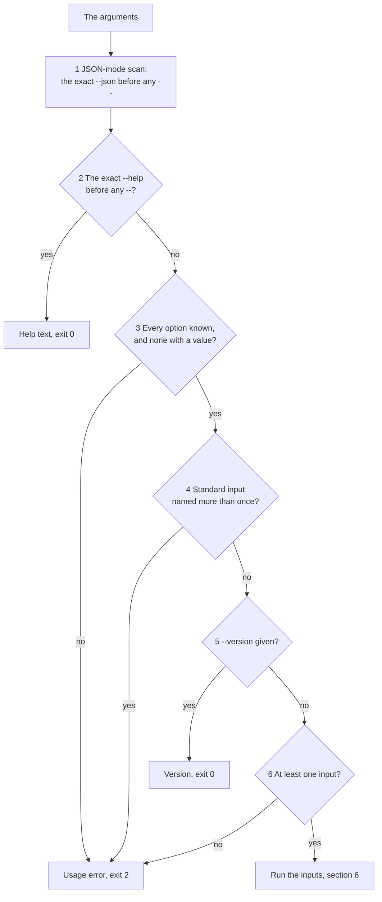

# CLI contract

| | |
|---|---|
| **Status** | Draft of Phase 2, task 4, written on 2026-11-23, for review before task 5 starts. G2.3 approves it together with the JSON contract of task 5. |
| **Plan** | [Section 8.9](../plans/plan-init-project.md#89-command-line-contract) fixes the command line, the JSON document, the outcomes and the exit statuses, on the rules of R21 and R23. This document fixes the rest: the order in which the command line is read, the messages, the help and version texts, the text layout and what goes to each output. |
| **API** | [`docs/design/api.md`](api.md), approved at G2.2 on 2026-11-23: the entry points and options (section 4), the outcomes (section 5), the report model (section 6), detection (section 8), the error record (section 10) and the document with its writer (section 12). |

This contract describes the command-line tool `cc-media-probe`, the binary of the package `cc-media-probe-cli` (G2.1). It fixes every byte that the tool writes for a given command line and input, so that the snapshot tests of Phase 3, task 21 can compare both outputs and the exit status exactly (plan section 8.9).

On 2026-11-23 the maintainer made three choices for it:

- **Text layout.** Text mode prints a summary of each report: the file's values, one line for each stream, the number of chapters, tags and attachments, and the completeness (section 8.2). JSON carries the whole report.
- **Text stability.** The text layout is written for people. It may change in any minor release, and each change is listed in the changelog under "Changed output". Programs read the JSON document (section 8.8).
- **An error that carries a partial report.** Standard error gets the error, and standard output gets the partial report in the normal layout, headed by the error (section 8.7).

## Contents

1. [Principles](#1-principles)
2. [The command line](#2-the-command-line)
3. [Reading the command line](#3-reading-the-command-line)
4. [Usage errors](#4-usage-errors)
5. [Help and version](#5-help-and-version)
6. [Running the inputs](#6-running-the-inputs)
7. [JSON mode](#7-json-mode)
8. [Text mode](#8-text-mode)
9. [Output failure](#9-output-failure)
10. [Tests](#10-tests)
11. [Not in 0.1.0](#11-not-in-010)
12. [What the spike found](#12-what-the-spike-found)
13. [Decisions for G2.3](#13-decisions-for-g23)

## 1. Principles

1. **A caller of the library.** The tool probes with the library's entry points and their default options, and writes its JSON document with `Document::serialize_results` (`api.md` section 12). It adds no value of its own to a report.
2. **The same bytes everywhere.** Nothing depends on the terminal or the locale. The parser has no color, terminal detection or suggestions (D6), no line is wrapped, no digits are grouped, and a line feed (U+000A) ends every line on every platform. Only what the platform itself supplies differs: the text of an operating-system error, and the paths a caller names.
3. **JSON for programs, text for people.** The JSON document is the interface for programs, with the compatibility contract of plan section 8.8. The text layout is for people (section 8.8).
4. **Results on standard output.** Standard output carries the results and nothing else. Messages go to standard error.
5. **Every text is a constant.** The messages, the help text and the labels of the text layout are constants of the tool (R33). The parser's own texts are never written (section 12).

## 2. The command line

```text
cc-media-probe [OPTIONS] <INPUT>...
```

| Option | Effect | Section |
|---|---|---|
| `--json` | Write one JSON document to standard output | 7 |
| `--detect` | Detection only: each entry carries a detection result in place of a report | 6, 8.5 |
| `--strict` | An entry of the outcome `partial` requires exit status 1 | 6.3 |
| `--help` | Print the help text | 5 |
| `--version` | Print the version | 5 |

`--companions` arrives with the release that ships companion lookup (plan section 8.9, R18). Until then it is an unknown option. A new option is a compatible change.

**Inputs.**

- An input is a path, or `-` for standard input. It is used as written: never expanded, resolved or normalized.
- `-` names standard input wherever it appears, also after `--`, as guideline 13 of the POSIX utility syntax guidelines says. A file named `-` is named `./-`. Standard input may be named once.
- An empty argument is an input too: a path that does not exist (section 6.4).
- An argument that is not valid Unicode is kept as the operating system gave it, so the file it names can still be opened. Its display follows plan section 8.8.

**Options.**

- An option may stand before, between or after the inputs. POSIX guideline 9 asks for options before operands; the tool accepts them anywhere, and the JSON-mode scan of plan section 8.9 already looks at every argument before `--`.
- `--` ends the options. Every argument after it is an input, even one that starts with `-` (POSIX guideline 10).
- There are no short options, and a long option is never abbreviated: `--js` is not `--json`. So only the exact argument `--json` turns JSON mode on (section 3).
- No option takes a value. `--json=yes` and `--json=` are usage errors.
- An option given twice is the same as an option given once. The order of the options does not matter (POSIX guideline 11).

## 3. Reading the command line

The tool reads the whole command line before it opens any input, so a usage error never follows a partial run (plan section 8.9). The steps run in this order, and the first that decides ends the reading:



1. **JSON mode.** It is on when the exact argument `--json` appears before any `--`. A plain scan of the arguments answers it, so the answer does not depend on the rest of the command line being valid (plan section 8.9). A misspelled `--jsno` leaves the run in text mode and is itself the usage error.
2. **Help.** The exact argument `--help` before any `--` prints the help text and exits with 0, whatever else the command line holds, an unknown option or a repeated `-` included. That is how `--help` always prints help (R21). `--help=1` is not `--help`; it is a usage error.
3. **Options.** An unknown option, or an option with a value, is a usage error. The first such argument from the left decides the message.
4. **Standard input.** `-` named more than once, before or after `--`, is a usage error.
5. **Version.** `--version` prints the version, as text or in JSON mode as the document of section 5, and exits with 0. It needs no input, and inputs beside it are not opened.
6. **Inputs.** A command line without an input is a usage error.

**Messages.** A usage error has one message:

| Case | Message |
|---|---|
| An unknown option | `unknown option: <argument>` |
| A value given to an option | `<option> takes no value` |
| Standard input named twice | `standard input (-) was named twice` |
| No input | `no input was named` |
| Any other error that the parser reports | `the command line could not be read` |

- `<argument>` is the argument as written, escaped as section 8.1 says. An argument that is not valid Unicode shows U+FFFD in place of what it cannot decode. In a group of short letters such as `-json`, the argument is its first letter, `-j`, since no letter is an option.
- `<option>` is the option's name without its value: `--json takes no value`.
- The last row is a fallback. No command line of the spike reaches it.

## 4. Usage errors

A usage error exits with status 2, in either mode, and always writes three lines to standard error (plan section 8.9):

```text
cc-media-probe: unknown option: --jsno
Usage: cc-media-probe [OPTIONS] <INPUT>...
Try 'cc-media-probe --help' for more information.
```

- The program's name is the constant `cc-media-probe`, never the first argument, so a renamed binary writes the same bytes.
- In text mode standard output stays empty.
- In JSON mode standard output gets the usage-error document, whose `results` array is empty (`Document::from_usage_error`, `api.md` section 12). Its message is the same text, unescaped, since JSON escapes control characters itself (RFC 8259 section 7):

```json
{
  "schema_version": "1.0",
  "generator": {
    "name": "cc-media-probe-cli",
    "version": "0.1.0"
  },
  "usage_error": {
    "message": "unknown option: --jsno"
  },
  "results": []
}
```

- The status stays 2 when the document cannot be written; standard error then also reports the output failure (section 9).

## 5. Help and version

**Help.** `--help` writes this text to standard output and exits with 0, with or without `--json` (R21):

```text
Inspect multimedia files and report what they contain.

Usage: cc-media-probe [OPTIONS] <INPUT>...

Arguments:
  <INPUT>...  A file to probe, or - for standard input

Options:
  --json      Write one JSON document to standard output
  --detect    Detect the format only
  --strict    Treat an incomplete or inconclusive result as a failure
  --help      Print this help
  --version   Print the version

Exit status: 0 if every input succeeded, 1 if any failed, 2 for a usage error.
```

The help text holds no version, so it changes only when this contract does. The release that ships lookup adds the line of `--companions`.

**Version.** Without `--json`, `--version` writes the program's name, a space and the version of the package, then a line feed: `cc-media-probe 0.1.0`. The GNU coding standards ask for this form: a constant name, and the version after the last space. With `--json`, it writes the document of no results, whose `generator` carries the version (plan section 8.9):

```json
{
  "schema_version": "1.0",
  "generator": {
    "name": "cc-media-probe-cli",
    "version": "0.1.0"
  },
  "results": []
}
```

Both exit with 0.

## 6. Running the inputs

### 6.1 Order

The inputs run one at a time, in the order of the command line. Each one is opened, probed, written and released before the next is opened, so memory use is bounded by one probe (plan section 8.9). An input that fails gets its result, and the run goes on with the next. Only an output failure ends the run early (section 9).

### 6.2 Entry points and options

| Input | Without `--detect` | With `--detect` |
|---|---|---|
| A path | `probe_file` | `detect_file` |
| `-` | `probe_stream` on standard input | `detect_stream` on standard input |

- Every probe uses the default options of `api.md` section 4.3: tags and chapters `Read`, attachments and cover art `MetadataOnly`, the default limits, and no format hint. `probe_file` and `detect_file` take the file-name hint from the path's final component; standard input has no hint.
- Companion lookup is off, so the tool opens no file other than its inputs (R18).
- A path that does not exist, is a folder or cannot be read is not a usage error. Its probe ends with an error of kind `source_failed`, whose record keeps the I/O error kind, such as `not_found` (section 6.4).

### 6.3 Outcomes and exit status

Each input gets one result, with the outcome of plan section 8.9:

| Mode | Result | Outcome | Exit status it requires |
|---|---|---|---|
| Probe | A complete report | `ok` | 0 |
| Probe | An incomplete report | `partial` | 0; 1 under `--strict` |
| Probe | An error, with its partial report where it carries one | `error` | 1 |
| `--detect` | Identified | `ok` | 0 |
| `--detect` | A family only, an ambiguous result, or a hint only | `partial` | 0; 1 under `--strict` |
| `--detect` | Insufficient data, an unknown format, or a source failure | `error` | 1 |

The run exits with the highest status that any result requires, or with 1 after an output failure. A usage error exits with 2, and help and the version with 0.

### 6.4 Inputs that fail

An input that cannot be opened gets the outcome `error`, like an input that opens and then fails. Its error record names the kind `source_failed`, the I/O error kind as a stable string, the operating system's code where there is one, and the messages of its cause chain (`api.md` section 10.2). In text mode the error goes to standard error (section 8.6). In JSON mode it is the entry's `error`.

## 7. JSON mode

- **One document.** Standard output gets exactly one document followed by one line feed, and nothing else. Standard error gets only usage messages and output failures: no per-input errors, no warnings and no diagnostics, since the document holds them all (plan section 8.9).
- **Its shape.** The document of plan section 8.9 and `api.md` section 12. Task 5 fixes every member in `docs/guide/json-output.md`. The `generator` is `cc-media-probe-cli` with the tool's version.
- **Written as it goes.** `Document::serialize_results` writes the document, one entry as each input finishes, to the pretty serializer of `serde_json`: two spaces of indentation for each level, a colon and a space after each member's name, and each member and each array element on lines of its own. The tool then writes the line feed and flushes, through the same output (`api.md` section 12).
- **Entries.** `index` counts the inputs from 0, in the order of the command line; options do not count. `input` is the input as written, so standard input is `"-"`. An input that is not valid Unicode has its display string with `input_lossy` and `input_raw` beside it (plan section 8.8). Then come `outcome` and the entry's record: `report`, `detection` or `error`.
- **Records.** Each record is a root record that carries the document's version, down to the partial report of an error record (plan section 8.8).

Three inputs of different outcomes, with each record cut to the members that this section discusses:

```json
{
  "schema_version": "1.0",
  "generator": {
    "name": "cc-media-probe-cli",
    "version": "0.1.0"
  },
  "results": [
    {
      "index": 0,
      "input": "movie.mkv",
      "outcome": "ok",
      "report": {
        "schema_version": "1.0"
      }
    },
    {
      "index": 1,
      "input": "-",
      "outcome": "partial",
      "report": {
        "schema_version": "1.0"
      }
    },
    {
      "index": 2,
      "input": "missing.mkv",
      "outcome": "error",
      "error": {
        "schema_version": "1.0",
        "kind": "source_failed",
        "source_failure_kind": "not_found"
      }
    }
  ]
}
```

## 8. Text mode

### 8.1 Layout rules

- **Blocks.** Standard output gets one block for each input that has something to show: a report, a partial report, or a detection result. A blank line separates two blocks. An input whose error carries no partial report has no block; its error is on standard error (section 8.6).
- **Lines.** A block starts with the input's display string at the start of its line. Every other line starts with two spaces, then a label padded with spaces to 13 characters, then the value. A label of 13 characters or more is followed by one space. A value that continues on further lines, such as the reasons of an incomplete report, continues after 15 spaces.
- **Absent values.** A file-level line whose value is absent says `unknown`. A stream's line lists only the values that are present.
- **Numbers** are decimal ASCII digits without grouping.

| Value | Written as | Example |
|---|---|---|
| A duration | `HH:MM:SS.mmm`, rounded to the nearest millisecond with ties away from zero. The hours have at least two digits and grow as needed. | `00:01:30.000`, `100:00:00.000` |
| A size in bytes | The count, then `bytes` | `12345678 bytes` |
| A bit rate | Rounded to the nearest whole bit per second with ties away from zero, then `bit/s` | `1097393 bit/s` |
| A frame rate or sample rate | The exact rational as `Rational` displays it, then `fps` or `Hz` | `24000/1001 fps`, `48000 Hz` |
| A picture size | As `Size` displays it | `1920x1080` |
| A language | The BCP 47 tag of `Language::tag()`. A language without a tag, `und`, is not shown. | `en` |
| A title | In double quotes | `"Français"` |
| A stable name | The `snake_case` name that the JSON document writes | `limit_exhausted` |

**Escaping.** Text taken from an input or from the command line can hold characters that a terminal acts on: escape sequences that move the cursor, rewrite the screen or set the window title, and bidirectional controls that reorder what is shown (the Trojan Source attack, CVE-2021-42574). Two sets of characters are therefore written as `\u{…}`, with the code point in lowercase hexadecimal and no leading zeros, the form of Rust's `char::escape_unicode`:

- the control characters of Unicode category `Cc`: U+0000 to U+001F and U+007F to U+009F. The escape U+001B is written `\u{1b}`, and a line feed inside a title `\u{a}`;
- the characters of the Unicode property `Bidi_Control`: U+061C, U+200E, U+200F, U+202A to U+202E, and U+2066 to U+2069.

Every other character is written as it is. A backslash is not escaped, so a Windows path reads as written; the escaping is for people, and the JSON document stays exact. The rule applies to every text in text mode and to every message on standard error in either mode, the input's display string included. A JSON document is not escaped this way: its strings follow RFC 8259.

### 8.2 A report

```text
movie.mkv
  format       Matroska
  media type   video/matroska
  duration     00:01:30.000
  size         12345678 bytes
  bit rate     1097393 bit/s
  stream 0     video: H.264, 1920x1080, 24000/1001 fps, en, default
  stream 1     audio: AAC, 48000 Hz, 2 channels, en, default
  stream 2     subtitle: SubRip, fr, forced, "Français"
  chapters     12 in 1 edition
  tags         37 in 4 sets
  attachments  2
  complete     yes
```

The lines, in this order:

| Label | Value |
|---|---|
| (none) | The input's display string. When the path is not valid Unicode, ` (the name is not valid Unicode)` follows. |
| `error` | Only for the partial report of an error (section 8.7) |
| `format` | `Format::name()` |
| `media type` | `MediaReport::media_type()`, or `unknown` |
| `duration` | `duration()`; when it is absent and an estimate exists, `unknown, estimated` with the estimate and its method in parentheses, such as `unknown, estimated 00:01:30.000 (constant_bit_rate_over_size)`; otherwise `unknown`. An estimate never stands alone (R25). |
| `size` | `size()`, or `unknown` |
| `bit rate` | `bit_rate()`, with its estimate in the same form as the duration, or `unknown` |
| `stream N` | One line for each stream in index order (section 8.3). A report of no streams has the line `streams` with `none`. |
| `chapters` | The number of chapters of every edition, nested ones included, then `in`, the number of editions and `edition` or `editions`; `none` without an edition |
| `tags` | The number of tags of every tag set, children included, then `in`, the number of sets and `set` or `sets`; `none` without a set |
| `attachments` | The number of attachments, or `none` |
| `complete` | Section 8.4 |

A section's status follows its count. `Incomplete` adds `, incomplete`, as in `none, incomplete`. `NotRequested` replaces the count with `not requested`, which the default options never cause. `NotApplicable` reads `none`. A status that a newer version wrote adds `, status ` and its name.

### 8.3 A stream

A stream's line holds its kind by its stable name, a colon, and its codec as `CodecInformation` displays it: the codec's name, else the identifier that the file wrote, and for an unresolved codec the candidates joined by ` or ` (`api.md` section 6.4). Then, separated by `, ` and each only when present:

1. **Video:** the visible size; `display` with the display size when it differs from the visible size, or when the visible size is absent; the frame rate with `fps`, or `variable frame rate` when the rate is absent and its mode is `Variable`.
2. **Audio:** the sample rate with `Hz`; the channel count with `channel` or `channels`.
3. **The language** of `Stream::language()`.
4. **The dispositions** that are true, in the order of `api.md` section 6.3: `default`, `disabled` (when `is_enabled()` is false), `forced`, `hearing impaired`, `visually impaired`, `text descriptions`, `original language`, `commentary`.
5. **`protected`**, when `Stream::protection()` holds a declaration.
6. **`embedded in stream N`**, for an embedded stream (F14).
7. **The title,** in double quotes.

The header status has no line of its own. A state that is not final is a shortfall, which the completeness reasons name with its stream (section 8.4). A final state, such as identification only or partially parsed by design, is not (`api.md` section 5.4).

### 8.4 Completeness

`complete` reads `yes` when `Completeness::is_complete()` is true (R23). Otherwise it reads `no`, and each reason of `Completeness::reasons()` follows on a line of its own, after 15 spaces:

```text
  complete     no
               discovery: limit_exhausted (streams)
               headers of stream 2: truncated_input
```

A reason is the part's stable name, with ` of stream N` for a stream's headers and ` of source N` where it names a source other than the primary input, as a companion's request does. A colon and the reason's kind follow, then the limit's name or the feature's name in parentheses where the reason names one, and a colon with the detail where it has one. A report that is incomplete only through a status of a newer version reads `no` with no further line.

### 8.5 A detection

With `--detect`, each detection result has a block of its own:

```text
movie.mkv
  outcome      identified
  format       Matroska
  support      probed
  confidence   100
```

| Outcome | Lines after `outcome` |
|---|---|
| `identified` | `format`; `support`, which is `probed` or `detect_only`; `confidence` |
| `family_only` | `format`, the family's name |
| `ambiguous` | One `candidate` line for each candidate, by falling confidence: the format's name, then `, confidence` and the number |
| `hint_only` | `hint`: the hinted format's name, its origin's stable name in parentheses, and `, not verified` |
| `insufficient_data` | `bytes needed`, where known; `reason`, where known: the reason's kind, with its limit in parentheses where it names one, as in section 8.4 |
| `unknown` | None |

A line whose value is absent is left out. An outcome of the kind `error`, insufficient data or an unknown format, also writes its error line to standard error (section 8.6). A source failure during detection is an error, as in a probe.

### 8.6 Errors and warnings

Standard error gets, for each input in turn, after that input's block on standard output:

- **Its error.** One line: the input's display string, `: error: `, the error's kind, `: ` and its message. Each message of the cause chain follows on a line of its own, as two spaces, `caused by: ` and the message:

  ```text
  broken.mkv: error: source_failed: the source failed at byte 1048576
    caused by: Input/output error (os error 5)
  ```

  With `--detect`, an outcome of insufficient data or an unknown format writes the input, `: error: ` and the outcome's stable name.
- **Its warnings.** One line for each diagnostic of the severity `error` or `warning`, in the report's order: the input, `: `, the severity, `: `, the code, `: ` and the message. Where they are known, the stream, the source other than the primary input, and the offset follow in parentheses, as `(stream 2, byte 4096)`. Diagnostics of the severity `information` stay in the JSON document. When the report counted diagnostics that it did not keep, a last line says `<input>: warning: <count> more diagnostics were counted and not kept`.

The block comes first and the lines on standard error after it, so a terminal that shows both outputs shows each input's messages below its block.

### 8.7 An error that carries a partial report

As the maintainer chose on 2026-11-23, an error that carries a partial report (R19) shows both:

- **Standard error** gets the error and the partial report's warnings, as section 8.6 says.
- **Standard output** gets the partial report in the layout of section 8.2. Its second line is `error`, with the error's kind and `, read before the error`, so a reader cannot take the block for a report that succeeded:

  ```text
  broken.mkv
    error        source_failed, read before the error
    format       Matroska
    media type   unknown
    duration     unknown
    size         4194304 bytes
    bit rate     unknown
    stream 0     video: H.264, 1920x1080, 24000/1001 fps
    chapters     none, incomplete
    tags         none, incomplete
    attachments  none, incomplete
    complete     no
                 tags: source_failed
                 chapters: source_failed
                 attachments: source_failed
  ```

  Each part that the failure stopped names the reason `source_failed`, which the maintainer added to `api.md` section 5.5 on 2026-11-23 for this case.

The observations of an error that stopped before its inventory, such as the track identifiers of an ISO media segment (R20), are not a report and have no block. They are in the JSON document.

### 8.8 Stability of the text

The text layout is for people, as the maintainer chose on 2026-11-23:

- It may change in any minor release. Each change is listed in the changelog under "Changed output", and the snapshot tests are updated in the same change (plan section 9.6).
- It is not a compatibility contract. Programs read the JSON document, whose contract is plan section 8.8.
- What does hold across releases is this document's rules for the outputs: which output carries what, the exit statuses, the usage errors and the JSON document.

`docs/guide/stability.md` (task 5) states this beside the compatible kinds of output change.

## 9. Output failure

If standard output cannot be written, as with a closed pipe or a full disk, the tool stops (plan section 8.9):

- It probes no further input, writes `cc-media-probe: standard output failed: ` and the error's message to standard error, escaped as section 8.1 says, and exits with 1. The document or the text on standard output is then incomplete.
- This holds up to the last byte. The line feed after the document, the line feeds of the text, and the final flush go through the same output and fail in the same way, never with a panic (`api.md` section 12).
- On Unix the Rust runtime ignores the signal of a closed pipe before `main` runs, so a write to a closed pipe returns an error instead of ending the process. A pipeline such as `cc-media-probe --json *.mkv | head -n 1` therefore ends the tool with status 1 and the message on standard error. Changing the signal's handling would need code outside the standard library and `unsafe`, which R15 forbids.
- A usage error keeps its status 2, and help and the version exit with 1 when their text cannot be written.
- A failure to write standard error changes nothing: the tool goes on, and the exit status stays what the results and standard output decide.

## 10. Tests

The snapshot tests of Phase 3, task 21 run the binary and compare standard output, standard error and the exit status byte for byte. They cover the cases of plan section 8.9:

- `-` named twice, with and without `--json`;
- no input, with and without `--json`;
- an unknown option together with `--json`, and a misspelled `--json`;
- `--json --version` and `--json --help`;
- a path that does not exist among valid inputs;
- the usage-error document read back as a `Document`;
- the writer's output equal to that of `Document::from_results`, for no inputs and for mixed ones;
- an output failure inside an entry, which leaves the next input unprobed, and one at the last byte, each with exit status 1 and its report on standard error.

And the rules of this document:

- **Reading the command line:** `--help` beside an unknown option and beside a repeated `-`; `--help=1`; `--json=yes`; `--js`; `-json`; an option after an input; a repeated option; `-` after `--`; `--json` after `--`; an empty argument; `--version` with an input, and `--version` beside `-` named twice. The spike's cases of section 12 are the start of this list.
- **The help and version texts** of section 5, with and without `--json`.
- **Text mode:** a complete report; an incomplete report, with and without `--strict`; an error without a partial report; an error that carries one; each detection outcome; a report of no streams; an estimated duration; a diagnostic with its stream and offset.
- **Escaping:** a title, a codec identifier as the file wrote it, a diagnostic's message and an input name that hold U+001B, U+0007, U+009B, U+202E and U+2066, each written as its escape; a backslash written as it is.
- **Paths:** an input that is not valid Unicode, on Unix and on Windows, in both modes.

## 11. Not in 0.1.0

Each of these can be added later as a compatible change, with a new option where it needs one:

- options for the limits or the sections, or a format hint: every probe uses the defaults of `api.md` section 4.3;
- a line-delimited JSON mode, under a separate flag (plan section 8.9);
- companion lookup, which arrives with `--companions` (R18);
- probing several inputs at once, and descending into folders: a folder is an input that fails;
- short options, color and localized messages.

## 12. What the spike found

The disposable spike [`spikes/cli-arguments/`](../../spikes/cli-arguments/README.md) reads the command lines of sections 2 and 3 with `clap` 4.6.8, the version of the dependency dossier. Its tests pass, and they found:

- `clap` takes `-` as an input, before and after `--`. A second `-` has to be counted by the tool.
- After `--`, `--json` and `--help` are inputs, and the two plain scans stop at the first `--`, as plan section 8.9 requires.
- `clap` never abbreviates a long option (`--js`), and an unknown option of any form is the error kind `UnknownArgument`, whose context names the argument (`--jsno`, `---json`, `--JSON`). For `-json` it names `-j`.
- A value given to a flag, `--json=yes` or `--json=`, is the error kind `TooManyValues`, whose context names the option alone.
- A repeated flag is accepted once `args_override_self` is set; without it, `clap` refuses the second occurrence.
- An empty argument is an input. An input that is not valid Unicode is kept as written, and an unknown option that is not valid Unicode is named with U+FFFD.
- With `clap`'s own help and version flags turned off, and `--help` and `--version` declared as plain flags, `clap` writes nothing to either output: a test runs the spike's program and finds only the lines that the program writes.
- The spike needs only the features `std` and `error-context`. `error-context` gives the argument that an error names. The features `help` and `usage` generate texts that the tool never writes; the spike passes with and without them.

## 13. Decisions for G2.3

G2.3 approves this contract together with the JSON contract of task 5 (plan Phase 2, task 9). The maintainer's three choices of 2026-11-23 are at the top of this document. The agent made these choices without asking, and each can still change at G2.3:

- The reading order of section 3: help before every other step, and the version before the check for an input.
- No short options, among them no `-h`.
- Options accepted after the inputs, and a repeated option accepted.
- The messages of section 3, the three lines of section 4, and the help and version texts of section 5.
- The JSON document pretty-printed with two spaces, followed by one line feed.
- The labels, value formats and order of the text layout (sections 8.2 to 8.5), with the language as its BCP 47 tag and the header status shown only through the completeness reasons.
- Diagnostics of the severities `error` and `warning` on standard error in text mode, and none of the severity `information`.
- The escaping of section 8.1, with the backslash left as it is.
- On a closed pipe, exit status 1 with a message, as plan section 8.9 has it, rather than the silent end that the signal would give.
- A failure to write standard error ignored.
- The dossier's row for `clap` could drop the features `help` and `usage`, which the tool does not need (section 12). The dossier keeps them until G2.3 decides.

**Found while writing.** A source failure after the inventory gives an error that carries a partial report (R19). `api.md` section 5.3 records every shortfall against the part it stopped, but no reason said that a source failed, so the partial report of section 8.7 could not say why its remaining parts were incomplete. The maintainer chose on 2026-11-23 to add `ReasonKind::SourceFailed`, with `PartReason::source_identifier()` naming the source (`api.md` section 5.5). A new variant of an open set is compatible, so G2.2 stands.
