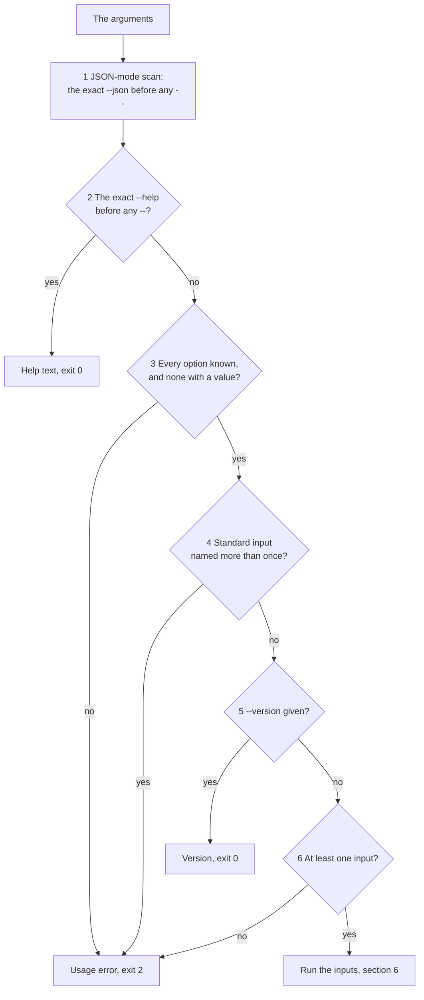

# CLI contract

| | |
|---|---|
| **Status** | Draft of Phase 2, task 4, written on 2026-11-23, for review before task 5 starts. G2.3 approves it together with the JSON contract of task 5. The sixth review of `api.md` revised sections 7, 8.4, 8.5, 10 and 13 on the same day, and the seventh revised sections 8.4, 10 and 13. The eighth review, of this contract and of `api.md`, revised sections 3, 8.4, 8.6, 8.7, 9, 10, 12 and 13, and the ninth revised sections 3, 4, 8.5, 8.6, 9, 10, 12 and 13. The tenth revised sections 8.1 to 8.6, 9, 10, 12 and 13, the eleventh sections 4, 8.1, 8.4, 8.6, 9, 10, 12 and 13, and the twelfth sections 8.2, 8.3, 10, 12 and 13. |
| **Plan** | [Section 8.9](../plans/plan-init-project.md#89-command-line-contract) fixes the command line, the JSON document, the outcomes and the exit statuses, on the rules of R21 and R23. This document fixes the rest: the order in which the command line is read, the messages, the help and version texts, the text layout and what goes to each output. |
| **API** | [`docs/design/api.md`](api.md), approved at G2.2 on 2026-11-23: the entry points and options (section 4), the outcomes (section 5), the report model (section 6), detection (section 8), the error record (section 10) and the document with its writer (section 12). |

This contract describes the command-line tool `cc-media-probe`, the binary of the package `cc-media-probe-cli` (G2.1). It fixes every byte that the tool writes for a given command line and input, so that the snapshot tests of Phase 3, task 21 can compare both outputs and the exit status exactly (plan section 8.9).

On 2026-11-23 the maintainer made three choices for it:

- **Text layout.** Text mode prints a summary of each report: the file's values, one line for each stream, the number of chapters, tags and attachments, and the completeness (section 8.2). JSON carries the whole report.
- **Text stability.** The text layout is written for people. It may change in any minor release, and each change is listed in the changelog under "Changed output". Programs read the JSON document (section 8.8).
- **An error that carries a partial report.** Standard error gets the error, and standard output gets the partial report in the normal layout, headed by the error (section 8.7).

At the eleventh review, also on 2026-11-23, the maintainer made three more:

- **The lines of a cause chain.** They continue the error's line, so they carry neither the input's name nor its marker (sections 8.1 and 8.6).
- **A usage error whose document cannot be written.** The output failure's line comes first on standard error, before the usage error's three lines (section 4).
- **A companion's diagnostic in `0.1.0`.** A test of the text formatter covers it with a report read from a JSON document. The binary snapshot waits for the release that adds `--companions` (section 10).

## Contents

1. [Principles](#1-principles)
2. [The command line](#2-the-command-line)
3. [Reading the command line](#3-reading-the-command-line)
4. [Usage errors](#4-usage-errors)
5. [Help and version](#5-help-and-version)
6. [Running the inputs](#6-running-the-inputs)
7. [JSON mode](#7-json-mode)
8. [Text mode](#8-text-mode)
9. [Output failure](#9-output-failure)
10. [Tests](#10-tests)
11. [Not in 0.1.0](#11-not-in-010)
12. [What the spike found](#12-what-the-spike-found)
13. [Decisions for G2.3](#13-decisions-for-g23)

## 1. Principles

1. **A caller of the library.** The tool probes with the library's entry points and their default options, and writes its JSON document with `Document::serialize_results` (`api.md` section 12). It adds no value of its own to a report.
2. **The same bytes everywhere.** Nothing depends on the terminal or the locale. The parser has no color, terminal detection or suggestions (D6), no line is wrapped, no digits are grouped, and a line feed (U+000A) ends every line on every platform. Only what the platform itself supplies differs: the text of an operating-system error, and the paths a caller names.
3. **JSON for programs, text for people.** The JSON document is the interface for programs, with the compatibility contract of plan section 8.8. The text layout is for people (section 8.8).
4. **Results on standard output.** Standard output carries the results and nothing else. Messages go to standard error.
5. **Every text is a constant.** The messages, the help text and the labels of the text layout are constants of the tool (R33). The parser's own texts are never written (section 12).

## 2. The command line

```text
cc-media-probe [OPTIONS] <INPUT>...
```

| Option | Effect | Section |
|---|---|---|
| `--json` | Write one JSON document to standard output | 7 |
| `--detect` | Detection only: each entry carries a detection result in place of a report | 6, 8.5 |
| `--strict` | An entry of the outcome `partial` requires exit status 1 | 6.3 |
| `--help` | Print the help text | 5 |
| `--version` | Print the version | 5 |

`--companions` arrives with the release that ships companion lookup (plan section 8.9, R18). Until then it is an unknown option. A new option is a compatible change.

**Inputs.**

- An input is a path, or `-` for standard input. It is used as written: never expanded, resolved or normalized.
- `-` names standard input wherever it appears, also after `--`, as guideline 13 of the POSIX utility syntax guidelines says. A file named `-` is named `./-`. Standard input may be named once.
- An empty argument is an input too: a path that does not exist (section 6.4).
- An argument that is not valid Unicode is kept as the operating system gave it, so the file it names can still be opened. Its display follows plan section 8.8.

**Options.**

- An option may stand before, between or after the inputs. POSIX guideline 9 asks for options before operands; the tool accepts them anywhere, and the JSON-mode scan of plan section 8.9 already looks at every argument before `--`.
- `--` ends the options. Every argument after it is an input, even one that starts with `-` (POSIX guideline 10).
- There are no short options, and a long option is never abbreviated: `--js` is not `--json`. So only the exact argument `--json` turns JSON mode on (section 3).
- No option takes a value. `--json=yes` and `--json=` are usage errors.
- An option given twice is the same as an option given once. The order of the options does not matter (POSIX guideline 11).

## 3. Reading the command line

The tool reads the whole command line before it opens any input, so a usage error never follows a partial run (plan section 8.9). The steps run in this order, and the first that decides ends the reading:



1. **JSON mode.** It is on when the exact argument `--json` appears before any `--`. A plain scan of the arguments answers it, so the answer does not depend on the rest of the command line being valid (plan section 8.9). A misspelled `--jsno` leaves the run in text mode and is itself the usage error.
2. **Help.** The exact argument `--help` before any `--` prints the help text and exits with 0, whatever else the command line holds, an unknown option or a repeated `-` included. That is how `--help` always prints help (R21). `--help=1` is not `--help`; it is a usage error.
3. **Options.** An unknown option, or an option with a value, is a usage error. The first such argument from the left decides the message.
4. **Standard input.** `-` named more than once, before or after `--`, is a usage error.
5. **Version.** `--version` prints the version, as text or in JSON mode as the document of section 5, and exits with 0. It needs no input, and inputs beside it are not opened.
6. **Inputs.** A command line without an input is a usage error.

**Messages.** A usage error has one message:

| Case | Message |
|---|---|
| An unknown option | `unknown option: <argument>` |
| A value given to an option | `<option> takes no value` |
| Standard input named twice | `standard input (-) was named twice` |
| No input | `no input was named` |
| Any other error that the parser reports | `the command line could not be read` |

- `<argument>` is the argument as written, decoded: an argument that is not valid Unicode shows U+FFFD in place of what it cannot decode, and nothing else is changed. In a group of short letters such as `-json`, the argument is its first letter, `-j`, since no letter is an option.
- A long option keeps its value: `--bogus=value` gives `unknown option: --bogus=value`, and `--=x` gives `unknown option: --=x`, never the separator `--` alone. The parser names only the option (section 12), so the tool takes the first argument before `--` that is that name, or that name followed by `=`.
- **One message, escaped only for the terminal.** The tool builds the message once, from the decoded argument. Standard error writes it escaped, as section 8.1 says for every message there. In JSON mode the document holds it unescaped, since JSON escapes control characters itself (section 4). So for the argument `--bo`, a line feed and `gus`, standard error shows `unknown option: --bo\u{a}gus`, and the document's `message` holds the line feed, written `\n` by JSON.
- `<option>` is the option's name without its value: `--json takes no value`.
- The last row is a fallback. No command line of the spike reaches it.

## 4. Usage errors

A usage error exits with status 2, in either mode, and always writes these three lines to standard error (plan section 8.9):

```text
cc-media-probe: unknown option: --jsno
Usage: cc-media-probe [OPTIONS] <INPUT>...
Try 'cc-media-probe --help' for more information.
```

- The program's name is the constant `cc-media-probe`, never the first argument, so a renamed binary writes the same bytes.
- In text mode standard output stays empty.
- In JSON mode standard output gets the usage-error document, whose `results` array is empty (`Document::from_usage_error`, `api.md` section 12). Its message is the message of section 3 as the tool built it, from the decoded argument and without the escaping of standard error, since JSON escapes control characters itself (RFC 8259 section 7):

```json
{
  "schema_version": "1.0",
  "generator": {
    "name": "cc-media-probe-cli",
    "version": "0.1.0"
  },
  "usage_error": {
    "message": "unknown option: --jsno"
  },
  "results": []
}
```

- The status stays 2 when the document cannot be written, and standard error then also reports the output failure (section 9). As the maintainer chose at the eleventh review, the output failure's line comes first, and the usage error's three lines follow it. The tool writes standard output before standard error, as it does for every input (section 8.6), so it meets the failure first. With `--json --jsno` and a pipe whose reader has gone, on Unix:

```text
cc-media-probe: standard output failed: Broken pipe (os error 32)
cc-media-probe: unknown option: --jsno
Usage: cc-media-probe [OPTIONS] <INPUT>...
Try 'cc-media-probe --help' for more information.
```

## 5. Help and version

**Help.** `--help` writes this text to standard output and exits with 0, with or without `--json` (R21):

```text
Inspect multimedia files and report what they contain.

Usage: cc-media-probe [OPTIONS] <INPUT>...

Arguments:
  <INPUT>...  A file to probe, or - for standard input

Options:
  --json      Write one JSON document to standard output
  --detect    Detect the format only
  --strict    Treat an incomplete or inconclusive result as a failure
  --help      Print this help
  --version   Print the version

Exit status: 0 if every input succeeded, 1 if any failed, 2 for a usage error.
```

The help text holds no version, so it changes only when this contract does. The release that ships lookup adds the line of `--companions`.

**Version.** Without `--json`, `--version` writes the program's name, a space and the version of the package, then a line feed: `cc-media-probe 0.1.0`. The GNU coding standards ask for this form: a constant name, and the version after the last space. With `--json`, it writes the document of no results, whose `generator` carries the version (plan section 8.9):

```json
{
  "schema_version": "1.0",
  "generator": {
    "name": "cc-media-probe-cli",
    "version": "0.1.0"
  },
  "results": []
}
```

Both exit with 0.

## 6. Running the inputs

### 6.1 Order

The inputs run one at a time, in the order of the command line. Each one is opened, probed, written and released before the next is opened, so memory use is bounded by one probe (plan section 8.9). An input that fails gets its result, and the run goes on with the next. Only an output failure ends the run early (section 9).

### 6.2 Entry points and options

| Input | Without `--detect` | With `--detect` |
|---|---|---|
| A path | `probe_file` | `detect_file` |
| `-` | `probe_stream` on standard input | `detect_stream` on standard input |

- Every probe uses the default options of `api.md` section 4.3: tags and chapters `Read`, attachments and cover art `MetadataOnly`, the default limits, and no format hint. `probe_file` and `detect_file` take the file-name hint from the path's final component; standard input has no hint.
- Companion lookup is off, so the tool opens no file other than its inputs (R18).
- A path that does not exist, is a folder or cannot be read is not a usage error. Its probe ends with an error of kind `source_failed`, whose record keeps the I/O error kind, such as `not_found` (section 6.4).

### 6.3 Outcomes and exit status

Each input gets one result, with the outcome of plan section 8.9:

| Mode | Result | Outcome | Exit status it requires |
|---|---|---|---|
| Probe | A complete report | `ok` | 0 |
| Probe | An incomplete report | `partial` | 0; 1 under `--strict` |
| Probe | An error, with its partial report where it carries one | `error` | 1 |
| `--detect` | Identified | `ok` | 0 |
| `--detect` | A family only, an ambiguous result, or a hint only | `partial` | 0; 1 under `--strict` |
| `--detect` | Insufficient data, an unknown format, or a source failure | `error` | 1 |

The run exits with the highest status that any result requires, or with 1 after an output failure. A usage error exits with 2, and help and the version with 0.

### 6.4 Inputs that fail

An input that cannot be opened gets the outcome `error`, like an input that opens and then fails. Its error record names the kind `source_failed`, the I/O error kind as a stable string, the operating system's code where there is one, and the messages of its cause chain (`api.md` section 10.2). In text mode the error goes to standard error (section 8.6). In JSON mode it is the entry's `error`.

## 7. JSON mode

- **One document.** Standard output gets exactly one document followed by one line feed, and nothing else. Standard error gets only usage messages and output failures: no per-input errors, no warnings and no diagnostics, since the document holds them all (plan section 8.9).
- **Its shape.** The document of plan section 8.9 and `api.md` section 12. Task 5 fixes every member in [`docs/guide/json-output.md`](../guide/json-output.md), whose draft is ready for review. The `generator` is `cc-media-probe-cli` with the tool's version.
- **Written as it goes.** `Document::serialize_results` writes the document, one entry as each input finishes, to the pretty serializer of `serde_json`: two spaces of indentation for each level, a colon and a space after each member's name, and each member and each array element on lines of its own. The tool then writes the line feed and flushes, through the same output (`api.md` section 12).
- **Entries.** `index` counts the inputs from 0, in the order of the command line; options do not count. Every input gets an entry in that order, so the index is the entry's position in `results`, which the document writes (`api.md` section 12). `input` is the input as written, so standard input is `"-"`. An input that is not valid Unicode has its display string with `input_lossy` and `input_raw` beside it (plan section 8.8). Then come `outcome` and the entry's record: `report`, `detection` or `error`.
- **Records.** Each record is a root record that carries the document's version, down to the partial report of an error record (plan section 8.8).

Three inputs of different outcomes, with each record cut to the members that this section discusses:

```json
{
  "schema_version": "1.0",
  "generator": {
    "name": "cc-media-probe-cli",
    "version": "0.1.0"
  },
  "results": [
    {
      "index": 0,
      "input": "movie.mkv",
      "outcome": "ok",
      "report": {
        "schema_version": "1.0"
      }
    },
    {
      "index": 1,
      "input": "-",
      "outcome": "partial",
      "report": {
        "schema_version": "1.0"
      }
    },
    {
      "index": 2,
      "input": "missing.mkv",
      "outcome": "error",
      "error": {
        "schema_version": "1.0",
        "kind": "source_failed",
        "source_failure_kind": "not_found"
      }
    }
  ]
}
```

## 8. Text mode

### 8.1 Layout rules

- **Blocks.** Standard output gets one block for each input that has something to show: a report, a partial report, or a detection result. A blank line separates two blocks. An input whose error carries no partial report has no block; its error is on standard error (section 8.6).
- **The input's name.** Text mode writes an input as its name: the input's display string, followed by ` (the name is not valid Unicode)` when the path is lossy (plan section 8.8). A path that is not valid Unicode shows U+FFFD in its display string, so a file whose name holds a real U+FFFD would otherwise look the same. As the tenth review asked, the name is the same wherever an input appears: the first line of a report, of a partial report and of a detection result, and the start of every line on standard error that begins a message of that input: its error, each warning and the count line (section 8.6). A line of the cause chain continues the error's line above it, so, as the maintainer chose at the eleventh review, it starts with two spaces and carries neither the name nor the marker. Standard input, `-`, is never lossy.
- **Lines.** A block starts with the input's name at the start of its line. Every other line starts with two spaces, then a label padded with spaces to 13 characters, then the value. A label of 13 characters or more is followed by one space. A value that continues on further lines, such as the reasons of an incomplete report, continues after 15 spaces.
- **Absent values.** A file-level line whose value is absent says `unknown`. A stream's line lists only the values that are present.
- **Numbers** are decimal ASCII digits without grouping.

| Value | Written as | Example |
|---|---|---|
| A duration | `HH:MM:SS.mmm`, rounded to the nearest millisecond with ties away from zero. The hours have at least two digits and grow as needed. | `00:01:30.000`, `100:00:00.000` |
| A size in bytes | The count, then `bytes` | `12345678 bytes` |
| A bit rate | Rounded to the nearest whole bit per second with ties away from zero, then `bit/s` | `1097393 bit/s` |
| A frame rate or sample rate | The exact rational as `Rational` displays it, then `fps` or `Hz` | `24000/1001 fps`, `48000 Hz` |
| A picture size | As `Size` displays it | `1920x1080` |
| A language | The BCP 47 tag of `Language::tag()`. A language without a tag, `und`, is not shown. | `en` |
| A title | In double quotes | `"Français"` |
| A stable name | The `snake_case` name that the JSON document writes | `limit_exhausted` |

**Escaping.** Text taken from an input or from the command line can hold characters that a terminal acts on: escape sequences that move the cursor, rewrite the screen or set the window title, and bidirectional controls that reorder what is shown (the Trojan Source attack, CVE-2021-42574). Two sets of characters are therefore written as `\u{…}`, with the code point in lowercase hexadecimal and no leading zeros, the form of Rust's `char::escape_unicode`:

- the control characters of Unicode category `Cc`: U+0000 to U+001F and U+007F to U+009F. The escape U+001B is written `\u{1b}`, and a line feed inside a title `\u{a}`;
- the characters of the Unicode property `Bidi_Control`: U+061C, U+200E, U+200F, U+202A to U+202E, and U+2066 to U+2069.

Every other character is written as it is. A backslash is not escaped, so a Windows path reads as written; the escaping is for people, and the JSON document stays exact. The rule applies to every text in text mode and to every message on standard error in either mode, the input's display string included. A JSON document is not escaped this way: its strings follow RFC 8259.

### 8.2 A report

```text
movie.mkv
  format       Matroska
  media type   video/matroska
  duration     00:01:30.000
  size         12345678 bytes
  bit rate     1097393 bit/s
  stream 0     video: H.264, 1920x1080, 24000/1001 fps, en, default
  stream 1     audio: AAC, 48000 Hz, 2 channels, en, default
  stream 2     subtitle: SubRip, fr, forced, "Français"
  chapters     12 in 1 edition
  tags         37 in 4 sets
  attachments  2
  complete     yes
```

The lines, in this order:

| Label | Value |
|---|---|
| (none) | The input's name (section 8.1): its display string, with ` (the name is not valid Unicode)` after a path that is not valid Unicode |
| `error` | Only for the partial report of an error (section 8.7) |
| `format` | `Format::name()` |
| `media type` | `MediaReport::media_type()`, or `unknown` |
| `duration` | `duration()`; when it is absent and an estimate exists, `unknown, estimated` with the estimate and its method in parentheses, such as `unknown, estimated 00:01:30.000 (constant_bit_rate_over_size)`; otherwise `unknown`. An estimate never stands alone (R25). |
| `size` | `size()`, or `unknown` |
| `bit rate` | `bit_rate()`, with its estimate in the same form as the duration, or `unknown` |
| `stream N` | One line for each stream in index order (section 8.3). A report of no streams has the line `streams` with `none`. |
| `chapters` | The number of chapters of every edition, nested ones included, then `in`, the number of editions and `edition` or `editions`; `none` without an edition |
| `tags` | The number of tags of every tag set, children included, then `in`, the number of sets and `set` or `sets`; `none` without a set. Every set of `tag_sets()` counts, so a set that a later Tags element of a live stream superseded counts too, as the history it is (`api.md` section 6.9) |
| `attachments` | The number of attachments, or `none` |
| `complete` | Section 8.4 |

A section's status follows its count. `Incomplete` adds `, incomplete`, as in `none, incomplete`. `NotRequested` replaces the count with `not requested`, which the default options never cause. `NotApplicable` reads `none`. A status that a newer version wrote adds `, status ` and its name.

### 8.3 A stream

A stream's line holds its kind by its stable name, a colon, and its codec as `CodecInformation` displays it: the codec's name, or the serialized name of a codec that a newer version wrote, else the identifier that the file wrote, and for an unresolved codec the candidates joined by ` or ` (`api.md` section 6.4). A codec that the input never named, as in a Matroska track entry cut short before its `CodecID`, displays as `a codec that was not read`, so the line reads `video: a codec that was not read` (tenth review). That text is only for an absent codec: a codec of a newer version without a raw identifier, read from a document, shows by its name, as in `video: future_codec`, and an unknown codec without one as `an unknown codec` (twelfth review). Then, separated by `, ` and each only when present:

1. **Video:** the visible size; `display` with the display size when it differs from the visible size, or when the visible size is absent; the frame rate with `fps`, or `variable frame rate` when the rate is absent and its mode is `Variable`.
2. **Audio:** the sample rate with `Hz`; the channel count with `channel` or `channels`.
3. **The language** of `Stream::language()`.
4. **The dispositions** that are true, in the order of `api.md` section 6.3: `default`, `disabled` (when `is_enabled()` is false), `forced`, `hearing impaired`, `visually impaired`, `text descriptions`, `original language`, `commentary`.
5. **`protected`**, when `Stream::protection()` holds a declaration.
6. **`embedded in stream N`**, for an embedded stream (F14).
7. **The title,** in double quotes.

The header status has no line of its own. A state that is not final is a shortfall, which the completeness reasons name with its stream (section 8.4). A final state, such as identification only or partially parsed by design, is not (`api.md` section 5.4).

### 8.4 Completeness

`complete` reads `yes` when `Completeness::is_complete()` is true (R23). Otherwise it reads `no`, and each reason of `Completeness::reasons()` follows on a line of its own, after 15 spaces:

```text
  complete     no
               discovery: limit_exhausted (streams)
               headers of stream 2: truncated_input
```

A reason is the part's stable name, with ` of stream N` where it names a stream and ` of source N` where it names a source other than the primary input, as a companion's request does. A reason names a stream for its headers, and for discovery when the stream's declaration fell short, as when its protection was not established or one of its content encodings was cut short (`api.md` sections 5.3 and 6.3), as in `discovery of stream 1: limit_exhausted (retained_data)`. In the partial report of an error, a primary input that failed there gives `discovery of stream 1: source_failed`. `N` is the stream's index, or the source's identifier as `SourceIdentifier` displays it, in decimal (`api.md` section 6.15). A colon and the reason's kind follow, then the limit's name or the feature's name in parentheses where the reason names one, and a colon with the detail where it has one. A report that is incomplete only through a status of a newer version reads `no` with no further line.

**When the budget was full.** `reasons()` is kept within the retained-data limit, so it can lack the reason of a part that fell short. The fixed-size record keeps the first reason of each part whatever the limits (`api.md` section 5.3). For each part that falls short and that no reason of `reasons()` names, the line is the record's `first_reason()` for that part, in the same form; it has no detail, since the record keeps none. Each such reason was itself one that `reasons()` did not keep, so it is among those that `omitted_reasons()` counts. The number still unprinted is therefore `omitted_reasons()` less the number of lines taken from the record, and never below zero. When it is more than zero, a last line follows: `1 more reason was not kept`, or `N more reasons were not kept` for more than one. The record kept the discovery reason of this report, and three others were not kept:

```text
  complete     no
               discovery: truncated_input
               3 more reasons were not kept
```

When the only reason of a report was not kept, the record's line is that reason and nothing follows it, since `omitted_reasons()` is 1 and one line came from the record:

```text
  complete     no
               tags: truncated_input
```

**The order of the lines.** The reasons of `reasons()` come first, in their order. The record's lines follow, one for each part that falls short and that `reasons()` does not name, in the order of `Part` in `api.md` section 5.3: detection, discovery, headers, tags, chapters, attachments, timing and companions. The tool asks the record for these parts by name, so a part that only a newer version knows gives no line from the record, and its reason stays among those counted. The count line comes last. In this report, `reasons()` kept the discovery reason, the retained data was full when the tags and then the chapters fell short, and `omitted_reasons()` is 4: the two reasons printed from the record and two others:

```text
  complete     no
               discovery: limit_exhausted (streams)
               tags: truncated_input
               chapters: truncated_input
               2 more reasons were not kept
```

### 8.5 A detection

With `--detect`, each detection result has a block of its own, which starts with the input's name (section 8.1):

```text
movie.mkv
  outcome      identified
  format       Matroska
  support      probed
  confidence   100
```

| Outcome | Lines after `outcome` |
|---|---|
| `identified` | `format`; `support`, which is `probed` or `detect_only`; `confidence`, the number of `Confidence::value()` |
| `family_only` | `format`, the family's name |
| `ambiguous` | One `candidate` line for each candidate, in the rank of `api.md` section 5.1, which falls with the confidence: the format's name, then `, confidence` and the number of `Confidence::value()` |
| `hint_only` | `hint`: the hinted format's name, its origin's stable name in parentheses, and `, not verified` |
| `insufficient_data` | `bytes needed`, where known: the least length of the input, from its start, that detection needs, as `Detection::bytes_needed()` gives it (`api.md` section 8), so three bytes of an eight-byte signature show `8`; `reason`, where known: the reason's kind, with its limit in parentheses where it names one, as in section 8.4 |
| `unknown` | None |

A line whose value is absent is left out. An outcome of the kind `error`, insufficient data or an unknown format, also writes its error line to standard error (section 8.6). A source failure during detection is an error, as in a probe.

### 8.6 Errors and warnings

Standard error gets, for each input in turn, after that input's block on standard output:

- **Its error.** One line: the input's name (section 8.1), `: error: `, the error's kind, `: ` and its message. Each message of the cause chain follows on a line of its own, as two spaces, `caused by: ` and the message:

  ```text
  broken.mkv: error: source_failed: the source failed at byte 1048576
    caused by: Input/output error (os error 5)
  ```

  With `--detect`, an outcome of insufficient data or an unknown format writes the input's name, `: error: ` and the outcome's stable name. An input whose path is not valid Unicode keeps its marker on every such line, whether or not it has a block. The lines of the cause chain continue the error's line, so they carry neither the name nor the marker (section 8.1), as in an error without a partial report:

  ```text
  caf�.mkv (the name is not valid Unicode): error: source_failed: the source could not be opened
    caused by: No such file or directory (os error 2)
  ```
- **Its warnings.** One line for each diagnostic of the severity `error` or `warning`, in the report's order: the input's name, `: `, the severity, `: `, the code, `: ` and the message. Diagnostics of the severity `information` stay in the JSON document. When the report counted diagnostics that it did not keep, a last line says `<input>: warning: <count> more diagnostics were counted and not kept`, or for a count of one, `<input>: warning: 1 more diagnostic was counted and not kept`, where `<input>` is the input's name.
- **Where a warning points.** After the message, a space and parentheses hold the parts of the diagnostic's location that it has, in this order, separated by `, ` (`api.md` section 6.13):
  - `stream` and the stream's index, where it names a stream;
  - `source` and the source's identifier, where the source is not the primary input, in decimal as `SourceIdentifier` displays it (`api.md` section 6.15, after the tenth review). The source table of the JSON document gives that source's role and name;
  - `byte` and the offset, counted from the start of that source;
  - `logical byte` and the logical offset, where several files form one stream.

  A diagnostic of the primary input shows `(stream 2, byte 4096)`. One of a companion, with all three, shows `(stream 0, source 1, byte 4096, logical byte 1052672)`. A diagnostic without any of them has no parentheses.
- **The warnings of an error.** An error that carries a partial report has that report's warnings (section 8.7). An error that stopped before its inventory carries no report, but its observations can hold diagnostics (`Observations::diagnostics()`, `api.md` section 10.1). They follow the error's lines by the same rule, in the observations' order, and the count line takes its count from the error's record, `record().omitted_diagnostics()`. So an input writes its warnings whether the probe ended before its inventory or after it.

The lines of one input come in this order: the error's line, the lines of its cause chain, its warnings, and the count line.

The block comes first and the lines on standard error after it, so a terminal that shows both outputs shows each input's messages below its block. Standard output is buffered, so the tool flushes it after an input's block and before that input's first line on standard error. A failure of that flush is an output failure (section 9): the tool writes no line of that input to standard error but the failure's own.

### 8.7 An error that carries a partial report

As the maintainer chose on 2026-11-23, an error that carries a partial report (R19) shows both:

- **Standard error** gets the error and the partial report's warnings, as section 8.6 says.
- **Standard output** gets the partial report in the layout of section 8.2. Its second line is `error`, with the error's kind and `, read before the error`, so a reader cannot take the block for a report that succeeded:

  ```text
  broken.mkv
    error        source_failed, read before the error
    format       Matroska
    media type   unknown
    duration     unknown
    size         4194304 bytes
    bit rate     unknown
    stream 0     video: H.264, 1920x1080, 24000/1001 fps
    chapters     none, incomplete
    tags         none, incomplete
    attachments  none, incomplete
    complete     no
                 tags: source_failed
                 chapters: source_failed
                 attachments: source_failed
  ```

  Each part that the failure stopped names the reason `source_failed`, which the maintainer added to `api.md` section 5.5 on 2026-11-23 for this case.

The observations of an error that stopped before its inventory, such as the track identifiers of an ISO media segment (R20), are not a report and have no block. They are in the JSON document, and their warnings go to standard error, as section 8.6 says.

### 8.8 Stability of the text

The text layout is for people, as the maintainer chose on 2026-11-23:

- It may change in any minor release. Each change is listed in the changelog under "Changed output", and the snapshot tests are updated in the same change (plan section 9.6).
- It is not a compatibility contract. Programs read the JSON document, whose contract is plan section 8.8.
- What does hold across releases is this document's rules for the outputs: which output carries what, the exit statuses, the usage errors and the JSON document.

`docs/guide/stability.md` (task 5) states this beside the compatible kinds of output change.

## 9. Output failure

If standard output cannot be written, as with a closed pipe or a full disk, the tool stops (plan section 8.9):

- It probes no further input, writes `cc-media-probe: standard output failed: ` and the error's message to standard error, escaped as section 8.1 says, and exits with 1. The document or the text on standard output is then incomplete.
- This holds up to the last byte. The line feed after the document, the line feeds of the text, the flush before an input's lines on standard error (section 8.6), and the final flush go through the same output and fail in the same way, never with a panic (`api.md` section 12).
- On Unix the Rust runtime ignores the signal of a closed pipe before `main` runs, so a write to a closed pipe returns an error instead of ending the process. Changing the signal's handling would need code outside the standard library and `unsafe`, which R15 forbids.
- **The status of an output failure.** As the tenth review asked, a write or a flush of standard output that fails gives the status 1, whatever the results would require, with one exception: a usage error keeps its status 2, and its standard error holds the output failure's line before its own three lines (section 4). Writes that all succeed leave the status to the results (section 6.3), so a strict run with a partial report still exits with 1, and a run whose results all require 0 exits with 0. A reader that closed the pipe before the tool wrote everything makes a later write fail. A reader that is still open can take a short output whole, so in `cc-media-probe --json movie.mkv | head -n 1` every write and the flush can succeed before `head` exits, and the tool then ends with the status that its results decide. A long scan through `head` meets the closed pipe at some write and ends with 1, at a point that depends on timing. The tests therefore close the read end before the tool starts, which fails the first write on every run.
- Help and the version exit with 1 when their text cannot be written.
- A failure to write standard error changes nothing, in either mode and for every line, a usage error's included: the tool goes on, and the exit status stays what the results and standard output decide. So a usage error with a closed standard error still exits with 2, and in JSON mode it still writes its document to standard output. The spike of revision 43 let that failure through and exited with 1, as the tenth review found (section 12).

## 10. Tests

The snapshot tests of Phase 3, task 21 run the binary and compare standard output, standard error and the exit status byte for byte. One case that no command line of `0.1.0` can produce, a companion's, goes through the text formatter instead, and the positions of an output failure, which no pipe can choose, go through the tool's own module in process (below). They cover the cases of plan section 8.9:

- `-` named twice, with and without `--json`;
- no input, with and without `--json`;
- an unknown option together with `--json`, and a misspelled `--json`;
- `--json --version` and `--json --help`;
- a path that does not exist among valid inputs;
- the usage-error document read back as a `Document`;
- the writer's output equal to that of `Document::from_results`, for no inputs and for mixed ones;
- an output failure, made deterministic in two ways and never with a reader such as `head` that may still be open. As the twelfth review asked, each way tests what the other cannot:
  - **Through the binary,** with a pipe whose read end is closed before the tool starts. Its first write fails, wherever buffering puts that write, so the test shows the exit status 1 and the failure's line on standard error, and nothing about which byte failed or which inputs were opened.
  - **In process,** through the module that `main` hands over to (R30), with a standard output that fails at a chosen byte and a sequence of inputs that records each input it hands out. A failure inside an entry leaves the next input untaken, so the tool never opens or probes it, and a failure at the final line feed comes after every input was taken. A buffered standard output whose final flush fails is a third case. Each gives the status 1 and writes the failure's line to the standard error that the test gives.

And the rules of this document:

- **Reading the command line:** `--help` beside an unknown option and beside a repeated `-`; `--help=1`; `--json=yes`; `--js`; `-json`; `--bogus=value`, `--bogus=` and `--=x`, in text mode and in JSON mode; an unknown option that holds a line feed and U+001B, escaped on standard error and unescaped in the document's message; an option after an input; a repeated option; `-` after `--`; `--json` after `--`; an empty argument; `--version` with an input, and `--version` beside `-` named twice. The spike's cases of section 12 are the start of this list.
- **The help and version texts** of section 5, with and without `--json`.
- **Text mode:** a complete report; an incomplete report, with and without `--strict`; a report whose detection the input's end left incomplete, which `--strict` fails (`api.md` section 5.1); an incomplete report whose `reasons()` the retained-data limit left empty, with the record's reasons and the count of those still unprinted; the same with a single reason, which ends with the record's line and no count; `1 more reason was not kept` in the singular; a kept reason beside the record's reasons of two parts, in the order of `Part`, with the count line; an error without a partial report; an error that carries one; an error before its inventory whose observations hold a warning and counted diagnostics that were not kept; each detection outcome, an ambiguous one with two candidates of equal confidence among them, and insufficient data with the bytes needed as a total; a report of no streams; an estimated duration; a diagnostic with its stream and offset; `1 more diagnostic was counted and not kept` in the singular; a report followed by a warning through a buffered standard output, with the block before the warning, and a flush that fails there with exit status 1.
- **Escaping:** a title, a codec identifier as the file wrote it, a diagnostic's message and an input name that hold U+001B, U+0007, U+009B, U+202E and U+2066, each written as its escape; a backslash written as it is.
- **Paths:** an input that is not valid Unicode, on Unix and on Windows, in both modes, with its marker on the first line of a report, of a partial report and of each detection outcome, and on every line of standard error that begins a message: an error without a partial report, a warning and the count line, with the lines of the error's cause chain written without the name or the marker. Beside each, a file whose name holds a real U+FFFD, shown without the marker.
- **Standard error that fails:** a usage error with a closed standard error, in text mode and in JSON mode, exiting with 2, with the document on standard output in JSON mode; a JSON usage error whose document cannot be written, exiting with 2, with the output failure's line on standard error before the usage error's three lines; and a report whose warnings cannot be written, exiting with the status of its results.
- **The completeness lines** of the tenth review: a reason of discovery that names a stream whose protection was not established; and a codec that the input never named, `a codec that was not read`.
- **A companion through the formatter.** Lookup is off in `0.1.0` (section 6.2), so no command line gives a source other than the primary input. As the maintainer chose at the eleventh review, a test of the text formatter therefore reads a report from a JSON document (`api.md` section 12), whose source table lists a companion as source 1. Its diagnostic names source 1 with its stream, offset and logical offset, and a reason of the companions names that source too. The test compares the formatter's standard output and standard error byte for byte with the layout of sections 8.4 and 8.6, `SourceIdentifier`'s display included. The binary snapshot of the same case joins the tests of the release that adds `--companions` (section 11), `0.7.0` with lookup (plan section 7.7).

## 11. Not in 0.1.0

Each of these can be added later as a compatible change, with a new option where it needs one:

- options for the limits or the sections, or a format hint: every probe uses the defaults of `api.md` section 4.3;
- a line-delimited JSON mode, under a separate flag (plan section 8.9);
- companion lookup, which arrives with `--companions` (R18);
- probing several inputs at once, and descending into folders: a folder is an input that fails;
- short options, color and localized messages.

## 12. What the spike found

The disposable spike [`spikes/cli-arguments/`](../../spikes/cli-arguments/README.md) reads the command lines of sections 2 and 3 with `clap` 4.6.8, the version of the dependency dossier. Its tests pass, and they found:

- `clap` takes `-` as an input, before and after `--`. A second `-` has to be counted by the tool.
- After `--`, `--json` and `--help` are inputs, and the two plain scans stop at the first `--`, as plan section 8.9 requires.
- `clap` never abbreviates a long option (`--js`), and an unknown option of any form is the error kind `UnknownArgument`, whose context names the argument (`--jsno`, `---json`, `--JSON`). For `-json` it names `-j`.
- For an unknown long option with a value, the context names the option without the value: `--bogus` for `--bogus=value`, and the separator `--` for `--=x`. The spike therefore takes the argument as written from the command line, and its tests check `--bogus=value`, `--bogus=` and `--=x` in both modes.
- A value given to a flag, `--json=yes` or `--json=`, is the error kind `TooManyValues`, whose context names the option alone.
- A repeated flag is accepted once `args_override_self` is set; without it, `clap` refuses the second occurrence.
- An empty argument is an input. An input that is not valid Unicode is kept as written, and an unknown option that is not valid Unicode is named with U+FFFD.
- With `clap`'s own help and version flags turned off, and `--help` and `--version` declared as plain flags, `clap` writes nothing to either output: a test runs the spike's program and finds only the lines that the program writes.
- A pipe whose read end is closed before the spike's program starts fails its first write, and the program exits with 1 on every run.
- The spike built its message from the decoded argument but wrote it to standard error unescaped, so a line feed and an escape reached the terminal. Since the ninth review it escapes the message where it writes standard error, and its tests check both: the message holds the line feed, and standard error shows `\u{a}`, `\u{1b}` and `\u{202e}`.
- The spike let a failure to write standard error decide its status: a usage error with a closed standard error exited with 1. A test written before the fix showed it, as the tenth review said. Since then the spike ignores the result of every write to standard error, and its tests check that a usage error exits with 2 in both modes. In JSON mode it writes a line on standard output that stands for the usage-error document, and a closed standard output keeps the status 2 there too. Its test of that case already found the output failure's line before the usage error's, the order that section 4 states since the eleventh review.
- A pipe closed before the program starts fails its first write, so it cannot place a failure inside an entry or at the final line feed, as the twelfth review said. Since then the spike writes its inputs through `write_inputs`, which takes any writer and any sequence of inputs and takes an input only once the line before it was written. Three tests of `tests/output.rs` drive it with a writer that fails at a chosen byte and inputs that count what was taken: a failure inside the second line leaves the third input untaken, one at the final line feed comes after all three, and a flush that fails fails as a write does. The binary test with a closed pipe stays and now also checks the failure's line on standard error, which the spike wrote only for a usage error before.
- The spike needs only the features `std` and `error-context`. `error-context` gives the argument that an error names. The features `help` and `usage` generate texts that the tool never writes; the spike passes with and without them.

## 13. Decisions for G2.3

G2.3 approves this contract together with the JSON contract of task 5 (plan Phase 2, task 9). The maintainer's three choices of 2026-11-23 are at the top of this document. The agent made these choices without asking, and each can still change at G2.3:

- The reading order of section 3: help before every other step, and the version before the check for an input.
- No short options, among them no `-h`.
- Options accepted after the inputs, and a repeated option accepted.
- The messages of section 3, the three lines of section 4, and the help and version texts of section 5.
- The JSON document pretty-printed with two spaces, followed by one line feed.
- The labels, value formats and order of the text layout (sections 8.2 to 8.5), with the language as its BCP 47 tag and the header status shown only through the completeness reasons.
- Diagnostics of the severities `error` and `warning` on standard error in text mode, and none of the severity `information`.
- The escaping of section 8.1, with the backslash left as it is.
- On a closed pipe, exit status 1 with a message, as plan section 8.9 has it, rather than the silent end that the signal would give.
- A failure to write standard error ignored.
- The dossier's row for `clap` could drop the features `help` and `usage`, which the tool does not need (section 12). The dossier keeps them until G2.3 decides.
- The record's reasons printed in the place of the missing ones when the budget was full, with a last line that counts the reasons not kept (section 8.4), after the sixth review of `api.md`. Since the seventh review the line counts only the reasons still unprinted, so a reason that the record printed is not counted again, and its wording, `N more reasons were not kept`, has a singular form.
- After the eighth review: the record's lines in the order of `Part`, after the kept reasons and before the count (section 8.4); the warnings of an error before its inventory on standard error, with the count from the error's record (section 8.6); and status 1 stated for a write or flush that fails, rather than for any pipeline into `head` (section 9).
- After the ninth review: a warning's location as `stream`, `source`, `byte` and `logical byte` in that order, with the source named by its identifier alone (section 8.6); a flush of standard output before each input's lines on standard error, rather than dropping the promise of their order; and `bytes needed` as the total that the maintainer chose for `api.md` section 8.
- After the tenth review: the marker of a lossy path on every line that names the input, rather than only on the first line of each input; `a codec that was not read` for a codec that the input never named; and the source of a warning or a reason written through `SourceIdentifier`'s display, the same canonical decimal as the JSON document.
- After the twelfth review: the byte at which an output failure occurs and the inputs taken before it tested in process, through the module that `main` hands over to, beside the binary test with a closed pipe, rather than through the binary alone; and the `tags` line counting every set that `tag_sets()` keeps, superseded ones included, rather than only those that the lookups see.

**The eighth review.** On 2026-11-23 the maintainer's review of revision 41 raised four findings on this contract, beside twelve on `api.md` (its section 16). Each holds. A test written first reproduced the first: the spike named `--bogus=value` as `--bogus`. The contract changed as follows:

| Finding | Change | Sections |
|---|---|---|
| An unknown option with `=` lost its value, and `--=x` was named as `--` | The message names the long option as written, value included, in both modes | 3, 10, 12 |
| The warnings of an error before its inventory had no rule | They follow the error on standard error, by the rule of a report's warnings, with the count from the error's record | 8.6, 8.7, 10 |
| Several reasons from the record had no order | The kept reasons first, then the record's in the order of `Part`, then the count; a mixed example | 8.4, 10 |
| A pipe into `head` does not always fail a write | Status 1 follows a write or flush that fails; the tests close the read end before the tool starts | 9, 10, 12 |

**The ninth review.** On 2026-11-23 the maintainer's review of revision 42 raised four findings on this contract, beside fourteen on `api.md` (its section 16). Each holds. A test written first reproduced the first: the spike wrote a line feed and an escape to standard error unescaped. The contract changed as follows:

| Finding | Change | Sections |
|---|---|---|
| The escaping of a usage error's argument differed between standard error and JSON | The message is built from the decoded argument; only standard error escapes it, and the document holds it unescaped | 3, 4, 10, 12 |
| A buffered standard output could show a warning before its report | The tool flushes standard output before an input's lines on standard error; a failure there is an output failure | 8.6, 9, 10 |
| A companion's diagnostic had no rule for its source and its two offsets | The location lists the stream, the source by its identifier, the offset in that source and the logical offset, in that order | 8.6, 10 |
| One omitted diagnostic was counted in the plural | `1 more diagnostic was counted and not kept` | 8.6, 10 |

**The tenth review.** On 2026-11-23 the maintainer's review of revision 43, committed as `1fec2b5`, raised four findings on this contract, beside fifteen on `api.md` (its section 16). Each holds. A test written first reproduced the first: the spike exited with 1 when it could not write a usage error to a closed standard error. The contract changed as follows:

| Finding | Change | Sections |
|---|---|---|
| A closed standard error turned a usage error's status 2 into 1 | A failure to write standard error changes nothing, a usage error's included; the spike ignores it, and its tests cover both modes and a closed standard output beside them | 9, 10, 12 |
| The text needed the decimal number of a companion's source, which the API did not give | `SourceIdentifier::value()` and `Display` (`api.md` section 6.15), written after `source` in a warning and after `of source` in a reason | 8.4, 8.6, 10 |
| "Status 1 exactly when a write fails" contradicted `--strict` and the usage error | An output failure gives 1 except in a usage error, which keeps 2; writes that succeed leave the status to the results | 9 |
| The marker of a lossy path was defined only for a report's first line | The input's name carries the marker wherever text mode writes the input: every block's first line and every line on standard error | 8.1, 8.2, 8.5, 8.6, 10 |

Two changes of `api.md` reach this contract too. A reason of discovery can name a stream whose protection was not established, written `discovery of stream N` (section 8.4). A codec that the input never named shows as `a codec that was not read` (section 8.3).

**The eleventh review.** On 2026-11-23 the maintainer's review of revision 44, staged on top of `1fec2b5`, raised three findings on this contract, beside ten on `api.md` (its section 16). Each holds. The spike already showed the third: its test of a usage-error document that cannot be written finds the output failure's line first, an order that this contract did not state. The maintainer chose the answer to each, and the contract changed as follows:

| Finding | Change | Sections |
|---|---|---|
| The binary snapshot of a companion's diagnostic had no command line that could produce it, since lookup is off in `0.1.0` | A test of the text formatter reads a report from a JSON document with a companion as source 1; the binary snapshot joins the release that adds `--companions` (the maintainer's choice) | 10 |
| Every line on standard error was to start with the input's name, while the lines of a cause chain start with two spaces | A line of the cause chain continues the error's line and carries neither the name nor the marker; every line that begins a message carries both (the maintainer's choice) | 8.1, 8.6, 10 |
| A usage error whose document cannot be written left the order of its two diagnostics open | The output failure's line first, then the usage error's three lines, beside the status 2 (the maintainer's choice) | 4, 9, 10, 12 |

One change of `api.md` reaches this contract too. A reason of discovery names the stream whenever the stream's declaration fell short, a content encoding cut short included, and the partial report of an error names a source that failed there (section 8.4).

**The twelfth review.** On 2026-11-23 the maintainer's review of revision 45, staged on top of `1fec2b5`, raised one finding on this contract, beside eleven on `api.md` (its section 16). It holds: a pipe closed before the tool starts fails the tool's first write, and buffering decides which logical byte that write holds, so it can select neither the middle of an entry nor the final line feed, and the exit status cannot show that the next input stayed unopened. The spike now writes its inputs through a function that takes any writer and any sequence of inputs, and three tests drive it with a writer that fails at a chosen byte, as section 12 says. The contract changed as follows:

| Finding | Change | Sections |
|---|---|---|
| The two precise positions of an output failure were binary snapshots, which a closed pipe cannot place | The binary test with a closed pipe stays; a failure inside an entry and one at the final line feed are tested in process, with a writer that fails at a chosen byte and inputs that record what was taken | 10, 12 |

Three changes of `api.md` reach this contract too. A codec of a newer version shows by the name that its version wrote, and `a codec that was not read` is only for an absent codec (section 8.3). A report whose reasons disagree with its record fails to read, so the formatter's test of a report read from JSON holds one whose reasons agree (section 10). The `tags` line counts every set that `tag_sets()` keeps, a set that a later Tags element of a live Matroska stream superseded included, since it is the history that the report holds and no lookup reads (section 8.2).

**Found while revising the twelfth review.** The spike wrote the output failure's line for a usage error only: a run whose standard output failed exited with 1 and wrote nothing to standard error, against section 9. Its run now writes the line too, and the binary test checks it.

**Found while writing.** A source failure after the inventory gives an error that carries a partial report (R19). `api.md` section 5.3 records every shortfall against the part it stopped, but no reason said that a source failed, so the partial report of section 8.7 could not say why its remaining parts were incomplete. The maintainer chose on 2026-11-23 to add `ReasonKind::SourceFailed`, with `PartReason::source_identifier()` naming the source (`api.md` section 5.5). A new variant of an open set is compatible, so G2.2 stands.
