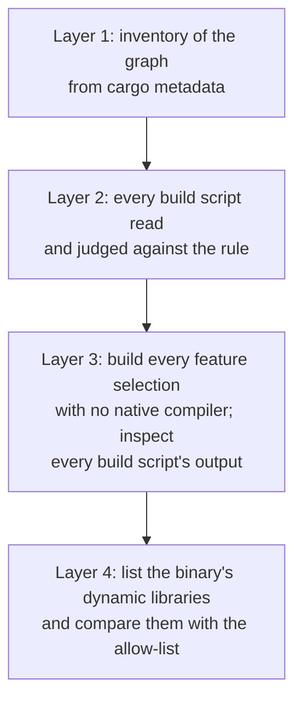

# Dependency dossier

The evidence for gate G1.3 of the [development plan](../plans/plan-init-project.md): every crate and tool proposed in D5 to D7, and the pure-Rust verification of D4 for the graph of the two published crates. The choices come from the maintainer's answers of 2026-11-21, and the approval followed the same day; both are recorded in the [development log](../plans/plan-init-project-log.md).

- **Status:** approved at G1.3 on 2026-11-21. Each manifest gains its dependencies in the phase that first uses them; until then no manifest of the workspace names any of these crates. Any other crate, tool or version change goes through GS.1, and this document is updated with it. The GitHub Actions of section 1.7 were approved through GS.1 on 2026-11-21.
- **Resolved:** 2026-11-21, by Cargo 1.100.0 with the workspace's dependency cooldown of 3 days. Every version below is the newest release that the cooldown admits.
- **Evidence:** the spike [`spikes/dependency-graph/`](../../spikes/dependency-graph/README.md). It copies the two published crates with exactly the dependencies and features approved here, together with the development and fuzzing dependencies. Its lock file pins every version in this document.
- **Advisories:** none. On 2026-11-21 the OSV database, which includes the RustSec advisories, listed no vulnerability for any of the 78 crate versions in the spike's lock file, or for the three npm packages of section 6.

## 1. What was approved

### 1.1 Library (`cc-media-probe`), all optional

| Feature | Crate | Version | Settings | License | What it is for |
|---|---|---|---|---|---|
| `zlib` (default on) | `miniz_oxide` | 0.9.1 | no default features; `with-alloc` | MIT OR Zlib OR Apache-2.0 | Inflating zlib streams: Matroska content compression and the compressed MP4 movie box. Its low-level inflater writes into a buffer the caller owns, so every buffer is charged to the budget before it is reserved (plan section 7.5). It contains no unsafe code. |
| `serde` | `serde` | 1.0.229 | no default features; `std`, `derive` | MIT OR Apache-2.0 | `Serialize` and `Deserialize` for the model (plan section 8.8), derived, with hand-written implementations where the contract needs them. |
| `tokio` | `tokio` | 1.54.1 | no default features, no features | MIT | Only the traits `AsyncRead` and `AsyncSeek` and the type `ReadBuf`. They need no feature: with this setting, a function bounded by both traits compiled on 2026-11-21. No runtime, file API or executor is compiled (plan section 8.7). |
| `futures-io` | `futures-io` | 0.3.34 | no default features; `std` | MIT OR Apache-2.0 | The traits `AsyncRead` and `AsyncSeek` of the futures ecosystem. |

### 1.2 Command-line tool (`cc-media-probe-cli`)

| Crate | Version | Settings | License | What it is for |
|---|---|---|---|---|
| `cc-media-probe` | `=` the workspace version | path dependency, with `serde` | Apache-2.0 | The library (plan section 7.1). |
| `clap` | 4.6.8 | no default features; `std`, `help`, `usage`, `error-context` | MIT OR Apache-2.0 | Argument parsing with the builder API. No color, no terminal detection and no suggestions, so the output that section 8.9 compares byte for byte does not depend on the terminal. Usage errors are turned into the CLI's own messages. |
| `serde_json` | 1.0.154 | default features | MIT OR Apache-2.0 | The JSON document (R21). |

### 1.3 Development dependencies of the library

Cargo keeps registry development dependencies in the published manifest, so all six remain there. Shipped examples use three of them: `tokio` for the Tokio example, `futures-lite` for the futures-io example and `serde_json` for the serialization example. `docs/design/examples.md` will list them per example (plan section 9.7).

| Crate | Version | Settings | License | What it is for | Crates it adds |
|---|---|---|---|---|---|
| `serde_json` | 1.0.154 | default features | MIT OR Apache-2.0 | Serialization tests and archived JSON (plan section 8.8). | 10, shared with the CLI |
| `proptest` | 1.12.0 | no default features; `std` | MIT OR Apache-2.0 | Property tests (plan section 9.2). | 15 |
| `criterion` | 0.8.2 | no default features | Apache-2.0 OR MIT | Benchmarks. It depends on `alloca`, whose build script compiles C with `cc`, so `cargo bench` needs a C compiler, as fuzzing does (R15). | 49 |
| `tokio` | 1.54.1 | `rt`, `macros`, `fs`, `io-util` | MIT | The executor and files for async tests and the Tokio example. | 7 |
| `futures-lite` | 2.6.1 | default features | Apache-2.0 OR MIT | `block_on`, and the adapters `AssertAsync` and `Cursor` that implement futures-io's traits over a file or a byte vector, for async tests and the futures-io example. | 5 |
| `peak_alloc` | 0.3.0 | — | MIT | The allocation-tracking allocator of the measured-peak tests (plan section 7.5): `current_usage`, `peak_usage` and `reset_peak_usage`, in bytes. Its `realloc` allocates the new block before it frees the old one, so a move counts both blocks, as the plan's accounting does. Its counters are global, so each measured test runs alone in its own test binary. | 0 |

The command-line tool has no development dependencies: its tests run the binary.

### 1.4 Fuzz workspace (`fuzz/`, nightly only)

| Crate | Version | Settings | License | What it is for | Crates it adds |
|---|---|---|---|---|---|
| `libfuzzer-sys` | 0.4.13 | default features | (MIT OR Apache-2.0) AND NCSA | The fuzzing entry point. Its build script compiles libFuzzer, which is C++, with `cc`; this is a development tool under R15. | 9 |
| `arbitrary` | 1.5.0 | default features, without `derive` | MIT OR Apache-2.0 | Structured inputs. The targets decode their own input encoding (plan section 9.5), so the derive macro is not needed. | 0 |

### 1.5 Cargo tools

Each tool is installed with `cargo install --locked --version <version> <tool>`, locally and in CI. It is built from crates.io with the lock file it ships. `cargo install` reads only the user's configuration, not the repository's, so the cooldown is given to it through Cargo's environment variables, `CARGO_REGISTRY_GLOBAL_MIN_PUBLISH_AGE="3 days"` and `CARGO_RESOLVER_INCOMPATIBLE_PUBLISH_AGE=deny`. CI caches the binaries, one cache per tool, version and runner. The tools are development tools and lie outside the boundary of D4 (R15).

| Tool | Version | Released | License | Rust | Crates in its lock file | What it is for |
|---|---|---|---|---|---|---|
| `cargo-llvm-cov` | 0.9.1 | 2026-09-06 | Apache-2.0 OR MIT | 1.87 | 60 | Coverage (R28, D23). 0.9.2 was 1 day old. |
| `cargo-deny` | 0.21.0 | 2026-11-16 | MIT OR Apache-2.0 | 1.89 | 189 | Licenses, advisories, sources and the crate allow-list. 0.22.0 was 2 days old. Its graph includes `ring`, which compiles C and assembly. |
| `cargo-semver-checks` | 0.51.0 | 2026-10-03 | Apache-2.0 OR MIT | 1.93 | 416 | API comparison from 0.1.0 on (plan section 8.10). Whether it reads the rustdoc JSON of the pinned toolchain is checked when the comparison is first run, in Phase 8. |
| `cargo-hack` | 0.6.46 | 2026-11-01 | Apache-2.0 OR MIT | 1.85 | 48 | Feature combinations in CI. |
| `cargo-fuzz` | 0.13.2 | 2026-06-09 | MIT OR Apache-2.0 | — | 101 | Fuzzing (plan section 9.5). |

The publishing rehearsal of Appendix C.2.3 needs no tool: its local registry is an in-house script, `scripts/rehearsal-registry.ts`. It is written in Phase 8 with Node.js built-in modules only (R34). It serves a sparse index, the publish endpoint and downloads, and records each version's publication time, so the rehearsal also exercises the cooldown.

### 1.6 Type checking of the scripts (npm, D24)

`typescript` and `@types/node` are pinned exactly in `scripts/package.json` (`"private": true`, `"type": "module"`) with its `package-lock.json`, and are installed with `npm ci` in `scripts/`. `scripts/tsconfig.json` holds the settings below. The npm files stay in `scripts/`, at the maintainer's request. The scripts themselves still import only `node:` modules.

| Package | Version | Released | License | Depends on |
|---|---|---|---|---|
| `typescript` | 7.0.2 | 2026-07-08 | Apache-2.0 | One of 20 optional platform packages `@typescript/typescript-<platform>` 7.0.2, each holding the native compiler. npm installs only the one for the running platform. |
| `@types/node` | 26.6.6 | 2026-10-28 | MIT | `undici-types` 8.9.0 (MIT). |

`tsc --noEmit` runs with `strict`, `erasableSyntaxOnly`, `verbatimModuleSyntax`, `allowImportingTsExtensions`, `module` set to `nodenext`, and three stricter checks: `noUncheckedIndexedAccess`, `exactOptionalPropertyTypes` and `noPropertyAccessFromIndexSignature`. With these settings, 7.0.2 and 6.0.3 both reported one error in the current scripts: the stdio constants were typed as plain string arrays. That was fixed with the `StdioOptions` type. Both now pass. 7.0.2 checks the 36 files in 0.09 seconds, 6.0.3 in 0.54 seconds.

### 1.7 GitHub Actions (GS.1, 2026-11-21)

The CI workflow, `.github/workflows/ci.yml` (plan section 9.8), uses only these three actions, all made by GitHub. Each is pinned to the full commit SHA that its release tag named on 2026-11-21, resolved with `git ls-remote`; the version stands in a comment beside it. A new version is a change under GS.1, like a crate. The repository allows only actions created by GitHub and requires SHA pinning (G1.8).

| Action | Version | Commit | Released | License | Runtime | What it is for |
|---|---|---|---|---|---|---|
| `actions/checkout` | 7.0.1 | `3d3c42e5aac5ba805825da76410c181273ba90b1` | 2026-07-20 | MIT | Node.js 24 | The checkout of the pushed commit, without persisted credentials. |
| `actions/setup-node` | 7.1.0 | `949feb2413d6458794dcd2491c4babbbce0c15c1` | 2026-10-08 | MIT | Node.js 24 | Node.js from `.nvmrc` (`lts/*`), without its npm cache. |
| `actions/cache` | 6.1.0 | `55cc8345863c7cc4c66a329aec7e433d2d1c52a9` | 2026-06-26 | MIT | Node.js 24 | The installed Cargo tools of section 1.5, one cache per tool, version and runner. |

The runner images are named exactly: `ubuntu-26.04`, `macos-26` (arm64) and `windows-2025`. They are not dependencies, but like the actions they change only when the workflow file does.

## 2. The published graph

These are the normal and build dependencies of the two published crates with all features, on every target. `cargo tree --locked -p cc-media-probe -p cc-media-probe-cli --all-features -e normal,build --target all` lists exactly these 20 crates. "Releases" counts the versions on crates.io that are not yanked.

| Crate | Version | License | Rust | Released | Releases | Build | Depends on |
|---|---|---|---|---|---|---|---|
| `adler2` | 2.0.1 | 0BSD OR MIT OR Apache-2.0 | — | 2025-06-09 | 2 | — | — |
| `anstyle` | 1.0.14 | MIT OR Apache-2.0 | 1.66.0 | 2026-03-13 | 31 | — | — |
| `clap` | 4.6.8 | MIT OR Apache-2.0 | 1.85 | 2026-11-16 | 372 | — | `clap_builder` |
| `clap_builder` | 4.6.7 | MIT OR Apache-2.0 | 1.85 | 2026-09-14 | 109 | — | `anstyle`, `clap_lex` |
| `clap_lex` | 1.1.2 | MIT OR Apache-2.0 | 1.85 | 2026-11-16 | 29 | — | — |
| `futures-io` | 0.3.34 | MIT OR Apache-2.0 | 1.36 | 2026-08-11 | 38 | — | — |
| `itoa` | 1.0.19 | MIT OR Apache-2.0 | 1.68 | 2026-11-09 | 38 | — | — |
| `memchr` | 2.8.3 | Unlicense OR MIT | 1.61 | 2026-07-08 | 46 | — | — |
| `miniz_oxide` | 0.9.1 | MIT OR Zlib OR Apache-2.0 | — | 2026-03-13 | 41 | — | `adler2` |
| `pin-project-lite` | 0.2.17 | Apache-2.0 OR MIT | 1.37 | 2026-02-27 | 15 | — | — |
| `proc-macro2` | 1.0.107 | MIT OR Apache-2.0 | 1.71 | 2026-07-19 | 161 | build script | `unicode-ident` |
| `quote` | 1.0.47 | MIT OR Apache-2.0 | 1.71 | 2026-07-19 | 95 | build script | `proc-macro2` |
| `serde` | 1.0.229 | MIT OR Apache-2.0 | 1.56 | 2026-07-18 | 313 | build script | `serde_core`, `serde_derive` |
| `serde_core` | 1.0.229 | MIT OR Apache-2.0 | 1.56 | 2026-07-18 | 10 | build script | `serde_derive` |
| `serde_derive` | 1.0.229 | MIT OR Apache-2.0 | 1.71 | 2026-07-18 | 270 | proc macro | `proc-macro2`, `quote`, `syn` |
| `serde_json` | 1.0.154 | MIT OR Apache-2.0 | 1.71 | 2026-10-11 | 184 | build script | `itoa`, `memchr`, `serde`, `serde_core`, `zmij` |
| `syn` | 3.0.10 | MIT OR Apache-2.0 | 1.71 | 2026-11-09 | 346 | — | `proc-macro2`, `quote`, `unicode-ident` |
| `tokio` | 1.54.1 | MIT | 1.85 | 2026-10-21 | 195 | — | `pin-project-lite` |
| `unicode-ident` | 1.0.27 | (MIT OR Apache-2.0) AND Unicode-3.0 | 1.71 | 2026-10-12 | 27 | — | — |
| `zmij` | 1.0.23 | MIT | 1.71 | 2026-07-13 | 37 | build script | — |

Notes:

- **Maintenance.** Every crate except `adler2` had a release in 2026. `adler2` is a finished checksum crate of 2 releases (2025-06), maintained beside `miniz_oxide`. The highest declared minimum Rust version is 1.85, below the project's 1.100.
- **No operating-system interface crate.** The graph contains none of `libc`, `windows-sys` or `windows-link`, which G1.2 permits.
- **`serde_derive` is always listed.** `serde` and `serde_core` name `serde_derive` under a configuration that is never true, so that the versions move together. Graph listings over all targets therefore include `serde_derive`, `syn`, `quote`, `proc-macro2` and `unicode-ident` even without the `derive` feature. With `derive` on, as proposed, they are also built.
- **The inventory lists 4 crates more.** `cargo metadata`, which the first layer reads, merges the features that the development dependencies enable: here, Tokio's runtime from the library's tests. Its graph therefore also has `bytes` and `tokio-macros`, and it counts the two spike crates themselves. The builds of the third layer, made without development dependencies, compile neither, so the inventory errs on the side of listing too much.

## 3. Pure-Rust verification (D4)

The checks of the repository ran against the spike, with `--root spikes/dependency-graph`. They read the spike's draft lists in `spikes/dependency-graph/crates/cc-media-probe-checks/data/`, which on approval replace the repository's lists.

### 3.1 Layer 1: inventory

`cargo run -q --locked -p cc-media-probe-checks -- inventory --root spikes/dependency-graph` lists 24 packages: the 20 crates of section 2, `bytes` and `tokio-macros` (see the notes there), and the two spike crates. None declares a `links` key, and none has a build dependency on a native-toolchain helper. It reports 0 findings with the reviewed list of section 3.2. Without that list, it reports exactly the six build scripts below as unreviewed.

### 3.2 Layer 2: build scripts

Each script was read in full from the packaged source of the version in the spike's lock file. That lock file records the SHA-256 checksum of each package, which identifies the text that was read. A script passes when the only program it starts is the Rust compiler that Cargo names, for a version query or a test compile of Rust; when it emits no link instruction; and when it neither contains nor fetches native code.

| Crate | Version | Lines | What it runs | What it reads and writes | What it emits | Finding |
|---|---|---|---|---|---|---|
| `proc-macro2` | 1.0.107 | 267 | `$RUSTC --version`. With the `proc-macro` feature, it also test-compiles two of its own Rust probe files, `src/probe/proc_macro_span*.rs`, with `--emit=dep-info,metadata` into a directory under `OUT_DIR`, and removes that directory. It honors `RUSTC_WRAPPER` and `RUSTC_WORKSPACE_WRAPPER` as Cargo does. | Reads `RUSTC`, `OUT_DIR`, `TARGET`, `RUSTC_BOOTSTRAP`, `RUSTC_STAGE` and `CARGO_ENCODED_RUSTFLAGS`. | `rustc-cfg`, `rustc-check-cfg`, `rerun-if-changed`, `rerun-if-env-changed` | Passes: only the Rust compiler, only Rust. |
| `quote` | 1.0.47 | 32 | `$RUSTC --version` | Reads `RUSTC`. | `rustc-cfg`, `rustc-check-cfg`, `rerun-if-changed` | Passes. |
| `serde` | 1.0.229 | 69 | `$RUSTC --version` | Reads `RUSTC`, `OUT_DIR` and `CARGO_PKG_VERSION_PATCH`. Writes `private.rs`, a Rust module of five lines, into `OUT_DIR`. | `rustc-cfg`, `rustc-check-cfg`, `rerun-if-changed` | Passes: the written file is Rust source generated from a constant. |
| `serde_core` | 1.0.229 | 113 | `$RUSTC --version` | Reads `RUSTC`, `OUT_DIR`, `TARGET` and `CARGO_PKG_VERSION_PATCH`. Writes `private.rs`, a Rust module, into `OUT_DIR`. | `rustc-cfg`, `rustc-check-cfg`, `rerun-if-changed` | Passes. |
| `serde_json` | 1.0.154 | 30 | No program. | Reads `CARGO_CFG_TARGET_ARCH` and `CARGO_CFG_TARGET_POINTER_WIDTH`. | `rustc-cfg`, `rustc-check-cfg`, `rerun-if-changed` | Passes. |
| `zmij` | 1.0.23 | 45 | `$RUSTC --version` | Reads `RUSTC` and `OPT_LEVEL`. | `rustc-cfg`, `rustc-check-cfg`, `rerun-if-changed` | Passes. |

The spike's draft list holds these six rows. On approval it becomes `crates/cc-media-probe-checks/data/build-scripts.tsv`. A changed version in the lock file makes the first layer fail until the script is read again (plan section 6).

### 3.3 Layer 3: build inspection

The two published spike crates were built with `CC`, `CXX` and `AR` naming a file that does not exist, once each with no default features, with the default features, and with all features.

| Target | How | Build-script runs inspected | Findings |
|---|---|---|---|
| `aarch64-apple-darwin` | `cargo build` | 6 | 0 |
| `x86_64-unknown-linux-gnu` and `x86_64-pc-windows-msvc`, in one target directory | `cargo check --target` | 10 | 0 |
| 32-bit (`i686`) | Not run: 32-bit targets are not supported, at the maintainer's decision of 2026-11-21 (plan section 2). | — | — |
| x86_64 Linux and Windows, as hosts | `cargo build` on the CI runners: the first CI run (task 19) | — | — |

`cargo check` runs every build script with the target's `TARGET` and `CARGO_CFG_*` values, which is what this layer inspects; it does not link. Of the 10 runs, the four target-dependent scripts (`serde`, `serde_core`, `serde_json`, `zmij`) ran once per target. `proc-macro2` and `quote` ran once for the host, because they build the derive macro. On every target, `serde_json` emitted `fast_arithmetic="64"`. No run emitted a link instruction or left a native object.

### 3.4 Layer 4: result inspection

| Platform | Tool | Libraries of the spike binary | Findings |
|---|---|---|---|
| macOS (aarch64) | `otool -L` | `/usr/lib/libSystem.B.dylib` | 0 |
| Linux, Windows | `readelf`, `objdump` or `dumpbin` | Measured by the first CI run (task 19), which also sets the allow-list entries of these platforms | — |

The spike binary uses every normal dependency once: it parses its arguments with `clap`, inflates its first argument with `miniz_oxide`, and writes a summary with derived `Serialize` and `serde_json`. So the linked binary holds code from all of them.

## 4. Development dependencies in full

These crates appear only through the library's development dependencies, on top of the 20 crates of section 2. `cargo tree --locked -p cc-media-probe --all-features -e normal,build,dev --target all` lists 54 of them. None is part of a published binary.

| Crate | Version | License | Rust | Released | Releases | Build | Depends on |
|---|---|---|---|---|---|---|---|
| `alloca` | 0.4.0 | MIT | — | 2023-08-03 | 10 | build script | `cc` |
| `anes` | 0.1.6 | MIT OR Apache-2.0 | — | 2019-11-29 | 11 | — | — |
| `autocfg` | 1.5.1 | Apache-2.0 OR MIT | 1.0 | 2026-05-22 | 17 | — | — |
| `bitflags` | 2.13.2 | MIT OR Apache-2.0 | 1.56.0 | 2026-09-10 | 57 | — | — |
| `bytes` | 1.12.2 | MIT | 1.57 | 2026-11-17 | 56 | — | — |
| `cast` | 0.3.0 | MIT OR Apache-2.0 | — | 2021-09-04 | 9 | — | — |
| `cc` | 1.11.2 | MIT OR Apache-2.0 | 1.65.0 | 2026-11-13 | 232 | — | `find-msvc-tools`, `shlex` |
| `cfg-if` | 1.0.5 | MIT OR Apache-2.0 | 1.32 | 2026-09-16 | 16 | — | — |
| `chacha20` | 0.10.2 | MIT OR Apache-2.0 | 1.85 | 2026-08-27 | 37 | — | `cfg-if`, `cpufeatures`, `rand_core` |
| `ciborium` | 0.2.2 | Apache-2.0 | 1.58 | 2024-01-24 | 4 | — | `ciborium-io`, `ciborium-ll`, `serde` |
| `ciborium-io` | 0.2.2 | Apache-2.0 | 1.58 | 2024-01-24 | 3 | — | — |
| `ciborium-ll` | 0.2.2 | Apache-2.0 | 1.58 | 2024-01-24 | 3 | — | `ciborium-io`, `half` |
| `core_detect` | 1.0.0 | MIT/Apache-2.0 | — | 2021-05-09 | 2 | — | — |
| `cpufeatures` | 0.3.1 | MIT OR Apache-2.0 | 1.85 | 2026-08-26 | 21 | — | `libc` |
| `criterion` | 0.8.2 | Apache-2.0 OR MIT | 1.86 | 2026-02-04 | 29 | — | `alloca`, `anes`, `cast`, `ciborium`, `clap`, `criterion-plot`, `itertools`, `num-traits`, `oorandom`, `page_size`, `regex`, `serde`, `serde_json`, `tinytemplate`, `walkdir` |
| `criterion-plot` | 0.8.2 | Apache-2.0 OR MIT | — | 2026-02-04 | 25 | — | `cast`, `itertools` |
| `crunchy` | 0.2.4 | MIT | — | 2025-06-25 | 11 | build script | — |
| `either` | 1.19.0 | MIT OR Apache-2.0 | 1.63.0 | 2026-10-06 | 36 | — | — |
| `fastrand` | 2.5.0 | Apache-2.0 OR MIT | 1.63 | 2026-07-19 | 29 | — | — |
| `find-msvc-tools` | 0.1.15 | MIT OR Apache-2.0 | 1.65.0 | 2026-10-19 | 16 | — | — |
| `futures-core` | 0.3.34 | MIT OR Apache-2.0 | 1.36 | 2026-08-11 | 37 | — | — |
| `futures-lite` | 2.6.1 | Apache-2.0 OR MIT | 1.60 | 2025-08-04 | 39 | — | `fastrand`, `futures-core`, `futures-io`, `parking`, `pin-project-lite` |
| `getrandom` | 0.4.3 | MIT OR Apache-2.0 | 1.85 | 2026-06-17 | 46 | build script | `cfg-if`, `libc`, `r-efi`, `rand_core` |
| `half` | 2.7.1 | MIT OR Apache-2.0 | 1.81 | 2025-10-14 | 29 | — | `cfg-if`, `crunchy`, `zerocopy` |
| `itertools` | 0.13.0 | MIT OR Apache-2.0 | 1.43.1 | 2024-05-16 | 131 | — | `either` |
| `libc` | 0.2.191 | MIT OR Apache-2.0 | 1.65 | 2026-10-16 | 200 | build script | — |
| `num-traits` | 0.2.19 | MIT OR Apache-2.0 | 1.60 | 2024-05-03 | 31 | build script | `autocfg` |
| `oorandom` | 11.1.5 | MIT | — | 2025-03-07 | 17 | — | — |
| `page_size` | 0.6.0 | MIT/Apache-2.0 | — | 2023-08-03 | 10 | — | `libc`, `winapi` |
| `parking` | 2.2.1 | Apache-2.0 OR MIT | 1.51 | 2024-09-07 | 12 | — | — |
| `peak_alloc` | 0.3.0 | MIT | — | 2025-06-23 | 4 | — | — |
| `proptest` | 1.12.0 | MIT OR Apache-2.0 | 1.88 | 2026-10-10 | 49 | — | `bitflags`, `chacha20`, `core_detect`, `num-traits`, `rand`, `rand_xorshift`, `regex-syntax`, `unarray` |
| `r-efi` | 6.0.0 | MIT OR Apache-2.0 OR LGPL-2.1-or-later | 1.68 | 2026-02-03 | 23 | — | — |
| `rand` | 0.10.4 | MIT OR Apache-2.0 | 1.85 | 2026-11-15 | 93 | — | `getrandom`, `rand_core` |
| `rand_core` | 0.10.1 | MIT OR Apache-2.0 | 1.85 | 2026-04-13 | 38 | — | — |
| `rand_xorshift` | 0.5.0 | MIT OR Apache-2.0 | 1.85 | 2026-02-02 | 7 | — | `rand_core` |
| `regex` | 1.13.2 | MIT OR Apache-2.0 | 1.65 | 2026-11-18 | 166 | — | `regex-automata`, `regex-syntax` |
| `regex-automata` | 0.4.19 | MIT OR Apache-2.0 | 1.65 | 2026-11-18 | 42 | — | `regex-syntax` |
| `regex-syntax` | 0.8.12 | MIT OR Apache-2.0 | 1.65 | 2026-11-18 | 79 | — | — |
| `same-file` | 1.0.6 | Unlicense/MIT | — | 2020-01-11 | 11 | — | `winapi-util` |
| `shlex` | 2.0.1 | MIT OR Apache-2.0 | 1.46.0 | 2026-05-17 | 9 | — | — |
| `syn` | 2.0.119 | MIT OR Apache-2.0 | 1.71 | 2026-07-15 | 346 | — | `proc-macro2`, `quote`, `unicode-ident` |
| `tinytemplate` | 1.2.1 | Apache-2.0 OR MIT | — | 2021-03-04 | 8 | — | `serde`, `serde_json` |
| `tokio-macros` | 2.7.2 | MIT | 1.71 | 2026-07-29 | 38 | proc macro | `proc-macro2`, `quote`, `syn` |
| `unarray` | 0.1.4 | MIT OR Apache-2.0 | — | 2022-11-30 | 5 | — | — |
| `walkdir` | 2.5.0 | Unlicense/MIT | — | 2024-03-01 | 41 | — | `same-file`, `winapi-util` |
| `winapi` | 0.3.9 | MIT/Apache-2.0 | — | 2020-06-26 | 51 | build script | `winapi-i686-pc-windows-gnu`, `winapi-x86_64-pc-windows-gnu` |
| `winapi-i686-pc-windows-gnu` | 0.4.0 | MIT/Apache-2.0 | — | 2018-01-18 | 4 | build script | — |
| `winapi-util` | 0.1.11 | Unlicense OR MIT | — | 2025-09-07 | 12 | — | `windows-sys` |
| `winapi-x86_64-pc-windows-gnu` | 0.4.0 | MIT/Apache-2.0 | — | 2018-01-18 | 4 | build script | — |
| `windows-link` | 0.2.1 | MIT OR Apache-2.0 | 1.71 | 2025-10-06 | 7 | — | — |
| `windows-sys` | 0.61.2 | MIT OR Apache-2.0 | 1.71 | 2025-10-06 | 21 | — | `windows-link` |
| `zerocopy` | 0.8.63 | BSD-2-Clause OR Apache-2.0 OR MIT | 1.56.0 | 2026-10-13 | 118 | build script | `zerocopy-derive` |
| `zerocopy-derive` | 0.8.63 | BSD-2-Clause OR Apache-2.0 OR MIT | — | 2026-10-13 | 159 | proc macro | `proc-macro2`, `quote`, `syn` |

Notes:

- **Native code, development only.** `alloca` compiles C through `cc`, and the two `winapi-*-pc-windows-gnu` crates ship import libraries for the GNU Windows targets. Both come in through `criterion` (`alloca` directly, `winapi` through `page_size`). R15 permits this for development tools, and none of it reaches a published binary.
- **Older crates.** `cast`, `anes`, `core_detect`, `same-file`, `tinytemplate`, `unarray`, `winapi` and its two import-library crates have had no release since 2023 or earlier. They are small, finished crates that `criterion` and `proptest` depend on.
- **Two versions of `syn`.** `zerocopy-derive` still uses `syn` 2 and everything else uses `syn` 3, both only in the development graph.

The fuzz workspace adds three crates of its own; the rest of its graph (`cc`, `cfg-if`, `find-msvc-tools`, `getrandom`, `libc`, `r-efi` and `shlex`) is listed above.

| Crate | Version | License | Rust | Released | Releases | Build | Depends on |
|---|---|---|---|---|---|---|---|
| `arbitrary` | 1.5.0 | MIT OR Apache-2.0 | 1.71.0 | 2026-10-06 | 39 | — | — |
| `jobserver` | 0.1.35 | MIT OR Apache-2.0 | 1.85 | 2026-07-06 | 34 | — | `getrandom`, `libc` |
| `libfuzzer-sys` | 0.4.13 | (MIT OR Apache-2.0) AND NCSA | — | 2026-06-04 | 23 | build script | `arbitrary`, `cc` |

## 5. Licenses

- **Published graph.** Every crate can be used under MIT or Apache-2.0. `unicode-ident` adds the Unicode-3.0 license for its data tables, in conjunction (`AND`). The other licenses that appear (0BSD, Zlib, Unlicense) are offered only as alternatives to MIT.
- **Development graph.** The same, except that `ciborium` and its two parts are Apache-2.0 only. `r-efi`, `zerocopy` and `zerocopy-derive` offer LGPL-2.1-or-later or BSD-2-Clause only as alternatives to MIT.
- **Fuzz workspace.** `libfuzzer-sys` adds NCSA, the license of LLVM's libFuzzer, in conjunction.
- **Tools and npm packages:** MIT, Apache-2.0, or both. The tools are run, never linked or distributed.

## 6. What the approval set in motion

Done on 2026-11-21, right after the approval:

1. `crates/cc-media-probe-checks/data/build-scripts.tsv` received the six reviewed scripts of section 3.2.
2. `deny.toml` was written:
   - **Licenses:** only `Apache-2.0`, `MIT` and `Unicode-3.0`. Every expression in sections 2 and 4 can be satisfied with them.
   - **Sources:** crates.io only, with unknown registries and Git sources denied.
   - **Advisories:** denied.
   - **Bans:** an allow-list of exactly the crates of sections 2 and 4, so that CI rejects any crate that is not on it (GS.1). Duplicate versions produce warnings, not errors, because the development graph holds two versions of `syn`.

   The fuzz workspace gets its own configuration, which adds NCSA, when it is created. `cargo-deny` 0.21.0 first checked this file on the development machine on 2026-11-21, during task 19: `cargo deny --locked check` reports advisories, bans, licenses and sources ok. CI repeats it on every push.
3. `cargo-llvm-cov` 0.9.1 replaced 0.8.7 on the development machine, and the coverage step of D23 joined `scripts/check.ts` after the tests.
4. `scripts/package.json`, `scripts/package-lock.json` and `scripts/tsconfig.json` were added, with `node_modules/` in `.gitignore`, and the type check joined `scripts/check.ts` after the script structure check. `scripts/.npmrc` sets `min-release-age=3`, so that npm resolves packages under the same 3-day cooldown as Cargo, and `save-exact=true`.

Each manifest gains its dependencies only in the phase that first uses them, through the allow-list approved here. For example, `miniz_oxide` arrives with the inflate task of Phase 3.
