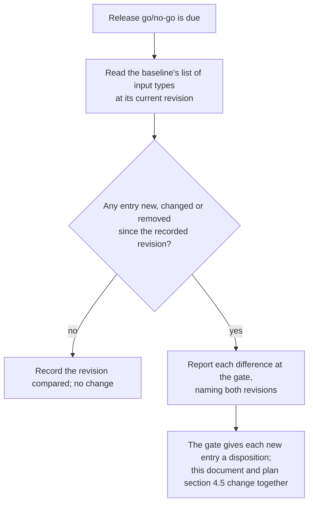

# Scope baseline

The project brief defines the audio and video scope of this project by reference to an external baseline: a list of input types that another tool reads. This document is the copy of that list that plan section 4.5 asks for. Each entry has a disposition, so that an omission is visible.

## The snapshot

| | |
|---|---|
| Read on | 2026-11-20 |
| Baseline revision | `a8d5c34d4`, dated 2026-11-18, ten commits after the baseline's release 103.0 |
| Read from | That revision's table of supported input types |
| Copied here | 2026-11-21, from section 4.5 of the [development plan](../plans/plan-init-project.md#45-scope-baseline-cross-check) |

The baseline is referred to by its revision only: this repository names no other multimedia tool (plan section 1.3). Only its list of input types is used; parsing behavior never comes from it.

## Entries and dispositions

"Probe" means the library reports the format's streams and headers from the phase shown; † marks a format without a public normative specification, whose source was decided at gate G1.5 (plan section 5.4) on 2026-11-21. "Detect-only" means the format is recognized and named, not probed; "hint only" means only its file name suggests it; "dropped" means it left the inventory (plan section 4.4).

| Baseline input type | Extensions | Disposition | Phase |
|---|---|---|---|
| AAC | `aac m4a mp4` | Probe (ADTS/ADIF; MP4 carriage) | 11, 6 |
| H.264 elementary streams | `264 avc h264 x264` | Probe | 12 |
| AVI | `avi` | Probe | 7 |
| ALAC | `caf m4a mp4` | Probe (CAF and MP4 carriage) | 11, 6 |
| Dirac | `drc` | Probe | 12 |
| TrueHD | `mlp thd thd+ac3 truehd true-hd` | Probe | 11 |
| DTS, DTS-HD | `dts dtshd dts-hd dtsma` | Probe | 11 |
| FLAC | `flac ogg` | Probe | 9 |
| Flash Video | `flv f4v` | Probe (FLV tag-based; F4V box-based) | 13, 6 |
| HDMV TextST | `textst` | Probe† | 14 |
| HEVC elementary streams | `265 hevc h265 x265` | Probe | 12 |
| IVF | `ivf` | Probe† | 12 |
| MP4 | `mp4 m4v` | Probe | 6 |
| MPEG audio layers II and III | `mp2 mp3` | Probe | 11 |
| MPEG program streams | `mpg mpeg m2v mpv evo evob vob` | Probe | 10 |
| MPEG transport streams | `ts m2ts mts` | Probe | 10 |
| MPEG-1/2 video elementary streams | `m1v m2v mpv` | Probe | 12 |
| Blu-ray playlist | `mpls` | Deferred at G1.5; a post-1.0 candidate | 17 |
| Matroska | `mk3d mka mks mkv` | Probe | 5 |
| PGS | `sup` | Probe† | 14 |
| QuickTime | `mov` | Probe | 6 |
| AV1 OBU streams | `av1 obu` | Probe | 12 |
| Ogg, OGM | `ogg ogm ogv` | Probe (an OGM file is read as Ogg; OGM stream headers deferred at G1.5) | 9 |
| Opus in Ogg | `opus ogg` | Probe | 9 |
| RealMedia | `ra ram rm rmvb rv` | Probe† (RealVideo identified only; `ram` metafiles dropped at G1.5) | 13 |
| SubRip | `srt` | Probe† | 14 |
| SSA/ASS | `ass ssa` | Probe† | 14 |
| TTA | `tta` | Probe† | 11 |
| USF | `usf xml` | Probe† | 14 |
| VC-1 elementary streams | `vc1` | Probe | 12 |
| VobButtons | `btn` | Hint only† (G1.5); identified as a Matroska stream (R22) | 3, 5 |
| VobSub | `idx` | Probe† | 14 |
| WAVE | `wav` | Probe | 11 |
| WavPack | `wv` | Probe | 11 |
| WebM | `weba webm webma webmv` | Probe | 5 |
| WebVTT | `vtt webvtt` | Probe | 14 |
| Types the baseline recognizes but does not read | ADIF AAC, ASF, RIFF CD-XA, HD-DVD subtitles, Internet Video Recording, Windows Television, MicroDVD | ADIF and ASF: probe (11, 13). MicroDVD: detect-only†. The rest: dropped at G1.5 | 3 |

Beyond the baseline, the plan adds VVC elementary streams, RF64/BW64, Wave64, CAF as a container, raw DV, DVD-Video title sets and the post-1.0 candidates of plan section 4.1.

## Comparing again

Before every release go/no-go, the baseline's list is read again at its then-current revision and compared with this one.

| Compared on | Revision compared | Against | Differences |
|---|---|---|---|
| 2026-11-20 | `a8d5c34d4` | (first snapshot) | — |
