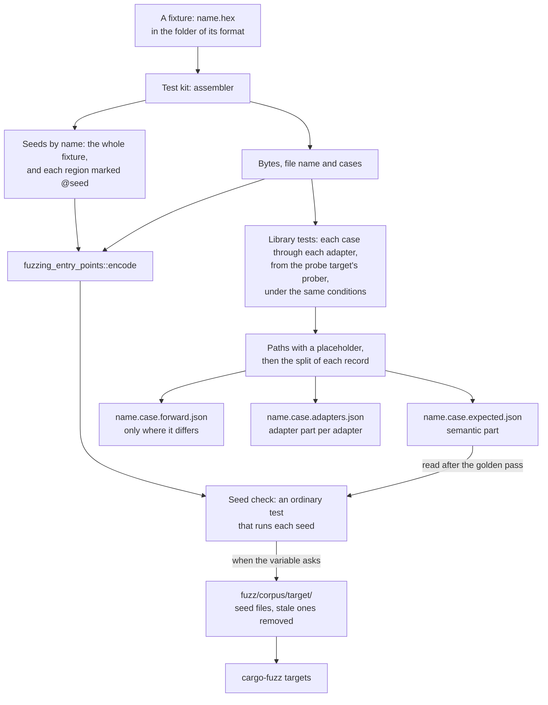

# Test kit: fixtures, expectations, seeds and hidden entry points

| | |
|---|---|
| **Status** | Draft of 2026-11-27 for gate G3.2 (plan Phase 3, task 3), written at revision 74 of the plan, revised at revision 75 after the maintainer's review the same day, at revision 76 after the maintainer's second review, and at revision 77 after the third (section 10). The second review approved the section named in a heading (section 2.2), the `Toy` variant (section 7) and the choices of section 8. The proposal as a whole is open at G3.2 until the maintainer confirms it. |
| **Decides** | D14, the fixture format, and D19, access to internals for fuzzing (plan section 6). |
| **Evidence** | The spike [`spikes/fixtures/`](../../spikes/fixtures/README.md), which runs this proposal end to end on the two sample fixtures of section 3. |
| **Plan** | Sections [7.1](../plans/plan-init-project.md#71-workspace-layout-and-target-ownership), [9.1](../plans/plan-init-project.md#91-test-files), [9.2](../plans/plan-init-project.md#92-test-layers), [9.4](../plans/plan-init-project.md#94-resource-gates) and [9.5](../plans/plan-init-project.md#95-fuzzing). Generated test files and their recipes are in the [test-files guide](../guide/test-files.md). |

## Contents

1. [What G3.2 decides](#1-what-g32-decides)
2. [The hex-fixture format](#2-the-hex-fixture-format)
3. [Two sample fixtures](#3-two-sample-fixtures)
4. [Expectations](#4-expectations)
5. [Builders, readers and paths](#5-builders-readers-and-paths)
6. [Fuzz seeds and the hidden access path](#6-fuzz-seeds-and-the-hidden-access-path)
7. [Repository-only entry points](#7-repository-only-entry-points)
8. [Choices made without asking](#8-choices-made-without-asking)
9. [What happens after G3.2](#9-what-happens-after-g32)
10. [The reviews of the proposal](#10-the-reviews-of-the-proposal)

## 1. What G3.2 decides

Task 3 asks for six things before any permanent test-kit or fuzz code:
- the hex-fixture format with two sample fixtures (sections 2 and 3);
- how a recipe states the values its tests expect (section 4.4);
- the builder interface (section 5);
- the routing fields of fuzz seeds (section 6.1);
- the hidden access path of fuzz targets (section 6.3);
- the list of repository-only entry points (section 7).

The maintainer settled four questions on 2026-11-27, before the first draft:

| Question | Answer |
|---|---|
| What evidence comes with the proposal | This document plus a disposable spike, with a real cargo-fuzz build of a target that reaches a hidden module |
| What a line of a fixture may hold beside its bytes in hex and its comment | Quoted text and repeats; nothing is computed, so every byte stays as written, and nested sizes are the builders' job |
| What form expectations take | The library's JSON form ([`json-output.md`](../guide/json-output.md)), split into a semantic part and an adapter part, and written only when an environment variable asks |
| Where the seed check runs | In repository builds too: `fuzzing_entry_points` is compiled under `cfg(fuzzing)` and in repository builds, so the seed check is an ordinary test |

The maintainer's review of the first draft, the same day, kept G3.2 open, and the maintainer settled four more questions (section 10):

| Question | Answer |
|---|---|
| Where a fixture's cases live: the conditions under which its tests probe the same bytes | On `case:` lines of the fixture's header, each a name and `name=value` conditions, with expectations of their own (sections 2.3 and 4.1) |
| How the file adapter's reads are counted | A second repository-only entry point counts the reads of every source that the library opens itself (section 7) |
| How parity treats the retained data of a path | It stays semantic, net of the paths that the test handed the library, which the library must charge at their length (section 4.2) |
| What shape the corpus tool takes | The seed check writes the corpus when an environment variable asks, and removes only its own stale files (section 6.4) |

The maintainer's second review, of revision 75, approved the section named in a heading, the `Toy` variant and the choices of section 8, kept the proposal open on four contract issues, and settled three more questions (section 10.2):

| Question | Answer |
|---|---|
| How a file probe keeps the others' budget at a limit | The library charges a path at the strings that keep it, held at their length, before anything else; the test raises the file adapters' retained-data limit by that charge, in case folders of a fixed length (section 4.2) |
| What a route to `probe` means, beside the seed that every fixture already gives it | A whole fixture's is refused; a region may route to `probe` (section 6.1) |
| How tests reach the names that no file can have | A hint-only case, `hint=` in percent-encoded UTF-8; names that are not Unicode in platform-specific tests of the library; and the fuzz input's hint as native bytes on Unix (sections 2.3, 4.1 and 6.2) |

The maintainer's third review, of revision 76, kept the proposal open on 19 findings and settled two more questions (section 10.3):

| Question | Answer |
|---|---|
| What a file probe gives when its retained-data limit cannot hold the charge of its path | The entry stays without its path, the limit is exhausted without a part that it stopped, and the probe goes on under the same limit (section 4.2, `api.md` section 6.15) |
| How each case's folder is built | 512 bytes, from a component for the run and one for the case, each of a fixed width, then padding, so that no name counts and concurrent runs never share a folder (section 4.2) |

How a fixture serves the tests and the fuzzer:



The default case has no case name in its files' names: `name.expected.json`.

## 2. The hex-fixture format

A fixture is a text file `crates/cc-media-probe-testkit/fixtures/<format>/<name>.hex`. It is UTF-8, and its lines end with a line feed, with or without a carriage return. It has a header, the line `---`, and a body. Tests name it by `<format>/<name>`, with `/` on every platform.

The fixtures' folder holds format folders only. Each format folder holds files only: the fixtures `<name>.hex` and their expectation files of section 4.1. A format, a fixture and a case are each named by lowercase words and digits joined by `-`, none of them a device name that Windows reserves, such as `nul` or `com1`, since `nul.hex` names that device there. Every listing checks this layout whole, so a misnamed fixture is an error rather than a fixture left out unseen. The checks refuse:
- a file beside the format folders;
- a folder inside a format folder;
- a name that breaks the rule, or that is not valid Unicode;
- any other extension or part;
- an expectation file without its fixture.

### 2.1 The header

The header is `name: value` lines, one member to a line. Blank lines are skipped, and so are comments that start with `#`.

| Member | Required | Meaning |
|---|---|---|
| `description` | yes | What the fixture holds, in one line |
| `source` | yes | The specification and section that the fixture comes from as a whole, such as `RFC 9639, Appendix D.1` |
| `erratum` | no, and may repeat | An erratum that the fixture depends on, such as `RFC 9639 erratum 8810` (plan section 9.1) |
| `target` | yes | The fuzz target of the whole fixture (section 6.1), or `none` for a fixture whose whole bytes are no seed, which then marks at least one region |
| `representation` | for a codec target | The representation of the bytes, by name, such as `one_byte_lengths` |
| `context` | no | For a codec target, the context that the container knows, in hex, in the layout that the target defines |
| `outcome` | yes, except beside `none` | The outcome that the target's entry point gives the whole fixture, by name, such as `report` or `parsed` |
| `file_name` | no | The name of the input as a file, such as `movie.idx`, which every adapter is given (section 4.1), and which every platform can write |
| `case` | no, and may repeat | A case: its name, then its conditions (section 2.3) |
| `length` | no | How many bytes the body assembles to; the assembler checks it |

A target, a representation and an outcome are names: lowercase letters and digits, their words joined by `_`. A context needs a representation beside it. The target `none` takes no representation, context or outcome: it serves a fixture longer than a fuzz run's input (section 6.2), whose regions give bounded seeds. So it marks at least one region, or the fixture would give no seed at all, as the third review found.

A file name is written to disk, so it is one that every platform can write, as the maintainer chose at the second review: ASCII letters, digits, `.`, `-` and `_`, at most 255 bytes, ending with no `.`, so neither `.` nor `..`, and whose part before the first `.` is none of the device names that Windows reserves with any extension, `CON`, `PRN`, `AUX`, `NUL`, `COM1` to `COM9` and `LPT1` to `LPT9`, compared without regard to ASCII case ([Microsoft, "Naming Files, Paths, and Namespaces"](https://learn.microsoft.com/en-us/windows/win32/fileio/naming-a-file)). So `movie.idx`, `.hidden` and `icon.backup` are file names, and `NUL.idx`, `Aux.tar.gz`, `con.backup` and `movie.` are none. Its letters keep their case, since a test may ask how a hint in another case is taken. Without the member, a fixture's file name is its own name without an extension, such as `setup-and-parameters`, which suggests no format and is no device name either (section 2). A name that no file can have reaches the library as a hint-only case's hint (section 2.3), and a name that is not Unicode through a platform-specific test of the library (section 4.1). A member other than `erratum` and `case` is given once.

### 2.2 The body

Each line of the body is one of:

- **Blank**, or a **comment**: `#` and any text. Neither assembles to anything.
- **A heading**: `##` and the specification and section of the lines of bytes below it, up to the next heading, such as `## RFC 9639 section 8.2, and Appendix D.1.3, table 28: streaminfo`. A heading needs text.
- **A line of bytes**: items, then `#` and a comment that names the field or fields that the bytes hold. The comment is required, and a line of bytes before the first heading is refused.
- **A directive**: `@seed` and `name=value` words, which open a region, or a bare `@end`, which closes it (section 6.1).

The items of a line of bytes:

| Item | Form | Bytes |
|---|---|---|
| Hex bytes | Pairs of hex digits, in either case, in words separated by white space: `00 0a`, `0A0b`, `664c6143` | One byte per pair |
| Quoted text | `"fLaC"`: printable ASCII from space to `~`, without escapes and without `"` | Its characters' codes |
| Repeat | An item, `*` and a decimal count of at least 1: `00 * 4096`, `"ab" * 2` | The item before it, that many times in all |

A `#` inside quoted text is text. A repeat applies to the one item before it. Nothing is computed: no size, offset or checksum is derived from other bytes, so every byte of a fixture is written where it stands, as the maintainer chose. A body assembles to at least one byte and at most 16 MiB, so that a repeat cannot ask a test for more memory than it should hold.

**Approved at the second review: the section in the heading.** Plan section 9.1 had "each line carries bytes and a comment naming the field and spec section". A fixture names the specification and section once, in the heading above a group of lines, and the field on each line. A line that a different subsection governs, such as `(9.1.6)`, names it in its comment. So both samples stay traceable line by line, with lines about half as long as the alternative, the specification and section on every line, would make them. The maintainer approved the heading form at the second review, and revision 76 of the plan amends section 9.1 to match.

### 2.3 Cases

A fixture's bytes are tested under conditions beyond the bytes themselves, and the same bytes give different results under different conditions. Plan Phase 3, task 6, for one, keeps a header split across deliveries, which a stream's packets give in the fixture's own bytes (section 3), a packet larger than the header limit, which a case gives, and a two-file input with its resolver's results. As the maintainer chose, each such case is a `case:` line of the header: the case's name, then at least one condition, each a `name=value` word, each name once.

```text
case: short-reads pieces=40,8
case: small-header-limit limit.header_bytes_per_stream=8
case: two-files lookup=custom companion.movie.toyc=found:toy/movie-companion
case: reserved-hint hint=NUL%20.backup
case: no-name lookup=custom hint=none
case: no-folder lookup=built_in hint=movie.idx
```

The test kit reads the words and never interprets them, as it reads a route. The library's tests read each condition by one rule, and a word that no rule reads fails the test, so that a misspelled condition is never ignored:

| Condition | Value | Effect |
|---|---|---|
| `limit.<limit>` | A decimal number | The limit of that serialized name, such as `limit.header_bytes_per_stream=8` |
| `pieces` | Sizes, each at least 1, separated by `,` | The input cut into pieces of these sizes from byte 0, the last size repeating: no read of the seekable and forward-only readers or of the custom source delivers bytes of two pieces, so `pieces=40,8` ends reads at byte 40, 48, 56 and so on, whatever sizes the reads ask for. The library may join short reads before its parsers see them, so pieces test that joining, and a header split across deliveries to a codec is a matter of the fixture's own bytes, such as a stream's packets (section 3) |
| `hint` | A name in percent-encoded UTF-8 ([RFC 3986, section 2.1](https://www.rfc-editor.org/rfc/rfc3986#section-2.1)), at least one character, such as `NUL%20.backup` or `Movie%3A%20Part%202`; or `none` | A hint-only case: every adapter but the file adapters is given this hint in place of the file name. It reaches the names that no file can have: a device name that Windows reserves, a name that ends with a period or a space, and the characters that Windows reserves in a name. `none` makes a nameless case: those adapters get no hint at all, so that no name can be built. A hint spelled `none` is written `%6Eone` |
| `lookup` | `off`, `custom` or `built_in` | The companion lookup. `off`, the default, is the API's: no request is made, and the companions are "not enabled" (`api.md` section 13). `custom` gives every blocking adapter `CompanionLookup::custom` and every async one `AsyncCompanionLookup::custom`, with resolvers that answer alike. `built_in` with the fixture's file name runs through the blocking `probe_file` alone, the only entry point that gives the built-in resolver a folder; with a hint or none, it runs through every other adapter, where the resolver has no folder and declines each request (`api.md` section 13) |
| `companion.<requested name>` | With `custom`: `found:<fixture>`, `found_with_identity:<fixture>:<token in hex>`, `not_found`, `declined:<reason>`, `limit_reached:<limit>` or `failed:<error kind>`. With `built_in` and the file: `found:<fixture>` or `not_found` | The answer to the request for that name. The name is percent-encoded as a hint is, such as `companion.Movie%20%282026%29.sub`, and each name, decoded, has one answer. The arguments are those of the resolver's results (`api.md` section 13): a fixture by its name of the layout, such as `toy/movie-companion`; a token of any length, none among them; a reason in percent-encoded UTF-8, which may be empty; one of the limits that a resolver may name, `companion_requests`, `sources_opened` or `bytes_read`; and an I/O error kind by the stable name that a record gives it (`json-output.md` section 4.4), such as `permission_denied`. A custom resolver's found companion is the named fixture's bytes. Built-in lookup writes a found companion beside the file under its requested name, which is then a file name of section 2.1, apart from the file's and from each other companion's by more than case, since Windows and macOS compare names without regard to case by default |

The default case is the fixture under the default limits, with reads that are not cut and lookup off, as the `probe` target runs it (section 6.3). Conditions that no adapter can run together are refused: an answer without a lookup that asks for it; beside built-in lookup with the file, an answer that only a custom resolver gives, and pieces, since the file adapter's reads are not cut; and beside built-in lookup without the file, any answer, since the resolver declines each request itself. Each request that a probe makes must have its answer in the case, and each answer must be asked for, so a misspelled name fails the test rather than giving `not_found`. Each case has expectations of its own (section 4.1).

**Companions arrive in Phase 14.** The library has no companion lookup before Phase 14, task 1, which ships the resolvers and the builder options, so until then the tests refuse every lookup but `off`. Task 6 keeps the I/O spike's two-file toy input as fixtures of their default case, with the spike's resolver results noted in their comments, and Phase 14, task 1, adds their cases of custom and built-in lookup, with their expectations.

### 2.4 What the assembler refuses

The assembler reports the first problem with its line, counted from 1, or 0 for the fixture as a whole. A test names the fixture too: `flac/decoding-example-1: 12: hex bytes are pairs of digits: 0a0`.

- **The header:**
  - no line `---`;
  - a line that is not `name: value` or a comment;
  - an unknown member, or a member given twice;
  - a required member missing;
  - a context without a representation;
  - a representation, context or outcome beside the target `none`;
  - a name that is not lowercase words;
  - a file name that the rule of section 2.1 does not allow;
  - a case without its name or a condition, a condition that is not `name=value`, a condition given twice in a case, and a case given twice;
  - a length that is not a decimal number, or that the body does not assemble to.
- **A line of bytes:**
  - no comment;
  - no heading above it;
  - a word that is not hex digits;
  - hex digits of an odd count;
  - quoted text without its closing quote, without a character, or with a character beyond printable ASCII;
  - a repeat without its item or count, or with a count that is not a decimal number of at least 1;
  - more than 16 MiB in all.
- **A heading** without text, a body without bytes, and a fixture of the target `none` that marks no region.
- **A directive:**
  - one other than `@seed` and `@end`;
  - an `@end` with a word after it;
  - a region opened inside another;
  - an `@end` without a region;
  - a region without bytes, or still open at the end;
  - a region routed to the target `none`;
  - a `name=value` word that is not a route member.

## 3. Two sample fixtures

**A toy file whose packet is a codec header.** The toy format and its codec are the drafts of the I/O spike's README, sections 2 and 3, which G3.1 accepted as the start of task 5. The region marks the packet's payload as a seed of the codec target, with the context that the container knows (section 6.2). The two cases probe the same bytes with reads cut short, which the library joins, and with a header limit smaller than the packet.

```text
description: one stream in packet mode whose header, a setup and a parameters unit, fills one packet
source: the draft of the toy format and its codec, spikes/input/README.md sections 2 and 3
target: toy
outcome: report
length: 48
# Reads that end at byte 40, inside the codec header that starts at byte 36, and every 8 bytes after give what
# reads that are not cut give, since the library joins short reads before its parsers see them; a header split
# across deliveries to the codec is toy/header-across-packets. A header limit of 8 bytes is smaller than the
# packet's 12.
case: short-reads pieces=40,8
case: small-header-limit limit.header_bytes_per_stream=8
---
## Toy format (spikes/input/README.md section 2): the file header
"CCToy" 00              # signature, "CCToy" and a zero byte
01                      # version 1
00                      # flags: none is defined
00 00 00 0c             # offset of the first element: 12, right after the header

## Toy format (section 2): the stream declaration, element STRM
"STRM"                  # code
00 00 00 07             # length of the body: 7
01                      # stream number 1
00                      # framing 0: packet mode
00                      # representation 0: units with one-byte lengths
"TCOD"                  # codec code: the toy codec

## Toy format (section 2): a packet, element PACK
"PACK"                  # code
00 00 00 0d             # length of the body: 13
01                      # stream number 1
# The packet's payload is the codec header, so it is a seed of the codec target too: in packet mode (framing 0),
# with the packet's known length, 12, as the container knows them.
@seed target=toy_codec representation=one_byte_lengths context=000000000c outcome=parsed

## Toy codec (spikes/input/README.md section 3): the setup, kind 1
01                      # kind 1: setup
06                      # length 6
01 40                   # width 320
00 f0                   # height 240
01                      # parameter count 1
00                      # flags: none, so the parameters can be read

## Toy codec (section 3): the parameters, kind 2
02                      # kind 2: parameters
02                      # length 2: the setup's one 16-bit parameter
00 07                   # parameter 7
@end
```

**A worked example of a specification.** RFC 9639, Appendix D.1, decodes a FLAC file of 57 bytes table by table. The fixture transcribes the tables, field by field. Its test compares the bytes with the RFC's own dump in D.1.1, transcribed separately as the RFC prints it. The two transcriptions agree, which gives expected bytes that do not originate in this project (plan section 9.1). The streaminfo block, with its header, is the codec header that a container carries apart from the native file's signature. So the region marks it as a seed of the FLAC codec target of Phase 4, beside the native file's target of Phase 9 (section 6.1).

```text
description: the FLAC file of two channels of one sample each that RFC 9639 decodes step by step
source: RFC 9639, Appendix D.1, "Decoding Example 1", from its tables 27 to 31 and its text
target: flac
outcome: report
length: 57
---
## RFC 9639 section 6, and Appendix D.1.3, table 27: the signature
"fLaC"                  # signature 0x664C6143

## RFC 9639 section 8.1, and Appendix D.1.3, table 27: the metadata block header
# The metadata block, its header and the streaminfo, is the codec header that a container carries apart from the
# native file's signature, so it is a seed of the FLAC codec target too, of Phase 4, in the representation of
# metadata blocks.
@seed target=flac_codec representation=metadata_blocks outcome=parsed
80                      # last metadata block 1; block type 0, streaminfo
00 00 22                # length of the block: 34

## RFC 9639 section 8.2, and Appendix D.1.3, table 28: streaminfo
10 00                   # minimum block size: 4096
10 00                   # maximum block size: 4096
00 00 0f                # minimum frame size: 15
00 00 0f                # maximum frame size: 15
0a c4                   # sample rate, its first 16 of 20 bits: 0x0ac44 is 44100
42                      # sample rate, its last 4 bits 0b0100; channels - 1, 3 bits 0b001: 2; bit depth - 1, first bit 0b0
f0                      # bit depth - 1, its last 4 bits: 0b01111 is 15, so 16 bits; total samples, first 4 of 36 bits
00 00 00 01             # total samples, the last 32 bits: 1
3e 84 b4 18 07 dc 69 03 # MD5 checksum of the unencoded audio, first 8 of 16 bytes
07 58 6a 3d ad 1a 2e 0f # MD5 checksum, last 8 bytes
@end

## RFC 9639 section 9.1, and Appendix D.1.4, table 29: the frame header
ff f8                   # frame sync, 15 bits; blocking strategy 0: fixed block size
69                      # block size bits 0b0110: 8-bit value below (9.1.1); sample rate bits 0b1001: 44.1 kHz (9.1.2)
18                      # channels bits 0b0001: stereo, no decorrelation (9.1.3); bit depth bits 0b100: 16 (9.1.4); 0
00                      # coded number (9.1.5): frame number 0
00                      # uncommon block size - 1 (9.1.6): 0, a block of 1
bf                      # frame header CRC-8 (9.1.8)

## RFC 9639 section 9.2, and Appendix D.1.4, table 30: the first subframe
03                      # subframe header (9.2.1): 0; type 0b000001, verbatim (9.2.4); wasted bits flag 1 (9.2.2)
58 fd                   # wasted bits unary 0b01: 2; sample 0b011000 11111101: 6397 in 14 bits

## RFC 9639 section 9.2, and Appendix D.1.4, table 31: the second subframe
03                      # subframe header (9.2.1): 0; type 0b000001, verbatim; wasted bits flag 1
12 8b                   # wasted bits unary 0b0001: 4; sample 0b0010 10001011: 651 in 12 bits

## RFC 9639 section 9.3, and Appendix D.1.4: the frame footer
# The appendix's text says that the frame CRC starts at 0x38, but its dump in D.1.1 and its own table 31, whose
# second subframe ends with byte 0x36, put it at 0x37; this fixture follows the bytes. No erratum covers it.
aa 9a                   # frame CRC-16, at 0x37
```

**A header across packets.** The spike holds a third toy fixture, `toy/header-across-packets`: one stream in stream mode whose setup is the first packet's payload and whose parameters are the second's. The split lies in the bytes, so the codec gets the header in two deliveries whatever the reads, and parses the second only with the continuation of the first. Its test also removes the first packet, which leaves the parameters malformed, as a lost continuation would. The first draft's case `split-header pieces=40,8` cut the reads instead, which the library may join before the codec sees them, so it established no split at the codec, as the third review found.

Writing the second sample found that the appendix's text puts the frame CRC one byte later than its own dump and tables do. On 2026-11-27 the RFC Editor lists no erratum for it, only 8256 and 8810, both verified, and 9096, rejected. The fixture follows the bytes, which the formal sections decide, and says so in a comment.

## 4. Expectations

### 4.1 The files beside a fixture

Plan section 9.1 stores the expected results beside each fixture and compares them exactly; section 9.2 splits them into a semantic part and an adapter part. As the maintainer chose, both are in the library's JSON form ([`json-output.md`](../guide/json-output.md)), the form that the CLI writes and the strict reader checks, so the comparison sees every member and whether it is present. Each case of section 2.3 has its own files, named with the case between the fixture's name and the part; the default case's files have no case name:

| File | Holds | Compared with |
|---|---|---|
| `<name>[.<case>].expected.json` | The semantic part of the report, or of the error record, as the seekable adapters give it | Every seekable adapter's semantic part: file, `Read + Seek`, bytes, custom positional source and async seekable |
| `<name>[.<case>].forward.json` | The semantic part through a forward-only adapter, only where it differs from the seekable one | The blocking and async forward-only adapters; when it would equal `expected`, the file must not exist |
| `<name>[.<case>].adapters.json` | One member per adapter, each the adapter part of that adapter's result | That adapter's result only, never across adapters |

A test probes the fixture's bytes in each case through each adapter, splits each result (section 4.2), checks that the semantic parts of a class agree, and compares each part with its file. A file of a fixture that no case produces any more fails the test, or is removed when expectations are written.

**The same conditions for every adapter.** A file name or a resolver can change what a probe reports. A VobSub index, for one, asks for its data file by its own stem, which a probe from memory knows only from a hint. So each adapter of a run starts from the one prober of section 6.3, `fuzzing_entry_points::prober`, and gets the same conditions:
- the fixture's file name (section 2.1): the file adapter's file has that name, and every other adapter gets it as the file-name hint;
- the case's limits, with the file adapters' retained-data limit raised by their path's charge (section 4.2);
- the case's lookup: off by default, as the API's is, so that no request is made and the companions are "not enabled"; or, for `lookup=custom`, resolvers that answer as the case says, through `CompanionLookup::custom` for the blocking adapters and `AsyncCompanionLookup::custom` for the async ones, so that no adapter's result depends on the folder of a file.

A hint-only case gives its hint to every adapter but the file adapters, whose file has a name that every platform can write, and a nameless case gives them none. A case with `lookup=built_in` and the fixture's file name depends on the file's folder by its nature, and only the blocking `probe_file` gives the built-in resolver a folder (`api.md` section 13). It runs through that adapter alone, with each found companion written beside the file, and its expected part is that adapter's semantic part. With a hint or none, the case runs through every other adapter, none of which has a folder: with a hint, the resolver declines each request, and without a name no request is made and the companions are cut short with `CompanionNameUnavailable` (`api.md` section 13). The third review found both outcomes out of reach, since every adapter but the file had a hint and built-in lookup ran only through the file.

**Names that are not Unicode** are a platform's own: bytes that are not UTF-8 on Unix, which a Mac's file system does not hold as a file name, and 16-bit units with an unpaired surrogate on Windows. Fixture cases run alike on every platform, so these names are not fixture cases, as the maintainer chose at the second review. Platform-specific tests of the library, under `cfg(unix)` and `cfg(windows)`, give such a name as the hint or as a path, as the stem rule's tests of plan section 7.7 do.

**The reads of every adapter.** The adapter part adds the reads that a counter saw: `read_calls` and `bytes_delivered`. The test kit's counting reader counts them under the `Read + Seek` and forward-only adapters, and the test's own custom source counts its own. The file adapter opens its file itself, so the second repository-only entry point of section 7 counts its reads, and those of each companion that the built-in resolver opens. Every adapter but bytes in memory then has both counts, as plan section 9.4 asks, so a change that reads a file more often fails its expectation.

### 4.2 The split

The adapter part holds what legitimately differs between adapters (plan section 9.2), keyed by its JSON pointer in the record (RFC 6901), so that each value keeps its place. The split takes members only at the places that the form defines. A typed detail of a newer version may keep members of any name, among them an object named `usage`, and the split leaves those in the semantic part:

| Where | Members that go to the adapter part |
|---|---|
| A root record (report, error record, detection) and an error's partial report | `size` and `size_exact`, since a source states the size or not; the `usage`'s `bytes_read` and `peak_working_memory`, with their twins `_exact`; and the source entries' members below |
| Each entry of the source table of such a record, and of an error's observations | `bytes_read` with its twin; `path`, `path_lossy` and `path_raw` |

Everything else is semantic. That includes the usage's other counters: `work_units`, `retained_data`, `retained_payloads`, `decompressed_output`, `companion_requests` and `sources_opened`. It includes `attempted_identity`, which every adapter now gives alike, since each gets the same file name. A count that is found to differ between adapters joins the table by a reviewed change of this document.

**Retained data, net of paths.** The plan charges retained data by capacity (plan section 7.5). A file probe keeps its path, which a probe from memory does not have, and the path's length depends on the folder that the test wrote the file into. As the maintainer chose, `retained_data` stays semantic, by one rule for the library and the test that the maintainer chose at the second review:
- **The charge.** A path is charged at the strings that the report keeps for it: its display string and, for a lossy path, its raw form's data, the hexadecimal digits of `api.md` section 6.15. The library holds each at exactly its length, as a boxed string holds it, so that the capacity charged is that length. The primary input's entry, with its path, is the probe's first charge to retained data. So the lossy Unix path of the bytes `/f`, `ff` and `/a`, 5 bytes as `OsStr::len` counts them, is charged 17: 7 for its display string `/f�/a` and 10 for its raw form's data `2f66ff2f61`.
- **A path beyond the limit.** As the maintainer chose at the third review, a path that the retained-data limit cannot hold is left out: its entry stays without the path, the limit is exhausted without a part that it stopped, as for a diagnostic that does not fit, and the probe goes on under the same limit (`api.md` sections 5.3 and 6.15). So a file probe under a limit one byte below its path's charge reports its file without the path, and one exactly at the charge keeps the path and nothing else that it would retain. Task 7 tests both at the caller's own limit, which the golden tests never meet, since they raise it.
- **An equal remaining budget.** The test raises the file adapters' retained-data limit by the charge of the probed file's path. The rest of the probe then has exactly the budget of a probe from memory, so a limit that leaves out a field leaves it out in every adapter alike. Subtracting the charge afterwards, as the first draft did, could not restore a field that the path's charge had crowded out.
- **Net of paths.** Before the split, the test takes out of each record's `retained_data` the charge of each path that the test handed the library and the record lists: the probed file, and each companion that the built-in resolver opened. An error's usage covers its partial report's (`api.md` section 6.14), so a path that the partial report lists comes out of both, as the third review found. Any other charge leaves the file adapter's figure apart from the others', so the parity check enforces the rule.
- **A fixed length.** As the maintainer chose at the third review, each case of each fixture writes its files into a folder of its own of 512 bytes below Cargo's folder for integration tests, `CARGO_TARGET_TMPDIR`: `expectations`, then a component for the run, the process's identifier, and one for the case, its number in the process, each of 8 hexadecimal digits, then components of `_` of at most 255 bytes each up to the length. No name of a fixture or a case counts, so any valid name fits, and two runs that share a target folder never share a case's folder or remove each other's files. The test requires the folder to be valid Unicode, and a target folder too long to leave room fails with a message that names `CARGO_TARGET_DIR`. A file name of 255 bytes below the folder stays under the 1,024 bytes that macOS allows a path ([Apple's `sys/syslimits.h`, `PATH_MAX`](https://github.com/apple-oss-distributions/xnu/blob/main/bsd/sys/syslimits.h)), and the standard library gives Windows the long form of a path beyond 260 characters by itself ([rust-lang/rust#89174](https://github.com/rust-lang/rust/pull/89174)). Every path below the folder, a built-in companion's among them, therefore has the same charge on every machine. So a built-in case that meets its limit, which has no other adapter to agree with, gives the same result everywhere. The second draft's folder of 200 bytes, named after the fixture and the case, refused a valid fixture name of 155 characters and every case of a long checkout, as the third review found.

**Paths with a placeholder.** Before the split, a path below the test's folder, by its components, must be one that the test handed the library, written exactly as its form gives it: its display string, with the lossy flag and the raw form only for a lossy path. It is then written as `{folder}/` and the rest, with `/` as the separator, as the expectation stores it. The display string, the lossy flag and the raw form all collapse into that one Unicode path, so no expectation holds the machine's folder, whatever its own form. The second draft matched the folder as a string prefix, so `/tmp/fixture2/file` became `{folder}2/file` beside a folder `/tmp/fixture`, and removed the flag and the raw form unchecked, so a serialization that marked a Unicode path as lossy passed, as the third review found. The fixture's part of the path is ASCII by the rule of section 2.1. The folder's run and case components are hidden by the placeholder, so no expectation holds the process or the run.

**Native details.** An error record's `operating_system_error_code` and `cause_messages` come from the operating system, so the same missing companion gives other codes and messages on Linux and on Windows. The semantic part keeps them as the placeholder `{native}`: the code's presence, and the number of messages, are compared, and their text is not. The error's kind, `source_failure_kind` and its source are compared as they are. A test that needs a code checks it where it chose the error itself, through the faulting reader of section 5.

### 4.3 Writing expectations

An expectation is written only by an explicit action, whose diff is then reviewed (plan section 9.1). With the environment variable `CC_MEDIA_PROBE_WRITE_EXPECTATIONS` set, the golden tests write each part instead of comparing it, and remove a file that no case needs any more. Without it, a missing, different or stale file fails the test, and the message names the variable.

A file is parsed and compared with the value as a value, so the order of its members and its white space never count. This holds whichever order `serde_json::Map` keeps: its default sorts members, and its `preserve_order` feature keeps them as inserted. A written file has its members sorted by an explicit sort. The variable is no compiler flag, so it leaves the repository marker alone.

### 4.4 The values that a recipe states

A generated file's bytes depend on the tool's version, so its test asserts only what its recipe fixes and the specifications derive from it (plan section 9.1). The recipe states those values in a member `expected` of the file's entry, which the generator already ignores and leaves out of the file's identity (test-files guide, section 3). `expected` is a partial report in the library's JSON form, matched with the probe's report:

- every member that it names holds that value; a member that it does not name is not compared;
- a member that it names as `null` is absent, since the form never writes null;
- an array has exactly as many entries as `expected` lists, each matched in order;
- a number, string or flag is equal to the report's.

Each difference is reported by its JSON pointer, with each member's name escaped as RFC 6901 escapes it, such as `/streams/0/video/coded_size/width: expected 640, found 320`. The differences are listed in the order of their pointers: an object's members by name, and an array's entries by index, so `/1` comes before `/2` and `/10`. Sorting the messages instead, as the second draft did, compares the text after each pointer too and put `/10` before `/1`, as the third review found. The test-files guide, section 3, shows a recipe with its `expected` member.

## 5. Builders, readers and paths

The test kit produces bytes and standard-library readers only, and never depends on the library (plan section 7.1). Its interface, as proposed for tasks 4 and 19:

- **`ByteWriter`.** Appends in the orders that specifications state, and returns itself so that calls chain:
  - `byte`, `bytes` and `text`;
  - `big_endian_u16`, `big_endian_u24`, `big_endian_u32` and `big_endian_u64`, and their `little_endian_` twins;
  - `four_character_code`;
  - `as_bytes` and `into_bytes`.
- **`BitWriter`.** Writes bits most significant first or least significant first:
  - `bits(value, count)` and `flag`;
  - `unsigned_exponential_golomb` and `signed_exponential_golomb`;
  - `align_with_zeros` and `align_with_ones`;
  - `into_bytes`, which refuses an unaligned end.

  `insert_emulation_prevention` turns a NAL unit's payload into its escaped bytes.
- **Container builders,** one per family, as the formats arrive: EBML elements, boxes, RIFF chunks, Ogg pages and transport packets. Each builds a tree of values, and computes each size, length, offset and checksum at `build()`. Each computed field has a `with_…` override that writes a wrong value on purpose, such as `ToyElement::with_length(9)`. `build()` returns `Result<Vec<u8>, BuildError>`, since a computed field can overflow its width.
- **The toy format's builder,** `ToyFile`, takes over the I/O spike's: streams, packets, titles, lists, references, companions and stray bytes, with the first element's offset and every length computed.
- **Readers** over any standard-library reader:
  - `CountingReader` counts read calls, bytes delivered and seeks, and its `Counts` count the reads of a custom source too;
  - `FaultingReader` gives short reads that end at the fixed bytes of a case's pieces (`Pieces`, which a custom source applies at the positions of its own reads), an error of a chosen kind at a chosen offset, an error that wraps any Rust error, or an interruption once.

  Async pending readers implement the library's traits or a runtime's, so they live in the library's `tests/common/` (plan section 7.1), with the case's custom resolvers, blocking and async, from Phase 14 on.
- **Paths.**
  - `Fixture::load("flac/decoding-example-1")` reads and assembles a fixture from the test kit's own manifest folder, and refuses a name that the layout does not allow. `Fixture::file_name()` gives its file name (section 2.1).
  - `fixture::names()` lists every fixture and `fixture::layout()` every expectation file too, each after checking the layout of section 2. `expectation_path(name, case, part)` gives the path of a part.
  - `generated::path("containers/matroska/h264-opus.mkv")` gives a generated test file below `target/test-files/`. It fails with a message that names `node scripts/generate-test-files.ts` when the file is missing, and never skips (test-files guide, section 6).

## 6. Fuzz seeds and the hidden access path

### 6.1 Routing fields

A seed's route is the fixture header's `target`, `representation`, `context` and `outcome` for the whole fixture. For each region that the fixture marks, the same members are the `name=value` words of its `@seed` directive. A region covers the bytes between its `@seed` and its `@end`, such as the codec header that a container embeds (plan section 9.5).

The test kit gives each fixture's seeds by name: the whole fixture first, unless its target is `none`, then each region with `#` and its number, such as `toy/setup-and-parameters#1`. No fixture's name holds `#`, so no seed's name is another's. The test kit knows no target, so it reads the names and never interprets them.

- **Target names.** A container target is named after its format, such as `toy`, `matroska` or `flac`, and a codec target after its codec, such as `h264`. Where the two would be the same name, the codec target takes `_codec`: `toy_codec`, and `flac_codec` for the FLAC header parser of Phase 4, which takes metadata blocks, the first a streaminfo block, in the representation `metadata_blocks`. Phase 4 confirms that name and representation when it adds the target.
- **Later targets.** A target that a fixture names before the library has it is on the seed check's list of later targets, each with the phase that adds it: `flac` (Phase 9) and `flac_codec` (Phase 4) for the second sample. Every seed's bytes are held to the input bound of section 6.2 before a later target is let through, since no target's encoding is shorter than its bytes. The second draft let a region of a later target past every length check, as the third review found.
- **The full public probe.** Every fixture whose target is not `none` is also a seed of the `probe` target, with its file name, without a routing field of its own. Its outcome is the default case's expectation's: `report`, or the error record's kind. So, as the maintainer chose at the second review, the seed check refuses a whole fixture whose target is `probe`, which would give that seed twice with two outcomes. A region may route to `probe`, such as a file that another embeds, with the fixture's file name as its hint and its own outcome.
- **Detection.** A fixture or region routed to `detection` is a seed of detection, with the fixture's file name as its hint. So a fixture of bytes that match nothing, with `file_name: movie.mkv`, records the outcome `hint_only` (plan section 8.6).

### 6.2 Input encodings

Each target's input encoding is written once, in the library's `fuzzing_entry_points`. The targets decode it, and the seed check encodes it with the same function, so no table is copied between crates (R36):

| Target | Input |
|---|---|
| A container target, such as `toy`, `matroska` or `flac` | The file's bytes as they are |
| A codec target, such as `toy_codec` or `h264` | One byte, the representation's code in that target; then the context, of the length and layout that the target defines; then the bytes |
| `detection` and `probe` | One byte, the length of the file-name hint, 0 for none; then the hint's bytes; then the bytes |

- **The toy codec's context** is five bytes: the framing, 0 for packet mode and 1 for stream mode, and the packet's known length in 32 bits, big-endian. In packet mode the length is the bytes' own, which the entry point offers in one call as a whole packet, and in stream mode it is 0, the bytes offered as a stream to its end. Any other length is rejected before the parser, so that a seed cannot claim a packet of another length than it holds. The second draft parsed a claim of 100 bytes beside 8 that held a whole setup, as the third review found.
- **The hint's bytes.** A seed's hint is its fixture's file name in UTF-8. As the maintainer chose at the second review, on Unix, where the fuzz runs, the hint's bytes become the native name as they stand, through `OsStringExt::from_vec`, so a hint that is not UTF-8 reaches the library as the final component of such a path would. Elsewhere a native name is no string of bytes, so such a hint is rejected before any parser. The first draft read it with U+FFFD, which is valid Unicode and so never reached a name that is not.
- **Rejected before any parser:** a representation code or a context that its target does not define, a toy codec context whose length is not its bytes' in packet mode or not 0 in stream mode, a hint whose length runs beyond the input, and a hint that is not UTF-8 off Unix.
- **Names, not codes.** A target names its representations as fixtures do, so a fixture's route never holds a code.
- **The input bound.** An encoded input is at most 1 MiB, the fuzz run's `-max_len` of plan section 9.5. libFuzzer truncates a corpus file beyond it ([LLVM's `FuzzerFlags.def`](https://llvm.googlesource.com/libfuzzer/+/97ca7b08eada830925c9f7ba4fb68fedd9054c20/FuzzerFlags.def)), so a longer seed would never reach its target whole. The encoding refuses one, with its length, and the seed check fails on it. A fixture longer than that, such as a regression of 16 MiB, takes the target `none` and marks bounded regions as its seeds.

### 6.3 `fuzzing_entry_points`

As the maintainer chose, the module is compiled under `cfg(fuzzing)`, which cargo-fuzz passes to every crate that it builds, and in repository builds:

```rust
#[cfg(any(fuzzing, cc_media_probe_repository))]
#[doc(hidden)]
pub mod fuzzing_entry_points;
```

A published build has neither configuration name, so the module is absent there. The tarball job's consumer that names it fails to compile (plan section 9.7), and it is no part of the public API (`stability.md` section 2.1). The module holds:
- `Target`, with `from_name`, `name` and `parser`;
- `encode(target, representation, context, file_name, bytes)`, which refuses an input beyond the bound;
- `run(target, input)` and one function per target;
- `Reached`: the parser that an input reached, or none for an input rejected before any parser, with its outcome by name, and for a container each stream's header state;
- `prober(hint)`, the prober of the default case (below);
- `configuration()`, which tells a fuzz build from a repository build.

The private walkers and parsers that it reaches are compiled under the same condition when they exist only for repository builds and fuzzing, as `toy/` does (plan section 7.2).

**One prober.** `prober(hint)` gives the prober of the default case: `Prober::new()`, with its lookup off and the toy format added, and the hint where one is given. It adds the toy format through one private function, which `with_toy_format` of section 7 calls too, in every build that compiles the module, the repository build and the fuzz build alike. The `probe` and `detection` targets run its `probe_bytes` and `detect_bytes`, so the seed check does too, and the golden tests start each case's prober from it. A default case's expectation and the `probe` target's outcome therefore come from one setup in both builds. The first draft added the toy format in a fuzz build alone, so once the walker lands, the same bytes could have given `unknown_format` to the seed check and a report to the fuzzer, as the second review found.

cargo-fuzz passes `--cfg fuzzing` in `RUSTFLAGS`. Cargo takes `RUSTFLAGS` in place of `build.rustflags`, so a fuzz build has no repository marker. A fuzz build is therefore a third configuration, beside the repository build and the published one, and every gated item must compile in it without a warning. The spike's first fuzz build failed on an import that only `repository_entry_points` used. To avoid a field that a fuzz build never reads, a container's stream states are part of `Reached`.

### 6.4 The seed check, which writes the corpus

As the maintainer chose, the seed check is also the corpus tool, so the corpus holds only seeds that passed it:

- **The check** is a test of the library in `tests/`. For every fixture, it encodes each seed whose target the library has and runs it, and it asserts that the seed reaches the parser it was written for with the outcome that the fixture records. A target that the library does not have must be on the list of later targets. A seed rejected before its parser, or beyond the input bound, fails the check (plan section 9.5). The whole fixture's seed of `probe` takes its outcome from the default case's expectation, so the check reads the expectations only after the golden tests' pass has run in the same process, through one function that runs the pass once: with `CC_MEDIA_PROBE_WRITE_EXPECTATIONS` set, it reads what the pass wrote, and a pass that fails fails the check too. The second draft ran the two as independent tests, so regenerating with a new fixture failed the check on a file that the writer had not written yet, as the third review found.
- **The corpus.** With the environment variable `CC_MEDIA_PROBE_WRITE_CORPUS` set, the check then writes every seed into `fuzz/corpus/<target>/`, which Git ignores. A whole fixture's file is `seed.<format>.<name>`, and a region's is `seed.<format>.<name>.<number>`. No fixture's name holds `.`, so no two seeds share a file, which the writer checks before it writes anything.
- **Regeneration.** A file that starts with `seed.` is the writer's. One that no seed writes any more, after a fixture is renamed, removed or routed elsewhere, is removed. Every other file is kept, among them the inputs that the fuzzer found, which libFuzzer names by their digest. So a local corpus after a rename starts from the same seeds as a clean checkout's. A corpus that does not exist yet is empty, and any other error of its listing fails the writer with its path, so that an unreadable folder never keeps stale seeds unseen.
- **Where it runs.** The scheduled fuzz workflow runs the seed check with the variable set before it runs the targets, and a developer does the same before a local run.

**The seeds in the test kit, the corpus in the library's tests.** Plan section 7.1 placed the corpus tool in the test kit, which cannot call the library. The first draft proposed to split it, since the encodings are in `fuzzing_entry_points`. With the maintainer's choice of the seed check as the corpus tool, the routes and regions stay in the test kit (task 19), and the writing is the library's seed check (task 20). Revision 75 of the plan amends sections 7.1 and 9.5 and tasks 19 and 20 to match. The alternative that the choice set aside kept a tool in the test kit, with a copy of each target's representation codes, which the seed check would have checked.

### 6.5 The fuzz workspace

- A target's crate root only declares, as R30 asks of a binary's root: `#![no_main]` and `mod target;`. The `fuzz_target!` call sits in `target.rs`.
- The workspace keeps the root's lint table, `forbid(unsafe_code)` included. `fuzz_target!` writes a `no_mangle` function, but from another crate's macro, which the lint does not report.
- `fuzz/` has a `rust-toolchain.toml` of its own, naming a nightly of a stated date, raised deliberately as the root's stable release is (D1). The root's file names 1.100.0, which cargo-fuzz cannot use.
- The CI smoke test of plan section 9.5 builds and runs two targets: `toy_codec`, which reaches a private codec parser, and `probe`, which runs the full public probe.
- Every target that the seed check writes a corpus for has a binary. The whole toy fixtures route to `toy`, which walks a toy file, so the workspace has a `toy` target too, and task 20 adds it (plan Phase 3, task 20). The first two drafts wrote `fuzz/corpus/toy/` with no target to run it, as the third review found.
- The run's limits are those of plan section 9.5: `-timeout=5 -rss_limit_mb=1024 -max_len=1048576`.

## 7. Repository-only entry points

`repository_entry_points` is compiled under the repository marker alone, `#[doc(hidden)]`. Integration tests and benchmarks may use what it lists, and nothing else that is private (plan section 7.1):

| Entry point | For |
|---|---|
| `with_toy_format(prober: Prober) -> Prober` | Adds the toy format to the prober's detection, so that every method of `Prober` reaches the toy walker: the blocking ones, and those of the `tokio()`, `futures()` and `asynchronous()` handles. The budget tests, fault injection, the header-assembly cases and the toy benchmark run the public paths, as callers do. `fuzzing_entry_points::prober`, from which the golden tests start, adds the toy format through the same private function (section 6.3) |
| `with_source_counter(prober: Prober, counter: SourceCounter) -> Prober` | Counts the reads of every source that the library opens itself, the file of `probe_file` and `detect_file`, blocking and async, and each companion that the built-in resolver opens. It counts read calls, bytes delivered and seeks for each source identifier, inside the real adapter over the real file. `SourceCounter` is a cheap clone of one shared counter, so a test reads its counts after the probe. The adapter parts of section 4.1 and the budget tests of plan section 9.4 use it, as the maintainer chose |

Two entry points are enough. Every other internal that a test measures is tested inside `src/`, where unit tests compiled under the marker may use the test kit: each charge against the real buffer's capacity, the readers, and the parsers' outcomes. A later phase adds an entry point only by amending this list at its phase gate.

**Approved at the second review: the toy format's value.** A toy report needs a `Format`. `Format` gains a variant `Toy`, with the JSON name `toy`, `#[doc(hidden)]` and compiled only under `cfg(any(fuzzing, cc_media_probe_repository))` ([the Rust reference, "Conditional compilation"](https://doc.rust-lang.org/reference/conditional-compilation.html)). The toy walker can then report the format that it recognized in every build that has it, without `serde` too, since the variant's name needs no constructor of the text form. The ordinary published build has neither configuration name, so it omits the variant, and the API comparison, made on the unpacked package, never sees it (plan section 8.10). `Format::Unrecognized` keeps its meaning, a value that a newer version wrote. The alternative set aside reported the toy format through that catch-all, which needs its crate-private text constructor `from_text`, compiled only with `serde`, in repository and fuzz builds without it. The maintainer approved the variant at the second review, revision 76 of the plan amends section 7.2 to match, and task 5 builds it.

## 8. Choices made without asking

The maintainer approved these choices at the second review. Where that review's own choices changed one, it is given as changed, and section 10.2 says how:

- The extension `.hex`, the header's members, `---` as the header's end, `#` and `##`, and `@seed` and a bare `@end` with `name=value` words.
- Hex digits in either case; quoted text without escapes.
- A bound of 16 MiB on a body.
- An optional `length` that the assembler checks, and comments in the header.
- The layout check of section 2, which refuses anything that is not a format folder of fixtures and their expectations.
- `file_name`, its rule, now one that every platform can write, and the default of the fixture's own name without an extension.
- The target `none` for a fixture whose whole bytes are no seed.
- The conditions of a case and their values (section 2.3), and the default case's files without a case name.
- The files `<name>[.<case>].expected.json`, `.forward.json` and `.adapters.json` beside the fixture, a stale file refused or removed, and the adapter part keyed by JSON pointer, with `read_calls`, `bytes_delivered` and the `{folder}` placeholder.
- The members of the split and its places (section 4.2), `attempted_identity` in the semantic part, and the placeholder `{native}`.
- One folder below `CARGO_TARGET_TMPDIR` for each case of each fixture, now padded to a fixed length.
- `null` in a recipe's `expected` for an absent member, and the differences listed in the order of their pointers.
- The variable `CC_MEDIA_PROBE_WRITE_EXPECTATIONS`, and comparison as values with an explicit sort on writing.
- The input encodings of section 6.2, among them the hint's length byte, with the hint now read as native bytes on Unix.
- The names of seeds with `#`, and of corpus files with `seed.`; the variable `CC_MEDIA_PROBE_WRITE_CORPUS`.
- The target names: `_codec` only where a codec's name is its container's; `flac_codec` and `metadata_blocks` until Phase 4 confirms them.
- Every fixture with a target as a seed of `probe`, with the default case's expectation as its outcome, now beside a whole fixture's route to `probe` refused; detection seeded only by the fixtures and regions that route to it.
- The names `with_source_counter` and `SourceCounter`.
- The fuzz workspace's own `rust-toolchain.toml` with a dated nightly.
- The spike's deletion with task 20 (section 9).

Choices made since the second review, open at G3.2:

- Device names that Windows reserves refused as the names of formats, fixtures and cases too, beside the file-name rule (section 2).
- The condition `hint`, percent-encoded, and the lookup names `off`, `custom` and `built_in` (section 2.3).
- A built-in companion's name held to the file-name rule, and apart from the file's and the other companions' by more than case (section 2.3).
- Each request answered by the case, and each answer asked for (section 2.3).
- Conditions that no adapter can run together refused: an answer without a lookup, a custom resolver's answer beside built-in lookup, and a hint beside built-in lookup (section 2.3). Changed at the third review: a hint beside built-in lookup runs through the other adapters, and an answer there is refused.
- Task 6 noting the I/O spike's resolver results in the comments of the two-file fixtures, for Phase 14 (section 2.3).
- The folder's fixed length of 200 bytes, padded with `_`, and a folder for tests that is valid Unicode (section 4.2). Changed at the third review, as the maintainer chose: 512 bytes from components of a fixed width.
- `fuzzing_entry_points::prober` as the one prober of the default case, from which the golden tests start (section 6.3).
- A hint that is not UTF-8 rejected off Unix (section 6.2).

Choices made since the third review, open at G3.2:

- `pieces` as cuts at fixed bytes from byte 0; the case `short-reads` in place of `split-header`; and the spike's stream fixture `toy/header-across-packets` for a header split across deliveries (sections 2.3 and 3).
- `hint=none` for a nameless case, with `%6Eone` for a hint spelled `none` (section 2.3).
- Built-in lookup without the file run through every other adapter, any answer refused there, and pieces refused beside it with the file (section 2.3).
- A requested name percent-encoded as a hint is, each decoded name once; `declined:<reason>` with a reason that may be empty; tokens that may be empty; only the three limits that a resolver may name; and the I/O error kinds by their stable names (section 2.3).
- A fixture of the target `none` with at least one region (section 2.4).
- The rule for a path that the limit cannot hold for every path that a report keeps, a built-in companion's too (section 4.2).
- A path below the test's folder that is no handed path in its exact form failing the test (section 4.2).
- The run's component as the process identifier and the case's as its number in the process, 8 hexadecimal digits each, below `expectations` (section 4.2).
- The toy codec's context length 0 in stream mode (section 6.2).
- The golden pass run once in a process, through one function that the seed check calls first (section 6.4).
- A `toy` target in the fuzz workspace beside the two smoke targets (section 6.5).

## 9. What happens after G3.2

- Task 4 writes the test kit's first part from sections 2, 4 and 5, starting from the spike's `kit/`. It moves the two samples into `crates/cc-media-probe-testkit/fixtures/`, `toy/` and `flac/`, the second for Phases 4 and 9. The golden tests start each case's prober from `fuzzing_entry_points::prober`, so task 4 adds the hidden module with that function alone, as the third review asked.
- Task 5 writes the toy format's description, builder and fixtures, and the walker with `with_toy_format` and the hidden `Format::Toy`, and adds the toy format to task 4's `fuzzing_entry_points::prober` through the private function that `with_toy_format` calls. It writes the spike's `toy/header-across-packets` as a fixture of the toy format, for task 16's header split across deliveries. It retargets the toy fixture's `source` and headings, which cite `spikes/input/README.md`, to that description, since task 6 deletes the I/O spike with its README (plan Phase 3, task 5, revision 75).
- Task 6 adds `with_source_counter` with the I/O layer, so that the file adapter's parts gain their read counts. It keeps the I/O spike's two-file toy input as fixtures of their default case, for Phase 14, task 1, which adds their cases of custom and built-in lookup once the resolvers ship (section 2.3).
- Task 7 charges a path as section 4.2 says: its strings held at their length, the primary input's path first, and a path that the limit cannot hold left out of its entry, tested at a file probe's own limit one byte below its path's charge and exactly at it.
- Task 19 adds the regions' routes to the test kit.
- Task 20 adds the rest of `fuzzing_entry_points`, the seed check that writes the corpus, and the `fuzz/` workspace with its two smoke targets and the toy-container target.
- The spike stays as the reference of tasks 4 and 20, and is deleted in the commit that completes task 20, as section 1.2 of the plan keeps a spike.
- The plan amendments. Revision 75 made those of the maintainer's choices at the first review: sections 7.1, 9.1, 9.2, 9.4 and 9.5, and Phase 3, tasks 5, 19 and 20. Revision 76 made those of the second review's approvals and choices: section 9.1, the section named in the heading, the file-name rule and the hint-only case; section 7.2, the `Toy` variant behind the two conditions; section 7.5, the charge of a path; sections 9.2 and 9.5, the lookup of a case, the equal remaining budget, the route to the probe target and the one prober; and Phase 3, tasks 3, 5 and 7, and Phase 14, task 1. Revision 77 made those of the third review's choices and direct asks: section 7.5, a path that the limit cannot hold; section 9.2, the folder of a fixed length from components of a fixed width, and built-in lookup without the file; section 9.5, the seed's bound before a later target, a fixture beyond it with a region, and the seed check after the golden pass; and Phase 3, tasks 3, 4, 5, 7 and 20. `api.md` sections 5.3, 6.15 and 16 state the path's rule. No amendment waits on G3.2.

## 10. The reviews of the proposal

### 10.1 The first review

The maintainer reviewed the first draft and its spike on 2026-11-27 and kept G3.2 open: 2 findings of priority 1, 16 of priority 2 and 7 of priority 3. The review found no reason to reopen G3.1. "Reproduced" means that a test or a scratch run failed before the fix and passes after it. Each finding has a test in the spike, apart from the plan and document fixes.

| # | Finding | What changed | Where | Reproduced |
|---|---|---|---|---|
| 1 | P1: the file adapter had a file name and a folder that the other seekable adapters lacked, so a companion's name could differ by adapter | Every adapter gets the fixture's file name, as its file's name or as the hint, and the same custom resolver, with built-in lookup off; a built-in lookup case runs through the file adapters alone | 2.1, 4.1 | By reading |
| 2 | P1: a fixture had no way to select limits, a delivery schedule, companions or resolver responses, nor an expected result for each | `case:` lines with their conditions, each case with its own expectation files, as the maintainer chose | 2.3, 4.1 | By reading |
| 3 | P2: a file probe retains a path that a bytes probe lacks, and its charge depends on the folder | `retained_data` semantic, net of the paths that the test handed the library, as the maintainer chose | 4.2 | By reading |
| 4 | P2: an error record's native code and cause messages stayed in the common expectation | The placeholder `{native}`, with presence and count compared; the kind and source compared as they are | 4.2 | By reading |
| 5 | P2: the comparison serialized both values, so an order that `preserve_order` keeps failed it | Parsed values compared directly, an explicit sort on writing, and the recipe matcher's differences sorted by pointer | 4.3, 4.4 | Yes: the FLAC golden test with `preserve_order` |
| 6 | P2: the split walked every object, so a typed detail's own `usage` lost members | The split takes members only at the places that the form defines | 4.2 | Yes: a detail's `usage/bytes_read` moved |
| 7 | P2: only the display path got the placeholder, not `path_lossy` and `path_raw` | All three collapse into one Unicode path with the placeholder, and the folder no longer holds the process | 4.2 | By reading |
| 8 | P2: the file adapter's reads were never counted, as plan section 9.4 asks | `with_source_counter`, as the maintainer chose; `read_calls` and `bytes_delivered` for every adapter but bytes | 4.1, 7 | By reading |
| 9 | P2: the toy codec's reduced parser gave three outcomes that the accepted grammar does not | The spike's parser is the I/O spike's, ported whole: the packet-boundary rule, payload skipping in stream mode, and the needs-decoding flag | 3, spike | Yes: `malformed`, `no_header` and `parsed` for `needs_more_bytes`, `parsed` and `partially_parsed_by_design` |
| 10 | P2: a file of its header alone, or whose first element lies beyond it, was a walked `report` | The accepted detection rule: a known first element's code, and insufficient data while the bytes can still begin a toy file | 6.2, spike | Yes: both gave `report` |
| 11 | P2: the walker ignored the codec code and took every nonzero framing for stream mode | Only `TCOD` gets an assembler, another codec is unsupported, and only framings 0 and 1 declare a stream | spike | Yes: `XCOD` parsed, and framing 2 declared a stream |
| 12 | P2: the FLAC example's streaminfo block had no region for the codec target of Phase 4 | A region routed to `flac_codec`, and the target names of section 6.1 | 3, 6.1 | By reading |
| 13 | P2: the full public-probe target of the CI smoke test had no entry point, encoding or seeds | The `probe` target, every fixture its seed, and a second fuzz target in the spike | 6.1 to 6.5 | By reading |
| 14 | P2: a seed could exceed the fuzz run's 1 MiB input length, which libFuzzer truncates | The bound applied after encoding, and the target `none` with bounded regions for a longer fixture | 2.1, 6.2 | By reading |
| 15 | P2: a bytes-only detection target could not reach the outcome that only a hint gives | The detection and probe inputs carry an optional hint | 6.1, 6.2 | By reading |
| 16 | P2: a region's seed and a fixture named like it shared a corpus file, and hyphens flattened names ambiguously | Seeds named with `#`, files with `.`, and the writer refuses two seeds of one file before it writes | 6.1, 6.4 | By reading |
| 17 | P2: the corpus writer skipped unknown targets and checked less than the seed check | The seed check writes the corpus, as the maintainer chose | 6.4 | By reading |
| 18 | P2: a renamed fixture left its old seeds in the corpus | The writer removes its own `seed.` files that no seed writes, and keeps every other | 6.4 | By reading |
| 19 | P3: `@end stray words` closed a region | A bare `@end`, and a word after it refused at its line | 2.2, 2.4 | Yes |
| 20 | P3: fixture discovery took files and folders of any shape, and a lossy name | The layout check of section 2, also in `Fixture::load` | 2, 5 | By reading |
| 21 | P3: the inventory tests required exactly the two samples | They require the samples among the fixtures and seeds | spike | By reading |
| 22 | P3: the recipe matcher wrote member names into pointers unescaped | Names escaped as RFC 6901 escapes them, by the helper that the split uses | 4.4 | Yes: `a/b` and `a`'s `b` gave one pointer |
| 23 | P3: the API checklist's C-HIDDEN row gave the old compilation condition | The row says `cfg(fuzzing)` and repository builds | `api-guidelines-checklist.md` | By reading |
| 24 | P3: the catch-all alternative cannot be built in a repository build with default features | The alternative says what it would compile | 7 | By reading |
| 25 | P3: the toy fixture would cite the I/O spike's README after task 6 deletes it, and the spike's code cited section 6 for section 7's list | Task 5 retargets the citations, and the spike's comment cites section 7 | 9 | By reading |

### 10.2 The second review

The maintainer reviewed revision 75 the same day. The review approved the specification and section named in a heading (section 2.2), the hidden `Format::Toy` (section 7) and the choices of section 8, and held the proposal as a whole on four contract issues, each fixed here. The maintainer settled three questions that the fixes raised (section 1). The review ran the fixture workspace's 44 tests and `git diff --cached --check`, both passing. "Reproduced" means as in section 10.1; the throwaway tests ran against a copy of the staged revision 75, outside the index.

| # | Finding | What changed | Where | Reproduced |
|---|---|---|---|---|
| 1 | Companion cases did not match the approved API: every default run had a custom resolver, whose unanswered request gave `NotFound` where the API's default makes no request and reports the companions "not enabled", and `lookup=built_in` ran through every file adapter, though only the blocking API offers built-in lookup | Lookup off by default; `lookup=custom` explicit, with blocking and async custom resolvers; `lookup=built_in` through the blocking `probe_file` alone; each request answered and each answer asked for; companion cases from Phase 14, with task 6 keeping the two-file input for it | 2.3, 4.1, 9 | By reading: the spike's golden test built no resolver at all, while the draft gave one to every run |
| 2 | Subtracting `OsStr::len` after the probe matched neither a lossy path's charge, whose display string and raw data exceed it, nor a file probe whose path had used up the budget that left a field out | A path charged at the strings that keep it, held at their length, first; the file adapters' limit raised by that charge; folders of a fixed length, as the maintainer chose | 4.2, plan 7.5 | Yes: a lossy Unix path of 5 bytes by `OsStr::len` keeps 17 in the report |
| 3 | The seed check ran the probe without the toy format, which the draft added in a fuzz build alone, and an explicit route to `probe` beside the automatic seed was undefined | One prober, `fuzzing_entry_points::prober`, for both targets that run the public API, the seed check and the golden tests, adding the toy format in both builds; a whole fixture's route to `probe` refused, a region's allowed, as the maintainer chose | 6.1, 6.3, 7 | By reading: the spike's probe target and golden test each built their own `Prober::new()` |
| 4 | The grammar allowed file names that Windows cannot hold, such as `NUL.idx` and `movie.`, and the fuzz hint's U+FFFD made valid Unicode of a name that is not | File names that every platform can write; `hint=` cases for the others; names that are not Unicode in platform-specific tests; the fuzz hint as native bytes on Unix and rejected elsewhere when not UTF-8, as the maintainer chose | 2.1, 2.3, 4.1, 6.2 | Yes: revision 75 parsed `NUL.idx`, `movie.` and `con` as file names and turned the hint's byte `ff` into U+FFFD |

Found while revising:

- **Device names in the layout.** A fixture or a format named `nul` or `com1` cannot exist on Windows either, since `nul.hex` names the device there. The layout check and `Fixture::load` refuse such names now (section 2). Reproduced: revision 75 took `nul` for a fixture's name.
- **A built-in companion's name** is written beside the file, so it follows the file-name rule too, and differs from the file's and the other companions' by more than case, since Windows and macOS compare names without regard to case by default.
- **A sign among hexadecimal digits.** `u8::from_str_radix` takes a leading `+`, so revision 75 read a token `+a` as the byte 10. The token and the hint's percent-encoding now check two hexadecimal digits. Reproduced.
- **No resolver before Phase 14.** Section 9 had task 6 add the cases' custom resolver, though no build of the library has one before Phase 14, task 1.
- **Boxed strings.** The library's `PortablePath` holds its strings as `String`, whose capacity can exceed its length. Task 7 holds them at their length, as the charge of section 4.2 needs.

### 10.3 The third review

The maintainer reviewed revision 76 on 2026-11-27 and kept G3.2 open: 15 findings of priority 2 and 4 of priority 3, with all 55 staged fixture tests passing and `git diff --cached --check` clean. Each holds. The maintainer chose the fixes of findings 1 and 6, and the other fixes follow the review's own recommendation. "Reproduced" means that a scratch test against a copy of the staged revision 76 failed, and that the spike's test of the fix passes.

| # | Finding | What changed | Where | Reproduced |
|---|---|---|---|---|
| 1 | P2: what a file probe gives when its retained-data limit cannot hold its path's charge was undefined, and the raised limit of the golden tests hid it | The path is left out and its entry stays, the limit exhausted with no part stopped, as the maintainer chose; plan section 7.5 and `api.md` sections 5.3 and 6.15 state it, and task 7 tests a file probe at its own limit one byte below the charge and exactly at it | 4.2, 9 | By reading: the Phase 2 library charges no path yet |
| 2 | P2: a partial report's path was taken out of the partial report's usage alone, though the error's usage covers it | A path that the partial report lists comes out of both | 4.2 | Yes: the error's figure stayed at 24 while the partial report's, net of its path of 22 bytes, went to 2 |
| 3 | P2: the toy walker needed a whole body before it entered a list or offered a packet, so the input's end lost what had arrived | A cut list is entered and its children before the end are walked; a cut packet's bytes are offered as a packet that has not ended; then the walk ends truncated, as the accepted walker does | spike | Yes: a cut list gave no stream, and a cut packet holding a whole header gave `not_found` |
| 4 | P2: a path's containment was a string prefix, and the flag and raw form of a lossy path were dropped unchecked | Containment by components, and a path below the folder must be a handed path in exactly its form | 4.2 | Yes: `/tmp/fixture2/file` became `{folder}2/file`, and a Unicode path marked lossy collapsed |
| 5 | P2: the documented regeneration ran the golden writer and the seed check as independent tests | The seed check runs the golden pass first, once in a process | 6.4 | Yes: with a new fixture and the variable set, the seed check failed on its missing `expected.json` |
| 6 | P2: the names of the fixture and the case, and the checkout's folder, counted toward the fixed length | 512 bytes from components of a fixed width for the run and the case, as the maintainer chose; a target folder too long fails with a message that names `CARGO_TARGET_DIR` | 4.2 | Yes: a fixture name of 155 characters, and in the scratch copy, whose path is long, the two samples too |
| 7 | P2: two runs that shared a target folder removed each other's input | The run's component, the process's identifier; the folder-length test uses no name | 4.2 | By reading |
| 8 | P2: `pieces=40,8` capped read calls, so a first read of 8 bytes used up the 40, and the library may join short reads, so the case established no split at the codec | Pieces cut at fixed bytes; the case renamed `short-reads` for what it does test; a stream fixture whose packets split the header, with a test that a lost continuation fails | 2.3, 3, 5 | Yes: reads of 8 and then 64 bytes delivered 8 and 8 |
| 9 | P3: the custom source narrowed a position to `usize` before comparing it with the length, which panics on a 32-bit host | It compares first, and gives no bytes at and beyond the end | spike | By reading; a test reads at `u64::MAX` |
| 10 | P3: the recipe matcher sorted its messages, so `/10` came before `/1` | Members by name and entries by index as it walks | 4.4 | Yes |
| 11 | P2: a requested name with a space or `=` could not be written, and duplicates were not checked after decoding | Requested names percent-encoded, each decoded name once | 2.3 | Yes: `Movie%20%282026%29.sub` stayed encoded |
| 12 | P2: no case reached the two outcomes of lookup without a path: no name, and built-in lookup without a folder | `hint=none` for a nameless case, and built-in lookup with a hint or none through every adapter but the file | 2.3, 4.1 | Yes: built-in lookup beside a hint was refused, and no case could withhold the hint |
| 13 | P2: the responses did not match the resolver's results | Each argument checked as the result takes it, `declined:` with its reason and an empty token among them | 2.3 | Yes: `limit_reached:streams`, `failed:whatever` and `found:` were accepted; `declined:` with a reason and an empty token refused |
| 14 | P3: pieces beside built-in lookup were accepted, though the file adapter's reads are not cut | Refused with the file | 2.3 | Yes |
| 15 | P2: no target ran `fuzz/corpus/toy/`, which the whole toy fixtures seed | A `toy` target in the spike and in task 20 | 6.5, 9 | By reading |
| 16 | P2: task 4's golden harness needed `fuzzing_entry_points::prober`, which task 20 added | Task 4 adds the module with the prober alone, task 5 the toy format, task 20 the rest | 9 | By reading |
| 17 | P2: a fixture of the target `none` without a region passed and gave no seed, and a region of a later target escaped every length check | A fixture of the target `none` marks a region, and every seed is held to the bound before its target is deferred | 2.4, 6.1 | Yes: no seed, and a region of 2 MB, both passed |
| 18 | P2: the toy codec target took any packet length that the context declared, so a seed could claim 100 bytes and hold 8 | The context's length is the bytes' own in packet mode and 0 in stream mode | 6.2 | Yes: the claim parsed |
| 19 | P3: the corpus writer dropped the errors of its listing | A corpus that does not exist yet is empty; any other error fails the writer with its path | 6.4 | Yes: an unreadable target folder kept its stale seed |

Found while revising:

- **The pieces' state.** Cutting at bytes makes `Pieces` a pure function of a position, so `FaultingReader` keeps its position across reads and seeks, and the custom source cuts at the positions that the library asks for.
- **The toy tests' stream inputs** stated their bytes' length as the context in stream mode; with finding 18's rule they state 0.
- **The renamed case** kept its files' content, since the Phase 2 library reads nothing, so `short-reads` changed no expectation.
- **The strict reader and the path's rule.** `RetainedData` exhausted beside no omission and no stopped part is readable: the stub's record checks each omitted count against an exhausted limit, and nothing the other way, as for the diagnostics limit beside a complete report.
- **A file at the corpus's top.** The writer read every entry of the corpus as a target folder; it now skips an entry that is no folder, which an error had hidden before.
