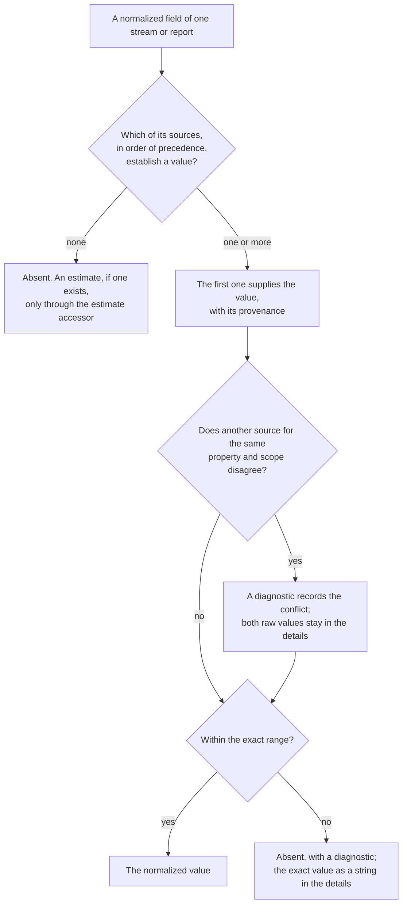

# Normalized fields

| | |
|---|---|
| **Status** | First version, written in Phase 2, task 1, on 2026-11-22, and revised on the same day, before the API specification. It became normative when G2.2 approved the API on 2026-11-23. The ninth review of the API added the rule of the last known good value to sections 1 and 2 on the same day. The tenth revised the rows of `protection`, `codec`, the high dynamic range and a tag's `children`, and the Matroska `protection` row. The eleventh revised the rows of `protection` and `codec` and the Matroska `protection` row again, and the twelfth the Matroska `protection` row, the Matroska tags and the H.264 `profile` and `level` rows. G2.3 confirms both. Every format phase extends it (plan section 11). |
| **Plan** | [Sections 8.3 and 8.4](../plans/plan-init-project.md#84-normalized-values-units-precedence-and-provenance) set the rules; this guide applies them per field and per format. |

This guide lists every field of the normalized model and says, for each format, which element, box or field of the file supplies it. Its unit, precedence and provenance are given too. Two correct implementations of these rules return the same value for the same file (plan section 8.1, principle 6).

The depth differs by release, as the maintainer chose on 2026-11-22:

- **Release `0.1.0`.** Matroska and WebM, the ISO base media family with QuickTime, and AVI (section 4). The codec headers that `0.1.0` parses (section 5). Every cell names its source and section.
- **Releases `0.2.0` to `0.8.0`.** A matrix of the fields each format can fill, with the sections that state them (section 6). It shows that the model has room for every format. Each format phase replaces the format's entry with tables like those of sections 4 and 5.

Section 7 lists what writing and reviewing this guide found: questions for the API specification, amendments of the plan, and gaps in the approved sources.

## 1. How to read this guide

**Tables.** Normalized fields are rows. The formats or codecs of one family are columns.

**Cells.** A cell names the source in the specification's own spelling, then its section in parentheses, then its unit where it has one, then its provenance:

- *declared*: the container states it;
- *bitstream*: a codec header states it;
- *derived*: computed exactly from declared, bitstream or derived inputs (plan section 8.4).

Where several sources can supply a field, they are numbered in order of precedence: use the first applicable source that establishes a value. An unknown sentinel or unread field supplies no value. Use a lower source only when no higher one establishes a value, and never where the format forbids the fallback. For example, a Matroska `LanguageBCP47` that reads suppresses legacy `Language`, even for `und`. A source that is damaged, so that its bytes contradict its syntax, or cut short before its value, establishes no value either. Where the sources are structures of several versions of one specification that state the same property for the same scope, as `LanguageBCP47` of Matroska version 4 and the older `Language` do, a property therefore holds its last known good value: the older structure's, when the newer one is damaged. A diagnostic names the damaged structure, and a suppression rule applies only to a newer value that reads, as the maintainer chose at the ninth review of `api.md` on 2026-11-23 (plan section 8.4). Other marks:

| Mark | Meaning |
|---|---|
| — | The format states nothing for this field. The field is absent, unless a codec header fills it (section 5). |
| *default* | The specification gives a value for an absent element, and the value then counts as stated once absence is established in its parent. A budget-limited read alone cannot establish a default. Apply the format's parent, version and compatibility rules. Matroska distinguishes the effective value from an element actually stored (section 4.1). Finding F1 asks how the API exposes this. |
| *details* | The fact exists, but it is not a normalized field: the typed details keep it (plan section 8.2). |
| *gap* | The format states it, but no approved source defines it. Section 7 names the gap. |

**Sources.** A section number belongs to the document named at the top of each table, by its key in `docs/specs/manifest.tsv` or `docs/specs/rfc/manifest.tsv`. A cell that cites another document names its key first. Descriptions written for this project (`iso-iec-*.md`, `iec-*.md`) live in `docs/specs/iso-iec/`.

## 2. General rules

These rules restate plan section 8.4 and add what the per-format tables need.

- **Time.** Time values are exact rationals of seconds. The report's zero is the origin of the format's presentation timeline. That is movie time 0 for the ISO family, segment time 0 for Matroska and time 0 of the stream clock for AVI. A stream's start time is an offset on that timeline. A value stored in ticks is converted exactly: ticks times the tick's length.
- **Values stored as floating point.** For Matroska time expressed as fractional ticks, scale to nanoseconds before rounding. RFC 9559 section 11.3 recommends the nearest nanosecond for block timestamps. Finding F2 proposes that precision for Matroska duration too, with exact half-nanosecond ties rounded away from zero: 2.5 ns becomes 3 ns and −2.5 ns becomes −3 ns. Other formats keep their stated time units. Any other floating-point value is converted exactly to the rational of its binary value, which F2 also asks to confirm.
- **Fixed point.** A 16.16 or 8.8 fixed-point value is an exact rational with denominator 65,536 or 256, reduced.
- **Rates.** Sample rates and frame rates are exact rationals per second. Bit rates are bits per second; a derived bit rate is an exact rational.
- **Sizes.** Sizes are whole pixels. A size computed from a fractional input is rounded to the nearest whole pixel, halves up, as the last step. It is labeled *derived*, and the exact rational stays in the details (plan section 8.4).
- **Precedence.** Properties of the coded stream follow the parsed header first: coded size, profile, level, bit depth, chroma format, coded sample rate and channel count. Presentation intent follows the container first: display size, aspect ratio, rotation, language, flags and titles. Use a format-specific override only for the components that the overriding source actually states. Duration comes first from the container's declaration or index, then from an exact derivation.
- **The last known good value.** A structure of a newer version of a specification that is damaged or cut short establishes no value, so the value that a structure of an older version of the same specification read well for the same property and scope is reported, with its provenance and a diagnostic for the damaged one (section 1). An older structure that covers less, such as AVI's first-segment frame count beside the OpenDML total, states a different property and is never such a fallback.
- **Conflicts.** Compare the same component, scope and stage, after unit conversion and before display rounding. When two sources that should agree do not, the field follows the precedence. Both raw values stay in the details, and a diagnostic records the conflict.
- **Absence.** A field that no source states, or that could not be established, is absent. Preserve a genuine zero, such as a chapter at time zero or a completed count of zero. Never substitute a zero or empty string for missing evidence. Estimates exist only through the estimate accessors (plan section 8.4, R25).
- **Range.** A quantity beyond 2^53 − 1 in magnitude is absent. A diagnostic is raised, and the exact value is kept as a string in the details (R24). A rational is reduced first and then checked by its numerator and its denominator, not by its value: 1 ÷ 2^54 is small, but its denominator is beyond the range. Then the field is absent, and both components are kept as strings with the inputs they were computed from (plan section 8.8).
- **Language.** The normalized language is a BCP 47 tag (RFC 5646), and the code as written is kept beside it. A three-letter ISO 639-2 code becomes the shortest BCP 47 tag that names the same language: the ISO 639-1 code where the registry gives one (`loc-iso-639-2`, `iana-language-subtag-registry`). A legacy Matroska value can add a dash and a country to the code (RFC 9559 section 12): the language part is converted alone and the country becomes the region subtag, so `fre-ca` becomes `fr-CA`. The codes `und`, `mis`, `mul` and `zxx` are kept as written. `und` denotes undetermined language. Preserve that explicit code as written and omit the normalized language. Retain a more specific valid BCP 47 tag such as `und-Latn`, which also conveys a script.

How one normalized value is chosen:

## 3. The normalized fields

The maintainer approved the names at G2.1 on 2026-11-22, and the names added since at G2.2 on 2026-11-23. The types are decided in `docs/design/api.md`. "Rational" means an exact fraction. Plan section 8.2 lists the types that hold these fields.

### 3.1 Report

| Field | Type and unit | Provenance | Precedence and rule |
|---|---|---|---|
| `format` | The detected format | detection | Plan section 8.6. Not a field of the file. |
| `media_type` | A media type | derived | Use the format registration for a fixed media type, or the established stream kinds and roles when the registration distinguishes presentation types (plan section 8.2). Section 4 names the type of each format, and finding F3 asks which sources may name one. |
| `size` | Bytes | the source | The length the source reports, or the end of the input when it was observed (plan section 7.5). It is not read from the format. |
| `duration` | Rational seconds | declared, derived | 1. The container's declaration or index. 2. The latest presentation end minus the earliest presentation start over all streams, from data examined in full (plan section 8.4). It needs the start and the end of every timed stream: one stream whose end is not established leaves the report's duration absent. A format with several independent timelines, such as transport-stream programs or DVD program chains, sets it only where its phase says so; otherwise each timeline keeps its own (section 6). |
| `bit_rate` | Bits per second | declared, derived | 1. Declared by the container. 2. `size` × 8 ÷ `duration`, when both are established, the duration is greater than zero, and the input holds all the media of the presentation. A movie referencing any external sample bytes lacks a complete local numerator, even when it also contains local media (section 3.11). An empty presentation of zero duration has none either. |
| `estimated_duration`, `estimated_bit_rate` | Value and method | estimate | Separate accessors (R25). |
| `creation_time` | An instant in UTC | declared | A candidate (finding F4). Only from a source that states its time in UTC. A date and time without a stated time zone stays in the details as written. |

### 3.2 Stream

| Field | Type and unit | Provenance | Precedence and rule |
|---|---|---|---|
| `index` | Position in the report, from 0 | — | Use declaration order for declared streams and the order of their first stream-carrying units for observed streams (plan section 8.3). The report assigns the index. |
| `native_identifier` | The container's own identifier, as text | declared | Kept exactly as written: a number in decimal, a binary value in lowercase hexadecimal (R24). |
| `unique_identifier` | Identifier, as text | declared | Only where the container gives one. Tags and chapters refer to it (plan section 8.5). |
| `kind` | Video, audio, subtitle, buttons, data, unknown | declared, bitstream | 1. The container's declaration. 2. The codec, where the container states no kind. |
| `codec` | See section 3.3 | declared, bitstream | |
| `header_status` | Plan section 8.3 | — | The outcome of header parsing, not a field of the file. |
| `protection` | The signaled protection of the stream or sample description, its scheme, and whether the configuration is clear | declared | A candidate (finding F22). Independent of `header_status`. Report the scope of the declaration. An encrypted entry establishes a protection mechanism, while individual samples can be clear. A Matroska track can have clear private data, so a parsed header, and encrypted blocks (plan Phase 5, task 8). The status is then the outcome of parsing the clear private data, and this field says protected. The header status "protected" remains for a stream whose configuration itself is encrypted. Protection belongs to the stream's declaration. A structure that can declare protection, and that the input, a limit, the reach of a forward-only source or a source failure kept from being examined in full, therefore leaves discovery incomplete for that stream. So does a declaration that the retained data could not hold, and settings that a disabled feature kept from being read. In the partial report of an error, the reason of a source failure names both the stream and the source (`api.md` section 6.3, after its eleventh review). |
| `language` | BCP 47 tag, and the code as written | declared | Section 2. The stream's primary language. |
| `languages` | Every language the container attaches to the stream, each with its own roles: clean effects, hearing impaired, visually impaired commentary and the others its format defines | declared | A candidate (finding F24). A transport stream's ISO 639 language descriptor can hold several pairs of language and audio type for one stream (`itu-t-h-222-0` 2.6.18, 2.6.19, Table 2-63). The pairs stay together, so the role of each language is not lost in stream-wide flags. |
| `title`, `titles` | Text; every name the container gives the stream, each with its language | declared | `titles` keeps every name, such as ASF's stream names with their language indexes (`microsoft-asf-specification` 4.1). `title` is the convenience name: the only one, or the unique name matching the stream's `language`. When neither choice is unique, `title` is absent. |
| `duration` | Rational seconds | declared, derived | 1. The container's declaration or index for this stream. 2. The stream's latest presentation end minus its earliest presentation start, from data examined in full (plan section 8.4). |
| `start_time` | Rational seconds | declared, derived | The offset of the stream's first presented unit from the report's zero (section 2). |
| `bit_rate` | Bits per second | declared, bitstream, derived | 1. An average that the container declares for the whole stream. 2. An average that a codec configuration states for the whole stream, such as DTS's `ddts` `avgBitrate` or ALAC's `avgBitRate` (section 5); a peak or nominal rate is no average and goes to the details. 3. Bits of all units ÷ the time those same units span: the media's own duration, summed from the durations of all its units, fragments included. Never divided by an edited or presented duration, which can cover less or more of the media. Only when every unit is accounted for and that time is greater than zero. |
| `estimated_duration`, `estimated_bit_rate` | Value and method | estimate | Separate accessors on each stream, as on the report (plan sections 8.2 and 8.4, R25). Never in `duration` or `bit_rate`. |
| `packet_count` | Count of container units | declared, derived | Only when every unit of the stream is accounted for (plan section 8.4). |
| `frame_count` | Count of video frames | declared, derived | Only where one unit is known to be one frame. |
| `sample_count` | Count of audio samples per channel | declared, bitstream, derived | Only where exact. It counts the samples of the stream after an established encoder delay and padding are removed, as CAF's valid frames do. An edit that is not priming or padding does not change it; it changes the presentation, which `duration` describes. |
| `default`, `enabled`, `forced` | Yes or no | declared | Disposition. Absent when the format states nothing; never assumed false. |
| `hearing_impaired`, `visually_impaired`, `text_descriptions`, `original_language`, `commentary` | Yes or no | declared | Disposition, as the previous row. |
| `declaration_range` | Where a declaration applies | declared | Only for a container that can give one identifier to different streams over time. None of `0.1.0` can. |
| `embedded_in` | The index of the stream that carries this one | derived | A candidate (finding F14): the audio of a type-1 DV stream. |
| `start_timecode` | A signed timecode: a frame number with its sign, the actual rate, the nominal frame count per timecode second (`numFrames`), whether it drops frames, and whether it wraps after 24 hours, from which the label of hours, minutes, seconds and frames follows | declared | A candidate (finding F23). The label a timecode track starts at, which is no presentation time: a track can start at movie time 0 with the label 01:00:00:00. QuickTime: the timecode sample description and the track's first sample (QT "Timecode sample description", "Timecode sample data"; plan Phase 6, milestone 6B). The wrap flag (0x0002) is kept, because at 25 frames per second frame 2,160,000 reads 24:00:00:00 without it and 00:00:00:00 with it. That sample is a signed frame number, negative where the description allows negative times (flag 0x0004), unless the Counter flag (0x0008) is set. Then it is an unsigned counter, divided by the description's number of frames, which is no timecode: it goes to the details, and the field is absent. |

### 3.3 Codec

| Field | Type and unit | Provenance | Precedence and rule |
|---|---|---|---|
| `codec` | The codec's identity, an open set | declared, bitstream | From the container's identifier through the registries of Phase 4. A codec header can refine it, as E-AC-3 refines AC-3. In a format without sample descriptions, absent when the input, a limit, the reach of a forward-only source or a source failure ended the structure before it named a codec, as for a Matroska track entry cut short before `CodecID`. Such a codec is not unknown, since the file named none (`api.md` section 6.4). An ISO description cut off before its format code is a description that was not read, which the rules of the first sample's description decide (`api.md` section 6.4, after its eleventh review). |
| `name` | The codec's human-readable name | — | From the library's registry entry for a known codec, never from the file. Absent for an unknown codec. A name that the file states, such as Matroska's `CodecName`, goes to the details. |
| `raw_identifiers` | Every codec identifier the input carries, as written, each with its namespace and in its namespace's spelling: a code of bytes in lowercase hexadecimal, a text code as its text, a coded number in canonical decimal (`api.md` section 6.4, the maintainer's choice at its thirteenth review) | declared | Kept also when the library does not know them, as when an MP4 entry gives both a sample-entry code and an object type. Empty when the format names no codec, as a SubRip file, which is identified from its content. While the description of an ISO track's first sample is unproven, each candidate description keeps its own identifiers, and a description that the probe could not read or keep is marked as missing (`api.md` section 6.4). When that description is established but was not read or kept, the field is empty, the description is marked as missing, and the details keep its index. |
| `profile` | The codec's profile | bitstream, declared | 1. The parsed header. 2. A container declaration (WebM's VP9 feature metadata). |
| `level`, `tier` | The codec's level and tier | bitstream, declared | As `profile`. |
| `codec_string` | An RFC 6381 `codecs` value | derived | In the ISO family: the registered four-character code of the selected description, with the case and escaping of `rfc6381` 3.2 to 3.4, followed by the parameters where an approved source defines them (`rfc6381` 3.3). In WebM: the strings of the WebM guidelines. In Ogg: the registered value corresponding to the identification header, `vorbis`, `theora`, `speex`, `flac`, `dirac`, `kate` and the others of `rfc5334` 4, and `opus` (`rfc7845` 9). Other containers require an approved mapping (finding F5). An ISO stream's primary string describes its selected sample description. A file-wide MIME `codecs` list would need all used descriptions across tracks (`rfc6381` 3.1). |

### 3.4 Video

| Field | Type and unit | Provenance | Precedence and rule |
|---|---|---|---|
| `coded_size` | Width and height, pixels | bitstream, declared | 1. The parsed header, when it describes a whole frame. 2. The container. A header that can describe one field of a frame, as a Motion JPEG image can, gives a coded size only when it is shown to describe a whole frame (section 5.3). |
| `visible_size` | Width and height, pixels | bitstream, declared, derived | 1. The parsed header's cropping, including the full coded size when the format establishes an uncropped frame. 2. The container's cropping or clean aperture, rounded (section 2). In the ISO family and in Matroska the order is reversed. A `clap` box overrides the codec's declarations (ISO 12.1.4.1), and its exact dimensions feed the aspect ratios. Matroska's cropping applies to the decoded frame, and its display size applies to the cropped image (RFC 9559 section 15.1), so a header's visible size never replaces it (section 4.1). |
| `display_size` | Width and height, pixels | declared, derived | 1. Display dimensions that the container states in pixels. 2. The exact aperture scaled by the pixel aspect ratio, width scaled, rounded (plan section 8.4). Absent otherwise. A render size that a codec header states, as VP9's does, stays in the details. For single-track stereo, a container's display size describes one view, while `coded_size` and `visible_size` describe the stored frame that holds both (section 4.1). |
| `pixel_aspect_ratio` | Rational: the shape of a visible pixel as presented | declared, bitstream, derived | A candidate definition (finding F26). 1. The container: a ratio derived exactly from a display aspect ratio it states or implies and the exact size of the region that ratio describes, or else a pixel ratio it states, as `pasp` does. The region is one visible view for Matroska (section 4.1), the exact visible aperture for the ISO family's track size, and the active frame for OpenDML's frame aspect ratio (section 4.3). 2. The parsed header. When the container states or implies a display aspect ratio but the size of its region is not established, the field is absent: a coded ratio, stated or parsed, describes the sample before the container's scaling, so it goes to the details. |
| `display_aspect_ratio` | Rational | declared, bitstream, derived | 1. A ratio the container states. 2. A ratio the codec header states (MPEG-2). 3. Derived from exact inputs only, never from a rounded size (plan section 8.4). For single-track stereo it describes one view, as `display_size` does. |
| `frame_rate` | Rational frames per second, a mode (constant, variable, unknown) and an origin | declared, bitstream, derived | 1. The container's timing tables, read without sample data. 2. The container's declared rate. 3. The parsed header's timing when the container binding permits it. A rate needs evidence of the frame cadence: the durations of units that are known to be one frame each, or a header field that fixes the interval between pictures. A clock rate, a tick or a time base alone is not a frame rate. The mode is constant only when every interval is shown to be equal, variable only when two are shown to differ, and unknown otherwise. An average from a count and a duration needs both established. |
| `bit_depth` | Bits per component: the common precision when all present components share one, otherwise the separate component depths | bitstream, declared | 1. The parsed header. 2. The container. H.264 can declare different depths, such as 8-bit luma and 9-bit chroma (`bit_depth_luma_minus8`, `bit_depth_chroma_minus8`; 7.4.2.1.1), so both are kept. Monochrome has only luma, and equal-depth RGB uses the common precision. |
| `chroma_format` | Monochrome, 4:2:0, 4:2:2, 4:4:4, 4:1:1, or another subsampling kept as written | bitstream, declared | As `bit_depth`. 4:1:1 is the format of 525-line consumer DV (`iec-61834-2.md` 6). |
| `scan_type`, `field_order` | Progressive or interlaced; top or bottom field displayed first | declared, bitstream | 1. The container. 2. The parsed header. Retain any distinct storage order or interleaving in the details. |
| `color` | Primaries, transfer characteristics, matrix coefficients and range, as ITU-T H.273 code points | bitstream, declared | 1. The parsed header. 2. The container. In the ISO family the order is reversed: a `colr` box "takes precedence, and over-rides the information in the bitstream" (ISO 12.1.5.1), and that choice also decides `dynamic_range`. |
| `mastering_display`, `content_light_level` | Chromaticities and luminance; maximum content and frame-average light levels | declared, bitstream | 1. The container. 2. The parsed header. Each source supplies only the values it states (section 2), so one structure can hold values from both. Each coordinate, luminance and light level therefore keeps its own provenance (`api.md` section 6.5). |
| `dynamic_range` | Signaling of a high dynamic range | derived | From the transfer characteristics and from a dynamic-range configuration (finding F6). |
| `rotation` | Degrees, a multiple of 90 | declared, derived | Reported, never applied (plan section 8.4). The direction is finding F7. |
| `stereo_mode`, `projection` | As the container states them | declared | |
| `alpha` | Whether the frames carry transparency, and how it is carried: inside the coded frames, or beside them as supplemental data | bitstream, declared | Two carriages, reported side by side, never in conflict. Embedded: the parsed header, such as ProRes's `alpha_channel_type` or FFV1's `extra_plane` (section 5.3). Supplemental: the container, such as Matroska's `AlphaMode`, which describes alpha in the block additions (section 4.1). The absence or a default of one says nothing about the other. |

### 3.5 Audio

| Field | Type and unit | Provenance | Precedence and rule |
|---|---|---|---|
| `sample_rate` | Rational hertz | bitstream, declared | 1. The parsed header. 2. The container. |
| `output_sample_rate` | Rational hertz | bitstream, declared | The rate after a decoder stage that changes it, such as AAC's spectral-band replication. 1. The parsed header, when it establishes the output, as explicit signaling does (section 5.4). 2. The container, when its mapping declares the output rate. Opus lets the decoder choose among several output rates, so a sample entry's fixed 48 kHz clock selects none (section 5.6). |
| `channel_count` | Count | bitstream, declared | The decoder's output, not an internal stage. 1. The parsed header, when it establishes the output. 2. The container. A core stage that differs, such as AAC's mono core under parametric stereo, goes to the details and is never compared with the output (section 5.4). |
| `channel_layout` | Speaker positions with any unassigned channels retained; or Ambisonic components, with their order, channel ordering and normalization, and any further channels such as a stereo pair beside them | bitstream, declared | As `channel_count`. Explicit speaker coordinates retain their signed azimuth and elevation when the format supplies them. Ambisonic components are no speaker feeds: Opus mapping families 2 and 3 carry them (`rfc8486` 3; section 5.6). |
| `bit_depth` | Bits per sample | bitstream, declared | As `channel_count`. Absent for codecs that have no sample depth. |
| `sample_format` | Integer or floating point, signedness, byte order | declared, bitstream | For PCM. |
| `encoder_delay`, `padding` | Samples | declared, bitstream, derived | The signaled leading and trailing discard, in samples per channel. In Ogg Opus the leading discard can include a sample-accurate crop, so `encoder_delay` reports the pre-skip and cannot distinguish the encoder's original latency (`rfc7845` 4.2). Only where a source establishes them as such. 1. A codec header field that the codec's mapping into the container makes normative, such as Opus's pre-skip in Ogg and Matroska (section 5.6). 2. A container field defined for it, such as Matroska's `CodecDelay` or CAF's priming frames, or an edit that an approved source defines as marking them (section 4.2). Where the mapping makes the header field informative, as the Opus binding to the ISO family does for `PreSkip`, the container's source comes first. An edit in general selects media; it is not encoder delay. |
| `immersive` | Signaling of an object-based or immersive presentation | bitstream, declared | Only from a field that states it, such as AC-4's `immersive_audio_indicator`, or a TrueHD 16-channel presentation whose channel meaning shows objects, an intermediate spatial format or height channels (section 5.5). A channel count or an assignment list that may also describe stereo does not establish it. |

### 3.6 Subtitle

| Field | Type and unit | Provenance | Precedence and rule |
|---|---|---|---|
| `subtitle_kind` | Text or bitmap | derived | From the codec. |
| `text_encoding` | The character encoding of the text | declared, bitstream | Fixed by the codec or the container, or stated in the header. |
| `canvas_size` | Width and height, pixels | bitstream, declared, derived | 1. The parsed header. 2. The container. |
| `event_count`, `time_range` | Count; rational seconds | derived | Only when every event was examined, and the end of the input was observed (plan Phase 14, task 11). The time range runs from the earliest start to the latest end of any event, not the end of the last one in file order. It needs the end of every event: a format that states only start times has no time range (finding F20). A container's packet count is not an event count. |

### 3.7 Chapter editions and chapters

| Field | Type and unit | Provenance | Rule |
|---|---|---|---|
| Edition `unique_identifier` | Identifier, as text | declared | |
| Edition `default`, `ordered`, `hidden` | Yes or no | declared | |
| Edition `has_linked_chapters` | Yes, no or unknown | derived | Positive evidence first: yes as soon as any chapter that was read points into another segment (plan section 8.5), even when the rest of the edition was not read. No only when every chapter of the edition was read and none does. Unknown only when no link was seen and some chapters were not read. |
| Edition `playback_duration` | Rational seconds | declared, derived | 1. A playback time that the structure itself declares, as a DVD program chain does; it stays even when its cells add up to another time (plan Phase 15, tasks 1 and 2). 2. For an ordered edition, derived from the chapters that play: the enabled leaves of enabled branches in stored order. An interval played by its stated times needs both endpoints. A leaf that plays a stretch of another segment counts with its end minus its start, on that segment's timeline (RFC 9559 section 17.2.1). A leaf that links an edition of another segment plays that whole edition in place of its own interval (RFC 9559 section 17.2.2); the segment is never opened, so the playback duration is absent, and so are the positions of the chapters after that leaf. If a control track can change the path and the resulting interval is unknown, playback duration and affected positions are absent. A parent chapter's end is ignored for playback and may be missing (RFC 9559 section 20.2.4), so a parent with two leaves of five seconds plays for ten (plan section 8.5). |
| Chapter `unique_identifier`, `string_identifier` | Identifier, as text | declared | |
| Chapter `start`, `end` | Rational seconds, on the timeline of the segment that holds the chapter's media: this one, or the linked segment of a chapter with a `segment_reference` (RFC 9559 section 17.2.1) | declared, derived | The end is absent where the format marks only a point, as a WAVE cue point does (section 6); no end is invented. |
| Chapter `segment_reference` | The identifier of another segment, and optionally the identifier of the edition to play from it | declared | That segment is never opened. Two chapters can point into the same segment and select different editions, so the edition identifier is part of the reference. Without it, no edition of the linked segment is used (RFC 9559 section 5.1.7.1.4.7). |
| Chapter `titles` | Text, each with its languages and its countries | declared | One Matroska `ChapterDisplay` can give the same text several `ChapLanguage` or `ChapLanguageBCP47` values (RFC 9559 sections 5.1.7.1.4.11, 5.1.7.1.4.12), so a title keeps all of them together. |
| Chapter `hidden`, `enabled` | Yes or no | declared | |
| Chapter `children` | Nested chapters | declared | |
| Chapter `playback_position` | Rational seconds | derived | Ordered editions only: the sum of the preceding playing leaf intervals on the established path. A playing parent starts at its first playing leaf. Skipped chapters have no playback position, and an unknown playing length leaves subsequent positions absent. A chapter's own start on the playback timeline needs only the preceding intervals. For known five-second media followed by a whole-edition link, the link starts at five seconds even when it has no stated end. |

### 3.8 Tag sets and tags

| Field | Type and unit | Provenance | Rule |
|---|---|---|---|
| Tag set `target_level` | A number and a type name | declared | |
| Tag set `targets` | Four lists of references: streams, editions, chapters, attachments | declared | Each reference preserves its namespace and resolves to a report entry where possible. This includes Matroska UIDs, MP4 track IDs and ASF stream numbers. A reference can also be unresolved or a wildcard (plan section 8.5). All empty means the whole file once the target structure was read in full; a tag set cut short before that has an incomplete scope (`api.md` section 6.9). The native scope and owner accompany ISO-family tags, since file and movie scope, or track and media scope, can resolve to the same target. |
| Tag `name` | Text as written; or, for a format whose keys have a namespace, the namespace and the key bytes as written | declared | A QuickTime metadata key is a namespace and key bytes interpreted by it (QT "Metadata atoms and types"), so both are kept and a recognized pair gets a normalized `key`; two namespaces that spell a key alike stay apart. |
| Tag `key` | A normalized key, an open set | derived | Where the library knows the name. Finding F4 lists the first keys. |
| Tag `languages`, `countries`, `default` | The languages, as BCP 47 tags with the codes as written, and the countries that the value applies to, each a set that may be empty; yes or no | declared | A QuickTime metadata value can apply to several languages, several countries, or countries alone, and two regional values of one key must stay apart (QT "Localization list sets"). A format with one language per tag gives a set of one. |
| Tag `value` | Text, binary, an integer, a floating-point number, a Boolean, a GUID or none, with the native type as written | declared | A candidate (finding F25). The format's own value type is kept: an ASF rating stored as a number is not the text of its digits, and a Boolean is no integer (plan Phase 13, task 2; `microsoft-asf-attribute-list`). QuickTime metadata defines 32-bit and 64-bit floating point, types 23 and 24 (QT "Well-known types"), so a rating of 3.5 stays a number. |
| Tag `children` | Nested tags | declared | A nested tag "becomes an attribute of its parent" (`ietf-draft-cellar-tags` 3), so a `TITLE` inside `ORIGINAL` is the title of the original work (4.1), not of the file. The flat lookups therefore see only the top level of each tag set (`api.md` section 6.9). |

### 3.9 Attachments

| Field | Type and unit | Provenance | Rule |
|---|---|---|---|
| `unique_identifier` | Identifier, as text | declared | |
| `name`, `description` | Text | declared | |
| `media_type` | A media type | declared, derived | 1. A declared media type. A link marker such as `-->` is excluded. 2. From inspecting embedded data (Phase 4, milestone 4C). |
| `size` | Bytes | declared | Of embedded data only; absent for a linked picture. |
| `link` | A URI, as written | declared | A picture that the file links instead of embedding, including the `-->` marker of a FLAC picture block (`rfc9639` 8.8) or an ID3v2 attached picture (`id3-v2-4-frames` 4.14). It stays an attachment with its description, picture type and declared pixel size; it has no `data` and no `size`, and the URI is never fetched (R18). The same URI is listed under external references (section 3.11), pointing to this attachment. |
| `data` | Bytes | — | Only at the caller's request, within the payload limit (plan section 7.5). |
| `width`, `height` | Pixels | declared, bitstream | 1. Declared with the picture, as FLAC's picture block does, where 0 means unknown (`rfc9639` 8.8). 2. From inspecting the image header, without its payload and within the per-stream header limit, also when the data is not kept (Phase 4, milestone 4C; `api.md` section 4.3). |
| `role` | Cover art or other, with the native picture type kept as written | declared, derived | A candidate (finding F8). The native type, such as FLAC's front cover 3 and back cover 4 (`rfc9639` 8.8), stays, so a caller can tell a front cover from a back cover. |

### 3.10 Programs

| Field | Type and unit | Provenance | Rule |
|---|---|---|---|
| `program_identifier` | Identifier, as text | declared | |
| `name`, `provider` | Text | declared | |
| `streams` | Member streams, by index | declared | |
| `clock_reference_identifier` | Identifier, as text | declared | Absent when the format says that no clock is associated, as a transport stream's `PCR_PID` of 0x1FFF does (`itu-t-h-222-0` 2.4.4.9). |
| `duration` | Rational seconds | derived | |
| `map_state` | Complete, incomplete | — | |

No format of `0.1.0` has programs. The transport stream is the first (section 6).

### 3.11 External references

The report lists the files, segments and resources referenced by the input (R18; plan section 7.7). A reference is recorded independently of access. For eligible companions, an explicitly enabled resolver also records the lookup outcome in the source table.

| Field | Type and unit | Provenance | Rule |
|---|---|---|---|
| `kind` | Linked segment, data reference, linked picture, expected companion, playlist entry, and others | declared | A linked picture also stays an attachment, with its picture metadata (section 3.9); the reference names that attachment. |
| `identifier` | Identifier, as text, such as a segment UUID | declared | Where the reference names one. |
| `location` | A path, file name or URI, as written | declared | Where the reference names one. Recorded without dereferencing it. Only the opt-in companion lookup specified by R18 may open an eligible companion. |
| `role` | What the referenced item would supply, such as the previous segment or the data of a track | declared | |
| `owner` | What in the report the reference belongs to: an attachment by index, a chapter by its edition and position in the chapter tree, or a stream by index with its sample-description index where applicable | derived | Two FLAC picture blocks can link the same URI for different covers, and two tracks can share one data reference, so each reference names its owner. A reference that belongs to the file as a whole, such as the segment's `PrevUUID`, has none. |

## 4. Release 0.1.0: containers

### 4.1 Matroska and WebM

Sections are those of `rfc9559` unless a cell names another document. A cell of the WebM column that reads "as Matroska" has the same source, subject to the WebM profile. WebM is a subset of Matroska (`webm-container-guidelines`), and the column notes only where the subset differs. An element that the guidelines mark unsupported is absent in WebM, and its default does not apply. An element that their tables do not list, such as the BCP 47 language elements that RFC 9559 added later, is read as in Matroska.

A file's `DocTypeVersion` must be at least the version of every element it stores (`rfc9559` 7), and an element's `minver` and `maxver` give the versions that support it (`rfc8794` 11.1.6.13, 11.1.6.14). A stored element whose `minver` is above the file's version breaks that rule: a diagnostic records it, and the element is still read. `StereoMode` in a file of version 2 is no such case, because version 2 stored it with other codes (18.10; `stereo_mode` below). A stored element whose `maxver` is below the file's version, such as `OldStereoMode` in a file of version 3, "SHOULD be discarded" (`rfc8794` 15.2): it supplies no field and stays in the details. A mandatory element omitted inside an established parent takes its default (`rfc8794` 11.1.19), including in versions before its `minver` while the element still has an applicable meaning, because a default added with a new mandatory element "MUST represent the state that was assumed for previous versions" (`rfc8794` 15.1). For example, a version 1 `TrackEntry` with no `FlagEnabled` is enabled. Record the element's physical absence. Do not create a missing optional parent to supply a child's default, and respect codec- and version-specific semantics such as the two stereo code tables (18.10).

**Report**

| Field | Matroska | WebM |
|---|---|---|
| `media_type` | `video/matroska` with a video track, `audio/matroska` with audio and no video on the evidence rule of plan section 8.2, `video/matroska-3d` for stereoscopic video (27.18); derived | `video/webm`, `audio/webm` (`webm-container-guidelines`: "MIME-type"); derived. Not in the IANA registry (finding F3) |
| `duration` | `Info\Duration` (5.1.2.10) × `TimestampScale` (5.1.2.9): floating point in segment ticks, nanoseconds per tick (11.1.2), rounded to the nanosecond (section 2); declared. Without it, timing is "not available by design": no cluster scan derives one (plan Phase 5, task 13) | as Matroska |
| `bit_rate` | First segment's data size × 8 ÷ its positive `duration` (plan Phase 5, task 4; `rfc8794` 6); derived. Use the declared `Segment` data size or the distance from the start of its data to an established end of that segment, when its size is unknown (`rfc8794` 6.2). Exclude the EBML header, element header and any later segment. If that end remains unknown, leave the rate absent. | as Matroska |
| `creation_time` | `DateUTC` (5.1.2.11): nanoseconds since 2001-01-01T00:00:00 UTC; declared | as Matroska |
| *details* | `SegmentUUID`, `SegmentFilename`, `SegmentFamily`, `ChapterTranslate`, `Title`, `MuxingApp`, `WritingApp` (5.1.2.1 to 5.1.2.14). External references (section 3.11): the previous and next linked segments, by `PrevUUID` with `PrevFilename` and `NextUUID` with `NextFilename` (5.1.2.3 to 5.1.2.6; 17), never opened (plan Phase 5, task 5); the EBML header's `DocType`, `DocTypeVersion` and `DocTypeReadVersion` (`rfc8794` 11.2) | `Title`, `MuxingApp`, `WritingApp` and the EBML header, as Matroska. The segment identifiers and file names, `SegmentFamily` and `ChapterTranslate` are unsupported |

**Stream**

| Field | Matroska | WebM |
|---|---|---|
| `native_identifier` | `TrackNumber` (5.1.4.1.1); declared | as Matroska |
| `unique_identifier` | `TrackUID` (5.1.4.1.2); declared | as Matroska |
| `kind` | `TrackType` (5.1.4.1.3; values in 27.16): 1 video, 2 audio, 17 subtitle, 18 buttons, 33 metadata; 3 complex, 16 logo and 32 control are kept as written in the details; declared | as Matroska |
| `raw_identifiers` | `CodecID` (5.1.4.1.21) in the Matroska namespace. For `V_MS/VFW/FOURCC` and `A_MS/ACM`, also preserve the inner `biCompression` or `wFormatTag` and any extensible `SubFormat`, in their respective namespaces. Resolve the codec from that inner identifier (`ietf-draft-cellar-codec` 3.3.18, 3.4.25 and section 4.3 of this guide). Declared | as Matroska; the guidelines name VP8, VP9, Vorbis and Opus, and for WebVTT the identifiers `D_WEBVTT/SUBTITLES`, `D_WEBVTT/CAPTIONS`, `D_WEBVTT/DESCRIPTIONS` and `D_WEBVTT/METADATA` ("Storing WebVTT data in a WebM Track"; finding F19) |
| `language` | 1. `LanguageBCP47` (5.1.4.1.20). 2. `Language` (5.1.4.1.19), ISO 639-2 bibliographic, possibly followed by a dash and a country, as in `fre-ca` (section 2), *default* `eng`. The first takes precedence when both are present (12) and it reads as a well-formed BCP 47 tag; a damaged one leaves the second in place, with a diagnostic (section 1, the last known good value); declared | as Matroska |
| `title` | `Name` (5.1.4.1.18); declared | as Matroska |
| `duration` | — (no element; the tags draft defines no duration tag, finding F9) | — |
| `start_time` | — (needs the first presented block; not read) | — |
| `bit_rate` | A `BPS` tag that targets the track (`ietf-draft-cellar-tags` 4.10); declared, below an index (plan section 8.4) | as Matroska |
| `packet_count`, `frame_count`, `sample_count` | — (finding F9) | — |
| `enabled` | `FlagEnabled` (5.1.4.1.4), *default* 1; declared | as Matroska |
| `default` | Audio, video and subtitle tracks only: `FlagDefault` (5.1.4.1.5; 18.1), *default* 1, set when such a track "is eligible for automatic selection by the player"; declared. On other track kinds the field is absent, its default unused | as Matroska |
| `forced` | Subtitle tracks only: `FlagForced` (5.1.4.1.6; 18.2), *default* 0; declared. The flag "applies only to subtitles", so on other tracks the field is absent, its default unused | The WebM guidelines define `FlagForced` for audio, video and subtitles, as "Set if that track MUST be used during playback" ("FlagForced"). An explicit flag is reported on those three kinds; the default 0 is reported only on subtitle tracks, as in Matroska |
| `protection` | For each encryption entry read `ContentEncAlgo` and `ContentEncodingScope` (5.1.4.1.31.3, 5.1.4.1.31.4, 5.1.4.1.31.8 to 5.1.4.1.31.12). A nonzero algorithm signals encryption for the flagged targets: 1 for block contents, 2 for private data, 4 for the next encoding's settings. These bits can be combined. Algorithm 0 adds no encryption for that entry. Establish clear or protected status separately for payload and configuration after considering the applicable chain (plan Phase 5, task 8). One encryption that covers a target is enough to protect it, whatever another encoding leaves unknown. Settings that a "next" encoding covers are read once it is undone: a zlib compression with the `zlib` feature on, header stripping, or an encryption with algorithm 0. With `zlib` off they are a shortfall of discovery. Under an encryption with a nonzero algorithm, or a compression by bzlib or lzo1x, they leave unknown only what they decide, by design. An encoding cut short keeps every field that was read, and only the unread fields stay unknown. A `ContentEncAlgo` of 0 read before the cut settles that its entry declares no protection, whatever its type (`api.md` section 6.3, after its eleventh review). An encryption declares protection only with a nonzero algorithm that was read, a first encoding over "next" settings included, and a diagnostic names only the fields observed. Covered settings whose element was read in full and whose data do not inflate are damaged, a shortfall of discovery with `DamagedStructure`, which is apart from a field that a cut left unread (`api.md` section 6.3, after its twelfth review). Declared | as Matroska for scope. The WebM profile permits only algorithm 5 (AES) for encryption (`webm-container-guidelines`, “ContentEncAlgo”) |
| `hearing_impaired`, `visually_impaired`, `text_descriptions`, `original_language`, `commentary` | `FlagHearingImpaired`, `FlagVisualImpaired`, `FlagTextDescriptions`, `FlagOriginal`, `FlagCommentary` (5.1.4.1.7 to 5.1.4.1.11; 18.3 to 18.7), no default; declared | as Matroska |
| *details* | `CodecPrivate`, `CodecName`, `AttachmentLink`, `CodecDelay`, `SeekPreRoll`, `DefaultDuration`, `TrackTimestampScale`, `BlockAdditionMapping`, `TrackOperation`, `ContentEncodings` (5.1.4.1.13 to 5.1.4.1.31) | as Matroska, but `AttachmentLink`, `TrackTimestampScale`, `TrackTranslate` and `TrackOperation` are unsupported, and `ContentEncodings` serves only encryption |

**Video** (`TrackEntry\Video`)

| Field | Matroska | WebM |
|---|---|---|
| `coded_size` | `PixelWidth` × `PixelHeight` (5.1.4.1.28.6, 5.1.4.1.28.7): the declared dimensions of the encoded frames. For `V_AV1`, these elements must equal the sequence maxima (`ietf-draft-cellar-codec` 3.3.1). Compare them with the header's maxima. They supply an actual frame size only when the header establishes that size (section 5.2, finding F15) | as Matroska |
| `visible_size` | `PixelWidth` − `PixelCropLeft` − `PixelCropRight` by `PixelHeight` − `PixelCropTop` − `PixelCropBottom` (5.1.4.1.28.8 to 5.1.4.1.28.11, *default* 0; 15.1); derived when the dimensions describe the decoded frame being cropped. For `V_AV1`, apply the crop to the established output raster. A reduced still-picture header fixes `UpscaledWidth` and `FrameHeight` to the sequence maxima even when super-resolution can change the coded width (AV1 5.9.2, 5.9.5, 5.9.8). Otherwise the maxima alone give no visible frame size. Matroska applies its crop to the decoded frame. The result takes precedence for `visible_size` (section 3.4): with RFC 9559's pillarbox example, `PixelCropLeft` and `PixelCropRight` of 240 on a 1920 × 1080 frame, the visible size is 1440 × 1080 even though the header's own cropping leaves 1920 × 1080. The header's visible size belongs to another stage, so it goes to the details and is never compared with this one | as Matroska |
| `display_size` | `DisplayWidth` × `DisplayHeight` (5.1.4.1.28.12, 5.1.4.1.28.13) when `DisplayUnit` (5.1.4.1.28.14) is 0 (pixels); with unit 0 each missing dimension defaults to its corresponding track pixel dimension minus that axis's two crops (Tables 8 and 9). These defaults still define display dimensions when the track pixel dimensions describe AV1 maxima. For single-track stereo the display dimensions describe one view (18.10); declared. Absent for units 1 (centimeters), 2 (inches), 3 (aspect ratio) and 4 (unknown); their values stay in the details | as Matroska; WebM allows only unit 0 |
| `pixel_aspect_ratio` | `display_aspect_ratio` divided by the exact aspect ratio of the corresponding visible view, derived. For mono that view is `visible_size`. For single-track stereo the display is per eye (18.10). In the RFC's uncropped 3840 × 1080 side-by-side example, one view occupies 1920 × 1080 and displays at 1920 × 1080, giving 1:1 pixels. If the packing and crop do not establish the per-view pixel dimensions, leave the ratio absent. This holds for every unit that gives a display aspect ratio, 0 to 3: a 720 × 576 visible frame with `DisplayUnit` 3 and a declared 16:9 has pixels of 64:45. Unit 4 supplies no container ratio | as Matroska |
| `display_aspect_ratio` | `DisplayWidth` : `DisplayHeight` for units 0 to 3. For stereo these are the dimensions of one view (18.10). A physical size gives the ratio of its sides; declared. Absent for unit 4 | as Matroska |
| `frame_rate` | 10^9 ÷ `DefaultDuration` (5.1.4.1.13; nanoseconds per "frame", which RFC 9559 defines as one element of a block), for a codec whose block element is one presented video frame. A stereo pair packed in a block by lacing (18.10) contains two views of one presentation instant. Mode unknown, because blocks may differ from the default; declared. For interlaced video stored as fields, `DefaultDecodedFieldDuration` (5.1.4.1.14) goes to the details. Below it, an `FPS` tag (`ietf-draft-cellar-tags` 4.10); declared | as Matroska. A VP8/VP9 alternate reference frame produces no output of its own (`webm-container-guidelines`, “VP8/VP9 Alternate Reference Frames”). Its block timestamp adds no presented frame |
| `bit_depth` | `Colour\BitsPerChannel` (5.1.4.1.28.18; 0 means unspecified); declared. For `V_VP9`, see also the codec-specific declaration in section 5.2 | as Matroska |
| `chroma_format` | `ChromaSubsamplingHorz`, `ChromaSubsamplingVert` (5.1.4.1.28.19, 5.1.4.1.28.20), with `CbSubsamplingHorz` and `CbSubsamplingVert` (5.1.4.1.28.21, 5.1.4.1.28.22) added for the Cb component when present, as in 4:2:1, which differs from 4:2:2 only by them; derived. For `V_VP9`, see also the codec-specific declaration in section 5.2 | as Matroska |
| `scan_type`, `field_order` | `FlagInterlaced` (5.1.4.1.28.1; *default* 0, undetermined) and `FieldOrder` (5.1.4.1.28.2; *default* 2, undetermined); declared. Use `FieldOrder` only when `FlagInterlaced` is 1, as its usage note requires. Values 1 and 9 display the top field first, 6 and 14 the bottom field first. Value 2 supplies no order. | as Matroska |
| `color` | `Colour\Primaries`, `TransferCharacteristics`, `MatrixCoefficients` (5.1.4.1.28.27, 5.1.4.1.28.26, 5.1.4.1.28.17; H.273 code points), and `Range` (5.1.4.1.28.25; 27.12); declared. The range is normalized before any comparison with a codec header: 1, broadcast range, is limited, as H.273's `video_full_range_flag` 0; 2, full range, is full, as that flag 1. 0, unspecified, leaves the range absent, and 3, "defined by MatrixCoefficients / TransferCharacteristics", too, with the raw value in the details | as Matroska (`webm-container-guidelines`: "Colour") |
| `mastering_display` | `MasteringMetadata`: `PrimaryRChromaticityX` to `WhitePointChromaticityY`, `LuminanceMax`, `LuminanceMin` (5.1.4.1.28.30 to 5.1.4.1.28.40; floating point, CIE 1931 coordinates and candelas per square meter); declared | as Matroska |
| `content_light_level` | `MaxCLL`, `MaxFALL` (5.1.4.1.28.28, 5.1.4.1.28.29; candelas per square meter); declared | as Matroska |
| `dynamic_range` | Derived from `TransferCharacteristics` (finding F6) | as Matroska |
| `rotation` | `Projection\ProjectionPoseRoll` (5.1.4.1.28.46; 15.2: degrees counter-clockwise), only when the whole pose is a planar rotation: `ProjectionType` 0, rectangular, `ProjectionPoseYaw` and `ProjectionPosePitch` both 0, and the roll a multiple of 90 (finding F7); declared. Yaw and pitch change what the roll means. With yaw 180 and roll 180, RFC 9559 gives a vertical flip, a reflection, so `rotation` is absent and the full pose goes to the details | as Matroska |
| `stereo_mode` | Use the modern `StereoMode` table from version 3 (5.1.4.1.28.3; 27.7). For `StereoMode` (0x53B8) in a file of version 2, and for `OldStereoMode` (0x53B9) up to its `maxver` 2, section 18.10 documents the legacy codes: 0 mono, 1 right eye, 2 left eye, 3 both eyes. These identify views without specifying a modern packing layout. Preserve the legacy meaning and raw code. The effective default is mono; declared | as Matroska |
| `projection` | `ProjectionType`, `ProjectionPrivate`, `ProjectionPoseYaw`, `ProjectionPosePitch`, `ProjectionPoseRoll` (5.1.4.1.28.42 to 5.1.4.1.28.46; 27.15); declared | as Matroska |
| `alpha` | Supplemental alpha: `AlphaMode` (5.1.4.1.28.4; 27.8), *default* 0, says whether the block additions carry alpha; declared. Alpha inside the coded frames comes from the codec (section 5.3) and does not conflict with it | as Matroska |
| *details* | `OldStereoMode`, `UncompressedFourCC`, `ChromaSitingHorz`, `ChromaSitingVert` | as Matroska |

**Audio** (`TrackEntry\Audio`)

| Field | Matroska | WebM |
|---|---|---|
| `sample_rate` | `SamplingFrequency` (5.1.4.1.29.1; floating point, hertz), *default* 8000; declared. For `A_OPUS` it holds the encoder's input sample rate instead (`ietf-draft-cellar-codec` 3.4.32), which goes to the details and is never compared with the 48 kHz decoding rate of section 5.6 | as Matroska |
| `output_sample_rate` | `OutputSamplingFrequency` (5.1.4.1.29.2), *default* the sampling frequency; declared. For `A_OPUS` the default does not apply, because `SamplingFrequency` holds the encoder's input rate there. Without the element the output rate is absent: Opus counts time and pre-skip at 48 kHz, but a decoder may output 8, 12, 16, 24 or 48 kHz (`rfc7845` 4, 5.1), so 48 kHz serves the sample arithmetic only | as Matroska |
| `channel_count` | `Channels` (5.1.4.1.29.3), *default* 1; declared | as Matroska |
| `channel_layout` | — | — |
| `bit_depth` | `BitDepth` (5.1.4.1.29.4); declared | as Matroska |
| `sample_format` | The codec identifier: `A_PCM/INT/LIT`, `A_PCM/INT/BIG`, `A_PCM/FLOAT/IEEE` (`ietf-draft-cellar-codec` 3.4.33 to 3.4.35). The integer forms are unsigned at 8 bits and signed otherwise. The float form is IEEE little-endian. Declared | — (no PCM) |
| `encoder_delay` | 1. For `A_OPUS`, the pre-skip of the identification header in `CodecPrivate` (section 5.6). The mapping makes it the source: `CodecDelay` must be present and is set from it, converted to nanoseconds (`ietf-draft-cellar-codec` 3.4.32). 2. `CodecDelay` (5.1.4.1.25; nanoseconds) × the codec's rate ÷ 10^9, when the result is a whole number of samples; derived. For `A_OPUS` the rate is 48 kHz whatever `SamplingFrequency` says, because the pre-skip counts samples at 48,000 Hz: 6,500,000 nanoseconds is 312 samples. Compare the two in nanoseconds. The element holds whole nanoseconds, so a stored value less than one nanosecond from the pre-skip's exact duration agrees with it: for 313 samples the exact duration is 6,520,833⅓ ns, and a stored 6,520,833 ns is no conflict. A difference of at least one nanosecond is a conflict, and the header's value stands. The generic default of `CodecDelay` is 0. The `A_OPUS` mapping requires the element itself. Once physical absence is established, record the missing declaration even if the header's pre-skip is zero. Preserve the header value when available. An unread header and a missing element give no Opus delay. The stored nanoseconds stay in the details | as Matroska |
| `padding` | — (`DiscardPadding` belongs to single blocks, 5.1.3.5.7) | — |
| *details* | `Emphasis`, the emphasis applied to the samples, which a player must invert: from the pinned element schema, secondary to RFC 9559, where it appears in version 5 (`matroska-elements`, `minver` 5). Record the stored value or the effective mandatory default 0 (no emphasis) for an established audio parent, with its presence recorded separately | as Matroska |

**Subtitle**

| Field | Matroska | WebM |
|---|---|---|
| `text_encoding` | UTF-8 for the codec identifiers of `S_TEXT/` (`ietf-draft-cellar-codec`), `S_TEXT/WEBVTT` included (5.4); declared | UTF-8 for the `D_WEBVTT/` tracks (`webm-container-guidelines`: "Storing WebVTT cue in a WebM Block"); declared. Their kind comes from `TrackType`: 0x11 for subtitles and captions, 0x21 for descriptions and metadata ("Storing WebVTT data in a WebM Track"). They carry no private data, so there is no header to parse (`ietf-draft-cellar-codec` 5.4.6) |
| `canvas_size` | — (from the codec, section 5.8) | — |

**Chapters** (`Chapters`, 5.1.7; 20)

| Field | Matroska | WebM |
|---|---|---|
| Edition `unique_identifier` | `EditionUID` (5.1.7.1.1) | — (unsupported: `webm-container-guidelines`, "Chapters") |
| Edition `default`, `ordered` | `EditionFlagDefault` (5.1.7.1.2, *default* 0; 20.1.1), `EditionFlagOrdered` (5.1.7.1.3, *default* 0; 20.1.3) | — (both unsupported) |
| Edition `hidden` | `EditionFlagHidden`, *default* 0 (`matroska-elements`, element 0x45BD); declared | — (unsupported) |
| Chapter `unique_identifier`, `string_identifier` | `ChapterUID` (5.1.7.1.4.1), `ChapterStringUID` (5.1.7.1.4.2) | as Matroska |
| Chapter `start`, `end` | `ChapterTimeStart`, `ChapterTimeEnd` (5.1.7.1.4.3, 5.1.7.1.4.4; nanoseconds, 11.1.1; 20.2.1, 20.2.2) | as Matroska |
| Chapter `segment_reference` | `ChapterSegmentUUID` (5.1.7.1.4.6), with `ChapterSegmentEditionUID` (5.1.7.1.4.7) as the edition to play from it, when present. Also list the external segment reference with its owning chapter (section 3.11) | — |
| Chapter `titles` | `ChapterDisplay` (5.1.7.1.4.9): `ChapString` (5.1.7.1.4.10). Its language and countries: 1. `ChapLanguageBCP47` (5.1.7.1.4.12), and then `ChapLanguage` and `ChapCountry` are ignored, as that element's definition requires when it is used; a damaged one is not, and leaves the second source in place (section 1). 2. Otherwise `ChapLanguage` (5.1.7.1.4.11, *default* `eng`) with `ChapCountry` (5.1.7.1.4.13) | as Matroska |
| Chapter `hidden` | `ChapterFlagHidden` (5.1.7.1.4.5, *default* 0; 20.2.5) | — (unsupported, so no default applies) |
| Chapter `enabled` | `ChapterFlagEnabled`, *default* 1 (`matroska-elements`, element 0x4598); declared | — (unsupported) |
| Chapter `children` | Nested `ChapterAtom` (20.2.3, 20.2.4) | as Matroska |
| *details* | `ChapterPhysicalEquiv`, `ChapProcess` (5.1.7.1.4.8, 5.1.7.1.4.14 to 5.1.7.1.4.19). The pinned `matroska-elements` schema also defines `ChapterTrackUID` in `ChapterTrack` (all tracks apply when absent), and, from version 5, localized edition names (`EditionDisplay`) and `ChapterSkipType`. Preserve the track UIDs, names with their languages, and skip designation when present | — |

All chapter fields are declared, and the playback fields of ordered editions are derived (plan section 8.5).

**Tags** (`Tags`, 5.1.8; 24; `ietf-draft-cellar-tags` 3 and 4)

| Field | Matroska | WebM |
|---|---|---|
| Tag set `target_level` | `TargetTypeValue` (5.1.8.1.1.1, *default* 50) and `TargetType` (5.1.8.1.1.2; `ietf-draft-cellar-tags` 3.3) | as Matroska |
| Tag set `targets` | `TagTrackUID`, `TagEditionUID`, `TagChapterUID`, `TagAttachmentUID` (5.1.8.1.1.3 to 5.1.8.1.1.6); the value 0 is the wildcard | `TagTrackUID` only; the other three are unsupported (`webm-container-guidelines`: "Tagging") |
| Tag `name`, `key` | `TagName` (5.1.8.1.2.1); keys from the names of `ietf-draft-cellar-tags` 4 | as Matroska |
| Tag `languages` | A set of one: `TagLanguageBCP47` (5.1.8.1.2.3) before `TagLanguage` (5.1.8.1.2.2, *default* `und`); a damaged `TagLanguageBCP47` leaves `TagLanguage` in place (section 1) | as Matroska |
| Tag `default` | `TagDefault` (5.1.8.1.2.4, *default* 1) | as Matroska |
| Tag `value` | `TagString` (5.1.8.1.2.5) or `TagBinary` (5.1.8.1.2.6) | as Matroska |
| Tag `children` | Nested `SimpleTag` | as Matroska |
| Tag set superseded | In a segment of unknown size, a live stream, a `Tags` element read after a `Cluster` resets every `Tags` element read before it (23.2). Each set of a reset element is kept and marked superseded, and no lookup sees it; a segment of known size supersedes nothing (`api.md` section 6.9, after its twelfth review) | as Matroska |

**Attachments** (`Attachments`, 5.1.6; 21)

| Field | Matroska | WebM |
|---|---|---|
| `unique_identifier` | `FileUID` (5.1.6.1.5) | unsupported (`webm-container-guidelines`: "Attachment") |
| `name`, `description` | `FileName` (5.1.6.1.2), `FileDescription` (5.1.6.1.1) | — |
| `media_type` | `FileMediaType` (5.1.6.1.3) | — |
| `size` | The size of `FileData` (5.1.6.1.4) | — |
| `role` | Cover art by the file names of 21.1 | — |

### 4.2 ISO base media and QuickTime

Each cell names its document:

- **ISO** is `iso-iec-14496-12-2015`. G1.6 approved it for what the project's description `iso-iec-14496-12.md` leaves open.
- **QT** is `apple-quicktime-file-format`, cited by page title.
- **F4V** is `adobe-flv-f4v-10-1`.

The project's description cites QT and F4V for the common boxes. Fragmented MP4 adds the boxes of ISO 8.8. 3GP and 3G2 (`3gpp-ts-26244`, `3gpp2-c-s0050-b`) and F4V use the same boxes as MP4 unless a cell says otherwise.

**Report**

| Field | MP4 | Fragmented MP4 | 3GP, 3G2, F4V | MOV |
|---|---|---|---|---|
| `media_type` | `video/mp4`, `audio/mp4`, `application/mp4` on the evidence rule (`rfc4337` 2; plan Phase 6, task 15); derived | as MP4 | 3GP: `video/3gpp`, `audio/3gpp` (`rfc3839`); 3G2: `video/3gpp2`, `audio/3gpp2` (`rfc4393`); F4V: none named (finding F3) | `video/quicktime` (`iana-media-types`) |
| `duration` | `mvhd` `duration` ÷ `timescale` (QT "Movie header atom"; F4V 2.4); declared. A `duration` of all ones, 32 or 64 bits by the box's version, means that it "cannot be determined" (ISO 8.2.2.3): it is not converted, and the next source applies, the latest track end after edits (derived) | 1. `mehd` `fragment_duration` (ISO 8.8.2), movie timescale; declared. 2. The latest end of all tracks, each after its own edits; derived. It is set only when every track's end is established, each by its own segment index (`3gpp-ts-26244` 13.4) or by the examination of every fragment. An index establishes the end of its reference track and of no other track. One track whose end is not established leaves the duration absent, with the latest end observed in the details (plan Phase 6, task 11) | as MP4 | as MP4 |
| `creation_time` | `mvhd` `creation_time` (ISO 8.2.2): seconds since 1904-01-01T00:00:00, "in UTC time"; declared | as MP4 | as MP4 | — (QT "Movie header atom" says that earlier versions did not specify UTC and that such fields "were commonly set to local time"; the value stays in the details as written) |
| *details* | `ftyp` brands (ISO 4.3; `mp4ra-brands`), `mvhd` `modification_time`, rate, volume, matrix. External references (section 3.11), never opened: each `url ` or `urn ` entry of a track's `dref` without the flag 0x000001, which marks media in the same file (ISO 8.7.2), with the track and the sample description that selects it through its `data_reference_index` (ISO 8.5.2). A self-contained entry gives no reference | adds `mfhd` sequence numbers, `sidx`, `mfra` | adds 3GPP2 and F4V boxes | as MP4, by the QuickTime data reference entries. External references, never opened (plan Phase 6, milestone 6B): the data references of each track's `dref` that point outside the file (QT "Data reference atom"), and the reference movies of `rmra` (QT "Reference movie atom") |

**Stream**

| Field | MP4 | Fragmented MP4 | 3GP, 3G2, F4V | MOV |
|---|---|---|---|---|
| `native_identifier` | `tkhd` `track_ID` (QT "Track header atom"; F4V 2.5.1); declared | as MP4 | as MP4 | as MP4 |
| `unique_identifier` | — | — | — | — |
| `kind` | `hdlr` `handler_type` (QT "Handler reference atom"; `mp4ra-handlers`): `vide`, `soun`, `text`, `subt`, `sbtl`, `clcp`, `meta` and others; an unknown handler gives the kind unknown, kept as its code (plan Phase 6, task 5); declared | as MP4 | as MP4 | as MP4 |
| `raw_identifiers` | The sample entry's code (ISO 8.5.2; `mp4ra-sample-entries`), and for `mp4a`, `mp4v` and `mp4s` the `objectTypeIndication` of the `esds` (`iso-iec-14496-1.md` 4; `mp4ra-oti`); preserve both an outer protected entry and its `frma` original format. Identify the codec from the original entry and its readable configuration (ISO 8.12). Declared | as MP4 | as MP4 | the sample description's data format (QT "Sample description atom"; `mp4ra-sample-entries-qt`) |
| `language` | 1. `elng` `extended_language` (ISO 8.4.6), BCP 47. 2. `mdhd` `language` (QT "Media header atom"; F4V 2.6.1), packed ISO 639-2/T; declared | as MP4 | as MP4 | 1. `elng` (QT "Extended language tag atom"). 2. `mdhd` `language`: a Macintosh language code below 0x400, else packed ISO 639-2/T, except 0x7FFF, which marks an unspecified language and leaves the field absent, its raw value in the details (QT "Language code values"); declared |
| `title` | — (the `hdlr` `name` describes the handler, *details*) | — | — | `titles`: every `tnam` in the track's `udta`, each with its language code, since a track can have several (QT "User data atoms", "Track name atom"); `title` chosen from them as section 3.2 says. Without one, `name` in the track's `udta`; declared |
| `duration` | The stream's presentation interval: the end of the last presented material on the movie timeline minus its `start_time`, from `elst` (ISO 8.6.6) and the media's timing tables; derived. Without an edit list, use the `tkhd` duration directly for an established zero-start presentation when its value is known. When the first output sample starts later, derive the interval from its first and last established presentation endpoints. An all-ones `tkhd` duration is unknown (ISO 8.3.2.3). With an edit list, `tkhd` `duration` is the sum of all edits, leading empty edits included, so it goes to the details. A leading empty edit of ten seconds before thirty seconds of media gives `start_time` 10 and `duration` 30. The `mdhd` duration, with the same sentinel (ISO 8.4.2.3), is the media's: *details* | The same interval: the track's latest presentation end after edits minus its `start_time`, when the track's own covering index or the complete presentation timing establishes its end; derived (plan Phase 6, task 11). The end itself also feeds the movie's duration | as MP4 | as MP4 |
| `start_time` | The first output sample's position on the movie timeline (ISO 8.6.1, 8.6.6). When the first media edit begins with presented material, this equals the total duration of preceding empty edits. Without edits, use the earliest output composition time. It can be positive when `ctts` shifts every sample. An initialization segment without samples supplies no start. Derived | as MP4 | as MP4 | as MP4 |
| `bit_rate` | 1. `btrt` `avgBitrate` (QT "Bit rate atom"; ISO 8.5.2), "the average rate in bits/second over the entire presentation". A 0 is no such average for a track with samples, so it supplies no value and stays in the details. 2. `esds` `avgBitrate` (`iso-iec-14496-1.md` 4), zero meaning variable, then absent; declared. 3. A whole-stream average from a codec configuration (section 5). 4. The sum of all sample sizes × 8 ÷ the media's own duration, the `stts` total over the media timescale; derived. Bytes and time cover the same whole media, never an edited selection of it | 1 to 3 as MP4. 4. Use sizes from the movie tables and all runs. Resolve durations from `trun`, `tfhd` or `trex` and apply any later `tfdt` extension to the preceding sample (ISO 8.8.3, 8.8.7, 8.8.8, 8.8.12). Even an empty fragment can extend that sample. Divide only when coverage is complete and the resulting media duration is positive | As MP4. For a 3GP `s263` description, `bitr.Avg_Bitrate` is a container-declared elementary-stream average in bits per second (`3gpp-ts-26244` 6.8, Table 6.8). Use it after an applicable `btrt` and before codec or computed averages. Zero denotes variable rate and supplies no average. `Max_Bitrate` is a one-second peak, kept in the details | as MP4 |
| `packet_count` | `stsz` `sample_count` (ISO 8.7.3.2) or `stz2` (ISO 8.7.3.3); declared | The tables' samples plus every `trun` `sample_count` (ISO 8.8.8), when every fragment was examined; derived. An initialization segment on its own, with empty tables and no fragments, has no samples to count: this field and every count built on it are absent, not zero (plan Phase 6, task 10) | as MP4 | as MP4 |
| `frame_count` | `packet_count`, for video whose codec puts one frame in one sample; derived | as MP4 | as MP4 | as MP4 |
| `sample_count` | Sum `stts.sample_count × sample_delta` (ISO 8.6.1.2) and convert media ticks to samples under Phase 6, task 10. For the explicit AAC priming convention subtract both established trim counts. For Opus, use a sample-exact priming-and-remainder edit's valid interval when established (`xiph-opus-in-isobmff` 4.4). Otherwise use the established valid last-sample duration from 4.3.4 and subtract priming once, the priming being the edit's `media_time` (4.4), never the informative `PreSkip`. Arbitrary playback edits do not establish a trim count. When the clock or conflicting inputs leave the valid count ambiguous, preserve the inputs in details; derived | As MP4, including the movie tables and every fragment. Use the effective duration after `tfdt` only where the codec establishes that the interval represents output samples. A longer presentation of a unit alone supplies no extra decoded samples. Absent for an initialization segment on its own | as MP4 | AAC as MP4; the Opus ISO binding excludes QuickTime |
| `enabled` | `tkhd` flag `track_enabled` (QT "Track header atom"); declared | as MP4 | as MP4 | as MP4 |
| `default`, `hearing_impaired`, `visually_impaired`, `text_descriptions`, `original_language`, `commentary` | — (`kind`, ISO 8.10.4, names roles by scheme URIs that no approved source defines: *details*) | — | — | — |
| `forced` | — | — | — | Yes for a track that another track's `forc` reference names (QT "Referencing a related forced subtitle track"); derived |
| `protection` | An entry signaled as protected, including `encv`, `enca`, `enct` and `encs`, with its `sinf` (ISO 8.12); declared. The entry identifies a protected description. A track can use both clear and protected descriptions (Phase 6, task 7). Retain protection per description and distinguish mixed usage from an entirely encrypted track. The scheme comes from `schm` when present, and where it is absent the IPMP descriptors that identify the protection go to the details. The original format comes from `frma`. The configuration is clear when the original format's configuration boxes are readable in the entry | as MP4 | as MP4 (F4V 2.8.8) | as MP4 |
| `start_timecode` | — | — | — | A timecode track (`tmcd`): the time scale and frame duration, nominal number of frames, and drop, wrap, negative and counter flags from its description. Interpret the first sample by section 3.2 (QT "Timecode sample description", "Timecode sample data"; plan Phase 6, milestone 6B); declared |
| *details* | `tkhd` `alternate_group`, `layer`, flags `track_in_movie` and `track_in_preview`; `mdhd` `timescale` and `duration`; `tref` (ISO 8.3.3); every sample description and whether it is used (plan Phase 6, task 7); protection (ISO 8.12) | adds `trex` defaults and `tfhd` overrides | as MP4 | adds `txas` (QT "Track exclude from autoselection atom") and `load` |

The primary codec and header values follow the first sample's selected description (plan Phase 6, task 7). A description observed later establishes usage there only. When the track is proven to have no sample, as an initialization segment examined to its end is, label the first-declaration fallback in the details. The probe can have failed to keep that first description within the retained-data limit; its codec and header fields are then absent, and the label stays (`api.md` section 6.4, the sixth review). A probe that stopped before the first sample's selection was established takes no fallback: the first-sample fields stay unresolved, and every declared description is a candidate (`api.md` section 6.4). Once the selection is established, the details keep its `sample_description_index` (ISO 8.7.4, 8.8.3, 8.8.7), also when the probe could not read the selected description or keep it within the retained-data limit. Its codec and header fields are then absent, and no other description stands in for it.

**Video** (`VisualSampleEntry`, ISO 12.1.3; QT "Video sample description")

| Field | MP4 | Fragmented MP4 | 3GP, 3G2, F4V | MOV |
|---|---|---|---|---|
| `coded_size` | — (`width` × `height` of the sample entry are "the maximum visual width and height of the stream described by this sample description" (ISO 12.1.3.3), not the size of a frame: a stream that changes resolution can start smaller. They go to the details and never conflict with the codec header, which gives the coded size) | as MP4 | as MP4 (F4V 2.8.2) | `width` × `height` of the video sample description: "the width of the source image in pixels" and its height (QT "Video sample description"); declared. For uncompressed video it is the only coded size |
| `visible_size` | `clap` `cleanApertureWidthN`/`D` × `cleanApertureHeightN`/`D` (ISO 12.1.4), rounded; derived | as MP4 | as MP4 | 1. `clap` (QT "Clean aperture"), rounded; derived. 2. *details*: `tapt` `clef`, `prof`, `enof` (QT "Track aperture mode dimensions atom") |
| `display_size` | 1. `tkhd` `width` × `height` (ISO 8.3.2.3; QT "Track header atom"; 16.16 fixed point): the visual presentation size, to which every image is scaled; declared when both are whole numbers. A fractional value is rounded, halves up, and the size is then derived, with the exact value, such as 640.5, kept in the details (section 2). Only when both are nonzero and the flag `track_size_is_aspect_ratio` (0x000008) is clear. 2. The exact visible size with its width scaled by `pixel_aspect_ratio`, whichever of its sources supplies it, rounded; derived. A track size that the flag marks as a ratio, in unspecified units, gives no pixel dimensions of its own | as MP4 | as MP4 | as MP4, but QuickTime gives 0x0008 another meaning, "Track in poster" (QT "Flags" of the track header atom), so only the zero check applies |
| `pixel_aspect_ratio` | 1. When `display_aspect_ratio` comes from the `tkhd` (its source 1), that ratio ÷ the aspect ratio of the exact visible size; derived. The track scales every image to its own size (ISO 8.3.2.3), so a 640 × 480 aperture in a track of 1024 × 576 presents pixels of 4:3, whatever `pasp` says; `pasp` then stays in the details, and the scaling is no conflict. When the visible size is not established, the field is absent, and `pasp` and the codec header's ratio stay in the details. 2. When the `tkhd` gives no ratio, `pasp` `hSpacing` : `vSpacing` (ISO 12.1.4; QT "Pixel aspect ratio"); declared (finding F26) | as MP4 | as MP4 | as MP4 |
| `display_aspect_ratio` | 1. `tkhd` `width` : `height`, exact, when both are positive. If the track uses `track_size_is_aspect_ratio`, the values give the desired ratio directly in unspecified units (ISO 8.3.2.3); declared. 2. Derived from the exact aperture and the established pixel aspect ratio (`pasp`, then the codec header). A 640 × 480 aperture with square pixels in a track of 1024 × 576 presents at 16:9, not 4:3 | as MP4 | as MP4 | as MP4, using the QuickTime pixel dimensions |
| `frame_rate` | For one frame per sample, form output composition times in presentation order from `stts` and `ctts` (ISO 8.6.1). Exclude non-output samples, including the version-1 `ctts` sentinel −2^31. Establish the last output frame's composition end from a known nonzero `cslg.compositionEndTime`, or its final sample delta when decode and composition times coincide. Map the resulting intervals through `elst` (ISO 8.6.6), accounting for cuts, repeats and dwells. Exclude empty edits. Compare the durations of presented pictures. Two different established durations prove variable cadence. Equal positive durations throughout establish constant cadence and its reciprocal rate. If the last duration is unknown, equal earlier intervals alone leave the mode unknown. An average requires an exact presented frame count and the corresponding time; derived | The same rules over the movie tables and track runs. Resolve `trun` offsets and durations, their defaults, and later `tfdt` adjustments (ISO 8.8). A `cslg` in `stbl` covers only movie-table samples. A `cslg` in `trep` covers the subsequent fragments (ISO 8.6.1.4). Use the end that covers the last presented picture. A partial read can establish variation, while constant cadence needs full coverage | as MP4 | as MP4 |
| `bit_depth`, `chroma_format` | — (ISO 12.1.3.3 defines the visual entry's `depth` value 0x0018 for color images. This field alone supplies neither component precision nor subsampling. Preserve it in the details.) | as MP4 | as MP4 | — (QT "Video sample description"; retain the pixel depth in details) |
| `scan_type`, `field_order` | — | — | — | `fiel` field count 1 means progressive, count 2 means interlaced. For count 2, interpret its detail code separately to recover the display order when specified (QT "Video sample description extensions"). Preserve the raw count and detail code; declared |
| `color` | `colr` with `colour_type` `nclx`: `colour_primaries`, `transfer_characteristics`, `matrix_coefficients`, `full_range_flag` (ISO 12.1.5); ICC profiles in the details; declared | as MP4 | as MP4 | `colr` with parameter type `nclc`: primaries, transfer function and matrix indexes, no range flag (QT "Color parameter atom"); declared |
| `mastering_display`, `content_light_level` | `SmDm` and `CoLL` in VP8 and VP9 sample entries (`webm-vp-codec-isobmff`); declared. `mdcv` and `clli`: *gap* (finding F10) | as MP4 | as MP4 | — |
| `dynamic_range` | The Dolby Vision configuration boxes `dvcC` and `dvvC` (`dolby-vision-isobmff` 3.2), and the transfer characteristics; derived (finding F6) | as MP4 | as MP4 | as MP4 |
| `rotation` | The track's `tkhd` matrix composed with the movie's `mvhd` matrix, in that order, since each track is composed by its matrix and the result is then transformed by the movie's (ISO 6.2.2; QT "Matrix structure"). Reported when the composition is a rotation by a multiple of 90 degrees with no scaling or reflection; otherwise absent, both matrices in the details; derived. An identity track matrix in a movie rotated by 90 degrees gives 90 | as MP4 | as MP4 | as MP4 |
| `stereo_mode`, `projection`, `alpha` | — | — | — | — |

**Audio** (`AudioSampleEntry`, ISO 12.2.3; QT "Sound sample descriptions")

| Field | MP4 | Fragmented MP4 | 3GP, 3G2, F4V | MOV |
|---|---|---|---|---|
| `sample_rate` | 1. `srat` `sampling_rate` (ISO 12.2.3, version 1 entries). 2. `samplerate` (16.16 fixed point) when `srat` is absent. With `srat` present, `samplerate` may be a multiple or divisor of the actual rate. Apply the codec binding first. For Opus the entry fixes `samplerate` at 48,000 (`xiph-opus-in-isobmff` 4.3.1), irrespective of the decoder's chosen output. DTS stores a rate-family value here. High-rate FLAC can store 48,000 for 96 or 192 kHz, so read STREAMINFO for its actual rate (`xiph-flac-in-isobmff` 3.3.1). For `mlpa`, read `SampleRate` as an unsigned 32-bit integer in hertz (`dolby-truehd-isobmff` 2.4). For `ac-4`, ignore this field and use its configuration (`etsi-ts-103190-2` E.4). Generic entry values describe default output and may be ignored when the codec states its definitive configuration (ISO 12.2.3). Map an output declaration to `output_sample_rate` when a codec stage changes the rate, and use it for `sample_rate` only when it describes that stage. A coded AAC core and its doubled output can both be valid; declared | as MP4 | as MP4 (F4V 2.8.3) | version 0 and 1: `sampleRate` (16.16); version 2: `audioSampleRate` (64-bit floating point) (QT "Sound sample description version 0", "1", "2"); declared |
| `channel_count` | A positive `channelcount` gives the declared output count (ISO 12.2.3). Zero supplies no count. The AC-3, E-AC-3, AC-4 and TrueHD bindings require readers to ignore the entry count (`etsi-ts-102366` F.3, F.5; `etsi-ts-103190-2` E.4; `dolby-truehd-isobmff` 2.4). A 3GP AMR entry reserves those bytes (section 5.7). For Opus, `channelcount` counts the decoded channels before mapping, the stream count plus the coupled count (`xiph-opus-in-isobmff` 4.3.1). The output channel count is `dOps` `OutputChannelCount` (4.3.2; section 5.6); the two can differ in a valid file, so `channelcount` goes to the details and is never compared with it. For the PCM entries `ipcm` and `fpcm`, the count can also come from the channel layout box `chnl`, which is mandatory for multichannel PCM (`iso-iec-23003-5.md` 2): use a valid count from the applicable sample entry even when speaker order is unavailable; leave the count absent only when it depends on an unreadable layout | as MP4 | as MP4 | version 0 and 1: `numberOfChannels`; version 2: `numAudioChannels`; declared |
| `channel_layout` | `chnl` (ISO 12.2.4): when `definedLayout` is zero and `speaker_position` is 126, use its signed azimuth and elevation in degrees. Other position codes and predefined layouts depend on the missing code tables (finding F11). Preserve their codes and `omittedChannelsMap`; declared | as MP4 | as MP4 | `chan` (QT "Audio channel layout atom"), with the layout tags of `apple-caf-specification`; declared |
| `bit_depth` | 1. `pcmC` `PCM_sample_size` (`iso-iec-23003-5.md` 2). 2. `samplesize` for uncompressed entries, or for FLAC, whose binding requires it to equal STREAMINFO precision (`xiph-flac-in-isobmff` 3.3.1). A fixed 16 in an Opus or Dolby entry gives no bit depth. Declared | as MP4 | as MP4 | Version 0: `sampleSize`, 8 or 16. Version 1: the size that the data format names, such as 24 for `in24`, 32 for `in32` and `fl32`, 64 for `fl64` ("Sound sample descriptions"). A format of more than 16 bits stores 16 in `sampleSize` ("Sample size"), and `bytesPerSample` is 2 for it too, so neither field is its depth. Version 2: `constBitsPerChannel`, which QuickTime sets "only if constant and only for uncompressed audio" and to 0 otherwise ("constBitsPerChannel"), so a compressed entry such as `mp4a` gets no depth from it, and a 0 is never a depth; declared |
| `sample_format` | The entry `ipcm` or `fpcm` with `pcmC` `format_flags` (`iso-iec-23003-5.md` 2); declared | as MP4 | as MP4 | the data format (`twos`, `sowt`, `in24`, `fl32`, `lpcm` and others) with the version 2 `formatSpecificFlags`; declared |
| `encoder_delay` | The `media_time` of the first media edit of `elst` (ISO 8.6.6), in the media timescale, converted exactly to samples at the codec's rate: 48 kHz for Opus, whose binding defines its durations so for any media timescale (4.3.4), and for AAC only when the media timescale equals the sample rate, as plan Phase 6, task 10 requires of audio counts. At 96,000 ticks per second, a `media_time` of 624 is 312 samples. A conversion that is not a whole number leaves the field absent; derived. It counts as encoder delay only where an approved source says that this edit marks the end of the codec's priming. A zero `segment_duration` in the live Opus convention denotes an implicit duration (4.4) and cannot prove trailing trim by itself. For Opus, the applicable source is the Opus binding (`xiph-opus-in-isobmff` 4.4), which covers the ISO family and not QuickTime (its section 1). Under it the edit is mandatory, and `PreSkip` is only informative. For AAC, it is QuickTime's complete convention for explicit encoder delay, which Apple defines for "QuickTime movie files (.mov) and related MPEG-4 files" ("Using track structures to represent encoder delay explicitly"). A conforming sound track holds exactly one `sgpd` and one `sbgp` of grouping type `roll` ("Sample group description atom ('sgpd')", "Sample-to-group atom ('sbgp')"). The description has a single signed roll-distance entry of −1 for AAC (QT "Payload data" of the sample group description atom). The sample-to-group table has a single entry whose sample count covers every sample of the track and whose `group_description_index` is 1, which selects that entry; an index of 0 would place no sample in the group (ISO 8.9.2). These tests identify the AAC roll convention. Use the edit for trimming only when it describes the priming and remainder interval. A splice, repeated media selection, dwell or ambiguous set of edits cannot establish encoder delay and padding. Without that structure, QuickTime assumes an implicit delay instead ("Historical solution for implicit encoder delay"), and the field is absent. A roll group of another shape is ordinary decoder recovery and makes the edit no delay. Any other edit, such as one that selects the middle of a PCM recording, is a general edit: its coordinates stay in the details and fill no codec field (plan section 8.4) | as MP4 | as MP4 | AAC as MP4. Opus: absent, since its binding excludes QuickTime |
| `padding` | Opus: determine the decoded length of the final packet from its TOC and, for code 3, its frame-count byte (`rfc6716` 3.1, 3.2.5). Compare its decoded end with the established valid end in 48 kHz samples. The final sample can signal the valid duration directly (`xiph-opus-in-isobmff` 4.3.4), or an explicit trimming edit can exclude remaining samples (4.4, example 4.7). Count their overlap once. The example has 34,560 decoded samples, a 312-sample delay and 33,600 valid samples, giving 648 padding samples. AAC: under the explicit priming convention above, use the decoded media end minus the end of the trimming edit. For either codec, an edit end must identify a unique whole sample. A whole-number conversion alone is insufficient when one movie tick spans several samples. At 48 kHz, a one-second edit at 90,000 ticks/s is sample-exact; an edit rounded to milliseconds needs independent evidence. Keep ambiguous padding absent; derived | as MP4 | as MP4 | AAC as MP4; no Opus trimming rule from this binding |
| `immersive` | `chnl.stream_structure` flag 2 signals object structure. With a positive `object_count` it establishes the presence of audio objects (ISO 12.2.4). The count stays in details, separately from speaker channels; declared | as MP4 | as MP4 | — |

**Subtitle**

| Field | MP4 | Fragmented MP4 | 3GP, 3G2, F4V | MOV |
|---|---|---|---|---|
| `canvas_size` | `tkhd` `width` × `height` for text and subtitle tracks, only when they are pixels: absent when the flag `track_size_is_aspect_ratio` (0x000008) is set, since the values then give only a desired rendering aspect ratio, retained as an exact ratio in the subtitle details, and absent for 0 × 0, which means that no rendering size is preferred (ISO 8.3.2.3); use section 2 rounding for fractional pixel sizes and retain the exact rendering dimensions. Declared for whole pixels, derived when rounded | as MP4 | as MP4: the text region of `3gpp-ts-26245` 5.7 is the track's width and height, under the same conditions | as MP4, but only the zero check applies, since 0x0008 means "Track in poster" in QuickTime |

**Chapters**

| Field | MP4 | Fragmented MP4 | 3GP, 3G2, F4V | MOV |
|---|---|---|---|---|
| Chapter `start`, `end`, `titles` | A text track named by a `tref` of type `chap` from an enabled track; the text track itself need not be enabled (QT "Chapter lists"). Each sample is a chapter: "the display time for each sample corresponds to the point in the movie that marks the beginning of that chapter", on the movie timeline, is its start, and its text is its title. A chapter list gives "named entry points", so the end is absent and the sample's duration stays in the details. When several enabled tracks name a chapter list, QuickTime uses "the first chapter list that it finds" without saying in which order it looks: the list of the first such track in the movie is taken, and the others stay in the details. Derived from bounded sample reads (plan Phase 6, task 13; finding F12) | as MP4, within the examined fragments | as MP4 | as MP4 |

**Tags**

| Field | MP4 | Fragmented MP4 | 3GP, 3G2, F4V | MOV |
|---|---|---|---|---|
| Tag set `targets` and native scope | File-level `meta` (ISO 8.11) and movie metadata target the report. Track and media metadata target their owning stream. Retain the native scope (file, movie, track or media), its owner, and the `meta` or `udta` source. At a given QuickTime location, `meta` takes precedence over `udta` for the same information. Keep distinct locations separately addressable. | as MP4 | as MP4 | as MP4 (QT "Metadata atoms and types") |
| Tag `name`, `key`, `value` | Items of the `meta` `ilst` list and the key table `keys` (QT "Metadata atoms and types"; the coverage row `tags.itunes`); declared | as MP4 | as MP4 | as MP4, and the `udta` text items (QT "Atoms for user data") |
| Tag `languages`, `countries` | The sets of languages and countries that each value applies to, from the language and country list atoms (QT "Localization list sets", "Language list atom ('lang')", "Country list atom ('ctry')"), and the default locale apart from them (QT "Metadata locale atom"); declared | as MP4 | as MP4 | as MP4 |

**Attachments**

| Field | MP4 | Fragmented MP4 | 3GP, 3G2, F4V | MOV |
|---|---|---|---|---|
| All | Cover art in the item list (finding F8) | as MP4 | as MP4 | as MP4 |

### 4.3 AVI

Each cell names its document:

- **AVI** is `microsoft-avi-riff-reference`.
- **ODML** is `opendml-avi-1-02`.
- **DV** is `microsoft-dv-in-avi`.
- **BMP** is `microsoft-bitmapinfoheader`.
- **WAVE** is `microsoft-waveformatex` and `microsoft-waveformatextensible`.

- **AVIMAINHEADER**, **AVISTREAMHEADER** and **AVIOLDINDEX** are `microsoft-avimainheader`, `microsoft-avistreamheader` and `microsoft-avioldindex`, Microsoft's pages for the structures that define the members of `avih`, `strh` and `idx1` (finding F13).

**Report**

| Field | AVI 1.0 | OpenDML | DV type 1 | DV type 2 |
|---|---|---|---|---|
| `media_type` | `video/vnd.avi` (`rfc2361`), not in the IANA registry (finding F3); derived | as AVI 1.0 | as AVI 1.0 | as AVI 1.0 |
| `duration` | The latest stream end (`start_time` + `duration`) minus the earliest `start_time`, when both are established for every stream; derived (plan section 8.4) | as AVI 1.0 | as AVI 1.0 | as AVI 1.0 |
| `creation_time` | — (the INFO item `ICRD` is a tag) | — | — | — |
| *details* | `avih` `dwMicroSecPerFrame`, `dwMaxBytesPerSec`, `dwFlags`, `dwTotalFrames`, `dwStreams`, `dwWidth`, `dwHeight` (AVIMAINHEADER); the legacy index `idx1` (AVI "AVI Index Entries"; AVIOLDINDEX) | adds `dmlh` `dwTotalFrames` (ODML 5.0), the super and standard indexes (ODML 3.0) and the further `RIFF` `AVIX` segments (ODML 2.0) | the `strf` `DVINFO` members (DV) | as AVI 1.0 |

**Stream**

| Field | AVI 1.0 | OpenDML | DV type 1 | DV type 2 |
|---|---|---|---|---|
| `native_identifier` | The stream number: the position of its `strl` list, from 0, also the two digits of its chunk identifiers (AVI "AVI Stream Headers", "Stream Data ('movi' List)"); declared | as AVI 1.0 | as AVI 1.0; the embedded audio streams have none (finding F14) | as AVI 1.0 |
| `kind` | `strh` `fccType` (AVISTREAMHEADER): `vids`, `auds`, `txts`, `mids`; declared | as AVI 1.0 | `iavs` (DV): video, with embedded audio (plan Phase 7, task 7) | `vids` and `auds` (DV) |
| `raw_identifiers` | Video: `strf` `biCompression` (BMP) and `strh` `fccHandler`. Audio: `strf` `wFormatTag`, and the `SubFormat` of an extensible format (WAVE); declared | as AVI 1.0 | `fccHandler` `dvsd`, `dvhd`, `dvsl` (DV) | as type 1 for the video stream |
| `language` | — (`strh` `wLanguage` is only "Language tag" without a coding: *details*; finding F13) | — | — | — |
| `title` | `strn` (AVI "AVI Stream Headers"): null-terminated text; declared | as AVI 1.0 | as AVI 1.0 | as AVI 1.0 |
| `duration` | `strh` `dwLength` × `dwScale` ÷ `dwRate` (AVISTREAMHEADER); declared. Audio with a variable bit rate follows plan Phase 7, task 8 | as AVI 1.0 | as AVI 1.0 (DV) | as AVI 1.0 |
| `start_time` | `strh` `dwStart` × `dwScale` ÷ `dwRate` (AVISTREAMHEADER); declared | as AVI 1.0 | as AVI 1.0 | as AVI 1.0 |
| `bit_rate` | Audio: `nAvgBytesPerSec` × 8 (WAVE); declared. Video: — (a rate from the index is an estimate, plan Phase 7, task 5) | as AVI 1.0 | — | as AVI 1.0 |
| `packet_count` | The chunks of the stream in `idx1` (AVI "AVI Index Entries"), palette changes included, since they are units of the stream; `rec ` list entries are not; only when the index accounts for every chunk; derived | the entries of the stream's indexes over every segment (ODML 3.0), likewise; derived | as AVI 1.0 | as AVI 1.0 |
| `frame_count` | Video whose codec puts one frame in one chunk, with `dwSampleSize` 0: 1. `strh` `dwLength` (AVISTREAMHEADER); declared. 2. The stream's image chunks in `idx1`, `##db` and `##dc`, when the index accounts for every chunk. Palette-change chunks, `##pc`, belong to the same stream but carry no image, so they are not counted (AVI "Stream Data ('movi' List)"); derived | 1. as AVI 1.0. 2. The entries of the stream's own indexes over every segment (ODML 3.0) that point to image chunks, when they account for every chunk; palette changes are left out as in `idx1`; derived. `dmlh` `dwTotalFrames` (ODML 5.0) belongs to the file, not to one stream: *details* | `dwLength` (DV); declared | as type 1 |
| `sample_count` | Audio: `dwLength` when `dwSampleSize` equals `nBlockAlign` and the format is PCM (AVISTREAMHEADER); declared | as AVI 1.0 | — | as AVI 1.0 |
| `enabled` | Not `strh` `AVISF_DISABLED` (AVISTREAMHEADER); declared | as AVI 1.0 | as AVI 1.0 | as AVI 1.0 |
| Other disposition | — (`wPriority` hints at the default: *details*) | — | — | — |

**Video**

| Field | AVI 1.0 | OpenDML | DV type 1 | DV type 2 |
|---|---|---|---|---|
| `coded_size` | `biWidth` × the magnitude of `biHeight` (BMP; a negative height is a top-down image); declared | as AVI 1.0 (ODML 5.0: `biHeight` is the height of the frame, interlaced or not) | from the codec (section 5.3) | as type 1 |
| `visible_size` | — | From the `VIDEO_FIELD_DESC` entries of `vprp`, one per field (ODML 5.0); derived. With `nbFieldPerFrame` 1, the one entry's `ValidBMWidth` × `ValidBMHeight`. With 2, the frame's visible size only when both fields give the same `ValidBMWidth` and `ValidBMXOffset`: that width, by the sum of the two `ValidBMHeight` values. Otherwise absent, the entries in the details, so that one field's 720 × 240 is never reported for a 720 × 480 frame | — | — |
| `display_aspect_ratio` | — | 1. `vprp` `dwFrameAspectRatio`, high word to low word (ODML 5.0), when the visible size equals the active frame, `dwFrameWidthInPixels` × `dwFrameHeightInLines`; declared. The ratio describes that active frame, and the bitmap "might digitize a region that is smaller or bigger" (ODML 5.0). 2. Otherwise the visible width × `pixel_aspect_ratio` ÷ the visible height, exactly; derived. The active frame's ratio stays in the details | from the codec | from the codec |
| `pixel_aspect_ratio` | — | `dwFrameAspectRatio` × `dwFrameHeightInLines` ÷ `dwFrameWidthInPixels`, when all three are positive (ODML 5.0: the ratio "can be used with the frame width and height to calculate the pixel aspect ratio"); derived. The valid bitmap has the same pixels, whatever part of the active frame it covers. The table of format tokens lists the reciprocal, 2160:1940 for NTSC CCIR 601, whose pixels are narrower than they are tall | — | — |
| `frame_rate` | `strh` `dwRate` ÷ `dwScale` (AVISTREAMHEADER; DV states it for video), constant; declared | as AVI 1.0 | as AVI 1.0 | as AVI 1.0 |
| `scan_type` | — | `vprp` `nbFieldPerFrame`: 1 progressive, 2 interlaced (ODML 5.0); declared | from the codec | from the codec |
| `bit_depth`, `chroma_format`, `color` | — (`biBitCount` is the bits of a whole pixel: *details*) | — | from the codec | from the codec |

**Audio** (`WAVEFORMATEX`, `WAVEFORMATEXTENSIBLE`)

| Field | AVI 1.0 | OpenDML | DV type 1 | DV type 2 |
|---|---|---|---|---|
| `sample_rate` | `nSamplesPerSec`; declared | as AVI 1.0 | the DV audio source pack (section 5.3) | as AVI 1.0 |
| `channel_count` | `nChannels`; declared | as AVI 1.0 | the audio auxiliary pack | as AVI 1.0 |
| `channel_layout` | `dwChannelMask` of an extensible format; declared | as AVI 1.0 | — | as AVI 1.0 |
| `bit_depth` | Only for PCM and floating-point audio: `wFormatTag` 1 or 3, or an extensible format whose `SubFormat` is PCM or IEEE floating point (`microsoft-audio-subtype-guids`). 1. `Samples.wValidBitsPerSample` of an extensible format. 2. `wBitsPerSample`, the container size; declared. For compressed formats the `Samples` union holds `wSamplesPerBlock` instead, and `wBitsPerSample` is no sample depth; both go to the details (WAVE: "Members") | as AVI 1.0 | the audio auxiliary pack | as AVI 1.0 |
| `sample_format` | `wFormatTag` 1 (integer PCM) or 3 (IEEE floating point), or the corresponding extensible `SubFormat`. PCM samples store the least significant byte first, and they are unsigned at one to eight bits and signed at nine or more (`microsoft-riff-mci-1-0`: "Data Format of the Samples"); declared | as AVI 1.0 | — | as AVI 1.0 |

**Tags.** The `INFO` list and its `CSET` chunk (`microsoft-riff-mci-1-0`: "INFO List Chunk", "CSET (Character Set) Chunk"), file-level, with the encoding of plan Phase 7, task 10; declared. AVI has no chapters and no attachments.

## 5. Release 0.1.0: codec headers

These are the codec representations that `0.1.0` parses: the parsers of Phase 4 and those that section 4.3 of the plan assigns to Phases 5 to 7. Every cell is *bitstream* unless it says otherwise. A configuration record can carry an elementary stream header or declare fields of its own. Apply the record's version and codec binding before interpreting them. A compatibility field can describe a different property from the elementary stream field. Values from a codec record such as `vpcC` or `av1C` are *bitstream* unless a cell identifies a container declaration, such as a track-wide average bit rate. Section 2 says which of these fields take precedence over the container.

### 5.1 ITU-T and ISO/IEC video

Documents: `itu-t-h-264`, `itu-t-h-265`, `itu-t-h-266`, `itu-t-h-262` with `iso-iec-11172-2.md`, `itu-t-h-263`; the configuration records of `iso-iec-14496-15.md` 2 and 3; color code points of `itu-t-h-273`.

| Field | H.264/AVC | H.265/HEVC | H.266/VVC (start-code stream) | MPEG-1 and MPEG-2 video | H.263 |
|---|---|---|---|---|---|
| `profile` | `profile_idc` with `constraint_set0_flag` to `constraint_set5_flag` (7.3.2.1.1; A.2); the record's `AVCProfileIndication` and `profile_compatibility`. No public source says how the record's values must relate to the sets, so a record that differs from the set that supplies the profile is no conflict: the set's value stands, and the details keep both (`api.md` section 11.5, after its twelfth review; finding F30). The sets of an ISO track include those of a parameter-set track that it links through `avcp` (F30) | `general_profile_space`, `general_profile_idc`, `general_profile_compatibility_flag` (7.3.3; A.3) | `general_profile_idc` (7.3.3.1; A.3) | MPEG-2: `profile_and_level_indication` of the sequence extension (6.2.2.3; 6.3.5); MPEG-1: — | `H263_Profile` of `d263` (`3gpp-ts-26244` 6.8) |
| `level`, `tier` | `level_idc`, also `AVCLevelIndication` in the record. Level 1b uses 11 with `constraint_set3_flag` set for Baseline, Constrained Baseline, Main and Extended. For the High-family profiles specified in A.3.2 it uses 9 (7.3.2.1.1, A.3.1, A.3.2). A record that differs from the set is no conflict, as for the profile, so a record of level 4 beside a set of level 3.1 gives the set's 3.1 (`api.md` section 11.5, after its twelfth review) | `general_tier_flag`, `general_level_idc` (7.3.3) | `general_tier_flag`, `general_level_idc` (7.3.3.1) | MPEG-2: `profile_and_level_indication` (6.3.5) | `H263_Level` of `d263` (6.8) |
| `coded_size` | (`pic_width_in_mbs_minus1` + 1) × 16 by (2 − `frame_mbs_only_flag`) × (`pic_height_in_map_units_minus1` + 1) × 16 (7.3.2.1.1, 7.4.2.1.1) | `pic_width_in_luma_samples` × `pic_height_in_luma_samples` (7.3.2.2.1), only when `field_seq_flag` (E.2.1) is 0. When it is 1, each picture is one field (E.3.1), so the picture size goes to the details and the frame size comes from the container | `sps_pic_width_max_in_luma_samples` × `sps_pic_height_max_in_luma_samples` (7.3.2.4) when `sps_res_change_in_clvs_allowed_flag` is 0 and `sps_field_seq_flag` is 0, since with 1 each picture is a field (7.4.3.4); otherwise the size goes to the details | The encoded size in whole macroblocks, with `horizontal_size_extension` and `vertical_size_extension` (6.2.2.1, 6.2.2.3; 6.3.3): the width is (`horizontal_size` + 15) ÷ 16 macroblocks. The height is (`vertical_size` + 15) ÷ 16 macroblocks when `progressive_sequence` is 1, which MPEG-1 always is. When it is 0, it is 2 × ((`vertical_size` + 31) ÷ 32) macroblocks, so a frame of 720 lines occupies 736; the field pictures of such a sequence cover the same frame height | The source format of `PTYPE`, or the custom picture format `CPFMT` of `PLUSPTYPE` (5.1), gives picture dimensions. Under W.6.3.11 a picture marked as a field contains half the full frame's lines. The full frame has the picture's width and twice its height (derived). Use the picture height directly for an established full-frame picture. If field signaling could apply and was not read, preserve the picture dimensions in the details |
| `visible_size` | `frame_crop_left_offset`, `frame_crop_right_offset`, `frame_crop_top_offset`, `frame_crop_bottom_offset` × `CropUnitX`, `CropUnitY` (7.4.2.1.1) | `conf_win_left_offset` to `conf_win_bottom_offset` × `SubWidthC`, `SubHeightC` (7.4.3.2.1), under the same field condition as the coded size | `sps_conf_win_left_offset` to `sps_conf_win_bottom_offset` (7.3.2.4), under the same condition as the coded size | `horizontal_size` × `vertical_size` (6.3.3): "the displayable part" | — |
| `pixel_aspect_ratio` | `aspect_ratio_idc` with Table E-1, or `sar_width` : `sar_height` (E.1.1, E.2.1) | as H.264 (E.2.1, E.3.1) | *gap*: the VUI syntax is in ITU-T H.274 (finding F17) | MPEG-1: invert the tabulated height-to-width `pel_aspect_ratio` to obtain width over height (`iso-iec-11172-2.md` 2). MPEG-2: derived from the display aspect ratio (Table 6-3). With a sequence display extension, divided by `display_horizontal_size` ÷ `display_vertical_size` (6.3.3, 6.3.6), so a 720-sample picture that declares a 704-sample display region gets the right pixel shape. Without one, divided by `horizontal_size` ÷ `vertical_size`. Convert the H.262 table's height-to-width ratios to width over height before dividing | 12:11 for the standard source formats (4.1); for a custom picture format, the `PAR` code of `CPFMT` with Table 3, or its extended ratio (5.1). W.6.3.11 gives a field picture a ratio that preserves the aspect of the full picture. Double that field pixel ratio to obtain the full-frame pixel ratio when using the doubled frame height. An unresolved field indication supplies no full-frame pixel ratio |
| `display_aspect_ratio` | Derived from the visible size and the pixel aspect ratio | as H.264 | — | MPEG-2: `aspect_ratio_information` with Table 6-3 (6.3.3); the code for square samples gives the pixel aspect ratio instead | Picture width × picture pixel aspect ratio ÷ picture height (4.1, W.6.3.11), derived. The field-picture convention preserves this ratio |
| `frame_rate` | `time_scale` ÷ (2 × `num_units_in_tick`), constant, when `timing_info_present_flag` and `fixed_frame_rate_flag` are 1 and `pic_struct_present_flag` is 0 (E.2.1; Table E-6). Then every frame lasts two clock ticks, and every field one. Otherwise the picture timing messages can change the divisor, the rate is absent, and the clock tick is in the details | The picture rate `vui_time_scale` ÷ (`vui_num_units_in_tick` × (`elemental_duration_in_tc_minus1[i]` + 1)), constant, for the highest sub-layer *i*, when the HRD parameters give `fixed_pic_rate_within_cvs_flag[i]` = 1 and `frame_field_info_present_flag` is 0 (E.3.1, E.3.2; Table E.7). Otherwise absent: a clock tick, or the ticks per picture order count step, is not a picture rate, and the values are in the details | As H.265, from the SPS's timing and HRD parameters: `time_scale` ÷ (`num_units_in_tick` × (`elemental_duration_in_tc_minus1[i]` + 1)) when `fixed_pic_rate_within_cvs_flag[i]` = 1 for the highest sub-layer, `sps_field_seq_flag` is 0, and `general_nal_hrd_params_present_flag` and `general_vcl_hrd_params_present_flag` are both 0 (7.3.5.1, 7.3.5.2, 7.4.6.1, 7.4.6.2). With HRD parameters present, picture timing messages can repeat pictures, and the rate is absent | MPEG-2: `frame_rate_code` with Table 6-4, times (`frame_rate_extension_n` + 1) ÷ (`frame_rate_extension_d` + 1) (6.3.3, 6.3.5); mode unknown, because `repeat_first_field` in the picture coding extensions, which are not read, changes the display cadence (6.3.10). MPEG-1: `picture_rate` (`iso-iec-11172-2.md` 2) | — (the picture clock frequency is a tick, not a frame rate: *details*) |
| `bit_depth` | `bit_depth_luma_minus8` + 8, `bit_depth_chroma_minus8` + 8 (7.3.2.1.1); 8 for profiles that omit them. A supported record extension can repeat both depths (`iso-iec-14496-15.md` 2) | As H.264 (7.3.2.2.1), also `bitDepthLumaMinus8` and `bitDepthChromaMinus8` in the HEVC record (`iso-iec-14496-15.md` 3) | `sps_bitdepth_minus8` + 8 (7.3.2.4) | 8 (3.97) | 8 (2.1, 4.1), the precision of the specified Y, Cb and Cr samples |
| `chroma_format` | `chroma_format_idc`, 1 when absent, and `separate_colour_plane_flag` (7.3.2.1.1). A supported record extension also gives `chroma_format` (`iso-iec-14496-15.md` 2) | `chroma_format_idc`, `separate_colour_plane_flag` (7.3.2.2.1), or the HEVC record's `chromaFormat` (`iso-iec-14496-15.md` 3) | `sps_chroma_format_idc` (7.3.2.4) | MPEG-1: fixed 4:2:0 (H.262, Introduction). MPEG-2: `chroma_format` (6.3.5) | 4:2:0 (4.1) |
| `scan_type`, `field_order` | — (`frame_mbs_only_flag` 1 says only that "every coded picture of the coded video sequence is a coded frame", 7.4.2.1.1. Such a frame can still be shown as two fields, with `pic_struct` 3 or 4 and `field_pic_flag` 0 (Table D-1), and `ct_type` can mark its source as interlaced (D.2.3). So the scan type needs the picture timing messages, which are not read; the flag goes to the details) | Progressive when `general_progressive_source_flag` is 1 and `general_interlaced_source_flag` is 0; interlaced when the reverse; absent when both are 0, or both are 1, since the picture timing messages then decide (7.3.3, 7.4.4). `field_seq_flag` (E.3.1) says whether the pictures are fields: *details* | *gap* (H.274) | MPEG-1: progressive (H.262, Introduction). MPEG-2: progressive when `progressive_sequence` is 1 (6.3.5). When it is 0, the sequence may hold progressive and interlaced frames alike, so the scan type is absent; the field order is in the picture headers, which are not read | Progressive for ordinary full-frame pictures (4.1). The `PEI`/`PSUPP` picture header can instead mark the picture as a top or bottom interlaced field (W.1, W.6.3.11). Report interlaced for that indication. Field identity alone supplies no presentation order. When applicable signaling was not examined, leave scan type absent |
| `color` | `video_full_range_flag`, `colour_primaries`, `transfer_characteristics`, `matrix_coefficients` (E.1.1, E.2.1) | as H.264 (E.2.1, E.3.1) | *gap* (H.274) | MPEG-2: `colour_primaries`, `transfer_characteristics`, `matrix_coefficients` of the sequence display extension (6.2.2.4; 6.3.6); no range | BT.601 Y, Cb and Cr with nominal limited range (2.1, 4.1). The nominal black and white codes are 16 and 235. Primaries and transfer characteristics are unspecified |
| `mastering_display`, `content_light_level` | — (SEI messages are not read in Phase 4) | — | — | — | — |
| `dynamic_range` | From `transfer_characteristics` (finding F6) | as H.264 | — | — | — |
| `codec_string` | In the ISO family: the track's own sample-entry code, such as `avc1` or `avc3`, which tells how the parameter sets are carried, then `profile_idc`, the constraint flags and `level_idc` in hexadecimal (`rfc6381` 3.3); derived. Elsewhere absent (finding F5) | In the ISO family, the sample-entry code alone (finding F5) | as H.265 | In the ISO family: `mp4v.` with the `objectTypeIndication` of the `esds` in hexadecimal (`rfc6381` 3.3; `iso-iec-14496-1.md` 4; `mp4ra-oti`); derived | In the ISO family, `s263`, the sample-entry code (`3gpp-ts-26244`) |
| *details* | The record's `lengthSizeMinusOne`, `numOfSequenceParameterSets`; `max_num_ref_frames`; the VUI bitstream restrictions | The record's fields; `vps_` timing; `general_constraint` flags | The PTL's sub-layer fields | `bit_rate_value`, `vbv_buffer_size_value`, `low_delay`, `display_horizontal_size`, `display_vertical_size` (6.3.6), `constrained_parameters_flag` | The picture clock frequency, `TR`, optional modes |

### 5.2 AOMedia and WebM video

Documents: `aom-av1-specification` with `aom-av1-isobmff` 2.3; `rfc6386`; `webm-vp9-bitstream-0-7` with `webm-vp-codec-isobmff`; for Matroska and WebM, `ietf-draft-cellar-codec` 3.3.1 and 3.3.29 with `webm-container-guidelines` ("VP9 Codec Feature Metadata"). Finding F29 records the missing Phase 5 deliverable for the VP9 private-data layout.

| Field | AV1 | VP8 | VP9 |
|---|---|---|---|
| `profile` | `seq_profile` (5.5.1); the record's `seq_profile` | The frame tag's `version` (9.1), which RFC 6386 defines as four "profiles with different decoding complexity", in every container. The binding's `vpcC` `profile` is another definition, fixed at 0 for VP8; it goes to the details and is never compared with the version, since a version-1 frame under a `vpcC` profile of 0 is valid | `profile_low_bit`, `profile_high_bit` (6.2); `vpcC` `profile`; in Matroska and WebM, `CodecPrivate` feature 1 (Profile, declared). The uncompressed frame header takes precedence |
| `level`, `tier` | `seq_level_idx[0]`, `seq_tier[0]` of the first operating point (5.5.1), also `seq_level_idx_0` and `seq_tier_0` in the configuration record (2.3.4 of the binding) | In the ISO family, `vpcC` `level` (0 means undefined) | `vpcC` `level` (0 means undefined). In Matroska and WebM, `CodecPrivate` feature 2 (Level, declared) |
| `coded_size` | (`max_frame_width_minus_1` + 1) × (`max_frame_height_minus_1` + 1) (5.5.1) only for a still picture with `reduced_still_picture_header` 1 and `enable_superres` 0: there `frame_size_override_flag` is 0 (5.9.2), so the frame takes the maximum size (5.9.5), and no super-resolution narrows it (5.9.8). Otherwise — (the sequence header states only a maximum: *details*; finding F15) | The 14-bit width and height of the key-frame header (9.1) | (`frame_width_minus_1` + 1) × (`frame_height_minus_1` + 1) when the uncompressed header calls `frame_size()` directly, including key frames and intra-only frames (6.2, 6.2.3). A size inherited from a reference requires that reference's dimensions (6.2.5) |
| `visible_size` | For a reduced still-picture header, the output raster is (`max_frame_width_minus_1` + 1) × (`max_frame_height_minus_1` + 1), even when super-resolution leaves the coded width unknown (5.9.2, 5.9.5, 5.9.8). Container cropping then follows section 3.4 | The uncropped key-frame dimensions (9.1), subject to container cropping | The established frame dimensions (6.2.3, 6.2.5), subject to container cropping |
| `display_size` | — (the render size is in the frame header, not read) | — (the scaling bits of 9.1 are an upscaling hint: *details*) | — (`render_width_minus_1` and `render_height_minus_1`, 6.2.4, are kept in the details: plan section 8.4 takes a display size only from the container or the aperture) |
| `frame_rate` | `time_scale` ÷ (`num_units_in_display_tick` × (`num_ticks_per_picture_minus_1` + 1)), constant, only when `timing_info_present_flag` and `equal_picture_interval` are 1 (5.5.3); otherwise absent, the display tick in the details. For an `av01` ISO track, the binding requires readers to ignore this timing for presentation even when it is present (`aom-av1-isobmff` 2.3.4). Use the movie timing or leave the rate absent | — | — |
| `bit_depth` | 8, 10 or 12 from `seq_profile`, `high_bitdepth` and `twelve_bit` (5.5.2), also available from the configuration record (binding 2.3.4) | 8: "VP8 works exclusively with an 8-bit YUV 4:2:0 image format" (`rfc6386` 2), in every container. In the ISO family, `vpcC` `bitDepth` must agree; the record is mandatory in every VP sample entry (`webm-vp-codec-isobmff`: "VP Codec Configuration Box") | 8 for profiles 0 and 1, else 10 or 12 from `ten_or_twelve_bit` (6.2.2); `vpcC` `bitDepth`. For Matroska and WebM use, in order, the frame header, `CodecPrivate` feature 3 (Bit Depth, declared), then `Colour\BitsPerChannel` |
| `chroma_format` | `mono_chrome`, `subsampling_x`, `subsampling_y` (5.5.2), or the configuration record's `monochrome` and `chroma_subsampling_x`/`chroma_subsampling_y` (binding 2.3.4) | 4:2:0 (`rfc6386` 2), in every container; in the ISO family `vpcC` `chromaSubsampling` must agree | `subsampling_x`, `subsampling_y` (6.2.2); `vpcC` `chromaSubsampling`. For Matroska and WebM use, in order, the frame header, `CodecPrivate` feature 4 (Chroma Subsampling, declared), then the track's `Colour` elements. Feature values 0 and 1 are both 4:2:0 with different siting, 2 is 4:2:2, and 3 is 4:4:4 |
| `color` | `color_primaries`, `transfer_characteristics`, `matrix_coefficients`, `color_range` (5.5.2) | In the ISO family, `vpcC` `colourPrimaries`, `transferCharacteristics`, `matrixCoefficients`, `videoFullRangeFlag`. Their code points are those of ISO/IEC 23001-8, the twin text of ITU-T H.273 (`itu-t-h-273`, Summary). Elsewhere — (`color_space` and `clamping_type` are in the first partition, 9.2, not read) | `vpcC` `colourPrimaries`, `transferCharacteristics`, `matrixCoefficients`, `videoFullRangeFlag`, as for VP8. For the bitstream, interpret `color_space` by its own table (6.2.2, 7.2.2), never by copying the number to H.273. Unknown (0) and reserved (6) supply no color-space mapping. BT.2020 (5) leaves constant versus nonconstant luminance unspecified, so the exact matrix needs external signaling. sRGB (7) specifies RGB with identity matrix and implies full range. Otherwise `color_range`, when established, distinguishes limited and full range |
| `dynamic_range` | From established transfer characteristics (finding F6) | as AV1 when `vpcC` supplies them | as AV1 |
| `codec_string` | In the ISO family: `av01.` with profile, level, tier, bit depth (mandatory), then all or none of the optional fields. Use `nclx` for their color values when present, otherwise the sequence header and the string-specific defaults in `aom-av1-isobmff` 5. Omit the optional suffix when it equals those defaults. The string defaults do not supply normalized color metadata. Derived | In the ISO family: `vp08.` with the fields of `webm-vp-codec-isobmff` ("Codecs Parameter String"), taken from `vpcC`; derived. In WebM: `vp8` (`webm-container-guidelines`: "HTML5 Video Type Parameters") | In the ISO family: `vp09.` likewise. In WebM: `vp9`, as for VP8 |
| *details* | `still_picture`, `reduced_still_picture_header`, the operating points, `initial_display_delay_minus_1` per operating point (5.5.1) and the record's distinct `initial_presentation_delay_minus_one` when present (binding 2.3.4) | `show_frame`, the scaling bits, `vpcC` `profile` | `color_space` as written, `intra_only` |

### 5.3 Intra-frame and production video

Documents: `itu-t-t-81`; `smpte-rdd-36`; `iec-61834-2.md` with `uspto-us-5907444` and `smpte-st-314`; `rfc9043`.

| Field | Motion JPEG | ProRes | DV | FFV1 |
|---|---|---|---|---|
| `profile` | — (the coding process of the frame marker, B.1.1.3: *details*) | — (the sample-entry code names it, declared) | — (the system and application of the header DIF block, `iec-61834-2.md` 3: *details*) | — (`version`, `micro_version`, 4.2: *details*) |
| `coded_size` | `X` × `Y`, samples per line by lines (B.2.2), when the image is shown to be a whole frame and `Y` is not 0. A `Y` of 0 defers the height to the define-number-of-lines marker after the first scan (B.2.2, B.2.5), which the header-only probe does not reach; the height then comes from established container dimensions or stays absent. That holds when the OpenDML `AVI1` marker of the image gives the field value 0, one image per chunk (`opendml-avi-1-02` 7.0). It also holds when the container declares progressive scan for the track: `fiel` field count 1, `vprp` `nbFieldPerFrame` 1, or Matroska `FlagInterlaced` 2. When a chunk or sample holds two images, one per field (7.0), or the framing is not established, the frame's coded size comes from the container, and each image's size goes to the details | `horizontal_size` × `vertical_size` (5.1.1; 6.1.1) | For an identified supported SD system, 720 by 480 or 576 (`iec-61834-2.md` 3, 6). The `dvhd` and `dvsl` identifiers alone do not establish SD geometry (`microsoft-dv-in-avi`) | — (from the container) |
| `display_aspect_ratio` | — | `aspect_ratio_information` (5.1.1; 6.1.1, Table 3): 2 is 4:3 and 3 is 16:9. The code 1, "Square pixels", gives `pixel_aspect_ratio` 1:1 instead, as MPEG-2's code for square samples does, and 0, "Unknown/unspecified", gives neither | DVCPRO: the display codes of `smpte-st-314`; consumer DV: — (G1.6) | — |
| `frame_rate` | — | `frame_rate_code` (5.1.1; 6.1.1, Table 4); 0, "Unknown/unspecified", supplies no rate | For the supported SD systems, 30000/1001 or 25 (`iec-61834-2.md` 3) | — |
| `bit_depth` | `P`, the sample precision (B.2.2) | — | 8 | `bits_per_raw_sample` (4.2.7): inferred to be 8 when absent, as in version 0, and a stored 0 read as 8, as that section asks of decoders |
| `chroma_format` | The sampling factors `Hi` and `Vi` of the components (B.2.2), when their luma and chroma roles are established. Preserve component identifiers and sampling factors for an unidentified color model | `chroma_format` (5.1.1; 6.1.1) | From the system and the video auxiliary pack (`iec-61834-2.md` 3, 4) | `chroma_planes`, `log2_h_chroma_subsample`, `log2_v_chroma_subsample` (4.2) |
| `scan_type`, `field_order` | — | `interlace_mode` (5.1.1; 6.1.1) | `IL` of the source control pack: 1 interlaced, 0 noninterlaced (`iec-61834-2.md` 4). The field order only for interlaced video and only when `FF` is 1, which delivers both fields, `FS` naming the first. With `FF` 0 one field is delivered twice, and the order is absent. Without the pack, both are absent | — |
| `color` | — | `color_primaries`, `transfer_characteristic`, `matrix_coefficients` (5.1.1; 6.1.1, Tables 5 and 6). Their other values agree with H.273, but 0 is "Unknown/unspecified" in all three, as 2 is, so a 0 supplies no code point. It is never copied as H.273's 0, which is reserved for primaries and transfer and means the identity matrix of RGB for the matrix | — | — (`colorspace_type`, 4.2: *details*) |
| `alpha` | — | `alpha_channel_type` (5.1.1; 6.1.1) | — | `extra_plane` (4.2) |
| `codec_string` | The sample-entry code only, for the ISO family (finding F5) | as Motion JPEG | as Motion JPEG | as Motion JPEG |

For the embedded DV audio, use the audio source pack (`PC0` 0x50) of the identified system. Consumer SD `SMP` gives 48, 44.1 or 32 kHz, `QU` gives 16-bit linear or 12-bit nonlinear quantization, and the channel-mode field selects two or four channels. For the SMPTE forms, use `SMP`, `QU`, `CHN` and `STYPE` together. `CHN` counts channels per audio block. A missing or invalid pack leaves its properties unknown. See `iec-61834-2.md` sections 5 to 7 (including its descriptive source for the consumer packs).

### 5.4 MPEG audio

Documents: `iso-iec-14496-3.md` (AudioSpecificConfig), `iso-iec-13818-7.md` (ADTS), `iso-iec-11172-3.md` and `iso-iec-13818-3.md` (layers I to III).

| Field | AAC | MPEG audio layers I to III |
|---|---|---|
| `profile` | `audioObjectType` (`iso-iec-14496-3.md` 2); ADTS: `profile_ObjectType` + 1 (`iso-iec-13818-7.md` 2) | — (the layer and version refine the codec: `layer`, `ID`, `iso-iec-11172-3.md` 2, `iso-iec-13818-3.md` 2) |
| `sample_rate` | `samplingFrequencyIndex` with the table of `iso-iec-14496-3.md` 3, or the explicit `samplingFrequency`; ADTS: `sampling_frequency_index` | `sampling_frequency` (`iso-iec-11172-3.md` 4), with the lower rates of `iso-iec-13818-3.md` 2 |
| `output_sample_rate` | The extension frequency of explicit spectral-band replication (`iso-iec-14496-3.md` 2). With implicit signaling, partially parsed by design (plan Phase 4) | — |
| `channel_count`, `channel_layout` | The decoder's output (section 3.5). `channelConfiguration` 1 to 7 (`iso-iec-14496-3.md` 4) describes the core. It is the output only when no stage changes the channels: when explicit signaling shows no parametric stereo, or the object type cannot carry it. Explicit parametric stereo over a mono core gives an output of 2 (`iso-iec-14496-3.md` 2; `rfc6416` 7.4.1.6, 7.4.1.7). Where implicit signaling remains possible, the output is not established by the header: the field comes from the container, and the core count goes to the details, never compared with it. A configuration of 0 needs a program configuration element: absent (G1.6) | 1 for `mode` single channel, otherwise 2 (`iso-iec-11172-3.md` 2); dual channel in the details |
| `bit_rate` | — | — (`bitrate_index`, `iso-iec-11172-3.md` 3, is one frame's: *details*; a stream rate from it is an estimate) |
| `codec_string` | In the ISO family: `mp4a.` and the `objectTypeIndication` of the `esds` in hexadecimal; when that is 40, MPEG-4 Audio, a third element gives the `audioObjectType` in decimal, as in `mp4a.40.2`. MPEG-2 AAC has its own indications, such as 67 for the low-complexity profile, and no third element (`rfc6381` 3.3; `iso-iec-14496-1.md` 4; `mp4ra-oti`); derived. Elsewhere absent (finding F5) | In the ISO family: `mp4a.` with the `objectTypeIndication`, such as `6B` or `69` (`rfc6381` 3.3; `mp4ra-oti`); derived |

### 5.5 Dolby and DTS

Documents: `etsi-ts-102366` (AC-3 and E-AC-3), `etsi-ts-103190-2` (AC-4), `etsi-ts-102114` (DTS), `dolby-truehd-bitstream` with `dolby-truehd-isobmff`.

| Field | AC-3, E-AC-3 | AC-4 | DTS | TrueHD, MLP |
|---|---|---|---|---|
| `codec` | `bsid` identifies the syncframe syntax (4.4.2.1, E.1.3.1.6): 0–8 for AC-3 and 11–16 for E-AC-3 in this edition. Other values establish neither supported syntax. An AC-3 syncframe can serve as independent substream 0 in an E-AC-3 stream (E.1.3.1.2), so it alone does not rule out the enclosing E-AC-3 identification | — | The extension substream's asset (7.4, 7.5.2), by its coding mode and components (7.5.3.4), refines the codec | The TrueHD major sync has `format_sync` 0xF8726FBA (4.2.1). The remaining cells in this column describe that FBA syntax. Matroska identifies the DVD-Audio form, Meridian Lossless Packing, separately by `A_MLP` (`ietf-draft-cellar-codec` 3.4.21). Its identifier supplies no TrueHD header fields (finding F27) |
| `sample_rate` | `fscod` in the syncframe or the matching `dac3`/`dec3` field (4.4, E.1.3.1.4, F.4, F.6). Codes 0, 1 and 2 give 48, 44.1 and 32 kHz. The pinned edition reserves 3 and supplies no `fscod2` rate | The sampling frequency of the selected presentation: the base frequency of `fs_index` in `ac4_dsi_v1` (E.5, E.6), raised for a 48 kHz base to 96 or 192 kHz by the `dsi_sf_multiplier` of the presentation's substreams (E.11; `etsi-ts-103190-1` 4.3.3.7.3, table 89), as G.2.2 derives it. Without an established selection, presentations whose rates differ leave the field absent, and the base frequency stays in the details | `SFREQ` establishes a core-only stream's rate (5.3, 5.4). With an extension substream, distinguish the presentation from its rate bounds: an asset's `nuMaxSampleRate` is "the maximum sample frequency among all channels present in the audio asset" (7.5.3.2), and `ddts` `DTSSamplingFrequency` is a maximum too (E.2.2.3). A maximum alone cannot establish the rate of a selected presentation, so use a container declaration only if it gives the actual rate. The ISO DTS sample entry stores 48,000 for 24, 48, 96 and 192 kHz sources (E.2.2.2). That value, the maxima and a core rate describing only a subset stay in the details | `audio_sampling_frequency` of `format_info` (4.2.2); `dmlp` `format_info` (`dolby-truehd-isobmff` 2.5) |
| `channel_count`, `channel_layout` | `acmod` and `lfeon` (4.4). For E-AC-3 use program 0: independent substream 0 and its associated dependent substreams (E.2.8). Every decoder decodes that substream, and it carries the main audio program (E.2.8.1, E.2.10.1). When `chanmape` is 0, `acmod` and `lfeon` identify replacement channels. Otherwise use `chanmap`. Count each output position once, including any additional positions. In `dec3`, each independent substream has its own `acmod`, `lfeon` and, when present, `chan_loc` for additional locations (F.6). The other programs and their layouts go to the details. A partial set of substreams cannot establish the full layout by summing their counts | The selected channel-coded presentation's mask in `ac4_dsi_v1` (E.5, E.6). Keep distinct presentations' layouts and language tags in the details. With no selection, a stream-wide layout requires the same established layout across presentations. Audio objects alone have no fixed speaker count | For a core-only stream, `AMODE` and `LFF` (5.4). An asset's `nuTotalNumChs` and loudspeaker activity mask (7.5.3.2) describe that asset. They give the stream's output only when the presentation is established: the applicable `nuActiveExSSMask` and `nuActiveAssetMask` select only that asset, and its static fields are available (7.5.2, 7.5.3.2). A presentation can also activate assets in lower-indexed substreams even when the current substream declares one presentation and one local asset. Use the loudspeaker mask only when the one-to-one mapping and the mask itself are signaled. Otherwise the asset values go to the details, and the field comes from the container or stays absent. Keep the core arrangement and a stream-wide `ddts` `ChannelLayout` separately when they describe a subset or a combination of presentations (E.2.2.3) | The assignment of the applicable presentation, using its channel assignment and modifiers in `format_info` (4.2.2). The 6- and 8-channel presentation masks describe alternatives. Keep differing layouts per presentation in the details when no single output is established |
| `bit_depth` | — | — | `pcmSampleDepth` of `ddts` gives the rendered precision (E.2.2.3). The core's `PCMR` gives the source PCM resolution (5.4), kept in details without using it as rendered precision | — |
| `immersive` | *gap*: the stored edition, V1.4.1, describes no object signaling (finding F16) | A presentation whose `immersive_audio_indicator` is set (E.6; the indicator is informative and present only when the presentation's bytes hold it) | — | A 16-channel presentation (the substream that carries it: `extended_substream_info` and `substream_info`, 4.2) whose `16ch_channel_meaning()` (4.4) shows objects or an immersive layout: `dyn_object_only` 1, a `16ch_content_description` with dynamic objects or intermediate spatial format audio (Table 17), or a `16ch_channel_assignment` with a top pair, Tfl/Tfr, Tsl/Tsr or Tbl/Tbr (Table 18). A 16-channel presentation of ordinary loudspeaker feeds without a top pair, which Tables 17 and 18 allow, is not immersive |
| `bit_rate` | `frmsizecod` (4.4) describes a frame. The `dac3` `bit_rate_code` gives a nominal rate. The `dec3` `data_rate` covers all substreams in kilobits per second and is a maximum for variable-rate coding (F.4.2.7, F.6.2.2). Without independent evidence of a constant rate, keep it in the details. For an established constant-rate stream the declared average is `data_rate` × 1000 | — | `avgBitrate` of `ddts`, "the average bit rate, in bits per second, of the audio elementary stream for the duration of the track", core and extensions (E.2.2.3); declared, at stream level, so it holds even when the sample tables were read in part. `maxBitrate`, the peak, with 0 for unknown, and `RATE` (5.4) go to the details | `peak_data_rate` (4.2): *details* |
| `codec_string` | In the ISO family, the sample-entry codes `ac-3` and `ec-3` alone (finding F5) | In the ISO family: `ac-4.` with `bitstream_version`, and the `presentation_version` and `md_compat` of the presentation, each as two hexadecimal digits, as in `ac-4.02.01.03` (E.13). Keep differing strings per presentation; a single stream value requires an established selection or a common string. Derived | In the ISO family, the sample-entry codes `dtsc`, `dtsh`, `dtsl` and `dtse` alone (finding F5) | In the ISO family, the sample-entry code `mlpa` alone (finding F5) |
| *details* | `bsmod`, `asvc`, `dialnorm`, `num_ind_sub`, `num_dep_sub`; for E-AC-3, each program after program 0 with its substreams and layout | `bitstream_version`, presentation versions | `nuExtSSIndex`, the asset's coding components | Substream counts, `peak_data_rate` |

### 5.6 Xiph and lossless audio

Documents: `rfc9639` with `xiph-flac-in-isobmff` 3.3.2; `rfc7845` and `rfc8486` with `xiph-opus-in-isobmff` 4.3.2; `xiph-vorbis-specification`; `apple-alac-magic-cookie`.

| Field | FLAC | Opus | Vorbis | ALAC |
|---|---|---|---|---|
| `sample_rate` | The positive sample rate in STREAMINFO (8.2). A stored zero is permitted for non-audio data and supplies no audio clock | 48000, the rate at which Opus counts its samples, granule positions and pre-skip (4, 5.1). A decoder may output 8, 12, 16, 24 or 48 kHz, so `output_sample_rate` stays absent unless a container states it. The input sample rate goes to the details | `audio_sample_rate` (4.2.2) | `sampleRate` ("ALAC Specific Info") |
| `channel_count` | The number of channels minus 1, plus 1 (8.2) | The output channel count (5.1); `dOps` `OutputChannelCount` (4.3.2) | `audio_channels` (4.2.2) | `numChannels` ("ALAC Specific Info") |
| `channel_layout` | 1. A valid `WAVEFORMATEXTENSIBLE_CHANNEL_MASK` in the Vorbis comment block (8.6.2), which can describe other channels than the default, such as a lone LFE channel with mask 0x8. A zero mask explicitly assigns no speakers. A partial mask assigns only its named channels and leaves the rest unassigned. 2. Use the default assignment for the count (9.1.3) only when absence of an override is established | Family 0 gives mono or stereo and omits the mapping table. Family 1 uses Vorbis speaker order for one to eight channels. Family 255 gives no speaker assignment (5.1.1). Preserve the count and mapping even when positions are unknown. In the Ogg-style header, families 2 and 3 carry Ambisonic components, optionally with a non-diegetic stereo pair, not speaker feeds (`rfc8486` 3.1, 3.2); the layout states that, with its order and normalization. Family 3 has a demixing matrix. The version-0 ISO `dOps` grammar specifies only a byte mapping per output channel (4.3.2), so it does not establish an RFC 8486 family-3 matrix | The Vorbis order for one to eight channels (4.3.9). Above eight, the application defines the channel use and order, so the count alone gives no layout | `mChannelLayoutTag` ("Channel Layout Info", "Channel Layout Tags"). Without that info, mono for one channel and stereo, left then right, for two; above two, the channels have "no specific channel designation or role", so the count stays and the speaker positions are absent, never a guessed 5.1 |
| `bit_depth` | Bits per sample minus 1, plus 1 (8.2) | — | — | `bitDepth` ("ALAC Specific Info") |
| `encoder_delay` | — | `pre-skip` (5.1), in samples at 48 kHz, for Ogg and Matroska. In the ISO family the edit list governs and `dOps` `PreSkip` is only informative (`xiph-opus-in-isobmff` 4.4; section 4.2) | — | — |
| `sample_count` | The nonzero total in STREAMINFO (8.2) for audio. Zero means unknown. A zero-rate non-audio stream retains the native count in the details | — | — | — |
| `bit_rate` | — | — | `bitrate_nominal` (4.2.2), the encoder's statement: *details* | `avgBitRate` ("ALAC Specific Info"), the average in bits per second; declared, at stream level; 0 means unknown, and the field is then absent |
| `codec_string` | `fLaC` in the ISO family and `flac` in Ogg (section 3.3) | In the ISO family, `Opus`, likewise. `opus` in Ogg (`rfc7845` 9) and WebM ("HTML5 Video Type Parameters") | In Ogg and WebM, `vorbis` | In the ISO family, `alac`, the sample-entry code alone |
| *details* | The block sizes, the MD5 signature (8.2) | The output gain, a signed 16-bit value in steps of 1/256 dB, Q7.8, applied to the decoded output (5.1), kept apart from any gain tag; `dOps` `OutputGain` in the ISO family. The input sample rate (5.1) | `bitrate_maximum`, `bitrate_minimum`, `blocksize_0`, `blocksize_1` (4.2.2) | `frameLength`, `maxRun`, `maxFrameBytes` ("ALAC Specific Info") |

### 5.7 PCM and speech

Documents: `microsoft-waveformatex` and `microsoft-waveformatextensible`; `apple-quicktime-file-format` ("Sound sample descriptions"); `iso-iec-23003-5.md`; `3gpp-ts-26244` 6.5 and 6.7; `rfc4867`.

| Field | PCM | AMR, AMR-WB |
|---|---|---|
| `sample_rate`, `channel_count`, `bit_depth`, `sample_format`, `channel_layout` | The structures of sections 4.2 and 4.3: the wave format in AVI and in Matroska's `A_MS/ACM` private data, the QuickTime sound descriptions, and `pcmC` | The sample rate is 8000 Hz for AMR and 16000 Hz for AMR-WB (`rfc4867` 3.1, 3.2), told apart by the sample-entry code `samr` or `sawb` (`3gpp-ts-26244` 6.5). In 3GP the storage format is the single-channel one (`3gpp-ts-26244` 6.1), so the output is mono. The 2 in the sample entry is reserved (6.5). Other carriages need their own channel declaration. Neither rate nor the reserved sample-size word establishes a PCM bit depth |
| *details* | `nBlockAlign`, `cbSize`, the extra format bytes | `damr` `mode_set`, `mode_change_period`, `frames_per_sample` (6.7) |

### 5.8 Text subtitles

Documents: `3gpp-ts-26245` 5.16; `apple-quicktime-file-format` ("Text sample description"); `w3c-webvtt` 4.1 with `iso-iec-14496-30.md` 2; `kotus-ssa-v4-plus`; `ietf-draft-cellar-codec`.

| Field | 3GPP timed text | QuickTime text | WebVTT, in a container | SSA/ASS, in Matroska |
|---|---|---|---|---|
| `text_encoding` | — (set per sample) | — | UTF-8 (`w3c-webvtt` 4.1) | UTF-8 (`ietf-draft-cellar-codec` 5.3) |
| `canvas_size` | — (the canvas is the track's width and height, section 4.2; the default text box of `TextSampleEntry`, 5.16, is a rectangle inside it, kept in the details) | — (as 3GPP timed text: the default text box of the "Text sample description" goes to the details) | — | `PlayResX` × `PlayResY` of `[Script Info]` ("Header lines, [Script Info] section") |
| *details* | Display flags, justification, colors, font table | Display flags, justification, font | The header text, with its region and style blocks | `ScriptType`, `Title`, the style lines ("Style lines, [v4 Styles] section") |

### 5.9 Bitmap subtitles

Documents: `ietf-draft-cellar-codec` 5.1 (VobSub); `thescorpius-pgs`; `etsi-en-300743` 7.2 with `etsi-en-300468` 6.2.41; `multimedia-wiki-xsub`.

| Field | VobSub, in Matroska | PGS | DVB subtitles | XSUB |
|---|---|---|---|---|
| `canvas_size` | `size:` of the index text (5.1) | `Video Width` × `Video Height` of the presentation composition segment ("Presentation Composition Segment") | (`display_width` + 1) × (`display_height` + 1) of a display definition segment (7.2.1). A DDS is "transmitted once per display set" when present, and its absence means 720 × 576 (5.1.3). So 720 × 576 is reported when a complete display set was read without one; declared by that rule. When the read stopped before a whole display set, the canvas is absent | — |
| `hearing_impaired` | — | — | A `subtitling_type` for the hard of hearing in Matroska's private data (`etsi-en-300468` 6.2.41); derived | — |
| *details* | The palette and the other index lines | Composition number and state; the frame-rate byte, whose meaning has no source | `composition_page_id`, `ancillary_page_id` | The packet header's size, position and colors |

## 6. Releases 0.2.0 to 0.8.0: the matrix

For each later format, the normalized fields that it can fill and the sections that state them. Sections are those of the documents of the format's coverage row (`docs/specs/coverage.tsv`), named at the start of each row. Codec fields come from the codec headers of section 5 and of the format's phase. Each format phase replaces its row with tables like those of section 4.

A column lists fields by the entity of section 3 they belong to. A `media_type` is listed where the IANA registry or an approved source of the format names one, on the evidence of plan section 8.2 (finding F3). For the other formats, each phase settles it. "Kind" stands for the kind-specific fields of video, audio or subtitles.

**Release 0.2.0**

| Format | Report | Streams | Kind | Chapters, tags, attachments, programs |
|---|---|---|---|---|
| Ogg (`rfc3533`, `xiph-ogg-skeleton`) | `media_type` by the rules of `rfc5334` 4 and 5, on the evidence rule of plan section 8.2; derived. `video/ogg` for a visual presentation, including timed text that needs a visual interface. `audio/ogg` when the content is predominantly audio, "lyrics, metadata, or cover art notwithstanding": a complete chain inventory whose media streams are all audio, beside Skeleton, lyrics, metadata or a picture. `application/ogg` requires positive evidence of a complex presentation together with Skeleton (4). RFC 5334 describes such content only as "not clearly video or audio data" (4) and leaves the line to the writer, so Phase 9 defines that evidence; until it does, `application/ogg` is not reported. A supporting stream or an unidentified stream alone cannot establish it. If the evidence does not establish a type, leave it absent. A supporting picture or lyric does not by itself trigger `video/ogg`. `duration`: for one link, the latest end minus the earliest start among its timed streams, not their sum. That needs both endpoints of every timed stream of the link: each stream's start, and its end from its final usable granule under the codec mapping. A page with no completed packet has granule −1 and supplies no timestamp (`rfc3533` 6; `rfc7845` 4 with the start offset and pre-skip of Opus, `xiph-theora-specification` A.2.3, `xiph-vorbis-specification` A.2, `rfc9639` 10.1, `xiph-speex-manual` 7.3). The report's `duration` is the sum over the links. It is set only when the chain inventory is complete, both endpoints of every timed stream in every link were read, and every possibly timed stream has a usable clock. Skeleton contributes no media time of its own. Its `fisbone` gives a granule rate, shift and start granule. Exact duration also requires knowing what the final granule marks (RFC 3533 section 6). For example, Theora streams with the same rate and shift can mark the start or the end of a frame depending on their version. Without an established endpoint mapping, keep the observed granule in the details. Apply the `fishead` presentation cut-in to a remuxed excerpt (`xiph-ogg-skeleton`); derived (plan Phase 9, tasks 4 and 5) | `native_identifier` from the serial number (6); `kind`, `codec` from the first packet; Skeleton message headers retained by stream serial number; map a language where its header syntax is established. Preserve unfamiliar header names and values in the details. For Opus, `encoder_delay` is the signaled pre-skip. The difference between the logical stream's own established PCM endpoints in 48 kHz samples gives `sample_count`, before any separate Skeleton presentation cut. The final granule already reflects end trimming. Derive `padding` from the nominal decoded samples on the final page and the number it retains. Use the preceding completed-packet granule and apply the initial-page rules when that page is also the first (`rfc7845` 4.2 to 4.5). Missing timing evidence leaves the dependent value absent | From the codec headers: Theora, Vorbis, Opus, FLAC, Speex. Kate is identified only (Phase 9, task 3); `codec_string` from the identification header (section 3.3) | Tags: Vorbis comments (`xiph-vorbis-comment`). Chapters: chapter comments (`xiph-wiki-chapter-extension`). Cover art in a comment (finding F8) |
| FLAC (`rfc9639`) | `media_type` `audio/flac` (12.1); derived. `duration` = total samples ÷ sample rate when both are positive (8.2); derived. A zero total means unknown. A zero rate supplies no audio clock. Either leaves duration absent (plan Phase 9, task 8) | One FLAC stream. For audio, `sample_count` is the nonzero STREAMINFO total (8.2). For zero-rate non-audio data, preserve the underlying count in the details | `sample_rate`, `channel_count`, `bit_depth` (8.2) | Tags: the Vorbis comment block (8.6), and from `0.4.0` on a leading ID3v2 tag, which Phase 9 only skips and Phase 11 extracts (plan Phase 11, task 2). Attachments: picture blocks (8.8), with their declared width and height, 0 meaning unknown, and their picture type. A block whose media type is the string `-->` holds a URI instead of image data. It stays an attachment with its description, picture type and declared size in pixels, and its URI as `link`, never fetched, with no data or size in bytes (section 3.9). The URI is also an external reference. Chapters: cue-sheet track and index positions in samples. Index offsets are relative to the track offset. Divide each absolute sample position by the positive sample rate to obtain seconds. The final lead-out bounds the preceding track and supplies no chapter of its own (8.7; plan Phase 9, task 7) |

**Release 0.3.0**

| Format | Report | Streams | Kind | Chapters, tags, attachments, programs |
|---|---|---|---|---|
| MPEG transport stream (`itu-t-h-222-0`, `etsi-en-300468`, `bda-bd-j-baseline-application`) | `duration` only when the file holds exactly one program: that program's duration. With several programs, each keeps its own timeline and duration (plan Phase 10, task 6). The clock span is in the details, and an estimate from the endpoints is offered only through the estimate accessor | `native_identifier` = the elementary PID; `kind`, `codec` from `stream_type` and the registration descriptor (2.4.4.9, 2.4.4.10); `languages` from the ISO 639 language descriptor (2.6.18, 2.6.19), which can hold several pairs of language and audio type for one stream: the pairs stay in their order, each with its role from Table 2-63: 0x01 clean effects, which has no language, 0x02 hearing impaired, 0x03 visually impaired commentary, 0x80 primary, 0x81 native, 0x82 emergency, 0x83 primary commentary, 0x84 alternate commentary. `language` is the language of the pair marked primary, 0x80; of the only pair when there is one, unless its role is clean effects; and absent when several pairs have no primary designation, since their order does not rank them; subtitling and teletext descriptors (`etsi-en-300468` 6.2.41, 6.2.43); `declaration_range`, because a PID can be reused. Transport scrambling control belongs to the affected packet PID and interval (2.4.3.2, 2.4.3.3); preserve observed payload protection and leave unseen intervals unknown | From the codec headers, the descriptors of `etsi-en-300468` 6.2 and `dolby-vision-mpeg-2-ts` 3.1 | Programs: `map_state` records whether the current map was completely read (plan Phase 10, tasks 3 and 4); `program_identifier` = `program_number` of the association table (2.4.4.4, 2.4.4.6); member streams and `clock_reference_identifier` = `PCR_PID` of the program map (2.4.4.9), absent for 0x1FFF, which means that no clock is associated; `name`, `provider` from the service descriptor (`etsi-en-300468` 6.2.33). A program's `duration` is the latest presentation end minus the earliest presentation start among its streams, and a stream's end is the greatest established sum of an access unit's presentation timestamp and its duration, known exactly from the parsed headers. It is set only when every packet was examined, with no discontinuity and every wrap counted (2.4.3.6, 2.4.3.7; plan Phase 10, task 6); derived. The streams' `duration` follows the same rule |
| MPEG program stream (`itu-t-h-222-0`, `iso-iec-11172-1.md`, `dvdinfo-dvdmpeg`) | `duration` from presentation intervals, under the conditions of the transport stream (plan Phase 10, task 8); derived. System clock references are delivery clocks: their span stays in the details and feeds only the estimate accessor (2.5.3.3, 2.5.3.4) | `native_identifier` = `stream_id` (2.4.3.6, 2.4.3.7), and the DVD sub-stream number for private stream 1 (`dvdinfo-dvdmpeg`: "Extensions"); `kind`, `codec` from the stream map (2.5.4) or the stream number | From the codec headers, and the disc LPCM header | — |

**Release 0.4.0**

| Format | Report | Streams | Kind | Chapters, tags, attachments, programs |
|---|---|---|---|---|
| WAVE (`microsoft-riff-mci-1-0`, `microsoft-waveformatex`, `microsoft-waveformatextensible`, `ebu-tech-3285`) | `media_type` `audio/vnd.wave` (`rfc2361`); derived. `duration` = `sample_count` ÷ `nSamplesPerSec`; derived. For PCM in one `data` chunk, the count is the data size ÷ positive `nBlockAlign`, when the quotient is integral. When the data sits in a `wavl` list, whose `data` chunks alternate with `slnt` chunks that each count samples of silence, and for compressed data, the `fact` chunk's sample length, which that form requires, gives the count ("Storage of WAVE Data", "FACT Chunk"). The division by the rate follows ("FACT Chunk"; `itu-r-bs-2088-2` Annex 2, 1.3, which gives this division) | One audio stream; `sample_count`: for PCM in one `data` chunk, the same exact quotient, derived; for a `wavl` list and for compressed data, the `fact` sample length, declared, so a second of audio and a second of declared silence count two seconds; `bit_rate` = `nAvgBytesPerSec` × 8 | `sample_rate`, `channel_count`, `bit_depth`, `channel_layout`, `sample_format` ("Members") | Chapters: the cue points ("Cue-Points Chunk"), as chapters of one unordered edition that have a start and no end, since a cue marks a point: `dwName` as the chapter's identifier, and as its start the cue's place in the data ÷ `nSamplesPerSec`. In PCM held in one `data` chunk, that place is `dwSampleOffset`. In a `wavl` list it is resolved from `fccChunk`, `dwChunkStart`, `dwBlockStart` and `dwSampleOffset` with the silence counts ("Examples of File Position Values"); where it cannot be resolved, the start is absent. `dwPosition` counts in the playlist's play order, which can reorder or repeat the audio ("Playlist Chunk"), so it never gives the start; and a label of the associated data list with the same name as its title ("Associated Data Chunk"); derived. Tags: the `INFO` list ("LIST Chunk"), the broadcast extension (`ebu-tech-3285` 2.3), an ID3v2 chunk (`id3-v2-4-structure` 3.1). The broadcast extension's origination date and time state no time zone, so they stay in the details as written and give no `creation_time` |
| RF64, BW64 (`ebu-tech-3306-v1-1`, `itu-r-bs-2088-2`) | As WAVE, with the 64-bit sizes of `ds64`. RF64: also its 64-bit sample count (`ebu-tech-3306-v1-1` 3.4; A.2); declared. BW64: the words in that place are `dummyLow` and `dummyHigh`, "ignored when read" (`itu-r-bs-2088-2` 4.2), so the count is derived from the data size and `nBlockAlign` for PCM, as in WAVE | As WAVE | As WAVE. The channel assignment chunk `chna` (8) refers to elements of the audio definition model of ITU-R BS.2076 and to common definitions of ITU-R BS.2094, which the manifest does not hold. Stereo has assignments too (8.3.1), so `immersive` stays absent and the assignments go to the details (finding F21) | As WAVE |
| Wave64 (`multimedia-wiki-wave64`) | As WAVE | As WAVE | As WAVE | As WAVE |
| CAF (`apple-caf-specification`) | `duration` = `sample_count` ÷ `mSampleRate` ("Audio Description Chunk"); derived | One audio stream. For a format of constant packet size, with `mBytesPerPacket` and `mFramesPerPacket` both nonzero, `packet_count` = payload bytes ÷ `mBytesPerPacket`, only when the division is exact. The payload is the Audio Data chunk minus its 4-byte `mEditCount` ("Audio Data Chunk"), when its length is known. This holds even with a packet table, which such a format may carry only for its priming and remainder, with `mNumberPackets` 0 ("Constant Bit Rate Format"). For variable packets, `packet_count` = `mNumberPackets`. `sample_count` = `mNumberValidFrames` of a packet table, since one packet can hold many frames ("Packet Table Chunk"). Without a table, `packet_count` × `mFramesPerPacket`, for constant packets; `encoder_delay` = `mPrimingFrames`, `padding` = `mRemainderFrames` ("Packet Table Chunk") | `sample_rate`, `channel_count`, `bit_depth`, `sample_format` ("Audio Description Chunk"); `channel_layout` ("Channel Layout Chunk"); the codec configuration ("Magic Cookie Chunk") | Tags: "Information Chunk" |
| MPEG audio, raw (`iso-iec-11172-3.md`, `iso-iec-13818-3.md`) | `media_type` `audio/mpeg` (`rfc3003`); derived. `duration` = the frame count of a Xing/Info or VBRI header (`mp3-tech-info-tag`) × the samples per frame ÷ the sample rate; derived from the declared count. With the header's extension, the delay and padding are subtracted first, and the result is derived. Otherwise an estimate only | One audio stream; `packet_count` from the same header; declared. With the extension that follows the Xing/Info fields, three bytes give a 12-bit `encoder_delay` and a 12-bit `padding`, in samples; declared (`mp3-tech-info-tag`). The document shows them as bytes B1 to B3 of one illustrated frame. The header's place varies with the MPEG version and the channel mode (`codeproject-mpeg-audio-frame-header` 2.2, 2.3.1), and its flags decide which fields precede the extension. So the bytes are found at offset 21 from the recognized start of the extension, after its 9-character version string and the fields up to its bitrate byte, not at a fixed place in the frame. They are used when the extension is recognized and passes the document's checks. `sample_count` is then the frame count × samples per frame minus both; derived | The frame header (section 5.4) | Tags: ID3v1, ID3v2, APEv2 (`tags.id3v1`, `tags.id3v2-*`, `tags.apev2`). Cover art in ID3v2 (finding F8) |
| AAC as ADTS or ADIF (`iso-iec-13818-7.md`, `loc-aac-adif`) | An estimate only | One audio stream | The ADTS header (section 5.4); the ADIF header up to its program configuration elements | As MPEG audio |
| AC-3, E-AC-3, DTS, TrueHD and MLP, raw (`etsi-ts-102366`, `etsi-ts-102114`, `dolby-truehd-bitstream`, `uspto-us-8086331`) | An estimate only | One audio stream, and two for TrueHD interleaved with AC-3 (`uspto-us-8086331` FIG. 7) | Section 5.5, with the 14-bit and byte-swapped DTS forms (`etsi-ts-102114-v1-2-1` 5.3). The Dolby major-sync rule establishes FBA TrueHD. Detecting raw DVD-Audio MLP and reading its header fields need the source that finding F27 asks for | As MPEG audio |
| TTA (`tausoft-tta`) | `duration` = data length ÷ sample rate ("TTA Header Structure"); derived | One audio stream; `sample_count` | `sample_rate`, `channel_count`, `bit_depth` ("TTA Header Structure") | As MPEG audio |
| WavPack (`wavpack-5-file-format`) | `duration` = `sample_count` ÷ sample rate; derived, under the conditions of `sample_count` | One audio stream; `sample_count` = `total_samples` of the first block that holds audio, when that block's `total_samples_u8`, the upper byte of the 40-bit total, is 0. Only when that block's 40-bit `block_index` is 0 and the low word of `total_samples` is not all ones, which marks an unknown length (2.0). The 40-bit total reserves a low word of all ones at every upper byte, and section 2.0 leaves the arithmetic of a nonzero upper byte to implementation macros, so such a total gives no count: both bytes stay in the details until an approved description gives that arithmetic (finding F28). A cut file with a nonzero initial index, streamed data whose fields are ignored, or an unknown total supplies no header-derived count or duration | `channel_count`, `bit_depth` and `channel_layout` from the block flags and metadata sub-blocks (2.0, 3.0). For PCM the flags also distinguish integer and floating-point `sample_format`; retain DSD separately (flag 31); `sample_rate` from the stored WAVE header only (4.0; plan Phase 11) | Tags: APEv2, ID3v1 |

**Release 0.5.0**

| Format | Report | Streams | Kind | Chapters, tags, attachments, programs |
|---|---|---|---|---|
| H.264, H.265, H.266, raw (`itu-t-h-264`, `itu-t-h-265`, `itu-t-h-266`) | — (timing not available by design) | One video stream | Section 5.1; for HEVC, Dolby Vision units (`uspto-us-10462491` Table 1) | — |
| AV1, raw (`aom-av1-specification` 5.2, 5.3, Annex B) | — | One video stream | Section 5.2, with `timing_info` (5.5.3) | — |
| MPEG-1 and MPEG-2 video, raw (`itu-t-h-262`, `iso-iec-11172-2.md`) | — | One video stream | Section 5.1 | — |
| VC-1, raw (`smpte-st-421` 6.1, 6.2, Annex E) | — | One video stream | `profile`, `level`, `pixel_aspect_ratio` (the sample aspect ratio of the display extension, 6.1.14.3), `frame_rate`, `color`, 8-bit `bit_depth` and 4:2:0 `chroma_format` (1, 6.1.3). For the advanced profile, `INTERLACE` 0 or `PSF` 1 specifies a progressive target display. `INTERLACE` 1 and `PSF` 0 specifies an interlaced target, which can include progressively coded frames (6.1.9, 6.1.13, Annex I.2). Report `scan_type` for that presentation and preserve the coding flags separately; the frame rate is constant only when `PULLDOWN` (6.1.8) is 0, since the picture headers can otherwise repeat fields and frames. The display extension's size in pixels (6.1.14.1, 6.1.14.2) is a codec header's, so it stays in the details, as VP9's render size does. `coded_size` from the first entry-point header: its `CODED_WIDTH` and `CODED_HEIGHT` when `CODED_SIZE_FLAG` is 1, or the sequence header's `MAX_CODED_WIDTH` and `MAX_CODED_HEIGHT` when it is 0 (6.1.6, 6.1.7, 6.2.13). Convert each selected dimension to pixels as 2 × (field value + 1). Without an entry-point header, the maxima stay in the details | — |
| Dirac (`smpte-st-2042-1` 10, 11, Annexes A and B) | — | One video stream | `profile`, `level`, and from the base video format with its overrides: `coded_size`, `visible_size` (clean area), `chroma_format`, `scan_type`, `frame_rate`, `pixel_aspect_ratio`, `color` (10, 11) | — |
| DV, raw (`iec-61834-2.md`, `uspto-us-5907444`) | `duration` = file size ÷ frame size × frame period, when a supported SD system and frame size are established and the input contains a whole number of such frames; derived | One video stream and the audio of its auxiliary packs | Section 5.3 | — |
| IVF (`multimedia-wiki-ivf`) | — (each frame header gives a presentation timestamp, with no duration for the last frame) | One video stream; `frame_count` from bytes 24–27 of the file header, declared | `coded_size` ("Introduction"); declared; then the codec headers (`rfc6386` 9.1, `webm-vp9-bitstream-0-7` 6.2, `aom-av1-specification` 5.2). The header's time base is the unit of the frames' timestamps, not a frame rate: it stays in the details, and a `frame_rate` needs the frames' own timestamps to show a cadence | — |

**Release 0.6.0**

| Format | Report | Streams | Kind | Chapters, tags, attachments, programs |
|---|---|---|---|---|
| FLV (`adobe-flv-f4v-10-1`, `veovera-enhanced-rtmp-v2`) | 1. `duration` of `onMetaData` (E.5); declared. 2. The latest media presentation end minus the earliest media presentation start across all tracks. Examine every tag and establish the bounds of every relevant media interval, including composition offsets. A script or configuration tag at file time zero does not establish a media start; derived (plan Phase 13, task 1) | Streams exist only as observed tags (E.4): one per kind of audio or video tag seen, and one per track identifier of multitrack extended headers (`veovera-enhanced-rtmp-v2`: "Multitrack Streaming via Enhanced RTMP"). The file header's flags (E.2) create no stream; they stay in the details. A file that ends cleanly after its header has zero streams (plan section 8.3; Phase 13, task 1). Each stream's tag headers (E.4.2.1, E.4.3.1) give its codec | `onMetaData` width, height, frame rate with mode unknown, data rates (kilobits per second × 1,000) and playback sample rate (E.5); declared, for the track each declaration names. The top-level fields describe the default track of each kind, track 0. Each further track takes its own fields from `audioTrackIdInfoMap` or `videoTrackIdInfoMap` under its `trackId` (`veovera-enhanced-rtmp-v2`: "Enhancing onMetaData"), so an alternate 720p track neither loses its size nor inherits the 4K default's. The audio tag header (E.4.2.1) depends on the codec. `SoundRate` and `SoundType` must be ignored for AAC, whose configuration carries the rate and channels, and they are fixed for Speex and for Nellymoser at 8 and 16 kHz. `SoundSize` applies only to uncompressed formats. For linear PCM (0 and 3), `SoundType` gives the channel count and `SoundSize` gives the bit depth. Eight-bit samples are unsigned. Sixteen-bit samples are signed, little-endian for format 3 and in the writer's native order for format 0, so byte order for format 0 stays unknown. Speex declares 16 kHz mono, and Nellymoser formats 4 and 5 declare 16 and 8 kHz mono respectively. Format 6 uses the ordinary sound header. Preserve nominal `SoundRate` labels without inferring an exact rate absent another declaration. Filtered tags carrying the Annex F encryption header record sample protection, scoped to the affected track and tags. An enhanced audio track's multichannel configuration packet gives its `channel_count` from `channelCount`. It gives its `channel_layout` from the `AudioChannelMask` flags of `audioChannelFlags` in the native order, or from the explicit `AudioChannel` list of `audioChannelMapping` in a custom order. An unspecified order gives the count alone (`veovera-enhanced-rtmp-v2`: "Enhanced Audio"); declared, below a layout that the codec header states. Then the codec headers | Tags: the other `onMetaData` entries (E.5) |
| RealMedia (`realnetworks-rmff`, `multimedia-wiki-realmedia`) | `duration`, `bit_rate` ("Properties Header"); declared | `native_identifier` = the stream number, `title` = the stream name, `kind` from the MIME type, `duration` and average `bit_rate` ("Media Properties Header"); declared. Its `start_time` field is an adjustment to packet timestamps. The first presentation time needs the first presented packet timestamp plus that adjustment minus the stream preroll, in milliseconds. Without that evidence, retain the adjustments in details | For `audio/x-pn-realaudio` and its multirate variant, the type-specific data has the version-dependent fields in the next row (`multimedia-wiki-realmedia`, “audio/x-pn-realaudio and audio/x-pn-multirate-realaudio”, “Codecs”). The lossless MIME type `audio/x-ralf-mpeg4` identifies its codec but has no described configuration layout | Tags: "Content Description Header" |
| RealAudio (`multimedia-wiki-realmedia`, “RA Format” and the RealAudio type-specific data) | — (the described `.ra` headers have no duration field) | One audio stream | Version 3 identifies RealAudio 14.4 by format and can carry an optional `lpcJ`. Its header has no sample rate, sample depth or channel count. Version 4 and the documented fields of version 5 give `Samplerate`, `Sample size`, `Channels` and a codec FourCC. Use only fields established for that version | Tags in standalone versions 3 and 4: title, author, copyright and comment. The approved version 5 layout describes type-specific data and supplies no such tag fields |
| ASF, WMV, WMA (`microsoft-asf-specification`, `microsoft-asf-attribute-list`) | `media_type` `application/vnd.ms-asf` (`iana-media-types`); derived. Only when the file properties' Broadcast Flag is 0, because the duration is invalid and the creation date may be invalid in a broadcast (3.2): `duration` = Play Duration, in 100-nanosecond units, minus Preroll, in milliseconds, both converted to seconds first; `creation_time` from Creation Date, 100-nanosecond intervals since 1601-01-01 in Coordinated Universal Time; declared. The maximum bit rate (3.2) goes to the details | `native_identifier` = the stream number, `kind` from the stream type (3); `bit_rate` from Average Bitrate in Stream Bitrate Properties (3.12), including the declared allowance for ASF packet and payload overhead; `start_time` from Start Time, in milliseconds, which "can optionally be set to 0, in which case it will be ignored", so a 0 leaves the field absent. The stream's `duration` is End Time minus Start Time, both in milliseconds. End Time is "the presentation time of the last object plus the duration of play", so it includes the last object. This holds only when both are nonzero and End Time is at least Start Time; derived; `language` and `titles` from the extended stream properties and the language list (4.1, 4.6): every stream name with its language index, the convenience `title` chosen as section 3.2 says. The extended stream properties' Data Bitrate is a leaky-bucket parameter, not an average, so it goes to the details. `frame_rate` for video = 10,000,000 divided by a positive Average Time Per Frame in 100-nanosecond units (4.1), with unknown mode. Zero means unknown and supplies no rate; protection (3) | The type-specific data: a wave format or a bitmap header (9, 10) | Tags: content description and extended content description (3), metadata and metadata library (4.7, 4.8), per stream where they say so; `WM/Picture` stays a binary tag, since no document gives its layout. Chapters: the markers (plan Phase 13, task 2) |

**Release 0.7.0**

| Format | Report | Streams | Kind | Chapters, tags, attachments, programs |
|---|---|---|---|---|
| SubRip (`loc-subrip`) | `duration` = the latest end of any cue minus the earliest start of any cue, over every cue, when the end of the input was observed; derived. Cues can overlap, so the cue that ends last need not be the last in the file | One subtitle stream | `text_encoding` (plan Phase 14, task 2); `event_count`, `time_range` (plan Phase 14, task 11) | — |
| SSA/ASS (`kotus-ssa-v4-plus`) | As SubRip | One subtitle stream | `text_encoding` under the rules of Phase 14, task 2; `canvas_size` from `PlayResX` × `PlayResY`; `event_count`, `time_range` ("Dialogue event lines, [Events] section") | Tags: `Title` and the other header lines. Attachments: embedded fonts and pictures ("Appendix B: Embedded font/picture encoding") |
| WebVTT (`w3c-webvtt` 4.1, 4.3; `rfc8216` 3.5) | `media_type` `text/vtt` (10.1); derived. Otherwise as SubRip; WebVTT allows cues to overlap (4.1) | One subtitle stream | `text_encoding` UTF-8; `event_count`, `time_range`; the timestamp map in the details | Chapters: a chapter-kind file is a candidate (finding F18) |
| USF (`titlevision-usf` 3.1 and 3.4; `w3c-xml-1-0`) | The latest cue end minus the earliest start across all subtitle groups once all events and the end of the input were examined | One stream per `subtitles` group, in document order. Each has its own `language` and optional `languageext` (including `Forced`, `HearingImpaired` and `DirectorComments`). The document title and language in `metadata` are file tags | `text_encoding` from the XML encoding rules (plan Phase 14, task 2); `event_count` and `time_range` per group, using `start` and `stop` or `start` plus `duration` | Tags: document metadata (3.1) |
| VobSub (`ietf-draft-cellar-codec` 5.1, `dvdinfo-spu`) | — (an index entry gives a start time and a file position, not an end, so the last subtitle's end is unknown: finding F20) | One stream per `id:` line, with its `language`; `native_identifier` = its index | `canvas_size` = `size:`; `event_count` = the entries of the stream (plan Phase 14, task 8). No `time_range`: the first and last start times are in the details (finding F20) | The data file is a companion (R18) |
| PGS (`thescorpius-pgs`) | — (finding F20) | One subtitle stream | `canvas_size` from the presentation composition segment; `event_count` = the display sets. `time_range` only where the description establishes when the last display set ends its subtitle; otherwise the first and last timestamps are in the details (finding F20) | — |
| HDMV TextST (`jpo-jp-5339002`, `uspto-us-8326118`) | — | One subtitle stream | `event_count` from the dialog presentation segments; no time range (plan Phase 14) | — |

**Release 0.8.0**

| Format | Report | Streams | Kind | Chapters, tags, attachments, programs |
|---|---|---|---|---|
| DVD-Video title set (`dvdinfo-ifo`, `dvdinfo-ifo-vts`, `dvdinfo-pgc`) | `duration` only when the title set has exactly one title program chain: that chain's playback time ("PGC header"); declared. With several chains, each chapter edition carries its own (plan Phase 15, task 2) | One title video stream, plus one stream per title audio and subpicture attribute entry. Language type 1 supplies `language`; the code extension supplies the applicable dispositions ("Title Audio Attributes", "Title Subpicture Attributes"), matched to the sub-streams of the object files through the program chain's stream control | Video: `coded_size`, `frame_rate`, `display_aspect_ratio` ("Video Attributes"). Audio: `codec`, `sample_rate`, `channel_count`, and `bit_depth` for LPCM | Each title program chain is a chapter edition with its own duration. A chapter is a program, starting at the sum of the playback times of the cells before its entry cell, with an angle block counted by its first cell ("program map entry", "cell playback information table entry"); derived (plan Phase 15, tasks 1 and 2). The angles stay in the details |

## 7. Findings

Writing this guide raised the questions below. Each names where it is decided: the API specification of task 2, approved at G2.2; a standing gate; or an amendment of the plan. Until then, the tables above follow the proposal. On 2026-11-22 the maintainer accepted the six plan amendments and the AVI pages of F13, and made the proposals for G2.2 the baseline of the API specification. On 2026-11-23 G2.2 approved every proposal as the API specification states it, and plan section 8.2 took the amendment of F3 in revision 39.

| # | Finding | Proposal | Decided at |
|---|---|---|---|
| F1 | **Default values.** Matroska gives many elements a default that applies when the element is absent: `Language` is `eng`, `FlagDefault` and `FlagEnabled` are 1, `SamplingFrequency` is 8000, `Channels` is 1, `DisplayWidth` defaults to `PixelWidth` minus the horizontal crops when `DisplayUnit` is 0, `TargetTypeValue` is 50. | The default is the value, with the provenance *declared*, because the specification states it. The details record whether the element was present. A new mandatory Matroska element's default applies in older files too, because it represents the state that earlier versions assumed (`rfc8794` 15.1). An effective default records no physical occurrence. An absent optional parent supplies no child defaults. A default codec delay of zero applies where the codec mapping permits it. For Opus the mapping requires `CodecDelay`, and the readable header still gives its pre-skip (sections 4.1 and 5.6). The alternative is a fourth provenance, *default*. | G2.2 |
| F2 | **Floating point.** Matroska stores `Duration`, `SamplingFrequency`, `OutputSamplingFrequency`, `TrackTimestampScale`, the chromaticities, the luminances and the projection pose as floating point. So do QuickTime's version 2 sound description and CAF for their sample rates. | A Matroska time in fractional ticks is scaled to nanoseconds, then rounded to the nearest nanosecond. Section 2 proposes rounding exact ties away from zero for a reproducible result. Other finite floating-point quantities become the exact rational of their binary value, subject to the representable range in section 2. Validate the stored value against the field's specified range before rounding. Preserve non-finite or out-of-range input in the details and leave the normalized field absent with a diagnostic. The alternative keeps floating-point types in the API for these fields. | G2.2 |
| F3 | **Media types without an IANA entry.** WebM's `video/webm` and `audio/webm` are named by the WebM guidelines, and AVI's `video/vnd.avi` by RFC 2361. The stored IANA registry lists neither. No approved source names a type for F4V. Plan section 8.2 reports a media type only when "a registered type applies". | A media type is reported when the IANA registry holds it or an approved specification of the format names it. F4V then has none. The `rule.media-types` row of the coverage table gains `rfc2361` and `webm-container-guidelines`. The alternative keeps the rule strict, and WebM and AVI then have none. | G2.2, with an amendment of section 8.2 |
| F4 | **Report facts and tag keys.** Several formats state a creation time. Only some state it in UTC: Matroska's `DateUTC`, the `mvhd` `creation_time` of the ISO family ("in UTC time", ISO 8.2.2) and ASF's creation date ("Coordinated Universal Time"). QuickTime says that older movies commonly hold local time in the same field, and the broadcast extension of WAVE gives a date and time with no time zone (`ebu-tech-3285` 2.3). Others state a title or a writing application: Matroska's `Title`, `MuxingApp` and `WritingApp`; the item list's title and encoder; the INFO list's `INAM` and `ISFT`. | `creation_time` becomes a normalized field of the report, filled only from a source that states UTC. A date and time without a time zone stays in the details as written, never converted. Title and writing application stay where the file puts them: a tag where the format writes a tag, the details where it writes a header element. The first normalized tag keys are those the formats share: title, artist, album, date, genre, comment, copyright, encoder, track number and disc number, with the source names of each in the API specification. | G2.2 |
| F5 | **Codec strings.** RFC 6381 section 3.3 defines the `codecs` namespace of the ISO family: its first element is the track's sample-entry code, and the parameters after it are defined per code. Approved sources define them for the AVC codes, such as `avc1` and `avc3`, and for `mp4a`, `mp4v` and `mp4s` (RFC 6381 section 3.3), `av01` (`aom-av1-isobmff` 5), `vp08` and `vp09` (`webm-vp-codec-isobmff`), and `ac-4` (`etsi-ts-103190-2` E.13). For HEVC and VVC the parameters are in ISO/IEC 14496-15 Annex E, which is not approved; for the other codecs no document defines them. The WebM guidelines define their own strings: `vp8`, `vp9`, `vorbis` and `opus`. Matroska defines none. | In the ISO family, the string starts with the track's own sample-entry code, because `avc1` and `avc3` differ in how parameter sets are carried. The defined parameters follow their binding's source and mandatory-field rules. If a binding requires parameters that cannot be established, leave the string absent. For AV1, an `nclx` box supplies the optional color fields when present. For `mp4a`, `mp4v` and `mp4s`, use the two-digit hexadecimal `esds` object type. A complete `mp4v.20` value adds the decimal visual profile-level indication when established (for example `mp4v.20.9`). Audio examples are `mp4a.40.2` for MPEG-4 AAC, `mp4a.67` for MPEG-2 AAC. A code whose parameters are not defined stands alone. In WebM, the guidelines' strings. In Ogg, the values associated with an identified logical stream (`rfc5334` 4, `rfc7845` 9). Other containers require their own approved mapping. The alternative is no string unless it is fully defined. | G2.2 |
| F6 | **Dynamic range.** The plan names "HDR metadata and dynamic-range signaling" and defines neither. | `dynamic_range` is an open set: standard, PQ or HLG, with PQ and HLG identified by transfer characteristics 16 and 18 of ITU-T H.273 respectively. Report standard range only where the selected transfer characteristic establishes it. A missing, unspecified or reserved transfer code supplies no range classification. A Dolby Vision configuration (`dolby-vision-isobmff` 3.2) adds a mark with its profile and level, which the details keep. | G2.2 |
| F7 | **Rotation.** Matroska states the roll counter-clockwise (RFC 9559 section 15.2). The ISO family states a matrix. | `rotation` is the clockwise angle a player applies to present the image: 0, 90, 180 or 270. Matroska's value is converted. A matrix or roll that is not a rotation by a multiple of 90 degrees, for example one with reflection or scaling, leaves the field absent and the raw values in the details. | G2.2 |
| F8 | **Cover art.** It comes as an item of the ISO item list, an ID3v2 picture frame, a FLAC picture block, a picture in a Vorbis comment, or a Matroska attachment with a cover name. ASF's `WM/Picture` stays a binary tag, because no document gives its stored layout (plan Phase 13, task 2). | Cover art whose layout an approved source gives is an `Attachment` with the role "cover art", whatever its carriage, so callers find it in one place. The builder's cover-art option controls its data. The tag lists do not repeat it. Its native picture type, such as front or back cover, stays with it, and its declared or inspected pixel size fills `width` and `height`. A picture that the file only links by URI, as FLAC (`rfc9639` 8.8) and ID3v2 (`id3-v2-4-frames` 4.14) allow, stays an attachment with its metadata and a `link`, never fetched, and no data or size; the URI is also an external reference. The alternative keeps carriage-specific pictures as binary tags. | G2.2 |
| F9 | **Matroska statistics tags.** Plan Phase 5, task 10 lets per-track statistics tags supply "bit rate, duration and packet count". The pinned tags draft defines only `BPS` and `FPS` (section 4.10), not a duration or a frame count. | Task 10 is amended: `BPS` supplies `bit_rate` and `FPS` a declared frame rate, below `DefaultDuration`. A tag of another name is an ordinary tag. | Accepted on 2026-11-22; plan revision 31 |
| F10 | **HDR boxes of the ISO family.** Plan Phase 6, task 6 reads "mastering display and content light level" boxes. `mdcv` and `clli` are defined in a later edition of ISO/IEC 14496-12. The 2015 edition and the QuickTime documentation lack them, and the AV1 binding only refers to them: it says their semantics differ from `SmDm` and `CoLL`. Only `SmDm` and `CoLL`, in VP8 and VP9 entries, have an approved source. | Task 6 reads `SmDm` and `CoLL`. It keeps `mdcv` and `clli` as raw boxes in the details until a source is approved through GS.2. | GS.2 or plan amendment |
| F11 | **Defined channel layouts.** ISO 12.2.4 defines the structure of `chnl`, including explicit angles for position code 126. Standard layout and other speaker-position assignments refer to ISO/IEC 23001-8, which the manifest does not hold. | Preserve declared angles, raw codes and the omitted-channel mask. Translating a standardized code into a named layout or speaker requires an approved mapping. | GS.2 |
| F12 | **Chapters in the ISO family.** Plan Phase 6, task 13 reads a "chapter list box" and chapter text tracks. Neither has a row in the deliverables table. The chapter text track has a source (QT "Chapter lists"); the chapter list box has none. | A deliverable row for the chapter text track joins the tables of `0.1.0`, with that source. The chapter list box is left out until a source is approved through GS.2. | Accepted on 2026-11-22; plan revision 31 |
| F13 | **AVI headers.** The stored AVI reference only links the structures `AVIMAINHEADER`, `AVISTREAMHEADER` and `AVIOLDINDEX`. Their members, which Phase 7 reads, are defined on Microsoft's pages for each structure, and the manifest does not list those pages. The page for `AVISTREAMHEADER`, read on 2026-11-22, defines `wLanguage` only as "Language tag", without a coding. | The three pages join the manifest through GS.2 as `fetch` rows, like `microsoft-bitmapinfoheader`. The stream language of AVI stays absent, its raw value in the details. | GS.2; approved on 2026-11-22 |
| F14 | **Embedded streams.** The audio of a type-1 DV stream in AVI is reported as streams embedded in the video stream (plan Phase 7, task 7). They have no identifier of their own in the container. | A stream gains the field `embedded_in`, the index of the stream that carries it. Such a stream has no `native_identifier`. | G2.2 |
| F15 | **AV1 frame size.** The AV1 sequence header states only the maximum frame size; the frame header holds the real one, and Phase 4 does not read it. The one exception is a still picture with a reduced header and no super-resolution, whose frame has the maximum size (section 5.2). | The coded size is established in two cases only. One is that still picture. The other is an independent container declaration of the actual frame size. Both Matroska's `V_AV1` track dimensions (`ietf-draft-cellar-codec` 3.3.1) and the ISO `av01` sample-entry dimensions (`aom-av1-isobmff` 2.2.4) repeat the sequence maxima. Without independent frame evidence those maxima stay in the details and the coded size is absent. The alternative extends Phase 4 to the first frame header. | Accepted on 2026-11-22; plan revision 31 |
| F16 | **Object audio in E-AC-3.** The stored ETSI TS 102 366, V1.4.1, describes no object signaling in `dec3` or in the bitstream. | `immersive` stays absent for E-AC-3. ETSI TS 103 420, a free ETSI document on object-based E-AC-3, can be proposed through GS.2 if the field is wanted. | GS.2, optional |
| F17 | **VVC usability information.** H.266 carries its VUI in the syntax of ITU-T H.274, which the manifest does not hold. Without it, a raw VVC stream (`0.5.0`) has no pixel aspect ratio, scan type or color description. | ITU-T H.274 joins the manifest through GS.2; it is free from the ITU. | GS.2, before Phase 12 |
| F18 | **Chapters from other structures.** The plan already maps the FLAC cue sheet (Phase 9, task 7), ASF markers (Phase 13, task 2) and DVD program chains (Phase 15, task 2) to chapters and editions. Those editions have no unique identifier, and a WebVTT file of chapter cues has no mapping yet. | The API specification keeps room for editions and chapters without identifiers, with the details saying which structure they came from. The WebVTT mapping is decided in Phase 14. | G2.2 for the room, Phase 14 for WebVTT |
| F19 | **WebVTT tracks of WebM.** The WebM guidelines store WebVTT as tracks with the codec identifiers `D_WEBVTT/SUBTITLES`, `D_WEBVTT/CAPTIONS`, `D_WEBVTT/DESCRIPTIONS` and `D_WEBVTT/METADATA`, UTF-8 cue data and no private data ("Storing WebVTT data in a WebM Track"). The pinned Matroska codec mapping names them only in a note and uses `S_TEXT/WEBVTT` itself (`ietf-draft-cellar-codec` 5.4.6). The plan has no deliverable for them. | The Matroska codec registry of Phase 4 gains the four identifiers, with the WebM guidelines added to the sources of its `registry.matroska-codec-ids` row. Such a track is identified as WebVTT text, with no header to parse. The suffix stays in the details: the guidelines give it no disposition meaning. | Accepted on 2026-11-22; plan revision 31 |
| F20 | **Subtitles without a stated end.** A VobSub index entry gives a start time and a file position, so the index never shows how long the last subtitle stays visible. The approved PGS description does not say how a display set ends the subtitle before it. Plan Phase 14, task 9 nevertheless reads a time range for PGS. | Without an end for the last event, the time range and the report's duration are absent, and the first and last start times are in the details. Phase 14, task 9 is amended: the time range is reported only where an approved source establishes the last event's end. | Accepted on 2026-11-22; plan revision 31 |
| F21 | **Audio definition model in BW64.** The `chna` chunk of BW64 assigns tracks to elements of the audio definition model of ITU-R BS.2076 and to the common definitions of ITU-R BS.2094 (`itu-r-bs-2088-2` 8). The manifest holds neither, and stereo files carry assignments too (8.3.1). | `immersive` stays absent for BW64, and the assignments go to the details. BS.2076 and BS.2094, both free from the ITU, can be proposed through GS.2 if the field is wanted. | GS.2, optional |
| F22 | **Protection beside the header status.** A Matroska track can carry clear codec private data and encrypted blocks, so its header parses while its payload is protected (plan Phase 5, task 8). The header status of plan section 8.3 has "protected" as one exclusive state. | A stream gains a `protection` field: the signaled scheme and its scope, which descriptions or packets are known to be protected, and whether the configuration is clear. It is independent of the header status, which keeps "protected" only for a configuration that is itself encrypted. | G2.2 |
| F23 | **Starting timecode.** Plan Phase 6, milestone 6B reads QuickTime timecode tracks "with start timecode". A timecode label is not a presentation time: a track can start at movie time 0 with the label 01:00:00:00. | A timecode stream gains `start_timecode`: a signed frame number with its actual rate, nominal frame count per timecode second, drop-frame flag and 24-hour wrap flag, from which the label follows. A QuickTime counter, which the Counter flag marks, is no timecode and stays in the details. The alternative keeps all of it in the QuickTime details. | G2.2 |
| F24 | **Several languages on one stream.** A transport stream's ISO 639 language descriptor can attach several pairs of language and audio type to one stream (`itu-t-h-222-0` 2.6.18, 2.6.19). One `language` with stream-wide flags loses which language is for the hearing impaired or the commentary for the visually impaired. | A stream keeps `language`, its primary language, and gains `languages`: every language attached, each with its own roles. The dispositions of section 3.2 remain stream-wide. | G2.2 |
| F25 | **Tag value types.** ASF attributes carry typed values: text, binary, integers, Booleans and GUIDs (`microsoft-asf-attribute-list`; plan Phase 13, task 2). A model of text, binary or none cannot tell a numeric rating from the text of its digits. | A tag value keeps its native type, from a small open set: text, binary, integer, floating point, Boolean, GUID. QuickTime metadata adds 32-bit and 64-bit floating point (QT "Well-known types"). The native scope and key namespace are preserved where applicable. The type name as written stays beside it, and a tag's languages and countries are sets (QT "Localization list sets"). | G2.2 |
| F26 | **What a pixel aspect ratio describes.** A container can scale the decoded image after the codec has given its sample shape. Matroska states only the display size, so its ratio is the shape of a pixel as presented. The ISO family states both: `pasp`, the coded sample shape (ISO 12.1.4), and the track size to which every image is scaled (ISO 8.3.2.3). A 640 × 480 aperture with `pasp` 1:1 in a track of 1024 × 576 presents at 16:9, so its pixels present at 4:3. Reporting `pasp` there gives 1:1 beside a display aspect ratio of 16:9, although square pixels on a 4:3 visible size cannot present at 16:9, and the same presentation stored in Matroska reports 4:3. | `pixel_aspect_ratio` is the shape of a visible pixel as presented. The container comes first when it establishes that shape: a display aspect ratio it states or implies, divided exactly by the aspect ratio of the region that ratio describes, before any rounding to pixels. The region is one visible view for Matroska (one eye for single-track stereo, RFC 9559 section 18.10), the visible aperture for the ISO family, and the active frame for OpenDML, whose digitized bitmap can cover more or less than that frame (section 4.3). Without such a ratio, a pixel ratio that the container states, then the codec header, supplies the field. When the container states a display aspect ratio but the size of its region is not established, the field is absent, because a coded ratio alone cannot give the presented shape (section 3.4). A coded sample shape that a later scaling changes, such as that `pasp`, goes to the details. The alternative defines the field as the coded sample shape, from `pasp` or the codec header, and leaves the presented shape to be computed from the display aspect ratio. | G2.2 |
| F27 | **Meridian Lossless Packing major sync.** The Dolby bitstream description defines the FBA TrueHD signature and syntax (`dolby-truehd-bitstream` 4.2) and says that it does not describe the FBB syntax of DVD-Audio (1.2). The Matroska mapping identifies `A_MLP` separately (`ietf-draft-cellar-codec` 3.4.21) and gives no header syntax. No approved source defines the DVD-Audio MLP major-sync fields. | Preserve the container's MLP identification and its declared properties. A separate source is needed before parsing that syntax or detecting it in a raw input. | GS.2, before implementing the MLP major-sync path |
| F28 | **Extended WavPack totals.** The approved format document (`wavpack-5-file-format` 2.0) reserves low-word all-ones values and refers to implementation macros for converting extended totals. Its field list alone does not specify how the skipped values affect the count. | Use the documented low-word count when the upper byte is zero and the total is known. Preserve extended totals as raw fields pending a clean-room specification of the conversion. | GS.2, before interpreting extended totals in Phase 11 |
| F29 | **VP9 private data in Matroska and WebM.** Plan section 4.3 lists VP9 uncompressed frames and the ISO configuration box. Neither describes the optional feature list carried in `V_VP9` `CodecPrivate` (`ietf-draft-cellar-codec` 3.3.29, `webm-container-guidelines`, “VP9 Codec Feature Metadata”). This list can declare fields even when a frame header is unavailable. | Add the private-data representation and its Phase 5 carriage to section 4.3, the deliverables and coverage tables, with a fixture for its four features. Until approved, the in-band frame header remains the listed VP9 pair for this container. | Accepted on 2026-11-22; plan revision 31 |
| F30 | **The AVC record beside the sets, and parameter-set tracks.** No public source says how the configuration record's profile, compatibility byte and level must relate to the parameter sets: the committed description (`iso-iec-14496-15.md` 2) gives them only as the values "for the configuration". The public MP4RA registries name an AVC parameter-set stream, the sample entry `avcp`, and the track reference `avcp` that links a track to one, "AVC parameter set stream link", and no public source says which of its samples a picture can use. The twelfth review of the API cites the paid ISO/IEC 14496-15 for both, and the project reads public specifications only. | `api.md` section 11.5: a record that differs from a set is no conflict, and the details keep both values; a linked track's sets are candidates, read once a public source states which samples the first picture can use, and until then the track lacks candidates and no link is called broken. | GS.2 for a public source; G4.1 and G6.2 for the rules |
