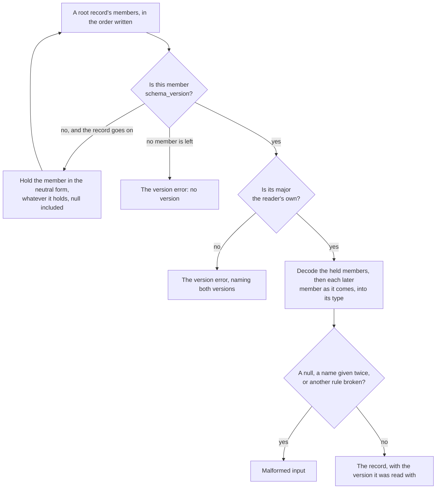

# JSON output

| | |
|---|---|
| **Status** | Draft of 2026-11-23 for review (plan, Phase 2, task 5), to be confirmed at G2.3 with `cli.md` and the serialization contract. Written from revision 47 of the plan, [`api.md`](../design/api.md) after its twelfth review, and [`cli.md`](../design/cli.md). |
| **Sources** | Plan sections 8.8 and 8.9; `api.md` sections 3.3, 5, 6, 8, 10, 11, 12 and 14; `cli.md` section 7; RFC 8259 (JSON), RFC 7493 (I-JSON), RFC 3339 (timestamps) |
| **Evidence** | The spike [`spikes/api-scenarios/`](../../spikes/api-scenarios/README.md): its stub writes and reads the forms marked "the stub" below, and `tests/version_first.rs` shows the neutral form of section 2 |

This guide is the contract of the serialized form: what `cc-media-probe --json` writes, and what the library writes and reads with its `serde` feature. A program that reads the output can rely on everything it states, within one schema major version (section 9). The text mode of the CLI is for people and is no contract (`cli.md` section 8.8).

The form is JSON as RFC 8259 defines it, UTF-8 encoded, and it follows the rules of I-JSON (RFC 7493) on names, numbers and duplicate members. The Rust names behind each member are in `api.md`; this guide gives the members, their values and the rules for reading them.

## Contents

1. [Terms](#1-terms)
2. [Reading a record](#2-reading-a-record)
3. [The document](#3-the-document)
4. [Root records](#4-root-records)
5. [Members and values](#5-members-and-values)
6. [Enums](#6-enums)
7. [The report model](#7-the-report-model)
8. [Typed details](#8-typed-details)
9. [Compatibility](#9-compatibility)
10. [Malformed input](#10-malformed-input)
11. [Decisions for G2.3](#11-decisions-for-g23)

## 1. Terms

| Term | Meaning |
|---|---|
| Record | A JSON object that one Rust type writes, such as a report or a stream. |
| Member | A name and its value in a record. |
| Root record | One of the four records that can stand alone and carry `schema_version`: a document, a report, a detection and an error record (section 4). |
| Absent | A member that is not written. A value that a file does not state, or that the probe could not establish, is absent; the form never writes null for it. |
| Catch-all | The value that an enum reads for a name that a newer version wrote, and writes back unchanged (section 6). |
| Kind | The `kind` member of an enum that carries data and of a typed detail, which names its variant (section 6.2). |
| Twin | The `_exact` member that carries a quantity beyond 2^53 − 1 as a decimal string, in place of the number (section 5.5). |
| Version error | The failure of a root record whose major version is not the reader's own, or that has no version. |
| Malformed input | Any other record that breaks this contract (section 10). |

## 2. Reading a record

A reader of this version reads a root record in this order. The library reads it this way through plain Serde, also on a bare `MediaReport` or `ErrorRecord`, so a caller needs no envelope or helper.



- **The version first.** JSON fixes no order of an object's members, and tools reorder them, so a reader does not rely on `schema_version` coming first. Until it has the version, it holds each member in a neutral form that takes any value, so no member can fail before the version error: not a member of the wrong type, not a null and not a name given twice. A newer major version may write what this one refuses. Only then are the members decoded.
- **Only what comes before the version is held,** as the maintainer chose on 2026-11-23. Every writer of this form writes `schema_version` first, so a reader holds nothing for its own output: a record is read at its typed size, and an error in a member keeps its place in the input, such as serde_json's line and column. A record that a tool reordered costs the reader a copy of the members before its version while it is read.
- **Null fails, wherever it stands.** A member is present when its name is, so null never stands for an absent value, and a member that holds null fails as malformed input: an optional member, an element of an array, a member that no type reads, and a member deep inside one. So does a map that names a member twice (RFC 7493 section 2.3). Neither is refused before the version error.
- **Unknown members are ignored,** except where a catch-all keeps them (section 6). No record denies unknown members.
- **Nested root records** are checked against the version of the record that holds them (section 4.5).

**Formats other than JSON.** The library writes the form through Serde's format-neutral traits, so any Serde format can carry it. Reading needs a self-describing format, one that can say what a value is without being told, because the neutral form, the catch-alls and the members that an entry of a newer outcome keeps read values whose type the reader does not know yet. JSON, CBOR and MessagePack are such formats. A format that is not self-describing reads no root record. The version error comes first in every format that reads one.

## 3. The document

`cc-media-probe --json` writes one document to standard output, followed by one line feed, and nothing else (`cli.md` section 7). A library caller writes the same document with `Document::from_results` or, one entry at a time, `Document::serialize_results` (`api.md` section 12). The two write the same text for the same entries.

| Member | Value | Presence |
|---|---|---|
| `schema_version` | The version, as in `"1.0"` (section 4.1) | Always, first |
| `generator` | A record: `name` and `version`, both strings, as in `{"name": "cc-media-probe-cli", "version": "0.1.0"}` | Always |
| `usage_error` | A record: `message`, a string. The message is unescaped here; standard error writes it escaped (`cli.md` section 4). | Only in the document of a usage error |
| `results` | The entries, an array, one for each input in the order of the command line | Always; empty with a usage error and for `--json --version` |

A document holds results or a usage error, never both. The CLI writes its document as it goes: each entry as soon as its input is finished. If standard output fails, the document stops where the failure happened, and the run exits with 1 (`cli.md` section 9); a reader then sees text that is not a whole JSON value.

**An entry:**

| Member | Value | Presence |
|---|---|---|
| `index` | The entry's position in `results`, from 0, a number | Always, first |
| `input` | The input's path as its display string (section 5.8); `"-"` for standard input | Always |
| `input_lossy`, `input_raw` | The path's flag and raw form, when the path is not valid Unicode (section 5.8) | Only for such a path |
| `outcome` | `ok`, `partial` or `error`, or the name of an outcome that a newer version wrote | Always |
| `report` | A report (section 4.2) | With a report |
| `detection` | A detection (section 4.3), under `--detect` | With a detection |
| `error` | An error record (section 4.4) | With an error |

An entry of a known outcome holds exactly one of `report`, `detection` and `error`, and that record allows its outcome:

| Record | `ok` | `partial` | `error` |
|---|---|---|---|
| Report | Complete (section 7.2) | Incomplete | Never |
| Detection | Identified | A family only, ambiguous, or a hint only | Insufficient data, or an unknown format |
| Error record | Never | Never | Always |

A source that fails during detection is an error record. Where a record holds a value of a newer version that decides the outcome, the outcomes that the value could still give are allowed: a report beside a status of a newer version allows `ok` and `partial`, never `error`, and a detection outcome of a newer version allows any outcome.

**An entry of a newer outcome.** An outcome that a newer version wrote, such as a hypothetical `skipped`, can need members that only that version knows. A reader keeps every member of such an entry that it does not read, and writes them back after its own members, in the order read, so the version that wrote the outcome reads the entry again from a document that an older version rewrote. It still checks the members it reads: the input, and the version of each record the entry holds.

**The document of a usage error:**

```json
{
  "schema_version": "1.0",
  "generator": {
    "name": "cc-media-probe-cli",
    "version": "0.1.0"
  },
  "usage_error": {
    "message": "standard input (-) was named twice"
  },
  "results": []
}
```

## 4. Root records

### 4.1 The version

`schema_version` is a string of two decimal numbers separated by a period, `major.minor`, as in `"1.0"`. This version writes `1.0`. A reader takes a record of its own major version and any minor version, and gives the version it read through `schema_version()`. An additive change raises the minor number; anything else raises the major number, and happens only in a major crate release (section 9).

### 4.2 Report

| Member | Value | Presence |
|---|---|---|
| `schema_version` | Section 4.1 | Always, first |
| `format` | A format name (section 6.1); the family for a family-only detection | Always |
| `media_type` | A media type as text, such as `"video/mp4"` | When known |
| `size` | The input's size in bytes, a number | When the source states it |
| `duration`, `duration_provenance` | Seconds (section 5.6) and its provenance | When established |
| `bit_rate`, `bit_rate_provenance` | Bits per second as a rational, and its provenance | When established |
| `estimated_duration`, `estimated_bit_rate` | An estimate (section 5.6) | When estimated |
| `creation_time` | A UTC time (section 5.6) | Only from a source that states UTC |
| `streams` | The streams, in index order (section 7.3) | Always |
| `programs` | Section 7.10 | Always |
| `chapter_editions` | Section 7.7 | Always |
| `tag_sets` | Section 7.8 | Always |
| `attachments` | Section 7.9 | Always |
| `external_references` | Section 7.11 | Always |
| `diagnostics` | Section 7.12 | Always |
| `completeness` | Section 7.2 | Always |
| `inventory_class` | `declared`, `single_stream` or `observed` | Always |
| `usage` | Section 7.13 | Always |
| `sources` | The source table (section 7.14) | Always |
| `format_details` | The format's typed details (section 8) | When the format has them |

Reading a report checks that its completeness agrees with itself and with its streams (section 10).

### 4.3 Detection

| Member | Value | Presence |
|---|---|---|
| `schema_version` | Section 4.1 | Always, first |
| `outcome` | `identified`, `family_only`, `ambiguous`, `hint_only`, `insufficient_data` or `unknown` | Always |
| `format` | The identified format or the family | For those outcomes |
| `confidence` | A number from 0 to 100 | For an identification |
| `candidates` | Each a record of `format` and `confidence`, in rank order (`api.md` section 5.1) | Always; empty unless ambiguous |
| `hint` | A record of `format` and `origin` (`file_name` or `format_option`); not verified | For a hint |
| `bytes_needed` | The least length of the input that detection needs to decide, a number | For insufficient data, when known |
| `insufficient_reason` | A reason (section 7.2) | For insufficient data |
| `usage` | Section 7.13 | Always |

### 4.4 Error record

| Member | Value | Presence |
|---|---|---|
| `schema_version` | Section 4.1 | Always, first |
| `kind` | An error kind (section 6.1) | Always |
| `message` | The error's message, for people; its text may change in any release | Always |
| `format` | The detected format or family | Where the kind has one |
| `candidates` | Each a record of `format`, `confidence`, `state` (`validated`, `rejected`, `not_checkable`, `outranked`) and `reason` | Always; empty unless candidates were checked |
| `hint` | As in a detection | For an unknown format with a hint |
| `reason` | A reason (section 7.2), such as a named limit | Where one reason stopped the probe |
| `source_identifier` | The source concerned (section 5.4) | When one is concerned |
| `attempted_identity` | A record of `identifier` and `requested_name`, each optional | For a companion that was requested |
| `offset`, `logical_offset` | Where the failure or the stop happened, numbers with twins (section 5.5) | When known |
| `source_failure_kind` | The I/O error kind as a stable string, such as `"not_found"` or `"permission_denied"` | For a source failure |
| `operating_system_error_code` | The operating system's error code, a number | For a source failure that has one |
| `cause_messages` | The messages of the cause chain, in order, strings | Always; empty without a cause |
| `partial_report` | The report established before a source failed (section 4.2) | When the stream inventory was reached |
| `observations` | A record of `format_details`, `diagnostics` and `sources`, as a report has them | When the probe stopped before its inventory and observed something |
| `usage` | Section 7.13 | Always |
| `record` | The fixed-size record of section 7.2 | Always |

An error record is never turned back into the live error: it describes one.

### 4.5 Nested root records

A report, a detection or an error record inside a document carries the document's version, and so does the partial report of an error record, inside a document or in a bare error record. A writer gives each record it holds its own version, whatever version the record was read with, so a document rebuilt from the entries of a document of version 1.1 is of version 1.0 throughout. A root record stands only in a member that every version reads: an entry's `report`, `detection` and `error`, and an error record's `partial_report`. A reader checks every nested record against the version of the record that holds it; a different version is the version error. The record that holds a nested one already has a version of this major, so the nested record is read strictly from its first member: a null or a repeated name before its version is malformed input, and every other failure comes after its version error.

## 5. Members and values

### 5.1 Names

Each member is named after the accessor of `api.md` that returns its value, in `snake_case`:

- **A yes-or-no fact** drops `is_` and keeps `has_`: `is_default()` is `default`, `is_superseded()` is `superseded`, and `has_linked_chapters()` stays `has_linked_chapters`.
- **A provenance** is the field's name with `_provenance`, as in `frame_rate_provenance`. An absent value has no provenance.
- **An estimate** is `estimated_` with the field's name.
- **What an accessor computes** from other members is not written: `is_complete()`, `HeaderStatus::is_final()`, `Format::family()`, `Codec::name()`, a timecode's label and the like. The tables of section 7 list every member that is written.

Every name is ASCII and named once in its record.

### 5.2 Absent values, lists and flags

- **An optional value** that is absent is not written. A reader takes a missing optional member as absent.
- **A list** is always written, empty as `[]`. A list that `0.1.0` defines is required on input; a list that a later minor version adds defaults to empty.
- **A plain flag** (`bool` in Rust, not `Option<bool>`) is always written, as `true` or `false`. One that a later minor version adds defaults to `false`.
- **An optional flag** (`Option<bool>`) is written only when the file states it, as `true` or `false`. Absent never means false.

### 5.3 Text

Text taken from media is decoded by the format's rules and is always valid Unicode in the document. Bytes that cannot be decoded are kept in the typed details in hexadecimal. Text holds what the file wrote, noncharacters included (section 11). The solidus `/` is written unescaped, and a reader takes it escaped or not (section 11).

### 5.4 Identifiers

A value whose meaning is identity is a string at every coded width (R24): the unique IDs of streams, editions, chapters and attachments, tag target references, source identifiers, program and clock-reference identifiers, and any other identity.

- An integer identifier is canonical decimal: digits with no sign and no leading zero, so `"+1"` and `"01"` are malformed. A source identifier is 64 bits wide, so `"18446744073709551615"` is the largest.
- A binary identifier is lowercase hexadecimal, two digits a byte.
- A textual identifier, such as a Matroska `ChapterStringUID`, is its own text.

In the typed details this rule comes before the rules for integers, so a 32-bit ISO `track_ID` kept in an error's observations is `"4294967295"` as well.

### 5.5 Numbers

**Quantities** are JSON numbers: sizes, offsets, counts, rates, indexes, and the parts of a rational. Each stays within 2^53 − 1 in magnitude, the range that every JSON reader holds exactly (RFC 7493 section 2.2). Integers are written without a fraction or an exponent.

**A normalized quantity beyond the range** is implausible: the normalized member is absent, a diagnostic says why, and the exact value is in the typed details as a decimal string (section 8). This applies to values that the library computes as well as to values it reads.

**Twins.** The quantities that a record cannot do without are numbers when they fit. Beyond 2^53 − 1 the number is not written, and a member of the same name with the suffix `_exact` carries the value as a decimal string in canonical form: digits, with a minus sign for a negative value, no plus sign and no leading zero. A reader takes the value from exactly one of the two, each in its own range: a number beyond the range, a twin within it or not canonical, and both at once are malformed. The members with a twin are exactly these:

| Record | Members |
|---|---|
| Diagnostic (section 7.12) | `offset`, `logical_offset` |
| Error record (section 4.4) | `offset`, `logical_offset` |
| Source offset (section 7.3) | `offset`, `logical_offset` |
| Usage (section 7.13) | Every counter |
| Source entry (section 7.14) | `bytes_read` |
| Binary tag value (section 7.8) | `size` |
| Integer tag value (section 7.8) | `integer` |

**Wide integers of the typed details** are always decimal strings: every integer that a detail stores at 64 bits (`u64`, `i64`), whatever its value, so its JSON type never varies, as Matroska's `DateUTC` in nanoseconds shows. Narrower integers that are no identifiers are numbers.

**The record's four omitted counts,** `omitted_diagnostics`, `omitted_declarations`, `omitted_reasons` and `omitted_references`, are decimal strings in canonical form, such as `"9007199254740993"`.

### 5.6 Value records

| Value | Form | Example |
|---|---|---|
| Rational | `numerator` and `denominator`, numbers; reduced, the denominator at least 1, both parts within 2^53 − 1 | `{"numerator": 30000, "denominator": 1001}` |
| Seconds | A rational of seconds, in the same form | `{"numerator": 21, "denominator": 2}` |
| Size | `width` and `height` in whole pixels, numbers within 2^53 − 1 | `{"width": 1920, "height": 1080}` |
| Estimate | `value`, the estimated value in its own form, and `method`: `constant_bit_rate_over_size`, `delivery_clock_span`, `endpoint_timestamps`, `last_unit_start` or `index_size_totals` | `{"value": {"numerator": 5400, "denominator": 1}, "method": "constant_bit_rate_over_size"}` |
| Time range | `start` and `end`, seconds | |
| UTC time | RFC 3339 text in UTC with the suffix `Z` and a four-digit year from 0000 to 9999. The fraction of a second is written with as many digits as it needs, up to nine, and not at all when it is zero. | `"2026-11-23T08:30:00.25Z"` |
| Floating-point value | `width` (`single` or `double`) and `bits`, its bits in lowercase hexadecimal: 8 digits for single and 16 for double precision | `{"width": "double", "bits": "3ff0000000000000"}` |
| GUID | The 16 bytes as stored, 32 lowercase hexadecimal digits | `"a1b2c3d4e5f60718293a4b5c6d7e8f90"` |
| Bytes | Lowercase hexadecimal, two digits a byte | `"89504e47"` |
| Confidence | A number from 0 to 100 | `100` |
| Language | `as_written`, the code as the file writes it; `tag`, the BCP 47 tag, absent for `und`; and `code_system` (section 6.1) | `{"as_written": "ger", "tag": "de", "code_system": "iso639_alpha3"}` |
| Localized text | `text`; `languages`, an array of languages; `countries`, ISO 3166 codes as written | `{"text": "Prologue", "languages": [], "countries": []}` |
| Profile, level, tier | `name`, the specification's name, and `code`, the coded value as written, each optional | `{"name": "High", "code": "100"}` |

A floating-point value appears only in the typed details and in tag values; no normalized member holds one.

### 5.7 Locations

An **entity location** names an entity of the report: `kind` (`stream`, `edition`, `chapter`, `attachment` or `program`); `index`, the index of the stream, edition, attachment or program, or for a chapter the index of its edition; and `chapter_path`, for a chapter the indexes of its ancestors and itself among their siblings, from the top level down, and empty otherwise. It is written in tag targets (section 7.8) and as the `owner` of a typed detail's entry (section 8).

### 5.8 Paths

A file-system path can hold data that no JSON string represents exactly. Wherever a path appears, in an entry's `input` and in a source entry's `path`, it is written as its display string under its own name. A path that is not valid Unicode is **lossy**, and two members beside it, named after it, carry its exact form:

| Member | Value |
|---|---|
| `<name>` | The display string: the path decoded with U+FFFD in place of what is not valid |
| `<name>_lossy` | `true`, written only for a lossy path |
| `<name>_raw` | A record of `encoding` and `data` |

| `encoding` | `data` |
|---|---|
| `unix_bytes` | The path's bytes as the operating system holds them, two lowercase hexadecimal digits a byte |
| `windows_wide` | The path's 16-bit units in order, four lowercase hexadecimal digits a unit |

The platform that wrote the record chooses the encoding. A reader takes the flag and the raw form only together, and checks that the three members describe one path, on every platform: the data is whole units of lowercase digits, it is not valid Unicode, and the display string is the data decoded with U+FFFD. So `"input": "input.bin"` beside the bytes `ff2e62696e` is malformed, and `"input": "�.bin"` reads. Data of an encoding that a newer version wrote is kept as written, unchecked. A reader never fails because a path is foreign; it rebuilds a native path only where it can (`api.md` section 6.15).

```json
{
  "index": 0,
  "input": "�.bin",
  "input_lossy": true,
  "input_raw": {
    "encoding": "unix_bytes",
    "data": "ff2e62696e"
  },
  "outcome": "error",
  "error": {
    "schema_version": "1.0",
    "kind": "source_failed",
    "message": "the input could not be opened",
    "source_identifier": "0",
    "source_failure_kind": "not_found",
    "cause_messages": ["No such file or directory (os error 2)"],
    "candidates": [],
    "usage": {"bytes_read": 0, "peak_working_memory": 0, "retained_data": 0, "retained_payloads": 0, "decompressed_output": 0, "work_units": 0, "companion_requests": 0, "sources_opened": 0},
    "record": {"exhausted": [], "first_stopped": [], "first_reasons": [], "omitted_diagnostics": "0", "omitted_declarations": "0", "omitted_reasons": "0", "omitted_references": "0"}
  }
}
```

### 5.9 Trees

The chapters of an edition and the tags of a set form trees whose depth the input decides. Each tree is one flat array of its nodes in depth-first order, so the depth of a document is fixed by its schema and every reader with a recursion limit reads it, such as serde_json with its default of 128 levels. Each node has its own members and `parent`, the position of its parent in the same array; a top-level node has no `parent`, and no node has `children`. The order of the array gives the order of siblings.

A reader takes depth-first order only: each node's `parent` is the node before it or one of that node's ancestors. A parent that does not come before its node, and a node that returns to a subtree that has closed, such as a root, a second root and then a child of the first root, are malformed.

```json
"chapters": [
  {"unique_identifier": "1", "titles": [{"text": "Act one", "languages": [], "countries": []}]},
  {"unique_identifier": "2", "parent": 0, "titles": []},
  {"unique_identifier": "3", "parent": 0, "titles": []},
  {"unique_identifier": "4", "titles": [{"text": "Act two", "languages": [], "countries": []}]}
]
```

A chapter or a tag written alone, outside a report, is the same array for its subtree: the node itself first, without `parent`, then the nodes below it. Reading one needs exactly one node without `parent`.

## 6. Enums

### 6.1 Enums written as strings

An enum whose variants carry no data is a `snake_case` string. The table lists the values, since a proper name keeps its common spelling as one word, as in `quicktime`, `webm`, `webvtt` and `truehd`. A reader takes a name that it does not know into the enum's catch-all, which keeps the text and writes it back unchanged, so a document of a newer minor version passes through an older reader intact. A string enum stays a string in every later release.

| Enum | Values in `0.1.0` |
|---|---|
| Stream kind | `video`, `audio`, `subtitle`, `buttons`, `data`, `unknown` |
| Provenance | `declared`, `bitstream`, `derived` |
| Format | `matroska`, `webm`, `mp4`, `three_gpp`, `three_gpp2`, `f4v`, `quicktime`, `avi`, and the families `iso_base_media` and `riff`; the inventory frozen at G3.5 fixes the list |
| Codec | `h264`, `h265`, `h266`, `av1`, `vp8`, `vp9`, `mpeg1_video`, `mpeg2_video`, `aac`, `mpeg_audio`, `ac3`, `enhanced_ac3`, `ac4`, `dts`, `truehd`, `meridian_lossless_packing`, `flac`, `opus`, `vorbis`, `pcm`, `webvtt`, `pgs` and the others of the codec registry of Phase 4, which fixes the list; `unknown` for a codec that the file names and this version does not know |
| Codec namespace | `matroska_codec_identifier`, `riff_four_character_code`, `wave_format_tag`, `iso_sample_entry`, `mpeg4_object_type`, `quicktime_code` |
| Language code system | `bcp47`, `iso639_alpha3`, `matroska_legacy`, `quicktime_packed` |
| Language role | `clean_effects`, `hearing_impaired`, `visually_impaired_commentary` |
| Inventory class | `declared`, `single_stream`, `observed` |
| Detection outcome | `identified`, `family_only`, `ambiguous`, `hint_only`, `insufficient_data`, `unknown` |
| Hint origin | `file_name`, `format_option` |
| Candidate state | `validated`, `rejected`, `not_checkable`, `outranked` |
| Error kind | `source_failed`, `unknown_format`, `format_not_determined`, `unsupported_format`, `feature_disabled`, `no_stream_inventory` |
| Entry outcome | `ok`, `partial`, `error` |
| Status of detection, discovery and the headers | `complete`, `incomplete` |
| Status of tags, chapters and attachments | `complete`, `incomplete`, `not_requested`, `not_applicable` |
| Timing status | `established`, `not_available_by_design`, `cut_short`, `not_applicable` |
| Companions status | `not_applicable`, `complete`, `not_enabled`, `cut_short` |
| Part | `detection`, `discovery`, `headers`, `tags`, `chapters`, `attachments`, `timing`, `companions` |
| Reason kind | `range_unavailable`, `truncated_input`, `limit_exhausted`, `end_of_input_not_observed`, `feature_disabled`, `companions_not_enabled`, `companion_not_found`, `companion_declined`, `companion_limited`, `companion_name_unavailable`, `unsupported_structure`, `damaged_structure`, `further_segments_not_examined`, `media_segment_without_initialization_data`, `source_failed` |
| Limit | `bytes_read`, `working_memory`, `header_bytes_per_stream`, `retained_data`, `retained_payloads`, `decompressed_output`, `work_units`, `nesting_depth`, `streams`, `diagnostics`, `companion_requests`, `sources_opened` (`api.md` section 4.5) |
| Feature | `zlib` |
| Header state | `parsed`, `partially_parsed_by_design`, `identified`, `protected`, `not_found_within_budget`, `partially_parsed_for_lack_of_bytes`, `malformed`, `compression_unavailable`, `not_attempted` |
| Identification | `identification_only`, `unknown_codec`, `pending_parser`, `unsupported_compression` |
| Severity | `error`, `warning`, `information` |
| Diagnostic code | Stable dotted names such as `matroska.seek_head_disagrees`; a code keeps its meaning across releases |
| Frame rate mode | `constant`, `variable`, `unknown` |
| Component | `luma`, `chroma`, `red`, `green`, `blue`, `alpha` |
| Scan type, field order | `progressive`, `interlaced`; `top_field_first`, `bottom_field_first` |
| Color range | `limited`, `full` |
| Dynamic range transfer, mark | `standard`, `perceptual_quantizer`, `hybrid_log_gamma`; `dolby_vision` |
| Rotation | `upright`, `clockwise_90`, `clockwise_180`, `clockwise_270` |
| Projection kind | `rectangular`, `equirectangular`, `cubemap`, `mesh` |
| Sample encoding, byte order | `integer`, `floating_point`; `little_endian`, `big_endian` |
| Immersive kind | `objects`, `intermediate_spatial_format`, `height_channels` |
| Subtitle kind | `text`, `bitmap` |
| Chapter origin | `matroska_edition`, `quicktime_chapter_track` |
| Target scope | `whole_file`, `entities`, `incomplete` |
| Target reference kind | `resolved`, `unmatched`, `wildcard` |
| Entity kind | `stream`, `edition`, `chapter`, `attachment`, `program` |
| Tag key | `title`, `artist`, `album`, `date`, `genre`, `comment`, `copyright`, `encoder`, `track_number`, `disc_number` |
| Attachment role | `cover_art`, `other` |
| Map state | `complete`, `incomplete` |
| Reference kind, role | `linked_segment`, `data_reference`, `linked_picture`, `expected_companion`, `playlist_entry`; `previous_segment`, `next_segment`, `track_data` |
| Protection scope | `packets`, `codec_private_data`, `sample_description`, `encoding_settings`, `other`, `unread` |
| Sample description state | `clear`, `declared` |
| Source role, outcome | `primary` and the companion roles of section 13 of `api.md`; `opened`, `not_found`, `declined`, `limit_reached`, `failed` |
| Raw path encoding | `unix_bytes`, `windows_wide` |

The lists of speakers, stereo layouts, ambisonic orderings and normalizations, native scopes and the companion roles come with the phases that fill them; each value is the `snake_case` name of its variant. A diagnostic code and a format or codec name are part of this contract once released: a later release adds values and never renames one.

### 6.2 Enums that carry data

An enum with a variant that holds a value is a record like a typed detail. Its `kind` member names the variant, and the value is the member named after the kind. A variant without a value is its `kind` alone. A value with a twin keeps the twin's suffix.

| Enum | Kinds and their members | Examples |
|---|---|---|
| Tag value | `text` (a string), `binary` (a record of `size` with its twin and `data`, the bytes in hexadecimal when they were kept), `integer` (a number with its twin), `floating_point` (section 5.6), `boolean`, `guid` (section 5.6) | `{"kind": "text", "text": "Title"}`, `{"kind": "integer", "integer_exact": "18446744073709551615"}`, `{"kind": "binary", "binary": {"size": 4, "data": "89504e47"}}` |
| Observed value (section 8) | `count`, a decimal string; `time`, seconds | `{"kind": "count", "count": "1200"}` |
| Chroma format | `monochrome`, `chroma_420`, `chroma_422`, `chroma_444`, `chroma_411` without a value; `other`, a record of `horizontal` and `vertical` | `{"kind": "chroma_420"}` |
| Text encoding | `utf8`, `utf16_little_endian`, `utf16_big_endian`, `utf32_little_endian`, `utf32_big_endian`, `iso8859_part1`, `windows1252`, `mac_roman` without a value; `other`, the encoding's name as written | `{"kind": "other", "other": "KOI8-R"}` |

A reader keeps the members as written until it has the kind, so the order of the members never matters and the kind alone decides how the others are read:

- **A known kind** reads its own members into their types and needs the one that it names, when it has a value. Once it has taken its own, no member that another known kind reads may remain, so `{"kind": "monochrome", "other": {"horizontal": 4, "vertical": 1}}` is malformed. Any other member is ignored.
- **A kind that a newer version wrote** reads into the catch-all, which keeps the kind's name and every other member without reading it into a type, so a member that a known kind names may hold anything there. Written back, the catch-all gives `kind` first, then the other members in the order read, each with the value it was read as: its type and its value, not its spelling. So `1e0` comes back as `1.0`, an escaped solidus as `/`, and a `kind` written last comes back first. No reader of the form depends on a spelling or on where `kind` stands.

An enum that is a string in one release stays a string; a variant with a value never joins it.

## 7. The report model

The tables list every member that the record writes. "Optional" means that the member is absent when the value is; every other member is always written. The `api.md` section after each heading gives the meaning of each value.

### 7.1 Notation

A member written as `x`, `x_provenance` has the value, and the provenance of section 6.1 beside it when the value is present.

### 7.2 Completeness (`api.md` sections 5.3 to 5.5)

**Completeness:**

| Member | Value |
|---|---|
| `detection`, `discovery`, `headers` | A status: `complete` or `incomplete` |
| `tags`, `chapters`, `attachments` | A section status |
| `timing` | A timing status |
| `companions` | A companions status |
| `reasons` | The part reasons kept within the retained-data limit |
| `record` | The fixed-size record, below |

A report is complete exactly when every status is complete, final or not applicable as plan section 8.3 defines it, no status holds a value of a newer version, and the record holds no first reason. `reasons` never decides it, since a full budget can leave it empty. An entry's outcome follows from this test.

**A part reason:** `part`; `stream`, a stream's index, optional; `source_identifier`, optional; `reason`.

**A reason:** `kind`, a reason kind; `limit`, optional, the limit named; `feature`, optional, the feature named; `detail`, optional, text for people kept within the retained-data limit.

**The record:**

| Member | Value |
|---|---|
| `exhausted` | The limits whose counters were exhausted, each once, in the order of `api.md` section 4.5 |
| `first_stopped` | For each such limit, a record of `limit` and `part`, the part that it stopped first, in the same order |
| `first_reasons` | The first reason recorded against each part, a part reason without its `detail`, each part once, in the order of the parts |
| `omitted_diagnostics`, `omitted_declarations`, `omitted_reasons`, `omitted_references` | Decimal strings (section 5.5) |

**A header status** (`api.md` section 5.4): `state`; `identification`, optional, for the state `identified`; `reason`, optional.

### 7.3 Stream (`api.md` section 6.3)

| Member | Value |
|---|---|
| `index` | A number |
| `native_identifier`, `unique_identifier` | Identifiers, optional |
| `kind` | A stream kind |
| `codec` | The codec information, below |
| `header_status` | A header status |
| `protection` | Protection, below; optional, and absent only when every structure that can declare protection was examined and none does |
| `language` | A language, optional: the primary language |
| `languages` | Each a record of `language` and `roles`, an array of language roles |
| `title`, `titles` | A string, optional; an array of localized texts |
| `duration`, `duration_provenance` | Seconds, optional |
| `start_time`, `start_time_provenance` | Seconds from the report's zero, optional |
| `bit_rate`, `bit_rate_provenance` | A rational, optional |
| `estimated_duration`, `estimated_bit_rate` | Estimates, optional |
| `packet_count`, `frame_count`, `sample_count` | Numbers, optional, each with its `_provenance` |
| `disposition` | A record of optional flags: `default`, `enabled`, `forced`, `hearing_impaired`, `visually_impaired`, `has_text_descriptions`, `original_language`, `commentary` |
| `declaration_range` | Optional: `first_offset` and `last_offset`, source offsets, and `start` and `end`, seconds, each optional |
| `embedded_in` | The index of the stream that carries this one, optional |
| `start_timecode` | A timecode, optional |
| `video`, `audio`, `subtitle` | Present exactly when the kind is video, audio or subtitle (sections 7.4 to 7.6) |
| `codec_details` | The codec's typed details (section 8), optional |

A **source offset** names its source: `source_identifier`; `offset` from that source's start, with its twin; and `logical_offset`, optional, with its twin, where several files form one stream.

A **timecode**: `frame_number` and `nominal_frames_per_second`, numbers; `rate`, a rational; `drop_frame` and `wraps_at_24_hours`, flags.

**Codec information** (`api.md` section 6.4):

| Member | Value |
|---|---|
| `codec` | A codec name, optional: absent while the codec is unresolved, when the description it describes was not read or kept, or when the input never named one |
| `candidates` | Each a record of `sample_description_index`, a number, `codec` and `raw_identifiers` |
| `has_every_candidate` | A flag |
| `raw_identifiers` | Each a record of `namespace`, a codec namespace, and `value`, as written |
| `profile`, `level`, `tier` | Each with its `_provenance`, optional |
| `codec_string` | A string, optional |

**Protection:**

| Member | Value |
|---|---|
| `declarations` | Each a record: `scheme`, optional, a record of `namespace` and `value` as written, such as an ISO `schm` code or a Matroska `ContentEncAlgo`; `scope`, a protection scope; `sample_description_index` for the scope `sample_description`; `encoding_order` for the scope `encoding_settings`, optional |
| `fully_examined` | A flag |
| `sample_description_count` | A number, optional |
| `sample_descriptions` | The descriptions whose state was established and kept, in index order: each a record of `index`, a number, and `state` |
| `configuration_clear` | An optional flag |

### 7.4 Video (`api.md` section 6.5)

| Member | Value |
|---|---|
| `coded_size`, `visible_size`, `display_size` | Sizes, optional, each with its `_provenance` |
| `pixel_aspect_ratio`, `display_aspect_ratio` | Rationals, optional, each with its `_provenance` |
| `frame_rate`, `frame_rate_provenance` | A rational, optional |
| `frame_rate_mode` | A frame rate mode |
| `bit_depth` | Optional: `common`, a number, optional, and `components`, each a record of `component` and `bits` |
| `chroma_format` | A chroma format, optional (section 6.2) |
| `scan_type`, `field_order` | Optional |
| `color` | Optional: `primaries`, `transfer_characteristics` and `matrix_coefficients`, ITU-T H.273 code points as numbers, and `range`, each optional with its `_provenance` |
| `mastering_display` | Optional: `red`, `green`, `blue` and `white_point`, each an optional chromaticity of `x` and `y`, optional rationals with their `_provenance`; `maximum_luminance` and `minimum_luminance`, optional rationals with their `_provenance` |
| `content_light_level` | Optional: `maximum_content` and `maximum_frame_average`, numbers, each optional with its `_provenance` |
| `dynamic_range` | Optional: `transfer`, optional, and `marks`, an array |
| `rotation` | A rotation, optional |
| `stereo_mode` | Optional: `layout` and `code` as written |
| `projection` | Optional: `kind`, and `yaw`, `pitch` and `roll` in degrees as optional rationals |
| `embedded_alpha`, `supplemental_alpha` | Optional flags |

### 7.5 Audio (`api.md` section 6.6)

| Member | Value |
|---|---|
| `sample_rate`, `output_sample_rate` | Rationals of hertz, optional, each with its `_provenance` |
| `channel_count` | A number, optional, with its `_provenance` |
| `channel_layout` | Optional, with its `_provenance`: `channels`, one record per channel in stream order with `speaker`, optional, `azimuth` and `elevation`, optional rationals of degrees, `ambisonic_component`, an optional number, and `unassigned`, a flag; and `ambisonics`, optional, a record of `order`, `channel_ordering` and `normalization` |
| `bit_depth` | A number, optional, with its `_provenance` |
| `sample_format` | Optional: `encoding`, `signed`, an optional flag, and `byte_order`, optional |
| `encoder_delay`, `padding` | Samples per channel, optional, each with its `_provenance` |
| `immersive` | Optional: `kinds`, an array |

### 7.6 Subtitles (`api.md` section 6.7)

`subtitle_kind`, optional; `text_encoding`, optional (section 6.2); `canvas_size` with its `_provenance`, optional; `event_count`, an optional number; `time_range`, optional.

### 7.7 Chapters (`api.md` section 6.8)

**An edition:** `unique_identifier`, optional; `origin`, a chapter origin; `default`, `ordered` and `hidden`, optional flags; `has_linked_chapters`, an optional flag; `playback_duration` with its `_provenance`, optional; `chapters`, the flat array of section 5.9.

**A chapter node:** `parent`, optional (section 5.9); `unique_identifier`, optional; `string_identifier`, optional, its own text; `start` and `end`, segment time as seconds, optional, each with its `_provenance`; `segment_reference`, optional, a record of `segment`, an identifier, and `edition`, an optional identifier; `titles`, localized texts; `hidden` and `enabled`, optional flags; `playback_position`, seconds, optional, for ordered editions only.

### 7.8 Tags (`api.md` section 6.9)

**A tag set:**

| Member | Value |
|---|---|
| `target_level` | Optional: `value`, an optional number, and `type_name`, an optional string |
| `stream_targets`, `edition_targets`, `chapter_targets`, `attachment_targets` | Target references |
| `target_scope` | A target scope |
| `native_scope` | The ISO family's scope, optional; Phase 6 fixes its members |
| `superseded` | A flag: whether a later element replaced the one that holds this set |
| `tags` | The flat array of section 5.9 |

**A target reference:** `kind`; `identifier` and `namespace`, optional, as written; `location`, an entity location (section 5.7), for a resolved reference.

**A tag node:** `parent`, optional (section 5.9); `name`, a record of `as_written`, `namespace`, optional, and `bytes`, optional, the key exactly as stored in hexadecimal; `key`, a tag key, optional; `languages`, languages; `countries`, ISO 3166 codes as written; `default`, an optional flag; `value`, a tag value (section 6.2), optional; `native_type`, the value's type name as written, optional.

### 7.9 Attachments (`api.md` section 6.10)

`unique_identifier`, optional; `name` and `description`, optional strings; `media_type` with its `_provenance`, optional; `size`, the size of embedded data, an optional number; `link`, a linked picture's URI as written, optional; `data`, optional, the bytes in hexadecimal, written only with the data option and within the retained-payload limit, and `""` for an empty payload; `width` and `height`, optional numbers, each with its `_provenance`; `role`, optional; `picture_type`, the native picture type as written, optional.

### 7.10 Programs (`api.md` section 6.11)

`program_identifier`, optional; `name` and `provider`, optional strings; `streams`, the indexes of its streams; `clock_reference_identifier`, optional; `duration` with its `_provenance`, optional; `map_state`. No format of `0.1.0` has programs.

### 7.11 External references (`api.md` section 6.12)

`kind`; `identifier`, optional; `location`, as written and never dereferenced, optional; `role`, optional; `owner`, optional, absent for a reference of the whole file: an entity location of the stream, chapter or attachment that holds the reference, with `sample_description_index`, an optional number, for a stream's sample description.

### 7.12 Diagnostics (`api.md` section 6.13)

`severity`; `code`; `message`, for people, which may change in any release; `source_identifier`; `offset` and `logical_offset`, optional, each with its twin; `stream`, an optional index.

### 7.13 Usage (`api.md` section 6.14)

`bytes_read`, `peak_working_memory`, `retained_data`, `retained_payloads`, `decompressed_output`, `work_units`, `companion_requests` and `sources_opened`: numbers, each with its twin.

### 7.14 Source table (`api.md` section 6.15)

**A source entry:** `identifier`, where `"0"` is the primary input; `role`; `attempted_identity`, optional, as in an error record; `outcome`; `reason`, optional, why a requested companion was not opened; `bytes_read`, an optional number with its twin; `alias_of`, an optional source identifier; `path`, optional, with `path_lossy` and `path_raw` for a lossy path (section 5.8).

## 8. Typed details

A report's `format_details` and a stream's `codec_details` are records with a `kind` member, the lowercase name of the format or codec, such as `"kind": "matroska"` or `"kind": "h264"`. The other members are the detail type's, named after the specification's fields and spelled out in American English (`api.md` section 11.2), with the rules of section 5: identifiers as strings, 64-bit integers as decimal strings, narrower integers as numbers, floating-point values by their bits, bytes in hexadecimal.

- **A value with a default** that the specification states is a record of `value` and `stored`, a flag that tells a stored value from the effective default, as in `{"value": true, "stored": false}`. It is absent when the element's omission is not established.
- **Every detail record** holds three lists, which the same rules give for every format and codec:

  | Member | Each entry |
  |---|---|
  | `conflicts` | `field`, the field guide's name; `owner`, an optional entity location; `stream`, an optional index; `values`, each a record of `source` and `value` as text |
  | `observed_lower_bounds` | `field`; `owner`; `stream`; `value`, an observed value (section 6.2). A lower bound is never a total. |
  | `exact_values` | `field`; `owner`; `stream`; `numerator` and `denominator`, optional, decimal strings; `inputs`, each a record of `name` and `value` as decimal strings |

- **A kind that a newer version wrote** is kept as written, with its other members, and written back unchanged, as the catch-all of an enum that carries data is (section 6.2).

Each format and codec phase adds its kind and fixes its members, reviewed at its gate; this guide then gains a section for it. In the skeleton of Phase 2, the only kind is the catch-all. `api.md` sections 11.4 and 11.5 sketch the Matroska and H.264 details as worked examples.

## 9. Compatibility

Within one schema major version, both directions hold:

| Direction | Rule |
|---|---|
| A newer reader, older output | Every member added after `0.1.0` is optional on input, with a default. No member is removed or renamed, and none changes its meaning. |
| An older reader, newer output | Unknown members are ignored. An unknown string of an enum reads into its catch-all and is written back unchanged. An unknown kind of a typed detail or of an enum that carries data keeps its other members and writes them back, and so does an entry of an unknown outcome. Every member that `0.1.0` requires is present in later output. |
| A minor version's new member | One that an older reader may drop: an optional member of a known record, or a member of a new kind or outcome, which a catch-all keeps. A member that a catch-all keeps never holds a root record: a new kind or outcome puts a report, a detection or an error record under `report`, `detection` or `error`, which every version reads. |
| Across major versions | A reader takes root records of its own major version only, and gives the version error for any other, unless the release that raised the major version documents a migration. |

**What a program reading the output should do.** Read the version before anything else, refuse another major version, ignore members it does not know, accept enum values it does not know, and never rely on the order of members, on a message's text or on the spelling of a number or a string. The CLI's text mode is no contract.

**Reported values can improve.** A later release that parses more fills more members and can change a header status or an entry's outcome. Such changes are compatible and listed in the changelog (`docs/guide/stability.md`, plan section 9.6).

**What the tests keep.** Every release archives the output of every fixture, and every retained old reader reads the current output (plan section 8.8, R27).

## 10. Malformed input

A record that breaks one of these rules fails to read. Each rule is checked by a test (plan section 8.8, task 13).

- **Form.** A member that holds null, wherever it stands. A map that names a member twice. A required member that is missing.
- **Versions.** A root record without `schema_version`, or of another major version, gives the version error before any other check. A nested root record of another version than the record that holds it is the version error too.
- **Numbers.** A quantity beyond 2^53 − 1; a twin within the range or not in canonical decimal; a number and its twin together. An identifier or an omitted count that is not canonical decimal, such as `"+1"`, `"01"`, or a source identifier beyond 2^64 − 1. An omitted count written as a number.
- **Values.** A rational that is not reduced, has a denominator of 0 or a part beyond the range. A size beyond 2^53 − 1. A known kind without the member it names, or beside a member of another known kind.
- **Paths.** A flag without the raw form, or the raw form without the flag; a flag of `false`; data of a known encoding that is not whole units of lowercase hexadecimal digits, that is valid Unicode, or whose decoding is not the display string.
- **Trees.** A node whose parent does not come before it; a node that returns to a closed subtree; a standalone node's array with no root or with two.
- **Documents.** Results beside a usage error. An entry whose `index` is not its position. An entry of a known outcome that holds no record or several, or whose record does not allow its outcome.
- **Completeness.** A headers status of `complete` beside a known header state that is not final, or `incomplete` while every state is known and final. A reason in `reasons` without a first reason of its part in the record. A known part whose status records a shortfall without a first reason, or that has a first reason while its status records none. A limit or a part listed twice in the record.

## 11. Decisions for G2.3

**Made by the maintainer for this draft, on 2026-11-23:**

- The neutral form holds only the members written before `schema_version`; every later member is decoded as it comes (section 2). Plan section 8.8 says so since revision 47.
- This guide is the contract in prose, with no machine-readable JSON Schema beside it. Several of its rules are beyond what a schema states: an index that is its position, the depth-first order of a tree, the three members of a path that describe one path, and one version throughout a document.

**Proposed here, open at G2.3:**

- **The solidus.** RFC 8259 section 7 requires only the quotation mark, the reverse solidus and the control characters to be escaped. Its erratum 5318, verified on 2026-05-28, narrows the grammar's `unescaped` production so that it no longer holds the solidus, while the section's prose still lists only those three. The proposal: write `/` unescaped, as every JSON reader takes it, and read it escaped or not. The alternative is to escape every `/` in the CLI's output, through a formatter of its own, which conforms to the corrected grammar too, at the cost of paths and media types that read as `video\/mp4`. A library caller's own serializer decides its own escapes either way.
- **Noncharacters.** RFC 7493 section 2.1 forbids noncharacters, such as U+FFFE, in an I-JSON text. Text from media is valid Unicode and can hold them. The proposal: keep the text as the file wrote it, so the document follows I-JSON's rules on names, numbers and duplicates without being I-JSON in this one respect. The alternative is to replace each noncharacter with U+FFFD, keeping what the file wrote in the details.
- **Bytes in hexadecimal.** Binary tag data, attachment data and a tag name's bytes are lowercase hexadecimal, as raw paths and binary identifiers are, so the form has one encoding of bytes. Hexadecimal doubles the size of an attachment's data, where base64 (RFC 4648) would add a third.

**Choices made without asking,** each open at G2.3:

- The member names of section 5.1: `is_` dropped and `has_` kept, as the stub already writes `default`, `superseded` and `has_every_candidate`.
- Lists always written; plain flags always written; a later list or flag defaulting to empty or `false` (section 5.2).
- The values of every string enum in section 6.1, and the names of formats and codecs, which G3.5 and the codec registry of Phase 4 complete.
- The forms of section 5.6: a UTC time in one canonical RFC 3339 form, a GUID as its 16 stored bytes in hexadecimal, a confidence as a number.
- The record of section 7.2: the exhausted limits, the first-stopped pairs and the first reasons as arrays in a fixed order, each limit or part once.
- A protection scheme as a record of `namespace` and `value`, and an external reference's owner as an entity location with a sample-description index (sections 7.3 and 7.11).
- The member `format` of an error record, after the accessor, where the example of plan section 8.9 wrote `detected`; revision 47 corrects the example.
- Reading needs a self-describing format (section 2).

**The stub and the library.** The stub of `spikes/api-scenarios/` writes the forms of sections 2 to 5 for the records it holds, and since this draft no null for an absent member; the rest of its model keeps Serde's default form for enums and typed details, since it builds no report. The skeleton of task 11 implements every form of this guide, and the contract tests of task 13 check each rule of section 10.
