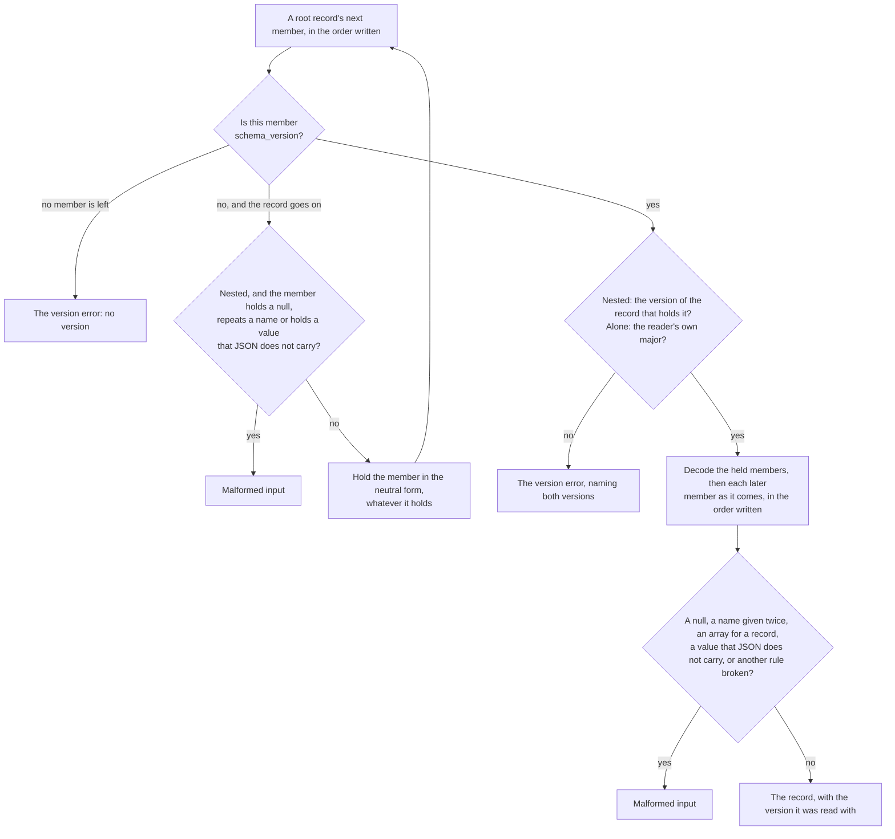

# JSON output

| | |
|---|---|
| **Status** | Approved at G2.3 on 2026-11-25 with the CLI contract and D18, at revision 56 of the plan. See the [gate decisions](../plans/plan-init-project-log.md). |
| **Review history** | Draft of 2026-11-23 for review (plan, Phase 2, task 5), to be confirmed at G2.3 with `cli.md` and the serialization contract. Written from revision 47 of the plan, [`api.md`](../design/api.md) after its twelfth review, and [`cli.md`](../design/cli.md). The thirteenth review, of this guide with `api.md` and `cli.md`, revised sections 1 to 5, 6.2, 7.2, 7.3, 7.8 and 8 to 11 on the same day, at revision 48 of the plan. The fourteenth, of revision 48, revised sections 2 to 5, 7.2, 7.3, 8 and 9 to 11 on 2026-11-24, at revision 49. The fifteenth, of revision 49, revised sections 2 to 7 and 9 to 11 on the same day, at revision 50. The draft of [`stability.md`](stability.md) revised sections 4.1 and 9 on the same day, at revision 51. The sixteenth review, of revision 50 with the drafts of revision 51, revised sections 2, 4.4, 4.5, 7.2, 10 and 11 on the same day, at revision 52. The seventeenth, of revision 52, revised sections 2, 3, 4.5, 5.2, 7.2 and 9 to 11 on the same day, at revision 53. The eighteenth, of revision 53, revised sections 2, 4.5, 5.9, 6.1, 6.2, 7.1 to 7.4 and 9 to 11 on the same day, at revision 54. The nineteenth, of revision 54, revised sections 2, 5.1, 5.2, 6.2, 7.1, 7.2 and 9 to 11 on the same day, at revision 55. The guidelines checklist of task 6, [`api-guidelines-checklist.md`](../design/api-guidelines-checklist.md), revised sections 7.4 and 11 on 2026-11-25, at revision 56. The maintainer's review of the first slice of the library's skeleton revised sections 3, 5.8, 7.3, 10 and 11 on the same day, at revision 57: the flag `has_sample_descriptions` of a protection, a lossy path without a raw form on a platform that has no exact form of a path, and the message of a source that could not be opened in the example of section 5.8, which now agrees with `cli.md` section 8.6. The maintainer's second review of that slice revised sections 4.4, 5.8, 6.1, 7.3, 7.14, 10 and 11 on the same day: an operating system's code as a string, a bounded cause chain, the bytes of Hermit, SOLID and Xous, a timecode's nominal rate of at least 1, the flag `has_sample_descriptions` checked against a report's format, and the standalone values of two enums. Its third review revised sections 4.4, 5.8, 6.1, 7.3, 10 and 11 on the same day: the indexes of sample descriptions and of their declarations bounded, the literal `unknown` of a description's state told apart from a newer state, an operating system's code checked beside a kind of a newer version, a lossy path's U+FFFD checked beside every raw form, and the cause chain stopped before a 33rd cause. The maintainer's review of revision 57, on 2026-11-26, revised section 7.3: a `declared` entry of `sample_descriptions` can stand without a declaration that names its index. The first part of the third slice of the library's skeleton, the same day, implements sections 2 and 4 to 10 for the report model and its three root records that stand alone, and adds no rule. The maintainer's review of that part, the same day, revised sections 2, 4.4, 5.6, 5.7, 7.3, 7.8, 7.9, 7.11, 7.14, 8, 10 and 11: a 64-bit integer of a stored value as a decimal string, an exact value's parts of any length with a denominator that its field decides, the flat owner of an external reference that this guide gives, a character as the string of its one character, the bits of a newer floating-point width, and the rules that a record and a report check on what they name. The maintainer's second review of that part, the same day, revised sections 2, 4.4, 7.3, 7.8, 7.11, 7.14, 8, 10 and 11: the records of a report that state a shortfall held against its completeness, an enum held before the version whatever its shape, a stored default of text or floating point, a reduced exact rational of at most 10000 digits with a fuller table of fields, the endings and the references of an error record, and the identities that a report's references name. The maintainer's third review of that part, the same day, revised sections 2, 4.4, 7.11, 7.14, 8, 10 and 11: an expected companion that no entry requested beside complete companions, a shortfall beside a newer status, a section not requested that holds nothing, the reasons and the outcomes of the source entries, the bytes read, the rank, the order and the first cause of an error's candidates, the failure of a tag's content, and an exact value beyond the range of its field, with the bound of its parts in the table of section 8. The maintainer's fourth review of that part, the same day, amended sections 2, 4.4, 5.9, 7.2 to 7.5, 7.7, 7.14, 10 and 11: the omitted counts with their limits, the limits of detection, a companion's reason, a header state against its codec, its protection and the record, a protection that contradicts itself, codec candidates against their descriptions, an edition, a layout and a precision that contradict themselves, an error's format against its winner and its order after a newer state, an observed refusal, an entry's alias read alone, a read that fails before an enum's content, and a tree's node read as it comes. The maintainer's fifth review of that part, the same day, amended sections 7.2, 10 and 11: a limit names the part that it stopped first only where it stopped one, so a complete report can hold a limit that stopped none, while a limit that a reason names, and the limit behind an omitted reference or declaration, names its part. The maintainer's sixth review of that part, the same day, amended sections 4.4, 7.2, 7.3, 10 and 11: a counter of an activity that never ran, the diagnostics limit as a cause, the header states of a newer version, which the record does not check, and the decisions of the fifth review. The maintainer's seventh review of that part, the same day, amended sections 4.3, 4.4, 7.2, 7.3, 7.14, 10 and 11: the parts that a limit can stop, the limits that can stop a companion before and after its request, the probes that never ran their prober, the usage of an activity that never ran, and the header states known to this reader in the malformed records. The second part of the third slice, the document, its entries and its writer, amended sections 2, 3, 10 and 11 on 2026-11-26: as the maintainer chose before it was written, a reader checks each entry as soon as it has read it, so the read stops at the first broken entry and the error has the place where the read stopped. The maintainer's review of that part, on 2026-11-27, amended sections 2 and 3: an entry held before the document's version fails with the place where the version was read. Plan Phase 2, task 13, on 2026-11-27, deleted the spike and changed no rule: the header's evidence is now the library's own tests, and the paragraph on the stub in section 11 says so. |
| **Sources** | Plan sections 8.8 and 8.9; `api.md` sections 3.3, 5, 6, 8, 10, 11, 12 and 14; `cli.md` section 7; RFC 8259 (JSON), RFC 7493 (I-JSON), RFC 3339 (timestamps) |
| **Evidence** | The library's own tests: [`crates/cc-media-probe/tests/serialization/`](../../crates/cc-media-probe/tests/serialization/main.rs) checks every form of this guide, the document's included, with the reader of the other formats' values of section 2, and the library's unit tests write back the samples that only its test constructors build. The spike `spikes/api-scenarios/`, whose stub first wrote and read these forms and whose tests the library's took over, was deleted with plan Phase 2, task 13, on 2026-11-27. Its cases whose types arrive in later phases, the typed details of H.264, Matroska and the ISO family, are kept in [`deferred-cases.md`](../design/deferred-cases.md) |

This guide is the contract of the serialized form: what `cc-media-probe --json` writes, and what the library writes and reads with its `serde` feature. A program that reads the output can rely on everything it states, within one schema major version (section 9). The text mode of the CLI is for people and is no contract (`cli.md` section 8.8).

The form is JSON as RFC 8259 defines it, UTF-8 encoded, and it follows the rules of I-JSON (RFC 7493) on names, numbers and duplicate members. The Rust names behind each member are in `api.md`; this guide gives the members, their values and the rules for reading them.

## Contents

1. [Terms](#1-terms)
2. [Reading a record](#2-reading-a-record)
3. [The document](#3-the-document)
4. [Root records](#4-root-records)
5. [Members and values](#5-members-and-values)
6. [Enums](#6-enums)
7. [The report model](#7-the-report-model)
8. [Typed details](#8-typed-details)
9. [Compatibility](#9-compatibility)
10. [Malformed input](#10-malformed-input)
11. [Decisions for G2.3](#11-decisions-for-g23)

## 1. Terms

| Term | Meaning |
|---|---|
| Record | A JSON object that one Rust type writes, such as a report or a stream. |
| Member | A name and its value in a record. |
| Root record | One of the four records that can stand alone and carry `schema_version`: a document, a report, a detection and an error record (section 4). |
| Absent | A member that is not written. A value that a file does not state, or that the probe could not establish, is absent; the form never writes null for it. |
| Catch-all | The value that an enum reads for a name that a newer version wrote, and writes back unchanged (section 6). |
| Kind | The `kind` member of an enum that carries data and of a typed detail, which names its variant (section 6.2). |
| Twin | The `_exact` member that carries a quantity beyond 2^53 − 1 as a decimal string, in place of the number (section 5.5). |
| Version error | The failure of a root record that has no version, a version not of the form of section 4.1, or a major version that is not the reader's own, and of a nested root record whose version is not that of the record that holds it (section 4.5). |
| Malformed input | Any other record that breaks this contract (section 10). |

## 2. Reading a record

A reader of this version reads a root record in this order. The library reads it this way through plain Serde, also on a bare `MediaReport` or `ErrorRecord`, so a caller needs no envelope or helper.



A root record read alone holds every member before its version, null included. A nested one is read strictly from its first member, since the record that holds it already has a version of this major, so the chart's second question applies only to a nested record (section 4.5).

- **The version first.** JSON fixes no order of an object's members, and tools reorder them, so a reader does not rely on `schema_version` coming first. Until it has the version, it holds each member in a neutral form that takes any value, so no member can fail before the version error: not a member of the wrong type, not a null, not a name given twice, and not a value that JSON does not carry, such as a byte string or a map whose names are integers, as the fifteenth review found for a CBOR map, or a tagged value and an integer beyond 64 bits, which ciborium reads too, as the sixteenth review found. A newer major version may write what this one refuses. Only then are the members decoded, the held ones first, in the order written, exactly as if the version had come first.
- **What the guarantee reaches.** The neutral form holds any value that the format's reader can represent, and nothing more, as the thirteenth review found. What the reader itself cannot read fails in the reader as soon as the reader reaches it: a syntax error, text that is not UTF-8, nesting beyond the reader's recursion limit, and a number beyond the reader's range, such as `1e400`, which serde_json refuses as "number out of range" in a build without its `arbitrary_precision` feature. With the feature, serde_json reads that number as its text, so the neutral form holds it as written, and once the version is checked it fails as a number that is not finite where no type is known and as an object where a number is required (below), as the fifteenth and sixteenth reviews found. Such a value before the version fails first; one after a version that fails is never reached, as the fourteenth review found, since the read stops at the version error.
- **Only what comes before the version is held,** as the maintainer chose on 2026-11-23. Every writer of this form writes `schema_version` first, so a reader holds nothing for its own output: a record is read at its typed size, and an error raised while the reader consumes a member keeps its place in the input, such as serde_json's line and column. A rule checked once a record has been read, such as the agreement of a report's reasons or a usage error beside a document's results, has no place to keep, so its error reports none, as the fourteenth review found. A document's entry is checked as soon as it has been read, as the maintainer chose for the second part of the third slice of Phase 2: its index against its position, its one record and that record's outcome (section 3). So the read stops at the first entry that breaks one of them, without decoding the entries after it, and the error has the place where the read stopped, just after that entry, such as serde_json's line and column. An entry that stands before the document's version is held with the other members before it and checked once the version has been read, so its error has the place where the read stopped after the version instead, as the maintainer's review of that part found: serde_json gives the place once it has looked for the end of the document, past the white space after the version's value and past a closing brace that ends the document there. A record that a tool reordered costs the reader a copy of the members before its version while it is read. Two more values are held only until the reader knows what they are, as the eighteenth review found them held to the end. An entry, a detection and an error record hold each member that they do not read until their outcome, or an error record's kind, is known; then they keep it for an outcome of a newer version, whose payload it is, and pass it by as it comes for one that this version knows, as the maintainer chose. Every writer writes the outcome before any member that a newer version adds, so a record of a known outcome holds none. Serde's `flatten` had held every such member to the record's end, so an ignored array of 200,000 numbers in a detection of a known outcome cost about 21 MB. And the value of a member named `$serde_json::private::Number` in a map of no known type streams to its type, while the reader notes whether it spells a number that is not finite (below); the review saw such a map held whole in a member that no type reads, about 12 MB for the same array. Since the nineteenth review a tag value, and every other enum that carries data, holds only the members that stand before its `kind`: once the kind is known, a known kind reads its members from the input as they come and passes by the others, so an error in one keeps its place in the input, and a kind of a newer version keeps them as its payload (section 6.2). The review read `{"kind": "integer", "integer": "oops", "extension": null}`, which failed on the later null while the whole map was kept, and without the null failed with no line or column. A member that stands before the kind is still held, so its error comes where the kind is read.
- **Null fails, wherever it stands.** A member is present when its name is, so null never stands for an absent value, and a member that holds null fails as malformed input: an optional member, an element of an array, a member that no type reads, and a member deep inside one. So does a map that names a member twice (RFC 7493 section 2.3). In a root record read alone, neither is refused before the version error; in a nested root record, one before its version is (below).
- **A record is an object.** Every record is a JSON object with named members, at the root and at every level below it. Serde's derive would also read a struct from an array of its values, in the order of its fields; the form refuses such an array as malformed input, so `"generator": ["catalog", "1"]` and `[1, 2]` for a rational fail.
- **A repeated name needs the text.** A reader sees a name given twice only when it reads the members as written. A value that a parser has already built, such as serde_json's `Value`, keeps one member for each name, so a record read from it cannot refuse the repetition. A program that wants the check reads the record from the text.
- **Unknown members are ignored,** except where a catch-all keeps them (section 6). No record denies unknown members.
- **Nested root records** are compared with the version of the record that holds them as soon as their own version is read, before their body is decoded (section 4.5).
- **Alone or nested.** A model type read on its own, such as a bare rational, follows every rule that it follows inside a root record (`api.md` section 3.3). It has no version, so only the version error does not apply to it. Each check that needs only the record's own members runs wherever the record is read, as the fifteenth review asked: a candidate keeps its confidence within 100, a reason holds the members of its kind, and a completeness agrees with its record (section 7.2), alone as inside a report. A check that needs more than the record runs where the record is held, such as a stream's index against its position in the report, or the headers status against the streams. Whether a record is read alone or nested is decided by the read that reaches it, never by anything else on the same thread: a read started inside another read's callback, such as that of a reader that supplies the bytes of a document, is a read of its own (fourteenth review).
- **Only what JSON carries.** Every value of the form is one that JSON writes back as read: a Boolean, an integer within 64 bits, a finite number, a string, an array, or an object with string names. A value of another format that JSON cannot carry faithfully, a non-finite number or a byte string from CBOR, fails as malformed input wherever it stands, in a catch-all too, as the maintainer chose at the fourteenth review, so no catch-all forwards a value that serde_json would write as null or as an array of numbers. So does a map with a member name that is not a string, such as an integer key of CBOR, also in a member that no type reads, as the fifteenth review found. Since the sixteenth review, so do a tagged value and an integer beyond 64 bits, which ciborium gives for a CBOR tag and a bignum, also in a member that no type reads, where Serde's own way of ignoring a value took both while the same member before the version failed. Since the seventeenth review, also where a type is known: ciborium drops a tag when a type asks for a value of its own, so the review read an identified detection whose confidence of 60 stood in tag 42 with the version first, and a candidate read alone, while the held value failed with the version last. The reader therefore asks the format for every value as the format holds it, with Serde's `deserialize_any`, as the neutral form does, and reads it as the type asked for, so a value meets the same rules through the same calls wherever the version stood. Since the eighteenth review the outermost value is asked for so too, a root record and a value read alone: a typed request let ciborium drop tag 42 around a whole detection, in either order, and around a standalone outcome `ok`. A root record in a tag is no object, so it fails at once, before its version, as an array fails as no record. Before the version of a root record read alone, the neutral form holds each of them, so the version error still comes first. A map that it holds keeps a name that is not a string in its place among the other members, so a nested record held before its parent's version still reads its own version first (section 4.5). A character, which a format of characters gives apart from a string, is the string of its one character, as a member's name as well as a value, as the review of the third slice's first part asked: the reader had refused it as a name after the version, while the neutral form held it as text before it, so the order of the members decided whether it read. An enum is held before the version too, as the maintainer chose at the second review of that part, since an enum is a value that JSON does not carry whatever its shape: its content is read as a newtype, as ciborium gives a tag. As the third review of that part asked, which read text that is not UTF-8 inside a tag before a version of 2.0 as the version error, while the same text outside a tag gave the reader's own error, a failure of that read is the input's and comes first, as every failure of the underlying reader does. The fourth review read a missing colon in `{"name"}`, which Serde's `MapAccessDeserializer` gives as an enum, as the version error: the reader failed before it handed the content over, where the third review's rule held a reader's refusal of the newtype shape, and Serde gives no way to tell the two apart. So, as the maintainer chose at that review, every failure of the read comes first, a refusal included: a unit variant of Serde's `EnumAccessDeserializer`, which the second review read before a version of 2.0, fails there with the reader's refusal, `invalid type: unit variant, expected newtype variant`, and after the version as a value that JSON does not carry.
- **Integers beyond 64 bits,** as the seventeenth review asked to state. A CBOR bignum, which ciborium gives as an integer of 128 bits, fails wherever it stands, since JSON has no such value. A JSON integer beyond 64 bits is a JSON number, so it follows the numbers below: where no type is known, it is a double and its last digits are lost, so `18446744073709551617` in a member of a future entry comes back as `1.8446744073709552e+19`. That double is the nearest one with `arbitrary_precision` or `float_roundtrip` on, while serde_json's default parser can miss it by one unit in the last place, as for the decimals below: the eighteenth review read `27666741684376230221` back as `2.766674168437623e+19`, the nearest double, with either feature, and as `2.7666741684376228e+19` without both; where a type requires an integer within 64 bits, as every integer member of the form does (section 5.5), it fails as malformed input. An integer within 64 bits is that integer, whatever width a reader hands it over in, as the nineteenth review asked: Serde's `MapDeserializer` gave the rational `1/2` with `u64` parts, which read, and with `u128` parts, which failed as an integer beyond 64 bits. Only a value beyond 64 bits fails.
- **Numbers of arbitrary precision.** serde_json's `arbitrary_precision` feature, which Cargo turns on for a whole build once any crate asks for it, hands over a number that is not an integer within 64 bits as a private map of one member, `$serde_json::private::Number`, whose value is the number's text. The Serde data model cannot tell that map from an object of the same shape in the input, so the form gives the shape one rule, the same in every order and every build, as the maintainer chose at the sixteenth review. The neutral form holds it as written, and the type that reads it decides:
  - **Where no type is known,** in a catch-all, a kept member and a member that no type reads, the map is the number it spells: an integer within 64 bits as that integer, and any other number as the nearest double, which fails as malformed input when it is not finite, as the maintainer chose at the fifteenth review. So `1.25` in a catch-all comes back as `1.25` in either build, where the fifteenth review saw it come back as that map, and `1e400` in a member that no type reads fails after the version as before it, where the sixteenth review saw it read after it.
  - **Where a type is known,** the map is the object it is, so a member that requires a number refuses it, before the version as after it. The sixteenth review read `{"$serde_json::private::Number": "60"}` as a candidate's confidence of 60 before the version, and saw it refused after it. An object of a known type, a record, an enum that carries data or a map that a type reads, never has a member of that name, as the maintainer chose at the seventeenth review: one that has it is malformed input, in every build and either order. The review read a disposition of `1.25` with the feature on. With the version first, serde_json gave the number to the request for a record, which refused it; with the version last, the held map reached `Disposition`, whose members are all optional and which ignores a member it does not know, so it read as an empty disposition. Every member of the form that holds a number holds an integer within 64 bits (section 5.5), which the feature hands over as itself, so a typed member meets the map only where the input holds a number of the wrong type, which fails either way. A value that a reader keeps before it knows the value's type stays as written, the map included, as the eighteenth review asked: the members of an enum that carries data until its kind is read, and, before the fourth review of the third slice's first part, a tree's node until its `parent` was taken out. The review read the map as a tag's integer of 60, written back as `"integer": 60`, as a chapter's `parent` and as a binary value's `size`, in both builds, since those members had become numbers while they were kept. Each is now read into its type as a member read from the input is, and refuses the map; the members that a catch-all keeps take it as its number once they are its payload. A tag value read alone, which took the name beside its `kind` and dropped it, reads strictly too, as does one in a report's tag. Since the fourth review of the third slice's first part, a tree's node holds nothing: it reads its members as they come (section 5.9).
  - **The restriction.** An object of that shape in the input is a number wherever no type is known, in either build, as serde_json's own `Value` reads it with the feature, and malformed input wherever a type is known. No member that the schema defines has that name, and no version defines one. A payload that a catch-all keeps is the newer writer's, so the reader takes a map of that name there as it does wherever no type is known, and keeps any other object as written, whatever names it holds, as the nineteenth review asked to tell apart: an entry of a newer outcome kept `{"$serde_json::private::Number": "x", "café": 1}` and wrote it back (section 5.1). Where no type is known, a map of that name whose value is not the text of a JSON number, or that holds another member beside it, stays a map.
  - **At the root,** of a root record read alone or nested, the map of a number is that number, as the maintainer chose at the nineteenth review: the root is then no object and fails before the version, in row 1 of the table below, in every build. The review read `1.25` as a `Document` and as a `MediaReport`, which failed as no object without the feature and as a root record without `schema_version` with it. A literal object of that one member and a number's text at the root fails the same way in a build without the feature, so the shape keeps one rule in every build. A type read alone, below no root, keeps the rule of a known type: with the feature, `1.25` read as a `Generator` fails as an object of that name, and without it as a floating-point number, both as malformed input.
  - **The nearest double** is correctly rounded. A build without the feature gives the double that serde_json's own parser reads, which is the same only when serde_json's `float_roundtrip` feature is on: its default parser is best effort, so `1.2234567890123456789` in a catch-all comes back as `1.2234567890123456` there, and as the nearest double, `1.2234567890123458`, with either feature, as the sixteenth review found. A program that forwards such numbers and needs the same double from every build turns `float_roundtrip` on.

**The order of the failures,** as the fourteenth review asked to state for each kind of root record. The first that applies decides:

| A root record read alone | A root record nested in another |
|---|---|
| 1. What the format's reader cannot read before the version, and a root that is no object, such as one in a tag or a number, the private map of a number included | 1. What the format's reader cannot read before the nested version, and a nested root that is no object, as for a record read alone |
| — | 2. A null, a name given twice or a value that JSON does not carry before the nested version, since the record that holds it reads strictly: malformed input |
| 2. The version error: no version, a version not of the form of section 4.1, or another major | 3. The version error: no version, a version not of the form of section 4.1, or a version other than the holder's |
| 3. Every other failure, in the order of the input | 4. Every other failure, in the order of the input |

Row 2 of a nested record holds in either order of its parent's members, as the seventeenth review asked. A value that JSON does not carry there is a byte string, a tagged value, an integer beyond 64 bits, a name that is not a string, or, with `arbitrary_precision`, the private map of a number that is not finite. The review put a tagged value and 2^64 before the version 2.0 of a detection in a document of 1.0 and got the version error when the document's version came first, and `1e400` with the feature on gave it in both orders (section 4.5).

Row 1 holds in every build, as the maintainer chose at the nineteenth review: a number at the root, which `arbitrary_precision` gives as its private map unless it is an integer within 64 bits, is that number there too, where the review read `1.25` as a root record without its version.

Row 2 holds only what is malformed whatever the type, as the eighteenth review asked. The name `$serde_json::private::Number` is refused only in an object of a known type, and a nested record's type is known once its version is, so a member of that name before the nested version comes after the version error, in row 4. The review read `"$serde_json::private::Number": "hi"` before the version 2.0 of a detection in a document of 1.0 and got the name's error in both orders. A member whose value is the private map of a number that is not finite, the map that the feature gives for `1e400`, holds a value that JSON does not carry, and stays in row 2.

**Formats other than JSON.** The library writes the form through Serde's format-neutral traits. A format carries it when it does three things, as the thirteenth review asked to state:

- **It writes a record as a map with member names.** A root record is read as a map, so that its reader can find `schema_version` by name. CBOR, through ciborium 0.2.2, writes a struct as a map of its field names. rmp-serde, the MessagePack serializer, writes a struct as an array of its values by default; only a serializer configured with `Serializer::with_struct_map()` writes the form (rmp-serde 1.3.1, `StructMapConfig`). An array of values has no version to find, and reading refuses it (section 10).
- **It reads self-describing values,** saying what a value is without being told, because the neutral form, the catch-alls and the members that an entry of a newer outcome keeps read values whose type the reader does not know yet. JSON, CBOR and MessagePack are such formats. A format that is not self-describing reads no root record. The version error comes first in every format that reads one.
- **It takes a map or a sequence whose length is not given up front.** `Document::serialize_results` writes `results` so, since it does not know how many entries will follow, and a writer may write a record so, such as an entry, whose members it does not count first. CBOR writes such a value with an indefinite length. rmp-serde holds its members in memory and writes the length when it ends, so a document that the writer streams to MessagePack is held whole until its last entry is written. A document held in memory and written with `Document::from_results` gives the length of its `results` up front.

## 3. The document

`cc-media-probe --json` writes one document to standard output, followed by one line feed, and nothing else (`cli.md` section 7). The one exception is help: the exact argument `--help` before any `--` writes the help text, never a document, whatever else the command line holds, `--json` included, and exits with 0 once the text is written and flushed, or with 1 when it cannot be, as for every output failure (`cli.md` sections 3 and 9; seventeenth review). So `cc-media-probe --json --help` succeeds with text that is not JSON, and a program that reads the output never adds `--help`. A library caller writes the same document with `Document::from_results` or, one entry at a time, `Document::serialize_results` (`api.md` section 12). The two write the same text for the same entries.

| Member | Value | Presence |
|---|---|---|
| `schema_version` | The version, as in `"1.0"` (section 4.1) | Always, first |
| `generator` | A record: `name` and `version`, both strings, as in `{"name": "cc-media-probe-cli", "version": "0.1.0"}` | Always |
| `usage_error` | A record: `message`, a string. The message is unescaped here; standard error writes it escaped (`cli.md` section 4). | Only in the document of a usage error |
| `results` | The entries, an array, one for each input in the order of the command line | Always; empty with a usage error and for `--json --version` |

A document holds results or a usage error, never both. The CLI writes its document as it goes: each entry as soon as its input is finished.

**When standard output fails.** The run stops and exits with 1 (`cli.md` section 9), however many bytes reached the reader. A failure inside an entry leaves text that is not a whole JSON value, while a failure of the final line feed or of the last flush can come after the whole document reached the reader, which then parses it. One exception keeps its status: a usage error exits with 2 even when its document cannot be written, as `cc-media-probe --json --jsno` does with a closed standard output, and standard error then reports the output failure before the usage error (`cli.md` section 4).

**What a program reads,** as the fourteenth review corrected. The exit status and the document answer two questions, so a program uses both:

- **Whether the results are whole** is whether the text parses as one whole JSON value. The writer writes the closing of the document only after its last entry, so a whole document holds every result, each with its own outcome, even when the status is 1. A text that does not parse was cut short by an output failure, and the results it holds are not a complete set.
- **How the run went** is the exit status: 0 when every input succeeded, 1 when an input failed, a strict run met a partial result, or standard output failed, and 2 for a usage error (`cli.md` section 6.3). A status of 1 beside a whole document never makes its results unusable: an error is an entry of the document, and an output failure after the closing changed none of them.

**An entry:**

| Member | Value | Presence |
|---|---|---|
| `index` | The entry's position in `results`, from 0, a number | Always, first |
| `input` | The input's path as its display string (section 5.8); `"-"` for standard input | Always |
| `input_lossy`, `input_raw` | The path's flag and raw form, when the path is not valid Unicode (section 5.8) | Only for such a path; the raw form only where the writing platform has one |
| `outcome` | `ok`, `partial` or `error`, or the name of an outcome that a newer version wrote | Always |
| `report` | A report (section 4.2) | With a report |
| `detection` | A detection (section 4.3), under `--detect` | With a detection |
| `error` | An error record (section 4.4) | With an error |

An entry of a known outcome holds exactly one of `report`, `detection` and `error`, and that record allows its outcome:

| Record | `ok` | `partial` | `error` |
|---|---|---|---|
| Report | Complete (section 7.2) | Incomplete | Never |
| Report beside a status of a newer version | Only while no status that this version knows records a shortfall, no stream has a known header state that is not final, and the record holds no first reason | Always | Never |
| Detection | Identified | A family only, ambiguous, or a hint only | Insufficient data, or an unknown format |
| Error record | Never | Never | Always |

A source that fails during detection is an error record. Where a record holds a value of a newer version that decides the outcome, the outcomes that the value could still give are allowed, and only those. A report beside a status of a newer version allows `ok` and `partial` while no status that this version knows records a shortfall and the record holds no first reason. A shortfall that this version can see, such as discovery `incomplete`, any first reason in the record, or a stream whose header state this version knows and that is not final, already rules `ok` out, since no newer status makes such a report complete, so it allows `partial` alone. A report never allows `error`. A detection outcome of a newer version allows any outcome.

A reader checks an entry as soon as it has read it: its `index` against its position, and for an outcome that this version knows its one record and the outcome that the record allows. The read stops at the first entry that breaks a rule, before the next entry is decoded, and the error has the place where the read stopped (section 2), which for an entry held before the document's version is after the version. A usage error beside results is checked once the document has been read, since the two members can stand in either order.

**An entry of a newer outcome.** An outcome that a newer version wrote, such as a hypothetical `skipped`, can need members that only that version knows. A reader keeps every member of such an entry that it does not read, and writes them back after its own members, in the order read, so the version that wrote the outcome reads the entry again from a document that an older version rewrote. It still checks the members it reads: the input, and the version of each record the entry holds. A detection of a newer outcome and an error record of a newer kind keep their unread members the same way, as the maintainer chose at the fifteenth review (sections 4.3 and 4.4).

**The document of a usage error:**

```json
{
  "schema_version": "1.0",
  "generator": {
    "name": "cc-media-probe-cli",
    "version": "0.1.0"
  },
  "usage_error": {
    "message": "standard input (-) was named twice"
  },
  "results": []
}
```

## 4. Root records

### 4.1 The version

`schema_version` is a string of two numbers separated by a period, `major.minor`, as in `"1.0"`. Each number is canonical decimal: ASCII digits, with no sign and no leading zero, from 0 to 4294967295, the range of the `u32` that `major()` and `minor()` return. So `"+1.+0"`, `"01.0"`, `"1.00"` and `"1.4294967296"` are no version, and a root record with one fails with the version error, since no reader can tell which version wrote it. So does a `schema_version` that is not a string, such as `17`, `true` or an array, and in a root record read alone `null` too, as the fourteenth review asked. In a nested root record a `null` there is malformed input instead, since the record that holds it reads strictly and refuses every null before the nested version (section 2). A reader takes a record of its own major version and any minor version in that range, and gives the version it read through `schema_version()`. An additive change raises the minor number; anything else raises the major number. The major number stays at 1 through every 0.x release, G16.1 decides whether 1.0 raises it, and from 1.0 it changes only with a major crate release (section 9; `stability.md` section 5.2, the maintainer's choice on 2026-11-24).

**Which version a record carries when it is written,** as the thirteenth review asked to tell apart:

- A record that this version builds, such as the report of a probe, carries `1.0`.
- A root record that was read and is written again on its own keeps the version that it was read with. A bare report read at 1.1 is written as 1.1, without the members that this version does not read, which every later minor version adds as optional (section 9).
- A document gives every record it holds its own version, whatever version the record was read with (section 4.5).

### 4.2 Report

| Member | Value | Presence |
|---|---|---|
| `schema_version` | Section 4.1 | Always, first |
| `format` | A format name (section 6.1); the family for a family-only detection | Always |
| `media_type` | A media type as text, such as `"video/mp4"` | When known |
| `size` | The input's size in bytes, a number | When the source states it |
| `duration`, `duration_provenance` | Seconds (section 5.6) and its provenance | When established |
| `bit_rate`, `bit_rate_provenance` | Bits per second as a rational, and its provenance | When established |
| `estimated_duration`, `estimated_bit_rate` | An estimate (section 5.6) | When estimated |
| `creation_time` | A UTC time (section 5.6) | Only from a source that states UTC |
| `streams` | The streams, in index order (section 7.3) | Always |
| `programs` | Section 7.10 | Always |
| `chapter_editions` | Section 7.7 | Always |
| `tag_sets` | Section 7.8 | Always |
| `attachments` | Section 7.9 | Always |
| `external_references` | Section 7.11 | Always |
| `diagnostics` | Section 7.12 | Always |
| `completeness` | Section 7.2 | Always |
| `inventory_class` | `declared`, `single_stream` or `observed` | Always |
| `usage` | Section 7.13 | Always |
| `sources` | The source table (section 7.14) | Always |
| `format_details` | The format's typed details (section 8) | When the format has them |

Reading a report checks that its completeness agrees with itself and with its streams (section 10).

### 4.3 Detection

| Member | Value | Presence |
|---|---|---|
| `schema_version` | Section 4.1 | Always, first |
| `outcome` | `identified`, `family_only`, `ambiguous`, `hint_only`, `insufficient_data` or `unknown` | Always |
| `format` | The identified format, which is no family, or the family | For `identified` and `family_only` only |
| `confidence` | A number from 0 to 100 | For `identified` only |
| `candidates` | Each a record of `format` and `confidence`, in rank order (`api.md` section 5.1), so their confidences never rise, each format once | Always; at least two for `ambiguous`, empty for every other outcome that this version knows |
| `hint` | A record of `format` and `origin` (`file_name` or `format_option`); not verified | For `hint_only` only |
| `bytes_needed` | The least length of the input that detection needs to decide, a number with its twin (section 5.5) | For `insufficient_data` only, when known |
| `insufficient_reason` | A reason (section 7.2): `truncated_input` when the input ended, or `limit_exhausted` with the limit reached (`api.md` section 8) | For `insufficient_data` only, when known |
| `usage` | Section 7.13 | Always |

**Each outcome has its members,** as the fourteenth review asked, since an entry's outcome is read from them (section 3):

| Outcome | Needs | Holds no |
|---|---|---|
| `identified` | `format`, no family, and `confidence` | `hint`, `bytes_needed`, `insufficient_reason`; `candidates` is empty |
| `family_only` | `format`, a family | `confidence`, `hint`, `bytes_needed`, `insufficient_reason`; `candidates` is empty |
| `ambiguous` | At least two `candidates`, so at least two formats | `format`, `confidence`, `hint`, `bytes_needed`, `insufficient_reason` |
| `hint_only` | `hint` | `format`, `confidence`, `bytes_needed`, `insufficient_reason`; `candidates` is empty |
| `insufficient_data` | Nothing more; `bytes_needed` and `insufficient_reason` when known, the reason of one of the two kinds above or of a newer version | `format`, `confidence`, `hint`; `candidates` is empty |
| `unknown` | Nothing more | Any of the other members; `candidates` is empty |

A detection whose members do not fit its known outcome is malformed, and so is an entry that holds it, whatever outcome the entry states. A format of a newer version may stand for a family or not, since only its version knows which. As the fifteenth review asked:

- **Each format once.** The candidates name each format once, whatever the outcome, since two copies of one format tie on every rank of `api.md` section 5.1 and name one possible format. An ambiguous detection therefore names at least two formats.
- **The reason of insufficient data** is the input's end or a named limit, as `api.md` section 8 defines it. A known kind other than `truncated_input` and `limit_exhausted` there, such as `range_unavailable`, is malformed; a kind of a newer version reads.
- **What detection charges,** as the maintainer chose at the seventh review of the third slice's first part, which read an `insufficient_data` whose reason named `companion_requests`, a cause that the error of the same detection refuses (section 4.4). Detection runs no prober and opens no companion, so the limit of a known outcome's `insufficient_reason` can stop detection, which none of `streams`, `header_bytes_per_stream`, `retained_payloads`, `companion_requests` and `sources_opened` can (section 7.2). Its `usage` counts `0` companion requests, sources opened and retained payloads. An outcome of a newer version is not checked.
- **A detection of a newer outcome** reads whatever members it holds and keeps every member that it does not read, as the maintainer chose. It writes them back after its own members, in the order read, as an entry of a newer outcome does (section 3), so the version that wrote the outcome reads its record again, also from a document that an older version rewrote with its own version. The review read a detection `deferred` of version 1.1 with `retry_after: 3`, and `retry_after` was gone when it was written back. A kept member never holds a root record (section 4.5). A detection of a known outcome ignores a member that it does not know.

### 4.4 Error record

| Member | Value | Presence |
|---|---|---|
| `schema_version` | Section 4.1 | Always, first |
| `kind` | An error kind (section 6.1) | Always |
| `message` | The error's message, for people; its text may change in any release | Always |
| `format` | The detected format or family | Always for `unsupported_format`, `feature_disabled` and `no_stream_inventory`, which name it; never for `unknown_format` and `format_not_determined`; for `source_failed` when detection found it (`api.md` section 5.1) |
| `candidates` | Each a record of `format`, each format once, `confidence`, `state` (`validated`, `rejected`, `not_checkable`, `outranked`) and `reason`, optional: the cause that kept a candidate from validating, when it has one. A candidate without a check of its own, such as one of a detect-only format, stays `not_checkable` and has no reason (`api.md` sections 5.1 and 10.1). No candidate is `outranked` beside `unknown_format` or `format_not_determined`, since none validated. | Always; empty unless detection had candidates. An ambiguous detection whose candidates have no check gives `format_not_determined` with each candidate `not_checkable` and no check run. |
| `hint` | As in a detection | For an unknown format with a hint; never beside another known kind |
| `reason` | A reason (section 7.2), such as a named limit, which the record holds as exhausted | Where one reason stopped the probe |
| `source_identifier` | The source concerned (section 5.4) | When one is concerned |
| `attempted_identity` | A record of `identifier` and `requested_name`, each optional | For a companion that was requested |
| `offset`, `logical_offset` | Where the failure or the stop happened, numbers with twins (section 5.5) | When known |
| `source_failure_kind` | The I/O error kind as a stable string, such as `"not_found"` or `"permission_denied"` | Always for `source_failed`; never beside another known kind |
| `operating_system_error_code` | The operating system's error code, a string: the code in canonical decimal, a 64-bit integer, signed or unsigned, such as `"2"`. Its type differs by platform, an `i32` on most and a `usize` status on UEFI, so it is text (`api.md` section 10.2) | For `source_failed`, when the error has one; never beside another known kind. A kind of a newer version may hold it, in the same form, which reading checks there too |
| `cause_messages` | The messages of the cause chain, in order, strings: at most 32 causes followed, the last of them never asked for its own, and a cause whose address and message equal those of one already listed left out (`api.md` section 10.2) | Always; empty without a cause |
| `partial_report` | The report established before a source failed (section 4.2) | For `source_failed` only, when the stream inventory was reached; never beside `observations` |
| `observations` | A record of `format_details`, `diagnostics` and `sources`, as a report has them | When the probe stopped before its inventory and observed something; never beside `partial_report` |
| `usage` | Section 7.13 | Always |
| `record` | The fixed-size record of section 7.2: the partial report's own, when there is one (`api.md` section 5.3) | Always |

A partial report and observations are two stopping points, after the inventory and before it, so an error record holds one at most, as the fourteenth review asked. An error record with a partial report has that report's record, so reading compares the two records and refuses one that differs in any member. As the fifteenth review asked:

- **Only a source failure carries a partial report.** Nothing short of a source failure turns a probe that reached its inventory into an error (`api.md` section 5.1), so a partial report beside any other known kind, such as `unknown_format`, is malformed. A kind of a newer version may hold one.
- **Only a source failure holds the members of one,** as the sixteenth review asked, which read a `source_failed` record without `source_failure_kind` and an `unknown_format` record with `"source_failure_kind": "not_found"`. Every source failure has an I/O error kind, so `source_failed` holds `source_failure_kind` always and `operating_system_error_code` when the error has a code, and no other known kind holds either. A kind of a newer version may hold both.
- **The error's own reason** follows the rules of a reason (section 7.2): a limit that it names is among the record's `exhausted` limits.
- **The members of a known kind,** as the review of the third slice's first part asked, which read an unsupported format without its format, an unknown format with Matroska as its format, and 33 causes: a known kind holds the format, the hint and the candidates that the table allows, and `cause_messages` holds at most 32 messages. The error's `source_identifier` names an entry of the source table of its partial report or its observations, when it holds one. As the second review of that part asked, which read endings that `api.md` section 5.1 rules out: an `unknown_format` rejected every candidate; a `format_not_determined` has no `validated` candidate, and a `reason` or a `not_checkable` candidate; a candidate has a `reason` only beside `not_checkable`, and then `range_unavailable`, `truncated_input` or `limit_exhausted`; a `feature_disabled` has the `reason` `feature_disabled` with its feature; a `no_stream_inventory` has a `reason`; and a `source_failed` has its `source_identifier`.
- **What an error record names,** as the same review asked, which read first reasons of the source 9 and the stream 9 beside observations of the primary input alone, and an AVI source failure with a Matroska partial report: without a partial report, a first reason of the `record` names no stream and only a source of the observations' table, and a record without a table names the primary input alone; a `partial_report` is of the error's `format`; and the limit that a candidate's `reason` or an observed entry's `reason` names is among the record's `exhausted`. A kind, a state or a format of a newer version is not checked.
- **The third review of that part** read an undetermined format with a companion's decline as its `reason`, a `reason` beside candidates that could not be checked, a record of version 1.1 whose one candidate of a newer state was refused, rejected candidates of the confidences 10 and then 90, an outranked candidate ahead of the validated one, an empty `record` beside a candidate cut short by the input's end, a Matroska partial report beside no `format`, a source failure that named a declined request, and 0 bytes read beside a partial report of 64. So, as the maintainer chose for the first reason and the bytes:
  - a `format_not_determined` has either a `reason`, `truncated_input`, `limit_exhausted` or a kind of a newer version, and no candidate, or no `reason` and a candidate that is `not_checkable` or of a state of a newer version;
  - the candidates' `confidence` never rises, and one at most is `validated`, with `rejected` or `not_checkable` ones ahead of it and `outranked` ones behind it, while a candidate of a newer state may stand ahead of an `outranked` one;
  - for every known kind, the `record`'s first reason of `detection` is the first candidate's `reason` in their order when one has a reason, the `reason` of a `format_not_determined` that has one, and none for a `format_not_determined` whose candidates have none;
  - a `partial_report` beside a known kind stands beside the `format`, which a kind of a newer version may leave out;
  - the entry of a `source_failed` error's `source_identifier` is `failed`, or of a newer outcome;
  - a first reason that names a request, of `companion_not_found`, `companion_declined` or `companion_limited`, is the reason of the observed entry that it names;
  - the `usage`'s `bytes_read` are at least the partial report's and at least what the observed entries read.
- **The fourth review of that part** read an unsupported Matroska file whose one `validated` candidate was MP4, a newer state, an `outranked` candidate and a `validated` one, a `format_not_determined` of too few bytes whose `bytes_read` the `record` said had stopped `discovery` first, an `unknown_format` whose candidates were all `rejected` beside a first reason of `detection`, and a source failure whose observations held a companion `not_found` beside no first reason. So, as the maintainer chose where `api.md` sections 5.1 and 5.3 say:
  - the `format`, beside a `validated` candidate, is that candidate's `format`, when both are of this version;
  - after a candidate of a newer state, no `outranked` one follows a `rejected` or `not_checkable` one, and once a candidate won, every later one is `outranked` or of a newer state;
  - a limit that a candidate's `reason` names, or the `reason` of a `format_not_determined`, stopped `detection` first in the `record`, and an `unknown_format`, `format_not_determined` or `unsupported_format` names no other part in `first_stopped` or `first_reasons`;
  - a known kind other than `source_failed` whose candidates have no `reason`, and that is no `format_not_determined` of too few bytes, has no first reason of `detection`;
  - an observed entry `not_found`, `declined` or `limit_reached` stands beside a first reason of `companions`.
- **The sixth review of that part** read an `unknown_format` beside `companion_requests` exhausted, a counter that only companion lookup charges (plan section 7.5). So, as the maintainer chose, a record exhausts only the counters of the activities that its error's probe ran:
  - an `unknown_format`, `format_not_determined` or `unsupported_format`, whose probe ended at detection, exhausts neither `companion_requests` nor `sources_opened`, nor `header_bytes_per_stream`, `retained_payloads` or `streams`, which only the prober charges;
  - an error record with neither `partial_report` nor `observations`, whose probe never reached its prober (above), exhausts no companion counter, a rule that the seventh review narrowed (below);
  - a kind of a newer version is not checked, and a partial report's completeness checks its companions itself (section 7.2).
- **The seventh review of that part** read `streams` exhausted beside a primary file that could not be opened, `companion_requests` and `sources_opened` counted in the `usage` of an `unknown_format`, an `opened` companion among its observations, and a `format_not_determined` that refused a cause which a detection accepted (section 4.3). So, as the maintainer chose:
  - a probe never ran its prober when its error ended at detection, an `unknown_format`, `format_not_determined` or `unsupported_format`, or is a `source_failed` without `format`, `partial_report` and `observations`, which failed before detection found a format, at the source's opening or while detection read;
  - a `feature_disabled` and a `no_stream_inventory` ran their prober, whatever they hold, since they omit `observations` when they observed nothing (above); so do a `source_failed` that names its `format` and a kind of a newer version, which are not checked;
  - a record whose probe never ran its prober exhausts none of the five limits that only a later activity charges, `streams`, `header_bytes_per_stream`, `retained_payloads`, `companion_requests` and `sources_opened` (section 7.2), and names `detection` alone in `first_stopped` and `first_reasons`;
  - its `usage` counts `0` companion requests, sources opened and retained payloads, and its `observations`, which an error that ended at detection may hold, list the primary input alone.
- **An error record of a newer kind** keeps every member that it does not read and writes it back after its own, as a detection of a newer outcome does (section 4.3), as the maintainer chose. An error record of a known kind ignores a member that it does not know.

An error record is never turned back into the live error: it describes one.

### 4.5 Nested root records

A report, a detection or an error record inside a document carries the document's version, and so does the partial report of an error record, inside a document or in a bare error record. A writer gives each record it holds its own version, whatever version the record was read with, so a document rebuilt from the entries of a document of version 1.1 is of version 1.0 throughout. A root record stands only in a member that every version reads: an entry's `report`, `detection` and `error`, and an error record's `partial_report`. No other member holds one, in this version or a later one (section 9).

A reader compares each nested record's version with that of the record that holds it as soon as it has read the nested version, before it decodes anything after it, as the thirteenth review asked. A different version, of either number, is the version error, and its message names both. So the version error comes first whatever the order of the members, of the nested record and of the record that holds it. A document whose `results` come before its own version holds them until it has its version and then reads them in the order written, exactly as if the version had come first, so a nested error record of version 1.1 whose `message` is `42`, or one of version 2.0 with a null after its version, gives the version error in either order. So does a nested record with a member name that is not a string after its version: the document holds such a name in its place, so the nested version is read first, as the sixteenth review found for a detection of 2.0 with an integer key, which gave the version error only when the document's version came first.

The record that holds a nested one already has a version of this major and is read strictly, so the nested record is read strictly from its first member: a null, a repeated name or a value that JSON does not carry written before its version is malformed input, in either order of the parent's members, as the table of section 2 states and the seventeenth review asked to state here, while every other failure of the nested record, such as a member of the wrong type, comes after its version error. The review read a tagged value and 2^64 before such a version, which gave the version error with the document's version first and malformed input with its results first, and `1e400` with `arbitrary_precision` on, which gave the version error in both orders. A member named `$serde_json::private::Number` before the nested version is no such value, as the eighteenth review asked: its name is given once, its value is one that JSON carries, and only an object of a known type refuses the name, so it fails after the version error, in either order (section 2).

## 5. Members and values

### 5.1 Names

Each member is named after the accessor of `api.md` that returns its value, in `snake_case`:

- **A yes-or-no fact** drops `is_` and keeps `has_`: `is_default()` is `default`, `is_superseded()` is `superseded`, and `has_linked_chapters()` stays `has_linked_chapters`.
- **A provenance** is the field's name with `_provenance`, as in `frame_rate_provenance`. An absent value has no provenance.
- **An estimate** is `estimated_` with the field's name.
- **What an accessor computes** from other members is not written: `is_complete()`, `HeaderStatus::is_final()`, `Format::family()`, `Codec::name()`, a timecode's label and the like. The tables of section 7 list every member that is written.

Every name that the schema defines is ASCII and named once in its record. A payload that a catch-all keeps is the newer writer's, so its names are kept and written back as read, whatever they are, as the nineteenth review asked to tell apart: an entry of a newer outcome wrote back `"café"` in a member that it kept. Only the version that defines such a member checks its name.

### 5.2 Absent values, lists and flags

- **An optional value** that is absent is not written. A reader takes a missing optional member as absent.
- **A list** is always written, empty as `[]`. A list that the first version of its schema major defines is required on input: version 1.0, which `0.1.0` writes, for major 1, as plan section 8.8 and `stability.md` section 5.3 state since the sixteenth review and the seventeenth asked to state here. So is a plain flag of that version, and so is every member that it defines as not optional, such as the counts of the record of section 7.2, as the nineteenth review found: a limit record of `exhausted` and `first_stopped` alone read and came back with `"first_reasons": []` and both counts at `"0"`. The stub also took a tag set's `superseded`, the H.264 details' `picture_parameter_sets` and the ISO base media details' `tracks` as absent, and left `tracks` out when it was empty.
- **A plain flag** (`bool` in Rust, not `Option<bool>`) is always written, as `true` or `false`.
- **An optional flag** (`Option<bool>`) is written when its value was established, as `true` or `false`, and is absent otherwise. A value is established when the file states it, and also when the specification gives the element a default and the probe established its omission, as the thirteenth review found: a Matroska `TrackEntry` read in full without `FlagEnabled` is enabled, so `disposition` holds `"enabled": true` and the details hold `{"value": true, "stored": false}` (`api.md` sections 11.2 and 11.4). A track entry cut short before `FlagEnabled` leaves it absent. Absent never means false.
- **A member that a later minor version adds to a record that an earlier version defines** takes the default of its type when a record of an earlier version lacks it, the same in Rust and in this form (`api.md` section 14): an optional value is absent, a list is empty and a plain flag is `false`. A newer reader that reads an older record and writes it again therefore writes `[]` and `false` for those members. So a later version adds a list or a plain flag only where that default is true of every record that an earlier version wrote; any other member it adds as an optional value, which an older record leaves absent: not established.
- **A new outcome or kind may require its own members** only where its record keeps every member that it does not read, so that an older reader writes them back: an entry's `outcome` (section 3), a detection's `outcome` (section 4.3), an error record's `kind` (section 4.4), and the `kind` of an enum that carries data or of a typed detail (sections 6.2 and 8). Such a value is a record of its own, which no earlier version wrote, so it may require its members wherever it stands, as an outcome `skipped` would require its `skip_reason` (`api.md` section 12), as the fourteenth review asked to scope. The fifteenth review found the gap that the rule left for a detection, and the maintainer chose to keep the members there too. Any other new value, such as a reason's kind, a header state, a status or the outcome of a source entry, adds only optional members, which an older reader drops.

### 5.3 Text

Text taken from media is decoded by the format's rules and is always valid Unicode in the document. Bytes that cannot be decoded are kept in the typed details in hexadecimal. Text holds what the file wrote, noncharacters included (section 11). The solidus `/` is written unescaped, and a reader takes it escaped or not (section 11).

### 5.4 Identifiers

A value whose meaning is identity is a string at every coded width (R24): the unique IDs of streams, editions, chapters and attachments, tag target references, source identifiers, program and clock-reference identifiers, and any other identity.

- An integer identifier is canonical decimal within its coded width: ASCII digits with no sign and no leading zero, so `"+1"` and `"01"` are malformed. A source identifier is 64 bits wide, so `"18446744073709551615"` is the largest, and a 32-bit ISO `track_ID` ends at `"4294967295"`.
- A binary identifier is lowercase hexadecimal, two digits a byte, such as a 16-byte Matroska `SegmentUUID`.
- A textual identifier, such as a Matroska `ChapterStringUID`, is its own text, and any text is one.

In the typed details this rule comes before the rules for integers, so a 32-bit ISO `track_ID` kept in an error's observations is `"4294967295"` as well.

A reader checks the decimal rule wherever the member's type fixes an integer and its width, as for a source identifier and an identifier of the typed details at its coded width, and the tests read each such width. Where only the format decides which kind of identifier a member holds, as for the `unique_identifier` of a stream, the reader takes the text as written, so a hexadecimal or textual identifier reads there.

### 5.5 Numbers

**Quantities** are JSON numbers: sizes, offsets, counts, rates, indexes, and the parts of a rational. Each stays within 2^53 − 1 in magnitude, the range that every JSON reader holds exactly (RFC 7493 section 2.2). Integers are written without a fraction or an exponent.

**A normalized quantity beyond the range** is implausible: the normalized member is absent, a diagnostic says why, and the exact value is in the typed details as a decimal string (section 8). This applies to values that the library computes as well as to values it reads.

**Twins.** The quantities that a record cannot do without are numbers when they fit. Beyond 2^53 − 1 the number is not written, and a member of the same name with the suffix `_exact` carries the value as a decimal string in canonical form: digits, with a minus sign for a negative value, no plus sign and no leading zero. A reader takes the value from exactly one of the two, each in its own range: a number beyond the range, a twin within it or not canonical, and both at once are malformed. The members with a twin are exactly these:

| Record | Members |
|---|---|
| Diagnostic (section 7.12) | `offset`, `logical_offset` |
| Error record (section 4.4) | `offset`, `logical_offset` |
| Source offset (section 7.3) | `offset`, `logical_offset` |
| Usage (section 7.13) | Every counter |
| Detection (section 4.3) | `bytes_needed`, as the maintainer chose at the fourteenth review |
| Source entry (section 7.14) | `bytes_read` |
| Binary tag value (section 7.8) | `size` |
| Integer tag value (section 7.8) | `integer` |

**Wide integers of the typed details** are always decimal strings: every integer that a detail stores at 64 bits (`u64`, `i64`), whatever its value, so its JSON type never varies, as Matroska's `DateUTC` in nanoseconds shows. Narrower integers that are no identifiers are numbers.

**The record's four omitted counts,** `omitted_diagnostics`, `omitted_declarations`, `omitted_reasons` and `omitted_references`, are decimal strings in canonical form, such as `"9007199254740993"`.

### 5.6 Value records

| Value | Form | Example |
|---|---|---|
| Rational | `numerator` and `denominator`, numbers; reduced, the denominator at least 1, both parts within 2^53 − 1 | `{"numerator": 30000, "denominator": 1001}` |
| Seconds | A rational of seconds, in the same form | `{"numerator": 21, "denominator": 2}` |
| Size | `width` and `height` in whole pixels, numbers within 2^53 − 1 | `{"width": 1920, "height": 1080}` |
| Estimate | `value`, the estimated value in its own form, and `method`: `constant_bit_rate_over_size`, `delivery_clock_span`, `endpoint_timestamps`, `last_unit_start` or `index_size_totals` | `{"value": {"numerator": 5400, "denominator": 1}, "method": "constant_bit_rate_over_size"}` |
| Time range | `start` and `end`, seconds | |
| UTC time | RFC 3339 text in UTC with the suffix `Z` and a four-digit year from 0000 to 9999. The fraction of a second is written with as many digits as it needs, up to nine, and not at all when it is zero. | `"2026-11-23T08:30:00.25Z"` |
| Floating-point value | `width` (`single` or `double`) and `bits`, its bits in lowercase hexadecimal: 8 digits for single and 16 for double precision. A width that a later version adds writes its bits in 16 digits, zero-extended, so a half-precision value is `"0000000000003c00"`: a reader of this version refuses any other number of digits beside a width that it does not know, and keeps the 64 bits as written (the review of the third slice's first part) | `{"width": "double", "bits": "3ff0000000000000"}` |
| GUID | The 16 bytes as stored, 32 lowercase hexadecimal digits | `"a1b2c3d4e5f60718293a4b5c6d7e8f90"` |
| Bytes | Lowercase hexadecimal, two digits a byte | `"89504e47"` |
| Confidence | A number from 0 to 100 | `100` |
| Language | `as_written`, the code as the file writes it; `tag`, the BCP 47 tag, absent for `und`; and `code_system` (section 6.1) | `{"as_written": "ger", "tag": "de", "code_system": "iso639_alpha3"}` |
| Localized text | `text`; `languages`, an array of languages; `countries`, ISO 3166 codes as written | `{"text": "Prologue", "languages": [], "countries": []}` |
| Profile, level, tier | `name`, the specification's name, and `code`, the coded value as written, each optional | `{"name": "High", "code": "100"}` |

A floating-point value appears only in the typed details and in tag values; no normalized member holds one.

### 5.7 Locations

An **entity location** names an entity of the report: `kind` (`stream`, `edition`, `chapter`, `attachment` or `program`); `index`, the index of the stream, edition, attachment or program, or for a chapter the index of its edition; and `chapter_path`, for a chapter the indexes of its ancestors and itself among their siblings, from the top level down, never empty, since an empty path names no chapter, and empty otherwise, as the review of the third slice's first part asked. A location of a kind of a newer version holds any path. It is written in tag targets (section 7.8) and as the `owner` of a typed detail's entry (section 8).

### 5.8 Paths

A file-system path can hold data that no JSON string represents exactly. Wherever a path appears, in an entry's `input` and in a source entry's `path`, it is written as its display string under its own name. A path that is not valid Unicode is **lossy**, and two members beside it, named after it, carry its exact form:

| Member | Value |
|---|---|
| `<name>` | The display string: the path decoded with U+FFFD in place of what is not valid |
| `<name>_lossy` | `true`, written only for a lossy path |
| `<name>_raw` | A record of `encoding` and `data`, written beside the flag where the platform has an exact form of a path |

| `encoding` | `data` |
|---|---|
| `unix_bytes` | The path's bytes as the operating system holds them, two lowercase hexadecimal digits a byte; written on Unix, WASI, Hermit, SOLID and Xous |
| `windows_wide` | The path's 16-bit units in order, four lowercase hexadecimal digits a unit; written on Windows |

The platform that wrote the record chooses the encoding. Any other platform, such as UEFI or WebAssembly without WASI, whose standard library gives no stable conversion of a path to its native form, holds a path in a form that the standard library leaves unspecified, so it writes the flag of a lossy path without a raw form, and a reader rebuilds no native path from it (`api.md` section 6.15). A reader takes the raw form only with the flag. Every lossy display string holds U+FFFD, which a reader checks for every lossy path, beside a raw form of any encoding and beside none, as the third review of the skeleton's first slice asked. It checks that the three members describe one path, on every platform: the data is whole units of lowercase digits, it is not valid Unicode, and the display string is the data decoded with U+FFFD. So `"input": "input.bin"` beside the bytes `ff2e62696e` is malformed, and `"input": "�.bin"` reads. Data of an encoding that a newer version wrote is kept as written, unchecked, beside a display string that holds U+FFFD. A reader never fails because a path is foreign; it rebuilds a native path only where it can (`api.md` section 6.15).

```json
{
  "index": 0,
  "input": "�.bin",
  "input_lossy": true,
  "input_raw": {
    "encoding": "unix_bytes",
    "data": "ff2e62696e"
  },
  "outcome": "error",
  "error": {
    "schema_version": "1.0",
    "kind": "source_failed",
    "message": "the source could not be opened",
    "source_identifier": "0",
    "source_failure_kind": "not_found",
    "operating_system_error_code": "2",
    "cause_messages": ["No such file or directory (os error 2)"],
    "candidates": [],
    "usage": {"bytes_read": 0, "peak_working_memory": 0, "retained_data": 0, "retained_payloads": 0, "decompressed_output": 0, "work_units": 0, "companion_requests": 0, "sources_opened": 0},
    "record": {"exhausted": [], "first_stopped": [], "first_reasons": [], "omitted_diagnostics": "0", "omitted_declarations": "0", "omitted_reasons": "0", "omitted_references": "0"}
  }
}
```

### 5.9 Trees

The chapters of an edition and the tags of a set form trees whose depth the input decides. Each tree is one flat array of its nodes in depth-first order, so the trees add no depth: the depth of what the schema defines is fixed, and every reader with a recursion limit reads it, such as serde_json with its default of 128 levels. That bound covers only what the schema defines, as the eighteenth review asked to limit. A value that a newer version wrote and an older reader keeps unread, in a catch-all or a member of an entry of a newer outcome, has the depth that its writer gave it, which only the reader's own limit bounds (section 2), so serde_json refused a document of 1.1 whose entry of a newer outcome held 130 nested arrays. Each node has its own members and `parent`, the position of its parent in the same array; a top-level node has no `parent`, and no node has `children`. The order of the array gives the order of siblings.

A node's members are read into it as they come, and `parent` is taken out where it stands, before the node's other members or after them, as the fourth review of the third slice's first part asked, which read `{"titles": false, "extension": null}` as a chapter and got the later null, and an invalid `titles` reported at the closing brace: a member fails where it stands, with its line and column, and a member that the node does not read passes by unheld.

A reader takes depth-first order only: each node's `parent` is the node before it or one of that node's ancestors. A parent that does not come before its node, and a node that returns to a subtree that has closed, such as a root, a second root and then a child of the first root, are malformed.

```json
"chapters": [
  {"unique_identifier": "1", "titles": [{"text": "Act one", "languages": [], "countries": []}]},
  {"unique_identifier": "2", "parent": 0, "titles": []},
  {"unique_identifier": "3", "parent": 0, "titles": []},
  {"unique_identifier": "4", "titles": [{"text": "Act two", "languages": [], "countries": []}]}
]
```

A chapter or a tag written alone, outside a report, is the same array for its subtree: the node itself first, without `parent`, then the nodes below it. Reading one needs exactly one node without `parent`.

## 6. Enums

### 6.1 Enums written as strings

An enum whose variants carry no data is a `snake_case` string. The table lists the values, since a proper name keeps its common spelling as one word, as in `quicktime`, `webm`, `webvtt` and `truehd`. A reader takes a name that it does not know into the enum's catch-all, which keeps the text and writes it back unchanged, so the value passes through an older reader intact. Only the value does, as the eighteenth review asked to limit: an older reader keeps these strings, the kinds of section 6.2 and the payloads that section 9 names, and drops every other member that it does not know, so a document of 1.1 whose `generator` held a member of 1.1 read with its version and came back without that member. A string enum stays a string in every later release.

| Enum | Values in `0.1.0` |
|---|---|
| Stream kind | `video`, `audio`, `subtitle`, `buttons`, `data`, `unknown` |
| Provenance | `declared`, `bitstream`, `derived` |
| Format | `matroska`, `webm`, `mp4`, `three_gpp`, `three_gpp2`, `f4v`, `quicktime`, `avi`, and the families `iso_base_media` and `riff`; the inventory frozen at G3.5 fixes the list |
| Codec | `h264`, `h265`, `h266`, `av1`, `vp8`, `vp9`, `mpeg1_video`, `mpeg2_video`, `aac`, `mpeg_audio`, `ac3`, `enhanced_ac3`, `ac4`, `dts`, `truehd`, `meridian_lossless_packing`, `flac`, `opus`, `vorbis`, `pcm`, `webvtt`, `pgs` and the others of the codec registry of Phase 4, which fixes the list; `unknown` for a codec that the file names and this version does not know |
| Codec namespace | `matroska_codec_identifier`, `riff_four_character_code`, `wave_format_tag`, `wave_subformat`, `iso_sample_entry`, `mpeg4_object_type`, `quicktime_code` (section 7.3) |
| Language code system | `bcp47`, `iso639_alpha3`, `matroska_legacy`, `quicktime_packed` |
| Language role | `clean_effects`, `hearing_impaired`, `visually_impaired_commentary` |
| Inventory class | `declared`, `single_stream`, `observed` |
| Detection outcome | `identified`, `family_only`, `ambiguous`, `hint_only`, `insufficient_data`, `unknown` |
| Hint origin | `file_name`, `format_option` |
| Candidate state | `validated`, `rejected`, `not_checkable`, `outranked` |
| Error kind | `source_failed`, `unknown_format`, `format_not_determined`, `unsupported_format`, `feature_disabled`, `no_stream_inventory` |
| Entry outcome | `ok`, `partial`, `error` |
| Status of detection, discovery and the headers | `complete`, `incomplete` |
| Status of tags, chapters and attachments | `complete`, `incomplete`, `not_requested`, `not_applicable` |
| Timing status | `established`, `not_available_by_design`, `cut_short`, `not_applicable` |
| Companions status | `not_applicable`, `complete`, `not_enabled`, `cut_short` |
| Part | `detection`, `discovery`, `headers`, `tags`, `chapters`, `attachments`, `timing`, `companions` |
| Reason kind | `range_unavailable`, `truncated_input`, `limit_exhausted`, `end_of_input_not_observed`, `feature_disabled`, `companions_not_enabled`, `companion_not_found`, `companion_declined`, `companion_limited`, `companion_name_unavailable`, `unsupported_structure`, `damaged_structure`, `further_segments_not_examined`, `media_segment_without_initialization_data`, `source_failed` |
| Limit | `bytes_read`, `working_memory`, `header_bytes_per_stream`, `retained_data`, `retained_payloads`, `decompressed_output`, `work_units`, `nesting_depth`, `streams`, `diagnostics`, `companion_requests`, `sources_opened` (`api.md` section 4.5) |
| Feature | `zlib` |
| Header state | `parsed`, `partially_parsed_by_design`, `identified`, `protected`, `not_found_within_budget`, `partially_parsed_for_lack_of_bytes`, `malformed`, `compression_unavailable`, `not_attempted` |
| Identification | `identification_only`, `unknown_codec`, `pending_parser`, `unsupported_compression` |
| Severity | `error`, `warning`, `information` |
| Diagnostic code | Stable dotted names such as `matroska.seek_head_disagrees`; a code keeps its meaning across releases |
| Frame rate mode | `constant`, `variable`, `unknown` |
| Component | `luma`, `chroma`, `red`, `green`, `blue`, `alpha` |
| Scan type, field order | `progressive`, `interlaced`; `top_field_first`, `bottom_field_first` |
| Color range | `limited`, `full` |
| Dynamic range transfer, mark | `standard`, `perceptual_quantizer`, `hybrid_log_gamma`; `dolby_vision` |
| Rotation | `upright`, `clockwise_90`, `clockwise_180`, `clockwise_270` |
| Projection kind | `rectangular`, `equirectangular`, `cubemap`, `mesh` |
| Sample encoding, byte order | `integer`, `floating_point`; `little_endian`, `big_endian` |
| Immersive kind | `objects`, `intermediate_spatial_format`, `height_channels` |
| Subtitle kind | `text`, `bitmap` |
| Chapter origin | `matroska_edition`, `quicktime_chapter_track` |
| Target scope | `whole_file`, `entities`, `incomplete` |
| Target reference kind | `resolved`, `unmatched`, `wildcard` |
| Entity kind | `stream`, `edition`, `chapter`, `attachment`, `program` |
| Tag key | `title`, `artist`, `album`, `date`, `genre`, `comment`, `copyright`, `encoder`, `track_number`, `disc_number` |
| Attachment role | `cover_art`, `other` |
| Map state | `complete`, `incomplete` |
| Reference kind, role | `linked_segment`, `data_reference`, `linked_picture`, `expected_companion`, `playlist_entry`; `previous_segment`, `next_segment`, `track_data` |
| Protection scope | `packets`, `codec_private_data`, `sample_description`, `encoding_settings`, `other`, `unread` |
| Sample description state | `clear`, `declared`, and `unknown` read or written alone. In an entry of a protection's sparse list, this version writes only `clear` or `declared`, and a reader refuses `unknown` there while it keeps a value of a newer version, as everywhere (section 7.3) |
| Support level | `probed`, `detect_only`, read or written alone; no record of the report holds one (`api.md` section 6.4) |
| Source role, outcome | `primary` and the companion roles of section 13 of `api.md`; `opened`, `not_found`, `declined`, `limit_reached`, `failed` |
| Raw path encoding | `unix_bytes`, `windows_wide` |

The lists of speakers, stereo layouts, ambisonic orderings and normalizations, native scopes and the companion roles come with the phases that fill them; each value is the `snake_case` name of its variant. A diagnostic code and a format or codec name are part of this contract once released: a later release adds values and never renames one.

### 6.2 Enums that carry data

An enum with a variant that holds a value is a record like a typed detail. Its `kind` member names the variant, and the value is the member named after the kind. A variant without a value is its `kind` alone. A value with a twin keeps the twin's suffix.

| Enum | Kinds and their members | Examples |
|---|---|---|
| Tag value | `text` (a string), `binary` (a record of `size` with its twin and `data`, the bytes in lowercase hexadecimal when they were kept, exactly `size` bytes of them), `integer` (a number with its twin, from −2^63 to 2^64 − 1), `floating_point` (section 5.6), `boolean`, `guid` (section 5.6) | `{"kind": "text", "text": "Title"}`, `{"kind": "integer", "integer_exact": "18446744073709551615"}`, `{"kind": "binary", "binary": {"size": 4, "data": "89504e47"}}` |
| Observed value (section 8) | `count`, a decimal string; `time`, seconds | `{"kind": "count", "count": "1200"}` |
| Chroma format | `monochrome`, `chroma_420`, `chroma_422`, `chroma_444`, `chroma_411` without a value; `other`, a record of `horizontal` and `vertical` | `{"kind": "chroma_420"}` |
| Text encoding | `utf8`, `utf16_little_endian`, `utf16_big_endian`, `utf32_little_endian`, `utf32_big_endian`, `iso8859_part1`, `windows1252`, `mac_roman` without a value; `other`, the encoding's name as written | `{"kind": "other", "other": "KOI8-R"}` |

A reader keeps the members that stand before the kind as written until it has the kind, so the order of the members never matters and the kind alone decides how the others are read. Once it has the kind, it reads the members as they come, as the nineteenth review asked: the review's `{"kind": "integer", "integer": "oops", "extension": null}` failed on the later null while the reader kept the whole map, and without the null the integer's error had no place in the input (section 2):

- **A known kind** reads its own members into their types and needs the one that it names, when it has a value. It reads a member that comes after the kind from the input, and one that stood before it from the member as written, each as a member read from the input is, so one that requires a number refuses the private map of section 2, and the kind's record refuses that map's name beside `kind`, alone and in a report (eighteenth review). Once it has taken its own, no member that another known kind reads may remain, so `{"kind": "monochrome", "other": {"horizontal": 4, "vertical": 1}}` is malformed. Any other member is passed by, as it comes or as it was held.
- **A kind that a newer version wrote** reads into the catch-all, which keeps the kind's name and every other member without reading it into a type, so a member that a known kind names may hold anything there. Written back, the catch-all gives `kind` first, then the other members in the order read, each with the value it was read as: its type and its value, not its spelling. So `1e0` comes back as `1.0`, an escaped solidus as `/`, and a `kind` written last comes back first. No reader of the form depends on a spelling or on where `kind` stands.

An enum that is a string in one release stays a string; a variant with a value never joins it.

## 7. The report model

The tables list every member that the record writes. "Optional" means that the member is absent when the value is; every other member is always written. The `api.md` section after each heading gives the meaning of each value.

### 7.1 Notation

A member written as `x`, `x_provenance` has the value, and the provenance of section 6.1 beside it exactly when the value is present: reading refuses a value without its provenance and a provenance without its value, as the nineteenth review asked, where a frame rate without its provenance and a provenance without its frame rate read and came back as written. The provenance is a string such as `declared` or `bitstream`, never of the value's type, as the eighteenth review found four rows misleading.

### 7.2 Completeness (`api.md` sections 5.3 to 5.5)

**Completeness:**

| Member | Value |
|---|---|
| `detection`, `discovery`, `headers` | A status: `complete` or `incomplete` |
| `tags`, `chapters`, `attachments` | A section status |
| `timing` | A timing status |
| `companions` | A companions status |
| `reasons` | The part reasons kept within the retained-data limit, in the order recorded |
| `record` | The fixed-size record, below |

A report is complete exactly when every status is complete, final or not applicable as plan section 8.3 defines it, no status holds a value of a newer version, and the record holds no first reason. `reasons` never decides it, since a full budget can leave it empty. An entry's outcome follows from this test.

**A part reason:** `part`; `stream`, a stream's index, optional; `source_identifier`, optional; `reason`.

**A reason:** `kind`, a reason kind; `limit`, optional, the limit named; `feature`, optional, the feature named; `detail`, optional, text for people kept within the retained-data limit. A reason of a known kind holds the members of its kind, as the fifteenth review asked (`api.md` section 5.5), so `{"kind": "limit_exhausted"}` without its limit is malformed, wherever the reason stands and alone too:

| `kind` | `limit` | `feature` |
|---|---|---|
| `limit_exhausted` | Required: the limit that was exhausted, never `diagnostics` | Never |
| `companion_limited` | Required: the first limit that refused the companion (`api.md` section 13), never `diagnostics`. Without `source_identifier`, before its request: `companion_requests`, `sources_opened` or `retained_data`. With one, after it, and in a source entry: `companion_requests`, `sources_opened`, `bytes_read` or `working_memory`. A limit of a newer version reads at either point | Never |
| `feature_disabled` | Never | Required: the disabled feature |
| Every other kind of section 6.1 | Never | Never |
| A kind of a newer version | Either | Either |

**A limit stands against a part that it can stop,** as the maintainer chose at the seventh review of the third slice's first part, which read `companion_requests` paired with `tags`, a report whose `streams` the record said had stopped `detection`, and a `companion_limited` of `streams` without `source_identifier`. A limit that only one activity charges stops only that activity's parts (`api.md` section 4.5):

| Limit | The parts that it can stop |
|---|---|
| `streams` | `discovery` |
| `header_bytes_per_stream` | `headers` and `attachments`, an attachment's image header |
| `retained_payloads` | `attachments` |
| `companion_requests`, `sources_opened` | `companions` |
| `diagnostics` | None (below) |
| Every other limit | Any part |

Reading checks the table wherever a limit stands against a part: a record of `first_stopped`, the `limit` of a part reason's `limit_exhausted` or `companion_limited`, the reason of a header state of this version against `headers` (section 7.3), a candidate's `reason` and a detection's `insufficient_reason` against `detection` (sections 4.3 and 4.4), and a source entry's reason against `companions` (section 7.14). A limit or a part of a newer version is not checked. The `companion_limited` of a part reason holds the limits of its point of the request in the table above, wherever its part stands.

**The record:**

| Member | Value |
|---|---|
| `exhausted` | The limits whose counters were exhausted, each once, in the order of `api.md` section 4.5: `diagnostics` only beside an omitted diagnostic, and a counter of one activity only where that activity can have run (below) |
| `first_stopped` | For each such limit that stopped a part, a record of `limit` and `part`, the part that it stopped first, in the order of `exhausted`, so it names some of the limits of `exhausted`, each once. A limit that stopped no part, such as the diagnostics limit that kept a diagnostic from being stored beside a report whose parts all completed, has no record, as the maintainer chose at the fifth review of the third slice's first part. Two limits can stop the same part first, so a part can appear in several records. Each record names a part that its limit can stop (above), as the maintainer chose at the seventh review of that part. |
| `first_reasons` | The first reason recorded against each part, a part reason without a `detail`, each part once, in the order of the parts |
| `omitted_diagnostics`, `omitted_declarations`, `omitted_reasons`, `omitted_references` | Decimal strings (section 5.5), each required, as every member of the record is (section 5.2) |

**Fixed-size as a probe builds it.** The record that a probe builds holds one slot for each limit and each part that its version knows, and reasons without their text, so its size never depends on the input, as plan section 7.5 requires. A record read back keeps each value of a newer version as written, a limit or a part that only that version knows, so it is no longer fixed-size: its size is bounded by the input, as that of every value read is, and each array still names each value once. The maintainer chose this scope at the fifteenth review, which read a limit name of 32 KiB in `exhausted` and `first_stopped`.

Reading keeps the record true to itself, as the fourteenth review asked:

- **The declared order.** The limits that this version knows stand in the order of `api.md` section 4.5 in `exhausted`, and so in `first_stopped`, and the parts in the order of `api.md` section 5.3 in `first_reasons`. A value of a newer version may stand anywhere, since only its version knows its place.
- **No detail in a first reason.** A first reason with a `detail` is malformed, as the maintainer chose at the fourteenth review, so a record that a probe builds holds no text of unbounded length. A record read back can still name a part, a limit, a reason kind or a feature of a newer version in a first reason, whose length only the input bounds (above), as the sixteenth review noted.
- **A stopped part has its reason.** Each part named in `first_stopped` has its first reason in `first_reasons`, and through it a status that records a shortfall, so a complete report never says that a limit stopped one of its parts.
- **A limit reason finds its counter.** A reason of the kind `limit_exhausted` or `companion_limited` names a limit, which it finds in `exhausted`: among the first reasons, in `reasons`, and as an error record's `reason` (section 4.4), as the fifteenth review added. The limit stopped the reason's part, so, as the maintainer chose at the fifth review of the third slice's first part, it has its record in `first_stopped` too, wherever the reason stands: among the first reasons, in `reasons`, as the `reason` of a header state of this version or of a source entry, and as an error record's `reason` or a candidate's. A header state of a newer version is held to neither rule, since only its version knows what its reason records (section 7.3), so a reader keeps its `limit_exhausted` reason whatever `exhausted` holds, as the sixth review of that part asked to state. Neither kind names `diagnostics`, which only bounds the diagnostics stored and stops no part, so the record never pairs it with one, as the maintainer chose at that review. A limit that stopped no part has no record in `first_stopped`, and a report beside it is complete when its statuses are, so its entry is `ok` and `--strict` succeeds (`cli.md` section 6.3).
- **An omitted reference has its part,** as the eighteenth review asked. `omitted_references` above `"0"` needs `retained_data` in `exhausted`, with its record in `first_stopped` since the fifth review of the third slice's first part, as it stopped that part, and a first reason of a part that finds references, as `api.md` section 6.12 has it: `discovery`, `chapters`, `attachments` or `companions`, or a part of a newer version. Through the rules of the stopped part and of the statuses, that part's status records a shortfall, so a complete report omits no reference. The record checks this itself, wherever it is read; the review read one reference omitted beside an empty record in an `ok` document. A completeness checks the part's own reason too, as the nineteenth review asked: the reason `limit_exhausted` naming `retained_data` of a part that finds references is in `reasons`, is that part's first reason, or is counted in `omitted_reasons` beyond the first reasons that `reasons` lacks or changes, so with `"0"` omitted it stands in `reasons` or first. The review read one reference omitted, the retained data exhausted and nothing omitted, with `truncated_input` as discovery's only reason.
- **The kept reasons and the omitted count,** as the fifteenth and sixteenth reviews asked. `reasons` keeps the reasons in the order recorded, and each reason that it does not keep is counted in `omitted_reasons`. So each first reason that `reasons` lacks or changes was counted, on its own: one whose part has no reason in `reasons`, and one whose part's first reason in `reasons` differs from it in its part, stream, source, kind, limit or feature, since that part's first reason was then not kept. Only the detail, which the record drops, may differ. `omitted_reasons` is at least the number of such first reasons, so when it is `"0"`, the first reason of each part in `reasons` is the record's first reason of that part. A reason omitted belongs to a part that fell short, so `omitted_reasons` above `"0"` needs at least one first reason. Both members belong to the record, so the record checks this itself, wherever it is read: alone, in a completeness, and in an error record without a partial report, where the seventeenth review found it unchecked. The sixteenth review read one reason omitted beside complete statuses and no first reason, a completeness that `is_complete()` took as complete, and two parts whose first kept reasons both differed, with one reason omitted. The CLI relies on these rules when it prints the record's reason of a part that `reasons` does not cover (`cli.md` section 8.4).
- **Each omitted count has its limit,** as the fourth review of the third slice's first part asked, which read `omitted_declarations` of `"1"` beside complete discovery and an empty `exhausted`: an omitted reason needs `retained_data` in `exhausted`, an omitted diagnostic `diagnostics` or `retained_data`, and an omitted declaration a first reason of `discovery` and `streams` or `retained_data` (plan section 7.5). That limit stopped discovery, so, as the maintainer chose at the fifth review of that part, it has its record in `first_stopped`; an omitted reason or diagnostic stops no part, and its limit needs none. In a completeness, the reason of `discovery` that names the limit of an omitted declaration is kept in `reasons`, the first reason of discovery or counted beyond the first reasons that `reasons` lacks, as an omitted reference's is, one counted reason of `discovery` naming `retained_data` standing for both, as the maintainer chose. And `diagnostics` is exhausted only beside a diagnostic that it kept from being stored, so beside `omitted_diagnostics` above `"0"`, as the maintainer chose at the sixth review; the retained data can keep a diagnostic too, so the converse does not hold.
- **A counter of an activity that ran,** as the maintainer chose at the sixth review of that part, which read `companion_requests` exhausted beside `companions` of `not_applicable`: `companion_requests` and `sources_opened`, which only companion lookup charges (plan section 7.5), are not exhausted beside `companions` of `not_applicable` or `not_enabled`, whose lookup never ran, wherever a completeness is read. A status of a newer version is not checked. As the maintainer chose at the seventh review, which read `companion_requests` counted beside `companions` of `not_applicable`, a report whose companions are `not_applicable` or `not_enabled` counts `0` companion requests and sources opened in its `usage` (section 7.13). An error record holds the same of the activities that its probe ran (section 4.4).
- **A limit of detection stopped detection first,** as the maintainer chose at that review: a `limit_exhausted` reason of `detection`, among the first reasons and in `reasons`, names a limit whose `first_stopped` part is `detection`.
- **A companion's reason stands against the companions.** A reason of the kind `companions_not_enabled`, `companion_not_found`, `companion_declined`, `companion_limited` or `companion_name_unavailable` has the part `companions`, or a part of a newer version, and one of `companion_not_found` or `companion_declined` has a `source_identifier`, since its request was made, as that review asked, which read `companion_not_found` without a source and against `tags`. A reason read alone is checked too.

**A header status** (`api.md` section 5.4): `state`; `identification`, for the state `identified` only, which needs one; `reason`, optional, of the kinds that `api.md` section 5.4 allows the state: none for a final state, the reason of a cut (`truncated_input`, `limit_exhausted`, `range_unavailable` or `source_failed`) for `not_found_within_budget` and `partially_parsed_for_lack_of_bytes`, `damaged_structure` for `malformed`, none or `feature_disabled` naming `zlib` for `compression_unavailable`, and none or `source_failed` for `not_attempted`, as the maintainer chose at the review of the third slice's first part. A reason, a feature, an identification or a state of a newer version is not checked.

### 7.3 Stream (`api.md` section 6.3)

| Member | Value |
|---|---|
| `index` | A number: the stream's position in the report's `streams`, which reading checks, as the fourteenth review asked, so `stream(index)` finds the stream with that index |
| `native_identifier`, `unique_identifier` | Identifiers, optional |
| `kind` | A stream kind |
| `codec` | The codec information, below |
| `header_status` | A header status: not final beside a `codec` without every candidate, and `protected` only beside a `protection`; inside a report, the `reason` of a known state finds its counter and its record in `first_stopped`, and is kept, first or counted among the omitted reasons (`api.md` section 5.4, the fourth and fifth reviews of the third slice's first part); a state of a newer version is not held to the record, since only its version knows what its reason records, as the sixth review asked to state; the limit that the `reason` of a known state names can stop `headers`, read alone too, as the maintainer chose at the seventh review (section 7.2) |
| `protection` | Protection, below; optional, and absent only when every structure that can declare protection was examined and none does |
| `language` | A language, optional: the primary language |
| `languages` | Each a record of `language` and `roles`, an array of language roles |
| `title`, `titles` | A string, optional; an array of localized texts |
| `duration`, `duration_provenance` | Seconds and its provenance, optional |
| `start_time`, `start_time_provenance` | Seconds from the report's zero and its provenance, optional |
| `bit_rate`, `bit_rate_provenance` | A rational and its provenance, optional |
| `estimated_duration`, `estimated_bit_rate` | Estimates, optional |
| `packet_count`, `frame_count`, `sample_count` | Numbers, optional, each with its `_provenance` |
| `disposition` | A record of optional flags: `default`, `enabled`, `forced`, `hearing_impaired`, `visually_impaired`, `has_text_descriptions`, `original_language`, `commentary` |
| `declaration_range` | Optional: `first_offset` and `last_offset`, source offsets, and `start` and `end`, seconds, each optional |
| `embedded_in` | The index of the stream that carries this one, optional |
| `start_timecode` | A timecode, optional |
| `video`, `audio`, `subtitle` | Present exactly when the kind is video, audio or subtitle (sections 7.4 to 7.6) |
| `codec_details` | The codec's typed details (section 8), optional |

A **source offset** names its source: `source_identifier`; `offset` from that source's start, with its twin; and `logical_offset`, optional, with its twin, where several files form one stream.

A **timecode**: `frame_number`, a number, and `nominal_frames_per_second`, a number of at least 1, since a source that declares a rate of 0 has no start timecode (`api.md` section 6.3); `rate`, a rational; `drop_frame` and `wraps_at_24_hours`, flags.

**Codec information** (`api.md` section 6.4):

| Member | Value |
|---|---|
| `codec` | A codec name, optional: absent while the codec is unresolved, when the description it describes was not read or kept, or when the input never named one |
| `candidates` | Each a record of `sample_description_index`, a number from 1, `codec` and `raw_identifiers`, in rising order of the index. While they are listed, `codec` is their one codec when `has_every_candidate` is true and they name one, two of `unknown` only with the same `raw_identifiers`, and absent otherwise (`api.md` section 6.4) |
| `has_every_candidate` | A flag. With `false`, the stream's header state is not final, and a stream of a format without sample descriptions has `true`, since it has none to miss; a candidate stands in a format with sample descriptions and names one within the protection's `sample_description_count` when that is present (`api.md` section 6.4, the fourth review of the third slice's first part) |
| `raw_identifiers` | Each a record of `namespace`, a codec namespace, and `value`, the code as written, in the spelling of its namespace (below). While `candidates` are listed, every candidate's, in their order, and without candidates and without `codec`, none (`api.md` section 6.4, the second review of the third slice's first part) |
| `profile`, `level`, `tier` | Each with its `_provenance`, optional |
| `codec_string` | A string, optional. Without `codec`, as without a profile, a level or a tier, it is absent, and so is a codec beside no candidates while `has_every_candidate` is false |

**A raw code** is spelled by its namespace, as the maintainer chose at the thirteenth review, so every code has one spelling and is kept exactly, whatever its bytes:

| Namespace | The code | `value` |
|---|---|---|
| `matroska_codec_identifier` | A Matroska `CodecID`, an EBML string | Its text, as in `"V_MPEG4/ISO/AVC"`, without the null octets that may end it (RFC 8794 section 13) |
| `iso_sample_entry`, `quicktime_code`, `riff_four_character_code` | Four bytes | The four bytes as stored, in lowercase hexadecimal, two digits a byte: `"61766331"` for `avc1`, and `"00000000"` for the code of an uncompressed RIFF bitmap |
| `wave_format_tag` | A 16-bit number (RFC 2361) | Canonical decimal, as in `"85"` |
| `mpeg4_object_type` | An 8-bit number | Canonical decimal, as in `"64"` |
| `wave_subformat` | The `SubFormat` GUID of an extensible WAVE format, 16 bytes | The 16 bytes as stored, 32 lowercase hexadecimal digits, as in `"0100000000001000800000aa00389b71"` |

Two identifiers name the same code exactly when their namespaces and values are equal, which decides whether two candidates of an unknown codec name one codec (`api.md` section 6.4). A `CodecID` is an EBML string, which may end in null octets (RFC 8794 section 13). The probe removes them first, as the fourteenth review found, so `A_OPUS` followed by a null octet is the code `A_OPUS` and names Opus. What remains holds printable ASCII only (RFC 8794 section 7.4); a remainder with any other byte is damaged: its value has U+FFFD in place of each such byte, the typed details keep the stored bytes in hexadecimal, and since a Matroska track has no sample descriptions, it never decides a comparison of candidates. So a reader takes a `matroska_codec_identifier` of printable ASCII and U+FFFD only, the one text that this decoder writes, and refuses any other character, such as an emoji or a null. A value of a namespace that a newer version wrote is kept as written. A namespace that a later phase adds spells its codes by the same rules. The codecs that the namespaces name come with the codec registry of Phase 4, and `wave_subformat`, as the maintainer chose at the fourteenth review, belongs to the namespaces of `0.1.0`, which the field guide keeps for AVI and Matroska's `A_MS/ACM`; Phases 5 and 7 confirm it at their gates.

**Protection:**

| Member | Value |
|---|---|
| `declarations` | Each a record: `scheme`, optional, a record of `namespace` and `value`, below; `scope`, a protection scope; `sample_description_index` for the scope `sample_description`, a number from 1 and within `sample_description_count` when that is present; `encoding_order` for the scope `encoding_settings`, optional |
| `fully_examined` | A flag: never `true` beside a declaration of the scope `unread`, which says that a structure was cut short, and that declaration leaves the report's `discovery` incomplete (`api.md` sections 5.3 and 6.3, the fourth review of the third slice's first part) |
| `has_sample_descriptions` | A flag: whether the stream's format has sample descriptions, `true` in the ISO family and `false` for a Matroska track. With `false`, `sample_description_count` is absent, `sample_descriptions` is empty and no declaration has the scope `sample_description`, which reading checks (`api.md` section 6.3). Inside a report, it is `true` exactly when the report's format is of the ISO base media family, `iso_base_media` included, and `false` for every other format of this version, which reading checks too; a format of a newer version is not checked |
| `sample_description_count` | A number, optional |
| `sample_descriptions` | The descriptions whose state was established and kept: each a record of `index`, a number, and `state`. The indexes rise strictly from 1 and lie within `sample_description_count` when that is present (`api.md` section 6.3). This version writes the state `clear` or `declared`; `unknown` is malformed here, since the list holds no entry for an unknown description, and a state of a newer version is kept (section 6.1). A `declared` entry can stand without a declaration that names its index, since the retained-data limit can drop the declaration and keep the state; `fully_examined` is then `false`, and reading does not require one, as the review of 2026-11-26 asked to state (`api.md` section 6.3). A `clear` entry beside a declaration of its index is malformed, since the protection holds both, as the fourth review of the third slice's first part asked |
| `configuration_clear` | An optional flag: `false` beside a declaration of the scope `codec_private_data`, and never `true` beside one of the scope `unread` (`api.md` section 6.3, the second review of the third slice's first part) |

**A protection scheme** names its namespace and its value as written, in the spelling of a raw code (above), as the thirteenth review asked:

| `namespace` | The scheme | `value` |
|---|---|---|
| `iso_scheme_type` | The `scheme_type` of an ISO `schm` box, four bytes | The four bytes in lowercase hexadecimal |
| `matroska_content_encryption_algorithm` | A Matroska `ContentEncAlgo` (RFC 9559 section 5.1.4.1.31.9) | Canonical decimal, as in `"5"` for AES |

Phases 5 and 6 confirm these at their gates, G5.2 and G6.2, and later phases add their namespaces.

### 7.4 Video (`api.md` section 6.5)

| Member | Value |
|---|---|
| `coded_size`, `visible_size`, `display_size` | Sizes, optional, each with its `_provenance` |
| `pixel_aspect_ratio`, `display_aspect_ratio` | Rationals, optional, each with its `_provenance` |
| `frame_rate`, `frame_rate_provenance` | A rational and its provenance, optional |
| `frame_rate_mode` | A frame rate mode |
| `bit_depth` | Optional: `common`, a number, optional, and `components`, each a record of `component` and `bits`. Each component has the `common` precision when it is present (field guide section 3.4, the fourth review of the third slice's first part) |
| `chroma_format` | A chroma format, optional (section 6.2) |
| `scan_type`, `field_order` | Optional |
| `color` | Optional: `primaries`, `transfer_characteristics` and `matrix_coefficients`, ITU-T H.273 code points as numbers, and `range`, each optional with its `_provenance` |
| `mastering_display` | Optional: `red`, `green`, `blue` and `white_point`, each an optional chromaticity of `x_coordinate` and `y_coordinate`, the CIE 1931 coordinates, optional rationals with their `_provenance`; `maximum_luminance` and `minimum_luminance`, optional rationals with their `_provenance` |
| `content_light_level` | Optional: `maximum_content` and `maximum_frame_average`, numbers, each optional with its `_provenance` |
| `dynamic_range` | Optional: `transfer`, optional, and `marks`, an array |
| `rotation` | A rotation, optional |
| `stereo_mode` | Optional: `layout` and `code` as written |
| `projection` | Optional: `kind`, and `yaw`, `pitch` and `roll` in degrees as optional rationals |
| `embedded_alpha`, `supplemental_alpha` | Optional flags |

### 7.5 Audio (`api.md` section 6.6)

| Member | Value |
|---|---|
| `sample_rate`, `output_sample_rate` | Rationals of hertz, optional, each with its `_provenance` |
| `channel_count` | A number, optional, with its `_provenance` |
| `channel_layout` | Optional, with its `_provenance`: `channels`, one record per channel in stream order with `speaker`, optional, `azimuth` and `elevation`, optional rationals of degrees, `ambisonic_component`, an optional number, and `unassigned`, a flag; and `ambisonics`, optional, a record of `order`, `channel_ordering` and `normalization`. Beside a `channel_count`, `channels` has that many records, and an `unassigned` record has no `speaker`, `azimuth` or `elevation` (`api.md` section 6.6, the fourth review of the third slice's first part) |
| `bit_depth` | A number, optional, with its `_provenance` |
| `sample_format` | Optional: `encoding`, `signed`, an optional flag, and `byte_order`, optional |
| `encoder_delay`, `padding` | Samples per channel, optional, each with its `_provenance` |
| `immersive` | Optional: `kinds`, an array |

### 7.6 Subtitles (`api.md` section 6.7)

`subtitle_kind`, optional; `text_encoding`, optional (section 6.2); `canvas_size` with its `_provenance`, optional; `event_count`, an optional number; `time_range`, optional.

### 7.7 Chapters (`api.md` section 6.8)

**An edition:** `unique_identifier`, optional; `origin`, a chapter origin; `default`, `ordered` and `hidden`, optional flags; `has_linked_chapters`, an optional flag; `playback_duration` with its `_provenance`, optional; `chapters`, the flat array of section 5.9. An edition whose `ordered` is `false` has no `playback_duration` and no chapter with a `playback_position`, and one whose `has_linked_chapters` is `false` has no chapter with a `segment_reference`, at any depth (`api.md` section 6.8, the fourth review of the third slice's first part).

**A chapter node:** `parent`, optional (section 5.9); `unique_identifier`, optional; `string_identifier`, optional, its own text; `start` and `end`, segment time as seconds, optional, each with its `_provenance`; `segment_reference`, optional, a record of `segment`, an identifier, and `edition`, an optional identifier; `titles`, localized texts; `hidden` and `enabled`, optional flags; `playback_position`, seconds, optional, for ordered editions only.

### 7.8 Tags (`api.md` section 6.9)

**A tag set:**

| Member | Value |
|---|---|
| `target_level` | Optional: `value`, an optional number, and `type_name`, an optional string |
| `stream_targets`, `edition_targets`, `chapter_targets`, `attachment_targets` | Target references |
| `target_scope` | A target scope |
| `native_scope` | The ISO family's scope, optional; Phase 6 fixes its members |
| `superseded` | A flag: whether a later element replaced the one that holds this set |
| `tags` | The flat array of section 5.9 |

**A target reference:** `kind`; `identifier`, optional, as written (section 5.4); `namespace`, optional, the namespace of the identifier; `location`, an entity location (section 5.7), for a resolved reference and never for another, which reading checks, as the review of the third slice's first part asked. A tag set's `target_scope` agrees with its targets: `whole_file` holds none, `entities` at least one, and a resolved target of each list names an entity of that list's kind. The one namespace of `0.1.0` is `matroska_unique_identifier`: the `TagTrackUID`, `TagEditionUID`, `TagChapterUID` or `TagAttachmentUID` of a Matroska tag target, which names the `TrackUID`, `EditionUID`, `ChapterUID` or `FileUID` of an entity of its list, a 64-bit integer in canonical decimal, always present beside its namespace; its wildcard is `"0"`, which only the kind `wildcard` holds (RFC 9559 sections 5.1.8.1.1.3 to 5.1.8.1.1.6). G5.2 confirms it, and a format phase that adds targets of its own adds its namespace, reviewed at its gate. As the second review of the third slice's first part asked, which read `"01"` beside a kind of a newer version: the namespace's spelling holds beside any kind, while only a kind of this version is held to the wildcard; a set holds only its `resolved` targets to the list's kind; inside a report, a resolved target of this namespace names the entity whose `unique_identifier` it holds, and a set of the scope `incomplete` stands beside incomplete `tags` (section 10).

**A tag node:** `parent`, optional (section 5.9); `name`, a record of `as_written`, `namespace`, optional, and `bytes`, optional, the key exactly as stored in hexadecimal; `key`, a tag key, optional; `languages`, languages; `countries`, ISO 3166 codes as written; `default`, an optional flag; `value`, a tag value (section 6.2), optional; `native_type`, the value's type name as written, optional.

### 7.9 Attachments (`api.md` section 6.10)

`unique_identifier`, optional; `name` and `description`, optional strings; `media_type` with its `_provenance`, optional; `size`, the size of embedded data, an optional number; `link`, a linked picture's URI as written, optional; `data`, optional, the bytes in hexadecimal, written only with the data option and within the retained-payload limit, and `""` for an empty payload; `width` and `height`, optional numbers, each with its `_provenance`; `role`, optional; `picture_type`, the native picture type as written, optional. Data beside a size are as many bytes as the size, and a linked picture has neither, since it embeds nothing (`api.md` section 6.10; the review of the third slice's first part).

### 7.10 Programs (`api.md` section 6.11)

`program_identifier`, optional; `name` and `provider`, optional strings; `streams`, the indexes of its streams; `clock_reference_identifier`, optional; `duration` with its `_provenance`, optional; `map_state`. No format of `0.1.0` has programs.

### 7.11 External references (`api.md` section 6.12)

`kind`; `identifier`, optional; `location`, as written and never dereferenced, optional; `role`, optional; `owner`, optional, absent for a reference of the whole file: the members of an entity location of the stream, chapter or attachment that holds the reference, `kind`, `index` and `chapter_path`, with `sample_description_index` beside them, an optional number from 1, for a stream's sample description only, as in `{"kind": "stream", "index": 0, "chapter_path": [], "sample_description_index": 2}`. An owner of a kind of a newer version is not checked, inside a report too, as the third review of that part asked, which read one as the stream of its index. The maintainer chose this flat record at the review of the third slice's first part, where the reader had refused it and the writer had nested the location. Inside a report, `sample_description_index` needs a format with sample descriptions, of the ISO base media family, and lies within the stream's `sample_description_count` when its protection declares one, as the second review of that part asked, which read the description 2 of a Matroska track.

### 7.12 Diagnostics (`api.md` section 6.13)

`severity`; `code`; `message`, for people, which may change in any release; `source_identifier`; `offset` and `logical_offset`, optional, each with its twin; `stream`, an optional index.

### 7.13 Usage (`api.md` section 6.14)

`bytes_read`, `peak_working_memory`, `retained_data`, `retained_payloads`, `decompressed_output`, `work_units`, `companion_requests` and `sources_opened`: numbers, each with its twin. `sources_opened` counts the companion sources opened, never the primary input (plan section 7.5), so a result whose companion lookup never ran counts `0` of it and of `companion_requests`, and one whose prober never ran counts `0` retained payloads too, as the maintainer chose at the seventh review of the third slice's first part (sections 4.3, 4.4 and 7.2).

### 7.14 Source table (`api.md` section 6.15)

**A source entry:** `identifier`, where `"0"` is the primary input and no other entry's; `role`, `primary` exactly for the identifier `"0"`; `attempted_identity`, optional, as in an error record; `outcome`; `reason`, why a requested companion was not opened: `companion_not_found` for `not_found`, `companion_declined` for `declined` and `companion_limited` for `limit_reached`, or a reason of a newer kind, and none for the primary input and for an opened or failed source; the limit of a `companion_limited`, whose request was made, is `companion_requests`, `sources_opened`, `bytes_read` or `working_memory`, or one of a newer version, as the maintainer chose at the seventh review of the third slice's first part (section 7.2); an outcome of a newer version is not checked; `bytes_read`, an optional number with its twin; `alias_of`, an optional source identifier of another entry of the table; `path`, optional, with `path_lossy` for a lossy path, and `path_raw` beside it where the platform that wrote it has an exact form of a path (section 5.8).

**The source table** of a report and of an error's observations names each source once and holds the primary input, as the maintainer chose at the review of the third slice's first part, which read a report without sources. An `alias_of` names an entry of a lower identifier that is no alias itself, the first source that the request led to again, as the second review of that part asked, which read two entries each the alias of the other. A companion's entry sets the report's `companions` status (section 10). As the third review of that part asked:

- **An alias** was found, opened and closed again, so its entry is `opened`, and the entry that it names is `opened`, or `failed` in the partial data of an error. The review read the alias of a source that was not found. An outcome of a newer version is not checked.
- **A reason that names a request,** of `companion_not_found`, `companion_declined` or `companion_limited` with a `source_identifier`, kept or first, is that entry's `reason`, apart from its `detail`. Each entry not opened gives the companions its reason, kept in `reasons` or counted in `omitted_reasons` beyond the first reason of the companions, which is counted once (section 7.2). The review read an entry `not_found` beside the reason `companion_declined` of the same source, kept and first, with no reason omitted.
- **The bytes read.** The entries' `bytes_read` add up to at most the `usage`'s `bytes_read`, since every source charges the one budget (plan section 7.5), as the review read a primary input of 150 bytes beside a usage of 64.

As the fourth review of that part asked, which read an entry alone that was `not_found` with an `alias_of` of `"7"`, an entry read alone has an `alias_of` only when it is `opened`, or of a newer outcome, and only below its own `identifier`; the table checks the entry that it names.

## 8. Typed details

A report's `format_details` and a stream's `codec_details` are records with a `kind` member, the lowercase name of the format or codec, such as `"kind": "matroska"` or `"kind": "h264"`. The other members are the detail type's, named after the specification's fields and spelled out in American English (`api.md` section 11.2), with the rules of section 5: identifiers as strings, 64-bit integers as decimal strings, narrower integers as numbers, floating-point values by their bits, bytes in hexadecimal.

- **A value with a default** that the specification states is a record of `value`, in the form of its type, and `stored`, a flag that tells a stored value from the effective default, as in `{"value": true, "stored": false}`, and for a 64-bit integer `{"value": "1000000", "stored": false}`, as the review of the third slice's first part found a number written there. Text is a string, as a Matroska `Language` of `{"value": "eng", "stored": false}`, and a floating-point value the record of section 5.6, as a `SamplingFrequency` of `{"value": {"width": "double", "bits": "40bf400000000000"}, "stored": false}`, which the second review of that part found without a form. It is absent when the element's omission is not established.
- **Every detail record** holds three lists, which the same rules give for every format and codec:

  | Member | Each entry |
  |---|---|
  | `conflicts` | `field`, the field guide's name; `owner`, an optional entity location; `stream`, an optional index; `values`, each a record of `source` and `value` as text |
  | `observed_lower_bounds` | `field`; `owner`; `stream`; `value`, an observed value (section 6.2). A lower bound is never a total. |
  | `exact_values` | `field`; `owner`; `stream`; `numerator`, a decimal string in canonical form of at most 10000 digits, its sign not counted, with a minus sign for a negative value; `denominator`, a decimal string of at most 10000 digits, the rational reduced, present exactly when the field is a rational and `"1"` for a whole one, and absent for an integer field, such as a count; `inputs`, each a record of `name`, the input's name as text, and `value`, a decimal string of any length (`api.md` section 11.3) |

- **An entry's `stream`** is its owner's index exactly when the owner is a stream, and absent otherwise, so an entry never names two entities (the review of the third slice's first part).
- **A kind that a newer version wrote** is kept as written, with its other members, and written back unchanged, as the catch-all of an enum that carries data is (section 6.2).

An exact value keeps a computed rational that no number holds. The field decides its form, as the fourteenth review asked: a rational field, such as a time or a rate, always writes both parts, so a duration of 9007199254740993 seconds is `"9007199254740993"` over `"1"`; an integer field, such as a frame count, writes no denominator. So every exact value has one form, which reading checks for the fields of the field guide that can hold one:

| Form | Fields |
|---|---|
| A rational, with `denominator` | `duration`, `start_time`, `bit_rate`, `pixel_aspect_ratio`, `display_aspect_ratio`, `frame_rate`, `sample_rate`, `output_sample_rate`, `start`, `end`, `playback_duration`, `playback_position`, `estimated_duration`, `estimated_bit_rate`, `yaw`, `pitch`, `roll`, `azimuth`, `elevation`, `maximum_luminance`, `minimum_luminance`, `x_coordinate`, `y_coordinate` |
| An integer, without | `size`, `packet_count`, `frame_count`, `sample_count`, `event_count`, `channel_count`, `encoder_delay`, `padding`, `width`, `height`, `bit_depth`, `ambisonic_component`, `maximum_content`, `maximum_frame_average` |

The table lists every rational and integer quantity of the report model that a probe can leave absent, by its accessor's name, since the second review of the third slice's first part found a bit depth that took a denominator and a yaw that took none. A field that the table does not list, such as one of a newer version or a size, which has two parts, takes either form, as the maintainer chose at the review of that part. The parts have no machine width: a computed rational can exceed any machine integer, so `"170141183460469231731687303715884105728"`, 2^127, is a numerator, where that review found the reader limited to 128 bits. As the maintainer chose at its second review, which read 18014398509481986/2 for a duration of 9007199254740993 seconds, a rational is reduced, so a whole number has the denominator `"1"` and every exact value has one form, and each part has at most 10000 digits, its sign not counted. The bound holds the exact rational of every binary floating-point value up to the 80-bit extended format, whose least positive value 2^-16445 has a denominator of 4951 digits, and bounds the time that checking the reduction takes, which grows with the square of the length. As its third review asked, which read a duration of 0/1, a frame count of 1 and one of −9007199254740993, the value of a field that the table lists lies beyond the range that its normalized member holds (section 5.5): a part of the reduced rational, or the integer, beyond 2^53 − 1 in magnitude. An integer field is a count or a size, so its numerator has no minus sign; a rational field takes either sign. A Matroska chapter whose `ChapterTimeStart` is 2^64 − 1 nanoseconds (RFC 9559 section 5.1.7.1.4.3) starts at (2^64 − 1) / 10^9 seconds, reduced to 3689348814741910323/200000000, a numerator beyond 2^53 − 1. So the chapter's `start` is absent, a diagnostic says why, and the details keep:

```json
{
  "field": "start",
  "owner": {"kind": "chapter", "index": 0, "chapter_path": [0]},
  "numerator": "3689348814741910323",
  "denominator": "200000000",
  "inputs": [
    {"name": "chapter_time_start", "value": "18446744073709551615"}
  ]
}
```

Each format and codec phase adds its kind and fixes its members, reviewed at its gate; this guide then gains a section for it. In the skeleton of Phase 2, the only kind is the catch-all. `api.md` sections 11.4 and 11.5 sketch the Matroska and H.264 details as worked examples.

## 9. Compatibility

Within one schema major version, both directions hold:

| Direction | Rule |
|---|---|
| A newer reader, older output | Every member that a later minor version adds to a record that an earlier minor of the same major defines is optional on input, with the default of its type (section 5.2): a record of version 1.0, which `0.1.0` writes, and one that a later minor introduces, such as the payload of a kind new in 1.1, which a reader of 1.2 reads without a member that 1.2 added, as the eighteenth review asked; a new outcome or kind may require its own members only where its record keeps the members that it does not read (section 5.2). No member is removed or renamed, and none changes its meaning. |
| An older reader, newer output | Unknown members are ignored. An unknown string of an enum reads into its catch-all and is written back unchanged. An unknown kind of a typed detail or of an enum that carries data keeps its other members and writes them back, and so do an entry and a detection of an unknown outcome and an error record of an unknown kind. Every member that the first version of the schema major requires is present in later output of that major, as plan section 8.8 and `stability.md` section 5.3 state, so a field that 2.0 removes is not kept in 2.x, and one that 2.0 first requires stays in 2.x (seventeenth review). |
| A minor version's new member | One of two kinds, as the nineteenth review asked to tell apart: an optional member of a known record, which an older reader may drop, since the record stays readable without it; or a member of a new kind or outcome, which an older reader never drops: the catch-all keeps it and writes it back, so the version that requires it, as `skipped` would require `skip_reason`, reads the entry again. A member that a catch-all keeps never holds a root record, which stands only where section 4.5 lists it. A new outcome that carries a report, a detection or an error record puts it under the entry's `report`, `detection` or `error`, which every version reads and gives its own version. A new kind of a typed detail, of a tag value or of any other enum that carries data holds no root record at all: an older reader keeps its whole payload unread and writes it back with the version that wrote it, so it could not give the record its own (thirteenth review). |
| Across major versions | A reader takes root records of its own major version only, as plan section 8.8 states for each direction and as the fifteenth review asked to repeat here. **An older reader** gives the version error for a root record of a higher major version, always: no migration runs backward. **A newer reader** gives the version error for a root record of a lower major version too, unless the release that raised the major version documents a migration, which the reader then applies and the archive tests check in place of the version error. Before 1.0 the major version stays at 1, so no 0.x release meets this row (`stability.md` section 5.2). |

**What a program reading the output should do.** Read the version before anything else, refuse a higher major version, and refuse a lower one unless the release that raised the major version documents a migration that the program applies, as the row above says. Ignore members it does not know, accept enum values it does not know, and never rely on the order of members, on a message's text or on the spelling of a number or a string. The CLI's text mode is no contract.

**Reported values can improve.** A later release that parses more fills more members and can change a header status or an entry's outcome. Such changes are compatible and listed in the changelog, and so are fixes and shortfalls newly found ([`stability.md`](stability.md) section 4.1, plan section 9.6).

**What the tests keep.** Every release archives the output of every fixture, and every retained old reader reads the current output (plan section 8.8, R27).

## 10. Malformed input

A record that breaks one of these rules fails to read. Each rule is checked by a test (plan section 8.8, task 13).

- **Form.** A member that holds null, wherever it stands. A map that names a member twice, read from the text (section 2). A record written as an array of its values, at the root or below it. A required member that is missing. A non-finite number or a byte string, which JSON does not carry, also in a catch-all, and a map with a member name that is not a string, also in a member that no type reads. Since the sixteenth review: a tagged value and an integer beyond 64 bits, as ciborium gives them, also in a member that no type reads; and the private map of `arbitrary_precision` where a number is required, and where no type is known when its number is not finite (section 2). Since the seventeenth review: a tagged value around a value of a known type too, which ciborium drops when a type asks for the value; a member named `$serde_json::private::Number` in an object of a known type; and each value that JSON does not carry before a nested record's version, in either order of the parent's members (sections 2 and 4.5). Since the eighteenth review: a tag around a root record or around a value read alone; the private map in a member of a known type read from the members of a kind or of a tree's node, which were kept before the type was known; and the private name beside a kind's members, alone too (sections 2 and 6.2). Since the nineteenth review: a value without its provenance, or a provenance without its value (section 7.1); a required member of the record of section 7.2 or a list or plain flag of version 1.0 that is missing (section 5.2); and an enum that a reader gives as an enum, such as Serde's `EnumAccessDeserializer` gives, as a tagged value is (section 2). Each holds for a model type read alone as well as inside a root record, and so does every check of a record's own members below.
- **Versions.** A root record without `schema_version`, with a version that is not a string of two canonical decimal numbers of 32 bits (section 4.1), or of another major version, gives the version error, in the order of section 2. A nested root record whose version is not that of the record that holds it is the version error too, before anything after its version is decoded (section 4.5).
- **Numbers.** A quantity beyond 2^53 − 1, such as a report's `size` or a usage counter written as a number; a twin within the range or not in canonical decimal; a number and its twin together. A tag integer beyond the range from −2^63 to 2^64 − 1. An integer identifier whose member fixes its width, such as a source identifier or a `track_ID` of the typed details, that is not canonical decimal within that width, such as `"+1"`, `"01"`, a source identifier beyond 2^64 − 1 or a `track_ID` beyond 2^32 − 1 (section 5.4); a binary or textual identifier is not checked by this rule. An omitted count that is not canonical decimal, or written as a number. An integer beyond 64 bits where a member's type is an integer, and a CBOR bignum anywhere; where no type is known, a JSON integer beyond 64 bits reads as a double instead, the nearest one with `arbitrary_precision` or `float_roundtrip` (section 2).
- **Values.** A rational that is not reduced, has a denominator of 0 or a part beyond the range. A size beyond 2^53 − 1. A known kind without the member it names, or beside a member of another known kind. Binary data that is not whole bytes of lowercase hexadecimal, or whose length is not its size. A raw code of a known namespace not in that namespace's spelling, such as a `matroska_codec_identifier` with a character that its decoder never writes (section 7.3). A stream whose `index` is not its position. A protection whose `has_sample_descriptions` is `false` beside a `sample_description_count`, an entry of `sample_descriptions` or a declaration of the scope `sample_description`. Since the second review of the skeleton's first slice: inside a report, a protection whose `has_sample_descriptions` disagrees with the report's format of this version; an entry of `sample_descriptions` whose state is `unknown`; and a timecode whose `nominal_frames_per_second` is 0 (section 7.3). Since the third review of that slice: an entry of `sample_descriptions` whose index is 0, is not greater than the index before it, or exceeds `sample_description_count` when that is present, and a declaration's `sample_description_index` that is 0 or exceeds that count (section 7.3).
- **References.** As the maintainer chose at the review of the third slice's first part: a source table that names a source twice or lacks the primary input; a stream index that names no stream of the report, of a carrier, a program, a diagnostic or a part's reason, and a stream embedded in itself; a source identifier that names no entry of the table, of a diagnostic, a reason, an offset, an alias or an error; a resolved location that names no entity of the report, of a tag target, a reference's owner or a typed detail's entry; and observations whose diagnostic names a stream (sections 7.3, 7.8, 7.11 and 7.14). Since the second review of that part, also what the references identify: a chain of carriers that does not end; an alias of a source that is not earlier or is an alias itself; a resolved target of `matroska_unique_identifier` whose entity lacks its unique identifier; and a reference owned by a sample description in a format without sample descriptions or beyond the declared count. Since its third review: an alias whose entry is not `opened` or whose source is neither `opened` nor `failed`; a reason of `companion_not_found`, `companion_declined` or `companion_limited` that names a source whose entry has another reason; an entry not opened whose reason `reasons` neither keeps nor counts in `omitted_reasons` beyond the first reason of the companions; sources whose `bytes_read` add up to more than the usage's; and a section that is `not_requested` beside a tag set, an edition or an attachment of its own list. An owner of a kind of a newer version is not checked. Since the fourth review of that part: a codec candidate in a format without sample descriptions, or beyond its protection's `sample_description_count`; a stream of such a format without every candidate; and an entry, read alone too, whose `alias_of` stands beside an outcome other than `opened` or names an identifier not below its own.
- **Shortfalls that a record states.** As the maintainer chose at the second review of the third slice's first part, which read a complete report beside a tag set of an incomplete scope and beside a companion refused by a limit: a tag set of the scope `incomplete` beside `tags` other than `incomplete`; a companion's entry beside `companions` of `not_applicable` or `not_enabled`, or, not opened, beside `complete`; an expected companion beside `not_applicable`; and an entry whose `reason` names a limit that the record does not hold as exhausted. A status of a newer version is not checked (`api.md` section 5.3). Since its third review, which read a nameless expected companion beside complete companions: an expected companion whose `location` is no entry's `requested_name`, a nameless one among them, beside `complete`; and a shortfall that one of these records states beside a status of a newer version and no first reason of its part. Since the fourth review of that part: a protection declaration of the scope `unread` beside complete discovery; the `reason` of a header state known to this reader whose limit is not exhausted, or that is neither kept with its stream, nor the first reason of the headers, nor counted among the omitted reasons; and an omitted declaration whose reason naming `streams` or `retained_data` is neither kept, nor first, nor counted.
- **Paths.** The raw form without the flag; a flag of `false`; a flag beside a display string without U+FFFD, with a raw form of any encoding, a newer one included, or without one; data of a known encoding that is not whole units of lowercase hexadecimal digits, that is valid Unicode, or whose decoding is not the display string. Since the review of the third slice's first part, a raw path read alone refuses valid Unicode too.
- **Trees.** A node whose parent does not come before it; a node that returns to a closed subtree; a standalone node's array with no root or with two.
- **Media records.** As the fourth review of the third slice's first part asked: a stream's header state that is final beside a codec without every candidate, or `protected` beside no protection; a protection examined in full beside a declaration of the scope `unread`, or a description kept as `clear` beside a declaration of it; an edition stated as unordered beside a playback duration or position, or said to link no segment beside a chapter that links one; a layout whose positions do not number the channels, or an unassigned position with a speaker or coordinates; and a component whose precision differs from the common one.
- **Documents.** Results beside a usage error. An entry whose `index` is not its position. An entry of a known outcome that holds no record or several, or whose record does not allow its outcome. Each entry's rule fails as soon as the entry has been read, before a later entry can fail (section 3).
- **Detections and errors.** A detection of a known outcome without a member that the outcome needs, or with one that another outcome needs, and a confidence beyond 100 or candidates whose confidence rises (section 4.3). An error record with both a partial report and observations, or whose record is not its partial report's (section 4.4). Since the fifteenth review: a candidate of confidence beyond 100 read alone; candidates that name a format twice, in a detection of any outcome and in an error record; an insufficient detection whose reason is of a known kind other than `truncated_input` and `limit_exhausted`; a partial report beside a known error kind other than `source_failed`; and an error's limit reason whose limit is not among its record's exhausted limits. Since the sixteenth review: a `source_failed` record without `source_failure_kind`, and a known kind other than `source_failed` with `source_failure_kind` or `operating_system_error_code` (section 4.4). Since the second review of the skeleton's first slice: an `operating_system_error_code` that is not a string, or not a 64-bit integer, signed or unsigned, in canonical decimal, such as `2`, `"02"`, `"+2"`, `"-0"` and `"18446744073709551616"` (section 4.4). Since the third review of that slice, that holds in a record of a kind of a newer version too. Since the fourth review of that slice's first part: a `format` other than the validated candidate's; a known check between a newer state and an `outranked` candidate; a limit of detection that the `record` says stopped another part first, or a part beyond `detection` for an unknown, undetermined or unsupported format; a first reason of `detection` beside candidates without a cause for a known kind but `source_failed`; and an observed companion not opened beside no first reason of the companions (section 4.4). Since its sixth review: a companion counter exhausted in an `unknown_format`, `format_not_determined` or `unsupported_format`, or in a record of neither a partial report nor observations, and `header_bytes_per_stream`, `retained_payloads` or `streams` exhausted in one of those three kinds (section 4.4). Since its seventh review: a detection of a known outcome whose `insufficient_reason` names one of those five limits, such as `companion_requests`, or whose `usage` counts companion requests, sources opened or retained payloads (section 4.3); a candidate's `reason` that names one of them, read alone too; a `source_failed` without `format`, `partial_report` and `observations` that exhausts one of them, or names a part other than `detection` in its `record`, such as `streams` exhausted beside a primary file that could not be opened; a record whose probe never ran its prober beside a `usage` that counts companion requests, sources opened or retained payloads, or beside observations that list a companion; and a source entry whose `companion_limited` names another limit than `companion_requests`, `sources_opened`, `bytes_read` or `working_memory` (sections 4.4 and 7.14).
- **Completeness.** A headers status of `complete` beside a known header state that is not final, or `incomplete` while every state is known and final. A reason in `reasons` without a first reason of its part in the record. A known part whose status records a shortfall without a first reason, or that has a first reason while its status records none. In the record, a limit listed twice in `exhausted` or in `first_stopped`, a part listed twice in `first_reasons`, and first-stopped records that name a limit beyond those of `exhausted`, or out of their order; since the fifth review of the third slice's first part, a limit of `exhausted` without one is no fault. Two limits that first stopped the same part are no repetition (section 7.2). Since the fourteenth review: known limits or parts out of their declared order; a first reason with a `detail`; a part in `first_stopped` without its first reason; a `limit_exhausted` reason whose limit is not in `exhausted`; and a known header state that is not final beside a headers status of a newer version and no first reason of the headers. Since the fifteenth review: a reason of a known kind without the members of its kind or with another kind's (section 7.2); fewer omitted reasons than first reasons whose part has no kept reason; with none omitted, a part whose first kept reason is not its first reason apart from its detail; and each check of a completeness that needs no stream, for a completeness read alone too. Since the sixteenth review: fewer omitted reasons than first reasons that `reasons` lacks or changes, each counted on its own, so a first kept reason that differs in its feature counts too; and reasons omitted beside no first reason (section 7.2). Since the seventeenth review, the record refuses that last case itself, read alone or in an error record too. Since the eighteenth review: an omitted reference without `retained_data` in `exhausted`, or without a first reason of a part that finds references (section 7.2). Since the nineteenth review: an omitted reference whose part's reason `limit_exhausted` naming `retained_data` is neither in `reasons`, nor the part's first reason, nor counted beyond the first reasons that `reasons` lacks (section 7.2). Since the fourth review of the third slice's first part: an omitted reason beside no `retained_data` in `exhausted`, an omitted diagnostic beside neither `diagnostics` nor `retained_data`, and an omitted declaration beside no first reason of `discovery` or beside neither `streams` nor `retained_data`; a limit of a reason of `detection` that `first_stopped` gives to another part; a companion's reason against another known part, or one of a request not found or declined without its `source_identifier`. Since the fifth review of that part: a limit that a reason names, among the first reasons, in `reasons`, in a header state known to this reader or a source entry, or as an error's or a candidate's `reason`, without its record in `first_stopped`; and an omitted reference without the record of `retained_data`, or an omitted declaration without that of `streams` or `retained_data` (section 7.2). Since its sixth review: a reason of `limit_exhausted` or `companion_limited` that names `diagnostics`, wherever it stands, alone too; a record of `diagnostics` in `first_stopped`, and `diagnostics` exhausted beside an `omitted_diagnostics` of `"0"`; and `companion_requests` or `sources_opened` exhausted beside `companions` of `not_applicable` or `not_enabled` (section 7.2). Since its seventh review: a record of `first_stopped`, or a part reason's `limit`, that pairs `streams`, `header_bytes_per_stream`, `retained_payloads`, `companion_requests` or `sources_opened` with a known part that the limit cannot stop, such as `companion_requests` with `tags`, and a known header state whose `reason` names such a limit, each read alone too; a `companion_limited` without `source_identifier` whose limit is not `companion_requests`, `sources_opened` or `retained_data`, such as `streams`, and one with it whose limit is not `companion_requests`, `sources_opened`, `bytes_read` or `working_memory`; and a report whose `companions` are `not_applicable` or `not_enabled` beside a `usage` that counts companion requests or sources opened (sections 7.2 and 7.3).

## 11. Decisions for G2.3

**Made by the maintainer for this draft, on 2026-11-23:**

- The neutral form holds only the members written before `schema_version`; every later member is decoded as it comes (section 2). Plan section 8.8 says so since revision 47.
- This guide is the contract in prose, with no machine-readable JSON Schema beside it. Several of its rules are beyond what a schema states: an index that is its position, the depth-first order of a tree, the three members of a path that describe one path, and one version throughout a document.

**Made by the maintainer at the thirteenth review, on 2026-11-23:**

- **Raw codes in hexadecimal.** A code of bytes, such as a four-character code, is its bytes in lowercase hexadecimal, a text code its text and a coded number canonical decimal, so `RawCodecIdentifier::value()` keeps every code exactly (section 7.3). A protection scheme's value is spelled the same way. The alternatives were the four characters with escapes for other bytes, the characters or else eight digits, and a typed value.
- **`IntegerValue` written by its owner only.** It has no serialized form of its own: the tag value that holds it writes `integer` or `integer_exact` and checks its bounds (section 6.2; `api.md` section 3.3). The alternative was a standalone record of the same two members.

**Made by the maintainer at the fourteenth review, on 2026-11-24:**

- **`bytes_needed` with a twin.** Beyond 2^53 − 1 it is `bytes_needed_exact` (sections 4.3 and 5.5). The alternative was an upper bound on what detection reports.
- **Only values that JSON carries.** A non-finite number or a byte string fails as malformed input in every format, a catch-all included (section 2). The alternative was to encode them as text, which changes their type.
- **`wave_subformat` named in `0.1.0`** for the `SubFormat` GUID of an extensible WAVE format (section 7.3). The alternative was to leave it to a format phase's gate.
- **No detail in a first reason.** One with a detail is malformed (section 7.2). The alternative was to drop the detail while reading.

**Made by the maintainer at the fifteenth review, on 2026-11-24:**

- **The payload of a newer outcome kept.** A detection of a newer outcome and an error record of a newer kind keep every member that they do not read and write it back, as an entry of a newer outcome does; only these records, an entry, and the catch-alls of an enum that carries data and of a typed detail let a new value require members (sections 4.3, 4.4 and 5.2). The alternative was to let a new detection outcome or error kind add optional members only.
- **Numbers of arbitrary precision read as numbers.** The private map of serde_json's `arbitrary_precision` feature reads as the number that a build without the feature reads (section 2). The alternatives were to keep the number's digits and write them back through the same private map, which only serde_json writes as a number, and to refuse the map. The sixteenth review narrowed where it applies and what "the number" is (below).
- **Fixed-size as a probe builds it.** The record of a probe is fixed-size; a record read back keeps the values of a newer version as written, bounded by the input (section 7.2). The alternative was a bound on the length and the number of such values, which a newer version with more limits would exceed.
- **R21 amended through GS.4.** Exit status 1 also covers a standard output that could not be written, in R21 as in the help (`cli.md` section 5). The alternative was to change the help only and leave R21 as a summary of the inputs' outcomes.

**Made by the maintainer at the sixteenth review, on 2026-11-24:**

- **The private map a number only where no type is known.** The neutral form holds it as written; a catch-all, a kept member and a member that no type reads take it as its number, and a member of a known type takes it as the object it is, so the order of the members and the build decide nothing. An object of the same shape in the input is that number where no type is known, a restriction that the form states (section 2). The alternatives were to take the map as its number everywhere, typed members included, and to refuse the name, which would leave no fractional number readable in a catch-all of a build with the feature.
- **The nearest double, stated and tested.** Through the private map the number is the correctly rounded nearest double; a build without the feature gives the same only with serde_json's `float_roundtrip` feature, and the guide says so (section 2). The alternative was to let the library's `serde` feature turn `float_roundtrip` on, through a dependency on serde_json that the library does not otherwise use and at about twice the cost of reading a float in every crate of the caller's build.

The seventeenth review narrowed the first choice for objects of a known type (below).

**Made by the maintainer at the seventeenth review, on 2026-11-24:**

- **The private map's name reserved.** No object of a known type, a record, an enum written as an object or a map that a type reads, has a member named `$serde_json::private::Number`; one that has it is malformed input in every build and either order, so the held number `1.25` no longer reads as an empty record (section 2). Where no type is known, the map stays the number it spells. The alternative was to refuse only the one-member shape of a number's text where a type is known, and let the name beside other members stay an unknown member that a record ignores, which the reader can decide only at the end of the object and from its value.
- **Deprecation warnings once each, in a fixed order,** for the CLI: one line per deprecated option, in the order of the option table of `cli.md` section 2, whatever the order or repetition on the command line (`cli.md` section 8.8). The alternatives were one line per option in the order of its first occurrence, and one line per occurrence.

**Made by the maintainer at the eighteenth review, on 2026-11-24:**

- **Members held until the outcome is known.** An entry, a detection and an error record hold a member that they do not read only until their outcome, or the error record's kind, is known; then they keep it for an outcome of a newer version and pass it by as it comes for one that this version knows (section 2). The alternative was to keep Serde's `flatten` and state that these records hold every such member until they end.

**Made by the maintainer at the nineteenth review, on 2026-11-24:**

- **A number at the root.** At the root of a root record, read alone or nested, the private map of a number is the number it spells, so the root is no object and fails before the version, in every build (section 2). The alternative was to keep the rule of a known type there, so that with `arbitrary_precision` a number at the root read as an object without a version and gave the version error, and to state that exception in the table.

**Approved at G2.3 on 2026-11-25:**

- **The solidus.** RFC 8259 section 7 requires only the quotation mark, the reverse solidus and the control characters to be escaped. Its erratum 5318, verified on 2026-05-28, narrows the grammar's `unescaped` production so that it no longer holds the solidus, while the section's prose still lists only those three. The proposal: write `/` unescaped, as every JSON reader takes it, and read it escaped or not. The alternative is to escape every `/` in the CLI's output, through a formatter of its own, which conforms to the corrected grammar too, at the cost of paths and media types that read as `video\/mp4`. A library caller's own serializer decides its own escapes either way.
- **Noncharacters.** RFC 7493 section 2.1 forbids noncharacters, such as U+FFFE, in an I-JSON text. Text from media is valid Unicode and can hold them. The proposal: keep the text as the file wrote it, so the document follows I-JSON's rules on names, numbers and duplicates without being I-JSON in this one respect. The alternative is to replace each noncharacter with U+FFFD, keeping what the file wrote in the details.
- **Bytes in hexadecimal.** Binary tag data, attachment data and a tag name's bytes are lowercase hexadecimal, as raw paths, binary identifiers and, by the maintainer's choice above, raw codes are, so the form has one encoding of bytes. Hexadecimal doubles the size of an attachment's data, where base64 (RFC 4648) would add a third.

**Made by the maintainer at the review of the skeleton's first slice, on 2026-11-25,** for G2.5 to confirm with the skeleton:

- **Sample descriptions.** A protection says with the plain flag `has_sample_descriptions` whether its stream's format has sample descriptions, so a reader tells a format without them from a count that was not read, in a protection read alone too (section 7.3). The alternative was to derive it from `fully_examined`, under which a Matroska track cut short reports its descriptions unknown.
- **A path without an exact form.** A platform that has no specified exact form of a path, which is any but Unix, WASI, Hermit, SOLID, Xous and Windows since the second review below, writes a lossy path's flag without its raw form, and a reader takes the flag alone beside a display string with U+FFFD (section 5.8). The alternatives were a library that does not build on such a platform, and the standard library's unspecified bytes written as `unix_bytes`, which a Unix reader would rebuild into a path that the writer never had.

**Made by the maintainer at the second review of the skeleton's first slice, on 2026-11-25,** for G2.5 to confirm with the skeleton:

- **The operating system's code is text.** `operating_system_error_code` is a string in canonical decimal, a 64-bit integer, signed or unsigned, since the standard library gives the code as an `i32` on most platforms and as a `usize` status on UEFI, whose error statuses fit no `i32` (section 4.4). The alternatives were an `i32` that drops a code that does not fit, an `i64` number, which fits no UEFI error status either and passes the range of section 5.5, and a record of its own for each platform's kind of code.
- **The cause chain is bounded.** `cause_messages` follows at most 32 causes and leaves out a cause whose address and message equal those of one already listed, since the identity of a value behind `dyn Error` cannot be told for certain (section 4.4). The alternatives were the bound alone, which repeats a cycle's messages up to it, and the bound with a stop at the first repeat, which cuts off the causes below a wrapper at its cause's address with its message.
- **Hermit, SOLID and Xous write bytes.** Their standard library gives a path's bytes through conversions stable since Rust 1.0, as Unix does, so they write `unix_bytes` (section 5.8), rather than the flag alone or a policy of Unix, WASI and Windows only.
- **A timecode's nominal rate is at least 1.** `nominal_frames_per_second` stays a number, of at least 1, and reading refuses 0 (section 7.3), rather than a type of its own that has no 0.

**Made by the maintainer at the third review of the skeleton's first slice, on 2026-11-25,** for G2.5 to confirm with the skeleton:

- **The indexes of sample descriptions are bounded.** The indexes of `sample_descriptions` rise strictly from 1 and lie within `sample_description_count` when it is present, and so does a declaration's `sample_description_index`, which ISO/IEC 14496-12 numbers in the same range (sections 7.3 and 10). Reading does not compare an entry's state with the declarations, since the retained-data limit can drop a declaration whose description's state is kept. The alternatives were the entries alone, and both with that comparison, which would need a rule for a dropped declaration.

**Made by the maintainer at the review of the third slice's first part, on 2026-11-26,** for G2.5 to confirm with the skeleton:

- **The flat owner.** An external reference's owner is the members of its entity location with `sample_description_index` beside them, as section 7.11 gave it, rather than the nested record that the writer had given.
- **A table of exact fields.** The field decides an exact value's denominator by the table of section 8, and a field that it does not list reads in either form, rather than a rule for the writer alone.
- **References resolve.** A report's source table names each source once and holds the primary input, and every stream index, source identifier and resolved location names a member of the report (section 10), rather than the primary input and a stream's carrier alone.
- **The reasons of two header states.** `compression_unavailable` holds none or `feature_disabled` naming `zlib`, and `not_attempted` none or `source_failed` (section 7.3), rather than either unchecked or required.

**Made by the maintainer at the second review of the third slice's first part, on 2026-11-26,** for G2.5 to confirm with the skeleton:

- **Records that state a shortfall.** Every record that `api.md` ties to a status, a tag set's scope, a companion's entry and an expected companion, is held against the completeness (section 10), rather than the review's two cases alone.
- **Exact parts of at most 10000 digits, reduced** (section 8), rather than any length at a time quadratic in it, or 1000 digits, enough for a double only.
- **An enum held whatever its shape** before the version (section 2), rather than the guarantee narrowed to readers that give an enum as a newtype.
- **No form for `TimecodeLabel`**, which a timecode computes and no record holds (`api.md` section 3.3), rather than a form whose frames no check could bound.

**Made by the maintainer at the third review of the third slice's first part, on 2026-11-26,** for G2.5 to confirm with the skeleton:

- **An expected companion that no entry requested** rules out complete companions (section 10), rather than only a nameless one, or every one, which would fix that a found companion is never listed as one.
- **The bytes read** of a usage cover those of its sources and of a partial report (sections 4.4 and 7.14), rather than the request counters too, or an error's whole usage equal to its partial report's.
- **A section `not_requested` holds nothing,** each held to its own list (section 10), rather than `not_applicable` too.
- **The first reason of detection** is the first cause of an error's candidates for every known kind (section 4.4), rather than for an undetermined format only.

**Made by the maintainer at the fourth review of the third slice's first part, on 2026-11-26,** for G2.5 to confirm with the skeleton:

- **A read that fails before an enum's content is handed over** fails as the reader's error, first, a refusal of the newtype shape included (section 2), rather than held, with a guarantee that does not reach it.
- **A limit of detection** stopped detection first, and an unknown, undetermined or unsupported format names no part beyond detection (sections 4.4 and 7.2), rather than the limits of detection's causes only.
- **A header state's reason** finds its counter and is kept, first or counted (section 7.3), rather than its counter only.
- **An omitted declaration's reason** is kept, first or counted, one counted reason of discovery naming `retained_data` standing for a reference's too (section 7.2), rather than the record's first reason and limit only.

**Made by the maintainer at the fifth review of the third slice's first part, on 2026-11-26,** for G2.5 to confirm with the skeleton:

- **A limit that stopped no part** has no record in `first_stopped` (section 7.2), rather than a record of every exhausted limit, which no such limit could have. So a report whose parts all completed can hold a limit that only kept a diagnostic from being stored, and is complete. A limit that only kept a reason from being stored has no record either, but a reason is omitted only beside the first reason of a part that fell short, so that report is partial for a cause of its own, as the sixth review noted.
- **A limit that a reason names** has its record in `first_stopped` wherever the reason stands, of the kind `limit_exhausted` or `companion_limited` alike (section 7.2), rather than only among the first reasons, or nowhere.
- **The limit behind an omitted reference or declaration** has its record, which the record checks itself (section 7.2), rather than only through a reason that is kept or first.

**Made by the maintainer at the sixth review of the third slice's first part, on 2026-11-26,** for G2.5 to confirm with the skeleton:

- **A counter of an activity that never ran** is refused: `companion_requests` and `sources_opened` beside `companions` of `not_applicable` or `not_enabled`, in an error that ended at detection, and in an error record of neither a partial report nor observations; and `header_bytes_per_stream`, `retained_payloads` and `streams` in an error that ended at detection (sections 4.4 and 7.2), rather than the companion counters only, or also the counters of a section not requested.
- **The diagnostics limit** is named by no reason of `limit_exhausted` or `companion_limited`, wherever the reason stands, alone too, and paired with no part (section 7.2), rather than refused only where it would name a stopped part.
- **`diagnostics` exhausted** stands only beside an omitted diagnostic (section 7.2), rather than beside none.

**Made by the maintainer at the seventh review of the third slice's first part, on 2026-11-26,** for G2.5 to confirm with the skeleton:

- **What a limit can stop:** a limit that only one activity charges stands only against a part of that activity, `streams` against `discovery`, `header_bytes_per_stream` against `headers` and `attachments`, `retained_payloads` against `attachments`, and `companion_requests` and `sources_opened` against `companions`, wherever a limit stands against a part (section 7.2), rather than in the records of `first_stopped` only, or with a list of parts for every limit, which the specifications do not fix yet.
- **A probe that never ran its prober** is an error that ended at detection, or a `source_failed` without `format`, `partial_report` and `observations`. It exhausts none of those five limits and names `detection` alone, while a `feature_disabled` and a `no_stream_inventory` ran their prober (section 4.4). The alternatives were any kind without a partial report or observations, a source failure without either whatever its format, or the counters only.
- **The usage of an activity that never ran** counts `0` companion requests and sources opened beside `companions` of `not_applicable` or `not_enabled`, in such an error and in every detection, whose observations list no companion, and `0` retained payloads where the prober never ran (sections 4.3, 4.4 and 7.2), rather than the lookup counters only, or also `sources_opened` at most `companion_requests` in every usage.
- **A companion refused by a limit** names `companion_requests`, `sources_opened` or `retained_data` before its request, without `source_identifier`, and `companion_requests`, `sources_opened`, `bytes_read` or `working_memory` after it, with one and in a source entry (sections 7.2 and 7.14), rather than a rule before the request only.

**Choices made without asking,** each open at G2.3:

- The member names of section 5.1: `is_` dropped and `has_` kept, as the stub already writes `default`, `superseded` and `has_every_candidate`.
- Lists always written; plain flags always written; a later list or flag defaulting to empty or `false` (section 5.2).
- The values of every string enum in section 6.1, and the names of formats and codecs, which G3.5 and the codec registry of Phase 4 complete.
- The forms of section 5.6: a UTC time in one canonical RFC 3339 form, a GUID as its 16 stored bytes in hexadecimal, a confidence as a number.
- The record of section 7.2: the exhausted limits, the first-stopped pairs and the first reasons as arrays in a fixed order, each limit once in each of the first two and each part once in the third, as the thirteenth review corrected.
- A protection scheme as a record of `namespace` and `value`, and an external reference's owner as an entity location with a sample-description index (sections 7.3 and 7.11).
- The member `format` of an error record, after the accessor, where the example of plan section 8.9 wrote `detected`; revision 47 corrects the example.
- Reading needs a self-describing format (section 2).
- After the thirteenth review: the guarantee of the version first limited to the values that the format's reader can represent, and the check of a repeated name to a record read from the text (section 2); a record refused as a positional array, alone and nested; the three conditions for a format other than JSON, with rmp-serde's `with_struct_map()` named (section 2); a version that is not canonical decimal of 32 bits given the version error, rather than malformed input (section 4.1); a bare record written again keeping the version it was read with, as `schema_version()` already said, rather than taking this version's (section 4.1); the nested version compared before anything after it is decoded, with the record that holds it read in the order written, so a nested record's errors do not depend on the order of its parent's members (section 4.5); the default of a later member by its type, with lists and plain flags added only where the default is true of every older record (section 5.2); a `CodecID` with a byte outside printable ASCII decoded with U+FFFD beside its bytes in the details (section 7.3); the namespaces `iso_scheme_type`, `matroska_content_encryption_algorithm` and `matroska_unique_identifier`, for G5.2 and G6.2 to confirm (sections 7.3 and 7.8); and a new kind of a detail or of an enum that carries data never holding a root record (section 9).
- After the fifteenth review: a member name that is not a string held before the version like any other value and refused once the version is known, also in a member that no type reads, with a value that JSON does not carry before a nested record's version refused as a null is (section 2); a map named like the private number whose value is not a JSON number kept as a map (section 2); the checks of a candidate, a reason and a completeness made wherever they are read (sections 2 and 7.2); the members of each known reason kind (section 7.2); `range_unavailable` and every known kind but two refused as the reason of insufficient data, as `api.md` section 8 defines it (section 4.3); candidates that name each format once in an error record too (section 4.4); `reasons` kept in the order recorded, which the rule of the omitted count needs (section 7.2); a partial report allowed beside a kind of a newer version (section 4.4); and an error's own limit reason checked against its record, which `api.md` section 5.3 already implied (sections 4.4 and 7.2).
- After the sixteenth review: a tagged value and an integer beyond 64 bits held before the version and refused after it as values that JSON does not carry, rather than read as some other value (section 2); a name that is not a string kept in its place in a held map (sections 2 and 4.5); a map named like the private number beside another member kept as a map (section 2); `operating_system_error_code`, like `source_failure_kind`, refused beside a known kind other than `source_failed` (section 4.4); and reasons omitted refused beside no first reason, which follows from the rule of the first reasons (section 7.2).
- After the seventeenth review: every value read with `deserialize_any` and the type's request told to the visitor, rather than a check in each typed request, so no format's own reading of a typed request decides (section 2); a tag refused around a record and an enum as around a number (section 2); an enum's object read as one member and a second member refused in either order, a sibling found while revising, where the held object read as its first member (section 10); the private map of a number that is not finite refused in every map of no known type that is read strictly, the held members before a nested version included (sections 2 and 4.5); the omitted count checked by the record itself (section 7.2); and the two outcomes of an integer beyond 64 bits stated, as JSON and as CBOR (section 2).
- After the eighteenth review: the value of the private map's member streamed to its type, rather than the guarantee qualified (section 2); a root record in a tag refused at once, before its version, as an array is (section 2); every type read alone through the strict reader, an enum included, with the answer to the request for the scope also taken from a deserializer that gives the value itself, as Serde's own value deserializers do (section 2); a value kept before its type is known kept as written, the private map included, and read into its type strictly once the type is known (sections 2 and 6.2); the private name before a nested version placed after the version error, as the table already ordered it, rather than the table changed (sections 2 and 4.5); the rule of an omitted reference checked by the record, with the four parts that find references and a part of a newer version (section 7.2); and the guarantees of depth and of passing through limited to what the schema defines and what the catch-alls keep (sections 5.9 and 6.1).
- After the nineteenth review: a kind's members after `kind` read as they come, and those before it held until it is read, so their error comes there (sections 2 and 6.2); an enum given by a reader as an enum refused as a tagged value is, rather than read alone (section 2); the number at the root only, alone and nested, while a type read alone below no root keeps the rule of a known type (section 2); a value and its provenance required together, the stub's bit rate given its provenance (section 7.1); every member of the record and the stub's other lists and flags of version 1.0 required, and an empty list always written (sections 5.2 and 7.2); and the names of a kept payload written back as read, rather than refused (sections 2 and 5.1).
- After the review of the third slice's first part, each open at G2.5: a character as the string of its one character, a name too (section 2); the bits of a newer floating-point width in 16 digits, zero-extended (section 5.6); a value of a newer version read wherever a known one would, a reason, a feature or an entity kind; a hint only for an unknown format, no outranked candidate beside an unknown or undetermined format, and an error's source in its own table (section 4.4); observations with no stream; no codec string, profile, level or tier without a codec; an identifier of `matroska_unique_identifier` always present beside its namespace; no edition or program as a reference's owner; no entry that is an alias of itself; and no stream embedded in itself.
- After the second review of the third slice's first part, each open at G2.5: a record without a table naming the primary input alone (section 4.4); an undetermined format with a reason or a candidate that could not be checked, a probe stopped before its inventory with its reason, and a candidate's cause among the three that `api.md` section 5.1 names (section 4.4); a declaration of the scope `unread` beside a configuration that is not clear (section 7.3); no raw identifier without candidates and a codec (section 7.3); a resolved Matroska target only to an entity that has its unique identifier (section 7.8); a companion's entry beside `not_enabled` refused too (section 10); the bound of 10000 digits on the parts and not the inputs, and the table of fields by the model's accessors (section 8).
- After the third review of the third slice's first part, each open at G2.5: an alias `opened`, of a source `opened` or `failed` (section 7.14); too few bytes without a candidate, as a detection of insufficient data has none (section 4.4); an expected companion matched to an entry by its `location` and the entry's `requested_name` (section 10); a partial report beside no format refused for a known kind only, and a failed source's entry checked for `source_failed` only (section 4.4); only the three kinds of an entry's reason, with a source, tied to the entry, and an error's first reasons alone held to its observed entries (section 7.14); an integer field of the exact values never negative, and a rational one of either sign (section 8); and the failure of a tag's content after the reader handed it over standing, while a refusal of its shape is held (section 2).
- After the fourth review of the third slice's first part, each open at G2.5: a codec without every candidate beside any state that is not final, a newer one included (section 7.3); a protected header beside any protection (section 7.3); every candidate in a format without sample descriptions (section 7.3); no playback value at all in an edition stated as unordered, and a yes for linked chapters beside no link read (section 7.7); an unassigned position without speaker or coordinates, and the layout's count checked only beside a `channel_count` (section 7.5); the winner's format compared exactly, and only where both are of this version (section 4.4); all five companion kinds tied to `companions`, a part of a newer version allowed (section 7.2); a `source_failed` beside candidates without a cause not held to a first reason of detection (section 4.4); the rules of the omitted counts in every record (section 7.2); and a header state of a newer version not held to the record (section 7.3).
- After the fifth review of the third slice's first part, each open at G2.5: the records of `first_stopped` in the order of `exhausted`, so the records of the limits that stopped a part keep the declared order (section 7.2); and an omitted declaration beside both `streams` and `retained_data` exhausted needs the record of either, since either can have stopped discovery (section 7.2). The rule of `companion_limited`, which the fifth review's first decision above names, is the maintainer's, as the sixth review asked to record once.
- After the sixth review of the third slice's first part, each open at G2.5: in an error that ended at detection, the counters that detection's checks can charge, `bytes_read`, `working_memory`, `work_units`, `nesting_depth`, `retained_data` and `diagnostics`, left open, and `decompressed_output` too, which this version ties to no one activity (section 4.4); an error record of observations without a partial report allowed a companion counter whatever its entries, since a request that a limit refused before it was made has no entry (section 4.4); and `companions` of `complete` or `cut_short` beside an exhausted companion counter not checked further (section 7.2).
- After the seventh review of the third slice's first part, each open at G2.5: a detection of a newer outcome not checked for its cause or its usage, as its members are not (section 4.3); a `companion_limited` against a part of a newer version still held to the limits of its point of the request, which its kind and its `source_identifier` tell (section 7.2); an error's own `reason` tied to no part of its own, its limit's record in `first_stopped` being checked instead (section 7.2); observations beside an error that ended at detection still read when they list the primary input alone (section 4.4); and a report's retained payloads not checked against its sections, as the counters of a section not requested were left at the sixth review.
- With the second part of the third slice, each open at G2.5: a usage error beside results refused once the document has been read, without a place in the input, since the two members can stand in either order (section 3); a document read at a newer minor version and written again on its own keeps that version, as a bare root record does (section 4.1); a document's members counted exactly for a format that writes the length of a map up front, three for results and four with a usage error (section 2); and a writer that a serializer asks to write the results twice refusing the second time, since it has given its entries away.
- After the guidelines checklist of task 6: a chromaticity's members `x_coordinate` and `y_coordinate`, after its accessors, which R32 requires to spell out, since it allows no name of a single letter (section 7.4).
- After the fourteenth review: the order of the failures for a bare and a nested root record, with the reader's own failures first only before the version (section 2); a location kept only for an error raised while the input is consumed (section 2); a version that is not a string as the version error, and a nested `null` there as malformed input (section 4.1); a program told to read whether the document is whole from its text and how the run went from its status (section 3); the members of each detection outcome, with a hint for `hint_only` only and a reason of insufficient data optional, as the CLI already prints it (section 4.3); the record's declared order enforced for the values that this version knows and a value of a newer version allowed anywhere (section 7.2); and a whole rational written with the denominator `"1"`, with no denominator only for an integer field (section 8).

**The stub and the library.** The spike `spikes/api-scenarios/` was deleted with plan Phase 2, task 13, on 2026-11-27, once the library's tests held its cases; this paragraph records what its stub showed. The stub writes the forms of sections 2 to 5 for the records it holds, and since this draft no null for an absent member; the rest of its model keeps Serde's default form for enums and typed details, since it builds no report. Since the thirteenth review it also reads every record strictly, alone or nested, compares a nested version with its holder's before decoding the nested body, refuses a record written as an array, writes binary tag data in hexadecimal, checks the spelling of raw codes, canonical versions and identifiers at their width, and writes the record's first-stopped pairs as records. Since the fourteenth review it keeps the scope of a read in its strict deserializer rather than on the thread, reads a detection with every member of section 4.3, an error record with its usage and record, usage counters, a diagnostic's offset and `bytes_needed` with their twins, a report's size and a tag set's target level within 2^53 − 1, and checks the agreements of sections 4.4, 7.2 and 7.3. Since the fifteenth review it writes and reads a detection's usage, keeps the members of a detection of a newer outcome and of an error record of a newer kind, reads the private map of arbitrary precision as its number, holds a member name that is not a string before the version and refuses it after the version, checks a candidate, a reason and a completeness alone as inside a report, and checks the omitted count, the kind of an error that carries a partial report, an error's own limit reason, the formats of the candidates and the reason of insufficient data. Its spike tests give a map with integer names through a small self-describing reader of their own, and the private map of numbers as text, which reaches the reader through the same calls as the feature's numbers do; a scratch crate outside the repository ran the review's cases through ciborium 0.2.2 and through serde_json with `arbitrary_precision`. Since the sixteenth review it holds the private map as written and lets the type that reads it decide, holds a tagged value and an integer beyond 64 bits before the version and refuses them after it, keeps a name that is not a string in its place in a held map, walks a member that no type reads with a walker of its own rather than Serde's, holds the members of a source failure for `source_failed` only, with `operating_system_error_code`, and counts each first reason that the kept reasons lack or change. It gained the part `attachments`, which it lacked, so its check of the statuses skipped incomplete attachments, and the reason kind `feature_disabled` with its feature. The scratch crate ran the review's cases again, with serde_json's `float_roundtrip` too, and its spike tests simulate a tagged value and a bignum through their small reader. Since the seventeenth review it asks the format for every value with `deserialize_any` and tells its visitor what the type asked for, refuses the private name in an object of a known type, refuses the private map of a number that is not finite in every map of no known type that it reads strictly, walks a member that no type reads with Serde's `IgnoredAny` under those rules in place of its own walker, reads an enum's object as exactly one member, and checks the omitted count in the record. Its small reader now drops a tag on a typed request, as ciborium does; a scratch crate ran the review's cases through ciborium 0.2.2 and through serde_json with and without `arbitrary_precision`, and a copy of the staged revision 52 showed the enum object's second member read with the version last. Since the eighteenth review it asks for a root record and for every value read alone with `deserialize_any`, reads every enum alone through the strict reader, keeps a value as written until its type is known and then reads it strictly, makes a catch-all's payload of the kept members, holds a member that an entry, a detection or an error record does not read only until its outcome is known, in place of Serde's `flatten`, streams the value of a map named like the private map, and checks an omitted reference in the record; it gained the limit `retained_data`, which it lacked. Since the nineteenth review it derives the reading of a type on a private mirror inside a block, so no inherent `deserialize` stands beside the trait, answers the request for the scope with an enum whose identifier is a private static, reads a sequence or a value that Serde's value deserializers give as a value alone, reads the members of a kind as they come once the kind is known, takes an integer within 64 bits whatever its width, fails a number at the root as no object, checks a value beside its provenance and the part's reason of an omitted reference, and requires every member of the record and its other lists and flags of version 1.0; it gained a report's and a stream's `bit_rate_provenance`, which it lacked. Its enums keep Serde's externally tagged form, which the public form never writes, so the rule that an enum's object has one member, which the seventeenth review's sibling added, is the stub's; the public form's enums are strings (section 6.1) or records of their kind (section 6.2), and the eighteenth review took the rule out of section 10. A scratch crate ran the review's cases through ciborium 0.2.2 and through serde_json with and without `arbitrary_precision` and `float_roundtrip`, and measured with a counting allocator what an ignored member holds. As the fourteenth review asked, the evidence claims no more than the stub holds: it writes the forms of section 5 for the members that it has, its usage has two counters, so a detection read with all eight writes back two, its diagnostics have no logical offset, its reasons have four kinds and one feature, its error record no candidates and no cause messages, and the string enums, the typed details and the records that it does not model keep Serde's default form, so the skeleton is the evidence for the rest. The skeleton of task 11 implements every form of this guide, and the contract tests of task 13 check each rule of section 10.
