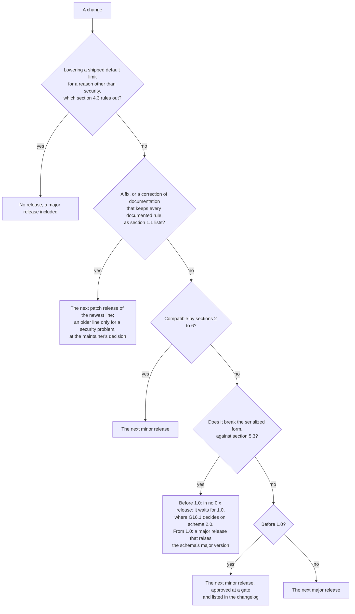

# Stability

| | |
|---|---|
| **Status** | Approved at G2.4 on 2026-11-25 with the README wording in section 8, at revision 56 of the plan. See the [gate decisions](../plans/plan-init-project-log.md). |
| **Review history** | Draft of 2026-11-24 for review (plan, Phase 2, task 5), to be confirmed at G2.4. Written from revision 51 of the plan, [`api.md`](../design/api.md), [`cli.md`](../design/cli.md) and [`json-output.md`](json-output.md) as their fifteenth review left them. The maintainer chose on 2026-11-24 to write it before reviewing revision 50 for G2.3. That review, the sixteenth, read this draft too, and revised sections 1, 2.2, 4, 5.2, 5.3, 6, 7, 8 and 9 on the same day, at revision 52 (section 9). The seventeenth, of revision 52, revised sections 1, 1.1, 2.2, 6.1, 8 and 9 on the same day, at revision 53. The eighteenth, of revision 53, revised sections 1, 2.2 and 9 on the same day, at revision 54. The nineteenth, of revision 54, revised sections 2.2, 5.3 and 9 on the same day, at revision 55. The guidelines checklist of task 6, [`api-guidelines-checklist.md`](../design/api-guidelines-checklist.md), revised sections 1 and 9 on 2026-11-25, at revision 56. |
| **Sources** | Plan sections [8.8](../plans/plan-init-project.md#88-serialization-and-its-compatibility-contract), [8.9](../plans/plan-init-project.md#89-command-line-contract), [8.10](../plans/plan-init-project.md#810-backward-compatibility-rules) and [9.6](../plans/plan-init-project.md#96-reviewing-changes-in-reported-output); R12, R21, R26, R27 and D2; Appendices C.6 and C.8; `api.md` sections 3, 4.5 and 14; `cli.md` section 8.8; `json-output.md` section 9; the [Cargo SemVer guide](https://doc.rust-lang.org/cargo/reference/semver.html) and the [Cargo resolver](https://doc.rust-lang.org/cargo/reference/resolver.html#rust-version) |

This guide says what stays the same from one release of `cc-media-probe` and `cc-media-probe-cli` to the next, and what a release may change. It covers the Rust API, the Cargo features, what a probe reports, the serialized form, the command-line tool and the minimum supported Rust version. The contract of the serialized form itself is [`json-output.md`](json-output.md). This guide says how releases keep it.

## Contents

1. [Versions and releases](#1-versions-and-releases)
2. [The Rust API](#2-the-rust-api)
3. [Cargo features](#3-cargo-features)
4. [What a probe reports](#4-what-a-probe-reports)
5. [The serialized form](#5-the-serialized-form)
6. [The command-line tool](#6-the-command-line-tool)
7. [Minimum supported Rust version](#7-minimum-supported-rust-version)
8. [The README's summary](#8-the-readmes-summary)
9. [Decisions for G2.4](#9-decisions-for-g24)

## 1. Versions and releases

Both crates carry the same version and are released together. The CLI requires the library of exactly its own version (plan Appendix C.6).

Cargo reads a `0.y.z` version so that a change of `y` may break and a change of `z` may not. Before 1.0, a breaking change therefore comes only in a minor release (0.2.0, 0.3.0, …), and the changelog lists every one, each entry beginning with **Breaking** under its kind of change, as the guidelines checklist of task 6 found that the Rust API Guidelines ask (C-RELNOTES). From 1.0 the crates follow [Semantic Versioning 2.0.0](https://semver.org/spec/v2.0.0.html).

| Release | Before 1.0 | From 1.0 |
|---|---|---|
| Patch: `0.y.Z`, `X.y.Z` | Fixes only (section 1.1) | Fixes only |
| Minor: `0.Y.0`, `X.Y.0` | Compatible changes, deprecations, and breaking changes of the Rust API, the Cargo features and the CLI's options, each one approved at a gate and listed in the changelog; never a break of the serialized form | Compatible changes and deprecations |
| Major: `X.0.0` | None | Breaking changes |

The serialized form is the one exception: its major version stays at 1 through every 0.x release, so no 0.x release breaks it, a minor release included (sections 4.2 and 5.2).

A change that this policy rules out in every release gets none: lowering a shipped default limit for any reason but a security problem comes in no release, a major release included (section 4.3), as the eighteenth review asked the chart to say.

### 1.1 Patch releases

A patch release carries fixes only, as the maintainer chose on 2026-11-24:

- a value that breaks its documented rule in [`fields.md`](fields.md), `api.md` or `json-output.md`;
- a wrong outcome, a wrong error kind, a panic, a hang, or a limit that a probe does not honor;
- a security problem, as [CONTRIBUTING.md](../../CONTRIBUTING.md) defines one. Such a fix may also lower a default limit (section 4.3);
- documentation that corrects its text and keeps every documented rule, as the seventeenth review asked to limit. A change of a field's meaning, unit, time origin or precedence is a breaking change of what a probe reports (section 4.2), in whichever document it is made, `fields.md` included, so it is no patch.

A patch release adds no public item, feature, option, field, parser or format. It changes no other default, and it keeps the MSRV of its minor line (section 7). Every change it makes to what a probe reports is listed under "Changed output", as in any release.

### 1.2 Which lines receive fixes

Fixes go to the newest minor line, as the maintainer chose on 2026-11-24. An older line gets a patch release only for a security problem, and only when the maintainer decides so. Such a patch is prepared on that line's branch `release/X.Y` (plan [Appendix C.6](../plans/plan-init-project.md#c6-every-later-release)). A release that turns out wrong is yanked, and a new patch release replaces it (plan [Appendix C.8](../plans/plan-init-project.md#c8-if-a-release-is-wrong)).

## 2. The Rust API

### 2.1 What is public

The public API is every item that the published library documents, with any combination of its features. The following are not part of it:

- the items that only repository builds and fuzzing compile, such as the toy format and the repository-only entry points (plan section 7.1);
- the unpublished crates of the workspace;
- text for people: `Debug` output, `Display` text unless its documentation says otherwise, and the messages of diagnostics and errors (`api.md` sections 3.3 and 6.13). Stable text comes from `as_str()` and from the diagnostic codes;
- the numbers of the usage summary, which describe the work of one run (section 4.1).

### 2.2 How the API stays compatible

The library is built so that it can grow without breaking callers (plan section 8.10, D11):

- Every public struct has private fields and accessors, and no struct literal builds one.
- Every public enum and every options or limits type is `#[non_exhaustive]`. Every open set has a catch-all for values that the library does not know.
- Traits that callers implement are kept minimal and gain only methods with a default body that keep them dyn compatible, as the sixteenth review asked, since callers pass sources as trait objects such as `Box<dyn PositionalSource + Send>` (`api.md` sections 4.4 and 14). A new method stays dispatchable, and carries no bound, only when it passes one test, as the nineteenth review asked: no type or const parameter, a receiver of `&self`, `&mut self`, `Box<Self>`, `Rc<Self>`, `Arc<Self>` or a `Pin` of one of them, no other use of the type `Self` in its parameters or its return type, and no opaque return type, as an `async fn` or a return of `impl Trait` has (the Rust Reference, "Dyn compatibility": a dispatchable function has no type parameters, "although lifetime parameters are allowed", and does not use `Self` "except in the type of the receiver"). Every other new method carries `where Self: Sized`. The bound would keep a trait object from calling a method that passes, as the seventeenth review asked. Lifetimes alone pass nothing: `fn copy_from<'other>(&mut self, other: &'other Self)` uses `Self`, so it needs the bound, and rustc 1.100.0 refuses the trait object without it with E0038. An associated type of the trait is no such use: a trait object names it, as in `dyn Items<Item = u8>`, and rustc 1.100.0 dispatches `fn item(&self) -> Option<Self::Item>` through it. A const parameter counts, as the eighteenth review found: the Reference's items "may be parameterized by types, constants, and lifetimes" ("Generic parameters"), and rustc 1.100.0 refuses a trait object of a trait with a provided `fn preview<const COUNT: usize>(&self)` with E0038. The Cargo SemVer guide counts losing dyn compatibility as a breaking change and a new defaulted item as possibly breaking, since a caller's type may implement another trait with a method of the same name, so a new method gets a distinct name. Traits that callers are not meant to implement are sealed.
- Compile-fail tests prove that an exhaustive match and a struct literal on a public type do not compile.
- From 0.1.0, CI compares the public API with the last release of the same line at the level "no breaking change", whatever the version numbers say, with all features, with the default features and with none. A break approved at a gate is entered in a committed list of approved exceptions, which is emptied once the release that contains it is published.

`api.md` section 14 lists how each kind of growth stays compatible: a new field is a new accessor, a new format or kind a new variant, a new option a new setter.

### 2.3 Deprecation

An item is deprecated, with `#[deprecated]` and a note that names its replacement, at least one minor release before it is removed. The changelog's "Deprecated" section gives the migration. A removal is a breaking change: before 1.0 it comes in a minor release, and from 1.0 in a major release. G16.1 decides which deprecated items 1.0 removes (plan Phase 16, task 2).

### 2.4 Dependencies

The public API names only the standard library and, behind their features, Serde's traits, Tokio's I/O traits and futures-io's I/O traits (`api.md` section 14). Serde and Tokio are at major version 1, and futures-io is at 0.3:

- Raising the major version of a public dependency would change the API, so it is a breaking change.
- If a later futures-io release changes its traits, a new module beside `asynchronous::futures` serves it, and the existing module stays as it is.

Every other dependency is private. Changing its version is compatible as long as the crate stays on the approved allow-list (G1.3, GS.1) and the change keeps the minor line's MSRV.

## 3. Cargo features

| Feature | Default | Adds |
|---|---|---|
| `zlib` | on | Inflating compressed Matroska content and the compressed movie box of the ISO family |
| `serde` | off | `Serialize` and `Deserialize` for the model, and the `document` module |
| `tokio` | off | `asynchronous::tokio` |
| `futures-io` | off | `asynchronous::futures` |

`api.md` section 3.1 is the authoritative list. The features follow these rules:

- **Additive.** Enabling a feature never removes or changes an item. Output that a disabled feature prevents says so in the report, such as compressed data with the status "compression unavailable" when `zlib` is off.
- **New features in a minor release.** A new feature starts off by default.
- **Never removed or renamed in a compatible release.** A feature also never leaves the default set. The Cargo SemVer guide counts both as breaking changes, so they come only in a breaking release.

D12 decides at G16.1 whether 1.0 adds a feature for each format.

## 4. What a probe reports

The output of a probe is what the API returns for an input: the report, the detection or the error, with its serialized form and the CLI's text. This section compares the output of two releases for the same input, options and limits.

### 4.1 Compatible changes

A later release may report more and report better. As the maintainer chose on 2026-11-24, these changes are compatible:

| Kind | Example |
|---|---|
| **A value newly filled** | A stream gains its frame rate once its codec's header is parsed |
| **A header status that advances** | A stream's header goes from `identified`, with the identification `pending_parser`, to `parsed` (`api.md` section 5.4) |
| **An outcome that says more** | An "unsupported format" error becomes a report, or an error that names the format and what stopped the probe; a detection of `unknown` or `hint_only` becomes `identified` |
| **A known name** | A format, codec, typed detail, reason or diagnostic code that an earlier release did not know, in place of its raw identifier or catch-all |
| **A shortfall gone** | A reason or diagnostic that no longer occurs, because the release reads what an earlier one could not |
| **A shortfall newly found** | Reading further finds damage or reaches a limit. A complete report can then become incomplete, and `--strict` fails on it |
| **A fix** | A value brought back to its documented rule, even when the fix changes or removes the value |
| **The work of a run** | The usage summary, the read calls and the peak memory, which change as the parsers change |

Every such change is reviewed, appears in the phase-gate summary under "intentional report changes", and is listed in the changelog under "Changed output" (plan section 9.6). This holds for a change of the CLI's text layout too (section 6.2). Text for people (section 2.1) is no compatibility contract, so a change of it is never a breaking change. Plan section 9.6 lists every change to an expectation file, so where an expectation records such text, such as an error message in a CLI snapshot or the `message` of an archived error record, its change is listed under "Changed output" too, as the sixteenth review found that this guide had contradicted. A change of text that no expectation records, such as `Debug` output, needs no entry.

### 4.2 Breaking changes

Any other change of the output is a breaking change, in particular:

- a field whose meaning, unit, time origin or precedence changes, which is a change of its rule in `fields.md`;
- a stable name that changes, or that comes to mean something else: the text of `as_str()`, an enum value or a member name of the serialized form, or a diagnostic code;
- a member that the serialized form requires and that disappears (section 5.3).

Each of these changes the serialized form too, which carries the whole output, so section 5 decides when it may come. Before 1.0 none comes: the schema keeps major version 1 through every 0.x release, and a 0.x minor release may break the Rust API but never the form (section 5.2), as the sixteenth review found that this section had allowed. A change that needs such a break waits for 1.0, where G16.1 decides whether the schema moves to 2.0 to carry it. From 1.0 it comes only in a major release, which raises the schema's major version. A value that a release loses although its documented rule still gives it is neither: it is a bug, and a patch release restores it.

### 4.3 Default limits

G3.3 confirms the first default of each limit (`api.md` section 4.5). As the maintainer chose on 2026-11-24, a later release changes a default limit as follows:

- **Raising a default** is compatible. It comes in a minor release and is listed under "Changed output", since a probe can then read further.
- **Lowering a default** happens only to fix a security problem, such as an input that exhausts memory within the default. That fix may come in any release, a patch release included, and is listed under "Security" and under "Changed output". No other release lowers a shipped default, a major release included, as the sixteenth review asked to state.

A caller who needs the same limits in every release sets them explicitly through `Limits`. The default of every other option (`api.md` section 4.3) is part of the API, and changing it is a breaking change.

## 5. The serialized form

### 5.1 The contract

[`json-output.md`](json-output.md) is the contract of the form. Its section 9 states what a reader of each version can rely on, in both directions. Every root record carries `schema_version`, as `major.minor` (R26, `json-output.md` section 4.1).

### 5.2 The major version

The schema keeps major version 1 from 0.1.0 through every 0.x release, as the maintainer chose on 2026-11-24. A 0.x minor release may break the Rust API, but never the form: the output of each 0.x release stays readable by every retained reader of major 1, so no 0.x release makes a change that section 5.3 rules out. G16.1 decides whether 1.0 moves the schema to 2.0 or keeps it at 1 (plan Phase 16, task 2). From 1.0, the major version changes only with a major crate release.

### 5.3 Rules for every later minor version

Each release that changes the form raises its minor number, and every later minor version follows these rules:

1. It writes every member that the first version of its major requires, with its meaning: version 1.0, which 0.1.0 writes, for major 1, and the first version of any later major for that major, as the sixteenth review asked, so the rule holds if 1.0 moves the schema to 2.0.
2. It adds a member in one of two places, as the nineteenth review asked to tell apart. An optional member of a known record, with the default of its type, is one that an older reader may drop, since the record stays readable without it; a list or a plain flag is added only where its default, empty or false, is true of every record that an earlier version wrote (`json-output.md` section 5.2). A member of a new outcome or kind is one that an older reader never drops: the catch-all of rule 3 keeps it and writes it back, so the version that requires it, as an outcome `skipped` would require its `skip_reason`, reads the record again.
3. A new value requires members of its own only where its record keeps the members that it does not read. Such a record is an entry's outcome, a detection's outcome, an error record's kind, or the kind of a typed detail or of an enum that carries data. Any other new value adds only optional members.
4. It removes, renames and redefines no member and no enum value.
5. **No root record in a member that a catch-all keeps.** A new outcome carries a report, a detection or an error record only under `report`, `detection` or `error`, which every version reads and gives its own version. A new kind of a typed detail or of an enum that carries data holds no root record at all (`json-output.md` section 9).

### 5.4 Across major versions

A reader takes root records of its own major version only. An older reader gives the version error for a higher major version, always. A newer reader gives it for a lower major version too, unless the release that raised the major version documents a migration (plan section 8.8).

### 5.5 What the tests keep

- **An archive per release.** Every release archives the JSON of every fixture, whether or not the form changed, so a fix that changes a value is kept as well.
- **Simulated future records.** Hand-written records of a later version, with unknown members, values and kinds, must read and write back.
- **Real old readers** (R27). Three kinds of release are kept as readers of the current output: the first release of the schema major, the last release of every earlier minor line, and the previous release. Since the major version stays at 1 before 1.0 (section 5.2), the reader of 0.1.0 stays as long as major 1 does.

## 6. The command-line tool

### 6.1 What holds

- **The options.** As the maintainer chose on 2026-11-24, they follow the rules of the Rust API. A new option comes in a minor release. An option keeps its name and its meaning, and it is removed or changed only in a breaking release, after a deprecation of at least one minor release. While an option is deprecated, using it writes a warning to standard error, in either mode and before anything else that the run writes there, as the maintainer chose at the sixteenth review, once for each deprecated option and in the order of the option table, as the maintainer chose at the seventeenth review (`cli.md` section 8.8), and the changelog gives the migration. Help writes no warning, and nor does a command line with a usage error, which keeps its three lines and its status 2.
- **The outputs.** Which output carries what, in both modes (`cli.md` sections 1 and 7).
- **The exit statuses** of R21: 0, 1 and 2, with an output failure as 1, except that a usage error keeps 2 when its document cannot be written, so `cc-media-probe --json --jsno` with a closed standard output exits with 2 (`cli.md` sections 4 and 9), as the sixteenth review asked to state.
- **The usage errors.** Which command lines are one, their status 2, and their JSON document.
- **The JSON document,** by the contract of `json-output.md`.
- **The version line.** Without `--json`, `--version` writes the program's name, a space and the version (`cli.md` section 5).

### 6.2 What is for people

The text layout, the help text and the messages are for people, not a compatibility contract (plan section 8.9, `cli.md` section 8.8). The text layout may change in any minor release. Each change is listed under "Changed output", and its snapshot tests are updated in the same change. So is a change of the help text or of a message that a snapshot records (section 4.1). A patch release changes the layout only to fix it. Programs read the JSON document.

## 7. Minimum supported Rust version

The MSRV follows R12 and D2:

- **Fixed per minor line.** The `rust-version` of both crates is the stable Rust current on the day the line's release candidate is built (plan Appendix C.6, step 2), as the maintainer chose at the sixteenth review, which found that R12 named the release day instead; R12 now says the same, amended through GS.4. That is the toolchain that CI tests on the candidate and that the preflight records, so a Rust release between the candidate and its publication changes nothing. Today it is 1.100.
- **Patch releases keep it.**
- **On `main`,** it may be raised while the next minor version is in development.
- **Tested.** CI runs the tests on the declared version and on current stable (`node scripts/test-declared-rust-version.ts`).
- **A raise is not a breaking change.** It comes only with a minor release. The Cargo SemVer guide calls such a change possibly breaking and recommends treating it as a minor change.

**On an older toolchain.** Cargo 1.84 and later, with `resolver.incompatible-rust-versions` set to `fallback`, prefers, among the versions that a dependency's requirement allows, those whose `rust-version` the project's own Rust version meets. That setting is the default of resolver 3, which edition 2024 implies. It never leaves the requirement, so `cc-media-probe = "0.3"` never resolves to a 0.2 release, and when no allowed version fits, it picks one that needs a newer Rust rather than failing, as the [Cargo resolver](https://doc.rust-lang.org/cargo/reference/resolver.html#rust-version) shows and the sixteenth review found that this section had promised otherwise. A project on an older toolchain therefore names a requirement that admits a line whose MSRV it meets, such as `"0.2"`. `cargo install` does not use that setting, so on an older toolchain the CLI is installed by naming such a release: `cargo install cc-media-probe-cli --version X.Y.Z --locked`.

G16.1 decides whether this rule continues after 1.0 (plan Phase 16, task 2).

## 8. The README's summary

G2.4 approved the following text for the [README's Stability section](../../README.md#stability) on 2026-11-25. The README's other content comes in Phase 8 (plan section 10).

> **Stability.** Before 1.0, a minor release (0.2.0, 0.3.0, …) may change the Rust API, and the changelog lists every such change; a patch release only fixes. From 1.0, both crates follow Semantic Versioning. The JSON output keeps schema version 1 through every 0.x release: a newer release only adds to it, and older readers keep reading it. What a probe reports can improve in a minor release and be fixed in any release, and the changelog lists every such change under "Changed output". The command-line tool's text output is for people; programs read `--json`.
>
> **Minimum supported Rust version.** The stable Rust current on the day a minor line's release candidate is built, 1.100 today. Patch releases keep it. See the [stability guide](https://github.com/caoccao/cc-media-probe/blob/main/docs/guide/stability.md).

## 9. Decisions for G2.4

G2.4 confirms the wording of this guide and of the README's summary: the MSRV rule of D2 and the rules for changes of output (plan Phase 2, task 10).

**Made by the maintainer on 2026-11-24:**

- **This guide before G2.3.** It is written now and takes in the findings of the review of revision 50 when they arrive. The alternatives were to confirm G2.3 first, to write the checklist of task 6 first, or to wait for the review.
- **The schema's major version stays at 1 before 1.0** (section 5.2). The alternative was to let a 0.x minor release raise it, with a gate decision and a migration.
- **Improvements and fixes are compatible** (section 4.1), including a fix that changes or removes a value. The alternative was improvements only, with such a fix held for a breaking release.
- **A patch release fixes only** (section 1.1). The alternative was any compatible change, as Cargo's reading of `z` in `0.y.z` allows.
- **Default limits are raised in a minor release and lowered only for security** (section 4.3). The alternatives were any change in a minor release, or a change only in a breaking release.
- **The CLI's options are as stable as the API** (section 6.1), and a deprecated option warns on standard error. The alternative was to treat them like the text layout.
- **A shortfall newly found is compatible** (section 4.1), and the change is listed. The alternative was to treat a report that turns incomplete as a breaking change.
- **Fixes go to the newest line only** (section 1.2), and an older line gets one only for a security problem, at the maintainer's decision. The alternatives were the newest two lines, or the newest line with no exception.

**Made by the maintainer at the sixteenth review, on 2026-11-24:**

- **A deprecated option's warning goes to standard error in either mode, before anything else** (section 6.1; `cli.md` sections 7 and 8.8). The alternatives were a `warnings` member of the document in JSON mode, and no warning in JSON mode.
- **The MSRV is the stable Rust of the day the release candidate is built** (section 7), with R12 amended through GS.4. The alternative was the day of publication, with the candidate rebuilt when a newer stable Rust came out in between.

**Made by the maintainer at the seventeenth review, on 2026-11-24:**

- **Deprecation warnings once each, in the order of the option table** (section 6.1; `cli.md` section 8.8), whatever the order or repetition of the options on the command line. The alternatives were one line per option in the order of its first occurrence, and one line per occurrence.

**Choices made without asking,** each open at G2.4:

- A new feature starts off by default, and a feature never leaves the default set in a compatible release (section 3).
- The default of every option other than a limit is part of the API (section 4.3).
- The version line of `--version` holds its form, as `cli.md` section 5 gives it (section 6.1).
- The usage summary, the read calls and the peak memory are the work of a run. They are compatible in any release and listed when an expectation changes (section 4.1).
- `Debug` output, `Display` text and messages are text for people and no compatibility contract (section 2.1). Since the sixteenth review, a change of such text that an expectation records is listed under "Changed output", as plan section 9.6 requires (section 4.1); this choice had exempted every one.
- A private dependency may change its version in a compatible release, within the allow-list and the MSRV (section 2.4).
- A patch release may change documentation (section 1.1), since the seventeenth review only where the change keeps every documented rule.
- A fix of a security problem that lowers a default is listed under "Security" as well as "Changed output" (section 4.3).
- The README's summary is the text of section 8, and `README.md` changes only after G2.4 confirms it.

**The sixteenth review.** On 2026-11-24 the maintainer's review of revision 50, read with this draft of revision 51, raised eight findings on this guide, beside four on `api.md`, six on `json-output.md` (`api.md` section 16) and one on `cli.md` (its section 13): one of priority 1, five of priority 2 and two of priority 3. Each holds, confirmed by reading this guide against the plan, `cli.md`, `json-output.md` and the [Cargo resolver](https://doc.rust-lang.org/cargo/reference/resolver.html#rust-version). The maintainer chose the answer to one of them, the day of the MSRV, through GS.4. The guide changed as follows:

| Finding | Change | Sections |
|---|---|---|
| A 0.x minor release could remove a member that the serialized form requires, while its major version stays at 1 (priority 1) | No 0.x release breaks the form; such a change waits for 1.0, and the rule of the required members holds for the first version of each major | 1, 4.2, 5.2, 5.3 |
| Calling a lowered default a breaking change let a major release lower one | A shipped default is lowered only to fix a security problem, in any release, and by no other release | 4.3 |
| Cargo's fallback was said to find an older line, which it cannot outside the requirement | The fallback prefers within the requirement and else picks a version that needs a newer Rust; a project names a requirement that admits an older line | 7 |
| The README and this guide chose the MSRV on different days, and so did R12 and D2 | The stable Rust current on the day the release candidate is built, with R12 amended through GS.4 (the maintainer's choice) | 7, 8, 9 |
| The exit statuses left out the usage error that keeps 2 when its document cannot be written | Stated | 6.1 |
| Messages were exempt from the changelog, while plan section 9.6 lists every change to an expectation file | A change of text for people that an expectation records is listed; it is never a breaking change | 4.1, 6.2, 9 |
| The README's summary and the chart sent a patch's changes to a minor release | Improvements in a minor release, fixes in any; the chart asks first for a fix or a change of documentation | 1, 8 |
| A detection was said to become `detected` | `identified`, the outcome's name | 4.1 |

The same review found that JSON mode both forbade and required a deprecated option's warning on standard error, and that this section listed the warning among the choices made without asking, though the maintainer had chosen it. The maintainer chose where it goes (section 6.1), and it moved to the maintainer's choices above.

**Choices made without asking in the sixteenth review,** each open at G2.4: every breaking kind of section 4.2 counted as a break of the serialized form, so none comes before 1.0; text for people that no expectation records, such as `Debug` output, kept without a changelog entry; and the requirement `"0.2"` given as the way to an older line.

**The seventeenth review.** On 2026-11-24 the maintainer's review of revision 52 raised two findings on this guide, both of the wording that G2.4 confirms, beside four defects of the API spike, three findings on `json-output.md` and `api.md` (`api.md` section 16) and three on `cli.md` (its section 13): one of priority 2 and one of priority 3. Each holds, confirmed by reading this guide against section 4.2, R12 and section 7. The guide changed as follows:

| Finding | Change | Sections |
|---|---|---|
| The chart sent every change of documentation to a patch release before asking whether it is compatible, though section 4.2 calls a change of a field's unit or precedence breaking | Only a correction of documentation that keeps every documented rule is a patch; a change of a rule is a change of output, wherever it is written | 1, 1.1 |
| The README's summary chose the MSRV when a release is "prepared", while R12 and section 7 name the day the release candidate is built | The same day, in the summary's words | 8 |

The same review asked to scope the trait rule of section 2.2 to type parameters, since a trait object can call a method generic only over lifetimes (`api.md` section 16), and to state the warnings of a deprecated option beside help, a usage error and a repeated option (section 6.1; `cli.md` section 13). The maintainer chose their count and order.

**Choices made without asking in the seventeenth review,** each open at G2.4: the opaque return types of the Rust Reference named in the trait rule beside type parameters, and the warnings of section 6.1 left out beside help, as `cli.md` section 8.8 states.

**The eighteenth review.** On 2026-11-24 the maintainer's review of revision 53 raised one finding on this guide, of priority 2, beside six defects of the API spike, seven findings on `json-output.md` and `api.md` (`api.md` section 16) and one on `cli.md` (its section 13). It holds, confirmed by following the chart with a proposal to lower a shipped default limit for a reason other than security: the chart led to a breaking release, where section 4.3 rules the change out in every release. The guide changed as follows:

| Finding | Change | Sections |
|---|---|---|
| The release chart offered a breaking release for a change of a default limit that section 4.3 forbids even there | The chart asks first whether the change lowers a shipped default for a reason other than security, and gives such a change no release; the text beside it says so | 1 |

The same review found that the trait rule of section 2.2 left out const parameters, which make a trait not dyn compatible as type parameters do (`api.md` section 16); the rule names them now.

**Choice made without asking in the eighteenth review,** open at G2.4: the chart's new first question names only the change of section 4.3, the one that this guide rules out in every release, rather than a general question of policy.

**The nineteenth review.** On 2026-11-24 the maintainer's review of revision 54 raised two findings on this guide, beside nine on the API and the JSON reader (`api.md` section 16) and one on `cli.md` (its section 13). Both hold. rustc 1.100.0 confirmed the first: it dispatches `fn item(&self) -> Option<Self::Item>` through `&dyn Items<Item = u8>`, which the rule would have bounded, and refuses `&mut dyn Source` with E0038 once `Source` has `fn copy_from<'other>(&mut self, other: &'other Self)`, which the rule left unbounded. The second follows from rule 3 of section 5.3: a member of a new outcome or kind may be required, so an older reader that dropped it would forward an entry that its own version no longer reads. The guide changed as follows:

| Finding | Change | Sections |
|---|---|---|
| The trait rule bounded a dispatchable method that names an associated type of `Self`, and left unbounded a method generic only over a lifetime that takes `&Self` | One test: no type or const parameter, a dispatchable receiver, no other use of `Self` and no opaque return type; every other method carries `where Self: Sized` | 2.2 |
| Rule 2 counted a member of a new outcome or kind among the members that an older reader may drop | An optional member of a known record may be dropped; a member of a new outcome or kind is kept and written back by the catch-all | 5.3 |

**Choice made without asking in the nineteenth review,** open at G2.4: the test of section 2.2 lists the receivers of the Reference, `Pin` of one of them included, rather than only the `&self` and `&mut self` that the source traits use.

**The guidelines checklist of task 6.** On 2026-11-25 the checklist found that the Rust API Guidelines ask release notes to identify every breaking change clearly (C-RELNOTES), which the changelog listed and did not mark. Section 1 now marks each one.

**Choice made without asking at the checklist,** open at G2.4: a breaking change is marked by **Breaking** at the start of its entry, under its kind of change, so the six kinds of Keep a Changelog stay as they are, rather than gathered under a seventh heading.
