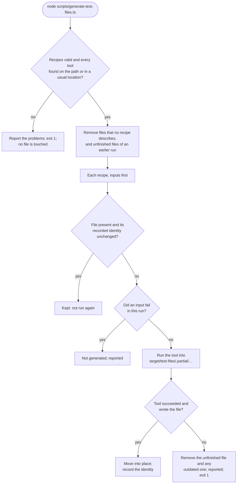
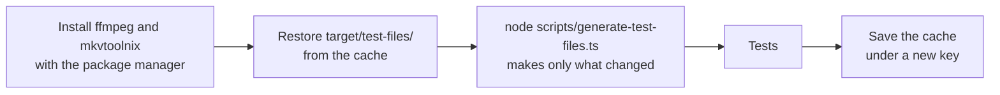

# Test files

| | |
|---|---|
| **Status** | Written on 2026-11-22, when the maintainer amended R8 through GS.4. The generator exists from that day; recipes arrive with the phases that test formats, and the CI job starts with the first of them. |
| **Plan** | [Section 9.1](../plans/plan-init-project.md#91-test-files) sets the rules; this guide explains how to use and extend the generator. |
| **Script** | [`scripts/generate-test-files.ts`](../../scripts/generate-test-files.ts), with its modules in [`scripts/checks/test-files/`](../../scripts/checks/test-files/). |

The tests of `cc-media-probe` read real media files: files made by **ffmpeg** and by **mkvmerge** of mkvtoolnix, run as installed binaries. Each file is described by a **recipe**, a few lines of JSON in the test kit. The generator turns recipes into files under `target/test-files/`, generates each file once, keeps it as long as its recipe and the tool's version stay the same, and removes the files that no recipe describes any more.

Generated files are never committed; Git ignores `target/`. Hand-annotated hex fixtures remain for what no tool writes, such as truncated or damaged files (section 7).

This guide, the generator, its recipes, the CI workflow, the plan, the dependency dossier, the development log, `CLAUDE.md` and `CONTRIBUTING.md` are the only places in the repository that name these tools. The library, its rustdoc, the other guides, the changelog and commit messages never do (R8).

## Contents

1. [Where things are](#1-where-things-are)
2. [Running the generator](#2-running-the-generator)
3. [Recipes](#3-recipes)
4. [When a file is generated, kept or removed](#4-when-a-file-is-generated-kept-or-removed)
5. [Reproducible recipes](#5-reproducible-recipes)
6. [What a test may assert](#6-what-a-test-may-assert)
7. [What hex fixtures still cover](#7-what-hex-fixtures-still-cover)
8. [Continuous integration](#8-continuous-integration)
9. [Adding or changing a recipe](#9-adding-or-changing-a-recipe)
10. [Troubleshooting](#10-troubleshooting)

## 1. Where things are

Recipes and files follow the topics of `docs/specs/files/`, then the format or codec:

```
crates/cc-media-probe-testkit/test-files/      the recipes, committed
├── containers/
│   ├── matroska.json                          → target/test-files/containers/matroska/…
│   └── isobmff.json                           → target/test-files/containers/isobmff/…
├── video/
│   └── h264.json                              → target/test-files/video/h264/…
└── audio/
    └── opus.json                              → target/test-files/audio/opus/…

target/test-files/                             the generated files, never committed
├── generation-state.json                      what was generated, by which tool version
├── containers/matroska/h264-opus.mkv
├── video/h264/baseline-320x240.h264
└── audio/opus/stereo-48k.opus
```

- The topics are `containers`, `video`, `audio`, `subtitles` and `tags-and-registries`. Any other folder in the recipes directory is an error.
- A recipe file is named after its format or codec: lowercase words and digits joined by hyphens, with `.json`.
- A generated file's path below `target/test-files/` is `<topic>/<format>/<name>`, written with `/` in recipes and in the state file on every platform.
- `cargo clean` removes `target/`, generated files included. The next run of the generator makes them again, once.

## 2. Running the generator

```sh
node scripts/generate-test-files.ts
```

It needs Node.js on a long-term-support release, like every script of the repository (R34), and the tools that the recipes name:

| Tool | Package | Version reported with |
|---|---|---|
| `ffmpeg` | FFmpeg | `ffmpeg -version` |
| `mkvmerge` | MKVToolNix | `mkvmerge --version` |

**Finding the tools.** Before it does anything else, the generator finds each tool that a recipe uses and asks it for its version:

1. By name on the system path, which the operating system searches.
2. Otherwise in the usual install locations, below the file-system root:
   - `/usr/bin` and `/usr/local/bin`;
   - `/opt/homebrew/bin` (Homebrew on Apple silicon) and `/opt/local/bin` (MacPorts);
   - `/snap/bin`;
   - `/Applications/MKVToolNix.app/Contents/MacOS`, where the macOS application keeps its command-line tools.
3. Otherwise below the folders that environment variables name, as on Windows:
   - `%ProgramFiles%\MKVToolNix`, the installer's default;
   - `%ProgramData%\chocolatey\bin`;
   - `%LOCALAPPDATA%\Microsoft\WinGet\Links`;
   - `%USERPROFILE%\scoop\shims`.

Each location is tried with and without the `.exe` suffix. The list is the same on every platform, because a folder that does not exist is simply not found; the script therefore needs no branch per platform. A tool found in a usual location is run by its full path, and that path's version line goes into the state file.

When a tool is found nowhere, the generator reports `<tool> is neither on the system path nor in its usual install locations; install it to generate the test files` and stops, without generating or removing any file. A tool that no recipe uses is not needed.

A run prints one line per file it generates or removes, and a summary:

```text
removed unused test file audio/opus/old.opus
generated video/h264/baseline-320x240.h264
generated containers/matroska/h264-opus.mkv
test files: generated 2, current 14, removed 1
```

The exit status is 0 when every recipe is current or was generated, and 1 when a recipe is invalid, a tool is missing, or a tool failed. `node scripts/check.ts` does not run the generator, because it runs offline and needs no media tools; it runs the generator's own tests, which use a stand-in for the tools.

## 3. Recipes

A recipe file holds a list of files:

```json
{
  "files": [
    {
      "name": "baseline-320x240.h264",
      "tool": "ffmpeg",
      "arguments": [
        "-nostdin", "-loglevel", "error",
        "-f", "lavfi", "-i", "testsrc2=size=320x240:rate=25:duration=2",
        "-c:v", "libx264", "-profile:v", "baseline", "-bf", "0", "-threads", "1",
        "-fflags", "+bitexact", "-flags", "+bitexact", "-map_metadata", "-1",
        "{output}"
      ]
    },
    {
      "name": "h264-opus.mkv",
      "tool": "mkvmerge",
      "inputs": ["video/h264/baseline-320x240.h264", "audio/opus/stereo-48k.opus"],
      "arguments": ["--deterministic", "cc-media-probe", "--output", "{output}", "{input:0}", "{input:1}"]
    }
  ]
}
```

| Member | Required | Meaning |
|---|---|---|
| `name` | yes | The file's name in `<topic>/<format>/`: lowercase words, digits and hyphens, then one or more extensions, such as `stereo-48k.opus` or `cropped.mkv`. Tools choose the output format from the extension, so it must be the real one. |
| `tool` | yes | `ffmpeg` or `mkvmerge`. Another tool joins the generator's list through GS.1. |
| `arguments` | yes | The tool's arguments, exactly as it receives them. The tool is started directly, without a shell, so no quoting is needed and none is interpreted. |
| `inputs` | no | Other generated files the recipe reads, by their path below `target/test-files/`. Each must be the output of another recipe. |

Two placeholders stand for paths, because the generator decides where files go:

- `{output}` is the file being generated. Every recipe uses it at least once.
- `{input:N}` is the `N`th entry of `inputs`, counted from 0.

The generator checks all recipes before it runs any tool, and stops when it finds a problem:

- a recipe file outside `<topic>/<format>.json`, or one that is not of the shape above;
- two recipes for the same file;
- a name that the pattern refuses;
- an unknown tool;
- an input that no recipe generates;
- arguments without `{output}`, or with an `{input:N}` beyond `inputs`;
- inputs that form a circle.

A recipe may carry other members, such as the values its tests expect. The generator ignores them, and they are not part of the file's identity, so changing an expectation never makes a file again.

**The values a test expects, approved at G3.2.** [`docs/design/test-kit.md`](../design/test-kit.md#44-the-values-that-a-recipe-states) section 4.4 gives each file a member `expected`, which the file's test matches with its report through the golden tests' matcher. It holds a partial report in the library's JSON form, with only what the recipe fixes and the specifications derive from it (section 6):
- every member that `expected` names must hold that value;
- a member that it names as `null` must be absent;
- an array must have as many entries as it lists;
- a member that it does not name is not compared.

```json
{
  "name": "h264-opus.mkv",
  "tool": "mkvmerge",
  "inputs": ["video/h264/baseline-320x240.h264", "audio/opus/stereo-48k.opus"],
  "arguments": ["--deterministic", "cc-media-probe", "--output", "{output}", "{input:0}", "{input:1}"],
  "expected": {
    "format": "matroska",
    "streams": [
      { "kind": "video", "video": { "coded_size": { "width": 320, "height": 240 } } },
      { "kind": "audio", "audio": { "channel_count": 2 } }
    ],
    "creation_time": null
  }
}
```

## 4. When a file is generated, kept or removed

Every file has an **identity**: the SHA-256 of its path, its tool, the first line of that tool's version report, its arguments, and the identities of its inputs. The identity says everything that decides the file's bytes. The state file, `target/test-files/generation-state.json`, records the identity and tool version of every file it holds:

```json
{
  "video/h264/baseline-320x240.h264": {
    "identity": "6093237508b3a62a56f52389d0f00e9f52f00a0ad22ad0eb0c14394f00e17eed",
    "tool": "ffmpeg",
    "version": "ffmpeg version 9.1 Copyright (c) 2000-2026 the FFmpeg developers"
  }
}
```



The rules behind the diagram:

- **Generated once.** A file whose identity is unchanged is never made again, however often the generator runs. That is what keeps repeated runs fast.
- **Made again only for a reason.** A changed argument, a changed input, or a tool that reports another version gives a new identity. The file is then made once more, and so is every file made from it.
- **Never half written.** A tool writes into `target/test-files/.partial/`, below the same `<topic>/<format>/` path and with the same name, so it still sees the right extension. The file moves into place only when the tool succeeded and the file exists. The state file is written after every generated file, so an interrupted run keeps what it finished.
- **No stale file.** When a changed recipe fails, the outdated file is removed too, so no test reads a file that its recipe no longer describes. The next run tries again.
- **Unused files are removed.** At the start of every run, any file below `target/test-files/` that no recipe describes is removed, with the folders it leaves empty. The state file and files that recipes describe are never removed.
- **A lost state file costs one run.** Without a readable state file, the generator cannot trust what it finds, so it makes every file once more and records it.

## 5. Reproducible recipes

A recipe should give the same bytes every time it runs with the same tool version. The two tools have options for it:

- **ffmpeg.** `-fflags +bitexact -flags +bitexact` leaves out the encoder's version strings and other varying values, and `-map_metadata -1` drops metadata copied from the input. Start with `-nostdin -loglevel error`, so the tool never waits for the terminal and prints only errors. Prefer the built-in `lavfi` sources, such as `testsrc2` for video and `sine` for audio: they need no input file and are deterministic.
- **mkvmerge.** `--deterministic <seed>` makes byte-identical files for the same version, inputs, options and seed, and leaves out the date (MKVToolNix 42.0 and later). Use the seed `cc-media-probe` unless a test needs a second, different file.
- **Threads.** Give external encoders `-threads 1`, so that their output cannot depend on the machine's number of cores.
- **Encoders.** Use only encoders that the builds installed in CI have: the native encoders of ffmpeg, and the common external ones of its usual builds, such as `libx264`, `libx265`, `libvpx`, `libopus` and `libvorbis`.
- **Keep files small.** A few frames at a small size and a short duration are enough to exercise headers and tables. The bytes count against the CI cache and the time of every test run.

The end-to-end trials of 2026-11-22 used ffmpeg 8.1.2 from Homebrew and mkvmerge 101.0 from the MKVToolNix application bundle on macOS, found as section 2 describes. The first trial was an FFV1 file from `testsrc2`. The second was an H.264 stream from `testsrc2` and an Opus stream from `sine`, muxed into Matroska with `--deterministic`. In both, a second run made nothing, and every file made again from scratch was byte for byte the same.

## 6. What a test may assert

Different machines and CI platforms can have different tool versions, so a generated file's bytes may differ between them. A test on a generated file therefore asserts:

- the values that its recipe fixes, such as the codec, the frame size, the frame rate, the sample rate, the channel count, the duration and the track flags;
- what the specifications derive from those values, such as a codec string, a pixel aspect ratio or a media type;
- the completeness and header statuses that follow from a well-formed file.

It does not assert byte offsets, sizes in bytes, unique identifiers that a seed produces, element order or anything else that a tool version decides. Those belong to hex fixtures. No test reads or compares what a tool reports about a file: expected values come from the recipe and the specifications only (R8, R16).

A test whose generated file is missing fails, and its message names `node scripts/generate-test-files.ts`. It is never skipped silently. The test kit resolves the paths: `generated::path("containers/matroska/h264-opus.mkv")` gives the file below `target/test-files/`, or that error, and `generated::recipe_path` the recipe file that describes it. Both take a name only as the generator writes it, by the rules of sections 1 and 3, so a missing file is one that a recipe could describe. Only a file that is absent is missing: a path whose metadata cannot be read fails with the system's error, and a path that holds a folder or another entry says so, since running the generator again fixes neither. `generated::path_in` looks below another folder alike, so that the lookup's own tests do not depend on the files that a developer has generated.

## 7. What hex fixtures still cover

Generated files replace hex fixtures wherever a tool can produce the case. Hand-annotated hex fixtures and the test kit's builders remain for what no tool writes:

- truncated, damaged and mutated files, and the robustness sweeps over them;
- values at the edge of a field's range, reserved values and conflicts between container and bitstream;
- structures that tools do not write, such as an element stored outside its version, a seek head that disagrees with the file, or a declaration beyond the stream limit;
- the worked examples of a specification, transcribed with their expected values;
- byte-exact expectations, such as offsets in diagnostics and the read counts of the budget tests.

## 8. Continuous integration

CI follows the same rules on each of its three platforms. The job starts in the phase that adds the first recipes, as plan section 9.8 starts every job when it first has something to check:

1. Install the tools with the platform's package manager: `apt` on Linux, Homebrew on macOS, Chocolatey on Windows. Where a manager can install an exact version, CI asks for the current releases, ffmpeg 9.1 and mkvtoolnix 104.0. Where it cannot, CI uses the version it gets, and the generator records it. On Linux these are the packages of Ubuntu's own archive, which are older: ffmpeg 8.0.1 and mkvtoolnix 97.0 on `ubuntu-26.04`. The Linux files therefore have identities of their own, and the tests expect the same values from them (section 6).
2. Restore `target/test-files/` from the cache of `actions/cache`. The key is made of the platform, the hash of the recipe files and the tools' version lines. A partial match restores the newest earlier cache, so only what changed is made.
3. Run `node scripts/generate-test-files.ts`. On a cache hit it makes nothing.
4. Run the tests, which read the files.
5. Save the cache when its key is new.



Each platform generates its own files, so a platform can have other tool versions than the others; section 6 keeps the tests independent of that.

## 9. Adding or changing a recipe

1. Choose the file's place: the topic, then the recipe file of its format or codec. A container file made from codec streams goes to the container's recipe file and names the streams as inputs.
2. Write the recipe with the options of section 5, in the smallest form that exercises what the test needs.
3. Run `node scripts/generate-test-files.ts`. Only the new or changed file is made, with the files made from it.
4. Write the test. It asserts what section 6 allows and names the file by its path below `target/test-files/`.
5. Removing a recipe removes its file on the next run.

A recipe change is reviewed like code: it changes what the tests read.

## 10. Troubleshooting

| Message | Meaning | What to do |
|---|---|---|
| `<tool> is neither on the system path nor in its usual install locations` | A recipe needs a tool that the generator cannot find. | Install FFmpeg or MKVToolNix in its default location, or put the folder that holds `ffmpeg` or `mkvmerge` on `PATH` (section 2). |
| `<path>: failed to generate` | The tool failed, or succeeded without writing the file. | Run the tool by hand with the recipe's arguments, with a real path for each placeholder, and read its error. |
| `<path>: not generated, because an input failed` | A file it needs failed in this run. | Fix the input's recipe first. |
| `unknown tool`, `no recipe generates the input`, or another recipe problem | A recipe is invalid. | Correct the recipe; nothing was touched. |

To make every file again, delete `target/test-files/`, or only its state file. The next run makes each file once.
