# cc-media-probe — Initial Project Development Plan

| | |
|---|---|
| **Status** | Approved on 2026-11-21 at draft 6, and amended in Phase 1 and after it (revision 77; see [Appendix E](#appendix-e--revision-history)). Phase 1 is complete: G1.9 passed on 2026-11-22. G2.3 and G2.4 passed on 2026-11-25. Phase 2 delivered the public API skeleton, examples and contract tests (tasks 11 to 13): the first of the skeleton's three slices, the data model, was approved on 2026-11-26 after the maintainer's three reviews, and the second, the entry points, options, sources and async surface, was revised after its three reviews on 2026-11-26 and committed. The first of the third slice's two parts, the strict reader and the form of the report model, was revised after the maintainer's seven reviews on 2026-11-26 and committed. The second, the document, its entries and its writer, was written the same day and revised after the maintainer's two reviews on 2026-11-27. The maintainer approved revision 66 and the completed skeleton the same day, and tasks 12 and 13, the examples and the contract tests, were done that day, revised after the maintainer's two reviews the same day, and approved at G2.5 on `701601b`. Phase 2 is complete. Phase 3 began with the I/O spike, task 1, which was built on 2026-11-27 and revised the same day after the maintainer's two reviews. Its async walker missed D8's bar after each review's fixes, so the spike also holds the fallback's state machine for comparison. G3.1 passed on 2026-11-27 at `2de60bf`: the maintainer confirmed D9, D15 and D17, and D8 with the async walker's measured overhead as a one-time exception to task 1's bar. The proposal for G3.2, `docs/design/test-kit.md` with the spike `spikes/fixtures/`, was written the same day and revised the same day after each of the maintainer's three reviews. The second approved the section named in a fixture's heading, the toy format's hidden `Format::Toy` and the proposal's choices made without asking, and the proposal as a whole waits for G3.2. The [development log](plan-init-project-log.md) records every gate decision and the progress of each task. |
| **Date** | 2026-11-21 |
| **Crates** | `cc-media-probe` (library), `cc-media-probe-cli` (command-line tool) |
| **Repository** | `github.com/caoccao/cc-media-probe` |
| **License** | Apache-2.0 |

`cc-media-probe` is a pure Rust library that inspects multimedia files and reports what they contain: container format, streams, codec parameters, chapters, tags and attachments. It never decodes audio or video. One universal API serves every supported format.

This document is the complete plan from an empty repository to a 1.0 release and beyond. It is organized in phases. A phase starts only after the previous phase's gate is passed and, for a release phase, after its release has been published and verified.

## Contents

1. [How to use this plan](#1-how-to-use-this-plan)
2. [Goals and non-goals](#2-goals-and-non-goals)
3. [Confirmed requirements](#3-confirmed-requirements)
4. [Scope: formats and codecs](#4-scope-formats-and-codecs)
5. [Specification sources](#5-specification-sources)
6. [Technical decisions](#6-technical-decisions)
7. [Architecture](#7-architecture)
8. [Public API design](#8-public-api-design)
9. [Testing strategy](#9-testing-strategy)
10. [Documentation plan](#10-documentation-plan)
11. [Definition of done for a format](#11-definition-of-done-for-a-format)
12. [Phases](#12-phases)
13. [Risks](#13-risks)
14. [Gate summary](#14-gate-summary)
15. [Appendix A — RFC list](#appendix-a--rfc-list)
16. [Appendix B — Non-RFC specifications](#appendix-b--non-rfc-specifications)
17. [Appendix C — crates.io registration and publishing runbook](#appendix-c--cratesio-registration-and-publishing-runbook)
18. [Appendix D — Research log](#appendix-d--research-log)
19. [Appendix E — Revision history](#appendix-e--revision-history)

---

## 1. How to use this plan

### 1.1 Gates

Three markers are used throughout.

| Marker | Meaning |
|---|---|
| **[CONFIRM]** | A critical decision. The proposal and its alternatives are presented; work continues only after your explicit answer. |
| **[MANUAL]** | A step only you can perform (accounts, tokens, purchases, repository settings, approvals). Exact instructions are given; work continues after you report it done. |
| **[OPTIONAL]** | An invitation, not a stop. Work continues without waiting. The next phase-gate summary records whether it was done, skipped, or what it found. |

Every gate has an ID such as `G3.2` (phase 3, gate 2). Section 14 lists all of them in one table.

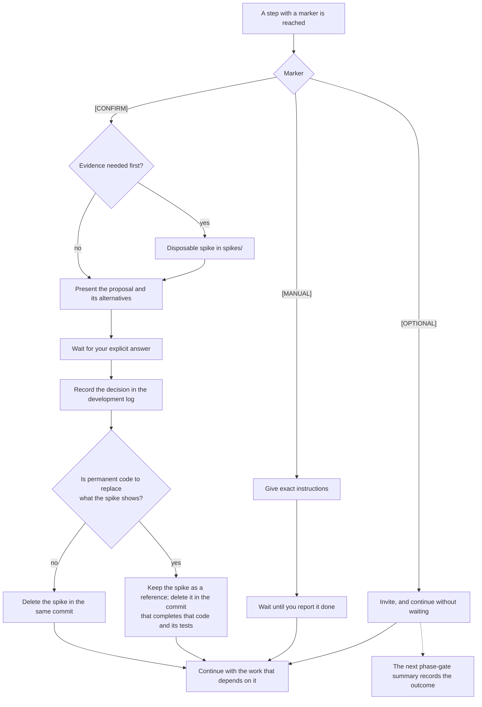

**Ordering rule.** A confirmation always comes before the first task or release that depends on it. Where a decision needs evidence first, the evidence is produced as a disposable spike (section 1.2), never as adopted code. Until a decision is confirmed, nothing that depends on it is added to the workspace, the library or CI.

**Standing gates.** Six gates are not tied to a phase. They are raised whenever their condition occurs:

| Gate | Type | Raised when |
|---|---|---|
| GS.1 | CONFIRM | A crate or tool outside the approved allow-list (G1.3) is proposed. |
| GS.2 | CONFIRM | An approved specification source disappears or changes, or a new source is proposed for a format without a normative specification. |
| GS.3 | CONFIRM | The crate name is at risk before Phase 8. Publishing early requires an explicit amendment of requirement R9; nothing is published without it. |
| GS.4 | CONFIRM | Work shows that a confirmed requirement in section 3 cannot be met as written. |
| GS.5 | MANUAL | The release records show a verified tokenless upload for both crates. You then switch on the crates.io setting that refuses token-based publishing (Appendix C.4). |
| GS.6 | CONFIRM | A release stopped half-way, or a published version is wrong. The recovery route is confirmed before any retry, yank or replacement version (Appendix C.7 and C.8). |

### 1.2 Working method

- Commits go directly to `main` in small, self-contained steps. There are no pull requests. The single use of branches is `release/X.Y`, which marks the latest release of a minor line and carries its patch releases once `main` holds work for the next minor version (Appendix C.6).
- **Agents.** An agent commits, pushes, creates a branch or starts a sub-agent only when you ask for it in that session (R10). Otherwise it leaves its changes uncommitted for your review. Every commit and branch this plan names, the release branches included, is made on such an instruction.
- **Agent instructions.** `CLAUDE.md` at the repository root summarizes the rules of this plan that apply to every change; `AGENTS.md` only points to it. When a revision of this plan changes one of those rules, `CLAUDE.md` changes in the same commit.
- **Local check.** `scripts/check.ts`, run as `node scripts/check.ts` (R34), is created in the first commit after gate G1.2, in a bootstrap form that runs only the checks that apply to what exists at that point (file hygiene and link checks). It grows as crates appear: format, lint, the structure check, tests, coverage, docs, packaging. From that commit onward every commit must pass it. Commits made before the script exists (the initial commit and plan documents) are the only exemptions. CI repeats the same checks on Linux, macOS and Windows, for `main` and for every maintenance branch. The check script never asks the registry whether a version exists; that question belongs to a release candidate alone (Appendix C.2).
- **Spikes.** An experiment needed to inform a gate lives in `spikes/<name>/` as a workspace of its own: its manifest has its own `[workspace]` table, and the root manifest excludes the `spikes` directory. Leaving a package out of the root's member list is not enough; Cargo would still place it in the root workspace and fail. A spike may use candidate dependencies that are not yet approved. It is never published and nothing depends on it. It is deleted in the commit that records the gate decision, unless permanent code is to replace what it shows; then it stays as a reference until that code and its tests exist, and is deleted in the commit that completes them. On 2026-11-25 the maintainer kept `spikes/api-scenarios/` until Phase 2, task 13, and `spikes/cli-arguments/` until Phase 3, task 21, on this rule, and on 2026-11-26 `spikes/input/` until Phase 3, task 6, once its cases without a permanent test have moved into the test kit. Anything that later tasks need, such as a vehicle for measurements, is built as permanent code after the gate.
- **Phase gate.** Each phase ends with a short written summary: what was built, test results, coverage per crate and per area (R28), resource and fuzz results against their stated limits, intentional changes to reported output, deviations from this plan, optional steps done or skipped, and open questions. The next phase starts after you approve it.
- **Release order.** In a release phase the order is fixed: phase gate, release go/no-go on one exact commit, tag of that commit, your approval of the publishing run, verification of the published crates. The next phase starts after verification. **Phase 8 is the one exception:** its work is the first publication itself, so the acceptance before publishing is the freeze (G8.1) and the go/no-go (G8.3), and its phase gate (G8.6) comes after the crates are published and verified. A phase that publishes more than once passes its phase gate once, before its first publication; each publication then has its own go/no-go, which also accepts the work done since the phase gate. Phase 16 is such a phase: a release candidate, then the final release.
- **Development log.** Decisions taken at gates are recorded in `docs/plans/plan-init-project-log.md` with the date and the reasoning, so later sessions do not reopen them. The same log records the progress of each task. This plan says what is to be done; the log says what was decided and done.
- When a phase discovers that this plan is wrong or incomplete, the plan is amended in the same commit as the discovery, and the change is called out at the phase gate. A change to a confirmed requirement goes through GS.4 first.

The order of a release phase (Phases 9 to 15; Phase 8 and Phase 16 differ as described above):


### 1.3 Clean-room rule

All parsing behavior is derived from the specifications listed in section 5.

**May be used as specification:**

- Normative prose and tables.
- Syntax descriptions, including pseudocode, that define the order, width and presence conditions of fields in a file or bitstream. Examples: the syntax sections of RFC 9043 (FFV1), whose pseudocode conventions are defined in its section 2.2.1, and the syntax tables of the ITU-T video recommendations.
- Worked examples and test vectors given as values.

**Never read for implementation:**

- Source code of any third-party multimedia project, in whole or in part. It is not copied, translated or paraphrased.
- Reference encoder or decoder implementations attached to a specification, such as the reference decoder that accompanies RFC 6716 or the source listing in RFC 6386.

Code is written from the syntax description and keeps the specification's field names in comments. When an approved document is hosted inside an implementation's source repository, only the named text document is opened.

---

## 2. Goals and non-goals

### Goals

- **Pure Rust.** Within the boundary set by requirement R15: this project's crates contain no `unsafe` and no C/C++, and everything the published crates depend on is Rust-only.
- **Spec-driven.** Every parser cites the specification section it implements. IETF RFCs are the primary source wherever a format has one.
- **One universal API.** The same types describe an MKV, an MP4, an AVI or a transport stream. Format-specific and codec-specific facts are available through typed detail sections on the same result.
- **Easy to use.** A one-line call covers the common case. Options exist but are never required.
- **Built to evolve.** New formats, codecs and fields can be added in minor releases without breaking existing users, in Rust and in the serialized form.
- **Safe on hostile input.** No panics, no unbounded allocation, no unbounded reading, regardless of file content. The bounds cover the whole probe, not each element separately.
- **Honest results.** A report states what was found, what could not be established, and where each value came from. Estimates are kept apart from established values.
- **Broad format coverage.** See section 4.

### Non-goals

- Decoding, encoding, transcoding, muxing, remuxing or editing media.
- Writing or modifying metadata.
- Reporting anything that requires decoding frames (for example scene statistics or loudness).
- Walking an entire file to count every frame or to find every late-starting stream. Probing uses bounded reads. An opt-in full-scan mode is listed as a post-1.0 candidate, not a commitment.
- Opening files that media content points to. Only companions whose names derive from a validated identifier, inside a trusted folder, are opened, and only when the caller enables it (R18).
- `no_std`, WebAssembly and 32-bit targets. The design does not preclude them, but they are not built, tested or supported. 32-bit targets were added to this list by the maintainer on 2026-11-21. On 2026-11-26 the maintainer chose not to support WebAssembly at all: nothing is done to make the `tokio` feature build there or for UEFI, where Tokio's `fs` feature is not available, nor to make the library's tests build there.
- Bindings for other languages (C, Python, JavaScript).

---

## 3. Confirmed requirements

These are fixed inputs, not proposals. "Brief" means settled before draft 1; "Review 01", "Review 02" and "Review 03" mean decided on 2026-11-20 in response to that review; "Code rules" means set on 2026-11-20 (R28 to R31) or 2026-11-21 (R32 to R35) together with the agent instructions in `CLAUDE.md`.

| # | Topic | Decision | Set |
|---|---|---|---|
| R1 | Specification sources | RFCs are downloaded to `docs/specs/rfc/` and committed. Every non-RFC specification is linked in this plan; freely downloadable ones are also fetched into a git-ignored `docs/specs/files/`; paywalled ones are link-only. | Brief |
| R2 | Dependency policy | No multimedia parsing or demuxing library may be used, anywhere. General-purpose crates (serialization, compression, async runtimes, argument parsing, test tooling) are allowed. | Brief |
| R3 | Probe depth | Container structure plus codec configuration and first headers, with bounded reads and no frame decoding. **Discovery:** every stream declaration that the probe reaches and can retain within its limits is reported; none of those is dropped. When a limit stops the enumeration, the report keeps what fits, names the limit, counts the further declarations it saw, and marks discovery incomplete. **Header parsing:** attempted for every reported stream, and each stream carries a header status. The report also says when discovery may be incomplete because its extent is unknown. | Brief, amended by Reviews 01 and 02 |
| R4 | Format scope | The baseline in section 4.1, plus standalone subtitle files, disc playlists, ASF/WMV/WMA, and a post-1.0 phase for further formats. | Brief |
| R5 | Environments | Blocking API over a file path, any `Read + Seek`, and in-memory bytes. Additionally: async I/O, and non-seekable forward-only streams. | Brief |
| R6 | Deliverables | Library crate and a companion CLI crate. | Brief |
| R7 | Crate name | `cc-media-probe` (CLI: `cc-media-probe-cli`). Both were unregistered on crates.io on 2026-11-20. | Brief |
| R8 | Test media | Test files are produced inside this repository. Wherever a tool can produce the case, they are generated with the ffmpeg and mkvmerge binaries from recipes in the test kit, by `scripts/generate-test-files.ts`, into the git-ignored `target/test-files/`; hand-annotated hex fixtures and in-repository builders cover the rest. No third-party sample files, and no generated file is committed. No test compares the library's results with what a tool reports: expected values come from the recipes and the specifications. The two tools are named only in the generator, its recipes, the CI workflow, this plan, the dependency dossier, the development log, the testing guide, `CLAUDE.md` and `CONTRIBUTING.md`; the library, its rustdoc, the other guides, the changelog and commit messages never name them. | Brief, amended through GS.4 on 2026-11-22 |
| R9 | First publish | `0.1.0` is published once Matroska/WebM, MP4, QuickTime MOV and AVI are all complete. Nothing is published earlier unless you amend this requirement at gate GS.3. | Brief, clarified by Review 01 |
| R10 | Workflow | Direct commits to `main`; confirmation at phase gates and at manual or critical steps. An agent commits, pushes, creates a branch or starts a sub-agent only when you ask for it in that session; otherwise it leaves its changes uncommitted for your review. | Brief, amended by the code rules |
| R11 | API detail | Normalized universal model plus strongly-typed format-specific and codec-specific detail sections. | Brief |
| R12 | MSRV | Latest stable Rust, fixed per minor line. Each minor release (0.2.0, 0.3.0, …) adopts the stable version current on the day its release candidate is built (Appendix C.6, step 2). Patch releases keep the MSRV of their minor line. CI tests the exact declared toolchain as well as current stable. Today the version is 1.100. | Brief, amended by Review 01 and through GS.4 on 2026-11-24 |
| R13 | License | Apache-2.0, as already present in the repository. | Brief |
| R14 | Documentation | Full rustdoc with examples, README, CHANGELOG, CONTRIBUTING, and Markdown guides under `docs/`. CONTRIBUTING also says how to report a vulnerability; the repository has no SECURITY file. No separate documentation website. In Markdown documents, workflows and processes are drawn as Mermaid diagrams. | Brief, amended by the code rules and through GS.4 on 2026-11-21 |
| R15 | Pure-Rust boundary | The library, the CLI and everything they depend on at build or run time are Rust-only: nothing is compiled or linked from C/C++. The one unavoidable exception is the set of system libraries that the Rust standard library itself links: operating-system libraries and the C runtime, such as glibc and GCC's unwinder on Linux, or the Universal C runtime and the Visual C++ runtime on Windows. `forbid(unsafe_code)` covers this project's own crates; dependencies may use `unsafe` internally. Development tools (fuzzer, coverage) are exempt. The boundary is enforced in CI. | Review 01, clarified by Review 02, amended through GS.4 on 2026-11-22 |
| R16 | Clean room | Syntax tables and syntax pseudocode count as specification. Reference implementations are never read. Section 1.3 has the full rule. | Review 01 |
| R17 | Sources without a normative specification | Decided per format at one gate in Phase 1 (G1.5), before the API is designed: approve the named public description, reduce the format to detection only, or defer it. | Review 01 |
| R18 | Companion files | Off by default. `probe_file` never opens another file unless the caller enables companion lookup. The lookup surface ships in the release of its first consumer: planned as `0.7.0` with VobSub, later if G1.5 removes that consumer, and not at all while no consumer exists. Earlier releases only report external references. When enabled, only names derived from a validated identifier are opened, and only if their fully resolved location, after following links, lies inside the trusted root folder. This containment is guaranteed on one condition: nobody else changes the folder tree while the probe runs. A caller who cannot assume that supplies a resolver of their own. Paths and URLs stored inside media are never opened, only reported. | Review 01, amended by Reviews 02 and 03 |
| R19 | Source failures | If a source fails (an I/O error) after part of the input was examined, the probe returns an error. The original I/O error is preserved as its cause, and whatever had been established is attached to the error. This holds for companion files as well as for the primary input. | Review 01, clarified by Review 02 |
| R20 | When a report exists | Probing a file whose format is detected but cannot be probed returns an error that names the detected format. A report is returned only when the probe reached the place where the format declares its streams. If it stops earlier, whatever the reason, it returns an error that names the format, gives the reason and carries what was read. A report may list zero streams when that inventory was reached and declares none. For MP4 the inventory is the movie box: a media segment on its own is such an error, and it carries the track IDs and raw tick values it showed. A format without a declaring structure has a stated observation that counts as its inventory (section 8.3). | Review 01, amended by Review 02, clarified by Review 03 |
| R21 | CLI JSON | `--json` always writes one JSON document with a `results` array, one entry per input. That includes a usage error, where the array is empty and the document names the error, and `--json --version`. The one exception is `--help`, which always prints help text. Exit status 0 if every input succeeded and standard output was written, 1 if any input failed or standard output could not be written, 2 for usage errors. | Review 01, amended by Review 03 and through GS.4 on 2026-11-24 |
| R22 | Button streams | VobButtons (`btn`) is detect-only. If no source for its byte signature is approved at G1.5, such a file yields the separate "hint only" detection result: the name suggests the format and the content was not verified. A Matroska button track is listed as a stream with its codec identified and its container-declared properties. No button data is parsed. | Review 01, amended by Review 02 |
| R23 | Completeness | A report is complete when nothing was cut short: discovery is complete, every stream reached the level this version promises for it (parsed, or identified where no parser applies), and every requested, applicable activity is complete. The activities are the metadata sections, timing and companion files. Only shortfalls count against it: limits, truncation, damage, unavailable ranges, disabled features, and expected companions that were not read. A value that this version never derives, such as a duration the file does not state, is not a shortfall. `--strict` uses this definition. | Review 02, clarified by Review 03 |
| R24 | Numbers in JSON | Identifiers are always strings. Quantities are JSON numbers kept inside the exactly representable range; a value beyond it is treated as implausible, reported as absent with a diagnostic, and kept as a string in the details. The rule covers computed values as well as values read from the file. A quantity that a record cannot omit, such as a byte offset in a diagnostic, is written as a string in a twin field instead. | Review 02, clarified by Review 03 |
| R25 | Estimates | A normalized field never holds an estimate. Estimated duration and bit rate are available only through separate accessors that also name the method. | Review 02 |
| R26 | Schema version | Every root record of the serialized form carries `schema_version`: a document, a report, a detection result and a serialized error. Reading any of them checks the major version first. Nested types such as a stream or a tag are not versioned on their own. | Review 03 |
| R27 | Old readers under test | CI keeps three kinds of release as readers of new output: the first release of the schema major, the last release of every minor line, and the previous release. | Review 03 |
| R28 | Test coverage | Line coverage above 90% for each published crate as a whole and for each area of the library listed in section 9.3. Exactly 90.0% fails. Enforced by the check script and CI from the first commit that gives a crate or area executable code, and reported at every phase gate. | Code rules |
| R29 | Modularity | The library is highly modularized: one concern per file, a directory for every format, codec and tag family that has more than one concern, and structures shared by several formats kept in shared modules (section 7.2). | Code rules |
| R30 | Module roots | `lib.rs` and every `mod.rs` contain only module declarations, imports and re-exports, with their attributes and documentation. Every module that has submodules is a directory with a `mod.rs`. | Code rules |
| R31 | File size | Every Rust file in the repository has at most 500 lines before its embedded tests. Every physical line counts, including comments, documentation and blank lines. The embedded tests are the one `#[cfg(test)] mod tests { … }` block that ends a file. | Code rules |
| R32 | Names | Every name in the repository's code is made of whole words: Rust items, fields, variables, parameters, generic parameters, lifetimes, modules and crates, and the names in scripts. No abbreviations and no single-letter names. Two kinds are exempt. Names fixed by Rust, its standard library, a dependency or an external tool, such as `std::io`, `fmt`, `str`, trait and conventional method names like `len` and `from_str`, and Cargo and workflow keys. Proper names of formats, codecs, standards and products as they are commonly written, such as `Ebml`, `Mp4`, `H264`, `Id3v2`, `Crc32`, `serde`, and the `cc` of the crate names (R7). A specification's own spelling of a field goes in the traceability comment (section 5.5), not in the identifier. | Code rules |
| R33 | Constants | Every numeric, string, character and byte-string literal in Rust code is a named constant in a dedicated constants module, which holds nothing but constants. The module sits beside the code that uses it: a `constants.rs`, or a `constants/` directory once it would pass the limit of R31. A constant that several modules use lives in the constants module of their nearest common parent. The data tables (detection signatures, registries, element schemas) count as constants modules. Literals stay inline only in test code (embedded test blocks, `tests.rs`, integration tests, benchmarks), in documentation, doc examples and the example programs, in attribute arguments and the other places where Rust accepts only a literal, and as the numbers 0 and 1. Message text is a constant too: a `format!` or `write!` template holds only placeholders, spacing and punctuation. | Code rules |
| R34 | Scripts | Every script in the repository is TypeScript, run by Node.js on a long-term-support release (`lts/*`), and imports only Node.js built-in modules. No shell, awk, Python or JavaScript scripts. The Rust code rules apply where they fit: whole-word names (R32), one concern per file, at most 500 lines per file, literals as named constants in constants modules (R33), and the copyright header that every Rust file carries. The scripts' logic has tests that use the built-in test runner. The scripts are type-checked by `tsc`, a development tool approved at G1.3. | Code rules |
| R35 | Language | All text in the repository is written in American English: documentation, plans, comments, rustdoc, messages, names in code and scripts, and commit messages. Write `color`, `behavior`, `license`, `initialize`, `analyze`, `catalog`, `signaling` and `labeled`. Names, titles and quoted text from a source keep their own spelling: the title of a document, and a specification's field name in a traceability comment (section 5.5), such as `colour_primaries`. The identifier for such a field is spelled in American English (`color_primaries`). Verbatim third-party texts are not edited. | Code rules |
| R36 | No duplicate code | Code is written once. In the Rust code, no function, method or closure of 5 lines or more has an exact copy, or a near copy at 80% similarity or more, once names and literal values are normalized. In the scripts, no clone of 5 lines and 50 tokens or more is allowed, and no function is 80% alike in structure to another. Code that several modules need lives once, in their nearest common parent (R29). Test code is left out: `#[test]` functions, `#[cfg(test)]` modules, `tests.rs`, integration tests, benchmarks and the scripts' `*.test.ts` files. So are the spikes and the old-reader workspaces. `cargo-dupes`, with the thresholds of `dupes.toml`, and `jscpd`, with those of `scripts/jscpd.json`, enforce the rule in `scripts/check.ts`. Both tools were approved through GS.1. A duplicate is removed, never ignored: neither tool's ignore list is used. The thresholds and exclusions change only at the maintainer's decision. | Maintainer, 2026-11-22 |

---

## 4. Scope: formats and codecs

### 4.1 Container and stream formats

"Release" is the version in which probing for the format first ships. A dagger (†) marks a format with no public normative specification; its sources are decided at gate G1.5, and it can be reduced to detection only or deferred there. G1.5 and G1.6 decided them on 2026-11-21: a format deferred there joined the post-1.0 candidates, and a detect-only type dropped there is marked so. Both keep their keys in the coverage table, as deferred or dropped rows (section 5.2). Detection is covered separately in section 4.4.

| Family | Formats (typical extensions) | Phase | Release |
|---|---|---|---|
| Matroska | Matroska (`mkv`, `mka`, `mks`, `mk3d`), WebM (`webm`, `weba`) | 5 | 0.1.0 |
| ISO base media | MP4 (`mp4`, `m4v`, `m4a`), fragmented MP4, 3GP/3G2, F4V (`f4v`, `f4a`, `f4b`) | 6 | 0.1.0 |
| QuickTime | MOV (`mov`, `qt`) | 6 | 0.1.0 |
| RIFF video | AVI including OpenDML and DV type 1 / type 2 | 7 | 0.1.0 |
| Ogg | Ogg (`ogg`, `oga`, `ogv`, `opus`, `ogm`) | 9 | 0.2.0 |
| FLAC | Native FLAC (`flac`) | 9 | 0.2.0 |
| MPEG systems | Transport stream (`ts`, `m2ts`, `mts`), program stream (`mpg`, `mpeg`, `vob`, `evo`, `evob`) | 10 | 0.3.0 |
| PCM containers | WAVE (`wav`), RF64/BW64, Wave64† (`w64`), Core Audio Format (`caf`) | 11 | 0.4.0 |
| Raw audio streams | MPEG audio layers I–III (`mp2`, `mp3`), AAC as ADTS or ADIF (`aac`), AC-3 / E-AC-3 (`ac3`, `eac3`, `ec3`, `eb3`), DTS / DTS-HD (`dts`, `dtshd`, `dtsma`), TrueHD / MLP (`thd`, `mlp`, `thd+ac3`), TTA† (`tta`), WavPack (`wv`) | 11 | 0.4.0 |
| Raw video streams | H.264 (`264`, `h264`, `avc`), HEVC (`265`, `h265`, `hevc`), VVC (`266`, `vvc`), AV1 OBU (`obu`, `av1`), MPEG-1/2 video (`m1v`, `m2v`, `mpv`), VC-1 (`vc1`), Dirac (`drc`), DV (`dv`) | 12 | 0.5.0 |
| Simple video containers | IVF† (`ivf`) | 12 | 0.5.0 |
| Flash | FLV (`flv`; tag-based files only) | 13 | 0.6.0 |
| RealMedia | RealMedia† (`rm`, `rmvb`, `rv`), RealAudio† (`ra`) | 13 | 0.6.0 |
| ASF | ASF (`asf`), WMV (`wmv`), WMA (`wma`) | 13 | 0.6.0 |
| Subtitle files | SubRip† (`srt`), SSA/ASS† (`ssa`, `ass`), WebVTT (`vtt`), USF† (`usf`), VobSub† (`idx` + `sub`), PGS† (`sup`), HDMV TextST† (`textst`) | 14 | 0.7.0 |
| Disc structures | DVD-Video title sets† (`ifo` + `vob`) | 15 | 0.8.0 |
| Detect-only | RIFF CD-XA† (dropped at G1.5), HD-DVD subtitles† (dropped at G1.5), Windows Television recordings† (dropped at G1.5), Internet Video Recording† (dropped at G1.5), MicroDVD†, VobButtons† (`btn`), RealAudio metafiles† (`ram`; dropped at G1.5) | 3 | 0.1.0 |
| Post-1.0 candidates | AIFF/AIFC, AMR, MXF, Monkey's Audio, Musepack, DSD (DSF/DSDIFF), AU, OGM†, AAC as LATM/LOAS (`loas`, `latm`), MPEG-4 Visual elementary streams, Blu-ray playlists and clip info† (`mpls`, `clpi`) | 17 | 1.x |

F4V is an ISO base media derivative and is handled by the Phase 6 box walker. Only tag-based FLV belongs to Phase 13.

The last four post-1.0 candidates were deferred at G1.5 and G1.6, for want of an approved source: OGM's stream headers (an OGM file is read as Ogg, and those streams are of unknown codec), the LOAS sync layer, the MPEG-4 Visual headers and the Blu-ray structures. Each comes back through GS.2 when a source is approved.

### 4.2 Codecs whose headers are parsed

For each codec the library extracts the parameters that are available without decoding frames.

| Kind | Codecs |
|---|---|
| Video | H.264/AVC, H.265/HEVC, H.266/VVC, AV1, VP8, VP9, MPEG-1 video, MPEG-2 video, H.263, VC-1, Theora, Dirac/VC-2, ProRes, DV, FFV1, Motion JPEG, Windows Media Video 7/8. Identification only, by design, for uncompressed video and legacy FourCC codecs. Identification only until a source is approved (G1.5, G1.6): MPEG-4 Visual, RealVideo†, and VVC in its configuration-record carriages. |
| Audio | AAC (AudioSpecificConfig, ADTS, and the ADIF header up to its program configuration elements; LATM is identified only), MPEG audio layers I–III, AC-3, E-AC-3, AC-4, DTS family, TrueHD/MLP, FLAC, Opus, Vorbis, ALAC†, PCM variants, AMR and AMR-WB (configuration box), WavPack, TTA†, Speex, RealAudio family†, Windows Media Audio family†. Identification only for EVRC, QCELP and SMV. |
| Subtitle | SubRip†, SSA/ASS†, WebVTT, 3GPP timed text, QuickTime text, TTML (identification), USF†, Kate† (identification), VobSub†, PGS†, DVB subtitles, DVB teletext, HDMV TextST†, XSUB†, CEA-608/708 captions (identification) |
| Other | VobButtons: identification only (R22) |

Typical extracted properties: for video, coded, visible and display dimensions, pixel aspect ratio, frame rate, profile, level and tier, bit depth, chroma format, scan type, color description, HDR metadata and dynamic-range signaling; for audio, sample rate, channel count and layout, bit depth, profile, immersive-audio signaling, encoder delay; for subtitles, text or bitmap kind, language, encoding, canvas size.

### 4.3 Codec-by-carriage checklist

One codec appears in several representations: a configuration record, length-prefixed units, a self-framed byte stream. Each representation needs its own parsing path. This table is the single list of parser deliverables. It is kept current in `docs/guide/formats.md`.

Rules:

- **One row, one representation, one phase.** A row names one representation of one codec and the phase in which its parser ships. A phase's parser milestone is exactly the set of rows that name it.
- **Pairs.** The last column lists every carriage of that representation, with the phase in which the pair first works. A **pair** is one row together with one of its carriages. Pairs are the unit of delivery: each pair has its own key in `docs/specs/deliverables.tsv`, its own coverage row naming the source document and section (section 5.2), and its own acceptance fixture in the phase shown. Nothing is derived by combining rows: a carriage that a row does not list is not a pair.
- **Retrofits.** Where the container shipped before the parser, the pair is marked "retrofit in N". Phase N adds the pair's fixture, and the change to existing reports is reviewed (section 9.6). Each phase restates its retrofit pairs in a task; a test compares that list with this table.
- **Pending parsers.** Until a pair's phase is reached, a stream in that carriage is reported with container-declared properties and the header status "identified: no parser in this version". `formats.md` lists the pending pairs of each release. No pair is pending at 1.0.
- **Unlisted carriages.** A codec met in a carriage that no row lists is reported as identified, with container-declared properties. Its header is not parsed until a pair is added to this table, with its source and fixture.
- **Wave-format and bitmap-format tracks in Matroska.** Matroska can wrap an AVI-style stream format in its private data. Such a track uses the representation of the matching AVI pair. The mechanism has one fixture of its own in Phase 5; further pairs of this kind are listed only where a row names them.
- **Identification only, by design.** Some codecs have no header to parse, or parsing them is out of scope. They are listed separately below. This is permanent and is not a pending parser.
- **Deferred pairs.** A carriage marked "deferred to G17.n" was deferred at G1.5, at G1.6 or in task 17 of Phase 1, because no approved source covers that representation. Its key stays in the coverage table as a deferred row, the codec is identified meanwhile (the table below names the gate), and GS.2 brings the pair back when a source is approved.

**Video**

| Codec | Representation | Parser phase | Carriages (phase in which the pair ships) |
|---|---|---|---|
| H.264/AVC | Decoder configuration record | 4 | Matroska private data (5); MP4/MOV sample entry (6); FLV sequence header (13) |
| H.264/AVC | Length-prefixed NAL units | 4 | Matroska frames (5); MP4/MOV samples (6); FLV packets (13) |
| H.264/AVC | Annex B byte stream | 4 | AVI chunks (7); TS/PS (10); raw file (12) |
| H.265/HEVC | Decoder configuration record | 4 | Matroska private data (5); MP4 sample entry (6); FLV sequence header (13) |
| H.265/HEVC | Length-prefixed NAL units | 4 | Matroska frames (5); MP4 samples (6); FLV packets (13) |
| H.265/HEVC | Annex B byte stream | 4 | TS (10); raw file (12) |
| H.266/VVC | Decoder configuration record | Deferred | Matroska private data (deferred to G17.n); MP4 sample entry (deferred to G17.n) |
| H.266/VVC | Length-prefixed NAL units | Deferred | Matroska frames (deferred to G17.n); MP4 samples (deferred to G17.n) |
| H.266/VVC | Annex B byte stream | 4 | TS (10); raw file (12) |
| AV1 | Configuration record | 4 | Matroska private data (5); MP4 sample entry (6); FLV sequence header (13) |
| AV1 | Low-overhead OBU stream | 4 | Matroska frames (5); MP4 samples (6); IVF frames (12); raw file (12); FLV packets (13) |
| AV1 | Start-code OBU format and AV1 video descriptor of transport streams | 10 | TS (10) |
| AV1 | Length-delimited OBU stream | 12 | Raw file (12) |
| VP8, VP9 | Codec configuration box | 4 | MP4 sample entry (6) |
| VP9 | Uncompressed frame header | 4 | Matroska frames (5); MP4 samples (6); IVF frames (12) |
| VP9 | Codec feature metadata in private data | 5 | Matroska private data (5) |
| VP8 | Frame tag and key-frame header | 4 | Matroska frames (5); AVI chunks (7); IVF frames (12) |
| MPEG-1/2 video | Sequence header and extensions | 4 | Matroska private data and frames (5); MP4/MOV decoder-specific information and samples (6); AVI chunks (7); TS/PS (10); raw file (12) |
| MPEG-4 Visual | Visual object sequence and video object layer headers | Deferred | Matroska frames (deferred to G17.n); MP4 decoder-specific information (deferred to G17.n); AVI chunks (deferred to G17.n); TS/PS (deferred to G17.n); raw file (deferred to G17.n) |
| Motion JPEG | JPEG frame header | 4 | Matroska frames (5); MOV samples (6); AVI chunks (7) |
| ProRes | Frame header | 4 | Matroska frames (5); MOV samples (6) |
| DV | DIF header plus the video and audio auxiliary packs of the first DIF sequence | 4 | MOV samples (6); AVI types 1 and 2 (7); raw file (12) |
| FFV1 | Version 3 configuration record | 4 | Matroska private data (5); MOV sample entry (6); AVI stream format (7) |
| FFV1 | Version 0 and 1 parameters in the first key frame | 4 | Matroska frames (5); MOV samples (6); AVI chunks (7) |
| H.263 | 3GPP configuration box | 6 | 3GP sample entry (6) |
| H.263 | Picture header | 6 | 3GP samples (6) |
| H.263 | Variant picture header used in Flash video | 13 | FLV packets (13) |
| Theora | Identification header | 9 | Ogg packets (9); Matroska laced private data (retrofit in 9) |
| VC-1 | Advanced-profile sequence header in a start-code stream | 10 | TS/PS (10); raw file (12); ASF stream format and payloads (13) |
| VC-1 | Decoder configuration structure | 10 | Matroska private data (retrofit in 10); MP4 sample entry (retrofit in 10) |
| VC-1 | Simple- and main-profile sequence structure in stream-format extra data | 13 | ASF stream format (13); AVI stream format (retrofit in 13); Matroska bitmap-format private data (retrofit in 13) |
| Dirac/VC-2 | Parse info and sequence header | 12 | Raw file (12); Ogg packets† (retrofit in 12); Matroska frames (retrofit in 12) |
| RealVideo† | Type-specific data for RV10 to RV40 | Deferred | RealMedia stream properties (deferred to G17.n); Matroska private data (deferred to G17.n) |
| Windows Media Video 7/8 | Bitmap header. Codec-specific extra data† is kept as raw bytes: G1.5 found no public description of it | 13 | ASF stream format (13); AVI stream format (retrofit in 13) |

**Audio**

| Codec | Representation | Parser phase | Carriages (phase in which the pair ships) |
|---|---|---|---|
| AAC | AudioSpecificConfig | 4 | Matroska private data (5); MP4 decoder-specific information (6); AVI wave-format extra data (7); FLV sequence header (13); RealMedia type-specific data† (deferred to G17.n) |
| AAC | ADTS header | 4 | AVI chunks (7); TS/PS (10); raw file (11) |
| AAC | LATM/LOAS configuration | Deferred | TS (deferred to G17.n); raw file (deferred to G17.n) |
| AAC | ADIF header up to its program configuration elements | 11 | Raw file (11) |
| MPEG audio | Frame header | 4 | Matroska frames (5); MP4 samples (6); AVI chunks (7); TS/PS (10); raw file (11); FLV packets (13) |
| MPEG audio | VBR headers† (the Xing/Info layout, and the byte and frame counts of the VBRI layout) | 11 | Raw file (11) |
| AC-3, E-AC-3 | Sync frame and bitstream information | 4 | Matroska frames (5); AVI chunks (7); TS/PS (10); raw file (11) |
| AC-3, E-AC-3 | Configuration boxes | 4 | MP4 sample entry (6) |
| AC-4 | Configuration box | 4 | MP4 sample entry (6) |
| AC-4 | Sync frame with its table of contents | 10 | TS (10) |
| DTS family | Core frame header | 4 | Matroska frames (5); TS/PS (10); raw file (11) |
| DTS family | Extension substream header | 4 | Matroska frames (5); TS/PS (10); raw file (11) |
| DTS family | Configuration box | 4 | MP4 sample entry (6) |
| DTS family | 14-bit and byte-swapped stream variants | 11 | Raw file (11); WAVE data (11) |
| TrueHD, MLP | Major sync | 4 | Matroska frames (5); TS (deferred to G17.n); raw file (11) |
| TrueHD | Configuration box | 4 | MP4 sample entry (6) |
| FLAC | STREAMINFO block | 4 | Matroska private data (5); Ogg mapping header (9); native file (9) |
| FLAC | Configuration box | 4 | MP4 sample entry (6) |
| Opus | Identification header | 4 | Matroska private data (5); Ogg packets (9) |
| Opus | Configuration box | 4 | MP4 sample entry (6) |
| Opus | Transport-stream control header | 10 | TS (10) |
| Opus | Transport-stream descriptor | Deferred | TS (deferred to G17.n) |
| Vorbis | Identification header | 4 | Matroska laced private data (5); Ogg packets (9) |
| ALAC† | Codec configuration ("magic cookie") | 4 | Matroska private data (5); MP4/MOV sample entry (6); CAF chunk (11) |
| PCM | Wave format structures | 4 | Matroska wave-format private data (5); AVI stream format (7); WAVE format chunk (11); ASF stream format (13) |
| PCM | QuickTime sound descriptions | 4 | MOV sample entry (6) |
| PCM | PCM configuration box | 4 | MP4 sample entry (6) |
| PCM | Disc LPCM headers† | 10 | TS (deferred to G17.n); PS (10) |
| AMR, AMR-WB | 3GPP configuration box | 6 | 3GP sample entry (6) |
| Speex | Header packet | 9 | Ogg packets (9) |
| WavPack | Native block header and metadata sub-blocks | 11 | Native file (11) |
| WavPack | Matroska form: version in codec private data and the reduced block header that starts each payload | 11 | Matroska private data and frames (retrofit in 11) |
| TTA† | File header structure | 11 | Native file (11); Matroska private data (retrofit in 11) |
| RealAudio† | File headers of versions 3, 4 and 5 | 13 | Standalone file (13) |
| RealAudio† | Stream type-specific data naming the codec (14.4, 28.8, AC-3 based, Sipro, Cook, ATRAC3, AAC, lossless) | 13 | RealMedia stream properties (13); Matroska private data (retrofit in 13) |
| Windows Media Audio† | Wave format structure for format tags 0x0160, 0x0161 (versions 1 and 2), 0x0162 (Professional), 0x0163 (Lossless) and 0x000A (Voice). For 0x0161 the extra data holds the samples per block, encode options and super-block alignment that ASF section 11.1.1 gives; for the other tags it is kept as raw bytes: G1.5 found no public description of it | 13 | ASF stream format (13); AVI stream format (retrofit in 13); Matroska wave-format private data (retrofit in 13) |

**Subtitle**

| Codec | Representation | Parser phase | Carriages (phase in which the pair ships) |
|---|---|---|---|
| 3GPP timed text | Sample description | 4 | MP4 and 3GP sample entry (6) |
| QuickTime text | Text sample description | 6 | MOV sample entry (6) |
| WebVTT | Header text carried by the container | 4 | Matroska private data (5); MP4 configuration box (6) |
| WebVTT | Header block of a file, including the timestamp-map header of RFC 8216 | 14 | File (14) |
| VobSub† | Index-style private data | 4 | Matroska private data (5) |
| VobSub† | Palette in decoder-specific information | Deferred | MP4 sample entry (deferred to G17.n) |
| VobSub† | Sub-picture stream packets | 10 | PS (10) |
| VobSub† | Index file | 14 | File (14) |
| PGS† | First display set, starting with its presentation composition segment | 4 | Matroska frames (5); TS (10); file (14) |
| DVB subtitles | First segment headers | 4 | Matroska frames (5); TS (10) |
| DVB subtitles | Page identifiers in private data | 5 | Matroska private data (5) |
| DVB subtitles | Subtitling descriptor | 10 | TS (10) |
| SSA/ASS† | Script header carried as private data | 5 | Matroska private data (5) |
| SSA/ASS† | Script header at the start of a file | 14 | File (14) |
| XSUB† | Subtitle packet header | 7 | AVI chunks (7) |
| Kate† | Identification header | Deferred | Ogg packets (deferred to G17.n); Matroska laced private data (deferred to G17.n) |
| DVB teletext | Teletext descriptor | 10 | TS (10) |
| HDMV TextST† | Dialog style segment | 14 | File (14); TS (retrofit in 14); Matroska private data (retrofit in 14) |
| USF† | Document header | 14 | File (14) |
| USF† | Stream-wide header in private data (metadata, styles, effects) | 14 | Matroska private data (retrofit in 14) |
| SubRip† | Cue scan of a file | 14 | File (14) |

Notes on this table:

- Speex has no codec identifier in the pinned Matroska codec mapping, so there is no Speex pair for Matroska. A Speex stream wrapped in a wave-format track is identified from the WAVE registry and falls under the rule for unlisted carriages.
- The pinned mapping lets a USF track carry stream-wide metadata, styles and effects in its private data. Until Phase 14 that pair is pending, not identification only.
- A dagger on a carriage (Dirac in Ogg, AAC in RealMedia) means that this binding, not the codec, lacks a normative source and is decided at G1.5. G1.5 approved the mapping of Dirac into Ogg and deferred AAC in RealMedia.
- The ADIF header is read up to its program configuration elements, which no approved source describes (G1.6); the sampling rate and channels they hold are deferred. Of the VBRI layout only the byte and frame counts are read (G1.5). Disc LPCM in program streams is the DVD form; the Blu-ray form in transport streams has no public description (G1.5).
- Two transport-stream pairs were deferred in task 17 of Phase 1. The only source for Opus in transport streams, an unfinished draft, leaves the tags of its descriptor unassigned, so the descriptor cannot be found; an Opus stream is identified by its registration descriptor, and its control header is read. No approved source gives the Blu-ray stream type of TrueHD, so a TrueHD stream in a transport stream is reported as a user-private stream type.

**Identification only, by design**

These are reported with their identity and container-declared properties. Their final header status is "identified", and they do not count against completeness (section 8.3). A row that names a gate was reduced there; its parser is a deferred pair of the tables above.

| Codec | Why there is nothing to parse | Carried in (phase) |
|---|---|---|
| Uncompressed video | No bitstream header exists; the container declares the pixel format | Matroska (5), MOV (6), AVI (7) |
| Legacy FourCC video codecs | Out of scope; identified from the registry | AVI (7), MOV (6), Matroska (5) |
| EVRC, QCELP, SMV | Out of scope; identified from the sample entry | 3G2 (6) |
| TTML | The sample entry identifies it; the documents are not read | MP4 (6) |
| CEA-608/708 captions | The sample entry identifies them | MP4/MOV (6) |
| SubRip and plain text carried in a container | Plain text without a header in this carriage | Matroska (5) |
| VobButtons | R22 | Matroska (5) |
| H.266/VVC | No free source gives its configuration record, which also holds the length of its NAL units (G1.6) | Matroska (5), MP4 (6) |
| MPEG-4 Visual | No free source gives its headers (G1.6) | Matroska (5), MP4 (6), AVI (7), TS/PS (10) |
| RealVideo | No public description of its type-specific data (G1.5). In RealMedia no document gives where its code is either, so a stream there is reported at container level: its kind from the MIME type, its codec not named (task 17) | Matroska (5), RealMedia (13) |
| AAC in LATM | No complete free source of its configuration (G1.6); the stream type identifies it | TS (10) |
| AAC in RealMedia | No public description of its type-specific data (G1.5); the RealAudio type-specific data names the codec | RealMedia (13) |
| VobSub in MP4 | No public description of its decoder-specific information (G1.5); a community description gives the private codes that identify the track (task 17) | MP4 (6) |
| Kate | Its public description identifies a stream but does not give its header (G1.5) | Matroska (5), Ogg (9) |

### 4.4 Detection inventory

Detection and probing are separate promises. Draft 1 promised detection of every listed format in `0.1.0`; that promise is withdrawn because it depended on source decisions that were not yet made.

- **Inventory.** The set of formats that `0.1.0` detects is frozen at gate G3.5, before detection is implemented. It contains every format of Phases 5 to 15, and every detect-only type, whose signature source was approved by the route that applies to it: G1.4 for RFCs and freely available specifications, G1.5 for descriptive sources, G1.6 for paywalled standards or their substitutes. A post-1.0 candidate is included only if its signature comes from a source that is already approved (for example AMR, whose magic number is in RFC 4867); otherwise it joins at its own gate G17.n. Each later release has its own inventory, recorded in `formats.md`.
- **Every signature has a source.** A signature without a cited source cannot be added (section 5.5). A detect-only type for which no acceptable public description exists is either dropped from the inventory at G1.5 or kept as a hint-only entry: it has no signature and can only produce the "hint only" outcome of section 8.6. G1.5 approved no signature source for VobButtons files, so they are kept that way (R22). A confirmed requirement is never dropped silently; if it cannot be delivered by either route, GS.4 is raised.
- **Per representation.** Where one format has several stream representations, each has its own detection rule and its own inventory entry. Raw AAC has two entries, ADTS and ADIF; LOAS, the third, was deferred at G1.6 for want of a source of its sync layer. The release of each entry is fixed at G3.5. The proposal is that both are detected from `0.1.0` and probed from `0.4.0`.
- **Outcomes.** Detection returns one of six outcomes, defined in section 8.6: identified, family only, ambiguous, hint only, insufficient data, unknown.
- **File-name hints.** An extension orders candidates that the bytes already allow, and when the bytes allow none it can produce the separate "hint only" outcome. It never overrides a conclusive signature and is never reported as an identification. Tests run identical prefixes with and without a hint.
- **Recognized but not probed.** `probe_*` on such a file returns an error naming the detected format (R20). `Format` exposes its support level, so a caller can ask in advance.

### 4.5 Scope baseline cross-check

The project brief defines audio and video scope by reference to an external baseline list of input types. To make omissions visible, every entry of that list gets a disposition here. The snapshot was taken on 2026-11-20 from the baseline's source revision `a8d5c34d4`, dated 2026-11-18, which is ten commits after its release 103.0. It was read from that revision's table of supported input types. The list is copied to `docs/design/scope-baseline.md` in Phase 1 together with this revision identifier. Before every release go/no-go it is compared again, the revision used for the comparison is recorded, and any new or changed entry is reported at that gate. A reported difference therefore always states which two revisions were compared.

| Baseline input type | Extensions | Disposition | Phase |
|---|---|---|---|
| AC-3, E-AC-3 | `ac3 eac3 eb3 ec3` | Probe | 11 |
| AAC | `aac m4a mp4` | Probe (ADTS/ADIF; MP4 carriage) | 11, 6 |
| H.264 elementary streams | `264 avc h264 x264` | Probe | 12 |
| AVI | `avi` | Probe | 7 |
| ALAC | `caf m4a mp4` | Probe (CAF and MP4 carriage) | 11, 6 |
| Dirac | `drc` | Probe | 12 |
| TrueHD | `mlp thd thd+ac3 truehd true-hd` | Probe | 11 |
| DTS, DTS-HD | `dts dtshd dts-hd dtsma` | Probe | 11 |
| FLAC | `flac ogg` | Probe | 9 |
| Flash Video | `flv f4v` | Probe (FLV tag-based; F4V box-based) | 13, 6 |
| HDMV TextST | `textst` | Probe† | 14 |
| HEVC elementary streams | `265 hevc h265 x265` | Probe | 12 |
| IVF | `ivf` | Probe† | 12 |
| MP4 | `mp4 m4v` | Probe | 6 |
| MPEG audio layers II and III | `mp2 mp3` | Probe | 11 |
| MPEG program streams | `mpg mpeg m2v mpv evo evob vob` | Probe | 10 |
| MPEG transport streams | `ts m2ts mts` | Probe | 10 |
| MPEG-1/2 video elementary streams | `m1v m2v mpv` | Probe | 12 |
| Blu-ray playlist | `mpls` | Deferred at G1.5; a post-1.0 candidate | 17 |
| Matroska | `mk3d mka mks mkv` | Probe | 5 |
| PGS | `sup` | Probe† | 14 |
| QuickTime | `mov` | Probe | 6 |
| AV1 OBU streams | `av1 obu` | Probe | 12 |
| Ogg, OGM | `ogg ogm ogv` | Probe (an OGM file is read as Ogg; OGM stream headers deferred at G1.5) | 9 |
| Opus in Ogg | `opus ogg` | Probe | 9 |
| RealMedia | `ra ram rm rmvb rv` | Probe† (RealVideo reported at container level; `ram` metafiles dropped at G1.5) | 13 |
| SubRip | `srt` | Probe† | 14 |
| SSA/ASS | `ass ssa` | Probe† | 14 |
| TTA | `tta` | Probe† | 11 |
| USF | `usf xml` | Probe† | 14 |
| VC-1 elementary streams | `vc1` | Probe | 12 |
| VobButtons | `btn` | Hint only† (G1.5); identified as a Matroska stream (R22) | 3, 5 |
| VobSub | `idx` | Probe† | 14 |
| WAVE | `wav` | Probe | 11 |
| WavPack | `wv` | Probe | 11 |
| WebM | `weba webm webma webmv` | Probe | 5 |
| WebVTT | `vtt webvtt` | Probe | 14 |
| Types the baseline recognizes but does not read | ADIF AAC, ASF, RIFF CD-XA, HD-DVD subtitles, Internet Video Recording, Windows Television, MicroDVD | ADIF and ASF: probe (11, 13). MicroDVD: detect-only†. The rest: dropped at G1.5 | 3 |

Beyond the baseline, this plan adds VVC elementary streams, RF64/BW64, Wave64, CAF as a container, raw DV, DVD-Video title sets and the post-1.0 candidates.

---

## 5. Specification sources

### 5.1 What the RFCs do and do not cover

Every candidate was verified against the official RFC index dated 2026-11-19. The outcome shapes the whole project:

- **Fully defined by RFCs:** EBML, Matroska, FLAC, Ogg, Opus (codec and Ogg mapping), VP8, FFV1, WebP (used for cover-art inspection), Advanced Professional Video, and the AMR file storage format.
- **Partly described by RFCs:** H.264, HEVC, VVC, H.263, MPEG-4 audio and visual, MPEG-1/2 video, MPEG audio, AC-3, E-AC-3, VC-1, DV, Vorbis, Speex, VP9, 3GPP timed text and the 3GPP2 speech codecs each have an RTP payload format RFC that documents header layout and configuration records. These are useful secondary references, never the normative source.
- **Not covered by RFCs:** MP4, QuickTime, AVI, MPEG-TS/PS, FLV, ASF, RealMedia, WAV, CAF and most codec bitstreams are defined by ISO/IEC, ITU-T, ETSI, SMPTE or vendor documents. RFCs supply only their media types and codec registries.
- **Still Internet-Drafts:** Matroska codec mappings, Matroska tags and Matroska chapter codecs.
- **No public normative specification:** every format and codec marked † in section 4. Gate G1.5 decides each one.

### 5.2 Repository layout and manifests

```
docs/specs/
├── README.md              how to fetch; why the files are not committed
├── manifest.tsv           one row per non-RFC document and draft         (committed)
├── deliverables.tsv       everything sections 4.1 to 4.4 promise         (committed)
├── coverage.tsv           deliverable → source document and section      (committed)
├── rfc/
│   ├── README.md          index: number, title, status, role, license notice
│   ├── manifest.tsv       one row per RFC                                (committed)
│   ├── errata.tsv         verified errata, classified by relevance       (committed)
│   └── rfcNNNN.txt        verbatim RFC text                              (committed)
├── iso-iec/
│   ├── README.md          what the descriptions are and how they are made
│   └── <identifier>.md    description of a paid standard, from free sources (committed)
└── files/                 downloaded documents, by topic and publisher    (git-ignored)
```

**`docs/specs/rfc/manifest.tsv`** columns: number, title, status, URL, SHA-256, retrieval date, role. It is generated from Appendix A. The manifest check compares the set of RFC numbers in the manifest with the set in Appendix A and with the files present. It never compares against a typed figure. Any count that appears in prose, in this plan or elsewhere, is a dated snapshot and is labeled as one.

**`docs/specs/manifest.tsv`** columns:

| Column | Content |
|---|---|
| `identifier` | Stable short identifier, for example `itu-t-h-264` or `etsi-ts-102366`. |
| `folder` | The topic of Appendix B (`containers`, `video`, `audio`, `subtitles`, `tags-and-registries`) and the publisher, as `<topic>/<publisher>`. The stored file is `files/<folder>/<identifier>` with the extension of its source. |
| `title`, `publisher` | As printed on the document. |
| `edition` | Exact edition, version or draft revision. "Living" for documentation that has no versions. |
| `landing_url` | The publisher's page for the document. |
| `artifact_url` | The document file itself, not a landing page, when one exists. Empty for paywalled documents. |
| `immutable_reference` | For a `snapshot` row, a location that keeps returning the same bytes: a dated version, a file at a pinned commit of a public repository, or an Internet Archive capture with its capture time. `none` marks a living page that has none (see Living pages below). |
| `content_type` | The media type the stored file must have. It is checked on retrieval, so an error page or a landing page is never stored as the document. |
| `availability` | `free`, `paid`, or `none` (no normative specification exists). |
| `retrieval` | `fetch` (the script downloads the artifact, whose address names its edition), `snapshot` (the script saves a copy of a living page from its immutable reference), `tree` (the script walks a documentation tree from the artifact and stores its pages as one file), `manual` (you place a purchased or hand-downloaded file), `link` (not stored). |
| `applies_to` | Components that rely on it. |
| `class` | `normative`, `secondary`, or `descriptive` (a community description approved at G1.5). |
| `sha256`, `retrieved` | Filled in when the file is stored. |
| `approved` | The gate that approved it. |

The manifest is built from Appendix A.7 (Internet-Drafts) and Appendix B together.

**`docs/specs/deliverables.tsv`** is the list of what must be built. It has one key per deliverable of sections 4.1 to 4.4: a detector entry, a container prober, one pair of section 4.3 (a codec representation in one carriage), one tag version or frame group, one registry table, and each rule that has a source of its own, such as a chapter convention or a timestamp header. It is transcribed from section 4, changes only together with it, and is reviewed against it at G1.4. Because this list exists on its own, a deliverable without a coverage row is visible: its key has no partner.

**`docs/specs/coverage.tsv`** has one row per deliverable key. Each row names the document and section the deliverable is built from, the fixture that accepts it, a `status`, a `release`, and whether the cited section has been confirmed in the stored document. A source is written `<document>: <section>`, where the document is `rfcNNNN`, an identifier of the non-RFC manifest, or the file name of a description in `docs/specs/iso-iec/` (`iso-iec-14496-15.md: 2`); a row can name several, separated by semicolons. A row that needs a structure no free source covers cites the `Gaps` section of the description that records it, and G1.6 decides that row. G1.6 decided all of them on 2026-11-21, and since task 16 no row cites a gap: each kept what its sources cover, and the rest became deferred rows. Keys start with their kind: `detect.`, `probe.`, `pair.<codec>.<representation>.<carriage>`, `identify.<codec>.<carriage>`, `tags.`, `registry.` and `rule.`.

- `active`: scheduled for the named release. The check fails if an active row has no source that is present in a manifest and approved, or if its only source was declined.
- `deferred`: not scheduled, with the gate that will decide it. Post-1.0 candidates start as deferred rows, so they do not block Phase 1. A deferred row becomes active only through its gate (G17.n, or GS.2 when a source becomes available), which sets its release and its source.
- `dropped`: removed from scope by a gate decision, which the row cites.
- *Provisional.* An active row can cite a section of a document that is not in hand yet, because it must first be bought (G1.6, G1.7) or downloaded by hand. Such a row is marked provisional. Phase 1 task 17 opens every stored document and confirms each cited section, and Phase 1 cannot end while an active row is provisional. From G1.9 on, the check fails on an active row without the date of its confirmation, so a row becomes active only once its sections are confirmed in the stored documents.

Three comparisons tie the tables to each other and to the code:

1. *Deliverables against coverage.* The two sets of keys must be equal, in both directions. The deliverables of sections 4.1, 4.3 and 4.4 keep the plan's own words, and the check compares them with those tables in both directions too.
2. *Coverage against the manifests,* as described for `active` rows.
3. *Code against deliverables.* From Phase 3 on, a library test lists what the code registers (detector entries, probers, the pairs known to the header assembler, tag parsers, registry tables) and compares it with the deliverables whose release has been reached. Code without a key fails, and so does a due key without code.

This is what the Phase 1 exit criterion tests, in addition to checksums. Mapping at this granularity is what catches a representation whose syntax lives in a different document from its codec, such as a container binding or a separately published frame list.

Policies:

- RFC text is committed. The IETF Trust Legal Provisions permit copying and distributing RFCs in full and without modification. Each file is byte-identical to the RFC Editor's copy and is verified by checksum.
- Non-RFC documents are copyrighted by their publishers and are **not** redistributed. Only the manifests are committed; `scripts/fetch-specs.ts` reproduces the local copies.
- **Living pages.** A checksum of a page that can change does not make the copy reproducible. For each `snapshot` row the manifest records an `immutable_reference` wherever one exists, and the fetch script retrieves that. Where a page is built from files in a public repository, the row stores the documentation file at a pinned commit, and only that file is opened (section 1.3). Otherwise the reference is an existing Internet Archive capture; none is requested. Where none exists, the row is marked as not reproducible upstream: the approved copy exists only locally. If that copy is lost, or the page has changed, the fetch script reports the difference and stops. The new content is adopted only by superseding the row through GS.2, after the changed parts were reviewed against the code that cites them. Nothing restricted is redistributed to work around this.
- Paywalled standards are listed with their catalog page only. For each one, G1.6 records one of three outcomes: purchased, replaced by a named substitute, or the dependent feature deferred. On 2026-11-21 G1.6 substituted all 16 with their descriptions: each is a `link` row whose `approved` cell is G1.6 and whose `applies_to` names its description.
- **Descriptions of the paid standards.** None of the paid standards is bought (development log, 2026-11-21). Each is described in `docs/specs/iso-iec/<identifier>.md`, in the project's own words, from the free sources that document the parts the deliverables need: free official texts where they cover the same structures, otherwise free vendor, 3GPP, ETSI and community documents. Every statement names its source, which is a row of a manifest; no implementation's code is a source (section 1.3). Each description ends with its gaps: what no free source covers, and what the project does until a source is approved. G1.6 approved each description as the substitute for its standard and decided its gaps: a row that rests on a gap keeps what the free sources cover and defers the rest to G17.n, unless another source was approved through GS.2.

### 5.3 Errata and Internet-Drafts

- **Errata.** RFC files stay verbatim. `docs/specs/rfc/errata.tsv` records every verified erratum of every listed RFC, and every erratum held for document update that affects parsing: RFC number, erratum ID, status, type, section, relevance (`parsing`, `output` or `none`), the components it affects and a one-line summary. Code and fixtures that depend on a corrected rule cite the erratum ID. Verified errata known on 2026-11-20 are listed in Appendix A.8. The table is refreshed at every phase gate by `node scripts/fetch-rfcs.ts`, which compares it with the RFC Editor's list of errata, and each RFC with its metadata: it fails on a verified erratum missing from the table, a changed status or type, an obsoleted RFC and a changed title or status, and it notes an updating RFC that Appendix A does not list and a held erratum that is not in the table.
- **Drafts.** Each Internet-Draft is pinned to an exact revision and a concrete archive URL (Appendix A.7), stored like a non-RFC document, and never committed. At every phase gate the pinned revisions are compared with the current ones; a newer revision is adopted only through GS.2. When a draft is published as an RFC it moves to `docs/specs/rfc/` and Appendix A.

### 5.4 Formats without a normative specification

Gate G1.5 works from a source dossier written in Phase 1. For each † entry the dossier states: the candidate public descriptions with links, who publishes them, what they cover and what they leave open, whether any is hosted inside an implementation's source repository, and the proposed disposition. Dispositions are: approve the named description as a `descriptive` source; reduce the format to detection only; reduce a codec to identification only; or defer to after 1.0. Appendix B.6 lists the candidates found so far.

A descriptive source is never treated as normative. Behavior taken from one is labeled as such in code comments and in `formats.md`.

### 5.5 Spec traceability

- Every parser module starts with a doc comment naming the specification and section it implements.
- Every field read from a file is commented with the spec's own field name. The identifier spells the name out in whole words (R32), and the comment keeps the specification's spelling: a field named `picture_width_in_macroblocks_minus_one` carries the comment `pic_width_in_mbs_minus1`. The identifier also follows R35: a field spelled `colour_primaries` in its specification is named `color_primaries`.
- **Tables carry their sources.** Each entry of the detection signature table and of every codec-registry table has a required source reference in its data structure, so an entry without a source does not compile.
- **Constants carry their sources.** A constant whose value a specification defines (R33), such as an element ID, a box type or a flag mask, names that specification and section in its doc comment, because it no longer sits beside the parser whose module comment cites the source.
- `docs/guide/spec-map.md` maps each source module to its specifications, and each specification back to modules. A test fails if a module under `containers/`, `codecs/`, `tags/`, `text/`, `disc/`, `detect/` or `registry/`, or a format-specific helper under `utilities/`, is missing from the map, or if the map names a source that is absent from the manifests.
- Source exceptions approved at G1.5 are listed in `spec-map.md` with their gate decision.
- Where a specification is ambiguous or real-world practice is known to differ, the chosen behavior and its reason are recorded next to the code.

---

## 6. Technical decisions

Each decision below was researched online first (sources in [Appendix D](#appendix-d--research-log)). All are **proposals** until confirmed at the gate shown. Every gate precedes the first work that relies on the decision.

| # | Topic | Proposal | Gate |
|---|---|---|---|
| D1 | Toolchain | Rust 1.100, edition 2024, `rust-version = "1.100"`. `rust-toolchain.toml` pins one exact stable release, such as `1.100.0`, and is raised deliberately: a moving channel name would not identify the Cargo that packages a release. CI runs the pinned release, current stable, and the exact declared `rust-version`. Nightly is installed only for fuzzing and for the job that reproduces the docs.rs build. | G1.1, G1.2 |
| D2 | MSRV policy | As fixed by R12. On `main`, `rust-version` may be raised while the next minor version is in development; when the release candidate of a minor release is built, it is set to the stable version current that day, which CI then tests and the preflight records, so a stable release before publication changes nothing (after the sixteenth review). A patch release never changes it. | G2.4 |
| D3 | Workspace | One virtual Cargo workspace with two published crates (library, CLI) and four unpublished support crates (test kit, documentation tests, compatibility tests, repository checks). Every test, benchmark, example and fixture belongs to a named crate (section 7.1). Fuzz targets, spikes and old-reader programs are separate workspaces, excluded from the root. Code that needs the test kit, the toy walker and the repository-only entry points are compiled only in repository builds; the mechanism that marks such a build was chosen at G1.2: a configuration flag in the root `.cargo/config.toml` (option A of section 7.1). | G1.2 |
| D4 | Unsafe code and pure Rust | `#![forbid(unsafe_code)]` in every crate of this project. The dependency graph of the two published crates (normal and build dependencies, all features, every shipped target) must not compile or link native code, other than the system libraries that the Rust standard library itself links (R15). Package metadata is an inventory, not proof; the verification has four layers, listed below this table. Development tools are outside the boundary (R15). | G1.2, G1.3 |
| D5 | Library dependencies | None required. Optional, feature-gated: `serde` with `derive` (serialization), `tokio` with only its `fs` feature and `futures-io` (async adapters: the I/O traits, and Tokio's file type for the path-based convenience of section 8.7, approved through GS.1 on 2026-11-22), and the pure-Rust inflater `miniz_oxide` behind `zlib` (default on) for compressed headers. Versions, settings and evidence are in `docs/design/dependency-dossier.md`. | G1.3 |
| D6 | CLI dependencies | `clap` with its builder API and without default features (no color, terminal detection or suggestions, so output never depends on the terminal) for arguments, `serde_json` for JSON output. | G1.3 |
| D7 | Dev dependencies and tools | `proptest` (property tests), `criterion` (benchmarks), `cargo-fuzz` with `libfuzzer-sys` and `arbitrary` (fuzzing; needs a C++ compiler, permitted as a development tool under R15), `cargo-llvm-cov` (coverage), `cargo-deny` (license, advisory and allow-list audit), `cargo-semver-checks` (API compatibility), `cargo-hack` (feature combinations), `cargo-dupes` (duplicate Rust code, R36; GS.1 on 2026-11-22). Also: `typescript` and `@types/node` for type-checking the scripts (R34, D24); `jscpd` for duplicate code in the scripts (R36; GS.1 on 2026-11-22); `serde_json` for the library's serialization tests; an executor for each async runtime, so that async tests and examples can run (`tokio` with its runtime feature, and `futures-lite` for `futures-io`); `peak_alloc`, the allocation-tracking allocator of the measured-peak tests (section 7.5). The throw-away local registry of the publishing rehearsal (Appendix C.2.3) is no tool but an in-house script, `scripts/rehearsal-registry.ts`. The tools are installed with `cargo install --locked` at exact versions, locally and in CI. `cargo install` reads only the user's configuration, not the repository's, so the cooldown is given to it through Cargo's environment variables (`CARGO_REGISTRY_GLOBAL_MIN_PUBLISH_AGE`, `CARGO_RESOLVER_INCOMPATIBLE_PUBLISH_AGE`). Registry dev-dependencies that shipped examples need remain in the published manifest; the dossier, `docs/design/dependency-dossier.md`, lists them with every version, license and dependency list. | G1.3 |
| D8 | Sync and async from one code base | Container walkers are written once as `async` functions over an internal positional-read source. Blocking sources always complete immediately, so the blocking API drives the same code with a minimal built-in executor and no runtime. A spike validates this before anything is built on it; the fallback is explicit state machines. | G3.1 |
| D9 | Non-seekable input | A forward-only adapter keeps a bounded sliding window. A read that falls behind the window fails for that range only, with a distinct "range unavailable" result. The walker treats the element as unreadable, records the reason, and continues with whatever lies ahead. | G3.1 |
| D10 | Error handling | A hand-written `Error` type with a non-exhaustive `ErrorKind`. Outcomes follow section 8.3 (R19, R20). Recoverable oddities are diagnostics on a successful result. | G2.2 |
| D11 | API stability mechanics | Private fields with accessor methods, `#[non_exhaustive]` on every public enum and options type, builders instead of struct literals, additive features only. Enforced by `cargo-semver-checks` from the first published release, always at the level "no breaking change" and with a reviewed list of approved exceptions (section 8.10). | G2.2 |
| D12 | Per-format feature flags | None before 1.0. All formats are always compiled, which keeps the test matrix small. Revisited at the 1.0 gate. | G16.1 |
| D13 | Release mechanism | Hand-maintained changelog, version bump, annotated git tag on an approved commit. Every release has approved digests of its two package files and a recorded exact toolchain, and nothing counts as published unless the registry's checksums equal the digests. The CLI requires exactly the library version it was released with. A tag starts a release workflow that is safe to run again, by a re-run or by a manual start for the same tag: it checks what the registry already holds and performs only the missing steps (Appendix C.5). Uploads use crates.io Trusted Publishing after your approval. The first publish of each crate is manual because crates.io requires it. | G8.1 |
| D14 | Fixture format | Hand-annotated hex files plus in-repository byte-level builders, owned by the test kit crate. See section 9. | G3.2 |
| D15 | Async surface | One module per runtime feature, `asynchronous::tokio` and `asynchronous::futures`, each with a seekable entry point and a forward-only entry point. No name is shared between the two modules, so enabling both features changes neither (section 8.7). | G2.1, G3.1 |
| D16 | Probe-wide budget | One budget object is shared by every source, child probe and companion of a probe. It counts bytes read including bytes skipped, working memory, retained report data, retained payloads, decompressed output, work units, companion requests and sources opened. Limits are exact; every buffer is charged before it is reserved, growth is bounded by design, and a fixed-size record reports exhausted limits even when a limit is zero (section 7.5). | G3.3 |
| D17 | Codec parsing contract | A codec parser receives the codec, the representation of the bytes, the framing mode and the container context. It returns an outcome (parsed, partially parsed, needs more bytes, no header present, malformed), how much of its input is finished and, where needed, a continuation value. A bounded per-stream assembler feeds it with pieces of packets or of a byte stream, keeps packet boundaries, and bounds repeated scanning. One traversal of the container feeds the assemblers of all streams (section 7.4). | G3.1 |
| D18 | Serialized compatibility | A written contract for both directions within a schema major version and for rejection across major versions; a schema version on every root record (R26); identifiers as strings and quantities within the exactly representable range; a serializable error record separate from the live error type; a portable form for paths; an archive of JSON fixtures per crate release; and real old readers, each pinned to an exact release in a workspace of its own (R27, section 8.8). | G2.3 |
| D19 | Access to internals for fuzzing | Private parsers are reachable from the fuzz workspace through a hidden module compiled under `cfg(fuzzing)`, which `cargo-fuzz` sets for every crate it builds, and in repository builds, so that the seed check of section 9.5 is an ordinary test (the maintainer's choice on 2026-11-27). No Cargo feature is added and nothing appears in the public API. | G3.2 |
| D20 | Companion files | As fixed by R18, with the rules of section 7.7: trusted root; containment after resolving links, under its stated condition; five resolver results; a source ID for every request, assigned before anything is opened; cached and limited requests; a stable identity for opened sources. Designed in Phase 2, shipped with its first consumer. | G2.2 |
| D21 | Normalized-value rules | Written units, time origin, precedence and provenance for every normalized field; exact ratios from exact inputs; durations only from presentation intervals; estimates only through separate accessors (section 8.4, R25). | G2.2 |
| D22 | Text encodings | In-house decoders for UTF-8, UTF-16, UTF-32, ISO 8859-1, Windows-1252 and Mac OS Roman. Whether other code pages come from an optional general-purpose encoding crate or are reported as raw bytes with a diagnostic is decided before AVI needs it. | G3.4 |
| D23 | Enforcing the code rules | Three layers, all run by `scripts/check.ts` and CI. *Lints:* four Clippy restriction lints are denied in the workspace lint table: `self_named_module_files` (a module with submodules must be `name/mod.rs`), `definition_in_module_root` (no definitions in a `mod.rs`; added in Clippy 1.99), `min_ident_chars` with an empty list of allowed short names (no single-letter item, field, variant, variable or parameter), and `single_char_lifetime_names`. *Structure check:* it covers what the lints do not. For R30 and R31: `lib.rs` and `main.rs`, inline module bodies and macro calls in a module root, `#[path]` attributes, `include!` of Rust source, and the line count. For R32: single-letter generic parameters, and every word of a defined name that is on the check's list of known abbreviations, unless the whole name is one that Rust or a dependency fixes. For R33: a literal outside a constants module and outside the exempt places, a letter or digit in a format template outside its placeholders, and anything but constants inside a constants module. For the private fields of section 8.1, added on 2026-11-27 as the maintainer chose: a field of the library's source declared `pub` without a restriction, outside the embedded tests. It runs after the formatter, so it can rely on formatted layout, and it uses the standard library only. No tool tells every abbreviation from a word, so review remains the last check of R32, and each abbreviation a review finds joins the list. *Coverage check:* it reads the LCOV report of `cargo-llvm-cov`, drops each file's lines from its embedded test block onward, and applies R28 per crate and per area. The tool's own threshold passes at exactly the threshold, knows no directories, and counts the lines of embedded test blocks as covered code. *Decided at G1.2:* both checks live in the unpublished member crate `cc-media-probe-checks` and use the standard library only. The coverage command is `cargo llvm-cov --workspace --all-features --lcov`. A constants module is recognized by its name or by its content. The first list of abbreviations is the data table of the name check. The structure check also verifies the copyright header of every Rust file. *Duplicate-code check (R36), added on 2026-11-22:* `cargo dupes --path . check` reads the thresholds of `dupes.toml` at the repository root. The path is given as `.`, because the tool matches its exclusions against the path as it walks, and from `.` that path is relative. Each exclusion is written once for each path separator. | G1.2, GS.1 |
| D24 | Scripts | TypeScript run by Node.js through its type stripping, with no build step (R34). The version floats with the newest long-term-support release: `.nvmrc` names `lts/*` for nvm and for CI, and the check runner fails on a release that is not long-term support. Scripts use only erasable syntax and `.ts` import paths, and import only `node:` modules. `tsc --noEmit` with `strict` and `erasableSyntaxOnly` checks them through `scripts/tsconfig.json`. `typescript` and `@types/node` are pinned exactly in `scripts/package.json` with its lock file and installed with `npm ci` in `scripts/`; `scripts/.npmrc` gives npm the same cooldown as Cargo (`min-release-age`). The npm files stay in `scripts/`, at the maintainer's request. The check runner has run the type check since G1.3. `jscpd`, pinned the same way, is the duplicate-code check of the scripts (R36). The check runner starts it with Node.js, with `scripts/jscpd.json`, over `scripts/`. Its engine is a native binary that npm installs as the optional package of the host's platform. The script structure check enforces the header, the line limit and the literal rule; the scripts' tests run with `node --test`; names are reviewed. The scripts run unchanged on Linux, macOS and Windows: file-system paths are built from components with `path.join`, Git and Markdown names keep their own `/`, programs start without a shell, and generated paths come from the tool that makes them. The one platform branch chooses the tool of the fourth pure-Rust layer (D4). | Code rules, G1.3 |

**Pure-Rust verification (D4).** Four layers, each reported at G1.3 and repeated in CI:

1. *Inventory.* From `cargo metadata`: every crate in the graph of the two published crates, and which of them have a build script, a `links` key, or a build dependency on a native-toolchain helper.
2. *Review.* Every build script in that graph is read at G1.3 and again whenever a dependency version changes. The reviewed scripts and their versions are listed in a committed file, each with what it runs and what it emits. A script is acceptable only if all of the following hold:
   - The only program it starts is the Rust compiler that Cargo names for the build, and only to ask for its version or configuration or to test-compile a Rust snippet. Crates adapt to compiler versions this way; `serde`, for example, asks the compiler for its version and then sets configuration flags. Such a query brings in no C or C++ code and no linkage.
   - It starts no other program: no C or C++ compiler, no archiver or linker, no package or system-configuration tool, no shell.
   - It emits no link instruction of any kind, and its package declares no `links` key.
   - It neither contains nor fetches nor unpacks native source code or object files.
3. *Build inspection.* CI builds the published crates for every shipped target and feature combination with the native-compiler variables pointed at a command that fails, collects the output of every build script, and fails on any link instruction or native object outside a short allow-list of system libraries (R15).
4. *Result inspection.* The dynamic dependencies of the linked CLI binary are listed with the platform's own tool and compared with the same allow-list.

Notes that affect implementation:

- In YAML, the version must be quoted (`"1.100"`). Unquoted, it is read as the number `1.1`. The same class of bug affects any script comparing versions as text, where `1.100` sorts below `1.99`.
- **Dependency cooldown.** Cargo 1.100 supports a minimum publish age: `registry.global-min-publish-age` sets the age and `resolver.incompatible-publish-age = "deny"` makes the resolver ignore younger versions unless they are already in `Cargo.lock`. The workspace sets a cooldown of a few days in `.cargo/config.toml` as a supply-chain precaution. Cargo documents no exemption for a single crate or version. The cooldown therefore also applies to this project's own freshly published versions wherever they are resolved from the registry: a CLI publish that follows the library publish in a separate command, the old-reader workspaces of section 8.8, and the baseline of the API compatibility check. Appendix C.5, C.6 and C.7 state the exact handling for each.
- `cfg(fuzzing)` is not in the compiler's list of well-known configuration names, so the workspace declares it under `[workspace.lints.rust] unexpected_cfgs` to keep builds warning-free. The repository marker of section 7.1 is declared the same way.
- Matroska permits several header compression algorithms. `zlib` and header stripping are supported; the deprecated ones are reported as a diagnostic and the affected stream falls back to container-declared values. Its header status is then "identified", with the identification that its compression is unsupported. That status is final, as a parser pending in this version is, because no option of this version would undo the compression (section 8.3).

---

## 7. Architecture

### 7.1 Workspace layout and target ownership

The root manifest is virtual: it owns no targets. Every Cargo target and every data file belongs to one of the member crates.

```
cc-media-probe/
├── Cargo.toml                    virtual workspace: members, exclude = [fuzz, spikes, readers],
│                                 shared metadata, lints, declared configuration names
├── rust-toolchain.toml           one exact stable release + rustfmt, clippy, llvm-tools
├── .nvmrc                        lts/*: the Node.js release line of the scripts (D24)
├── deny.toml  rustfmt.toml  clippy.toml  .cargo/config.toml
├── dupes.toml                    thresholds of the duplicate-code check of the Rust code (R36)
├── README.md  LICENSE  CHANGELOG.md  CONTRIBUTING.md
├── CLAUDE.md  AGENTS.md          agent instructions; AGENTS.md points to CLAUDE.md
├── crates/
│   ├── cc-media-probe/           the library (published)
│   │   ├── src/
│   │   ├── tests/                integration tests; tests/common/ holds helpers that implement
│   │   │                         the library's own traits; tests/schema/ holds archived JSON.
│   │   │                         Not part of the published package
│   │   ├── benches/              not part of the published package
│   │   ├── examples/             runnable programs; examples/data/ holds one tiny synthetic
│   │   │                         sample that ships in the package
│   │   └── README.md  LICENSE    byte-identical copies of the root files
│   ├── cc-media-probe-cli/       the command-line tool (published; binary: cc-media-probe)
│   │   ├── src/  tests/
│   │   └── README.md  LICENSE
│   ├── cc-media-probe-testkit/   publish = false
│   │   ├── src/                  hex assembler, byte and bit writers, container and codec
│   │   │                         builders, toy format, fault-injecting and counting std
│   │   │                         readers, fuzz seeds and their routes
│   │   ├── fixtures/<format>/    annotated hex fixtures and expected results
│   │   └── test-files/<topic>/<format>.json
│   │                             recipes of the generated test files (section 9.1)
│   ├── cc-media-probe-doctest/   publish = false; compiles and runs the code blocks of
│   │                             README.md and docs/guide/*.md against the library
│   ├── cc-media-probe-compatibility/
│   │                             publish = false; runs the old-reader programs of readers/
│   │                             against the current output (section 8.8)
│   └── cc-media-probe-checks/    publish = false; the repository checks of D4 and D23, which
│       │                         use the standard library only
│       └── data/                 expected targets and package contents, reviewed build
│                                 scripts, allowed system libraries
├── readers/<version>/            one tiny workspace per retained old release: a program that
│                                 depends on exactly that published library and reads documents
├── fuzz/                         its own workspace, nightly only, publish = false
├── spikes/                       disposable experiments, each its own workspace
├── docs/                         plans, specs (with rfc and iso-iec), guide, design, releases
├── scripts/                      TypeScript run by Node.js (R34): check.ts, verify-pure-rust.ts,
│                                 fetch-rfcs.ts, fetch-specs.ts, generate-test-files.ts,
│                                 rehearsal-registry.ts (Phase 8);
│                                 checks/ holds their modules, the offline checks of the
│                                 specification tables included; package.json, package-lock.json,
│                                 .npmrc and tsconfig.json hold the type check (D24, from G1.3),
│                                 jscpd.json the duplicate-code check of the scripts (R36)
└── .github/workflows/            ci.yml, release.yml, fuzz.yml
```

Ownership rules:

- **Separate workspaces.** `fuzz/`, each directory under `spikes/` and each directory under `readers/` have their own `[workspace]` table and their own lock file, and the root manifest excludes all three directories. A package that merely sits below the root without being a member makes Cargo fail; the boundary has to be explicit.
- **The test kit does not depend on the library.** It produces bytes and standard-library readers only. The library uses it as a dev-dependency without linking two copies of its own types. Helpers that implement the library's traits (custom sources) live in `crates/cc-media-probe/tests/common/`.
- **Fixtures** live in the test kit crate and are reached through a function that resolves paths from the test kit's own manifest directory. Library tests, CLI tests, benchmarks and the seed check, which writes the fuzz corpus (section 9.5), all use it.
- **Repository builds are marked.** Cargo removes the test kit from the published manifest, because it is an unpublished path dependency. Some code must therefore exist only when the library is built inside this repository. Such code is compiled under one configuration name, the **repository marker**. How the marker gets set is one decision, taken at G1.2: option A, with the configuration name `cc_media_probe_repository`. Phase 1 builds only that mechanism:
  - *Option A: a flag in the root `.cargo/config.toml`.* No build script. The flag is lost when a tool or an environment variable replaces the configured compiler flags, so this option comes with a guard test: compiled whenever the marker is absent, it fails if it finds the test kit beside the crate. CI denies warnings through lint settings, never through that variable.
  - *Option B: a small build script in the library* that sets the marker when the test kit is present beside the crate. It does not depend on compiler-flag configuration. The price is a build script in a published crate; it runs no program and emits no link instruction, and it is reviewed under D4 like any other.
- **What the marker gates.**
  - Tests inside `src/` that use the test kit or fixture files. Tests that use only inline vectors are ordinary unit tests and compile anywhere.
  - The toy walker (`toy/`).
  - **Repository-only entry points** (`repository_entry_points.rs`): a hidden module through which integration tests and benchmarks reach the toy walker and the few internals they measure. Among them is a counter of the reads of every source that the library opens itself, the probed file and each companion that the built-in resolver opens, so that the file adapter's reads are counted as the readers' are (section 9.4; the maintainer's choice at the review of the G3.2 proposal on 2026-11-27). Integration tests and benchmarks link an ordinary build of the library, so without this module they could not reach a private walker.
  - Outside the repository the marker is absent. None of this is compiled, and the published package passes `cargo test` on its own.
- **The marker never widens the published API.** The tarball job (section 9.7) builds the unpacked package outside the repository and checks two things: a consumer program that names the repository-only module fails to compile, and the API comparison of section 8.10 is made on the unpacked package, so an item that exists only in a repository build can never be part of the compared surface.
- **License and README.** Cargo packages only files inside a crate's directory. Each published crate carries its own `LICENSE` and `README.md`; the check script fails if the library's copies differ from the root files. The CLI has its own shorter README.
- **CLI dependency on the library.** `cc-media-probe = { version = "=X.Y.Z", path = "../cc-media-probe" }`, where X.Y.Z is the version both crates carry. The requirement is always exact, for releases and pre-releases alike. A caret requirement lets Cargo put a newer published library of the same compatibility range into the CLI's packaged lock file; this was reproduced in a disposable workspace (Appendix D). With the exact requirement the packaged lock file names the paired library and its checksum. The check script asserts that the requirement equals the workspace version.
- **Old readers are not dependencies of anything in the root workspace.** Each lives in its own workspace under `readers/`, because Cargo does not resolve two compatible versions of one crate into a single lock file. The published manifests never refer to older versions of themselves.
- **Verification.** A test reads `cargo metadata` and asserts that the expected test, bench and example targets exist in the expected packages, and that it succeeds with a spike directory and a reader directory present. `cargo package --list` for each published crate is compared with a committed expected file list, so nothing enters or leaves a tarball unnoticed.

### 7.2 Library module layout

The library is highly modularized (R29). Four rules shape its tree, and two more govern the names and literals in its files. All six hold in every crate of the repository, and D23 enforces them.

- **Module roots only declare (R30).** `lib.rs` and every `mod.rs` contain module declarations without a body, `use` imports, `pub use` re-exports, the attributes on those items (such as `#[cfg]` and `#[doc(hidden)]`), crate-level attributes, and `//!` documentation. Nothing else: no function, type, trait, `impl`, constant, static, type alias, macro definition, macro call, inline module body or inline test module. A module root whose tests do not belong to one of its files declares `#[cfg(test)] mod tests;`, and those tests live in `tests.rs`. A binary's `main.rs` follows the same rule and may in addition hold the `main` function, which only hands over to the crate's modules.
- **Directories use `mod.rs` (R30).** A module with submodules is `name/mod.rs`, never `name.rs` beside a `name/` directory, so every module root falls under the previous rule. A module without submodules is a single file.
- **At most 500 lines per file (R31).** Every `.rs` file in the repository has at most 500 lines before its embedded tests, counted on formatted source: the library, the CLI, the support crates, integration tests, benchmarks, examples, fuzz targets, build scripts, readers and spikes. Every physical line counts: code, comments, documentation and blank lines. The embedded tests are one `#[cfg(test)] mod tests { … }` block at the end of the file. A file that holds only tests, such as a module's `tests.rs` or an integration test, is counted in full. Static tables count like code: a table that would pass the limit is split into files by group, and each entry keeps its source reference (section 5.5). `#[path]` attributes and `include!` of Rust source are not used, so no file can exceed the limit by pulling in another.
- **One concern per file (R29).** Walking a structure, mapping it to the normalized model, and building its typed details are separate files. A format, a codec or a tag family becomes a directory as soon as it has more than one concern. A structure that several formats read (wave-format and bitmap headers, FLAC metadata blocks, Vorbis comments) lives in one shared module that each of them uses, never inside one of its consumers.
- **Names are whole words (R32).** Every name the code defines spells its words out: `identifier`, not `id`; `information`, not `info`; `maximum`, not `max`; `buffer`, not `buf`. No name is a single letter, generic parameters (`Source`, not `S`) and lifetimes (`'input`, not `'a`) included. A name that Rust, the standard library or a dependency fixes stays as it is, such as `fmt` in a `Display` implementation, and so does the name of a format, codec, standard or product as it is commonly written (`Ebml`, `Mp4`, `H264`, `Id3v2`). The trees below follow the rule.
- **Literals live in constants modules (R33).** A number other than 0 and 1, a string, a character and a byte string are named constants in a constants module. That is a `constants.rs` beside the code that uses them, or a `constants/` directory split by group once it nears the limit. A constant that several modules share lives in the constants module of their nearest common parent. Data tables count as constants modules: Matroska's element IDs belong to its element table in `schema/`, while a value that only its block reader uses sits in `containers/matroska/constants.rs`. A constants module holds `const` and `static` items, their imports and their documentation, and nothing else; module roots stay declarations only (R30). Test code, documentation, doc examples, the example programs, attribute arguments and the other places where Rust accepts only a literal are exempt. A `format!` or `write!` template keeps only placeholders, spacing and punctuation, and names its message constant as an inline argument (`"{UNEXPECTED_END}: {element}"`).
- **Copyright header (decided at G1.2).** Every Rust file starts with the maintainer's copyright line and the Apache-2.0 notice, in the exact text that the structure check holds; only the year or year range varies. Its lines count toward the limit of R31.

```
src/
├── lib.rs              crate documentation, module declarations and re-exports only (R30)
├── entry/              the one-line probe_* and detect_* functions, re-exported at the root
├── prober/             Prober builder, options, limits
├── error/              Error, ErrorKind, the partial data an error carries, ErrorRecord
├── diagnostics/        Diagnostic, Severity, diagnostic codes
├── completeness/       Completeness, HeaderStatus, section status, reasons, fixed-size record
├── format/             Format enum, static descriptors, support level
├── codec/              Codec enum, descriptors, codec-string generation
├── model/              MediaReport, Stream, VideoInformation, AudioInformation,
│                       SubtitleInformation, Chapter, Tag, Attachment, Program, time,
│                       rational, language, color, channels
├── details/            FormatDetails, CodecDetails; one file per format and per codec
├── source/             the source table, source identifiers and offsets, portable paths; the
│                       positional source trait
├── input/              adapters, block cache, forward-only window, budget
├── companion/          from the release that ships lookup, the resolver traits
│                       and the built-in resolver
├── asynchronous/       async source trait and its entry points, each in a file of its own;
│                       tokio.rs, futures.rs (feature-gated)
├── detect/             signature table, scoring, text sniffing
├── registry/           codec identifier tables, one namespace per module
├── utilities/          byte reader, bit reader, checked math, CRC, text decoding, ID3v2 skip
├── containers/         one directory per family: matroska/, isobmff/, riff/, ogg/, flac/,
│                       mpegts/, mpegps/, caf/, flv/, real/, asf/, ivf/, …
├── codecs/             assemble/ (header assembler); video/, audio/, subtitle/, one directory
│                       per codec
├── tags/               id3v1, id3v2, ape, vorbis_comment, riff_information, itunes
├── text/               srt, ssa, webvtt, usf
├── disc/               bluray, dvd
├── document/           the document, its entries and writer, and the schema version of the root
│                       records (serde feature)
├── form/               the strict reader of the serialized form: the scope of a read, the root
│                       records read version first, held and kept values, twins (serde feature)
├── constants.rs        constants that several top-level modules share (R33)
├── string_enumeration.rs, data_enumeration.rs
│                       the macros that write the enums with a catch-all (R36)
├── form_record.rs      the macro that writes a record of the serialized form (R36)
├── downstream/         the compile-fail doc tests of section 8.10, one list per public module;
│                       built for the crate's own tests and doc tests only
├── toy/                walker for the toy format; repository builds and fuzzing only
├── repository_entry_points.rs
│                       repository builds only; entry points for tests/ and benches/
└── fuzzing_entry_points.rs
                        cfg(fuzzing) and repository builds; entry points for fuzz targets
                        and the seed check
```

The toy format's walker and its value `Format::Toy`, whose JSON name is `toy`, are compiled only under `cfg(any(fuzzing, cc_media_probe_repository))`, and the variant is `#[doc(hidden)]`. So the toy walker names the format that it recognized in every build that has it, without `serde` too, while a published build omits both, and the API comparison of section 8.10, made on the unpacked package, never sees the variant. `Format::Unrecognized` keeps its meaning, a value that a newer version wrote (the maintainer's approval at the second review of the G3.2 proposal on 2026-11-27).

Every name that ends in `/` is a directory with its own `mod.rs`. One family shows how far the splitting goes. The names are illustrative; a file is split further whenever it approaches the limit.

```
containers/matroska/
├── mod.rs              declarations and re-exports only
├── ebml/               variable-size integers, element headers, EBML header, CRC and void elements
├── schema/             the element table, one file per group of top-level elements
├── segment.rs          seek head, linear scan, further segments
├── information.rs      segment information
├── tracks/             track entry, video, audio, color, content encodings, block additions
├── blocks.rs           first blocks, lacing, restored header bytes
├── chapters.rs
├── tags.rs
├── attachments.rs
├── constants.rs        values that only this family uses and that no table holds (R33)
├── completeness.rs     enumeration and its evidence
└── map.rs              mapping to the normalized model and to the Matroska details
```

### 7.3 Data flow

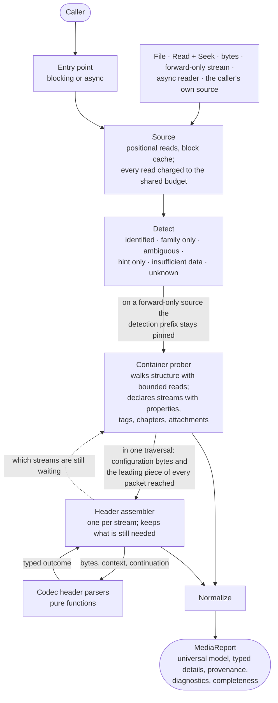

### 7.4 Codec header parsing contract

A codec identifier and "the first packet" are not enough. The same codec arrives as a configuration record, as length-prefixed units, or as a self-framed byte stream; a header can span several transport packets or arrive after the first payload; a header can sit at the start of a very large packet; and for some codecs the boundary between two packets carries meaning.

- **Input.** The codec; the **representation** of the bytes (configuration record of a named container, length-prefixed units with a stated length size, start-code byte stream, self-framed stream, packets); and the **context** the container already knows (for example the unit length size, or a declared sample rate).
- **Framing mode.** The container prober states one of two modes for each stream:
  - *Packet mode.* The container delivers codec packets (Ogg packets, Matroska frames after lacing, MP4 samples). Units are never concatenated: two packets stay two packets. A packet does not have to be delivered whole. Each delivery is a **bounded piece of one packet** and carries three marks: whether it starts a packet or continues one; whether it is the last piece of that packet; and the packet's total length where the container knows it. The parser can therefore finish on the first piece of a multi-megabyte sample, and the rest of that sample is never read.
  - *Stream mode.* The container delivers a continuous byte stream cut at arbitrary points (PES payload, raw files, stream-format chunks). Deliveries are concatenated in order.
- **Outcome.** One of:
  - *Parsed*: all header fields read.
  - *Partially parsed, by design*: some fields read; the rest cannot be reached without decoding (for example implicit AAC spectral-band replication). This is a final state.
  - *Partially parsed, cut short*: some fields read; the rest lies outside the bytes available.
  - *Needs more bytes*: the header is incomplete; more of the same packet or stream is required. The parser states the smallest total it can make progress with, when it knows it. Stating the same total again on a later call is legitimate.
  - *No header present*: well-formed data without a header; a later unit may carry it.
  - *Malformed*: the bytes contradict the syntax. Running out of bytes is never "malformed". A parser reports it as soon as the bytes that it was given establish it: a unit whose kind, length or place already contradicts the syntax is malformed before its body is needed, so no limit is named for bytes that the parser never needed (the second review of the I/O spike, 2026-11-27).
- **Consumption.** With every outcome the parser reports how much of its input is finished: in stream mode, the number of leading bytes that never need to be offered again; in packet mode, whether the packet is finished, which lets the container skip its remainder. It may also return a resume position, so that the next call continues scanning where this one stopped.
- **Continuation.** A header can consist of several units in which a later unit can only be read with facts from an earlier one. A parser may return a small **continuation value**: what it has established so far, in a fixed-size form of its own. The assembler stores it and hands it back on the next call. It is what survives when the assembler drops consumed bytes; a byte position alone could not recreate it. Its size is fixed per codec and counts toward the stream's header limit.
- **When the assembler calls again.** After "needs more bytes" the assembler calls the parser again in exactly three situations: the bytes it holds have reached the stated total; no total was stated and at least one new byte arrived; or the packet or the stream has ended, in which case the call says so. Between those moments it only collects bytes.
- **End of input, limits.** If the packet or stream ends, or the per-stream limit or the probe budget is reached, while the parser still needs bytes, the stream's header status is "partially parsed for lack of bytes" when some fields were read and "not found within the budget" otherwise. The reason is recorded with it: truncated input, or the limit by name. On a forward-only source a stream can also be discovered after its in-band header has left the sliding window, while the input is intact and the counters still have room. That header can no longer be read, and the same two states record the reason "range unavailable" (section 7.6). A source that fails while a header is read gives an error whose partial report records the same two states, by whether a field was read, and "not attempted" for a header not yet begun, each with the reason "source failed" (section 8.3; `api.md` section 5.4, the sixth review).
- **Header assembler.** For each stream the assembler holds at most the per-stream header limit. It drops what the parser reported as consumed. In packet mode a packet that yields "no header present" is abandoned and its remaining pieces are not requested. A packet larger than the limit is not an error: the assembler offers the pieces that fit, and only a parser that truly needs more than the limit ends with the limit named. In stream mode bytes before the consumption mark are discarded and the rest is kept. The assembler stops when the parser reaches a final outcome, when the per-stream limit is reached, or when the probe budget is exhausted. The stream's header status records which.
- **One traversal feeds every stream.** The container prober never passes over a packet on behalf of one stream only. Every packet it reaches is offered, as a bounded first piece, to the assembler of the stream it belongs to, if that stream is still waiting. On a seekable source the prober may jump to a stream's next packet through an index. On a forward-only source it reads in file order and dispatches as it goes. So when stream B's only header passes while stream A is still being assembled, B's assembler receives it at that moment, whether or not those bytes later leave the sliding window. The traversal ends when every stream is final, when no waiting stream can still be served, or when a budget ends.
- **Contention.** All assemblers share the working-memory budget. When a stream's buffer cannot be charged, even after the optional cache blocks were given back (section 7.5), that stream ends with "not found within the budget", naming working memory. Streams that already hold bytes continue. One stream never evicts another's bytes.
- **Bound on repeated work.** Every byte a parser examines is charged to the work counter. The total number of bytes examined for one stream is capped at a fixed multiple of the per-stream header limit; reaching the cap ends the attempt with the limit named. A parser that scans without stating a total and without a resume position meets this cap, not an endless loop.
- Parsers stay pure functions over byte slices. They perform no I/O and hold no state between calls; the assembler owns all buffering, the resume position and the continuation value. The same bytes, context and continuation always give the same result.
- **Tests.** Each header split at every byte position across two and three deliveries; one-byte deliveries from start to end; a fixed-width field that asks for the same total twice; a header of several units in which a later unit depends on an earlier one whose bytes were already dropped; a packet larger than the per-stream limit whose header fits in its first piece, asserting that the rest of the packet is not read; a packet split by the container and two packets delivered back to back; configuration that arrives only after several non-header units; a long run of headerless payload, asserting the work charged and the cap on bytes examined; the end of the stream while more bytes are needed; exhaustion of the per-stream limit; on a forward-only source, the sequence A, B, A in which B's only header lies outside the window by the third packet; two streams that compete for the last working memory; the same codec through each of its representations.

### 7.5 Budgets and limits

Limits apply to the whole probe. One budget object is created per probe and shared by every source it touches, including companion files and nested probes.

| Counter | What it counts | Proposed default |
|---|---|---|
| Bytes read | Bytes delivered by all sources of the probe, including bytes read only to skip forward on a non-seekable source | 64 MiB |
| Working memory | The sum, at any moment, of all internal allocations that are alive: block caches of every open source, forward-only windows, the pinned detection prefix, the header assemblers of all streams with their continuation values, inflate buffers, tables under construction, and cached results of child probes. During a move from an old allocation to a new one, both count | 32 MiB |
| Per-stream header bytes | Payload bytes held by the assembler for one stream, or for the image header of one attachment (`api.md` section 4.3); also counted in working memory | 1 MiB |
| Retained data | Variable-sized memory owned by the returned report or by the partial data of an error, measured by allocated capacity: strings, tag values, private data, diagnostics, stream entries. Payloads are counted separately | 16 MiB |
| Retained payloads | Attachment and cover-art data kept at the caller's request, summed over the whole probe | 64 MiB |
| Decompressed output | Total output of all inflate operations | 16 MiB |
| Work units | Elements, boxes, chunks, pages, packets and table entries visited, and bytes examined by codec parsers | 2,000,000 |
| Nesting depth | Depth of the explicit walker stack | 64 |
| Streams | Stream declarations retained in one report | 4,096 |
| Diagnostics | Recorded diagnostics. Beyond the cap they are counted, not stored | 1,000 |
| Companion requests | Distinct requests put to a resolver by one probe, whatever their result | 256 |
| Sources opened | Companion sources actually opened by one probe | 64 |

The defaults are starting proposals. Gate G3.3 confirms them from measurements on the toy format; G8.1 reviews them against three real container families; G10.1 sets the transport-stream scan windows. After a default has shipped, a later release raises it only in a minor release and lowers it only to fix a security problem, which may come in any release (the maintainer's choice on 2026-11-24; `docs/guide/stability.md` section 4.3).

Rules:

- **Limits are exact.** No counter is ever exceeded, not by a block and not by a byte. Every physical read request is clamped to the remaining read allowance before it is issued, so a caller who allows one byte gets at most one byte read, from any source, including a pipe. With no allowance left, no read is issued. The allowance is one number shared by the primary source and all companions.
- **The end of the input is observed, never assumed.** A source of unknown length has ended only when a read of at least one byte returned no bytes. The probe never issues a read of zero bytes, which says nothing about the end (`api.md` section 4.4). Such a read at position P says only that the source ends at or before P. The length is P exactly when the byte at P − 1 was delivered, or P is 0. A read that returns no bytes beyond a gap establishes no length, no total and no clean end (`api.md` section 4.4, after its tenth review). When the read allowance is used up on such a source, the probe may not issue the read that would tell "exactly N bytes" from "more than N bytes". Every result that depends on having seen the end is then cut short with the limit named: a total, a proof that no further element follows, complete discovery in a format that can add streams later. Totals are given as observed values (section 8.3). Results that do not depend on the end are unaffected: a format whose streams and durations are all stated in a header that was read in full stays complete. Each format's phase lists which of its results need the end.
- **Some facts are always reportable.** Every limit can be set to zero, and a limit can be full at the moment something must be said about it. So the facts that must never be lost live in a **fixed-size record** inside the completeness data. It is part of the report's own fixed-size base, it is created with the report, and it is not charged to any counter. It holds: the status of each activity (section 8.3); for each counter, whether it was exhausted and which activity it stopped first, detection included, which an error's record names when a limit ended detection and a report's when a limit stopped one candidate's check while another validated, and none where it stopped none: a counter that only kept a diagnostic from being stored stopped no activity, so a report can be complete beside it, and one that only kept a reason from being stored stopped none either, though the activity whose reason it was fell short for a cause of its own (the maintainer's choice at the fifth review of the third slice's first part of Phase 2, on 2026-11-26). The diagnostics counter never stops an activity, and is exhausted only beside a diagnostic that it kept from being stored; and a counter that only one activity charges, such as the two of companion lookup, is not exhausted where the result shows that the activity never ran (the maintainer's choice at its sixth review, the same day), and stops no other activity: the stream counter stops only discovery, the per-stream header counter the headers or an attachment's image header, the payload counter the attachments, and the two of companion lookup the companions; a probe that ended at detection, or a source failure before detection found a format, ran no later activity, so it exhausts none of these counters, its usage counts no companion request, no companion source opened and no payload retained, and its record names detection alone (the maintainer's choices at its seventh review, the same day; `api.md` sections 4.5 and 10.2); the number of diagnostics that were not stored; the number of stream declarations that were seen and not retained; the first reason recorded against each activity, without its text; the number of reasons that were not kept in the report's list of reasons (`api.md` section 5.3; the maintainer's choice at the sixth review on 2026-11-23); and the number of external references that were found and not kept (`api.md` section 6.12; the maintainer's choice at the eighth review on 2026-11-23). The status of the headers says whether every stream's header state is final, so the record decides completeness without the streams. So an incomplete report always says why each activity fell short. Nothing of variable size is promised at a limit: no summary diagnostic, no message text and no further reason. An activity with several reasons keeps only its first in the record, so two candidate checks stopped for different reasons keep only the first reason for certain. A resolver's decline text and every other detail are kept within the retained-data limit, while the kind of each reason stays fixed-size (`api.md` sections 5.3, 5.4, 6.15 and 13, after its seventh review). The same holds for an error: its kind, format, fixed-size record and usage summary are fixed-size and always present, as is its reason wherever one reason stopped the probe, and its partial report holds whatever variable-sized data fitted. An ambiguous "format not determined" has no reason of its own: each candidate carries its cause, and the record's first reason of detection is the first such cause in the candidates' rank (`api.md` section 5.3, after its eleventh review). The statuses of the activities are a report's. The API keeps them on the completeness data beside the record (`api.md` section 5.3). So an error without a partial report has no statuses, and nothing reports a status for an activity that never started. Its record names the first reason of each activity that the stop reached, while an error with a partial report has that report's statuses (`api.md` section 5.3, after its tenth review). The record is fixed-size as a probe builds it, with the limits and activities that its version knows; a record read back from an archive keeps the limits and activities of a newer version as written, so its size is bounded by the input it was read from (the maintainer's choice at the fifteenth review on 2026-11-24).
- **Charge before reserving.** Every buffer whose size depends on input is requested from the budget first and reserved, fallibly, only if the charge succeeds. After the reservation the real capacity is read back, because an allocator may hand out more than was asked for, and the charge is corrected to it. If the corrected charge would not fit, the buffer is released and the activity stops with the limit named. A reservation that the allocator refuses after the charge fit stops the activity the same way, with working memory named, and the charge is returned. Releasing a buffer returns its charge.
- **Growth is bounded by design.** Growing a live buffer can need the old and the new allocation at once, and the final capacity alone would hide that peak. Three cases cover every input-sized buffer:
  - *Size known first.* Where the input states a size (a declared length, an entry count), the size is validated against the remaining input and the limits, and the buffer is reserved once at that size. It never grows.
  - *Size not known, order irrelevant to layout.* The buffer is a list of fixed-size segments. A full segment is never moved, so no second copy ever exists. Each segment is charged before it is reserved.
  - *Size not known, contiguous memory needed.* The new allocation is charged before it is reserved, while the old one is still charged; the old charge is returned after the move. A growth that does not fit is refused before it happens.
- **Optional memory gives way.** A block cache holds its blocks beyond the first only to save reads, so such a block is optional: one that does not fit is not taken and marks no counter exhausted, since nothing stopped. A buffer that an activity requires and that does not fit first takes back the optional blocks of the open sources, and only one that still does not fit stops the activity with working memory named. So a larger cache never gives less than a smaller one under the same limit (the second review of the I/O spike, 2026-11-27).
- **Changing owner.** Data that moves from working memory into the report, or from a report under construction into an error's partial data, hands over its allocation instead of being copied wherever that is possible. The charge moves with it in the same step, and the receiving counter is checked first. Where a copy cannot be avoided, both copies are charged until the source is released.
- **Paths.** A path that a report keeps is charged at the strings that keep it: its display string and, for a lossy path, its raw form's data (`api.md` section 6.15), each held at exactly its length, so that the capacity charged is that length. The primary input's entry, with its path, is the probe's first charge to retained data, so a probe of a file has, beyond that charge, exactly the budget of a probe of the same bytes from memory (the maintainer's choice at the second review of the G3.2 proposal on 2026-11-27; `docs/design/test-kit.md` section 4.2). A path that the limit cannot hold is left out: its entry stays without the path, `RetainedData` is exhausted without a part that it stopped, and the probe goes on under the same limit, as for a diagnostic that does not fit (the maintainer's choice at the third review of the G3.2 proposal on 2026-11-27; `api.md` sections 5.3 and 6.15).
- **Declarations beyond a limit (R3).** When the stream limit or the retained-data limit stops the enumeration of stream declarations, the report keeps the declarations that fit, counts the further declarations it saw in the fixed-size record, and marks discovery incomplete with the limit named.
- **References beyond a limit.** An external reference holds text, so it is retained data. When the retained-data limit cannot hold one, the report does not list it, counts it in the fixed-size record, and marks the part that found it incomplete with the limit named: the companions for an expected companion, the attachments or the chapters for a reference that one of them owns, and discovery for a reference of the whole file or of a stream (`api.md` section 6.12).
- **Protection beyond a limit.** A protection declaration, or a sample description's state, that the retained-data limit cannot hold is not kept. Discovery is then incomplete with the limit named and the stream given, as for a structure that can declare protection and that a limit or the input's end cut short (`api.md` section 6.3; the maintainer's choice at its tenth review).
- **Exhaustion is not an error by itself.** The probe stops the affected activity, records which counter ran out, and returns what it has. The one exception is a probe that cannot reach the stream inventory at all (section 8.3).
- **Usage.** Every report, and every partial report carried by an error, includes a usage summary as accounted by the budget: bytes read, peak working memory, retained data, retained payloads, decompressed output, work units, companion requests and sources opened. It lets callers tune limits, and it is what the tests assert on. G2.2 made it part of the public API on 2026-11-23 (`api.md` section 6.14).

Verification:

- **Reads.** The test kit's counting readers wrap the real file, `Read + Seek` and forward-only adapters and record calls, bytes delivered and bytes skipped. Tests assert that the bytes delivered never exceed the limit, with limits of zero, one byte, one byte less than a cache block and one byte more, and with the allowance split between a primary source and two companions.
- **End of input.** A reader that gives no length is probed with inputs of N − 1, N and N + 1 bytes under a read limit of N, for a format whose results need the end and for one whose results do not. Where the end is needed, the cases at N and N + 1 must give the same result, with the limit named, and the case at N − 1 must be complete.
- **Memory.** Unit tests compare the budget's charges with the real capacities of the buffers they cover. Each kind of growing buffer is driven to one step below its peak limit and to the limit. Probe-level tests assert the peak working memory with thousands of streams whose assemblers are active at the same time and with several sources open, and assert the payload cap with several attachments requested in one probe.
- **Measured peak.** Charges are the library's own account, so they cannot reveal an allocation it forgot. Dedicated test binaries therefore run probes under an allocation-tracking allocator taken from a development dependency (approved at G1.3) and assert that the real peak of live heap memory stays within the configured caps plus a stated fixed overhead.
- **Zero and full.** With the diagnostics limit at zero, and with the retained-data limit at zero and at exactly full, a probe that meets a limit still reports the exhausted counter, the first reason of each activity that fell short and the omitted counts, the external references not kept among them. The same is asserted for an error that is built while the retained-data limit is already full.
- **Backstop.** Robustness and fuzz jobs run under a process memory limit set to a stated multiple of the configured caps.
- **Small elements.** Dedicated cases use many small valid elements (tags, attachments, diagnostics, stream declarations beyond the limit) and nested companions, each individually within limits.

### 7.6 Robustness rules

These apply to all code that touches file content and are enforced by lints, tests and fuzzing.

- No panics: no `unwrap`, `expect`, unchecked indexing or unchecked arithmetic on values derived from input.
- Every loop over file structure is bounded by the shared budget.
- Container walkers are iterative with explicit stacks; there is no input-driven recursion.
- A malformed element produces a diagnostic and parsing continues with the next sibling when the structure allows it.
- An unreadable range on a forward-only source is handled like a missing element, not like the end of the probe.
- On a forward-only source, the bytes that detection read stay available to the prober (section 8.6).
- On a forward-only source one traversal serves every stream: a packet is offered to its stream's assembler when it is reached, because it cannot be fetched later (section 7.4).
- A failure of the source itself (an I/O error) is never hidden and never converted into "unsupported format". It ends the probe with an error that keeps the original cause and carries what was established (R19). Reaching the end of the data is not an I/O error; it is truncation and is handled as content.

### 7.7 Companion files

Some inputs span several files: a VobSub index and its data file, a Blu-ray playlist and its clips, a DVD title set and its object files.

**Availability (R18).** The lookup described here ships in the release of its first consumer. G1.5 kept VobSub, so that is `0.7.0`, with VobSub: resolver traits, builder options, CLI switch and example arrive in one release. If G1.5 reduces or defers VobSub, lookup moves to the next release that has a consumer, which is `0.8.0` with the disc formats. If no consumer remains, it is not shipped and stays a design in `api.md`. Releases before that one never open another file; they only list, under external references, the companions a format expects. The design is written in Phase 2 and exercised in the Phase 3 spike, so the earlier API leaves room for it.

**Default: off.** Even once it has shipped, no other file is opened unless the caller enables lookup. The report then contains what the given file holds, names the expected companions under external references, and its completeness states that companions were not enabled.

**Two kinds of reference, treated differently.**

| Kind | Examples | Built-in resolver |
|---|---|---|
| Identifier-derived name | The data file of a VobSub index (same stem, from the probed path or else the file-name hint); the clip of a Blu-ray play item (a five-digit clip number); the object files of a DVD title set (the title-set number) | May be opened. The identifier is validated against a strict pattern and combined with a fixed folder and a fixed extension. Nothing else from the media enters the name. |
| External reference | A path, file name or URL stored in the media: QuickTime external data references, file names of linked Matroska segments, entries of text playlists and metafiles | Never opened. Reported as an external reference. |

**Trusted root.** Each lookup has a root folder, resolved once to its real location when the first request needs it:

- for a sibling companion, the folder that contains the probed file. An input without a path, such as a reader, a stream or bytes, has no such folder, and the built-in resolver then declines each request with that reason;
- for a Blu-ray playlist, the disc folder that holds the fixed layout folders;
- for a DVD title set, the folder that holds the information file.

A root that cannot be resolved fails the request with the file system's error, which ends the probe with its cause (R19), and so does a companion's path that cannot be resolved for any reason but its absence. Neither is taken for an input without a folder or for a path that changed. A companion that is absent is not found, and one whose path names nothing any more after the open has changed (the second review of the I/O spike, 2026-11-27).

**Containment and its condition (R18).** A companion is opened only if its fully resolved location, after following every link in every path component, lies inside the resolved root. Links that stay inside the tree work. Anything that leads outside is declined and reported. The rule is the same on every platform; on Windows it covers symbolic links, junctions and other reparse points that redirect a name.

The built-in resolver works in three steps: it resolves the path, checks containment, and opens the resolved path. After opening it resolves the path once more and declines the companion if the answer has changed or the object is not a regular file. This guarantees containment **on one condition: nobody else changes the folder tree while the probe runs.** A second check narrows the gap between checking and opening; it cannot close it. Closing it needs an open that the operating system itself confines to a folder. Rust's standard library does not offer one in a stable release, and this project's crates contain no `unsafe` code. The condition is therefore part of the requirement, and it is stated in the resolver's documentation, in the README and in the vulnerability section of `CONTRIBUTING.md`.

**Caller-supplied resolvers.** A caller-supplied resolver returns sources, not paths: open readers, in-memory data, ranges of a remote object. The library does not know where they come from and makes no containment claim about them. What it still guarantees is the rest of the contract: it asks only for identifier-derived companions, each request carries the validated identifier and the companion's role and never a path taken from media, and everything is read under the shared budget. When the caller probed a file by its path, the request also carries that path, which is the caller's own. One resolver can therefore serve concurrent probes of files with the same name in different folders. A caller who needs other context gives each probe a resolver of its own. A caller who must tolerate a tree that changes during the probe enables lookup with a resolver of their own, built on whatever confinement their platform provides.

**Requests and source references.** Every request to a resolver is registered before anything is opened:

- Each request gets a **source ID** at that moment: 0 is the primary input, and requests are numbered in the order in which they are made. A source ID is 64 bits wide, so every request that the companion-request limit allows, which is at most 2^64 − 1, has one (`api.md` section 6.15, after its ninth review).
- With lookup off, no request is made. An expected companion is then listed only under external references, and the source table has no entry for it.
- Without a name, no request is made either. A VobSub index probed with neither a path nor a file-name hint has no stem, so its data file is listed under external references without an identifier or a name, and with lookup on the companions are cut short with the reason "companion name unavailable" (`api.md` section 13; the maintainer's choice on 2026-11-22). A stem or other identifier that fails validation, such as a Unix stem that is not UTF-8, is treated the same way: a request carries only a validated identifier, so none is made. A VobSub stem is valid by one rule, the same on every platform, as the maintainer chose at the eighth review of `api.md` on 2026-11-23. It must be valid Unicode and not empty, `.` or `..`. It holds no control character and none of the characters that Windows reserves in a name, and it ends with neither a space nor a period. Its part before the first period, without the spaces at its end, is no Windows device name, since Windows drops those spaces when it recognizes one, so `NUL .backup` names the device `NUL` (after the ninth review). The data file's name is at most 255 bytes of UTF-8 (`api.md` section 13). So `Movie (2026).idx` asks for `Movie (2026).sub`, and `Movie: Part 2.idx` and `NUL .backup.idx` ask for nothing, on every platform.
- **What a request needs is checked before it is made,** and before a source ID is assigned, in this order (`api.md` section 13, after its ninth review): the companion-request limit allows one more request; the sources-opened limit allows one more source, since a resolver may open the source before it answers, which closing it afterwards cannot undo; and the retained-data limit holds the source-table entry with its attempted identity, which the probe reserves before the call. When one of them fails, no request is made and the resolver is not called. The companion is listed under external references with its validated identifier and name, gets no source ID and no source-table entry, is not counted as a request, and the companions are cut short with the reason "companion limited", naming the first limit that failed and no source. Whatever else fails for that companion, that reason is its own; the order decides between the limits of one companion only. The record's first reason of the companions is the first reason recorded against them in the probe, whichever companion gave it, so a refusal after an earlier companion was declined keeps "companion declined" in the record and goes to the list of reasons on its own (`api.md` section 13, after its eleventh review). With the request limit and the retained data both at 0, it names the request limit. A retained data that is full also keeps the external reference from being listed. That loss is counted on its own, as section 7.5 says of any reference, with its own reason naming the retained data (`api.md` section 13, after its tenth review). A resolver's own "limit reached" answer is different: its request was made and has an entry.
- Every external reference of these cases is listed within the retained-data limit. Beyond it, the reference is counted in the fixed-size record and not listed, and the companions keep their status and first reason (section 7.5; `api.md` section 6.12).
- The source table lists every requested source, not only the opened ones. An entry holds the ID, the companion's role, the **attempted identity** (the validated identifier and the name the resolver was asked for), the outcome (opened, not found, declined, limit reached, failed), the reason of an outcome other than opened or failed, and for an opened source the bytes read from it. The completeness reason of a companion names its entry, so two companions declined for different reasons keep their reasons apart.
- A companion that fails while it is being opened therefore has an ID like any other. The error names that ID, and the attached report shows the entry with the outcome "failed".

**Resolver results.** A resolver, built-in or supplied by the caller, answers each request with one of five results:

| Result | Probe outcome |
|---|---|
| Found | The companion is read under the shared budget. |
| Not found | Report incomplete; the reference is listed. |
| Declined | The resolved location failed containment, or the caller's resolver refused. Report incomplete, with the reason. An identifier that fails validation never reaches a resolver: no name can be built, so no request is made (above). |
| Limit reached | The request limit, the sources-opened limit or the read limit does not allow it, by the resolver's own account; the probe has already checked the first two before the call (above). Report incomplete, with the limit named. |
| Failed | An I/O error while opening or reading the companion. The probe returns an error under R19: the original cause is preserved, the failing source is named by its ID, and the aggregate report built so far is attached. |

How one expected companion is handled:

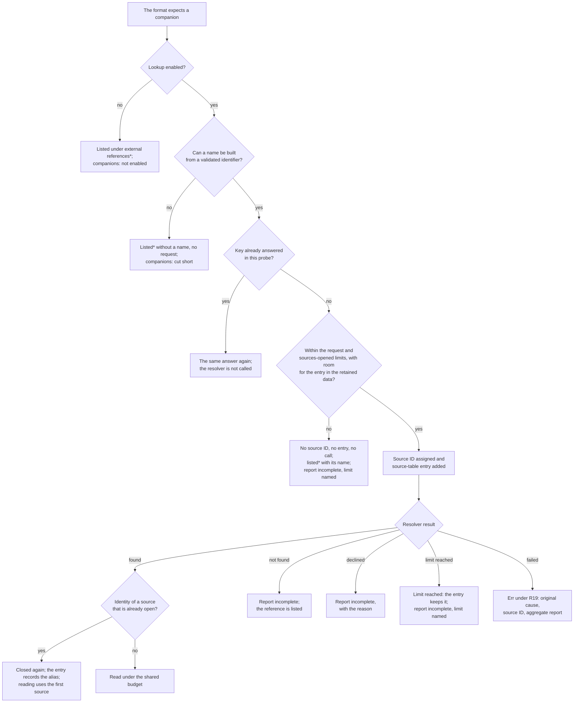

\* Listed within the retained-data limit; beyond it, not listed but counted, with the companions incomplete and the retained-data limit named (section 7.5; `api.md` section 13, after its eleventh review).

The built-in resolver's own steps:

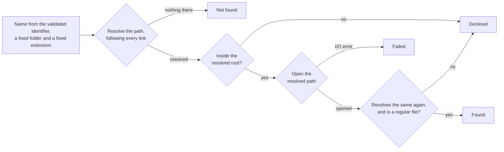

**Requests are cached and limited.**

- A request is identified by its **key**: the role, the validated identifier and the root. The answer to a key is kept for the rest of the probe, whatever it was. A repeated reference to the same key costs nothing and does not call the resolver again. That holds for "not found" and "declined" as much as for "found".
- The number of distinct keys per probe is limited by the companion-requests counter. Beyond it the answer is "limit reached" and the resolver is not called. A file that names thousands of different missing companions therefore causes a bounded number of file-system or resolver calls.
- Only successful opens count toward the sources-opened limit.

**One underlying source, several names.** Two different keys can lead to the same file: a link, a hard link, a case-insensitive name. Source IDs are assigned per request and cannot reveal that. So an opened source also has a **stable identity**:

- The built-in resolver uses the device and file numbers of the opened file where the standard library exposes them, as it does on Unix, and then compares nothing else, so two hard links to one file are one source. Where it does not expose them, as on Windows, whose file index is not stable in the standard library, the resolver compares the resolved real path alone, and two hard links there are two sources, each counted (`api.md` section 13, after its tenth review).
- A caller-supplied resolver may return an identity token of its own with each source: bytes of its choosing, and two tokens with the same bytes name one source (`api.md` section 13). Without one, its sources are treated as distinct. A token is held for the rest of the probe and charged to working memory.
- **The primary input** can be an alias target only for the built-in resolver, as the maintainer chose at the eleventh review of `api.md`. That resolver serves `probe_file` only, and the library opened that file itself, so it takes the primary file's identity in the same form as a companion's: the device and file numbers, or else the resolved real path. A companion with that identity, such as a VobSub data file that is a hard link to its index, is an alias of source 0. The primary input has no token, so a caller-supplied resolver's tokens are compared with earlier companions' only, under `probe_file` too, and a source it returns for the primary input's data is a source of its own, opened and counted (`api.md` section 13).

When a newly opened source has the identity of one that is already open, it is closed again, its table entry records the first source's ID as its alias, and all further reading uses the first source. The visited set that guards against cycles holds identities, not IDs, the primary file's among them for the built-in resolver.

**Depth.** Companions of companions are followed only along the fixed disc chain (playlist, clip information, stream), to a depth of two.

**Offsets.** Every diagnostic, every error and every byte offset names its source by ID, and offsets are relative to that source's own start. Where several files form one logical stream (the object files of a DVD title set), the logical offset is given as well.

**Budget.** All sources share the probe budget of section 7.5.

**Tests.** A companion that is a link to a file inside the root, and one that leads outside it, on Unix and on Windows including a junction; a linked layout folder; a companion that is a directory; missing and declined companions; the same missing companion referenced many times, asserting one resolver call; many distinct missing companions, asserting the request limit; a request limit of zero, asserting no source ID, no entry, an external reference with its name and the reason naming the limit without a source; a Unix stem that is not UTF-8, asserting no request and "companion name unavailable"; the stems `Movie (2026)`, `.hidden` and one of 251 bytes, asserting a request, and `Movie: Part 2`, `CON`, `con.backup`, `NUL .backup`, `aux  .idx`, `movie.`, `movie ` and one of 252 bytes, asserting none, on every platform; a companion found while the retained-data limit is full, asserting no external reference, the count of references not kept and the companions' first reason; a retained-data limit with room for the reference but not for the source-table entry, and a sources-opened limit of zero, each with a custom resolver that records its calls, asserting no call, no source ID, no entry, no counted request and "companion limited" naming `RetainedData` or `SourcesOpened`; a request limit and a retained-data limit both at zero, asserting "companion limited" naming `CompanionRequests` as the first reason, the reference counted in the references not kept, and both reasons counted in the reasons not kept; two names that lead to one file, asserting one open source and an alias entry; two hard links to one file, asserting one source and an alias entry on Unix, and two sources on Windows; a VobSub data file that is a hard link to the probed index, asserting an alias of source 0 on Unix through the built-in resolver, and a custom resolver that returns a second handle to the primary input's data with a token, asserting a source of its own; a resolver that declines one companion and a request limit of 1 that refuses a second of another key, asserting the record's first reason "companion declined" with the first source ID and the refusal in the list of reasons (`api.md` section 13, after its eleventh review); names that would leave the directory; a custom resolver with and without identity tokens, including two tokens with the same bytes, asserting an alias entry, and a token that working memory cannot hold; the limit reached on the second companion; a permission error while opening a companion, and an I/O failure while reading the second companion, each asserting the preserved cause, the source ID, the attempted identity and the attached aggregate report; a diagnostic raised in the second companion, with its source ID visible in JSON; the same input through a path with lookup enabled, through a reader with a supplied resolver, and alone.

---

## 8. Public API design

Phase 2 produces the definitive API specification and you approve it before any format is implemented. This section fixes the principles, the behavior that the reviews required to be defined, and the intended shape. The maintainer approved the names of `api.md` at gate G2.1 on 2026-11-22, and the specification, with the names added since, at G2.2 on 2026-11-23.

### 8.1 Principles

1. **One call for the common case**, a builder for everything else.
2. **Same types for every format.** Callers never branch on the container to read a resolution or a language.
3. **Absence is explicit.** A property a file does not state, or that could not be established, is `None`, never a zero or an empty string. Accessors for such properties return `Option`.
4. **Lenient about content, strict about the source.** A damaged file yields the best available result plus diagnostics. A failing source yields an error (R19).
5. **Honest about completeness.** A result says what was established, what was not, and why (section 8.3).
6. **Reproducible values.** Every normalized field has a written unit, precedence and provenance (section 8.4). Two correct implementations of this specification return the same value for the same file.
7. **No surprises on I/O.** Reads are bounded for the whole probe, the bounds are configurable, and no other file is opened unless asked (R18).
8. **Forward compatible by construction**, in Rust and in the serialized form (sections 8.8 and 8.10).
9. **Follows the Rust API Guidelines.** The checklist is completed and kept in `docs/design/`.

### 8.2 Intended shape

```rust
use std::io::{self, Write};

use cc_media_probe::{MediaReport, probe_file};

fn main() -> Result<(), Box<dyn std::error::Error>> {
  let report = probe_file("movie.mkv")?;
  print_report(&mut io::stdout().lock(), &report)?;
  Ok(())
}

/// Writes what the report holds. Every value that a file may not state is an `Option`, so each one says what an
/// absent value means here.
fn print_report(output: &mut impl Write, report: &MediaReport) -> io::Result<()> {
  writeln!(output, "{}", report.format())?;
  if let Some(media_type) = report.media_type() {
    writeln!(output, "media type: {media_type}")?;
  }
  match report.duration() {
    Some(duration) => writeln!(output, "duration: {duration}")?,
    None => writeln!(output, "duration: unknown")?,
  }
  for stream in report.streams() {
    // The codec displays its name, or for an unknown codec the identifier that the file wrote.
    write!(
      output,
      "#{} {} {}",
      stream.index(),
      stream.kind().as_str(),
      stream.codec()
    )?;
    if let Some(tag) = stream.language().and_then(|language| language.tag()) {
      write!(output, " [{tag}]")?;
    }
    // A title is the file's own text: written as a quoted string, its quotes and control characters escaped, it
    // stays on its line.
    if let Some(title) = stream.title() {
      write!(output, " {title:?}")?;
    }
    // `video()` and `audio()` are present exactly for their kinds, but every field inside them may be absent.
    if let Some(video) = stream.video() {
      match video.display_size() {
        Some(size) => write!(output, ", {size}")?,
        None => write!(output, ", size unknown")?,
      }
    }
    if let Some(audio) = stream.audio() {
      match audio.sample_rate() {
        Some(rate) => write!(output, ", {rate} Hz")?,
        None => write!(output, ", sample rate unknown")?,
      }
      match audio.channel_count() {
        Some(channels) => write!(output, ", {channels} channels")?,
        None => write!(output, ", channels unknown")?,
      }
    }
    writeln!(output)?;
    // A header that was not parsed says why.
    if !stream.header_status().is_parsed() {
      writeln!(output, "    headers: {}", stream.header_status())?;
    }
  }
  // An incomplete report names what stopped it.
  if !report.completeness().is_complete() {
    writeln!(output, "note: {}", report.completeness())?;
  }
  Ok(())
}
```

The part of the quick start that renders a report is tested with two reports: a complete one, and one in which dimensions, sample rate, channel count, duration and media type are all absent (section 9.7). The code above is the shipped example `list_streams` of Phase 2, task 12, with the names that `api.md` approved.

Entry points:

| Function | Input |
|---|---|
| `probe_file(path)` | A path. Opens only that file. From the release that ships lookup (R18), companion lookup can be enabled on a `Prober`. |
| `probe_reader(reader)` | Any `Read + Seek`. The input is the reader from its byte 0, wherever it stands when it is passed, as the maintainer chose at the ninth review of `api.md` (its section 4.1). So the report is that of the same reader at byte 0. The offsets of the primary input count from byte 0, a companion's and a logical offset keep their own origins, and the size is the reader's length within the exact range of section 8.8. A reader has no file-name hint or folder of its own, so its report need not equal that of `probe_file` (after the tenth review). |
| `probe_stream(reader)` | Any `Read`; forward-only. The input starts where the reader stands, and the reader is left after exactly the bytes read from it. |
| `probe_bytes(&[u8])` | In-memory data. |
| `probe_source(source)` | The caller's own implementation of the positional source trait, for input that is neither a file nor a reader, such as ranges of a remote object. It need not implement `Read` or `Seek`. |
| `detect_file` / `detect_reader` / `detect_stream` / `detect_bytes` / `detect_source` | Format detection only, for the same five kinds of input. `detect_stream` serves forward-only input such as standard input. |
| `asynchronous::tokio::…`, `asynchronous::futures::…` | Async `probe_reader`, `probe_stream`, `detect_reader` and `detect_stream` for each runtime, and `probe_file` and `detect_file` for Tokio (section 8.7). |
| `asynchronous::probe_source`, `asynchronous::detect_source` | The caller's own implementation of the async positional source trait. |
| `Prober::new()…` | Builder carrying options; exposes the same set of `probe_*` and `detect_*` methods, blocking and async. |

Options on the builder (all optional): format hint, file-name hint, every limit of section 7.5, attachment handling (skip, metadata only, with data) for attachments that are not cover art, cover-art handling for cover art in any carriage, default legacy text encoding and, from the release that ships lookup, companion lookup: one option for the blocking entry points (off, built-in resolver, custom resolver) and one for the async entry points (off, custom async resolver). The two attachment options split the attachments by role and apply independently, even to a picture inside tags that are not read. The two lookup options serve their own entry points, so a resolver never meets an entry point that cannot call it. The maintainer chose both on 2026-11-22. No section defined a thoroughness level, so the maintainer left it out of `0.1.0` on 2026-11-22: each phase fixes its bounded work, and the limits tune it. A release can add the option when a format needs an opt-in deeper scan.

The result model:

| Type | Content |
|---|---|
| `MediaReport` | Format, media type, size, duration, overall bit rate, estimated duration and bit rate (separate accessors), streams, programs, chapter editions, tags, attachments, diagnostics, completeness, usage summary, format details, source table, external references. |
| `Stream` | Index, container-native ID, unique ID where the container has one, kind, codec, header status, language (BCP 47 plus the original code), title, duration, start time, bit rate, estimated duration and bit rate (separate accessors), packet count, frame or sample count where established, disposition flags, kind-specific info, tags, codec details. Where a container can give one native ID to different streams over time, the entry also says where its declaration applies. |
| `VideoInformation` | Coded and visible size, display size where one exists in pixels, pixel and display aspect ratio, frame rate and mode, bit depth, chroma format, scan type and field order, color description, HDR metadata, rotation, stereo and projection info, alpha. |
| `AudioInformation` | Sample rate, output sample rate, channel count, channel layout, bit depth, sample format, encoder delay and padding, immersive-audio signaling. |
| `SubtitleInformation` | Text or bitmap kind, text encoding, canvas size, event count and time range where established. |
| `CodecInformation` | `Codec` identity, human-readable name, profile, level, raw container codec identifier, and an RFC 6381 codec string where one is defined for the codec. |
| `ChapterEdition`, `Chapter` | Unique IDs; start and end on the timeline of the segment that holds the media; for an ordered edition, its playback duration and each chapter's playback position; a reference to another segment where a chapter has one; titles per language, nesting, flags (section 8.5). |
| `TagSet`, `Tag` | Targets including wildcards, level, name, optional value, language, nesting (section 8.5). |
| `Attachment` | Unique ID, name, media type, size, description, optional data. |
| `Program` | Program ID, name, provider, member streams, clock-reference identifier, the program's own duration, the state of its map. |
| `Diagnostic` | Severity, stable code, message, source ID, byte offset within that source, stream. |
| `Completeness` | Discovery status; the status of the headers, of each section, of timing and of companions; reasons; the fixed-size record of exhausted limits and omitted counts (section 8.3). |
| `SourceEntry` | One row of the source table: source ID, role, attempted identity, outcome, bytes read, and the ID it is an alias of (section 7.7). |
| `Error`, `ErrorRecord` | The live error with its original cause, and its serializable description (section 8.8). |

Three properties that draft 1 treated as always present are optional:

- **Media type.** It belongs to the report, not to the format, because it depends on content, and it is chosen only on sufficient evidence. For MP4 (RFC 4337): `video/mp4` as soon as a visual stream is present; `audio/mp4` only when the stream inventory is complete, the kind of every stream is known, and there is audio but no visual stream; `application/mp4` only when the inventory is complete, the kind of every stream is known, and there is neither. The absence of video has to be shown, not assumed. With an incomplete inventory, or with a stream whose kind is unknown, and no visual stream so far, the media type is `None`. The same evidence rule applies to the other families. It is also `None` when no type applies. A type applies when the IANA registry holds it, or when an approved specification of the format names it, as the WebM container guidelines name `video/webm` and `audio/webm` and RFC 2361 names `video/vnd.avi`; F4V then has none (field guide F3, approved at G2.2 on 2026-11-23).
- **Codec string.** RFC 6381 defines strings for some codecs only. The accessor returns `None` for the rest.
- **Dimensions, sample rate, channel count.** Any of them can be missing from a damaged or partially read file.

Typed detail sections, reachable from the same result:

```rust
if let Some(FormatDetails::Matroska(matroska)) = report.format_details() {
    println!("segment unique identifier: {:?}", matroska.segment_unique_identifier());
}
if let Some(CodecDetails::H264(h264)) = stream.codec_details() {
    println!("{} @ L{}", h264.profile(), h264.level());
}
```

### 8.3 Outcomes: errors, partial results and completeness

**One ordered procedure decides between an error and a report.** The first rule that applies wins, so no input has two outcomes.

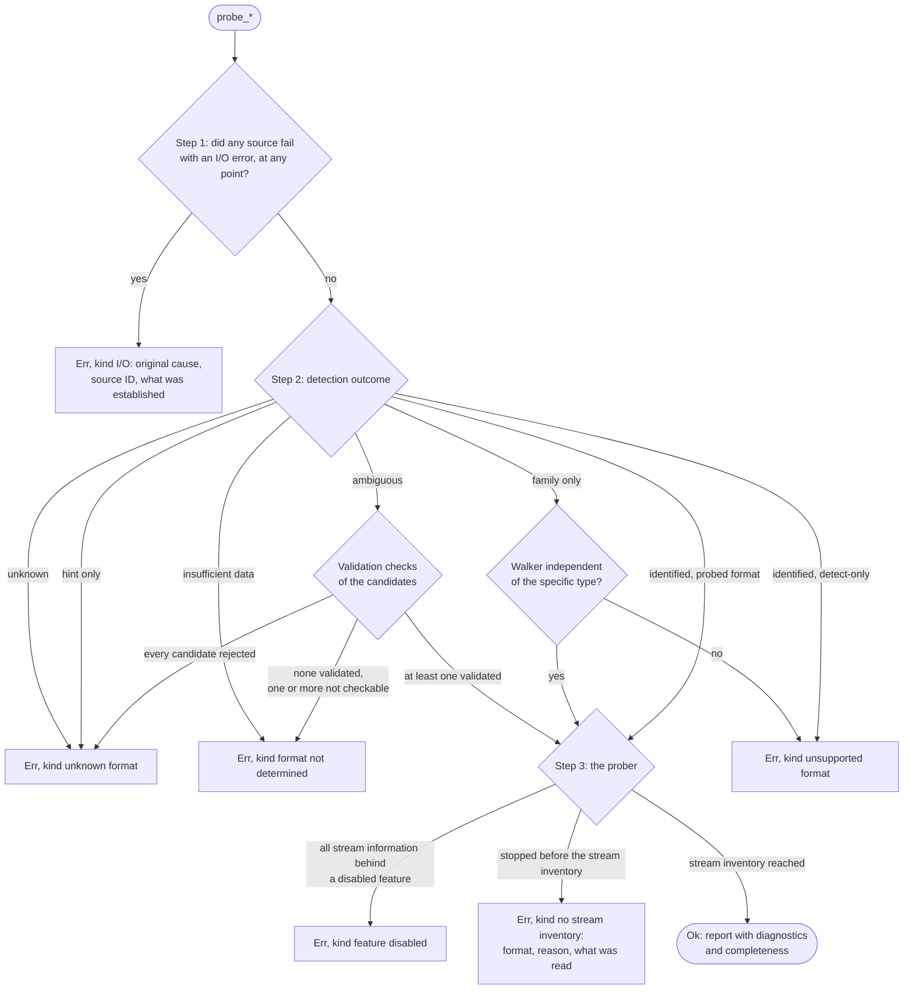

*Step 1: the source.* If any source fails (an I/O error), the probe returns `Err`, kind I/O. The original `std::io::Error` is the error's source, the failing source is named by its source ID, and whatever was established is attached (R19). Reaching the end of the data is not an I/O error.

*Step 2: detection.* Each detection outcome of section 8.6 maps to exactly one continuation:

| Detection outcome | Probe result |
|---|---|
| Unknown | `Err`, kind unknown format. |
| Insufficient data | `Err`, kind format not determined. The error says whether the input ended or a named limit was reached before a decision. |
| Hint only | `Err`, kind unknown format, carrying the hint. A file name never selects a prober. |
| Ambiguous | The candidates are checked as described below. |
| Family only | If the family's walker does not depend on the specific type (an ISO base media file with an unknown brand), probing continues and the format is reported as the family. Otherwise: `Err`, kind unsupported format, carrying the family. |
| Identified, detect-only | `Err`, kind unsupported format, carrying the format (R20). |
| Identified, probed format | The prober runs; step 3 applies. |

*Ambiguous candidates.* Each probed candidate has a **validation check**: a bounded test of its primary structure. A check reads only bytes that can be read again: any position on a seekable source, the pinned prefix on a forward-only source. It consumes nothing, so one candidate's check can never take away the bytes another candidate needs. A detect-only candidate has no check. Every candidate ends in one of four states: *validated*, *rejected*, *not checkable* (it has no check, its check needs bytes outside the readable range, the input's end cut it short, or a limit ended it), or *outranked* (a candidate ranked ahead of it validated, so its check never ran; `api.md` section 5.1, after its seventh review).

| After the checks | Probe result |
|---|---|
| At least one candidate validated | The candidates are ranked: by confidence, then the format hint's format, then the file-name hint's format, then the order of the release's detection inventory, so none tie. They are checked in that rank, and the first that validates is used; step 3 applies. The others are recorded in a diagnostic, each with its state: rejected or not checkable, with its cause, for one ranked ahead, and outranked for one ranked behind, which leaves detection complete. A candidate ranked ahead of it whose check a limit ended, or whose check needs bytes outside the readable range, could have been chosen instead, so a report leaves detection incomplete, with the limit or the unavailable range named (below). A candidate ranked ahead without a check leaves it complete. The maintainer chose this at the sixth review of `api.md` on 2026-11-23 (`api.md` section 5.1). |
| None validated, at least one not checkable | `Err`, kind format not determined, carrying the candidates that were not rejected and each one's own cause: the unavailable range, the end of the input, the limit by name, or no check at all. The error itself names no cause, since neither an end of the input nor a limit need have occurred; that requirement belongs to insufficient data, when too few bytes were read to detect anything (`api.md` section 5.1, after its seventh review). A small budget or a short prefix never turns surviving candidates into "unknown". |
| Every candidate rejected | `Err`, kind unknown format, carrying the rejected candidates. |

*Step 3: the prober.*

| Situation | Result |
|---|---|
| All stream information sits behind a disabled Cargo feature (a compressed QuickTime movie header without `zlib`) | `Err`, kind feature disabled, naming the feature and carrying the format. |
| The probe stops before it reaches the format's stream inventory, because the data ends, a limit is reached, a range is unavailable, the structure is damaged, or the input is a part that does not contain it | `Err`, kind no stream inventory. The error names the format and the reason and carries whatever was read (R20). |
| The stream inventory was reached | `Ok`, with a report. Everything below applies. |

**The stream inventory** is what a format must have yielded before a report exists. Formats fall into three classes, and each format's phase and `formats.md` state its class and its threshold.

| Class | Inventory | Reached when | Examples |
|---|---|---|---|
| Declared | A structure that lists the streams | That structure was read | The tracks element of Matroska; the movie box of MP4; the header list of AVI; the first header pages of an Ogg link; the association table and program maps of a transport stream; a program stream map; the header object of ASF; language groups in USF and stream declarations in a VobSub index, which are discovered progressively |
| Single stream | The file is one stream | The format's primary structure was validated: the same check that identifies it conclusively | Raw audio and video streams; native FLAC; WAVE-family files; IVF; single-stream subtitle files such as WebVTT |
| Observed | Streams exist only as packets | The first stream-carrying unit was read | A program stream without a map; tag-based FLV |

Thresholds for the cases that need one:

- **A program stream without a map** reaches its inventory with a valid pack header followed by the header of one PES packet that carries an elementary stream. Pack headers, a system header and padding alone are not enough: such an input is an error that names the format and says that no elementary-stream packet was found.
- **FLV** reaches its inventory with a valid file header followed by the header of one audio or video tag. A file that ends cleanly after its header, with no tag at all, has reached it too and reports zero streams.
- **A single-stream file with an empty body** is valid. A WebVTT file that holds its signature line and no cue is `Ok`: one subtitle stream, an event count of zero.
- **An MP4 media segment on its own** (fragments, no movie box) never reaches the inventory, which is the movie box. It is an error, kind no stream inventory, with the reason "media segment without initialization data". The error carries the track IDs and the raw tick values that the fragments showed (Phase 6).
- A report can list zero streams when a declared inventory was reached and declares none.

*After the inventory is reached*, nothing short of a source failure turns the result into an error:

| Situation | Result |
|---|---|
| The data ends early, a limit is reached, a range is unavailable, or content is damaged | `Ok`, with diagnostics and a completeness record. |
| One stream cannot be parsed | `Ok`. The stream is reported with its container-declared properties and its header status. |
| A companion is expected but lookup is off | `Ok`, incomplete, with the companion listed under external references. No request is made, so the source table has no entry for it (section 7.7). |
| The resolver answers not found, declined or limit reached | `Ok`, incomplete, with the companion listed under external references and its request in the source table. |
| A companion fails with an I/O error | `Err` under step 1, carrying the aggregate report. |

**Completeness (R23).** A report is complete when nothing was cut short: the probe did everything this version of the library can do with the file. It is measured against what was requested and how far discovery reached, not against the source type. A small forward-only input that was read to its end can be complete even though its total length was unknown beforehand.

Everything the probe does belongs to one of the parts below. A reason for stopping is always recorded against the part it stopped, so no shortfall can exist without changing the result of `is_complete()`.

| Part | States |
|---|---|
| Detection | Complete, or incomplete with reasons: a limit, an unavailable range or the input's end left the validation check of a candidate ranked ahead of the one used unfinished, so the candidate that was used may not be the one a full check would choose, or the input may be a file of the other format that was cut short. |
| Stream discovery | Complete, or incomplete with reasons. Incomplete means further streams may exist or were not retained: a transport stream with unexamined intervals, a program stream that can introduce streams later, a chained Ogg file whose middle could not be reached, further Matroska segments that were not examined, embedded streams that were not yet discovered, or more declarations than a limit allows. Incomplete also means that a reported stream's protection was not established: a structure that can declare it was cut short, by the input, a limit or a source failure in the partial report of an error, a declaration was not kept, or settings that a "next" zlib compression covers wait for the disabled `zlib` feature. The reason names the stream, and a source failure names the source too (the maintainer's choice at the tenth review of `api.md`, its section 6.3, after its eleventh review). A declaration that this version cannot read at all, such as one under a "next" encryption or a "next" compression by bzlib or lzo1x, is no shortfall. Where what was read already settles an encoding's protection, as an encryption algorithm of 0 read before a type that the cut left unread does, the cut leaves that protection settled and discovery incomplete. |
| Header status, per stream | **Final states:** parsed; partially parsed by design; identified (an identification-only codec, a codec the library does not know, a codec whose parser is pending in this version, or a header behind a compression that this version cannot undo); protected (the bytes that hold the codec header are encrypted, with the scheme reported; a clear configuration beside protected packets has its parser's state, and the stream's protection reports the packets). **Cut-short states:** not found within the budget; partially parsed for lack of bytes; malformed; compression unavailable because a feature is disabled; not attempted. |
| Tags, chapters, attachments | Each one: complete (including proven empty), incomplete, not requested, or not applicable. Attachments requested with their data are complete only when every embedded payload was kept. A payload that a limit stopped leaves the section incomplete, with the limit named. |
| Timing | *Established*: the durations and totals that this format can state, or that bounded probing derives exactly, were established. *Not available by design*: the file states none and deriving one would need a scan that this version does not perform; estimates may still exist. *Cut short*: a limit, truncation, damage or an unavailable range stopped work that would have established them. *Not applicable.* |
| Companions | *Not applicable*: the format expects none. *Complete*: every expected companion was read as far as this version reads it. *Not enabled.* *Cut short*: a companion was not found, was declined, or a limit was reached. |
| Reasons | Range unavailable on a forward-only source; truncated input; a named limit exhausted; the end of the input not observed; feature disabled; companions not enabled; companion not found, declined or limited; unsupported structure; damaged structure; a source that failed, for the parts that a source failure stopped in the partial report of the error (step 1; `api.md` section 5.5, the maintainer's choice on 2026-11-23). |
| Fixed-size record | The status of each part above, the headers among them, whose status says whether every stream's header state is final; one flag per budget counter; the first reason of each part without its text; and the counts of omitted diagnostics, omitted declarations, omitted reasons and omitted external references (section 7.5). It exists under any limits. |

**Detection is an activity too.** A limit that ends detection, or the validation check of a candidate, is recorded against it, and the fixed-size record names detection as the activity that the limit stopped first. With a read limit of zero, for example, the result is the error "format not determined", whose record names the read limit and detection (`api.md` section 5.3; the maintainer's choice on 2026-11-22). When a limit ends the check of a candidate ranked ahead of one that validates, the probe goes on with the validated candidate, and a report can result. Its detection is incomplete, with the limit as the reason, and its record names detection for that limit, as the maintainer chose at the fifth review of `api.md` on 2026-11-22. A check that needs bytes outside the readable range does the same, with the reason "range unavailable". So does a check that the input's end cut short, with the reason "truncated input" and no exhausted counter, as the maintainer chose at the eighth review of `api.md` on 2026-11-23; `--strict` then fails. The diagnostic that lists the other candidates names the one left unchecked, within the diagnostics limit.

`is_complete()` is true when all of the following hold: detection is complete; discovery is complete; every stream is in a final state, which the record's headers status says, since the completeness data holds no stream; every section that was requested and applies to the format is complete; timing is established, not available by design, or not applicable; and companions are complete or not applicable. Sections that are not requested or not applicable do not count. A status of a newer version, or a first reason in the fixed-size record (section 7.5), also makes it false. It reads the statuses and that record, which every limit leaves in place, and never the list of reasons, which a full budget can leave empty. The CLI's `--strict`, the report's display and a document entry's outcome use exactly this definition (`api.md` section 5.3, after its seventh review). The headers status is set as the report is built, and reading a report checks it against the header states that the reader knows; beside a state of a newer version it is the verdict of the version that wrote the state (`api.md` section 5.3; the maintainer's choice at the eighth review on 2026-11-23). Reading a report also checks that the list of reasons, the record's first reasons and the statuses agree part by part: a listed reason has the first reason of its part, and a part that the reader knows has a first reason exactly when its status records a shortfall. A report that breaks this fails as malformed input, alone, as a partial report or in a document, so two reports with the same statuses and record never differ in completeness (`api.md` section 5.3; the maintainer's choice at the twelfth review). A file with a button track, an encrypted stream or an unknown codec can therefore be complete. So can a file that states no duration at all.

Two cases are tested with every other part final: a VobSub index whose data file cannot be found, and a fragmented file whose streams and headers succeeded while the search for the end of the presentation ran out of budget. Both must report `is_complete()` as false and fail `--strict`. Reading is tested with a listed reason whose part has no first reason, a first reason beside a status that records no shortfall, a status that records one without a first reason, a part of a newer version, and a document entry that holds such a report under each outcome.

**Totals and observed values.** A field that describes the whole file or stream (duration, frame count, packet count, event count, size) is `Some` only when it was established for the whole. When only part was seen, the field is `None` and the typed details expose the observed lower bound separately. A truncated or budget-limited scan never reports an observed count as a total. Estimates are never placed in these fields (section 8.4).

### 8.4 Normalized values: units, precedence and provenance

`docs/guide/fields.md` is the normative table: for every normalized field and every format it names the unit, the sources in order of precedence, and the provenance each source produces. The general rules are:

- **Units.** Time values are exact rationals of seconds on the presentation timeline; the report's zero is the start of presentation, and each stream's start time is an offset from it. `fields.md` names the presentation timeline of every format: the movie timeline after edits for MP4, the segment timeline for Matroska, the program's presentation timestamps for a transport stream. Bit rates are bits per second. Sizes are whole pixels.
- **Video geometry.**
  - *Coded size* is the encoded frame, in pixels.
  - *Visible size* is the coded size after cropping or clean aperture. An aperture can be fractional; the exact rational values stay in the details, and the normalized visible size is the aperture rounded to the nearest whole pixel (halves round up), with the provenance "derived".
  - *Display aspect ratio* is an exact rational, computed from exact inputs only. It is reported whenever it can be determined: from pixel display dimensions; from the exact aperture and the pixel aspect ratio; or from a ratio the container states directly. It is never computed from a rounded size. A clean aperture of 10.5 by 10 with square pixels has the aspect ratio 21:20, while its normalized visible size is 11 by 10.
  - *Display size* is in pixels and exists only in two cases: the container declares display dimensions in pixels; or it follows from the exact aperture and the pixel aspect ratio, in which case the width is scaled, rounded to the nearest whole pixel (halves round up), and labeled "derived". Rounding is the last step and happens only in fields that count pixels. When a container states display dimensions in another unit, as Matroska allows with centimeters, inches or a bare aspect ratio, there is no unique pixel size: display size is absent, the aspect ratio is reported, and the original unit and values are preserved in the details.
  - Rotation is reported separately and is not applied. A coded size that differs from the display size is normal and produces no diagnostic.
- **Precedence.** For properties of the coded stream (coded size, profile, level, bit depth, chroma format, coded sample rate, channel count) a parsed bitstream header takes precedence over a container declaration. For presentation intent (display size, aspect ratio, rotation, language, default and forced flags, titles) the container declaration takes precedence. For duration the order is: declared or indexed by the container; derived exactly from tables or from the presentation intervals of data that was examined in full.
- **What an exact duration is made of.** A derived duration is the latest presentation end minus the earliest presentation start, on one named timeline. A presentation end is a presentation time plus the duration of that unit. Three things are therefore never an end: a decode time; the presentation start of the last unit; and a transport or system clock value. Clock references describe delivery: padding can advance them after the media has ended. A span of clock references never fills a normalized field. It is kept in the details and can feed the estimate accessor.
- **Conflicts.** When two sources that should agree do not, the normalized field follows the precedence, both raw values remain available in the typed details, and a diagnostic records the conflict.
- **The last known good value.** As the maintainer chose at the ninth review of `api.md` on 2026-11-23, a property holds its last known good value. A file can state one property, for the same scope, in structures of several versions of its specification: an ID3v2 tag beside an ID3v1 tag in an MP3 file, or Matroska's `LanguageBCP47`, `ChapLanguageBCP47` and `TagLanguageBCP47` of version 4 beside the older `Language`, `ChapLanguage` and `TagLanguage`. The newer structure takes precedence. When it is damaged, so that its bytes contradict its syntax, or cut short before the value, it establishes no value, and the value that the older structure read well is reported, with that structure's provenance; a diagnostic names the damaged structure, and the details keep what it held. A rule by which the newer element suppresses the older one, as RFC 9559 says of `Language` "if the LanguageBCP47 element is used" (5.1.4.1.19), applies only when the newer element establishes a value, `und` included. When both read and disagree, the newer one wins and the conflict is recorded. An older structure that covers less of the file, such as AVI's first-segment frame count beside the OpenDML total, states a different property and is never such a fallback (`api.md` sections 6.9 and 7; `fields.md` sections 1 and 2).
- **Provenance.** Each normalized field whose origin can vary has a companion accessor that returns it: *declared* (stated by the container; a writer's statistics tag counts as declared and ranks below an index), *bitstream* (read from codec headers), or *derived* (computed exactly from tables, indexes or fully examined data). A value computed from several inputs is derived only if every input is declared, bitstream or derived. A structure whose values an override can supply one by one has a provenance for each value: each component of the color description, and each coordinate, luminance and light level of the mastering display and the content light level. A Matroska track can state `MaxCLL` alone while a codec header supplies the frame-average level (the maintainer's choice at the tenth review of `api.md`, its section 6.5).
- **Estimates are separate (R25).** A normalized field never holds an estimate. Duration and bit rate, on the report and on each stream, have separate accessors, `estimated_duration()` and `estimated_bit_rate()`, which return the value together with the method that produced it: a constant bit rate applied to the size; the span of delivery clock references; presentation timestamps taken at the two ends of a file whose middle was not examined; the presentation start of the last unit seen; size totals from an index. No other quantity has an estimate. A value that could only be computed from an estimate, such as an average frame rate from an exact count and an estimated duration, is not reported. A partial observation is neither a total nor an estimate; it stays in the details.
- **Counts.** `packet_count` is the number of container units of the whole stream and is reported only when every unit is accounted for by tables or by a full examination. `frame_count` is reported only for video where one unit is known to be one frame; field-coded and multi-frame units leave it `None`. For audio, a sample count is reported only where it is exact (for example FLAC's total samples, or a packet table with priming and remainder). An MP4 sample count is never presented as a frame count without that mapping. Counts are never estimated.
- **Frame rate.** Reported with a mode (constant, variable, unknown) and an origin. An average computed from a count and a duration requires an established frame count and a duration that is not an estimate.
- **Edit lists.** The normalized duration is the presentation duration after edits; the media duration is in the details. An edit list maps the movie timeline to the media timeline, and the two have different timescales; both are converted exactly.
  - A stream's start time is the first output sample's position on the movie timeline. Leading empty edits move the first media edit forward. Without edits, use the earliest output composition time, which can be positive (ISO/IEC 14496-12:2015, 8.6.1.3). An initialization segment that supplies no samples gives no start time.
  - The `media_time` of an edit is a coordinate inside the media. It selects which sample is presented first, for example to skip encoder priming. It is never added to the start time. An audio track that starts at movie time zero with a first edit at media time 2,112 starts at zero. Those 2,112 samples are reported as encoder delay only where an approved source says that the edit marks the end of the codec's priming: for Opus, the Opus binding to the ISO family, which excludes QuickTime; for AAC, the complete convention that the QuickTime documentation defines for QuickTime movies and related MPEG-4 files: one roll sample group with a single AAC roll distance of −1, which one sample-to-group run of index 1 assigns to every sample (`fields.md`, section 4.2). Use an edit for priming only when it describes the trim interval. An arbitrary selection, splice or dwell cannot establish the number of priming samples. The padding at the end follows from the edit only when its end converts exactly to a whole number of samples and a movie tick is no longer than a sample, since the edit duration is counted in the movie timescale. The encoder delay, given in the media timescale, does not depend on that. An edit can also select the middle of a recording, as with PCM; its coordinates then stay in the details, and the encoder delay and padding are absent.

Tests include: a genuine conflict between container and bitstream; a valid coded/display difference that must not raise a diagnostic; a Matroska track with a non-pixel display unit; a clean aperture of 10.5 by 10 with square pixels, asserting the aspect ratio 21:20 and the visible size 11 by 10; a track with a leading empty edit, and a track that starts at zero with a nonzero media time; an AAC track with the complete roll convention, in a QuickTime movie and in an MP4 file, the same track with a roll group that covers only some samples or whose run has index 0, and a PCM track whose edit selects the middle of its recording, asserting that only the first reports an encoder delay; the first track again with a movie timescale too coarse for a sample-exact end, asserting that it keeps its encoder delay while its padding and its sample count are absent, and with a 90,000 Hz movie clock over 48 kHz audio, asserting that its padding is established; AAC roll distance −2 as a negative case; both forms of Opus end trimming (a shortened last sample and the binding's example 4.7 with a full final sample), asserting that each padding sample is subtracted once; and a file for which only an estimate exists, asserting together that `duration()` is absent, that `estimated_duration()` is present with its method, and that no average frame rate is reported. For the last known good value: a Matroska track whose `LanguageBCP47` is not a well-formed BCP 47 tag beside a `Language`, asserting the language of `Language` with a diagnostic; the same track with `LanguageBCP47` `und`, asserting that it still suppresses `Language`; and an MP3 file whose ID3v2 title frame is damaged beside an ID3v1 title, asserting that `tag(Title)` gives the ID3v1 title (Phases 5 and 11).

### 8.5 Tags, chapters and attachments keep their identity

Matroska tags can target tracks, editions, chapters and attachments, several at once, with nested and binary values. The model keeps all of it:

- Streams, chapter editions, chapters and attachments each expose a unique ID where the container provides one.
- A `TagSet` holds a target level (numeric value and type name) and four lists of target references: streams, editions, chapters, attachments. All empty means the whole file, but only once the target structure was read in full. A tag set cut short before that has an incomplete scope: its lists hold the targets kept, and the whole-file lookups never take it (`api.md` section 6.9; the maintainer's choice on 2026-11-22).
- A **target reference** is one of three things: a specific ID that resolves to an entity of the report; a specific ID that matches no entity, kept as it was written; or the wildcard "every entity of this kind", which Matroska expresses with the ID zero. A wildcard is never resolved to one entity.
- A `Tag` holds its original name, a normalized key when one is known, a language, a default flag, child tags, and a value that is text, binary, or absent. A node may carry only children.
- Convenience lookups give the flat view most callers want (file-level tags, a stream's tags, a tag by normalized key) without losing the hierarchy. A wildcard target applies to every entity of its kind in these lookups. Nodes without a value appear in the hierarchy and are skipped by value lookups. Every lookup sees only the top level of each tag set, the sets in report order and each set's tags in stored order. A nested tag "becomes an attribute of its parent" (Matroska tags draft, section 3), so a title inside `ORIGINAL` is the original work's, never the file's, and it is reached through its parent (the maintainer's choice at the tenth review of `api.md`, its section 6.9).
- A tag set that a later element replaced is **superseded**: in a live Matroska segment, of unknown size, a `Tags` element read after a `Cluster` resets every earlier one (RFC 9559 section 23.2). The report keeps every set read as history, each marked, and no lookup sees a superseded set, so a title that a later element dropped is not the file's title (the maintainer's choice at the twelfth review of `api.md`, its section 6.9).
- Containers with flat tags map into the same types with a single level.

**Chapter timelines.** A chapter's start and end are positions on the timeline of the segment that holds the media. An ordered Matroska edition defines a playback order of its own: it can repeat, skip or reorder parts of the segment, or take a part from another segment. The model keeps these apart:

- *Segment time.* Every chapter reports its start and end as written, on the timeline of the segment that holds its media, together with the UID of another segment, and of the edition to play from it, where the chapter points into one.
- *Playback time, for ordered editions only.* The edition's playback duration is the sum of the lengths of the chapters that play, in stored order, and each chapter has a playback position, the running sum before it. Use enabled leaves in enabled branches for the declared playback path. A disabled branch has no playback position. If control-track behavior leaves an interval unknowable, the affected playback values remain absent. For the lowest level of nesting, RFC 9559 section 20.2.4 requires their ends and says that a parent's end is ignored for playback and should not be set. A chapter's playback position needs only the preceding playing lengths. The edition total needs every playing length. A chapter that plays a stretch of another segment counts with the length it states, on that segment's timeline (RFC 9559 section 17.2.1). A chapter that links an edition of another segment plays that whole edition in place of its own interval (section 17.2.2), so its length is unknown: the playback duration is absent, and so are the positions after it. The other segment is never opened, and the edition is marked as containing linked chapters.
- *The report's duration* is the duration of the segment. It is not replaced by the playback duration of any edition, including the default one. A caller who wants to know how long the default edition plays reads that from the edition.

Tests round-trip, through the report and through JSON: an attachment-targeted binary tag; an edition-targeted tag; a tag set with a wildcard track target; a node that has children and no value; a reference to an ID that no entity carries; two editions of one segment with different playback durations, one of them ordered; and a live stream whose second `Tags` element, after a cluster, holds only an artist where the first held a title, so the title lookup gives nothing while both sets stay in the report; and an ordered edition with five seconds of media, a whole-edition link without an end, and a final chapter. Their positions are zero, five seconds and unknown respectively. The edition duration is unknown. A chain of tags and one of chapters, each far deeper than a reader's recursion limit, round-trip through the flat form of section 8.8 and are dropped and cloned without recursion.

### 8.6 Detection

`detect_*` returns a `Detection` with one of six outcomes:

| Outcome | Meaning |
|---|---|
| Identified | One format, with a confidence level. |
| Family only | The container family is certain but the specific type is not (for example a RIFF file with an unlisted form type, or an ISO base media file with no known brand). |
| Ambiguous | Several candidates, ordered by confidence. |
| Hint only | The content matched nothing, and the file name suggests a format. The result names that format and is explicitly marked as not verified. It is never presented as an identification. |
| Insufficient data | The bytes available are too few to decide; where known, the number of bytes that would decide is given, as the least length of the input from its start, so three bytes of an eight-byte signature give 8 (the maintainer's choice at the ninth review of `api.md`). It is a length, not a read budget: detection can seek to the end of a long input or read a range twice, so it prescribes no value for the read limit (`api.md` section 8, after its tenth review). |
| Unknown | Nothing matched and there is no hint. |

- **File-name hints.** A hint orders candidates that the bytes already allow, and it can produce the "hint only" outcome when the bytes allow none. It never overrides a conclusive signature and never turns into an identification.
- **Support level.** `Format` reports whether it is probed or detect-only.
- **Bounded.** Detection never opens companions. It reads a bounded prefix and, on seekable sources, bounded later samples for formats with weak signatures.
- **Forward-only sources.** Detection reads only from a prefix that stays pinned until the prober has taken over, and the prober starts from that pinned prefix. Detection can therefore never push bytes out of the sliding window that the walker still needs. A format whose detection would need samples beyond the pinned prefix gets a lower confidence, or "insufficient data", on such a source.
- **Ambiguity is kept, not guessed away.** When several candidates remain, `probe_*` checks them with bounded tests that read only bytes which can be read again (section 8.3). A candidate that cannot be checked stays a candidate: a small budget, a short prefix or a detect-only format never turns an ambiguous result into "unknown".
- **A rank, never a tie.** Candidates are ranked by confidence, then by the format hint, then by the file-name hint, then by the order of the release's detection inventory. `detect_*` lists an ambiguous result's candidates in that rank, and `probe_*` checks them in it (section 8.3; `api.md` section 5.1).
- **Weak signatures are checked per representation.** ADTS and MPEG audio need several consecutive valid frame headers. ADIF has one header at the start of the file and is checked by its signature and the plausibility of that header; no repetition is expected.

### 8.7 Async

Tokio and futures-io define different, incompatible `AsyncRead` and `AsyncSeek` traits, so each gets its own module. Both modules offer detection as well as probing.

| Module (feature) | Seekable input | Forward-only input | Path input |
|---|---|---|---|
| `asynchronous::tokio` (`tokio`) | `probe_reader`, `detect_reader`: `AsyncRead + AsyncSeek` | `probe_stream`, `detect_stream`: `AsyncRead` | `probe_file`, `detect_file` |
| `asynchronous::futures` (`futures-io`) | `probe_reader`, `detect_reader`: `AsyncRead + AsyncSeek` | `probe_stream`, `detect_stream`: `AsyncRead` | — |
| `asynchronous` (no feature) | `probe_source`, `detect_source`: the caller's own implementation of the async positional source trait | — | — |

- The seekable path performs positional reads as seek-then-read through the block cache, so files with metadata at the end work. The forward-only path uses the sliding window of D9.
- With both features enabled, both modules exist and neither changes. No function is generic over "either runtime".
- The features depend on the I/O traits only, with one exception. No runtime or executor is pulled in. Tokio's `fs` feature, approved through GS.1 on 2026-11-22, gives `asynchronous::tokio` a `probe_file` and a `detect_file` that open the file with Tokio's file type and hand it to the seekable path. It adds no crate. Tokio runs file operations on the blocking pool of the caller's runtime, so the two functions must run inside a Tokio runtime and say so in their rustdoc. futures-io defines no file type, so its module has no path input; a caller opens the file with its own runtime. G2.2 confirmed the functions with the rest of the API on 2026-11-23.
- **Custom sources.** A source that is neither a file nor a reader, such as ranges of a remote object, implements a positional source trait: the blocking one, passed to `probe_source` and `detect_source` at the crate root, or the async one, passed to the functions of the same names in `asynchronous`. The async trait is defined by this library and needs neither runtime feature. A custom source states whether it knows its length. The async form of the companion resolver arrives with lookup (R18), with a builder option of its own for the async entry points. Within one probe, a request that returned pending is repeated with the same range; a dropped probe never calls again, so a source that outlives it keeps the range of its request in flight.
- **Cancellation.** Dropping a probe's future stops the probe: nothing is polled again, and no further read is issued. The library spawns no task. Work already handed elsewhere is not recalled. A file operation that Tokio runs on its blocking pool keeps running until it ends, and its result is discarded. The rustdoc of the async functions says which work stops.
- Tests: each feature alone and both together; a reader that returns pending several times before each chunk; a custom async source reused after a probe was dropped while its request was pending; a file with tail metadata through the seekable path; the same file through the forward-only path; detection through every function of the table; a custom blocking source and a custom async source that serve ranges and implement neither `Read` nor `Seek`.

### 8.8 Serialization and its compatibility contract

With the `serde` feature, every model type with its own serialized form implements `Serialize` and `Deserialize`. The types listed in [`api.md` section 3.3](../design/api.md#33-common-traits) have no form of their own: six are serialized through the values that contain them, and `TimecodeLabel` is computed from a `Timecode`, which has a form, as the maintainer chose at the second review of the third slice's first part. The serialized form is part of the public API. Rust-level mechanisms such as `#[non_exhaustive]` do not protect it, so it has its own contract.

**Root records and their version (R26).** Four types are **root records**: they can be stored on their own and each carries `schema_version`, which each gives through `schema_version()`: the version that it was read with, or the current one for a record that this version built (`api.md` section 12, after its twelfth review).

| Root record | Content |
|---|---|
| `Document` | Generator, results, and a usage error where one occurred. The CLI writes it; library users can produce identical documents. |
| `MediaReport` | A report. |
| `Detection` | A detection result. |
| `ErrorRecord` | The serializable form of an error (below). |

- Reading a root record checks the version before anything else is decoded. JSON does not fix the order of an object's members, and tools reorder them, so the reader does not rely on `schema_version` coming first: it takes in the top-level members written before the version in a neutral form, reads the version, and only then decodes those members and the ones after it into typed values. As the maintainer chose at task 5 on 2026-11-23, only the members before the version are held, so a record whose version comes first, as every writer of the form writes it, is read at its typed size, and a reader's error keeps its place in the input. The held members are then read in the order written, as if the version had come first. The guarantee covers what the format's reader can represent: what the reader itself cannot read, such as a number beyond serde_json's range, fails there first when it stands before the version, and a repeated name is seen only in a record read from the text, not from a value that a parser already built (`json-output.md` section 2, after the thirteenth review). The order of the failures is stated apart for a root record read alone and for one nested in another, and an error keeps its place in the input only when the reader raised it while consuming the input (after the fourteenth review). The neutral form also holds a value that JSON does not carry and a member name that is not a string, such as an integer key of CBOR, which keeps its place among the other members, and, after the sixteenth review, a tagged value and an integer beyond 64 bits, as ciborium gives them, so the version error still comes first; once the version is known they fail as malformed input, also in a member that no type reads. The private map in which serde_json's `arbitrary_precision` feature hands over a number is held as written, and the type that reads it decides, the same in every order and every build: a catch-all, a kept member and a member that no type reads take it as its number, the nearest double correctly rounded, and a member of a known type takes it as the object it is (`json-output.md` section 2; the maintainer's choices at the fifteenth and sixteenth reviews on 2026-11-24). No object of a known type, a record, an enum written as an object or a map that a type reads, has a member of the private map's name, so one that has it is malformed input in every build and either order (the maintainer's choice at the seventeenth review). After the seventeenth review, the reader asks the format for every value as the format holds it, as the neutral form does, so that a format's own reading of a typed request, such as ciborium's dropping of a tag, never decides, and inside a strict read a value that JSON does not carry before a nested record's version is malformed input, whatever the order of the parent's members. After the eighteenth review, the outermost value is asked for the same way, a root record and every value read alone, so a tag around either fails; a value kept before its type is known, such as the members of an enum that carries data before its kind or a tree's node before its `parent`, stays as written and is read into its type strictly once the type is known; a member of the private map's name is refused once its object's type is known, so before a nested version it comes after the version error; the value of such a member streams to its type rather than being held; and an entry, a detection and an error record hold a member that they do not read only until their outcome, or the error record's kind, is known, then keep it for an outcome of a newer version and pass it by as it comes for one that this version knows (the maintainer's choice at the eighteenth review on 2026-11-24). After the nineteenth review, a tag value and every other enum that carries data hold only the members before their `kind` and then read their members as they come, so an error keeps its place in the input; an integer within 64 bits reads as itself whatever width a reader gives it in; and at the root of a root record, read alone or nested, the private map of a number is that number, so the root is no object and fails before the version in every build (the maintainer's choice at the nineteenth review on 2026-11-24).
- A missing version, a version that is not a string of two canonical decimal numbers of 32 bits, such as `"+1.+0"`, `"01.0"` or `17`, or a major version other than the reader's own, ends with the version error. That error names both versions and is raised before any other member can fail to decode. A record that this version built is written with the current version, and a root record read and written again on its own with the version it was read with.
- A root record nested in a `Document` carries the document's version, and so does the partial report inside an error record. A document gives each record it holds its own version when it is written, whatever version the record was read with, in memory and when written as it goes (section 8.9), down to the partial report. A different version inside one document is the version error, and a reader checks every nested record of every entry, the partial report of an error record included. A nested record compares its version with that of the record that holds it as soon as it has read it, before it decodes anything after it, so the version error comes first whatever the order of the members of either record (`json-output.md` section 4.5, after the thirteenth review). A root record stands only in an entry's `report`, `detection` and `error` and an error record's `partial_report`. Whether a record is nested belongs to the deserializer that reads it, never to the thread, so a read started inside another read's callback is a read of its own (after the fourteenth review).
- Every other model type with its own serialized form (`Stream`, `Tag`, `Chapter` and so on) implements the traits so that it can be nested. Such a type is not a root record: read on its own it carries no version and has no cross-major guarantee, and its documentation says so. It still reads by the form's rules, alone as nested: a null, a repeated name and a record written as an array fail at both entry points (`api.md` section 3.3, after its thirteenth review), and so does every check that needs only its own members, such as a candidate's confidence, a reason's members and a completeness that agrees with its record (after the fifteenth review). `IntegerValue` has no form of its own; the tag value that holds it writes it and checks its bounds (the maintainer's choice at the thirteenth review on 2026-11-23). Every value of the form is one that JSON carries as read: a non-finite number or a byte string fails as malformed input in every format, in a catch-all too (the maintainer's choice at the fourteenth review on 2026-11-24). A standalone `Tag` or `Chapter` is the flat array of its subtree, below, with the node itself first and exactly one root (the maintainer's choice at the seventh review of `api.md` on 2026-11-23). A type has no other way in: no inherent `deserialize` stands beside the trait, and a value that one of Serde's own value deserializers gives, such as a sequence of `SeqDeserializer`, is read alone, so no input passes for a read already under way; a value and its provenance are present together, and every member that version 1.0 defines as not optional is required on input, the counts of the limit record included (after the nineteenth review).

**Document shape.** A report serializes as a map, and so does every record below it, never an array of its values. Unit-like enums serialize as strings. Typed details serialize as a map with a `kind` field, and so does an enum whose variants carry data, such as a tag's value: its `kind` names the variant, and the member named after the kind holds the value. A reader keeps the members that stand before the kind as written until it has the kind, so the kind alone decides how the others are read, and then reads the members as they come (after the nineteenth review). A kind it knows reads its own members and refuses a member of another known kind; a kind without a value is its `kind` alone and needs no member. A kind it does not know keeps its name and its other members unread, and writes them back, so a document that an older version rewrites stays readable by the version that knows the kind; a typed detail of an unknown kind does the same (the maintainer's choice at the seventh review of `api.md` on 2026-11-23). What it keeps is each member's value and the order of the members other than `kind`, which it writes first; the spelling of a number or a string is the writer's own (`api.md` section 12, after its eighth review). An entry whose outcome a newer version wrote is kept the same way: it writes back every member it does not read, so an outcome's payload, such as the reason of a skipped input, survives a document that an older version rewrites. A detection of a newer outcome and an error record of a newer kind keep and write back their unread members too (the maintainer's choice at the fifteenth review on 2026-11-24). A catch-all's payload names its enum as a type parameter and has no serialized form of its own, so it goes back only into the enum that read it, and a name that one enum does not know never becomes a value of another that knows it; an entry built by this version takes only an outcome that it knows (the maintainer's choice at the ninth review of `api.md` on 2026-11-23). The form never writes null, and a member that holds null fails as malformed input wherever it stands, as a member named twice does (the maintainer's choice at the same review; RFC 7493 section 2.3 forbids duplicate names). A tree that the input shapes, the chapters of an edition and the tags of a set, is one flat array of its nodes in depth-first order, each with the position of its parent, so the trees add no depth, and every reader's recursion limit admits what the schema defines, though an unknown value that a newer version wrote and an older reader keeps unread has the depth that its writer gave it (after the eighteenth review); the maintainer chose this at the sixth review of `api.md` on 2026-11-23. A reader takes that order only, so a tree has one form: a node that returns to a subtree that has closed is malformed (after the ninth review). In Rust no operation on such a tree recurses on its depth (section 7.6).

**Identifiers and numbers (R24).**

- Identifiers are always strings, at every coded width: unique IDs of streams, editions, chapters and attachments, tag target references, source IDs, and any other value whose meaning is identity. Integer identifiers are written in canonical decimal within their coded width, which is also the only form a reader takes wherever the member fixes that width, binary identifiers in lower-case hexadecimal, and textual identifiers, such as a Matroska chapter's string UID, as their own text. A source ID is 64 bits wide (section 7.7). In the typed details this rule comes before the rules for integers, so a 32-bit track ID that an error's observations keep is a string as well.
- **Raw codes** are spelled by their namespace, the extensible WAVE `SubFormat` GUID among the namespaces of `0.1.0` (the maintainer's choice at the fourteenth review), and a Matroska `CodecID` read without the null octets that may end it, as the maintainer chose at the thirteenth review of `api.md` on 2026-11-23: a code of bytes, such as a four-character code, in lowercase hexadecimal, a text code as its text, and a coded number in canonical decimal, so a codec identifier or a protection scheme keeps every code exactly and two compare equal only when they are the same code.
- Quantities (sizes, offsets, counts, rates, numerators and denominators of rationals) are JSON numbers and stay inside the range that every JSON consumer reads exactly, as RFC 7493 recommends: at most 2^53 − 1 in magnitude.
- **A normalized quantity beyond the range** is treated as implausible: the normalized field is absent, a diagnostic is raised, and the exact value is kept as a decimal string in the details. This applies to values the library computes as well as to values it reads. A rational is reduced first; if its numerator or denominator is then beyond the range, the field is absent and both are kept as strings, together with the inputs they were computed from.
- **A quantity that a record cannot do without** has a twin. Byte offsets and source positions in diagnostics and errors, the counters of the usage summary and the source table, and the size of a binary tag value, which is present even when its data was not kept, are numbers when they fit. When one does not, the number is omitted and a field of the same name with the suffix `_exact` carries the value as a decimal string. The schema lists every field that has such a twin. A binary tag value's data, when kept, is exactly as many bytes as its size, and a tag integer lies within −2^63 and 2^64 − 1. A detection's bytes needed has a twin as well (the maintainer's choice at the fourteenth review). The Rust accessors always return the full value. A reader takes the value from exactly one of the two, each in its own range: a number beyond the range, a twin within it or not in canonical decimal, and both at once are malformed input.
- **Rationals** read back only in their reduced form, with a denominator of at least 1 and both parts within the range; anything else is malformed input. An exact value of a rational field keeps both parts, the denominator `"1"` for a whole one, and only an integer field writes none (after the fourteenth review).
- **Raw 64-bit values** are always strings. In the typed details, an integer of a 64-bit type is a decimal string whatever its value, so its JSON type never varies; Matroska's `DateUTC` in nanoseconds is an example. The fixed-size record's four counts of omitted diagnostics, omitted declarations, omitted reasons and omitted external references are decimal strings as well. A `Size` reads back only with both dimensions within 2^53 − 1, as its constructor builds it. A floating-point value is written by its bits in lowercase hexadecimal, which keeps it exact. The maintainer chose this on 2026-11-22.

**Text and paths.**

- Text taken from media is decoded by the format's rules and is always valid Unicode in the document. Bytes that cannot be decoded are kept in the details in hexadecimal.
- A file-system path can contain data that no JSON string represents exactly. Wherever a path appears (the CLI's `input`, the source table, resolved external references) it is written as a display string under its own name, as in `"input": "movie.mkv"`. If the conversion was lossy, two members beside it, named after it, say so and add the exact path in a form that any platform can read: `input_lossy` is `true`, and `input_raw` holds the `encoding` and the `data` (`api.md` section 12). A path that was not lossy has neither. A reader takes the raw form only with the flag, and the flag alone only beside a display string with U+FFFD, for a platform that has no exact form of a path (below). A path is lossy exactly when it is not valid Unicode, and its display string is its exact form decoded with U+FFFD in place of what is not valid. So the three members describe one path, and a reader checks that they do (`api.md` sections 6.15 and 12).

  | `encoding` | `data` |
  |---|---|
  | `unix_bytes` | The path's bytes as the operating system holds them, in hexadecimal. |
  | `windows_wide` | The path's 16-bit units in order, each written as four hexadecimal digits. |

  The form is chosen by the platform that wrote the record: Unix, WASI, Hermit, SOLID and Xous write `unix_bytes` and Windows `windows_wide`, the forms that their standard library specifies through conversions that are stable (Hermit, SOLID and Xous since the second review of the skeleton's first slice). The library's internal string encoding is never written, because it is not defined across platforms or versions, so any other platform, such as UEFI or WebAssembly without WASI, writes a lossy path's flag without a raw form (the maintainer's choice at the review of the skeleton's first slice, on 2026-11-25). The digits are lowercase, two for each byte and four for each unit. A reader checks this form for both encodings, on every platform: other data of a known encoding is malformed input, so a path in the running platform's own encoding always rebuilds. The data of an encoding that a newer version wrote is kept as written. Every lossy display string holds U+FFFD, which a reader checks for every lossy path, beside a raw form of any encoding and beside none (the third review of the skeleton's first slice).
- A reader keeps a path it cannot use. The accessor that rebuilds a native path rebuilds a path that was not lossy from its display string, on every platform. A lossy path it returns when the record's encoding belongs to the running platform, and nothing otherwise, nor for a lossy path without a raw form; the display string and the raw form stay available either way. Reading never fails because a path is foreign.
- CLI entries also carry the position of the input on the command line, which always identifies it exactly. An entry's `index` is its position in the document's `results`, which the document writes and a reader checks; the CLI writes an entry for each input in order, so the two are the same (the maintainer's choice at the sixth review of `api.md` on 2026-11-23). The writer counts positions in a 64-bit integer on every platform, so a scan passes 2^32 entries on a 32-bit target too. A reader checks each entry as soon as it has read it, its index, its one record and the outcome that the record allows, so the read stops at the first broken entry and its error has the place where the read stopped (the maintainer's choice in the second part of the third slice of Phase 2, task 11). An entry that stands before the document's version is checked once the version has been read, so its error has the place there (the maintainer's review of that part).

**Errors: the live type and the wire record.** The two are different types on purpose.

- `Error` is what `probe_*` returns. For a source failure it holds the caller's original `std::io::Error` as its cause, with whatever that error wraps. It is not serializable: an arbitrary error object cannot be rebuilt from text.
- `ErrorRecord` is the serializable description of an error, and `Error` converts into it. It holds: the kind, as an open set of strings; a message; the detected format, family or candidates where the kind has them; the reason, including a named limit; the source ID and attempted identity of the source concerned; for a source failure and for no other known kind, the I/O error kind as a stable string and the operating-system error code where one exists (after the sixteenth review), as text in canonical decimal, since its type differs by platform (the maintainer's choice at the second review of the skeleton's first slice), whose form a reader checks in a record of any kind (the third review); the messages of the cause chain as a list of strings, at most 32 causes followed and a repeat left out (the same review), the last never asked for its own (the third review); and the partial data, which is a `partial_report`, for a source failure only, or the observations made before an inventory was reached (after the fifteenth review).
- Reading an `ErrorRecord` gives an `ErrorRecord`. No API pretends to return the original error. The CLI and the archives use only this type.

**Compatibility rules**

| Direction | Rule |
|---|---|
| New reader, old output, same schema major | Every field that a later minor version adds to a record that an earlier minor of the same schema major defines, a record of `0.1.0` or one that a later minor introduces, such as the payload of a new kind (after the eighteenth review), is optional on input and has the default of its type, while a new outcome or kind may require its own fields (after the fourteenth review) where its record keeps the fields it does not read: an entry's and a detection's outcome, an error record's kind, and the kind of an enum that carries data or of a typed detail (after the fifteenth review). The default is absent for an optional value, empty for a list, false for a plain flag. A later version adds a list or a plain flag only where that default is true of every record an earlier version wrote, since a newer reader that rewrites an older record writes it (after the thirteenth review). No field is removed or renamed, and no field changes meaning. |
| Old reader, new output, same schema major | Readers ignore unknown fields. Every open enum deserializes an unknown string into its catch-all variant, keeping the original text. An unknown detail `kind` deserializes into an "unrecognized" variant that keeps the kind name, and so does an unknown kind of an enum that carries data; both keep the other members by value and write them back. An entry or a detection of an unknown outcome and an error record of an unknown kind keep and write back the members they do not read (after the fifteenth review). Fields required by the first version of the schema major, which `0.1.0` writes for major 1, are always present in later output of that major (after the sixteenth review), and a member that a minor version adds is either optional in a known struct, which a reader may drop, or inside a new kind or outcome, which the catch-all keeps and writes back, so no reader drops it (after the nineteenth review). A member that a catch-all keeps never holds a root record: a new outcome puts a report, a detection or an error record only under `report`, `detection` or `error`, which every version reads and gives its own version, so a rebuilt document has one version throughout (the maintainer's choice at the ninth review), and a new kind of a detail or of an enum that carries data holds none (after the thirteenth review). |
| Across schema majors | A reader accepts root records of its own major version only. An old reader given a record of a higher major version must reject it with the version error. A new reader given a record of a lower major version also rejects it with the version error, unless the release that raised the major version documents a migration, in which case the migration is what is tested. |
| Version numbers | `schema_version` is `major.minor`, two canonical decimal numbers of 32 bits. An additive change raises the minor number. Anything else raises the major number. The major number stays at 1 through every `0.x` release, G16.1 decides whether 1.0 raises it, and from 1.0 it changes only with a major crate release (the maintainer's choice on 2026-11-24; `docs/guide/stability.md` section 5.2). So no `0.x` release, a minor release included, makes a change that is not additive (after the sixteenth review). |

**Tests**

- **Archive per crate release.** At every release, whether or not the schema changed, the JSON for each fixture is archived under `crates/cc-media-probe/tests/schema/<crate version>/`: reports, detection results, error records with and without partial reports, and CLI documents. A parser fix that changes a value without changing the schema is therefore kept as well.
- **New reader, old output.** The current reader reads every archived record of its own schema major, and rejects those of another major with the version error (or migrates them where a migration is documented).
- **Version checks.** For each root record: the right major, a wrong major, a missing version, the version as the last member of the object, and a document whose nested record disagrees with it. Also an entry of a newer outcome that holds records of two versions, an error record whose partial report disagrees with the document, and a document rebuilt from the entries of a document of a newer minor version, partial reports included, by both writers. The wrong-major cases also contain a member that would not decode, written before and after the version, to show that the version error comes first in each of the four root records. The same cases run through plain Serde on a bare `MediaReport`, without the envelope, and on a bare `ErrorRecord` whose partial report has another version. A nested record of another version with a member that does not decode, or a null after its version, gives the version error with the document's `results` before and after the document's version, and a null or repeated name before the nested version is malformed in both orders (after the thirteenth review). Each bare root record of a newer minor version gives that version through `schema_version()`, and one held by a document gives the document's.
- **Old reader, new output, simulated.** From `0.1.0`: hand-written "future" records with extra fields, unknown enum strings, unknown detail kinds and an unknown kind of an enum that carries data, such as a tag value, must deserialize, also when a member that a known kind names holds another type. Written back, an unknown kind of either sort gives `kind` first and its members by value, in their order. An entry of an unknown outcome with a payload, such as `skipped` with its `skip_reason`, gives its payload back, from the document read and from one rebuilt by either writer, while `with_outcome` refuses that outcome. A rebuilt document gives its version to every record under `report`, `detection` and `error`. A compile-fail test shows that a catch-all's payload cannot move into another enum and cannot be read on its own.
- **Malformed input.** A report labeled `ok` whose known statuses record a shortfall beside a status of a newer version, and one labeled `error`; an index that is not its entry's position; a path whose display string, flag and raw data describe different paths, and a flag of `false`; a rational with a zero denominator or that is not reduced; a twin within the exact range, a number beyond it, and both at once; a tree whose node comes before its parent, and one whose node returns to a closed subtree, such as a root, a second root and a child of the first; a standalone node's array with no root or two; a source ID of `"+1"`, `"01"` or beyond 2^64 − 1; a member that holds null, in an optional member, a twin, a path and a tag value; a member named twice; a known kind beside a member of another known kind, also for a kind without a value; a `Size` beyond 2^53 − 1; an omitted count written as a number; a binary size as a number beyond 2^53 − 1 or as a twin within it; a headers status of `complete` beside a known header state that is not final, and `incomplete` while every state is known and final. After the thirteenth review: a record written as an array, at the root, below it and inside a node of a tree; a model type read alone with a null, a repeated name or an array of its values; a schema version of `"+1.+0"`, `"01.0"`, `"1.00"` or beyond 32 bits; a track ID of `"01"`, `"+1"` or beyond 2^32 − 1; binary data that is not hexadecimal or not of its size; a raw code not in its namespace's spelling; a limit repeated in `exhausted` or `first_stopped`, a part repeated in `first_reasons`, and first-stopped records out of the order of `exhausted`, of a limit that it does not hold, or missing for a limit that a reason names, a reason of a header state known to the reader among them, while two limits that stopped one part read, and so does an exhausted limit that stopped none (the fifth review of the third slice's first part of Phase 2). Each fails, and the same records without the defect read. After the fourteenth review: a `CodecID` with a character that its decoder never writes; a known header state that is not final beside a headers status of a newer version and no first reason; a part that a limit stopped first without its first reason, a limit reason whose limit is not exhausted, limits or parts out of their declared order, and a first reason with a detail; a stream whose index is not its position; a detection whose members do not fit its outcome; an error record with both a partial report and observations, or whose record is not its partial report's; a usage counter, a diagnostic's offset or a detection's bytes needed beyond 2^53 − 1 as a number or within it as a twin, and a report's size beyond it; a version that is not a string; a non-finite number or a byte string in a catch-all; and an independent read inside a reader's callback, which keeps a scope of its own. After the fifteenth review: a map with a member name that is not a string, after the version and before a nested version, while one before the version of a root record read alone gives the version error first; a candidate of confidence 101, a reason without the members of its kind and a completeness whose tags fell short without a first reason, each read alone; candidates that name a format twice; an insufficient detection whose reason is `range_unavailable`; fewer omitted reasons than first reasons that the kept reasons lack, and with none omitted a first kept reason other than the record's; a partial report beside an error kind other than `source_failed`; and an error's limit reason whose limit is not exhausted. A detection of a newer outcome and an error record of a newer kind give their unread members back, and a number in serde_json's private map of arbitrary precision keeps its JSON type. After the sixteenth review: an object of the private map's shape where a number is required, before the version and after it, and a private map of `1e400` in a member that no type reads, in either order; a tagged value and an integer beyond 64 bits after the version, also in a member that no type reads, while one before the version of a root record read alone gives the version error first; a nested record of another version with a later integer key, whatever the order of its parent's members; a `source_failed` record without its kind of failure, and another known kind with it or with an operating-system code; reasons omitted beside no first reason, and fewer than the first reasons that the kept reasons lack or change, each counted alone; and incomplete attachments without a first reason. The nearest double of `1.2234567890123456789` comes back through the private map. After the seventeenth review: a member of the private map's name in a disposition, in either order and read alone; a tag around a confidence, in either order and in a candidate read alone; a tagged value, 2^64 and the private map of `1e400` before a nested record's version, in either order of its parent's members; a limit record that counts an omitted reason without a first reason, alone and in an error record. An integer of JSON beyond 64 bits in a member of a future entry comes back as a double, the nearest one with `arbitrary_precision` or `float_roundtrip` (after the eighteenth review). After the eighteenth review: a limit record that counts an omitted reference without the retained data exhausted, or without a first reason of a part that finds references, alone and in an `ok` document; the private map as a tag's integer, a chapter's `parent` and a binary value's `size`, read from what was kept before the type was known; the private name beside a kind's members, alone and in a report; and a tag around a root record and around a value read alone. A member of the private name before a nested version of another version gives the version error. The stub's rule that an enum's object has one member belongs to Serde's externally tagged form, which the form does not write, so it is no contract test. After the nineteenth review: a limit record without any one of its members; a tag set without `superseded` and typed details without one of their lists; a value without its provenance and a provenance without its value; an omitted reference whose part's retained-data reason is neither kept, nor first, nor counted; and an enum that a reader gives as an enum. A type read through its own name meets the trait's rules, a chapter's flat array reads from Serde's `SeqDeserializer` while a forged answer to the request for the scope does not, a rational with parts of 128 bits within 64 bits reads, and a number at the root fails as no object, also as the private map's literal object; a known kind's error after its `kind` keeps its place in the input. After the fifth review of the third slice's first part: a limit that a reason names, among the first reasons, in `reasons`, in a header state known to the reader, in a source entry, or as an error's reason or a candidate's, without its first-stopped record; an omitted reference without the record of the retained data, and an omitted declaration without that of the stream limit or of the retained data. After its sixth review: a reason of `limit_exhausted` or `companion_limited` that names `diagnostics`, wherever it stands, alone too; a first-stopped record of `diagnostics`, and `diagnostics` exhausted beside no omitted diagnostic; a companion counter exhausted beside companions not applicable or not enabled, in an error that ended at detection, or in one that holds neither a partial report nor observations; and the counters of the streams, of a stream's header and of the payloads exhausted in an error that ended at detection. After its seventh review: a first-stopped record, a part's reason, a known header state's reason, a candidate's cause or a detection's reason that names a counter which only one activity charges against a known part of another activity, such as the companion requests against the tags or the stream counter against detection; a companion refused before its request by a counter other than the request, source and retained-data counters, and one after it by a counter other than the request, source, read and working-memory counters, as a part's reason or a source entry's; a detection, a source failure before detection found a format, and an error that ended at detection beside a usage that counts companion requests, sources opened or retained payloads, or beside observations of a companion; a report whose companions never ran beside companion requests or sources opened in its usage; and a source failure before detection found a format that exhausts a counter of a later activity, such as the stream counter beside a primary file that could not be opened, or names an activity other than detection, while a disabled feature and a probe stopped before its inventory read without observations, as the maintainer chose.
- **Old readers, real (R27).** Three kinds of release are kept as readers: the first release of the schema major; the last release of every earlier minor line; and the previous release.
  - Each retained reader is a workspace of its own under `readers/<version>/`. It holds one small program that depends on exactly that published library (`=X.Y.Z`) and reads the records named on its command line. For each one it reports "accepted", "rejected with the version error" or "failed". The program is written when its release is retained and is not edited afterwards.
  - Separate workspaces are necessary. Cargo resolves at most one version of a crate per compatibility range into a lock file, so two `1.x` readers could never share one.
  - The compatibility crate's tests run every retained reader against the current output of every fixture: reports, detection results, error records including those that carry a partial report, and CLI documents with mixed outcomes and with a usage error. Within one schema major every record must be accepted. Across a major change every record must be rejected with the version error.
  - New combinations are covered because the input is always the whole current output. A reader from several releases back meets a field, an enum value and a detail kind that were added at different times in one record.
  - The set is brought up to date at each release (Appendix C.6). The first reader is added right after `0.1.0` is verified (Phase 8).
- **Round trip.** Serialize, deserialize and compare for every fixture, including: the entries of section 8.9 as written there, with `input` as a string; adjacent large identifiers referenced by a tag; a 32-bit identifier in the typed details; quantities at 2^53 − 1, at 2^53 and at the largest value of their type, as a file-declared size, as a computed rational, as a diagnostic offset and as a usage counter; and paths that are not valid Unicode, one written on Unix and one written on Windows, each read on all three platforms from the same archived records. As the fifth review of the third slice's first part asked, which read a complete report refused once its diagnostics limit was exhausted and one diagnostic omitted: such a report reads back complete, so its entry is `ok`, beside one whose limit stopped a part, which reads back incomplete, so its entry is `partial`; the tests of the document repeat both entries (task 13).
- **Errors.** A custom reader that fails with an error wrapping an arbitrary Rust error: the live `Error` exposes that object as its source; the record holds its kind and messages; the record round-trips; and nothing offers to turn the record back into the live error.

### 8.9 Command-line contract

The CLI's arguments, text layout, JSON document and exit codes are specified in `docs/design/cli.md` and approved at G2.3, before the first snapshot test exists. Its options are as stable as the Rust API: a new option comes in a minor release, and an option is removed or changed only in a breaking release, after a deprecation of at least one minor release that warns on standard error (the maintainer's choice on 2026-11-24; `docs/guide/stability.md` section 6.1). The warning goes to standard error in either mode, before anything else that the run writes there (the maintainer's choice at the sixteenth review), one line for each deprecated option however often it is given, in the order of the option table (the maintainer's choice at the seventeenth review); help and a command line with a usage error write none, and a usage error keeps an output failure's line before its own and its status 2 (`cli.md` section 8.8).

```
cc-media-probe [OPTIONS] <INPUT>...     INPUT is a path, or - for standard input

  --json          write one JSON document to standard output
  --detect        detection only
  --strict        treat an incomplete or inconclusive result as a failure
  --companions    enable the built-in companion resolver (from the release that ships lookup)
  --version       print the version
  --help          print help
```

**JSON document (R21).** Always one object, with one entry per input in argument order, also for a single input:

```json
{
  "schema_version": "1.0",
  "generator": { "name": "cc-media-probe-cli", "version": "0.1.0" },
  "results": [
    { "index": 0, "input": "movie.mkv", "outcome": "ok",      "report": { "schema_version": "1.0" } },
    { "index": 1, "input": "cut.mp4",   "outcome": "partial", "report": { "schema_version": "1.0" } },
    { "index": 2, "input": "notes.txt", "outcome": "error",   "error": { "schema_version": "1.0", "kind": "unknown_format" } },
    { "index": 3, "input": "tape.mxf",  "outcome": "error",   "error": { "schema_version": "1.0", "kind": "unsupported_format", "format": "mxf" } }
  ]
}
```

Each `report`, `detection` and `error` is a root record of section 8.8 and carries the document's schema version. The example shows only that member of each.

**Outcome and exit status of each entry**

| Mode | Result | `outcome` | Exit status it requires |
|---|---|---|---|
| Probe | Complete report | `ok` | 0 |
| Probe | Incomplete report | `partial` | 0; 1 under `--strict` |
| Probe | Any error of section 8.3; an error that carries partial data includes it as `partial_report` | `error` | 1 |
| `--detect` | Identified; the entry says whether the format is probed or detect-only | `ok` | 0 |
| `--detect` | Family only, ambiguous, or hint only | `partial` | 0; 1 under `--strict` |
| `--detect` | Insufficient data, unknown, or a source failure | `error` | 1 |

With `--detect`, an entry carries `detection` in place of `report`, or its `error` alone for an input that cannot be opened or read (after the nineteenth review). The exit status of the run is the highest status any entry requires. A reader of the library checks this table too: an entry whose record does not warrant its outcome, such as an error labeled `ok`, is malformed, wherever the record holds no value of a newer version (`api.md` section 12).

**Usage errors (R21).** A usage error is a command line that cannot be run: an unknown option, a missing value, no input at all, or `-` named twice. The whole command line is validated before anything is probed, so a usage error never follows a partial run. It always exits with status 2 and always writes its message to standard error. The message names an unknown long option as written, with any value after `=` (`cli.md` section 3, after the eighth review).

- **Is this run in JSON mode?** That question is answered first and on its own: JSON mode is on when the exact argument `--json` appears before any `--` separator. The answer comes from a plain scan of the arguments, so it does not depend on the rest of the command line being valid.
- **In JSON mode** standard output still receives one valid document. Its `results` array is empty and a `usage_error` member holds the message:

  ```json
  {
    "schema_version": "1.0",
    "generator": { "name": "cc-media-probe-cli", "version": "0.1.0" },
    "usage_error": { "message": "standard input (-) was named twice" },
    "results": []
  }
  ```

- **In text mode** standard output stays empty.
- A misspelled flag such as `--jsno` is not `--json`. The run is then in text mode, and the misspelling is itself the usage error.
- **Not a usage error:** a path that does not exist or cannot be opened. That input gets its own entry with the outcome `error`, and the run exits with 1.

**`--version` and `--help`.**

- `--json --version` writes the document with an empty `results` array; its `generator` member carries the version. Exit status 0 once the document is written and flushed, 1 when it cannot be, as R21 says (after the eighteenth review). Without `--json`, the version is printed as text.
- `--help` always prints help text to standard output and exits with 0 once the text is written and flushed, 1 when it cannot be, with or without `--json`. It is the one invocation in which `--json` does not produce a document (R21). Its exit-status line names both causes of status 1, an input that failed and a standard output that could not be written, as R21 does since revision 50 (`cli.md` section 5; the maintainer's choice at the fifteenth review on 2026-11-24, through GS.4).
- Like the JSON-mode scan, a plain scan answers whether help is asked for: the exact argument `--help` before any `--` prints help whatever else the command line holds, a usage error included. `--version` needs no input and opens none, but a usage error elsewhere on the command line comes first (`cli.md` section 3).

**Text mode** (`cli.md` section 8). The maintainer made three choices for it on 2026-11-23:

- **A summary.** Each report is a block: the file's values, one line for each stream, the numbers of chapters, tags and attachments, and the completeness with its reasons. The JSON document carries the whole report.
- **For people.** The layout may change in any minor release, with a changelog entry under "Changed output" and updated snapshots (section 9.6). Programs use `--json`, whose form section 8.8 keeps compatible.
- **An error that carries a partial report** writes the error to standard error, and the partial report to standard output in the same layout, headed by the error.

Text that comes from media or from the command line has its control characters and bidirectional controls escaped before it reaches a terminal, in text mode and in every message on standard error. A usage error's message is built once from the decoded argument; standard error writes it escaped, and the JSON document holds it unescaped (`cli.md` section 3, after the ninth review).

**Other rules**

- **Written as it goes.** The document is written incrementally: its opening, then each entry as soon as its input is finished, then its closing. A finished report is released before the next input starts, so memory use is bounded by one probe, not by the number of inputs. The result is still one valid document. The CLI writes it with the library's `Document::serialize_results`, which library callers use too (`api.md` section 12; G2.3, the maintainer's answer on 2026-11-22). It writes what the in-memory `Document::from_results` writes for the same entries, and stops taking inputs at the first output error.
- **Output failure.** If standard output cannot be written (a closed pipe, a full disk), the CLI stops, reports the failure on standard error where it can, and exits with 1, whatever reached the reader: a failure inside an entry leaves an incomplete document, and one of the last line break or flush can follow a whole one, so the status alone cannot say whether the results are usable: a program takes the completeness of its results from whether the JSON value is whole, and the run's outcome from the status (`cli.md` section 9, after the fourteenth review). `--json --help` writes the help text, not a document (`json-output.md` section 3). This holds up to the last byte: the line break after the document and the final flush go through the same output and fail the same way, never with a panic. A write or flush of standard output that fails gives status 1, except in a usage error, which keeps 2. Writes that succeed leave the status to the results, and a reader that is still open, as `head` can be for a short output, lets every write succeed. A failure to write standard error changes nothing, a usage error's included (`cli.md` section 9, after the tenth review).
- **Standard input** is forward-only and uses `probe_stream` or `detect_stream`. It may be named once.
- **Destinations.** In JSON mode standard output carries the document and nothing else; standard error carries only the warnings of deprecated options (after the sixteenth review), usage messages and output failures. In text mode reports go to standard output, and usage messages, per-input errors and warnings go to standard error, the warnings of an error that stopped before its inventory included. The tool flushes standard output before an input's lines on standard error, so a report comes before its warnings, and a failure of that flush is an output failure. A warning names its stream, its source other than the primary input, its offset in that source and its logical offset, in that order, and a single diagnostic not kept is counted in the singular (`cli.md` section 8.6, after the ninth review). The source is written in decimal through `SourceIdentifier`'s display. Text mode writes an input as its name: its display string, followed by a marker when the path is not valid Unicode, on the first line of every block and on every line of that input on standard error that begins a message (`cli.md` section 8.1, after the tenth review). A line of an error's cause chain continues the error's line and carries neither, and a usage error whose JSON document cannot be written has the output failure's line before its own three lines (`cli.md` sections 4 and 8.6; the maintainer's choices at the eleventh review).
- **Locations.** Diagnostics and errors name their source (section 7.7), so a problem in a companion file can be told apart from one in the input.
- A line-delimited mode can be added later under a separate flag without changing this form.

**Tests.** Standard output and standard error are compared byte for byte, together with the exit status. Where those bytes hold text that the operating system supplies, such as the cause of a missing file or of a closed pipe, the expectation is a template that the test fills from an error it makes itself the same way, so every byte is still compared (`cli.md` section 10, after the thirteenth review). The order of a report and its warning is checked through one ordered log of writes and flushes in process, and with both outputs on one pipe through the binary (after the fourteenth review). The cases are: `-` named twice, with and without `--json`; no input, with and without `--json`; an unknown option together with `--json`; a misspelled `--json`; `--json --version`; `--json --help`; a path that does not exist among valid inputs. The usage-error document is also read back as a `Document`. The writer's output equals that of `Document::from_results` for no inputs and for mixed ones, and an output failure leaves the next input unprobed. A pipe whose read end is closed before the tool starts tests the binary: exit status 1 and the failure's line on standard error. It fails the first write wherever buffering puts it, so the two positions that matter are tested in process, through the module that `main` hands over to, with a standard output that fails at a chosen byte and inputs that record each one handed out: a failure inside an entry leaves the next input untaken, and an output that takes every byte but the final line feed fails after every input was taken. Each gives status 1 and its report on the standard error given (`cli.md` section 10, after the twelfth review). The reading order of `cli.md` section 3: `--help` beside an unknown option and beside `-` named twice, `--help=1`, `--json=yes`, `--bogus=value` and `--=x` in both modes, an abbreviated option, an option after an input, `-` after `--`, and `--version` with an input. In text mode: a complete report, an incomplete one with and without `--strict`, an incomplete one whose list of reasons a full budget emptied, which prints the record's reasons in the order of the parts and counts only those still unprinted, also when the only reason was not kept and beside a kept reason, an error with and without a partial report, an error before its inventory whose observations hold warnings, each detection outcome, insufficient data with the bytes needed as a total, one diagnostic not kept, a warning after its report through a buffered output and a flush that fails there, and text from media and from the command line that holds control and bidirectional characters, each written escaped on standard error, while a usage error's message stays unescaped in the document. After the tenth review: a usage error with a closed standard error, in both modes, which exits with 2; a lossy path's marker on each detection outcome and on every line of an error without a partial report that begins a message, with the cause chain's lines without it, beside a name that holds a real U+FFFD; a codec that the input never named; and a reason of discovery that names a stream. After the eleventh review: a JSON usage error whose document cannot be written, with the output failure's line before the usage error's three lines. Lookup is off in `0.1.0`, so a companion's diagnostic with its source and both offsets, and a reason that names a companion's source, are tested through the text formatter on a report read from a JSON document; their binary snapshot joins the release that adds `--companions` (`cli.md` section 10; the maintainer's choice).

### 8.10 Backward-compatibility rules

- All public structs have private fields and accessor methods. None can be built with a struct literal.
- All public enums, and every options or limits type, are `#[non_exhaustive]`.
- `Format`, `Codec`, `ErrorKind`, `FormatDetails`, `CodecDetails`, header statuses, completeness reasons, tag keys and diagnostic codes are open sets with a catch-all for values the library does not know. Each catch-all's payload names its enum as a type parameter, fixed before `0.1.0`, since adding a type parameter later would break callers (`api.md` section 1, rule 5; the maintainer's choice at its ninth review).
- Traits intended for callers to implement (custom sources, companion resolvers) are kept minimal, and gain only methods with a default body that keep them dyn compatible, since callers pass them as trait objects (after the sixteenth review): a new method stays dispatchable without a bound only when it has no type or const parameter (after the eighteenth review), a dispatchable receiver, no other use of the type `Self` and no opaque return type, and every other new method carries `where Self: Sized`; lifetimes alone make no method dispatchable, and an associated type of the trait is no use of `Self` (after the seventeenth and nineteenth reviews); traits not intended for implementation are sealed.
- Cargo features are additive. Enabling one never removes or changes an API.
- Deprecation precedes removal by at least one minor release, with a migration note in the changelog.
- Compile-fail doc tests prove that exhaustive matches and struct literals on public types do not compile, so the guarantees cannot regress unnoticed. As the maintainer chose on 2026-11-27, every public enum and every public struct has its own: a match that names every variant without a wildcard arm, and a struct literal that takes every field from another value. Stable Rust does not check a compile-fail test's error code, so each has a twin that must compile, the same match with a wildcard arm or the type named alone, which fails when a name is wrong. They are written from one list per public module, and the crate's own tests match each enum's list exhaustively, so a variant that a phase adds stops the build until its list names it, and a type that a phase adds joins its list in the same change. A struct literal already fails when one field is private, so the struct's test proves that it cannot be built, not that each field is private: as the maintainer chose at the review of tasks 12 and 13, the structure check of D23 refuses a field of the library declared `pub` without a restriction.
- **API comparison.** From `0.1.0` onward CI compares the public API against the last published release of the same line.
  - *Level.* The comparison always runs at the level "no breaking change", whatever the version numbers say. A tool that takes the level from the manifest treats a `0.x` minor bump as a breaking release and would accept an accidental removal in it.
  - *Approved exceptions.* A break that was approved at a gate is entered in a committed list, one line per item, with the gate decision that approved it. The job fails on any reported break that is not on the list. The list is emptied when the release that contains those breaks has been published.
  - *Features.* The comparison runs with all features, with the default features and with none, so optional API is covered as well as the default surface.
  - *Review.* Every release go/no-go shows the approved exceptions next to the breaks the tool reports.
- The serialized form is covered by the tests of section 8.8.
- **Reported values can improve.** When a later release parses headers that an earlier one could not, a stream gains fields and its header status changes. `docs/guide/stability.md` defines this as a compatible change, lists which kinds of output change are compatible, and requires each one to be reviewed and listed in the changelog (section 9.6). It also says that the CLI's text layout is for people and not a compatibility contract (section 8.9). As the maintainer chose on 2026-11-24, the compatible kinds are improvements and fixes: a value newly filled, a header status or an outcome that advances, a known name in place of a catch-all, a shortfall gone or newly found by reading further, a fix that restores a documented rule even when it changes or removes a value, and the work of a run. A change of a field's meaning, unit or form, or of a stable name, is a breaking change.

Versioning: before 1.0, breaking changes are allowed only in `0.x` minor bumps and are listed in the changelog, and none breaks the serialized form, whose major version stays at 1 through every `0.x` release (section 8.8; after the sixteenth review). From 1.0, standard SemVer. A shipped default limit is lowered only to fix a security problem, by no other release (section 7.5). A patch release carries fixes only: a value that breaks its documented rule, a wrong outcome or error, a panic, a hang, a limit not honored, a security problem, and documentation; it adds no public item, feature, option, field, parser or format (the maintainer's choice on 2026-11-24; `docs/guide/stability.md` section 1.1).

---

## 9. Testing strategy

### 9.1 Test files

Test files come from three sources inside the repository. In this plan a **fixture** is any of them. Generated files show what real encoders and muxers write. Hex fixtures and builders reach the cases that no tool writes, and they come from the specifications independently of the tools, which guards against a parser that only agrees with one writer.

1. **Generated test files (R8).** Wherever a tool can produce the case, the test file is generated by the ffmpeg and mkvmerge binaries from a **recipe**: a few lines of JSON in `crates/cc-media-probe-testkit/test-files/<topic>/<format>.json`, following the topics of `docs/specs/files/`. `node scripts/generate-test-files.ts` writes the files into the git-ignored `target/test-files/<topic>/<format>/`, and [`docs/guide/test-files.md`](../guide/test-files.md) documents it in full. Its rules:
   - **Finding the tools.** By name on the system path, then in their usual install locations. A tool found in neither is an error, and nothing is generated or removed.
   - **Generated once.** A file's identity is the digest of its path, its tool, the tool's version line, its arguments and its inputs' identities. A file whose identity is unchanged is never generated again. A changed recipe, input or tool version generates it once more, together with every file made from it.
   - **Never half written, never stale.** A tool writes to a separate unfinished path, and the file moves into place only on success. When a changed recipe fails, the outdated file is removed.
   - **Unused files are removed.** Every run removes the files that no recipe describes. No generated file is ever committed.
   - **Reproducible recipes.** Recipes use ffmpeg's bit-exact flags, synthetic `lavfi` sources and one encoder thread, and mkvmerge's `--deterministic` seed.
   - **What a test asserts.** The values the recipe fixes and what the specifications derive from them. Never bytes, offsets or identifiers that a tool version decides, and never what a tool reports about the file. A test whose file is missing fails and names the generator; it is never skipped.
2. **Annotated hex fixtures**, for what no tool writes: truncated, damaged and mutated files, edge and reserved values, conflicts between container and bitstream, structures that tools do not write, the specifications' worked examples, and byte-exact expectations such as diagnostic offsets and read counts. Small text files under `crates/cc-media-probe-testkit/fixtures/<format>/`, written by hand directly from the specification's syntax tables. Each line carries bytes and a comment naming the field. A heading names the specification and section of the lines below it, and a line that another subsection governs names that subsection in its comment (the maintainer's approval at the second review of the G3.2 proposal on 2026-11-27). A line holds bytes in hex, quoted text and repeats, and nothing is computed, so every byte stands as written and nested sizes are the builders' job (the maintainer's choice on 2026-11-27). The test kit assembles them to bytes at test time. Where a specification includes worked examples (the FLAC and EBML RFCs do, for instance), those examples are transcribed as fixtures, which gives expected values that do not originate in this project. A fixture that depends on a corrected rule cites the erratum ID. Each fixture also declares its fuzz target and, for a codec fixture, its representation and context (section 9.5). Its header can also give cases, each a name and the conditions under which its tests probe the same bytes, such as a limit, the pieces in which a reader delivers them, a hint that no file can have, or a companion's response, and each case has expectations of its own (the maintainer's choice at the review of the G3.2 proposal on 2026-11-27). A fixture's file name, which every adapter is given, is one that every platform can write. A name that no file can have, such as a device name that Windows reserves, reaches the library as a hint-only case's hint, and a name that is not valid Unicode is a platform's own, tested by platform-specific tests rather than by a fixture (the maintainer's choice at its second review).
3. **Programmatic builders.** The test kit provides writers per container and per codec header (EBML elements, boxes, RIFF chunks, Ogg pages, transport packets, bit-level header writers). Tests use them to generate matrices of valid and deliberately invalid files.

Expected results are stored beside each fixture, for each of its cases, in the library's JSON form (section 8.8), the semantic part and the adapter part each in a file of its own, and compared exactly (the maintainer's choice on 2026-11-27). For a generated file the expectation holds only what its recipe fixes and the specifications derive from it, so that it holds for every tool version. An expectation has a semantic part and an adapter part (section 9.2, source parity), and a fixture has a separate forward-only expectation where that differs. Regenerating an expectation is an explicit, reviewed action.

### 9.2 Test layers

| Layer | What it proves | Owner |
|---|---|---|
| Unit | Each reader, bit-level helper and codec header parser against spec-derived vectors, including every parser outcome of section 7.4. Tests that use only inline vectors compile anywhere; tests that use the test kit compile only in repository builds (section 7.1). | Library `src/` |
| Golden | Each hex fixture yields exactly the expected `MediaReport`; each generated test file yields the values its recipe fixes. | Library `tests/` |
| Matrix | Builder-generated variants: every optional element present/absent, every size encoding, every codec mapping. | Library `tests/` |
| Property | Arbitrary valid structures built by the test kit are probed without error and round-trip their declared values. | Library `tests/` |
| Robustness | Every fixture truncated at every byte offset, and with single-bit and single-byte mutations: no panic, termination within the work-unit limit, reads and retained data within their limits (section 9.4). | Library `tests/` |
| Budget | Exact read limits with counting readers on the real adapters; the unobserved end of input; working-memory and payload accounting; each growth case at its peak, and the measured heap peak; limits of zero and limits that are exactly full; declarations beyond the stream limit; many small valid elements; forward-only skipping (section 7.5). | Library `tests/`, with the toy walker reached through the repository-only entry points |
| Source parity | Each expectation has two parts. The **semantic part** holds what the input establishes: format, media type, streams with every normalized field and its provenance, header statuses, tags, chapters, attachments, typed details, completeness, and diagnostics by code and stream. Sources of one capability class must agree on it field for field, and whether a field is present is part of the comparison: a field that one source reports and another of the same class omits is a failure. The classes are seekable (file, `Read + Seek`, bytes, custom positional source, async seekable) and forward-only (blocking and async); a fixture states which fields its forward-only expectation may lack. The **adapter part** holds what legitimately differs between adapters: the identity in the source table, bytes read, read calls and peak memory. It is asserted against an expectation of its own for each adapter and is never compared across adapters. A probe without a resolver must match the no-companion expectation. Every adapter of a run gets the same conditions: the fixture's file name, as the file's name or as the hint, and the same lookup, so that a companion's name never depends on the adapter. Lookup is off by default, as the API's is, so a default case makes no request. A case that asks for a custom resolver gives every adapter, blocking or async, resolvers that answer alike. A case of the built-in resolver depends on the file's folder, and runs through the blocking `probe_file` alone, the only entry point that the resolver serves, with expectations of its own (the second review of the G3.2 proposal on 2026-11-27). A case that gives the other adapters a hint or no name at all runs without the file adapters, so the built-in resolver, which has no folder there, declines each request, and an input without a name makes none (the third review). Retained data stays in the semantic part, taken net of the paths that the test handed the library (the maintainer's choice at the review of the G3.2 proposal on 2026-11-27). The file adapters' retained-data limit is raised by their path's charge (section 7.5), so that the rest of their probe has the others' budget exactly, and each case's folder has a fixed length, so that each path's charge is the same on every machine (the maintainer's choice at its second review): 512 bytes, from components of a fixed width for the run and the case rather than the names of the fixture and the case, so that any valid name fits and concurrent runs never share a folder (the maintainer's choice at its third review). | Library `tests/` |
| Fault injection | Readers that return short reads, an error at a chosen offset (asserting the error kind, the preserved cause, the source ID and the attached partial report), an error that wraps an arbitrary Rust error, or pending in the async path. | Library `tests/` |
| Fuzzing | One target per container, per codec parser, and for detection; seeded from the fixtures (section 9.5). | `fuzz/` |
| Documentation | Rustdoc examples; the quick start in its two parts; README and guide code blocks; the tarball job (section 9.7). | Library, doctest crate |
| API contract | Compile-fail tests for non-exhaustiveness; public-API comparison against the last release at the no-breaking-change level, with the list of approved exceptions (section 8.10). | Library, CI |
| Serialization | The test groups of section 8.8. The retained old readers are run by the compatibility crate. | Library `tests/`, compatibility crate, `readers/` |
| Cross-container regression | Each pair of section 4.3 that has shipped, including every retrofit pair in the release that adds it (section 9.6). | Library `tests/` |
| CLI | Text and JSON output for each fixture; several inputs with mixed outcomes; every `--detect` outcome with and without `--strict`; a report complete beside a limit that stopped no part, an input whose diagnostics exceed the default limit while every activity completes, `ok` with exit status 0 under `--strict`, beside one that a limit cut short, `partial` with 1 under `--strict` (the fifth review of the third slice's first part of Phase 2); standard input; the usage-error cases of section 8.9, compared byte for byte on both output streams; `--version` and `--help` with and without `--json`; output failure; exit codes. | CLI `tests/` |
| Benchmarks | Probe cost per format on in-memory input. | Library `benches/` |

### 9.3 Quality bars

- **Coverage (R28).** Line coverage above 90% for each published crate as a whole, and for each area of the library: `containers/`, `codecs/`, `tags/`, `text/`, `disc/`, `detect/`, `registry/`, `input/` and `utilities/`. Exactly 90.0% fails. It is measured with `cargo-llvm-cov` over the full test suite of a repository build, and the coverage check of D23 computes the figures from the tool's LCOV report, without the lines of embedded test blocks, which the tool counts as covered. A crate or area is held to the bar from the first commit that gives it executable code, so tests arrive together with the code they cover. The figures for every crate and area are reported at every phase gate.
- **Structure (R29 to R34).** The lints and the structure check of D23 pass: module roots only declare, directory modules use `mod.rs`, no `.rs` file has more than 500 lines before its embedded tests, no defined name is a single letter or contains a listed abbreviation, and every literal outside the exempt places is a constant in a constants module. The script structure check of D24 passes for every TypeScript file, and the scripts' tests pass.
- Zero warnings from the compiler, the linter and rustdoc.
- **Every implementation phase is covered.** Phases 3 to 17 add their tests together with their code, and each phase gate reports the coverage of both published crates and of every area, which must be above 90% (R28).
- Every bug found after a format ships gets a minimized test file before it is fixed: a recipe where a tool can produce the case, a hex fixture otherwise.

### 9.4 Resource gates

"Bounded" is asserted with numbers, on the real adapters, not on in-memory input alone.

| Property | How it is measured | Pass condition |
|---|---|---|
| Bytes read | Counting readers under the file, `Read + Seek` and forward-only adapters, counting delivered and skipped bytes, summed over all sources of a probe. Under the file adapter, and for each companion that the built-in resolver opens, the repository-only counter of section 7.1 counts them (the maintainer's choice at the review of the G3.2 proposal on 2026-11-27) | Never more than the configured limit, for every fixture, truncation and mutation. Tested with limits of zero, one byte, one byte below and one byte above a cache block, and with the allowance shared between a primary source and companions |
| Read calls | Same counters | At or below a per-format ceiling recorded with each fixture; a rise is a test failure that must be explained |
| Working memory | The budget's peak charge, reported in the usage summary; unit tests check each charge against the real buffer capacity and drive each kind of growing buffer to its peak | Never more than the configured limit, including cases with thousands of streams whose assemblers are active together and with several sources open |
| Retained data | The budget's charge, measured by capacity, cross-checked by the test kit through public accessors | Never more than the configured cap, including a cap of zero and a cap that is exactly full when a limit has to be reported |
| Retained payloads | The budget's charge | Never more than the configured cap, including several attachments requested in one probe |
| Measured heap peak | An allocation-tracking allocator in dedicated test binaries, independent of the budget's own accounting | Never more than the configured working-memory, retained-data and payload caps together, plus a stated fixed overhead |
| Termination | Work-unit accounting | Every probe ends with the work-unit limit respected. A watchdog fails any single case that runs longer than 60 seconds |
| Process memory | An operating-system limit on the robustness and fuzz jobs, set to a stated multiple of the configured caps | The job never hits the limit. This checks the accounting itself |

Ceilings and limits for a phase are fixed before that phase's measurements are taken and are listed in the phase-gate summary.

### 9.5 Fuzzing

- **Access to private parsers.** Fuzz targets call the hidden `fuzzing_entry_points` module, which exists under `cfg(fuzzing)` and in repository builds (D19). A smoke test in CI builds and runs one target that reaches a private codec parser and one that runs the full public probe path.
- **Seeds carry their routing.** A codec target needs more than payload bytes: it needs the representation and the context (for example the NAL length size). Each fixture therefore declares its fuzz target and, for codec targets, its representation and context. When an environment variable asks, the seed check below writes each seed in the input encoding of its target, which starts with those fields, into `fuzz/corpus/<target>/`, once every seed has passed. A rerun removes each file it wrote that no seed writes any more and keeps the inputs that the fuzzer found (the maintainer's choice at the review of the G3.2 proposal on 2026-11-27). An encoded seed is at most the run's maximum input length, which libFuzzer would otherwise cut, and every seed's bytes are held to it before the check lets a target that a later phase adds through. A fixture longer than that is no seed as a whole and marks bounded regions as its seeds, at least one (the third review of the G3.2 proposal on 2026-11-27). A container fixture goes to its container target and, where it embeds a codec header, the extracted header goes to the codec target with the right representation. Every fixture with a target is also a seed of the full public probe, whose outcome is its default expectation's, so a whole fixture never names that target, while a region may (the maintainer's choice at the second review of the G3.2 proposal on 2026-11-27). The corpus directories are git-ignored and reproducible.
- **Seeds are checked.** An ordinary test of the library, in a repository build, runs every seed through its target's entry point and asserts that it reaches the intended parser and produces the outcome recorded with the fixture. A seed that is rejected before the parser it was written for is a test failure. The targets of detection and of the full public probe, and so the seed check, run one prober, the default one with the toy format added, and the golden tests start each case's prober from it, so that a fixture's default expectation and its seed's outcome come from one setup in the repository build and in the fuzz build (the second review of the G3.2 proposal on 2026-11-27). The seed check reads the default expectations only after the golden tests' pass has run in the same process, so that regenerating writes them before they are read (the third review).
- **Pass conditions.** Every run uses a 5-second per-input timeout, a 1 GiB memory limit and a 1 MiB maximum input length. Any crash, timeout, out-of-memory stop or leak report is a failure and becomes a fixture.

| Run | Targets | Duration per target |
|---|---|---|
| Before a format's phase gate | Targets touched by the phase | 30 minutes |
| Phase 8 hardening | All | 4 hours |
| Scheduled CI smoke (weekly) | All | 5 minutes |
| Phase 16 campaign | All | 24 hours |

### 9.6 Reviewing changes in reported output

A new codec parser or registry entry can change what an already-shipped container reports, while every test for the new format passes.

- Each shipped pair of section 4.3 has a regression fixture. When a phase adds the parser for a pair whose container has already shipped, it adds that pair's fixture in the same release. This holds for every retrofit pair the table names, not for one example of them.
- Any change to an existing expectation file is listed in the phase-gate summary under "intentional report changes", with the reason, and gets a changelog entry under "Changed output".
- A change that is not covered by the compatible kinds in `stability.md` is a breaking change and follows the versioning rules.

### 9.7 Testing what users receive

- **Rustdoc examples.** In Phase 2 the probe functions are stubs, so examples that call them are compile-only (`no_run`). From Phase 5 every example that can run does run, against the tiny synthetic sample that ships in the package.
- **The quick start.** It has two parts. The call that probes a file is compiled in Phase 2 and run from Phase 5. The part that renders a report is a function of its own; from Phase 2 a test calls it with a complete and an incomplete report. Those two reports are obtained by deserializing two JSON documents, which needs no private constructor and no working parser. As the maintainer chose on 2026-11-27, it is the `list_streams` example, whose rendering function writes to any `io::Write` and renders the shape of section 8.2, and the example's own tests compare the text written for each report byte for byte. As the maintainer chose at the second review of tasks 12 and 13, which found `dump_tags` misreporting its targets a second time, `dump_tags` is tested the same way: its rendering function `print_tag_sets` writes to any `io::Write`, and its tests compare the text written for tag sets read from JSON byte for byte.
- **README and guides.** Cargo's documentation tests see only documentation attached to crate items. The doctest crate attaches `README.md` and each `docs/guide/*.md` file to an item so that their code blocks are compiled and run in CI. A code block that is illustrative only is marked as ignored and counted; the count is reported at phase gates.
- **What the package contains and what it can run.** The published library package ships `src/`, the examples and their sample, the license and the README. It does not ship `tests/` or `benches/`: the manifest's `exclude` keeps them out, and Cargo drops their targets from the published manifest with a warning for each, as the maintainer chose at the review of tasks 12 and 13, when the package had shipped `tests/` since task 11. It does not ship the test kit, which Cargo removes from the published manifest because it is an unpublished path dependency. Tests inside `src/` that need the test kit or repository fixtures are compiled only in repository builds (section 7.1), so the package still compiles and passes `cargo test` on its own.
- **Examples and their features.** Every example declares the features it needs as `required-features`, and Cargo skips an example whose features are not enabled without saying so. `docs/design/examples.md` therefore lists each shipped example with its required features and the dev-dependencies it uses. Everything a shipped example or a packaged test needs is a registry dependency, so it is still present in the published manifest; an async example gets its executor that way.
- **Tarball job.** A CI job runs `cargo package`, unpacks the library tarball into a directory outside the repository, and works only there:
  - It builds the crate and runs `cargo test` four ways: with no default features, with the default features, with each optional feature on its own, and with all features. This covers the self-contained unit tests and the documentation tests.
  - It runs every example with exactly its required features, against the shipped sample, and then compares the list of examples that ran with the example targets of the manifest. A skipped example fails the job.
  - It builds a separate consumer project that depends on the unpacked crate by path. The consumer probes the sample; implements the blocking and the async source trait itself and calls `probe_source` and `detect_source` in both forms; and calls every async detection and probing function of each runtime feature.
  - It checks that the repository-only entry points are absent: a consumer source file that names the hidden module fails to compile, and the API comparison of section 8.10 uses the unpacked crate.
  - Fixture-driven tests run in the repository only.
- **Hosted documentation.** The library manifest sets docs.rs metadata so that all optional features are documented. A CI job on nightly reproduces that build, including the labels on feature-gated items.

### 9.8 Continuous integration

`ci.yml` runs on every push to `main` and to every `release/*` branch: Node.js from `.nvmrc`, the script structure check and the scripts' tests (D24), and their type check from G1.3 on; formatting; lint; tests on Linux, macOS and Windows with the pinned toolchain and with current stable; build and tests with the exact `rust-version` that the branch declares; feature-combination build of every target, the examples and the tests included, as the review of tasks 12 and 13 asked, including both async features together and `zlib` off; documentation build with warnings denied, for every feature combination as well (the maintainer's choice on 2026-11-26); documentation tests through the doctest crate; the four layers of the pure-Rust verification (D4); license, advisory and allow-list audit; coverage, checked against R28 per crate and per area; the structure check of D23; the duplicate-code checks of R36, over the Rust code and over the scripts; target-ownership and package-content checks; the check that belongs to the repository marker; the three comparisons of deliverables, coverage and code (section 5.2); the packaging checks of Appendix C.2.1 on a clean runner with the dependency cooldown active, including the tarball job; and, after `0.1.0`, the API comparison of section 8.10 and the retained old readers of section 8.8, each against the baselines of the branch's own release line.

How the workflow is built:

- **Actions and runners.** The workflow uses only GitHub's own actions (checkout, Node.js setup and cache), each pinned to a full commit SHA and approved through GS.1; the dependency dossier lists them. The runner images are named exactly: `ubuntu-26.04`, `macos-26` and `windows-2025`. Nothing changes until the workflow file does. These three hosts, x86_64 Linux, arm64 macOS and x86_64 Windows, are the targets on which the published crates are built and verified; 32-bit targets are not supported (section 2).
- **Tools.** The Cargo tools are installed with `cargo install --locked` at the versions of the dossier and cached per runner. The install step gives them the cooldown through Cargo's environment variables (D7). The check job installs `cargo-llvm-cov` and `cargo-dupes`; its `npm ci` installs the type checker and `jscpd`. `node scripts/check.ts` itself also packages both crates in one command (Appendix C.2.1, step 3).
- **Test files.** Each of the three platforms installs ffmpeg and mkvtoolnix with its package manager: `apt` on Linux, Homebrew on macOS, Chocolatey on Windows. On Linux, CI takes the packages of Ubuntu's own archive, as the maintainer chose on 2026-11-22: on `ubuntu-26.04` these are ffmpeg 8.0.1 and mkvtoolnix 97.0. Homebrew and Chocolatey provide the current releases, ffmpeg 9.1 and mkvtoolnix 104.0; where a manager installs an exact version, CI asks for those. Every platform records the version it ran, and a test asserts only what its recipe fixes, so a difference between platforms changes no expected value. Each platform restores `target/test-files/` from `actions/cache`, under a key of the platform, the hash of the recipes and the tools' version lines. It then runs `node scripts/generate-test-files.ts`, which generates only what changed, runs the tests, and saves the cache under a new key. The tools and this use of the package managers were approved through GS.1 on 2026-11-22 (dependency dossier).
- **When each job starts.** Phase 1 runs the jobs that apply to an empty workspace (task 19). Each other job joins in the phase that first gives it something to check: the test-file steps with the first recipes, the binding of the pair once the CLI depends on the library, the comparison with the code once the first parser exists, the reproducibility check and the tarball job in Phase 8, and the API comparison and the old readers after `0.1.0`.

None of these jobs requires a version to be absent from the registry, so they pass on the commit that follows a release. The candidate preflight of Appendix C.2.2 is a separate job that is started for a release candidate. `fuzz.yml` runs the weekly smoke run. `release.yml` is described in Appendix C.5.

### 9.9 Limits of the test files

Hex fixtures prove conformance to the specifications, and generated files show how two common writers apply them. Neither reveals every way in which other muxers deviate. To offset this, each format phase has an **[OPTIONAL]** acceptance step where you run the CLI against files of your own and report anything that looks wrong. Each confirmed discrepancy becomes a new minimized test file: a recipe where a tool can produce it, a hex fixture otherwise. The phase-gate summary records whether the step was performed. No generated or third-party media file is committed: generated files stay in `target/test-files/`.

---

## 10. Documentation plan

| Document | Content | First written |
|---|---|---|
| Rustdoc | Crate-level overview and quick start; every public item documented with an example; `missing_docs` denied. | Phase 2 (compile-only examples), running from Phase 5 |
| `README.md` | What it is, install, 20-line example, format table, feature flags, MSRV and stability summary, license. | Phase 1 stub, complete in Phase 8 |
| `CHANGELOG.md` | Keep-a-Changelog format with a "Changed output" heading; updated in the commit that makes the change. An entry for a breaking change begins with **Breaking** (C-RELNOTES, `docs/design/api-guidelines-checklist.md`). | Phase 1 |
| `CONTRIBUTING.md` | Issues as the way to contribute from outside (section 1.2). How to report a vulnerability, through GitHub's private reporting, and what counts as one (panic, hang, exceeding a configured limit, opening a file the caller did not allow), with the condition under which companion containment is guaranteed (R18). Clean-room rule, spec-traceability rule, fixture rules, dependency allow-list rule, module, file-size, naming and constants rules, the scripts rule (R34), American English (R35) (section 7.2), coverage bar, how to add a format, check script. It changes in the same commit as a plan revision that changes a rule it states. | Phase 1 |
| `CLAUDE.md`, `AGENTS.md` | Instructions for AI coding agents: the rules of this plan that apply to every change, the gates, and the agent rule of R10. `AGENTS.md` only points to `CLAUDE.md`. `CLAUDE.md` changes in the same commit as any plan revision that changes a rule it summarizes. | Before Phase 1 |
| `docs/guide/getting-started.md` | Tutorial covering the common tasks. | Phase 8 |
| `docs/guide/formats.md` | Support matrix: per release, what is detected, what is probed, what is reported, and which codecs have no parser yet. Generated from code and checked by a test so it cannot drift. | Phase 5, extended every format phase |
| `docs/guide/fields.md` | For each normalized field: unit, precedence, provenance, and its exact source in every format. | Phase 2: exact sources for the formats of `0.1.0` and the codecs of Phase 4, and for later releases a matrix of the fields each format can fill; extended every format phase |
| `docs/guide/architecture.md` | Layers, data flow, I/O model, budget, codec parsing contract, how sync and async share code. | Phase 3 |
| `docs/guide/spec-map.md` | Module-to-specification traceability, including detection and registries, and approved source exceptions. | Phase 3, extended every format phase |
| `docs/guide/stability.md` | SemVer policy, MSRV policy, feature policy, deprecation, serialization contract, compatible kinds of output change. | Phase 2 |
| `docs/guide/json-output.md` | The JSON document, its schema version and its compatibility rules. | Phase 2 draft, complete in Phase 8 |
| `docs/guide/test-files.md` | The test-file generator: recipes, layout, finding the tools, when a file is generated, kept or removed, reproducible recipes, what a test may assert, CI, troubleshooting. | Phase 2, extended when the generator changes |
| `docs/guide/cli.md` | CLI usage and examples. | Phase 8 |
| `docs/design/api.md` | The approved API specification. | Phase 2 |
| `docs/design/cli.md` | The approved CLI contract. | Phase 2 |
| `docs/design/api-guidelines-checklist.md` | Rust API Guidelines checklist, item by item. | Phase 2, re-run against the code in task 13 and in Phase 16 |
| `docs/design/scope-baseline.md` | The cross-check of section 4.5, with its snapshot date and the baseline revision it was read from. | Phase 1, re-checked before every release |
| `docs/design/source-dossier.md` | Candidate sources and dispositions for formats without a normative specification. | Phase 1 |
| `docs/design/dependency-dossier.md` | Every approved crate, tool, npm package and GitHub action with its version, settings, license, maintenance state and dependency list, and the pure-Rust evidence of D4. Updated with every change approved through GS.1. | Phase 1 |
| `docs/design/examples.md` | Every shipped example with its required features and dev-dependencies. | Phase 2, extended with every example |
| `docs/design/deferred-cases.md` | The inputs and expected results of the API spike's cases that the library cannot run before a later phase: the typed details, and the reads of the source protocol. | Phase 2, task 13; each of Phases 3 to 6 removes its cases, and the last deletes it |
| `docs/plans/plan-init-project-log.md` | Development log: the decisions of every gate with their reasoning, and the progress of every task. | Phase 1 |
| `docs/releases/X.Y.Z.md` | The record of one release: commit, tag, toolchain, approved digests, registry checksums, and the authentication used for each crate. | Phase 8, one per release |
| `docs/specs/rfc/README.md`, `docs/specs/README.md` | Indexes and license notes for the specifications. | Phase 1 |
| `crates/cc-media-probe/examples/` | One runnable program per common task. | Phase 2 (compile-only), running from Phase 5 |

**Diagrams (R14).** In every Markdown document (this plan, `CLAUDE.md`, the guides and the design documents), workflows and processes are drawn as Mermaid diagrams in fenced `mermaid` blocks, which GitHub renders. Directory trees and byte layouts stay as text. A diagram restates the prose next to it and adds no rule of its own. Rustdoc renders no Mermaid without an extra crate, so rustdoc describes processes in prose and links to the guide; adopting such a crate goes through GS.1.

---

## 11. Definition of done for a format

Every format phase (5–7, 9–15, 17) applies this checklist to each format it adds.

**Sources**
- [ ] Every source used is in a manifest and approved; `deliverables.tsv`, `coverage.tsv` and `spec-map.md` are updated for each pair and field group, and the comparison of code against deliverables passes.

**Code**
- [ ] Detector entry with signature, source reference, confidence and extension hints, as listed in the release's detection inventory.
- [ ] Container prober with every loop charged to the shared budget, and diagnostics.
- [ ] The format's stream inventory defined: its class (declared, single stream or observed) and the threshold at which it is reached. Every declared stream reported up to the limits. Header parsing attempted for every stream through the assembler, in each representation and framing mode the format uses; every stream carries a header status. Codec mapping table complete for the format, with unknown identifiers preserved.
- [ ] Mapping to the normalized model following `fields.md` (units, precedence, provenance), plus a typed detail struct, designed within the conventions of `api.md` and reviewed at the phase gate. The format's exact sources replace its entry in the matrix of `fields.md`.
- [ ] Completeness defined with its evidence: when discovery is complete, what proves a section complete or empty, what establishes timing and when it is "not available by design", which results need the end of the input, and which totals may be absent. Estimates offered only through the estimate accessors.
- [ ] Behavior defined for forward-only sources, with its own expectation files.
- [ ] Behavior defined with each relevant Cargo feature disabled.
- [ ] Spec citations in module and field comments.
- [ ] Module layout as in section 7.2: the format is a directory of single-purpose files, module roots only declare, names are whole words, literals live in constants modules with their sources, and the structure check passes.

**Tests**
- [ ] Generated test files covering the minimal file, a full-featured file and each notable edge case that a tool can produce, with their recipes; hex fixtures for the cases that no tool writes (section 9.1).
- [ ] Builder-driven matrix and property tests.
- [ ] Truncation and mutation sweeps within the resource gates of section 9.4.
- [ ] Budget tests: exact read limits, working memory, one declaration beyond the stream limit, a stop before the stream inventory, and a stop during timing with everything else final.
- [ ] Source parity: the semantic part across each capability class, the adapter part per adapter.
- [ ] Fault injection, including an I/O error after streams were found.
- [ ] Fuzz target with routed and checked seeds, and a clean run under the conditions of section 9.5.
- [ ] A fixture for every pair of section 4.3 that this phase ships or retrofits; intentional report changes listed.
- [ ] Serialization round trip and archived JSON records, read by every retained old reader.
- [ ] CLI text and JSON snapshots.
- [ ] Coverage above 90% for both published crates and for every area the phase touched (R28).

**Docs**
- [ ] Rustdoc with an example for every new public item.
- [ ] Rows added to `formats.md`, `fields.md` and `spec-map.md`.
- [ ] Changelog entry, including any "Changed output".

---

## 12. Phases

| Phase | Title | Size | Result |
|---|---|---|---|
| 1 | Foundations and specification acquisition | M | Repository scaffold, all sources decided and fetched |
| 2 | Universal API design | M | Approved API, CLI and serialization contracts; compiling skeleton |
| 3 | Core infrastructure | L | I/O layer, budget, readers, detection, test kit, CLI skeleton |
| 4 | Codec header parsers, core set | XL | Shared codec parsers and registries |
| 5 | Matroska and WebM | L | First working container |
| 6 | MP4, QuickTime and F4V | XL | ISO base media family |
| 7 | AVI | M | RIFF video |
| 8 | First release | M | **0.1.0 on crates.io** |
| 9 | Ogg family and FLAC | M | 0.2.0 |
| 10 | MPEG transport and program streams | L | 0.3.0 |
| 11 | Audio file formats | L | 0.4.0 |
| 12 | Raw video streams and IVF | M | 0.5.0 |
| 13 | FLV, RealMedia, ASF | L | 0.6.0 |
| 14 | Subtitle files and companion lookup | M | 0.7.0 |
| 15 | DVD-Video and multi-file inputs | M | 0.8.0 |
| 16 | Stabilization | M | **1.0.0** |
| 17 | Post-1.0 formats | ongoing | 1.x |

Every implementation phase, 3 to 17, is covered by tests: it adds the tests of its code in the same change, its format phases add the recipes and hex fixtures of section 9.1, and its gate requires line coverage above 90% for both published crates and every area (R28, section 9.3).

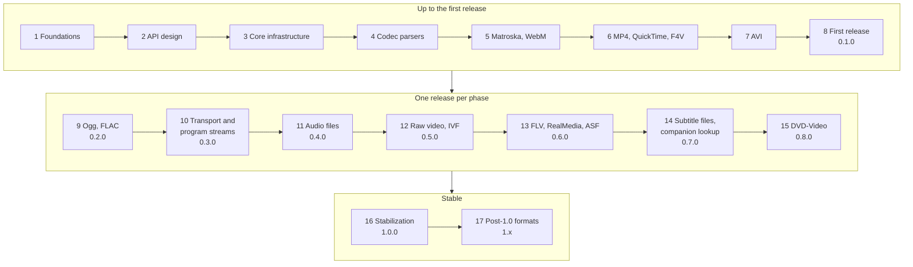

---

### Phase 1 — Foundations and specification acquisition

**Goal.** A building, linted, CI-checked empty workspace; every specification in place; every source decision that later phases depend on already made.

**Progress on 2026-11-22.** Phase 1 is complete: the maintainer approved G1.9 on 2026-11-22, and the exit criteria are met. G1.1 to G1.8 are passed, and tasks 3 to 16 are done; `node scripts/check.ts` passes locally, with the type check of the scripts, the coverage check and the offline checks of the specification tables. The scripts were rewritten in TypeScript for R34. The 16 paid standards are not bought; `docs/specs/iso-iec/` describes them from free sources, and the coverage table cites those descriptions. G1.4 approved the specification set, added the 11 RFCs in force that update listed ones and, through GS.2, SMPTE RP 227 for VC-1 in MPEG-2 streams. G1.5 accepted every proposal of the source dossier and approved sources for HDMV TextST, the VBRI header and the DVD sub-stream numbers. G1.6 substituted the 16 paid standards with their descriptions, added the documents they cite, a DV patent for the consumer packs and the free 2015 edition of ISO/IEC 14496-12, and reduced the rows that rest on a gap. The maintainer placed that edition (G1.7), and task 16 applied the outcomes of G1.5 and G1.6 to section 4, the tables and the phases. Task 17, the verification of every cited section, is done: all 307 active rows, of releases 0.1.0 to 0.8.0, are confirmed against the stored documents. Task 18 added the changelog and the contributing guide, which also says how to report a vulnerability, and task 19 the CI workflow. Its first run, on the commit after G1.8, failed in the check script on all three runners at the coverage step: the coverage tool does not create the directory of its report, which a fresh checkout lacks. The script now creates it. The second run passed on macOS and measured the fourth layer on Linux and Windows (task 5). It found glibc, its loader and GCC's unwinder on Linux, and on Windows, Windows' own libraries, the Universal C runtime and the Visual C++ runtime, which is not part of Windows. Through GS.4, R15 now allows the C runtime that the Rust standard library links as well as the operating-system libraries. The allow-list holds the 13 measured libraries. The third run, on the commit that added them, passed every job on the three runners. The maintainer dropped two things: `SECURITY.md`, through GS.4, and support for 32-bit targets. At G1.9 the deliverables check gained a rule: an active row needs the date of its confirmation. After the gate, the maintainer added R36, no duplicate code, with `cargo-dupes` and `jscpd` approved through GS.1. Its first run found the lexer's cursor copied in the JSON reader, and one test of a token against a list of words or characters written in 13 places; both now exist once. The [development log](plan-init-project-log.md) has the details.

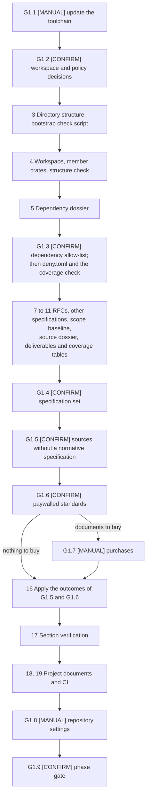

**Tasks**

1. **[MANUAL] G1.1 — Update the toolchain.** The installed compiler is 1.96.0; the project requires 1.100. Run `rustup update stable`, then `rustup component add rustfmt clippy llvm-tools`, then `rustup toolchain install nightly` (fuzzing and the docs.rs reproduction only). Confirm `rustc --version` reports 1.100.x.
2. **[CONFIRM] G1.2 — Workspace and policy decisions,** before anything is created: D1 (the pinned toolchain and the toolchains in CI), D3 (layout and target ownership of section 7.1), the mechanism that marks a repository build (option A or option B of section 7.1), D4 (no unsafe; the pure-Rust check, its rule for build scripts and its list of permitted operating-system interface crates), the lint set including the four lints of D23, where the structure check and the coverage check live, the coverage command and what it excludes from the measured lines, how the structure check recognizes the data-table modules, and its first list of abbreviations (D23), whether source files carry a license header, and how local tooling directories found in the working tree are handled in `.gitignore`.
3. Create the directory structure of sections 5.2 and 7.1 and `scripts/check.ts` in its bootstrap form. From this commit on, every commit passes the script.
4. Create the workspace: root manifest with shared package metadata, lint tables, the declarations of the `fuzzing` configuration name and of the repository marker, and `fuzz`, `spikes` and `readers` excluded; the six member crates with minimal content and **no dependencies**; `rust-toolchain.toml` naming one exact release; formatter and linter configuration; `.cargo/config.toml` with the dependency cooldown; the pure-Rust verification scripts; the target-ownership test; the structure check of D23, run by `scripts/check.ts`. The repository marker is built in the one way chosen at G1.2, with the test that belongs to it: the guard test for option A, or a test of the build script for option B. Nothing of the other option is created.
5. **Dependency dossier.** For every crate and tool in D5 to D7: exact version, license, maintenance state and its own dependency list. For the graph of the two published crates, the evidence of the pure-Rust verification (D4): the inventory; every build script, read in full and identified by the checksum of its package in the lock file, with the reviewer's finding against the rule of D4, stating what the script runs and what it emits; and the build and result inspections for every shipped target that the local toolchain can build. The build inspection on Linux and Windows hosts, and the fourth layer there, come from the first CI runs (task 19) and are reported at G1.9. 32-bit targets are not supported (section 2). The dossier is `docs/design/dependency-dossier.md`, and its evidence is the spike `spikes/dependency-graph/`.
6. **[CONFIRM] G1.3 — Dependency allow-list.** Approve the dossier. `deny.toml` is then written so that CI rejects any crate that is not on the list, and the coverage check of D23 is added to `scripts/check.ts` and CI. No dependency is added to any manifest before this gate; any later addition goes through GS.1.
7. **RFCs.** Write `docs/specs/rfc/manifest.tsv` from Appendix A and `scripts/fetch-rfcs.ts`, which downloads each `https://www.rfc-editor.org/rfc/rfcNNNN.txt`, records its SHA-256 and verifies it on later runs. Run it. Write `docs/specs/rfc/errata.tsv` from Appendix A.8 and a fresh errata query for every listed RFC. Generate `docs/specs/rfc/README.md` with the index and the IETF Trust license notice.
8. **Other specifications.** Write `docs/specs/manifest.tsv` from Appendix A.7 and Appendix B with the columns of section 5.2, and `scripts/fetch-specs.ts`, which downloads `fetch` rows, stores `snapshot` rows from their immutable reference where one exists, checks the content type and checksum of everything it stores, and reports `manual` rows that are missing. Add `docs/specs/files/` to `.gitignore`. Resolve every row that Appendix B marks as unverified or incomplete: exact edition, landing page, the document file itself rather than a landing page, an immutable reference where the publisher offers one, retrieval policy. Record any document that cannot be located and any snapshot that is not reproducible upstream.
9. **Scope baseline.** Write `docs/design/scope-baseline.md` from section 4.5, including the baseline revision it was read from.
10. **Source dossier.** Write `docs/design/source-dossier.md` for every † entry of section 4, starting from Appendix B.6 (section 5.4).
11. **Deliverables and coverage.** Write `docs/specs/deliverables.tsv`, the list of everything sections 4.1 to 4.4 promise, and `docs/specs/coverage.tsv`, which gives each of those keys its source (section 5.2), together with the check that compares the two. Every coverage row is active for a named release, deferred to a named gate, or dropped. Post-1.0 candidates are entered as deferred rows. A row whose document is not in hand yet names its section provisionally and is marked so.
12. **[CONFIRM] G1.4 — Specification set.** Review the RFC list, the errata table, the pinned draft revisions, the non-RFC manifest, the deliverables list against section 4, and the coverage table's mapping of each deliverable to a document. Sections cited in documents that are not yet obtained are provisional; task 17 confirms them. Confirm that committing the RFC text files to the repository is acceptable.
13. **[CONFIRM] G1.5 — Sources for formats without a normative specification.** For each † format, codec, carriage and detect-only signature: approve the named description, reduce to detection or identification only, or defer (R17). If VobSub is reduced or deferred here, this gate also records which release then carries companion lookup: the first one that still has a consumer, or none (R18).
14. **[CONFIRM] G1.6 — Paywalled standards.** For each document marked Paid in Appendix B, choose one outcome: purchase; rely on the named free substitute; or defer the features that depend on it. The decision is recorded per document in the manifest.
15. **[MANUAL] G1.7 — Purchases.** Buy the documents chosen at G1.6 and place them in `docs/specs/files/`. They are never committed. Skipped if nothing was chosen. On 2026-11-21 nothing was bought; the step places the free 2015 edition of ISO/IEC 14496-12 that G1.6 chose, which ISO serves only to a browser.
16. Apply the outcomes of G1.5 and G1.6: update section 4, the detection candidates, both tables of task 11 and the affected phases of this plan, including the release that carries companion lookup. The checks must pass afterwards. An outcome that would break a confirmed requirement goes to GS.4; the requirement is not dropped by this task.
17. **Section verification.** With every chosen document now in hand, each active coverage row is checked against the stored text: the cited section is opened and confirmed to contain the rule the deliverable needs. The row's provisional mark is cleared and the date recorded. A row that cannot be confirmed is given another source through GS.2, deferred to a named gate, or raised under GS.4. The outcome is part of the phase-gate summary.
18. Add `README.md` (stub), `CHANGELOG.md` and `CONTRIBUTING.md`. Contributions from outside come as issues. `CONTRIBUTING.md` also says how to report a vulnerability, through GitHub's private reporting; there is no `SECURITY.md` (R14). The development log, `docs/plans/plan-init-project-log.md`, exists from G1.1 on.
19. Add `.github/workflows/ci.yml` with the jobs from section 9.8 that apply to an empty workspace:
   - `node scripts/check.ts` on Linux, macOS and Windows, which now also packages both crates in one command (Appendix C.2.1, step 3);
   - the tests on current stable on all three, and with the declared `rust-version` on Linux, through `node scripts/test-declared-rust-version.ts`;
   - the feature combinations, with `cargo-hack`;
   - the license, advisory and allow-list audit, with `cargo-deny`.
20. **[MANUAL] G1.8 — Repository settings.** In the repository's **Settings → Actions → General**: GitHub Actions enabled, allowing only actions created by GitHub and requiring them to be pinned to a full-length commit SHA; under **Workflow permissions**, the default token read-only. In **Settings → Advanced Security**: private vulnerability reporting enabled.

**Tests.** CI green on all three operating systems. The fetch scripts are idempotent and fail on a checksum or content-type mismatch. A link check over both manifests passes or lists known exceptions. The deliverables and coverage check passes, and fails when a key is removed from either table. The pure-Rust verification and the target-ownership test pass. `cargo metadata` succeeds in the root workspace with a spike directory and a reader directory present. The structure check passes on the workspace and fails on its own test inputs: a definition in a `mod.rs`, a function in a `lib.rs`, an inline module body in a module root, `name.rs` beside `name/`, and a file with 501 counted lines; a file with 500 counted lines followed by a test block of any length passes. Its name check fails on a single-letter generic parameter and on a listed abbreviation inside a longer name, such as `header_buf`, and passes on a format name such as `Id3v2` and on `fmt` in a `Display` implementation. Its literal check fails on a number other than 0 and 1 outside a constants module, on a word in a `format!` template, and on a function inside a constants module; it passes on 0, on 1, on an attribute argument, on a test block and on a constants module. The coverage check fails on a summary at exactly 90.0%, for a crate and for an area, and passes just above it. A test runs the CLI's placeholder binary, so the CLI meets the coverage bar from its first commit.

**Docs.** README stub, CHANGELOG, CONTRIBUTING, both spec READMEs, scope baseline, source dossier, development log.

**Exit criteria.** The set of RFC numbers in the manifest equals the set in Appendix A, and every one is present and checksum-verified. The errata table exists. Every draft is pinned to a revision. Every non-RFC row has an edition, a landing page, a retrieval policy and an approval state, and every stored file has the expected content type. The set of deliverable keys equals the set of coverage keys. Every active coverage row has an approved source and a confirmed section, and none is still provisional; every other row is deferred to a named gate or dropped by a cited decision. The workspace builds with zero warnings and CI is green.

**[CONFIRM] G1.9 — Phase gate.**

---

### Phase 2 — Universal API design

**Goal.** An API, a CLI contract and a serialization contract that you have approved, first as specifications and then as compiling code, before any format exists. Nothing permanent is written into the library before its approval: tasks 1 to 6 produce documents, tasks 7 to 10 are the approvals, and tasks 11 to 13 build on them. Each document is presented for review when it is finished, before the next one is started, so that a design choice that changes early does not spread into later documents. These reviews do not replace the gates.

**Progress on 2026-11-22.** The phase started. The maintainer chose how deep the field inventory goes, how much of the typed details the API fixes now, and the review of one document at a time (tasks 1, 2 and 11). The first version of [`docs/guide/fields.md`](../guide/fields.md) (task 1) has been reviewed against the pinned specifications. The reviews corrected rules for durations, frame rates, stream discovery, unit conversions, codec strings and encoder delay above all. The second to sixth reviews also led to revision 24, on when an edit counts as encoder delay (section 8.4), and the seventh to revision 25, on ordered editions and Opus sample counts. Revision 26 reconciles the remaining timing, stream inventory and provenance rules with the format tables. The review of the maintainer's own revision led to revision 27: a chapter that links a whole edition of another segment leaves an ordered edition's playback values absent (section 8.5), and version checks were added to the Matroska schema (Phase 5, task 2). Revision 28 lets a Matroska default apply in a file older than its element, because the default represents the state that earlier versions assumed (RFC 8794 section 15.1). It also clarifies fragment timing, ordered chapter positions and audio mappings, including the source limits for Meridian Lossless Packing and extended WavPack totals. Revision 29 says what the version checks do with an element stored outside its versions. Revision 30 clarifies AV1 dimensions and timing, VP9 track metadata and the evidence needed for an Ogg presentation endpoint. The guide gives the sources of the formats and codecs of `0.1.0`, the matrix of the later releases, and 29 findings: fifteen API questions, six plan amendments and eight source questions. The eighth review also added fields that the plan's features need: payload protection, several languages per stream, a starting timecode, typed tag values, picture dimensions and external references. On 2026-11-22 the maintainer closed the review of the guide: the six plan amendments were applied in revision 31, the AVI structure pages of F13 were added through GS.2, the other source questions wait for their phases, and the fifteen API proposals are the baseline of `api.md`, to be confirmed at G2.2. The first draft of [`docs/design/api.md`](../design/api.md) (task 2) is ready for review; the usage scenarios of task 3 follow it. On the same day the maintainer amended R8 (revision 32): test files are generated with ffmpeg and mkvmerge by `scripts/generate-test-files.ts`, documented in [`docs/guide/test-files.md`](../guide/test-files.md); its recipes arrive with the phases that test formats. Revision 33 records three later decisions of the same day. Tokio's `fs` feature is approved through GS.1 for the path-based async convenience. The naming list of R8 is confirmed. Linux CI takes the test-file tools from Ubuntu's own archive. The maintainer also chose to review `api.md` together with the usage scenarios of task 3, which are now its section 15. The disposable spike `spikes/api-scenarios/` type-checks them against a stub of the specification. Writing them revised the specification in ten places, which its section 15.12 lists: enums are returned by reference and have stable names, and the names with abbreviations are spelled out. The maintainer's first review of the specification and its scenarios held back G2.2 on 21 findings. Each one holds, and the specification was revised for all of them; its section 16 lists the changes. Three of them were the maintainer's choices, which revision 34 carries into sections 8.2, 8.7 and 8.8: the attachment options split by role, a companion-lookup option for each kind of entry point, and raw 64-bit values always written as strings. The second review held back G2.2 on 14 findings, and each one holds as well. Revision 35 carries the fixes into sections 6.2, 7.7, 8.3 and 8.7 and Phases 5 and 6, with three choices that the maintainer made there: the absence of protection is proof, an unresolved codec is absent, and with lookup off a companion appears only as an external reference. The third review held back G2.2 on 12 findings, all of which hold. Revision 36 carries the fixes into sections 7.5, 7.7, 8.3, 8.5 and 8.9 and Phases 4, 5, 6 and 14, with three choices that the maintainer made there: the stem of a VobSub index from the path or else the file-name hint, image headers of attachments within the per-stream header limit, and an explicit scope for each tag set. At the fourth review the maintainer approved G2.1 for the names of revision 36 and held back G2.2 and G2.3 on nine findings, all of which hold. The same review answered the question that G2.3 had left open: the library's `document` module gains a writer that takes the entries one at a time, which the CLI uses too. Revision 37 carries the fixes into sections 7.4, 7.5, 7.7, 8.3, 8.8 and 8.9 and Phase 6, with the maintainer's two other choices: entry constructors refuse an outcome that this version cannot derive, with a way to give it, and detection is a part of the completeness record. The fifth review held back G2.2 on three findings and raised four more under G2.3, all of which hold. Revision 38 carries the fixes into sections 7.5, 8.3, 8.8 and 8.9 and Phases 2, 3 and 6, with the maintainer's choice that a limit that stops one candidate's check while another validates leaves the report's detection incomplete. On 2026-11-23 the maintainer approved G2.2 for revision 38, and revision 39 applies the amendment of section 8.2 that F3 implies. The draft of [`docs/design/cli.md`](../design/cli.md) (task 4) is ready for review. The disposable spike `spikes/cli-arguments/` checks its command line against the approved `clap`. Writing it brought three choices of the maintainer for the text mode, which section 8.9 records, and one for the API: a part that a source failure stopped names the reason "source failed" in the error's partial report (section 8.3). The maintainer's sixth review of `api.md`, of revision 39, found 15 places where two implementations could report differently and two gaps in the evidence for task 5, and held G2.3 open; all of them hold. Revision 40 carries the fixes into sections 7.4, 7.5, 8.3, 8.5, 8.6, 8.8 and 8.9, Phase 2, task 5, and G3.5, with four choices that the maintainer made there: candidates are ranked and checked in that order, the fixed-size record keeps the first reason of each part, an entry's index is its position, and trees are flat arrays in JSON. The amendments of the approved `api.md` are confirmed at G2.3. The seventh review, of revision 40, raised seven findings under G2.2 and seven under G2.3, all of which hold. Revision 41 carries the fixes into sections 7.5, 7.7, 8.3, 8.8 and Phases 2, 3 and 4, with four choices that the maintainer made there: a catch-all of an enum that carries data keeps its members and writes them back, no member holds null, only an observed chain establishes the primary H.264 set, and a standalone chapter or tag is the flat array of its subtree. The eighth review, of revision 41, raised twelve findings on `api.md` and four on `cli.md`, all of which hold. Revision 42 carries the fixes into sections 7.5, 7.7, 8.2, 8.3, 8.8 and 8.9 and Phases 2, 3, 4 and 14, with four choices that the maintainer made there: a headers status in the fixed-size record, a candidate check that the input's end cut short leaves detection incomplete, an external reference beyond the retained data is counted and its part incomplete, and one portable rule for the stem of a VobSub index. The ninth review, of revision 42, raised fourteen findings on `api.md` and four on `cli.md`, all of which hold. Revision 43 carries the fixes into sections 7.7, 8.2, 8.4, 8.6, 8.8, 8.9 and 8.10 and Phases 2, 4, 5, 11 and 14, with four choices that the maintainer made there: a catch-all's payload names its enum, no root record stands in a member that a catch-all keeps, a seekable reader is the input from its byte 0, and the bytes needed are a total. During the revision the maintainer added a rule of their own: a property holds its last known good value, so a damaged structure of a newer version of a specification leaves the older one's value in place (section 8.4). The tenth review, of revision 43, raised fifteen findings on `api.md` and four on `cli.md`, all of which hold. Revision 44 carries the fixes into sections 7.5, 7.7, 8.2, 8.3, 8.4, 8.5, 8.6 and 8.9 and Phases 3, 4 and 5, with three choices that the maintainer made there: discovery records a shortfall of protection and names the stream, every tag lookup sees the top level only, and each value of a high dynamic range has its own provenance. The eleventh review, of revision 44, raised ten findings on `api.md` and three on `cli.md`, all of which hold. Revision 45 carries the fixes into sections 7.5, 7.7, 8.3 and 8.9 and Phases 3, 4, 5, 6 and 14, with four choices that the maintainer made there: only the built-in resolver can find an alias of the primary input, a cause chain's lines carry no input name, a usage error's output failure comes first on standard error, and a companion's diagnostic is tested through the formatter until the CLI can produce one. The twelfth review, of revision 45, raised eleven findings on `api.md` and one on `cli.md`, all of which hold. Revision 46 carries the fixes into sections 8.3, 8.5, 8.8 and 8.9 and Phases 3, 4, 5 and 6, with four choices that the maintainer made there: reading refuses a report whose reasons disagree with its record and statuses, a tag set that a live stream's later Tags element replaced is kept and seen by no lookup, a codec of a newer version displays its own name, and the parameter sets of a linked parameter-set track are H.264 candidates. Task 5 started on the same day with `docs/guide/json-output.md`, whose draft is ready for review: the maintainer chose to review it before `stability.md` is written, a reader that holds only the members before a root record's version (revision 47, section 8.8), and a contract in prose without a JSON Schema. The spike `spikes/api-scenarios/` now reads its four root records version first. The maintainer's thirteenth review, of revision 47, read the JSON contract with `api.md` and `cli.md` and raised nineteen findings, all of which hold. Revision 48 carries the fixes into sections 8.8 and 8.9, with two choices that the maintainer made there: a raw code is spelled by its namespace, a code of bytes in hexadecimal, and `IntegerValue` is written only by the tag value that holds it. The fourteenth review, of revision 48, raised twenty findings, all of which hold. Revision 49 carries the fixes into sections 8.8 and 8.9, with four choices that the maintainer made there: a detection's bytes needed has a twin, only values that JSON carries are read, the extensible WAVE `SubFormat` has a namespace in `0.1.0`, and a first reason carries no detail. The fifteenth review, of revision 49, raised fifteen findings, all of which hold. Revision 50 carries the fixes into R21 and sections 7.5, 8.8 and 8.9, with four choices that the maintainer made there: a detection of a newer outcome and an error record of a newer kind keep their unread members, a number of arbitrary precision reads as its number, the record is fixed-size as a probe builds it, and R21 counts an output failure among the causes of status 1, amended through GS.4. The draft of `docs/guide/stability.md` followed on 2026-11-24, before the review of revision 50, as the maintainer chose. Revision 51 carries its rules into sections 7.5, 8.8, 8.9 and 8.10 and Appendix C.6, with seven more choices that the maintainer made: the schema keeps major version 1 before 1.0, improvements and fixes are compatible changes of output, a shortfall newly found among them, a patch release only fixes, a default limit is raised in a minor release and lowered only for security, the CLI's options are as stable as the API, and only the newest minor line receives fixes. The sixteenth review, of revision 50 with the drafts of revision 51, raised nineteen findings, all of which hold. Revision 52 carries the fixes into R12 and sections 8.8 to 8.10, with four choices that the maintainer made there: the private map of arbitrary precision is a number only where no type is known, its double is the correctly rounded one and the guide says when a build gives another, a deprecated option warns on standard error in either mode before anything else, and a minor line's MSRV is the stable Rust current on the day its release candidate is built, R12 amended through GS.4. The seventeenth review, of revision 52, found four defects of the spike's reader and eight findings on the contracts, all of which hold. Revision 53 carries the fixes into sections 8.8 to 8.10, with two choices that the maintainer made there: no object of a known type has a member of the private map's name, and a deprecated option warns once, in the order of the option table. The eighteenth review, of revision 53, found six defects of the spike's reader and nine findings on the contracts, all of which hold, and revising it found Serde's `flatten` holding every unknown member of an entry, a detection and an error record to the record's end. Revision 54 carries the fixes into sections 8.8 to 8.10, with the maintainer's choice that those records hold such a member only until their outcome is known. The [development log](plan-init-project-log.md) has the details. The nineteenth review, of revision 54, found twelve issues, nine of the API and the JSON reader, one of the CLI and two of the stability rules, all of which hold. Revision 55 carries the fixes into sections 8.8 to 8.10, with the maintainer's choice that the private map of a number at the root is that number, and the log has the details. On 2026-11-25, while revision 55 waits for its review, task 6 completed the Rust API Guidelines checklist, [`docs/design/api-guidelines-checklist.md`](../design/api-guidelines-checklist.md), against `api.md`: of its 54 items, 26 were met, 15 amended, 3 are deviations and 10 do not apply. As the maintainer chose, each shortfall was amended in `api.md`, for G2.3 to confirm, and each verdict rests on the specification's text, which task 13 checks against the code. The maintainer renamed `UnderivableOutcome` to `DeriveOutcomeError` and kept Apache-2.0 under R13. Revision 56 marks a breaking change in the changelog (section 10) and adds the question of futures-io at 1.0 to G16.1. G2.3 and G2.4 passed for revision 56 on 2026-11-25. Task 11 started the same day. As the maintainer chose, it is written in three slices, each passing the check script and the coverage bar on its own and presented for review before the next: the data model; the options, sources, entry points, detection and async surface; and the serialized form with the contract tests of task 13 that cover it. The skeleton ports the spike's stub where it matches `api.md` and writes the rest from the specification; tests build model values through test-only constructors, and the library's own way of building a report is designed in Phase 3, task 13. The first slice, the data model, is written. Revision 57 keeps a spike until the permanent code that replaces it exists (section 1.2) and adds the public `source` module and the two enum macros to the tree of section 7.2. The maintainer's review of the first slice found twelve issues, all of which hold: ten were fixed to the approved contracts and two needed the maintainer's choices, which revision 57 carries into section 8.8 and `api.md`: a protection says whether its format has sample descriptions, and a platform without an exact form of a path writes a lossy path without a raw form. The diagram of section 1.1 now keeps a spike until its replacement exists, as section 1.2 says. The second review found twelve more issues, all of which hold. Among them, the library failed to build for WebAssembly without WASI and for UEFI, two targets that section 2 does not support but whose design it does not preclude. Four needed the maintainer's choices, which section 8.8 and `api.md` carry: the operating-system code of an error record is text, the cause chain is followed for at most 32 causes with a repeat left out, Hermit, SOLID and Xous write a path's bytes, and a timecode's nominal rate is at least 1. The third review found ten more issues, all of which hold. One needed the maintainer's choice, which `api.md` and `json-output.md` carry: the indexes of a protection's sample descriptions, and those of its declarations, rise from 1 within the declared count. The rest brought the spike's reader, the cause chain, a lookup, the rustdoc of a raw path and three fixtures to the approved contracts. On 2026-11-26 the maintainer's review of revision 57 approved the first slice and held G2.5 open for the rest of tasks 11 to 13. It asked that `Declared` say that its declaration can be absent, which `api.md` and `json-output.md` now say and a round trip of task 13 covers. It also asked that the I/O spike of Phase 3 stay until its replacement exists: revision 58 deletes it with Phase 3, task 6, as the maintainer chose. The second slice, the entry points, the options, the sources and the async surface, is written. As the maintainer chose, the bytes of every input match nothing until the detection inventory of Phase 3, so detection gives "unknown", or "hint only" for a format hint, and probing the "unknown format" error, and only the two file functions open their input. The legacy text encoding option waits for G3.4 and Phase 3, task 12. The maintainer's review of the second slice, the same day, found ten issues. Nine hold and were fixed. The maintainer declined the tenth, that the library's tests without features do not build for WASI, and chose not to support WebAssembly at all (section 2). Revision 59 carries the maintainer's two other choices: CI documents every feature combination (section 9.8), and every case of the I/O spike that no permanent test takes over moves into the test kit before the spike is deleted (Phase 3, task 6). A second review, the same day, found seven more issues in the rustdoc and `api.md`, all of which hold and were fixed. The maintainer chose that `Interrupted` from a source's length query is retried as from a read. A third review, the same day, found two more issues in the rustdoc and `api.md`, both of which hold and were fixed. The third slice followed the same day. As the maintainer chose, it is presented in two reviewed parts, its tests take over every case of the API spike's tests and build their records from JSON documents and through the test-only constructors, and the rules of formats other than JSON are shown with a self-describing reader of the tests' own, with no further dependency. Revision 60 records these choices in task 11 and adds the strict reader, the private module `form`, and the macro `form_record!` to the tree of section 7.2. The first part is written: the `serde` feature, the strict reader ported from the spike, the form of every model type, the report, the detection and the error record read version first alone, `document::SchemaVersion`, and 113 serialization tests with the unit tests of the samples. The maintainer's review of the first part, the same day, found seventeen issues, all of which hold and were fixed, among them a stored 64-bit integer written as a number, an exact value held to 128 bits, two shapes of a reference's owner and records that contradicted themselves. The maintainer chose the flat owner that `json-output.md` gives, a table of the fields that decide an exact value's denominator, that every reference of a report resolves, and the reasons of two header states, which `api.md` and `json-output.md` carry; the serialization tests number 133. The maintainer's second review of the part, the same day, found fifteen issues, all of which hold and were fixed, among them a report that read as complete beside a shortfall that its own records state, references that named another entity than they said, error endings that section 5.1 of `api.md` rules out, and exact values of two forms. The maintainer chose that every record tied to a status is held against the completeness, reduced exact values of at most 10000 digits, an enum held before the version whatever its shape, and no form for `TimecodeLabel`, which section 8.8 now states; the serialization tests number 153. The maintainer's third review of the part, the same day, found sixteen issues, all of which hold and were fixed, among them a report that read as complete beside an expected companion that no entry requested, sections not requested that held results, source entries that disagreed with their reasons, error candidates out of their rank, and usage that counted fewer bytes than the sources read. The maintainer chose that such an expected companion rules out complete companions, that the bytes read cover those of the sources and of a partial report, that a section not requested holds nothing, and that an error's record keeps the first cause of its candidates for every known kind, which `api.md` and `json-output.md` carry and no rule of this plan changes; the serialization tests number 170. The maintainer's fourth review of the part, the same day, found twenty issues, all of which hold and were fixed, among them a report that read as complete beside omitted declarations, a missing codec description or a protection scope that was not read, records of the model that contradicted themselves, an error's format that was not its validated candidate's, a detection limit said to have stopped discovery, and a reader's syntax error hidden behind the version error. The maintainer chose that a read that fails before an enum's content is handed over is the reader's failure, that a limit of detection stopped detection first and a probe that ended at detection names no other part, that a header state's reason is kept, first or counted, and that an omitted declaration's reason is too, which `api.md` and `json-output.md` carry and no rule of this plan changes; the omitted counts and their limits are the record of section 7.5 as it stands. The serialization tests number 196. The maintainer's fifth review of the part, the same day, approved the plan at revision 61 and found one issue, which holds and was fixed: a report whose activities all completed was refused once its diagnostics limit was exhausted and one diagnostic omitted, since every exhausted limit had to name an activity that it stopped. The maintainer chose that a limit names the activity that it stopped first only where it stopped one, that each limit that a reason names, and the limit behind an omitted reference or declaration, names one, and that the tests of the document and of the tool repeat the case where they are written, which sections 7.5, 8.8 and 9.2 now state (revision 62). The serialization tests number 202. The maintainer's sixth review of the part, the same day, found six issues, all of which hold and were fixed: an error that ended at detection and a report whose companions were not applicable each read beside the companion requests exhausted, discovery read as stopped by the diagnostics limit, the contracts did not say that a header state of a newer version is not held to the record, the list of malformed records of section 8.8 kept the rule that the fifth review replaced, and the log gave one decision two statuses. The maintainer chose that a counter that only companion lookup charges is not exhausted where the companions never ran, nor, with the counters of the streams, of a stream's header and of the payloads, in an error that ended at detection; that no reason names the diagnostics limit and no record pairs it with an activity; and that it is exhausted only beside an omitted diagnostic, which sections 7.5 and 8.8 now state (revision 63). The serialization tests number 207. The maintainer's seventh review of the part, the same day, found six issues, all of which hold and were fixed: a detection read beside a cause that the error of the same detection refuses, a primary file that could not be opened beside the stream limit exhausted, an unknown format and companions not applicable beside companion requests counted in their usage, the companion requests paired with the tags and the stream limit with detection, a companion refused before its request by the stream limit, and the malformed records of section 8.8 and of `json-output.md` section 10 still held a header state of a newer version to the record. The maintainer chose that a counter which only one activity charges stops only that activity, that a companion refused by a limit names one that can stop it before or after its request, that a probe which ended at detection or failed before detection found a format never ran its prober, and that a result whose lookup or prober never ran counts none of their usage, which sections 7.5 and 8.8 now state (revision 64). The serialization tests number 217. After that revision was committed, the second part followed the same day: the document, its entries and its writer, with the serialization tests that need a document, the spike's cases about documents and the fifth review's entry `ok` among them. The maintainer chose that reading checks each entry as soon as it has read it, so the read stops at the first broken entry and its error has a place in the input, which section 8.8 now states (revision 65), and that the part is presented alone, before task 12 and the rest of task 13. The serialization tests number 277. The maintainer's review of the part, on 2026-11-27, found six issues, all of which hold and were fixed: an entry that reserved space for all three records, the place of an entry held before the version, which section 8.8 now states (revision 66), a writer that prepared its entries before the results opened, a partial report allocated again for its version, member counts that no test observed, and module documentation that described the command-line tool's `--json` output as written today. The serialization tests number 283. The maintainer's second review, the same day, found six issues, all of which hold and were fixed: two tests that depended on the order that `serde_json::Value` gives a map, which failed with serde_json's `preserve_order`, a copy of every entry's outcome, two examples that dropped successful probes, a module comment, the rationale of the last index, and the first review's count of its tests. No rule of the plan changed. The serialization tests number 283 in every build of serde_json that the tests use. The same day the maintainer approved revision 66 and the completed skeleton at `024e3b7`, with G2.1 to G2.4 already passed, and held G2.5 open for tasks 12 and 13. Task 12 made the thirteen scenarios the shipped examples, which `docs/design/examples.md` lists; twelve compiled against the library as written, and `format_details`, whose typed variants arrive in Phases 4 and 5, shows what every kind of details shares, as the maintainer chose. Task 13 followed, with three choices that the maintainer made: a compile-fail doc test and a twin for every public enum and struct, the quick start rendering the shape of section 8.2 to a writer whose text its tests compare, and the spike's typed cases kept in `docs/design/deferred-cases.md` before the spike was deleted. Its run of the guidelines checklist against the code gave `Language` the `Display` that `api.md` promises, the crate's front page its links to the guides and the async `detect_source` a link to its example, and `api.md` now says that the options and `DeriveOutcomeError` have no serialized form. Revision 67 carries these into sections 7.2, 8.2, 8.10, 9.7 and 10 and Phases 2, 4, 5 and 6. The maintainer's review of the staged tasks, the same day, found fourteen issues, three of priority 2: the spike's tests of the source protocol were lost, and two examples could attribute a line to the wrong chapter or file. Each holds and is fixed. As the maintainer chose, the structure check now keeps each field of the library private and the package ships no `tests/`, and revision 68 carries these, CI's build of every target and the protocol's cases into sections 8.2, 8.10, 9.7, 9.8 and 10, D23 and Phases 2 and 3.

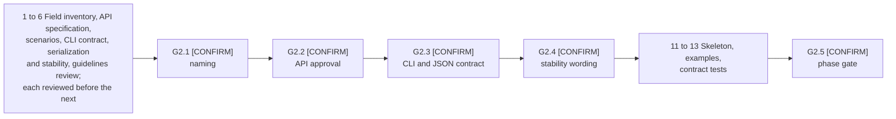

**Tasks**

1. **Field inventory.** From the approved sources, list what each in-scope format can express about a file, a stream, a chapter, a tag and an attachment. Record it as the first version of `docs/guide/fields.md`. Formats deferred at G1.5 or G1.6 are left out. The depth differs by release, as the maintainer chose on 2026-11-22:
   - *Release `0.1.0`.* Matroska and WebM, the ISO base media family with QuickTime, AVI, and the codecs of Phase 4: normalized fields as rows and the formats or codecs of one family as columns, each cell naming the source element, box or field, with its section, unit, precedence and provenance (section 8.4).
   - *Releases `0.2.0` to `0.8.0`.* A matrix that lists, for each format, the normalized fields it can fill and the section that states each one. It shows that the model has room for every format. Each format phase replaces the format's entry with its exact sources (section 11).
2. **API specification.** Write `docs/design/api.md`: principles; every public type with its accessors; naming conventions; every entry point, including those for custom blocking and async sources and for async detection; options and limits; the ordered outcome procedure, the three classes of stream inventory and the completeness model of section 8.3 with its fixed-size record; normalized-value rules and the separate estimate accessors; identity of tags, chapters and attachments, and the two chapter timelines; detection outcomes; the async surface; the conventions of the typed details; the usage summary; the source table; the live error and its serializable record; and the compatibility rules of section 8.10. It also contains the design of companion lookup, marked as shipping with its first consumer (R18), so that the `0.1.0` surface leaves room for it. For the typed details it fixes the conventions, as the maintainer chose on 2026-11-22: the two open enums `FormatDetails` and `CodecDetails`, the catch-all variant that keeps an unknown kind name, the naming of detail types and accessors, their serialized form with its `kind` field, and where raw values, observed lower bounds and values beyond the exact range go (sections 8.3, 8.4 and 8.8). Matroska and H.264 serve as its worked examples. Each format's or codec's own detail type is designed in its phase, within these conventions, and reviewed at that phase's gate; adding a variant to a non-exhaustive enum is a compatible change.
3. **Usage scenarios.** Write the scenarios as annotated sketches inside `api.md`: list streams; print video size and frame rate with absent values handled; find the default audio language; dump tags with their targets; list chapters; export JSON; probe asynchronously with each runtime; probe from bytes, from standard input and from a custom source that serves ranges; scan a directory with per-file error handling, including the partial data carried by an error; read format-specific details; read an estimated duration. Any scenario that reads awkwardly is a reason to revise the specification. A disposable spike may be used to type-check the sketches.
4. **CLI contract.** Write `docs/design/cli.md` from section 8.9, including the JSON-mode scan, the usage-error document and the behavior of `--version` and `--help`.
5. **Serialization contract and stability policy.** Write the draft of `docs/guide/json-output.md` and `docs/guide/stability.md` from sections 8.8 and 8.10, including the root records and their version check, the twin fields for large quantities, the error record, the portable form of paths, the MSRV rule (D2), the compatible kinds of output change, and the CLI's text layout as written for people (section 8.9). The JSON contract also fixes the forms that the sixth review of `api.md` added: enums that carry data, flat trees, the entry's index as its position, and the reading rules for twins, rationals and paths. It fixes those of the seventh review as well: the catch-alls that keep their members and write them back, no null in any member, no name twice, a standalone chapter or tag as the flat array of its subtree, the third omitted count as a decimal string, and a size within the exact range. And it fixes those of the eighth review: the headers status and its check against the streams, an entry of a newer outcome that keeps the members it does not read, the twin of a binary size, a kind without a value as its `kind` alone, what a catch-all keeps of a member, and the fourth omitted count. And those of the ninth review: catch-all payloads bound to their enums and without a form of their own, a tree read only in depth-first order, source IDs of 64 bits in canonical decimal, and no root record in a member that a catch-all keeps, which `stability.md` states as a rule for every later minor version. A spike shows the neutral form of section 8.8, which reads a root record's version before anything else wherever the member stands, for each of the four root records, a bare error record included, and refuses null in every member. As the maintainer chose on 2026-11-23, `json-output.md` is written and reviewed first, for G2.3, and `stability.md` after that review, for G2.4; the contract is prose, with no machine-readable JSON Schema beside it. On 2026-11-24, after the fifteenth review, the maintainer chose to write `stability.md` while revision 50 waits for its review, folding in that review's findings when they arrive. The sixteenth review read both drafts with revision 50, and revision 52 folds its findings into both. The seventeenth, of revision 52, revised both again at revision 53, the eighteenth, of revision 53, at revision 54, and the nineteenth, of revision 54, at revision 55.
6. **Guidelines review of the specification.** Complete the Rust API Guidelines checklist in `docs/design/api-guidelines-checklist.md` against `api.md`. Done on 2026-11-25 against revision 55, before its review, as the maintainer chose. Each verdict rests on the specification's text, and each shortfall amends `api.md`, which G2.3 confirms; the last column of the checklist names what task 13 checks in the code.
7. **[CONFIRM] G2.1 — Naming.** CLI binary name, feature names, the async module names, and the names of the main result and stream types.
8. **[CONFIRM] G2.2 — API approval.** Walk through `api.md` and its scenarios. Confirms D10, D11, D20 and D21, decides whether the usage summary is public, and decides whether a path-based async convenience is wanted.
9. **[CONFIRM] G2.3 — CLI and JSON contract.** Confirms `cli.md`, the JSON document with its usage-error form, and D18 with the root records and the set of retained old readers.
10. **[CONFIRM] G2.4 — Stability policy wording** (D2 and the output-change rules) as it will appear in the README and the stability guide.
11. **Skeleton.** Implement every approved public type in the library with full rustdoc, using approved dependencies only and laid out as section 7.2 requires. From this commit on, the library is held to the coverage bar of R28. As the maintainer chose on 2026-11-25, the skeleton comes in three reviewed slices: the data model; the options, sources, entry points, detection and async surface; and the serialized form, with the contract tests of task 13 that cover it. As the maintainer chose on 2026-11-26, the third slice is presented in two reviewed parts: the strict reader and the form of every model type, with the report, the detection and the error record read alone; then the document, its entries and its writer, with the rest of the serialization tests of task 13. Each part passes the check script and the coverage bar on its own. Its tests take over every case of the API spike's tests, so that no review's case is lost when the spike is deleted, and build their records from JSON documents, and through the test-only constructors where a value comes from no reader. The rules for formats other than JSON, the values of ciborium and of serde_json's `arbitrary_precision` and `float_roundtrip`, are shown with a self-describing reader of the tests' own and the private map written as literal JSON, as the spike did, with no further dependency. The `zlib` feature is declared with `miniz_oxide`, the dependency that it enables, in Phase 3, task 14, which first uses it. Until the detection inventory of Phase 3 (G3.5), the bytes match nothing, so, as the maintainer chose on 2026-11-26, detection gives the outcome "unknown", or "hint only" for a format hint, and probe functions give the "unknown format" error with that hint, as the ordered procedure of section 8.3 does for such an outcome. A file-name hint is kept but not consulted until G3.5 fixes its role. Only the two file functions, the blocking one and Tokio's, touch the input: they open the file, so one that cannot be opened is a source failure. The legacy text encoding option waits for G3.4 and comes with Phase 3, task 12, as the maintainer chose the same day; a new setter is a compatible change. Nothing is stubbed with a panic. Companion lookup is not part of the skeleton. `FormatDetails` and `CodecDetails` have only their catch-all variant; each format phase adds its own (task 2).
12. **Examples.** Turn the approved scenarios into the `examples/` programs, each with its `required-features`, and list them in `docs/design/examples.md`. Those that call a probe function are compile-only at this stage. Done on 2026-11-27: thirteen programs, all compile-only, since each calls a probe function, under the workspace's lint table. As the maintainer chose at the approval review of revision 66, `format_details` shows what every kind of details shares, its stable name through `as_str()` and its three lists, since `FormatDetails` and `CodecDetails` hold only their catch-all, and the H.264 and Matroska parts of `api.md` section 15.10 join it in Phases 4 and 5. The quick start is `list_streams` (section 9.7). The maintainer's second review of tasks 12 and 13, the same day, found `dump_tags` dropping a level that has a number and no name, and reading a target scope or a reference kind of a newer version as an incomplete scope or an unmatched identifier; as the maintainer chose, its rendering half is tested like the quick start's (section 9.7).
13. **Contract tests on the skeleton.** Compile-fail tests for non-exhaustiveness. Serialization tests with records obtained from JSON documents: round trip, unknown fields, unknown enum strings, unknown detail kinds, large identifiers, quantities at the edge of the exact range with their twin fields, a foreign path in each encoding, raw path data of each known encoding that is not whole units of lowercase hexadecimal digits, and the version checks of every root record, including a bare report read through plain Serde and the partial report of an error record in a document. A round trip also covers a sample description whose state `declared` was kept after the retained-data limit dropped its declaration, which reading takes (`api.md` section 6.3), as the review of revision 57 asked. The rendering part of the quick start, called with a complete and an incomplete report (section 9.7). The checklist of task 6 is re-run against the code. Done on 2026-11-27, as the maintainer chose: a compile-fail doc test for every public enum and struct, each with a twin that compiles (section 8.10), in the private module `downstream`; the quick start's text compared for both reports; and the checklist run against the code through its last column, which found three shortfalls of the code, fixed in the same change, and one gap of `api.md` (the checklist's section 15), and added the integration tests of `tests/surface/`. Before the spike `spikes/api-scenarios/` was deleted, the inputs and expected results of its cases whose types arrive in Phases 4 to 6 moved into `docs/design/deferred-cases.md`, as the maintainer asked at the approval review and chose the same day. The maintainer's review of tasks 12 and 13, the same day, found the spike's tests of the source protocol missing there; the library reads nothing before Phase 3, so they moved into the same document for that phase. Its second review found the checklist's evidence for nonempty debug output inexact, since a derived `Debug` of an enum writes the name of its variant, not of its type.

**Tests.** All rustdoc examples and example programs compile. Documentation builds with warnings denied. The contract tests of task 13 pass.

**Docs.** `api.md`, `cli.md`, `examples.md`, checklist, `stability.md`, `json-output.md` draft, `fields.md` skeleton, full rustdoc on the skeleton.

**Exit criteria.** API, CLI contract and serialization contract approved; skeleton merged; no public item undocumented.

**[CONFIRM] G2.5 — Phase gate.**

---

### Phase 3 — Core infrastructure

**Goal.** Everything every format needs: I/O, budget, readers, shared types, detection, test kit, CLI shell. Each design decision is confirmed before the permanent code that depends on it is written.

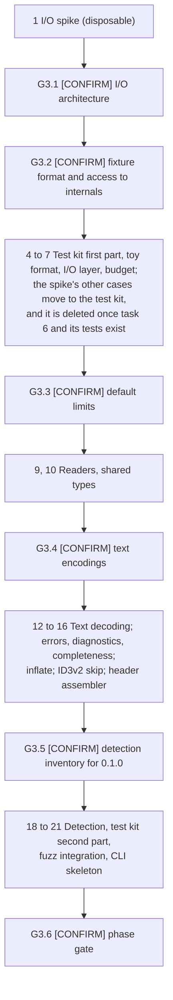

**Tasks**

1. **I/O spike** (disposable; `spikes/input/` is a workspace of its own, see section 1.2). The smallest end-to-end slice of D8, D9, D15 and D17: one toy container walker written once, driven from a file, from bytes, from a custom positional source, from a forward-only reader, and from seekable and forward-only async readers of both runtimes with both features enabled. It includes: a header that spans two deliveries; two packets delivered back to back; a packet far larger than the assembler limit whose header fits in its first piece; a header of two units in which the second needs facts from the first; two interleaved streams on a forward-only reader, where the second stream's only header passes while the first is still waiting; a backward reference that falls outside the forward-only window followed by a readable sibling; a detection sample that would fall outside the window; and a two-file toy input opened through a resolver in blocking and async form, with the built-in check-then-open sequence run against links inside the root. The maintainer chose on 2026-11-27 to run that one-time check on macOS alone, with no CI job; the permanent tests of section 7.7 run on all three platforms in Phase 14. Measure overhead against a hand-written blocking version with Criterion, on the same toy files from memory, through the block cache and from a file, with few and with many packets: D8 holds if the async walker is within 10% of the hand-written one in the in-memory cases, where no I/O hides the cost, by the median of each case in each of three runs, measured with one codegen unit in the benchmark's profile, and otherwise the spike writes the fallback's state machine for comparison before G3.1 (the maintainer's choices on 2026-11-27; one codegen unit at the review of the spike, since the default partition into sixteen units moved the hand-written baseline by about 15% between builds whose hand-written code was the same). The spike's parser takes the inputs of section 7.4 beyond the bytes, the representation and the context with the packet's known length, and its toy codec has two representations, units with one-byte and with two-byte lengths, so that D17 is exercised whole (the maintainer's choice at the review of the spike on 2026-11-27). The spike depends on the library by path, so it drives the approved source traits and reads the library's `Limits`, and its toy format is the draft of task 5's (the maintainer's choices on 2026-11-27).
2. **[CONFIRM] G3.1 — I/O architecture.** Present the spike results. Confirm D8, D9, D15 and D17, or switch to the fallback. The spike then stays as the reference for the permanent code that replaces it, as section 1.2 keeps a spike: the toy format's walker of task 5 and the I/O layer of task 6 are checked against it. As the maintainer chose on 2026-11-26, after the review of revision 57, it is deleted in the commit that completes task 6 with the toy format's source-parity tests. Its cases that no permanent test takes over by then move into the test kit first (task 6). Nothing later depends on it. The maintainer approved G3.1 on 2026-11-27, for revision 72 at `2de60bf`. D9, D15 and D17 were confirmed as the spike showed them. D8 was confirmed with the async walker's measured overhead, which missed task 1's bar in each of the gate's three runs, as a one-time exception: the bar stays as written, and the fallback measured more than twice that overhead with the same heap peaks. The spike's internal sizes and its toy format are the starting points of tasks 5 to 7, and the public defaults remain G3.3's.
3. **[CONFIRM] G3.2 — Fixture format and access to internals** (D14, D19), before any permanent test-kit or fuzz code: a written description of the hex-fixture format with two sample fixtures, how a recipe states the values its tests expect, the builder interface, the per-fixture routing fields for fuzz seeds, the hidden access path for fuzz targets, and the list of repository-only entry points that integration tests and benchmarks may use. The mechanism behind the repository marker is not decided here; it was fixed at G1.2. On 2026-11-27 the maintainer chose four things for the proposal:
   - a design document with a disposable spike, whose cargo-fuzz build reaches a hidden module;
   - lines of bytes in hex, quoted text and repeats, with nothing computed;
   - expectations in the library's JSON form, split into the semantic and the adapter part;
   - `fuzzing_entry_points` compiled in repository builds too, so that the seed check is an ordinary test.

   The proposal, [`docs/design/test-kit.md`](../design/test-kit.md), was written the same day with its spike, `spikes/fixtures/`. The maintainer's review of it the same day kept G3.2 open, and the maintainer chose four more things:
   - a fixture's cases on `case:` lines of its header, each with expectations of its own;
   - a second repository-only entry point that counts the reads of the sources that the library opens itself;
   - retained data in the semantic part, net of the paths that the test handed the library;
   - the seed check as the corpus tool, writing the corpus when an environment variable asks and removing only its own stale files.

   The proposal was revised the same day. The maintainer's second review, the same day, approved the section named in a fixture's heading, the toy format's hidden `Format::Toy` and the proposal's choices made without asking, and the maintainer chose three more things:
   - a file probe's retained-data limit raised by the charge of its path, which the library takes first, in folders of a fixed length;
   - no whole fixture routed to the target of the full public probe, whose seed it is already, while a region may be;
   - names that no file can have given as a hint-only case's hint, names that are not Unicode left to platform-specific tests, and the fuzz input's hint read as native bytes on Unix.

   The proposal was revised again the same day. The maintainer's third review, the same day, kept G3.2 open, and the maintainer chose two more things:
   - a path that the retained-data limit cannot hold left out of its entry, which stays, with the limit exhausted and no part stopped;
   - each case's folder of a fixed length of 512 bytes, from components of a fixed width for the run and the case.

   The proposal was revised a third time the same day and waits for G3.2.
4. **Test kit, first part.** Hex-fixture assembler; byte and bit writers; fault-injecting readers; counting readers; expectation comparison with a semantic part and an adapter part per fixture (section 9.2); the paths of generated test files below `target/test-files/`, with a failure that names `node scripts/generate-test-files.ts` when a file is missing, and the expected values of a recipe (section 9.1). The golden tests start each case's prober from `fuzzing_entry_points::prober` (section 9.5), so this task adds the hidden module with that function alone, and task 20 adds the rest of the module (the third review of the G3.2 proposal on 2026-11-27).
5. **Toy format.** A tiny container format defined by this project, starting from the I/O spike's draft (`spikes/input/README.md`) as G3.1 accepts it, and documented in the test kit, with builders and fixtures there. The fixtures and the test kit's code that cite the draft are retargeted to that description, since task 6 deletes the draft with the spike (the review of the G3.2 proposal). It has a permanent walker inside the library that is compiled only in repository builds and for fuzzing, as is the hidden value `Format::Toy` that its reports name (section 7.2). It adds the toy format to `fuzzing_entry_points::prober` of task 4 through the private function that the repository-only `with_toy_format` calls too. Integration tests and benchmarks reach it through the repository-only entry points of section 7.1. It replaces the spike as the lasting vehicle for measuring and testing the I/O layer, the budget and the header assembler, in this phase and in every later one.
6. **I/O layer.** Source traits (blocking and async) that callers may implement, with the entry points that accept them; adapters for files, `Read + Seek`, byte slices and forward-only readers; async adapters in `asynchronous::tokio` and `asynchronous::futures`; block cache; the forward-only sliding window with its "range unavailable" result and its pinned detection prefix. The commit that completes this task, with the toy format's source-parity tests of this phase, deletes the I/O spike of task 1 (task 2). Before the deletion, every case of the spike that the permanent tests of tasks 5 and 6 do not take over moves into the test kit as a toy-format fixture with its expected results, as the maintainer chose on 2026-11-26 at the review of the skeleton's second slice: the header-assembly cases (a header that spans two deliveries, two packets delivered back to back, a packet far larger than the assembler limit whose header fits in its first piece, a header of two units in which the second needs facts from the first, and two interleaved streams on a forward-only reader) for task 16, and the two-file toy input with its resolver results for Phase 14, task 1.
7. **Budget.** The shared budget of section 7.5: exact read clamping; the rule for the unobserved end of input; working-memory and payload accounting; charge before reservation with the capacity read back; the three growth cases and the change of owner; the fixed-size record; the companion-request counter; the usage summary; the charge of a path, taken first, and a path that the limit cannot hold left out of its entry, with a file probe tested at the caller's own limit one byte below its path's charge and exactly at it (the third review of the G3.2 proposal on 2026-11-27). Measure the toy walker.
8. **[CONFIRM] G3.3 — Default limits.** Confirm the default value of every counter in section 7.5.
9. **Readers.** Byte reader (big- and little-endian integers, fixed-point, four-character codes); bit reader (MSB-first and LSB-first, Exp-Golomb, emulation-prevention removal); checked arithmetic helpers; CRC routines used by EBML and Ogg.
10. **Shared types.** Rational numbers, timestamps, four-character codes, BCP 47 language tags with ISO 639 conversion tables, media types, channel layouts, color description code points, UUIDs.
11. **[CONFIRM] G3.4 — Text encodings** (D22): the in-house set, the caller-configurable default for legacy text, and whether other code pages come from an optional general-purpose encoding crate (through GS.1) or are reported as raw bytes with a diagnostic.
12. **Text decoding** as decided, with byte-order-mark handling, and the legacy text encoding option of `api.md` section 4.3 with the default of G3.4, which the skeleton leaves out until then (Phase 2, task 11).
13. **Errors, diagnostics, completeness, header status,** following the ordered procedure of section 8.3: errors that carry partial data, the source ID of every diagnostic, the status of every part of the completeness model, and the serializable error record of section 8.8.
14. **Inflate integration** behind the `zlib` feature, charged to the decompression counter.
15. **ID3v2 skip.** Recognition of a leading ID3v2 tag and a bounded skip over it from its header alone. Tag extraction is not part of this task (Phase 11). Used by detection now and by FLAC in Phase 9.
16. **Header assembler and parser contract** of section 7.4, exercised with the toy format's codec in both framing modes: pieces of packets, continuation values, the rule for calling again, one traversal for all streams, contention. Its tests include the header-assembly cases that the I/O spike handed to the test kit (task 6).
17. **[CONFIRM] G3.5 — Detection inventory for 0.1.0** (section 4.4): the list of formats, each signature with its source and approval gate, the outcome each prefix class produces, the per-representation rules for weak signatures, the validation check of each probed format, the role of file-name hints, and the order of the entries, which breaks a tie between candidates (section 8.6).
18. **Detection.** Signature table and scoring for the approved inventory; multi-unit validation for weak signatures, skipping a leading ID3v2 tag where a format allows one; text sniffing for subtitle files; the six outcomes of section 8.6; the pinned prefix on forward-only sources; bounded, repeatable validation of ambiguous candidates. Every `detect_*` function is fully functional at the end of this phase, in the blocking API and in both async modules, and `probe_*` follows the ordered procedure, returning the "unsupported format" error with the detected format.
19. **Test kit, second part.** Truncation and mutation harness; the seeds of each fixture with their routes, which the seed check of task 20 writes into the corpus.
20. **Fuzz integration.** The rest of the `fuzzing_entry_points` module, beside the prober of task 4; the `fuzz/` workspace with a detection target, a toy-container target, which the whole toy fixtures seed, a toy-codec target and a target of the full public probe, the two smoke targets of section 9.5 among them (the toy-container target since the third review of the G3.2 proposal on 2026-11-27); the seed check of section 9.5, which writes the corpus when asked; the scheduled workflow; one benchmark.
21. **CLI skeleton** to the approved contract: arguments, text output, the incrementally written JSON document, `--detect` with its outcome mapping, standard input named once, several inputs with mixed outcomes, the JSON-mode scan and the usage-error document, `--version` in both modes, output failure, exit codes.

**Tests.** Unit tests for every reader against spec-derived vectors. Detection tests with a minimal signature fixture for every inventory entry, near-miss negatives, each of the six outcomes, identical prefixes with and without a file-name hint, a forward-only input that fits the budget but would need a detection sample outside the sliding window, and two ambiguous candidates of which the first cannot be checked within the budget, asserting that the second one's report has incomplete detection, the limit as its reason, detection as the part that the limit stopped first, and `is_complete()` false; a candidate ranked behind the one that validated, asserting the state outranked and complete detection; two ambiguous candidates of which the input's end cuts the first one's check short while the second validates, asserting incomplete detection with "truncated input" as detection's first reason, no exhausted counter, and `--strict` failing; and two candidates of which one is rejected and the other needs bytes outside the readable range, asserting "format not determined" with that candidate's own cause and no error reason. The same report under a full retained-data limit, asserting an empty list of reasons, the record's first reason, and `is_complete()`, the display and the entry's outcome all incomplete. On the toy format: source parity with its semantic and adapter parts, including a custom positional source, which is never asked for zero bytes; a positional source of unknown length that returns no bytes beyond a gap, asserting no size, no total and no clean end, beside one that returns no bytes right after its last byte; a seekable reader passed at byte 100, asserting the report of the same reader at byte 0; an error without a partial report, asserting the record's first reason for the part that the stop reached and none for a part that never started (`api.md` sections 4.1, 4.4 and 5.3, after its tenth review); an ambiguous "format not determined" whose first candidate in rank has no check and whose second a limit stopped, asserting no `reason()` on the error, no cause on the first candidate, and the limit both as the second candidate's cause and as the record's first reason of detection (after its eleventh review); a codec of a newer version without a raw identifier, read from JSON, asserting its serialized name as its display, and an unknown codec without one, asserting "an unknown codec" (after its twelfth review); a report whose stream has a header state that is not final, asserting the headers status `incomplete` and `is_complete()` false; fault injection; the budget tests of section 7.5, including limits of zero and one byte, the inputs of N − 1, N and N + 1 bytes, each growth case at its peak, the measured heap peak, and many simultaneous assemblers; the parser-contract tests of section 7.4; forward-only skipping; a backward reference outside the forward-only window followed by a readable sibling; a short prefix; a stop immediately after identification; a stream limit one below the number of declared streams. ID3v2 skip with tag sizes larger than the remaining input and larger than the budget. Async tests with each feature alone and both together, with pending reads, with tail metadata through the seekable path, and with detection through every async function. The source-protocol cases of `docs/design/deferred-cases.md` section 5 become tests here, and leave that document: a pending read asked again with the same request, a source reused after a dropped probe, and no read of zero bytes, blocking and async. CLI tests for arguments, output shape, output failure and exit codes, including `--detect --strict` over a mixed batch and the byte-level usage-error cases of section 8.9.

**Docs.** `architecture.md`; `spec-map.md` skeleton covering detection; the toy format's description; rustdoc for the source traits with an example.

**Exit criteria.** Detection works for the whole approved inventory; all input paths work, including custom sources; resource gates of section 9.4 pass on the toy format; the coverage bar of R28 met for both published crates and for `input/`, `utilities/` and `detect/`.

**[CONFIRM] G3.6 — Phase gate.**

---

### Phase 4 — Codec header parsers, core set

**Goal.** The codec parsers the first four containers need: exactly the rows that section 4.3 assigns to Phase 4. Rows that 4.3 assigns to a later phase are not part of this phase: ADIF, LATM/LOAS, the DTS stream variants, the MPEG audio VBR headers, disc LPCM, the AC-4 sync frame, the transport-stream forms of Opus and AV1, and the length-delimited AV1 stream. Each parser follows the contract of section 7.4 and has a typed detail struct, a mapping to the normalized model, an RFC 6381 codec string where one is defined, a hex fixture for each of its representations, and a fuzz target. Parsers whose source was reduced or deferred at G1.5 or G1.6 are left out and recorded.

**Milestone 4A — Video**

| Codec | Parsed |
|---|---|
| H.264/AVC | NAL unit header; sequence parameter set including VUI and cropping; decoder configuration record. The primary set is the one the first picture activates, and only a chain that the probe followed from that picture's slice establishes it; a sole candidate gives its values by agreement without being named primary. Agreement among sets counts only once every set that picture could activate was read, so the parser states per binding whether parameter sets can sit in the samples, as `avc3` allows. With every candidate read, a reference to a set that none of them has is a damaged stream: no field from the sets, and the header state malformed (`api.md` section 11.5; the maintainer's choice at its seventh review). Each link resolves where its activation happens: a buffering-period SEI message's reference at the message, and the slice's at the slice. A set first supplied between the message and the slice was not available to the message, and an SEI chain that disagrees with the slice's, or a set whose content changes after the message activated it, is damaged too (ITU-T H.264 7.4.1.2.1 and D.2.2; `api.md` section 11.5, after its eighth review). The content is the RBSP, compared without the NAL unit header and without emulation prevention bytes, so copies with different nonzero `nal_ref_idc` agree. The profile and level come from the primary set, from agreement, or else from the record as a declared value, and `api.md` section 11.5 tells a caller how to tell the three apart (after its ninth review). An observed primary set is the bitstream's evidence: it stands for the parsed header in the precedence of every field it holds, whatever the other candidates say, so a source that the field guide ranks above the parsed header still comes first, such as an ISO `colr` or `clap` box or Matroska's cropping, and a field it lacks after a cut takes the next source of its precedence; agreement among candidates and the fallback apply only while the primary set is unknown (after its eleventh and twelfth reviews). No public source says how the record's profile, compatibility byte and level must relate to the sets, so a record that differs from the set that supplies a value is no conflict: the set's value stands, and the details keep both (after the twelfth review; field guide F30). The details keep every picture parameter set read with its two identifiers, what the first picture's activation named, and where each set was read (after the twelfth review). Candidates that disagree on a field rule the sets out as its evidence, so the field takes the next source of its own precedence in the field guide: the record for the profile and the level, and the container for the coded size, the bit depth and the chroma format where it declares them. A field stays absent only where no later source gives it (after its tenth and eleventh reviews). The primary set always has its profile and level, which come before its identifier; only a set that is never primary can be cut before them |
| H.265/HEVC | Video and sequence parameter sets; profile, tier, level; VUI; decoder configuration record |
| H.266/VVC | Sequence parameter set; profile, tier, level. The decoder configuration record is deferred (G1.6), so VVC in Matroska and MP4 is identified only |
| AV1 | OBU header and sequence header in the low-overhead stream format; configuration record. The frame header is not read. The sequence header states only the maximum frame size, so it gives the coded size only for a reduced still-picture header without super-resolution; otherwise the maxima stay in the details (field guide F15) |
| VP9 | Uncompressed frame header; the codec configuration box it shares with VP8 |
| VP8 | Frame tag and key-frame header (RFC 6386) |
| MPEG-1/2 video | Sequence header and extensions |
| Motion JPEG | Frame header |
| ProRes | Frame header |
| DV | DIF header (system), then the video auxiliary pack and the audio auxiliary pack (sampling rate, quantization, channels) of the first DIF sequence; partial when a pack is missing. The aspect ratio is read where SMPTE ST 314 defines the display codes; for consumer DV they have no approved source (G1.6), and it is absent |
| FFV1 | Version 3: configuration record. Versions 0 and 1: the parameters at the start of the first key frame. Both use the range decoder for header symbols only (RFC 9043) |

**Milestone 4B — Audio**

| Codec | Parsed |
|---|---|
| AAC | AudioSpecificConfig with explicit SBR/PS signaling and channel configuration; ADTS header. A program config element (channel configuration 0) has no approved source (G1.6) and is not read. Implicit signaling sits in the frame payload behind entropy-coded data and is not read: the result is "partially parsed by design", states that an implicit extension is possible, and leaves the output sample rate as declared |
| MPEG audio | Frame header for layers I–III |
| AC-3 / E-AC-3 | Sync and bitstream information; container configuration boxes |
| AC-4 | Container configuration box |
| DTS family | Core frame header; extension substream header; container configuration box |
| TrueHD / MLP | FBA major sync and the TrueHD configuration box. Preserve the distinct Matroska `A_MLP` identity. The source for the separate DVD-Audio MLP header is open (field guide F27). |
| FLAC | STREAMINFO (RFC 9639); container configuration box |
| Opus | Identification header and channel mapping (RFC 7845, RFC 8486); container configuration box |
| Vorbis | Identification header |
| ALAC† | Codec configuration |
| PCM | Wave format structures; QuickTime sound descriptions; the PCM configuration box |

**Milestone 4C — Subtitle and auxiliary**

3GPP timed text sample description; WebVTT header text as carried by a container; VobSub† index-style private data; the first display set of a PGS† stream, starting with its presentation composition segment; DVB subtitle first-segment headers; cover-art inspection for JPEG (ITU-T T.81), PNG (RFC 2083 and the W3C specification), GIF (GIF89a), BMP (bitmap file header) and WebP (RFC 9649). Every sniffer cites its source. An inspection reads only the bytes its sniffer asks for, from the start of the picture, within the per-stream header limit. It serves every listed picture whose file declares no pixel size or no media type, also when its data is not kept (`api.md` section 4.3; the maintainer's choice on 2026-11-22).

**Milestone 4D — Codec registry**

Tables mapping container-level identifiers to the `Codec` enum, built from the registries in Appendix B and RFC 2361. The Matroska table also holds the four WebVTT identifiers of the WebM container guidelines, `D_WEBVTT/SUBTITLES`, `D_WEBVTT/CAPTIONS`, `D_WEBVTT/DESCRIPTIONS` and `D_WEBVTT/METADATA` (field guide F19).

- **Namespaces.** Each table is its own namespace: Matroska codec IDs, RIFF video four-character codes, WAVE format tags, ISO sample entry codes, MPEG-4 object type indications, QuickTime codes. Later phases add transport stream types, registration descriptors, ASF identifiers and others. The same value in two namespaces is resolved independently.
- **Entry states.** Mapped to a `Codec`; known but unsupported (named, no parser); alias of another entry. Several identifiers may map to one codec.
- **Fallback.** An identifier that is in no table yields an unknown codec with the raw identifier preserved. Nothing is guessed.

**Tests.** Per codec: fixtures for each profile family, each optional syntax branch and each representation; the parser-contract cases of section 7.4, including one-byte deliveries and a header at the start of an oversized packet; exhaustive truncation; a fuzz target through `fuzzing_entry_points`, with seeds routed by representation and context. The rows of section 4.3 that name this phase are compared with the parsers the code registers. Registry: no identifier with two meanings inside one namespace and context; every `Codec` that has a parser is reachable from at least one identifier; invented identifiers in every namespace take the fallback path. H.264: an `avc1` record whose only sequence parameter set is 0 while its picture parameter set names 1, in a track whose references were read and link no parameter-set track, asserting no field from the sets, the header state malformed and a diagnostic, and the details' three identifiers; an initialization segment without samples, asserting no primary set and the set's values by agreement. An `avc3` access unit whose buffering-period SEI message names set 1 before the only set 1, and one whose message and slice name different sets, each asserting a damaged stream. Two copies of the activated set with the same RBSP, one with `nal_ref_idc` 1 and one with 3, asserting that they agree. Each of the four rows of the provenance table of `api.md` section 11.5, among them candidates that disagree on the profile beside a record that states one, asserting the record's profile as declared. After its eleventh review: a first picture that activates set 0 beside a set 1 with another level and a record that states a third, asserting set 0's level with the provenance `Bitstream`; after its twelfth, a record of level 4 and another profile beside a primary set of level 3.1, asserting the set's profile and 3.1, both raw values in the details and no conflict; two candidates without an observed primary that disagree on the coded size of a track whose container declares it, asserting the container's size as declared; and a primary set cut before `pic_width_in_mbs_minus1`, asserting the container's coded size; one where a set 0 with other content replaces the activated set 0 between the message and the slice, asserting the same; and one whose message and slice agree, asserting the set that the message activated as primary. The H.264 cases of `docs/design/deferred-cases.md` section 2, which the API spike kept, become tests of the H.264 details and leave that document, and the example `format_details` gains the H.264 part of `api.md` section 15.10 (`docs/design/examples.md` section 4), as the maintainer chose on 2026-11-27.

**Docs.** Rustdoc on every detail struct; codec section of `fields.md`; `spec-map.md` entries for parsers and registries.

**[CONFIRM] G4.1 — Phase gate.**

---

### Phase 5 — Matroska and WebM

**Specifications.** RFC 8794 with erratum 7189, RFC 9559, the pinned Matroska codec, tag and chapter-codec drafts, the IANA Matroska and EBML registries, WebM container guidelines.

**Tasks**

1. **EBML.** Variable-size integers, element IDs, data sizes including unknown size, the EBML header, CRC-32 elements, void elements.
2. **Schema table.** Record each element's ID, type, parent, occurrence constraints, defaults and version range from RFC 9559 and the approved supplemental schema. Cross-check the element count against the IANA registry. Validate stored elements against the document version (RFC 9559 section 7), with the legacy stereo exception in section 18.10: an element above the file's version is read, with a diagnostic, and one past its maximum version is discarded and kept in the typed details (RFC 8794 section 15.2). For an established parent, distinguish a physically stored element from a mandatory default. A newly added mandatory default represents the state assumed in earlier versions (RFC 8794 sections 11.1.19 and 15.1).
3. **Segment navigation.** Seek head following; fallback linear scan of top-level elements when no seek head exists; unknown-size segments and clusters; metadata located after the clusters.
4. **Scope of a report: one segment.** RFC 9559 allows an input to hold several segments one after another, for example a live stream in which the codec or the resolution changes between segments. A report describes the **first segment** of the input, and the details carry that segment's UID. Whether more follows is established separately:
   - *Seekable source, segment of known size.* One bounded read at the segment's end shows the end of the input, a further EBML header, or something else. At the end of the input the segment is the whole input. Bytes that are not an EBML header are reported as trailing data in a diagnostic and are treated like the end.
   - *A further segment is found.* It is counted and its position is recorded in the details. Its tracks are not reported. Discovery is incomplete, with the reason "further segments not examined".
   - *It cannot be settled* (a segment of unknown size, or a forward-only source that the probe stops reading before the segment ends). Discovery is incomplete, with the reason that the end of the input was not observed.
5. **Segment information.** Timestamp scale, duration, title, muxing and writing application, date, segment UUIDs, linked-segment UUIDs, segment families. Linked segments are reported as external references and never opened.
6. **Tracks.** Every track entry field: video (pixel and display size and unit, cropping, interlacing and field order, stereo mode, alpha mode, color including mastering metadata and light levels, projection), audio (sampling and output sampling frequency, channels, bit depth, emphasis), all flags, both language elements, name, track UID, codec ID, codec private data, codec delay, seek pre-roll, default duration, content encodings (compression and encryption), block addition mappings, track operations. Coded, visible and display size follow section 8.4. For `V_AV1`, the track pixel dimensions repeat the sequence maxima (Matroska codec mapping 3.3.1). Deriving a frame's visible size requires its actual decoded dimensions. RFC 9559 section 18.10 defines the display dimensions of a single-track stereo picture per eye. The display unit is preserved: a display size in pixels exists only when the unit is pixels, and the other units yield an aspect ratio or a physical size in the details. A button track is reported as a stream of its own kind with its codec identified (R22).
7. **Codec headers.** Use the codec mapping to interpret private data. For `V_VP9`, the uncompressed frame header is in-band. The optional feature list in the private data is a pair of its own (section 4.3) and a different representation from the ISO `vpcC` layout (Matroska codec mapping 3.3.29; WebM container guidelines, "VP9 Codec Feature Metadata"). Its profile, level, bit depth and chroma subsampling features declare those fields even when no frame header is read (field guide F29). Other mappings that specify a configuration record pass it to the header assembler. Where a codec carries its parameters in-band, the first blocks of that track are located, laces are split, stripped header bytes are restored, and frames are fed to the assembler in packet mode until it succeeds or a limit is reached. The pairs that section 4.3 assigns to this phase are handled here, among them the SSA/ASS script header, the WebVTT header text and the DVB page identifiers in codec private data. SubRip and plain text have no header. Nor does a WebM track with one of the four `D_WEBVTT` identifiers: it is identified as WebVTT text, and the identifier's suffix stays in the details, because the guidelines give it no disposition meaning (field guide F19). The stream-wide header that a USF track may carry in its private data is a pending pair until Phase 14. A track that wraps a wave-format or bitmap-format structure is mapped through the corresponding registry.
8. **Content encodings.** A track can declare several encodings. Each has a scope (block payloads, the codec private data, or the next encoding) and an order value that is unique within the track.
   - *Direction.* The order value says in which order a writer applied the encodings. A reader undoes them in the opposite direction: it starts with the encoding that has the **highest** order value and works down to the lowest (RFC 9559 section 5.1.4.1.31.2). The position of the elements in the file plays no part.
   - *Scope.* An encoding is undone only on the bytes its scope covers. Private data is decoded with the encodings scoped to it; a first block that is needed for an in-band header is decoded with the encodings scoped to blocks. An encoding whose scope is "the next encoding" transforms the settings of the encoding with the next order value; those settings are decoded first, before that encoding is used. RFC 9559 discourages this scope but permits it, so it is read. It covers only the data inside the next encoding's `ContentCompression` or `ContentEncryption` (Table 21), so that encoding's `ContentEncodingType` and `ContentEncodingScope` are read whatever covers the rest. What else is read depends on the covering encoding (`api.md` section 6.3, after its eleventh review):
     - *Recovered.* A zlib compression with the `zlib` feature on, header stripping, or an encryption with algorithm 0 is undone on the covered data, under the budget, and the settings are then read as any encoding's, so an encryption under it declares protection as usual. An inflate over the decompression limit, or data that do not inflate, leave the settings undecoded, a shortfall with the limit named, or with "damaged structure" for data that do not inflate, which discovery records with the stream (`api.md` section 6.3, after its twelfth review).
     - *A disabled feature.* A zlib compression with the feature off leaves the settings unread, a shortfall that discovery records with the stream and the feature named, as "compression unavailable" is not final.
     - *Not undone by this version.* An encryption with a nonzero algorithm, or a compression by bzlib or lzo1x, leaves the settings unread by design. Nothing fell short, so no part records it.

     Undecoded settings, whose element was read in full and whose payload could not be interpreted, are kept apart from a field that a cut left unread, and each diagnostic says which of the two it reports. They keep the next encoding's order, type and scope in the details, with its algorithm absent. An encryption among them leaves its protection unknown: no declaration, `is_fully_examined()` false, and the configuration's clarity unknown where its scope covers the private data (`api.md` section 6.3, after its ninth review). A declaration that already covers the private data, such as the first encoding's own when it is an encryption whose scope sets both bits, makes the configuration protected whatever the covered one adds. The first encoding declares protection of its own only with a nonzero algorithm that was read; one of type encryption whose algorithm a cut left unread declares nothing, since the algorithm can be 0 (after the twelfth review). A compression among them declares no protection either way. This task fixes the header state of a codec header that its unknown algorithm covers, with a diagnostic that says that its algorithm lies under the encoding before it and names only the fields observed, an unread one as unread (after its tenth to twelfth reviews).
   - *An encoding cut short.* Every field read is kept, and each field that the cut left unread is named in a diagnostic. A field that an encoding read in full omits takes its default: type 0, a compression, and scope 1, the block. A known compression whose scope was not read declares no protection. An encryption whose algorithm was read and whose scope was not declares protection of an unread scope. An encoding whose type was not read declares nothing, and its protection stays unknown, unless its `ContentEncryption` was read with a `ContentEncAlgo` of 0, or in full, which gives the default 0. EBML fixes no order among the children, so that can come before the type, and the encoding then declares no protection whatever its type. A source failure is a cut too, in the partial report of an error. Each such cut leaves discovery incomplete for the stream, and a source failure names the source as well (`api.md` section 6.3, after its tenth and eleventh reviews).
   - *Clear data is always used.* A track whose blocks are encrypted but whose private data is clear has its headers parsed from the private data. Its header status is that parser's outcome, and its protection records that the payload is protected.
   - *What declares protection.* Only an encryption with a nonzero `ContentEncAlgo` does, once for each scope bit it sets (field guide section 4.1). A compression, header stripping included, and an encryption with algorithm 0 declare none, so a track that is only compressed reports no protection.
   - *Limits and features.* Every transformation is charged to the budget. With the `zlib` feature off, bytes that need inflating are unavailable and the status is "compression unavailable"; header stripping needs no inflater and always works. An inflate that would exceed the decompression limit ends with the status "not found within the budget". A deprecated algorithm that this version cannot undo, `bzlib` or `lzo1x` (RFC 9559 section 5.1.4.1.31.6), gives the final status "identified" when it covers the codec header, as section 6.2 says.
9. **Chapters.** Editions and nested atoms with their UIDs, per-language display strings and flags, mapped as section 8.5 describes. Chapter times are positions on the timeline of the segment that holds their media. For an ordered edition the playback duration and each chapter's playback position are computed from the enabled leaves of the declared playback path, using each established preceding length for a position and all playing lengths for the total (section 8.5); chapters that point into another segment are marked as linked, and that segment is not opened. A playing leaf that links a whole edition of the other segment leaves the playback duration and the positions after it absent. The report's duration stays the segment's duration.
10. **Tags.** Every top-level tags element is read, since a segment may hold several. They are mapped to the model of section 8.5 with all four target kinds, several targets per tag set, wildcard targets, target levels, nested tags, nodes without a value, and binary values. Of the per-track statistics tags, `BPS` supplies the bit rate and `FPS` a declared frame rate that ranks below `DefaultDuration`, both with the provenance "declared" (tags draft section 4.10). The draft defines no duration or count tag, so a tag of any other name is an ordinary tag (field guide F9). In a live stream a later tags element replaces the earlier ones (RFC 9559 section 23.2); the report holds the tags elements it read and marks the section incomplete when later ones may exist. In a segment of unknown size, a tags element read after a cluster supersedes every tags element read before it: their sets stay in the report, marked superseded, and no lookup sees them (section 8.5; the maintainer's choice at the twelfth review of `api.md`).
11. **Attachments.** UID, name, media type, description, size; data on request.
12. **WebM.** Document type detection and profile check, reported as a distinct format.
13. **Completeness and its evidence.** The stream inventory is the tracks element of the first segment. Discovery is complete once it was read **and** task 4 has shown that the segment is the whole input. A metadata section is judged on evidence, not on having seen one element:
    - *Enumeration.* The prober lists the segment's top-level elements by their headers, skipping clusters by size, within the work and read limits.
    - *The seek head is a shortcut, not evidence.* RFC 9559 section 6.3 requires the one or two seek heads of a segment to reference, between them, every top-level element except the first seek head. A conforming index would therefore be enough. The prober still enumerates, because it cannot tell a conforming index from one that is stale after editing, damaged, or simply wrong, and a wrong "complete" is worse than a slower answer. Where the index and the enumeration disagree, the enumeration wins and a diagnostic records the disagreement.
    - *Complete.* Every top-level element of the segment was enumerated and all elements of that kind were read. For kinds that the format allows only once (chapters, attachments), reading that one element is also sufficient.
    - *Proven empty.* Enumeration reached the end of the segment and found no element of that kind. The section is complete and empty.
    - *Incomplete.* Enumeration was cut short, or a known element could not be read. For tags this always applies when only part of the segment was enumerated, because a further tags element may follow.
    - *Timing.* Established when the segment information states a duration. When it states none, timing is "not available by design": no cluster scan is made to derive one.

    Forward-only sources follow the same rule: what lies ahead of the cursor is read, what lies behind the window is reported as unavailable, and the probe continues.
14. **Typed details.** Segment UUIDs, document type and versions, per-track raw codec ID and private data, content-encoding description, the number and positions of further segments. The example `format_details` gains the Matroska part of `api.md` section 15.10, and the Matroska accessors of `docs/design/deferred-cases.md` section 3 leave that document, as the maintainer chose on 2026-11-27.

**Tests.** Section 11 checklist, including: metadata before and after clusters; a conforming seek head, no seek head, and a seek head that omits an element which enumeration then finds; unknown-size elements; every size-encoding width; compressed codec private data with `zlib` on, with `zlib` off, over the decompression limit, and under a deprecated algorithm; an encryption whose scope is the next encoding, once over an encryption whose scope is the private data, asserting that scope kept in the details, no declaration for it and the configuration's clarity unknown, and once over a compression, asserting that the compression declares nothing; a zlib compression whose scope is the next encoding over an encryption whose scope is the private data, with `zlib` on, asserting the encryption's algorithm read and its declaration, with `zlib` off, asserting discovery incomplete with the feature named and the configuration's clarity unknown, and over the decompression limit, asserting the limit named; the same under a bzlib compression, asserting no declaration, `is_fully_examined()` false and nothing recorded as a shortfall; an encryption with algorithm 0 whose scope is the next encoding, asserting the covered settings read (`api.md` section 6.3, after its eleventh review); a zlib compression whose scope is the next encoding over data that do not inflate, asserting discovery incomplete with "damaged structure", the stream named and a diagnostic that says the settings could not be decoded; a first encoding of type encryption whose scope is the next encoding, cut before its `ContentEncAlgo`, asserting no declaration of its own and a diagnostic that names its algorithm as unread (after its twelfth review); a first encoding whose scope sets both the private data and the next encoding, over an encryption that also covers the private data, asserting that the configuration is not clear; an encoding cut short after its type and before its scope, and one cut short after its scope and before its type, asserting each field read kept, a diagnostic naming the unread field, and discovery incomplete for that stream; a track's only encoding, the last element of its `ContentEncodings` by their sizes, whose `ContentEncryption`, with a `ContentEncAlgo` of 0, comes before a type that the cut leaves unread, asserting no declaration, the configuration clear and discovery incomplete for the stream; a source that fails inside a track's `ContentEncodings` after the inventory, asserting the error's partial report with discovery incomplete, its reason "source failed" naming the stream and the source (`api.md` section 6.3, after its eleventh review); a declaration that the retained-data limit cannot keep, asserting discovery incomplete with the stream and the limit named; a track entry cut short before `CodecID`, asserting no codec, no identifier and the display "a codec that was not read"; a track that states only `MaxCLL` and the red primary's x coordinate, asserting the provenance of each value (`api.md` sections 6.3 to 6.5, after its tenth review); a track whose `LanguageBCP47` is damaged beside a `Language`, asserting the last known good value of section 8.4; header-stripped track, asserting no protection; encrypted track; a track with encrypted blocks and clear private data, and one whose clear private data is truncated, asserting the parser's state beside the protection; a track whose in-band header sits in compressed blocks; two chained encodings whose result is wrong when they are undone in the other direction, written with the lower order value first in one fixture and last in another; nested chapters; two editions of one segment with different playback durations, one of them ordered with a repeated chapter; an ordered edition with a chapter that plays a stretch of another segment, and one with a chapter that links a whole edition of it, whose playback duration is absent; an attachment-targeted binary tag and an edition-targeted tag, round-tripped through JSON; a tag set with several targets; a wildcard track target; a tag node with children and no value; a whole-file tag set whose only `TITLE` is inside `ORIGINAL`, asserting no file title and no match among the top-level tags (`api.md` section 6.9, after its tenth review); a second tags element beyond the read window; a live segment of unknown size whose tags element after a cluster holds only `ARTIST` where the one before held `TITLE`, asserting both sets kept, the first superseded, and no title from the lookups, and the same two elements in a segment of known size, asserting neither superseded (section 8.5); a whole segment without tags, chapters or attachments; multiple attachments; a button track; a track table with one stream more than the stream limit; a conflict between container and bitstream dimensions; a `V_AV1` track giving only sequence maxima, with absent coded and visible sizes but established display dimensions; a 3840 × 1080 side-by-side pair with 1920 × 1080 per-eye display and square pixels; a `V_VP9` track whose private data declares all four features, and one with no private data; a `D_WEBVTT/CAPTIONS` track; a statistics tag other than `BPS` and `FPS`, which stays an ordinary tag; a valid cropped video, including a crop that the codec header does not make; a track whose display unit is an aspect ratio; a version 1 track with no stored `FlagEnabled` that is effectively enabled; a track entry cut short before `FlagEnabled`, asserting that the stored-value detail and `is_enabled()` are both absent; a tag cut short before its `Targets`, asserting that the whole-file lookups do not take it; a version 2 `StereoMode` of 1 (right eye) beside a version 3 value of 1 (side by side); an `OldStereoMode` in a file of version 3, which is discarded; a `FieldOrder` in a file of version 2, which is read with a diagnostic; an absent optional `Projection` versus an explicitly present one with defaulted children; a wave-format track; two segments with different codecs, read through a seekable source and through one forward-only reader; a single segment of known size that ends the input (complete); a segment without a duration; the EBML worked examples from the RFC.

**Docs.** Section 11 checklist. First complete `formats.md` entry.

**[OPTIONAL] G5.1 — Acceptance.** Run the CLI on Matroska and WebM files of your own; report discrepancies.

**[CONFIRM] G5.2 — Phase gate.**

---

### Phase 6 — MP4, QuickTime and F4V

**Specifications.** ISO/IEC 14496-12, -14, -15, -1 and -30; ISO/IEC 23003-5; Apple QuickTime File Format; 3GPP TS 26.244 and 26.245; 3GPP2 C.S0050; Adobe Flash Video File Format Specification (F4V part); the W3C ISO BMFF byte stream format; the MP4 registration authority; codec binding documents for AV1, VP9, Opus, FLAC, AC-3, E-AC-3, AC-4, DTS, TrueHD and Dolby Vision; RFC 6381, RFC 4337, RFC 3839, RFC 4393 and the secondary RFCs listed for this phase in Appendix A. Documents declined at G1.6 are replaced by their recorded substitutes, or the dependent items are deferred.

**Milestone 6A — ISO base media, MP4 and F4V**

1. **Box walker.** 32- and 64-bit sizes, to-end-of-file size, extended types, full boxes, containment table, limits.
2. **File type.** Brands mapped to a format (MP4, M4A, M4V, 3GP, 3G2, F4V, QuickTime, fragmented and segmented profiles). Still-image brands are detected and reported as unsupported.
3. **Movie and track headers.** Timescales, durations, creation and modification times, transformation matrix to rotation, track flags, alternate groups, dimensions.
4. **Track references and edit lists.** Chapter, timecode and description references, and the `avcp` reference that links an AVC parameter-set track (MP4RA track references, "AVC parameter set stream link"). The parameter sets of a linked track are H.264 candidates of the track that links it, of the origin "parameter-set track": the samples that the first picture can use are read under the shared budget, once a public source states which ones those are; the project reads public specifications only, and none describes that stream yet (field guide F30, GS.2). Until the probe has them all, or while no public source states the rule, or when the track's references were not read in full, the track lacks candidates, no link is called broken, and a diagnostic says why (`api.md` section 11.5; the maintainer's choice at its twelfth review). The MP4RA registry of track references joins `docs/specs/manifest.tsv` here. Edit lists are applied as section 8.4 describes:
   - The normalized duration is the presentation duration after edits; the media duration goes to the details.
   - Use the first presented sample's movie time as defined in section 8.4, including the effect of leading empty edits and composition offsets.
   - The media time of an edit is a position in the media, in the media timescale. It selects the first presented sample and is reported in the details. For audio it is also reported as encoder delay, but only under the condition of section 8.4: an approved source must say that the edit marks the end of the codec's priming. It is never used as a start offset.
5. **Media headers.** Packed ISO 639-2 language; extended language tag; handler type mapped to stream kind. A handler the library does not know gives the kind "unknown" and is kept as its four-character code.
6. **Sample descriptions.** Visual, audio, subtitle, text, caption, timecode and metadata sample entries with all codec configuration boxes: AVC, HEVC, AV1, VP9, H.263, MPEG-4 elementary stream descriptors, AMR, AC-3, E-AC-3, AC-4, DTS, Opus, FLAC, ALAC, TrueHD, PCM, dynamic-range configuration (the Dolby Vision configuration boxes of version 2.8, with the feature flags that version 2.7 assigned), color information, pixel aspect ratio, clean aperture, field handling, mastering display and content light level, bit-rate box. The 3G2 speech codecs, VVC and MPEG-4 Visual are identified from their sample entries, and VobSub† only when its handler, sample entry, stream type and object type all match the private codes that a community description reports (task 17); its palette stays raw bytes. The parsers that section 4.3 assigns to this phase are written here: the H.263 configuration box (including the optional `bitr` average rate) and picture header (including the field indication of H.263 W.6.3.11), the AMR configuration box and the QuickTime text sample description.
7. **Which description is in use.** A track can declare several sample descriptions. The sample-to-chunk table selects one per chunk; in fragments the track-extends default or a track-fragment override selects one. Two facts are kept apart, because the first can be known while the second is not:
   - *The description of the first sample.* Take the description selected for the first sample in decoding order. With empty movie tables, this requires locating the first nonempty fragment for the track and establishing that no earlier unexamined fragment can contain its samples. A later fragment found by a random-access lookup establishes only its own description. Keep such usage in the details. Once the selection is established, the track's details keep its index (`first_sample_description_index`), also when the probe could not read that description or keep it within the retained-data limit. Its codec is then absent, no other description is a candidate, and the codec information says that one is missing (`api.md` section 6.4).
   - *The set of descriptions used anywhere.* The details list every description as used, unused or unobserved. "Unused" needs full coverage: all chunk entries and all fragments were examined. Without it, a description that nothing examined refers to is "unobserved". A stream that uses more than one description gets a diagnostic.
   - When the track is proven to have no sample, use the first declared description as the fallback and label it in the details. An initialization segment on its own is such a track once the probe has examined it to its end: empty tables and no fragment. The fallback leaves nothing unresolved and lists no candidates. A probe that stopped first, such as at a read limit before the first fragment, has observed no description in use, yet the first sample can still select any declared one: no fallback applies. So whenever the first sample's selection is unproven, whether or not a later description was observed, retain the observed usage and leave first-sample-specific codec fields unresolved. The candidate descriptions are listed, each with its index, its codec and its own identifiers. A description that the probe could not read or keep is missing from the list, and the codec information says so (`has_every_candidate`). The codec is one of the unresolved fields, and is absent, unless every candidate is listed and they name one codec. Two codecs that this version does not know name one codec only when their identifiers are the same (`api.md` section 6.4).
8. **First-sample lookup.** Where a codec carries parameters in-band, the first sample of each used description is located from the sample-to-chunk table, the sample-size table in its normal or compact form, and the 32- or 64-bit chunk-offset table, or from the first track fragment's data offset and defaults. The lookup reads a bounded number of table entries and is charged to the budget. Only the leading piece of the sample that the parser asks for is read (section 7.4).
9. **Protected streams.** Encrypted sample entries reported with protection scheme and original format; header status "protected" where the configuration is not in the clear. Each sample description is reported as clear, declared or unknown. A stream reports no protection only when every description was examined and none declares it (`api.md` section 6.3). The declared count of descriptions is kept, and only the descriptions found clear or declared are listed, within the retained-data limit; any other description within the count is unknown. So a file that declares millions of descriptions costs no more than the limit.
10. **Counts and rates.** A track's samples are those of its sample tables plus those of every track run in every fragment. For `av01`, the ISO binding requires presentation timing to come from these file structures even when the sequence header contains timing information (`aom-av1-isobmff` 2.3.4).
    - *A file without fragments:* `packet_count` is the sample count of the tables.
    - *A fragmented file:* the total is reported only when every fragment was examined. Otherwise it is absent, and the number of samples seen is in the details as an observed value.
    - *An initialization segment on its own:* there are no samples to count. The total is absent, not zero.
    - `frame_count` is set only for video where one sample is one frame; audio sample counts are set only where the time-to-sample total is in the audio sampling timescale, or, for Opus, in any media timescale, since its binding defines sample durations as 48 kHz samples scaled by that timescale. Average frame rate and average bit rate are derived only from an established count and an established duration. Constant or variable rate comes from the tables without reading sample data.
11. **Fragmented files.** Three questions are kept apart: which tracks exist, which descriptions are in use, and how long the presentation is.
    - *Track inventory.* With initialization data (a movie box), the tracks it declares are the inventory, and discovery is complete once it was read: a fragment can only refer to a declared track. Unexamined fragments do not make the inventory incomplete.
    - *Duration, first source:* the fragment duration in the movie-extends header (declared).
    - *Duration, second source:* a segment index, which establishes the end of **its reference track** and nothing else. It is used only when all of the following hold. One reference track and its timescale are chosen, and only indexes for that track are read; an index for another track describes the same interval again and is never added. An index entry that refers to a further index is followed once, and only entries that refer to media are summed, so a nested index is not counted twice. The intervals are contiguous: each index starts where the previous one ended. Together the indexed byte ranges cover every fragment of the file. A gap, an overlap or an uncovered fragment means the index is not used, and the details say why.
    - *Duration, third source:* reconstruct composition times from the movie tables and all track runs, exclude non-output samples and apply the edits. A later `tfdt` can extend the preceding sample, including when the new track fragment contains no samples (ISO 8.8.12). Apply that duration adjustment before computing rate or timing. For reordered video, establish the final presentation endpoint using the composition end for the applicable samples (`cslg` in `stbl` for movie-table samples or `trep` for subsequent fragments, ISO 8.6.1.4), or another exact source of the last output sample's composition duration. A decode delta alone does not establish that interval. An earlier-decoded sample can be presented last.
    - *What counts as proof.* For the sample-based proof, a track's end is established only when no unexamined sample can extend it and the final composition interval is established: every movie fragment of the file was examined, found by a walk over the top-level box headers to the end of the file. A fragment without samples for a track, and an empty run, count as examined. A random-access box lists random-access samples only; fragments may follow its last entry without being listed. It is used to find fragments faster and is never taken as proof of the last fragment or as the end of playback.
    - *The report's duration,* when the movie-extends header states none, is the latest track end after each track's edits, converted exactly. It is set only when every track's end is established, by the track's own index or by the proof above. When the proof exceeds the limits, or a forward-only source ends first, the duration is absent, the timing status is "cut short" with the reason, and the latest end observed is in the details.
    - *Initialization segment only* (movie box with empty tables, no fragments): tracks reported; discovery complete; duration from the movie-extends header or absent; totals absent; description usage unobserved; flagged in the details.
    - *Media segment without initialization data* (fragments, no movie box): the stream inventory is never reached. The result is the error of section 8.3: kind no stream inventory, naming the detected format and the reason "media segment without initialization data". It carries the track IDs seen in fragment headers and, per track, the raw decode times and durations as ticks. No timescale is known, so nothing is converted, and no stream entries are built.
12. **Metadata.** iTunes-style item list including cover art, track and disc numbers and free-form items; key-based metadata; user-data text; location.
13. **Chapters.** Chapter text tracks (bounded sample reads), as the QuickTime documentation's "Chapter lists" defines them. The chapter list box has no approved source and is not read until one is approved through GS.2 (field guide F12).
14. **Completeness.** The stream inventory is the movie box; discovery is complete when it was read. On a forward-only source a movie box that follows the media data is reached only if the media data fits the read limit. If it is not reached, the probe ends with the "no stream inventory" error of section 8.3, which names the format and carries what was read. Timing is established by the movie header of a file without fragments, and by the rules of task 11 otherwise.
15. **Media type.** RFC 4337 distinguishes files with visual content, files with audio and no visual content, and files with neither. A complete track list settles the number of tracks, not their kinds. So the evidence is stated per kind: `video/mp4` needs one known visual track; `audio/mp4` and `application/mp4` need a complete inventory in which **every** track has a known kind. A track of unknown kind could be visual, and with one present and no known visual track the media type is absent (section 8.2).

**Milestone 6B — QuickTime specifics**

Classic and versioned sound descriptions; the sound-description extension atom; Macintosh language codes and Mac OS Roman text; international user-data text; compressed movie atoms; reference movies and external data references, reported as external references and never opened; timecode tracks with start timecode; track aperture atoms; Pascal strings.

A compressed movie atom holds all track information. With the `zlib` feature on it is inflated within the decompression limit. With the feature off, detection succeeds and the probe returns the "feature disabled" error of section 8.3, because no stream can be enumerated.

**Tests.** Section 11 checklist, including: movie box first and last; 64-bit boxes; every sample entry type; an `avc1` track whose record lacks the set that its slice names and whose `avcp` reference links a parameter-set track, asserting no damaged stream, missing candidates while no public source states which samples count, and the linked sets as candidates once one does; and the same track with its references cut short, asserting missing candidates; an `av01` track whose sample timing is unavailable despite a readable sequence timing field; a 3GP H.263 `bitr` box with a positive average and one with a zero average and a positive peak; a random-access read that observes a later fragment before the first nonempty fragment; a track with two sample descriptions whose samples use the second one, and one with an unused description; a track fragment in the first fragment that selects the second description while a later fragment lies outside the budget, asserting that the stream's codec is the second description; compact sample sizes and 64-bit chunk offsets; fragmented with and without segment index and random-access box; parallel segment indexes for audio and video, a nested index, and an index with a gap; a track fragment with `tfhd` and `tfdt` but no samples at tick 30 extending a preceding sample whose nominal end was tick 20; separate `stbl` and `trep` composition ends; a trailing fragment that holds no random-access sample and is missing from the random-access box; an earlier-decoded sample that is presented last; an initialization segment alone, asserting absent totals; a prefix of a fragmented file, asserting an absent `packet_count` and an observed count in the details; a media segment alone, asserting the one Rust result, the JSON outcome `error` with its carried track IDs and raw ticks, and exit status 1; a fragmented recording cut before its end; a fragmented file whose audio track ends in an earlier fragment than the last one; a final fragment with composition offsets; the budget ending during the walk for the end while streams and headers are final, asserting `is_complete()` false; a forward-only file whose movie box lies beyond the read limit; an audio-only inventory that is incomplete (no media type) and one that is complete (`audio/mp4`); a file with neither audio nor video (`application/mp4`); an audio track beside a track with an unknown handler, and a file whose only tracks have unknown handlers (no media type in both); a track-fragment override of the default description; a leading empty edit; an audio track that starts at zero with a media time of 2,112; an audio track whose samples hold many audio frames; a video sample far larger than the assembler limit whose parameter sets sit at its start; each metadata flavor; compressed movie atom with `zlib` on, off and over the limit; encrypted entries; a sample-description count beyond the retained-data limit, asserting a shorter list, unknown states within the count and none outside it; an initialization segment with two declared descriptions, asserting the first one's codec and no candidates; a fragmented file with two declared descriptions under a read limit that ends before its first fragment, asserting an unresolved selection with both candidates and no fallback; the same file under that read limit and also a retained-data limit that cannot keep its second description, asserting a missing candidate and an absent codec; the same file without the read limit, whose first fragment selects the second description, under that retained-data limit, asserting an absent codec, no candidates, a missing candidate and the second index in the details; two candidates whose codecs this version does not know, with different identifiers, asserting an absent codec; an `avc3` track whose first sample carries a sequence parameter set that differs from the record's, read with that sample inside and outside the budget; a track whose first sample selects a description cut off before its format code, asserting no codec, no identifiers, `has_every_candidate()` false, the index in the details and the display "a description that was not read" (`api.md` section 6.4, after its eleventh review); an embedded picture without declared dimensions under `MetadataOnly`; one F4V file. The ISO cases of `docs/design/deferred-cases.md` section 4, which the API spike kept, become tests of the ISO details, and the document is deleted once they and the cases of Phases 4 and 5 have left it, as the maintainer chose on 2026-11-27.

**[OPTIONAL] G6.1 — Acceptance** on your own MP4, MOV and F4V files.

**[CONFIRM] G6.2 — Phase gate.**

---

### Phase 7 — AVI

**Specifications.** Microsoft AVI RIFF File Reference, with Microsoft's pages for the `AVIMAINHEADER`, `AVISTREAMHEADER` and `AVIOLDINDEX` structures, which define their members (field guide F13); the RIFF specification of 1991, for the INFO list and the character-set chunk; OpenDML AVI File Format Extensions 1.02; DV data in AVI; bitmap and wave format structures; RFC 2361 and the IANA WAVE/AVI codec registry; the XSUB description approved at G1.5.

**Tasks**

1. **RIFF walker.** Chunks, lists, word alignment, tolerant size handling.
2. **Main header.** Frame period, flags, total frames, stream count, dimensions.
3. **Stream lists.** Stream header (type, handler, scale and rate, start, length, sample size, frame rectangle); stream format (bitmap header with extra data; wave format with extensible and codec-specific extensions); stream name; video properties header.
4. **OpenDML.** Extended header total frames; super index and standard index chunks; additional RIFF segments accounted for without walking them.
5. **Legacy index.** Presence, entry count, and size totals. A bit rate computed from them is an estimate and is offered only through the estimate accessor.
6. **In-band headers.** For each stream whose format structure is not sufficient, chunks of that stream are located in the movie list and fed to the header assembler until it succeeds or a limit is reached.
7. **DV.** Type 2 has separate video and audio streams. Type 1 has one interleaved stream: it is reported as a video stream, and the audio found in its auxiliary packs is reported as additional streams marked as embedded in it. The AVI headers do not declare those embedded streams. They are discovered only when the first DV frame was read and its audio auxiliary pack was found; until then they are unknown, not absent.
8. **Audio timing.** Constant and variable bit-rate conventions for duration, each with its provenance.
9. **Subtitles.** Text streams; XSUB† bitmap subtitle streams with the fields of the packet header, or identification only if G1.5 reduced it.
10. **Tags and text.** INFO list and date chunk mapped to normalized tags. The encoding is chosen in this order: first, the code page that a character-set chunk declares, if the decision of G3.4 supports that code page; second, when nothing usable is declared, UTF-8 if the bytes are valid UTF-8; third, the caller's default legacy encoding. A declaration always wins over a guess: the bytes `C3 A9` are valid in UTF-8 and in Windows-1252 and mean different text. The raw bytes stay available in the details. Every choice other than a supported declaration, and every declared code page that could not be honored, is recorded as a diagnostic.
11. **Completeness.** The stream inventory is the header list, and the declared streams are known once it was read. A file with a type-1 DV stream has a second step: discovery is complete only when the embedded audio of task 7 was discovered too, or when the first frame showed that there is none. If the probe stops between the header list and that frame, or the frame cannot be read, discovery is incomplete with the reason "embedded streams not yet discovered". A stream that needs an in-band header is complete only when that header was found. On a forward-only source the movie list follows the headers and is read forward within the budget; values that depend on an index at the end of the file are absent and the reason is recorded.
12. **Typed details.** OpenDML flag, interleaving, index presence, per-stream handler and raw format structures.

**Tests.** Section 11 checklist, including: with and without legacy index; OpenDML multi-segment; odd-sized chunks; truncated movie list; both DV types, with a missing auxiliary pack; a type-1 DV file read through a forward-only reader that stops between the header list and the first frame, asserting incomplete discovery; a stream whose header arrives in a later chunk; variable bit-rate audio; palette video; INFO text in UTF-8, in a declared code page and in an undeclared legacy encoding; the bytes `C3 A9` once with a declared Windows-1252 code page and once without a declaration, asserting two different titles; an XSUB stream.

**[OPTIONAL] G7.1 — Acceptance** on your own AVI files.

**[CONFIRM] G7.2 — Phase gate.**

---

### Phase 8 — First release: 0.1.0

**Goal.** Publish both crates. The step-by-step procedure is in [Appendix C](#appendix-c--cratesio-registration-and-publishing-runbook). Everything in this phase completes inside this phase; nothing waits for a later release. Its phase gate follows publication; section 1.2 states this exception.

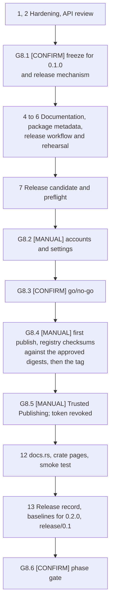

**Tasks**

1. **Hardening.** The 4-hour fuzz run on every target (section 9.5); fix and add fixtures. Review all limits and defaults against the three container families. Run the benchmarks and record a baseline.
2. **API review.** Re-read the whole public surface and the serialized form now that three container families are implemented. Apply any breaking adjustments now, before anything is published.
3. **[CONFIRM] G8.1 — Freeze for 0.1.0 and release mechanism:** the public API, schema version 1.0 of the JSON document, the CLI contract and the default limits; and D13, the release mechanism of Appendix C, before the release workflow is added.
4. **Documentation.** Complete the README, `getting-started.md`, `cli.md`, `json-output.md`. Make every example run against the shipped sample. Verify the documentation build as docs.rs will perform it, with all optional features.
5. **Package metadata.** Description, keywords, categories, repository, documentation link, readme, license, `rust-version`, docs.rs metadata, and an explicit `include` list for each crate. Compare `cargo package --list` with the expected file lists. Archive the JSON fixtures of release `0.1.0`.
6. **Release workflow.** Add `.github/workflows/release.yml` (Appendix C.5). Because it only uploads what the registry lacks, it is safe to have in place before the manual first publish. Write `scripts/rehearsal-registry.ts`, the throw-away local registry of D7, with its tests, rehearse the two publishing routes against it (Appendix C.2.3), and record the result.
7. **Release candidate and preflight.** Commit the candidate with its final version, its changelog and its pinned toolchain. With CI green on that commit, run the preflight of Appendix C.2.2 on it, in CI and locally. It produces the approved digests and the toolchain record.
8. **[MANUAL] G8.2 — Accounts and settings.** Appendix C.1: crates.io account, verified email, scoped token, the GitHub `release` environment and the tag ruleset.
9. **[CONFIRM] G8.3 — Go/no-go.** Publishing is permanent. Confirm the candidate commit, the version, the toolchain record, the approved digests, the two package file lists, the result of the rehearsal and the scope-baseline re-check.
10. **[MANUAL] G8.4 — First publish.** Appendix C.3, performed by you or in your presence: publish both crates from the candidate commit, verify the registry's checksums against the approved digests, then create and push the tag. This is the only place the `v0.1.0` tag is created. The workflow run that the tag starts confirms both versions against the approved digests, uploads nothing, and creates the GitHub release.
11. **[MANUAL] G8.5 — Trusted Publishing configuration.** Appendix C.4: configure both crates, then revoke the first-publish token and log out. The gate is complete when both configurations are saved and the token is revoked.
12. Verify the docs.rs build and the crates.io pages; run the smoke test with the exact version `0.1.0`. Check on the crate pages whether the site offers owners a yank action, and note the answer in Appendix C.8.
13. **Release record and baselines for 0.2.0,** in one commit (Appendix C.6 step 9). Write the release record `docs/releases/0.1.0.md`. Enable the API comparison in CI with `0.1.0` as the baseline. Add `readers/0.1.0/`, the first retained old reader: a workspace of its own that depends on exactly the published `0.1.0` library, with its lock file, and the compatibility crate's tests that run it. Its lock entry needs the cooldown lifted once. Create the branch `release/0.1` at this commit (Appendix C.6 step 10). The first real old-reader test therefore exists before any work on `0.2.0` begins.

**Tests.** Full suite on all platforms; the tarball job of section 9.7; the check that packaging twice gives the same digests; the publishing rehearsal; the smoke test with exact versions.

**Exit criteria.** Both crates on crates.io with checksums equal to the approved digests; docs.rs build succeeded; GitHub release created; Trusted Publishing configured for both crates; no long-lived token remains; the release record written; API and old-reader baselines in place.

**[CONFIRM] G8.6 — Phase gate.**

> From here on, every phase ends with a release, in the order of section 1.2: **[OPTIONAL]** acceptance; **[CONFIRM]** phase gate; **[CONFIRM]** release go/no-go; tag; **[MANUAL]** approval of the publishing run; verification (Appendix C.6). The next phase starts after verification. Each crate's Trusted Publishing configuration is proven by its first verified tokenless upload: at `0.2.0`, or earlier if a `0.1.x` patch is released first. GS.5 follows once both crates have one.

---

### Phase 9 — Ogg family and FLAC (0.2.0)

**Specifications.** RFC 3533 with errata 6796 and 8825, RFC 5334, RFC 7845, RFC 8486 with erratum 7342, RFC 6716 with erratum 4853, RFC 9639 with errata 8256 and 8810; Vorbis I; Theora; Ogg Skeleton; Speex; RFC 5215 and RFC 5574 as secondary references; the Kate description, for identification, and the chapter-comment convention, both approved at G1.5.

**Tasks**

1. **Ogg pages.** Capture pattern, header flags, granule position, serial number, sequence number, CRC, segment table and packet reassembly.
2. **Links and logical streams.** Streams multiplexed within one link run concurrently. Chained links follow one another. Codec identification from the first packet of each stream.
3. **Codec mappings.** Vorbis (identification and comment headers), Opus (identification and comment headers, all channel mapping families, pre-skip, output gain), Theora (new parser: size, frame rate, aspect ratio, color space, pixel format), FLAC in Ogg, Speex (new parser), Kate† (identified only, G1.5), and Skeleton. OGM† stream headers were deferred at G1.5: an OGM file is read as Ogg, and those streams are of unknown codec.
4. **Chain inventory.** The first link is read sequentially. On a seekable source the last page of the file is read; if its serial number belongs to the known link, the chain has one link. Otherwise the end of the known link is found by bisection on serial numbers, the next link's first pages are read, and the step repeats. Each bisection step is one bounded read, the number of links is capped, and every step is charged to the budget. The inventory is complete only when the chain was followed to the end of the file. If the budget or the cap ends the search, or a forward-only source ends before the end of the data, discovery is incomplete and the report says so.
5. **Duration.** For one link: the latest end time minus the earliest start time among its timed streams; concurrent streams are not added together. This needs the start and the end of **every** timed stream of the link. The last page of a link is not enough: it belongs to one logical stream, and another stream may have ended on an earlier page. A bounded backward scan establishes each stream's final granule under its codec mapping. A granule of −1 means no packet finished on that page and supplies no presentation endpoint (RFC 3533 section 6). Granule positions are converted per codec: sample counts at the stream's positive rate for Vorbis, FLAC and Speex; 48 kHz with pre-skip removed and the start offset taken from the first audio page for Opus (RFC 7845 section 4); the granule shift for Theora, with one frame added to the keyframe part when the identification header's VREV is 0, since streams before bitstream version 3.2.1 count from the start of the display interval (Theora specification A.2.3). OGM header timing was deferred at G1.5. Streams fall into three groups. *Timed by a known mapping:* converted as above. *Known not to carry media time:* a Skeleton stream; it takes no part. *Unknown timing:* a stream whose codec the library does not recognize may well be timed and may outlast the others. Use Skeleton's granule rate, shift and start granule together with its presentation cut-in. These establish an exact interval only if the mapping also establishes what the final granule means (RFC 3533 section 6). Otherwise its last granule position is kept as an observation and the link has no exact duration. Endpoint coverage is recorded per stream, separately from the chain inventory. The total is the sum over links and is reported only when the inventory is complete, both endpoints of every timed stream in every link were read, and no link holds a stream of unknown timing. Otherwise it is absent, and the observed part, including the duration of the recognized streams, is in the details.
6. **Vorbis comments.** Normalized tags; embedded pictures. Chapter comments are mapped to chapters by the convention approved at G1.5; without that approval they stay ordinary tags.
7. **Native FLAC.** A leading ID3v2 tag is skipped with the Phase 3 routine and noted in a diagnostic; its content is reported from Phase 11. Then the stream marker and all metadata block types: STREAMINFO, padding, application, seek table, comments, cue sheet (mapped to chapters), picture.
8. **FLAC duration.** STREAMINFO carries the sample rate and the total number of samples. A positive total and a positive sample rate give the exact duration on seekable and forward-only sources alike. RFC 9639 section 8.2 also permits a zero rate for non-audio data, which has no audio duration. A zero total means unknown, and the duration is absent.
9. **Completeness.** The stream inventory of a link is its first header pages; the streams and tags of the first link are complete after them. On a forward-only source the chain inventory and the Ogg duration are established only if the data ends within the read budget and that end was observed (section 7.5): an input that fills the read limit exactly has not shown its end. Native FLAC is a single-stream format. Its results come from the metadata blocks and do not need the end of the input.
10. **Retrofits,** the pairs that section 4.3 lists for this phase: the Theora identification header in Matroska laced private data, with its own fixture. Kate is identified only (G1.5). Speex has no pair in Matroska, because the pinned codec mapping defines no identifier for it. Report changes reviewed (section 9.6).

**Tests.** Section 11 checklist, including: the worked examples from RFC 9639; multiplexed streams; a multiplexed link whose last page belongs to the stream that ends first; a link in which one stream's final page lies outside the backward scan; a two-link chain; a three-link chain whose middle link cannot be reached under a small budget; Opus with pre-skip, a nonzero start and end trimming; packets spanning pages; every Opus mapping family; FLAC through a non-seekable reader with a nonzero and with a zero total, plus a non-audio stream with a positive total and a zero rate; a leading ID3v2 tag larger than the remaining input and larger than the budget; a link in which an unrecognized stream outlasts the audio, with and without sufficient Skeleton timing, including a case with a known clock but no established meaning for the final granule; a forward-only Ogg input one byte shorter than the read limit, exactly as long, and one byte longer; a Theora track and a Kate track in Matroska.

**[OPTIONAL] G9.1 — Acceptance.**

**[CONFIRM] G9.2 — Phase gate.**

**[CONFIRM] G9.3 — Release go/no-go for 0.2.0.**

**[MANUAL] G9.4 — Approve the publishing run.** Unless a `0.1.x` patch came first, this is the first tokenless upload of both crates, and it proves the Trusted Publishing configuration of G8.5. If it fails, the configuration is corrected and the workflow is run again; Appendix C.4 has the fallback. The release record states what each crate used. Token-based publishing is switched off only at GS.5, once both crates have a verified tokenless upload on record.

---

### Phase 10 — MPEG transport and program streams (0.3.0)

**Specifications.** ITU-T H.222.0; ETSI EN 300 468, EN 300 743, EN 300 472, TS 101 154, TS 103 190; ETSI EN 300 421 for 204-byte packets; the Blu-ray Disc Association's BD-J application definition for 192-byte packets, and the published patent US 8,208,795 B2 for the Blu-ray stream types, both approved through GS.2 in task 17 of Phase 1; carriage of AV1 and of Opus in MPEG-2 TS; Dolby Vision in MPEG-2 TS; ITU-T H.262; ISO/IEC 11172 or its substitute from G1.6; SMPTE ST 421, RP 2025 and RP 227; the DVD descriptions approved at G1.5 (LPCM, sub-pictures, sub-stream numbers), the last from the author's current page since task 17 of Phase 1 (GS.2); RFC 2250, RFC 4425, RFC 6416.

**Tasks**

1. **Transport stream.** Packet size detection (188, 192 and 204 bytes) and synchronization. A 192-byte packet is a source packet of a BDAV stream: a 4-byte header, which is skipped and not reported, then the 188-byte packet (BD-J application definition, section 4.1). A 204-byte packet is the 188-byte packet followed by its 16 Reed-Solomon parity bytes, which are skipped and not checked (EN 300 421, clause 4.4.2). Table sections are reassembled across packets, each checked by its CRC. Read: the program association and program map tables; the service description table for names; stream types and all relevant descriptors (registration, language, audio and video codec descriptors, subtitling, teletext, dynamic-range signaling). New registry namespaces for stream types and registration identifiers.
2. **Programs.** Each program reported with its member streams, its clock-reference PID and its own duration.
3. **Stream discovery (R3).** The stream inventory is the association table together with the program maps. Every stream a program map declares is reported, whether or not any payload was seen. A PID that carries elementary-stream packets but is declared by no table is reported as undeclared.
   - *Which table.* Tables are tracked by identity: the association table by its transport stream ID and version, each program map by its program number and version.
   - *When a table version is complete.* When every section from zero to its last section number was received with the current indicator set and a valid CRC. A table whose section number and last section number are both zero is complete in that one section. A table with several sections is complete only with all of them.
   - *Partial evidence is kept (R3).* Stream declarations found in valid sections are reported even when their table version stays incomplete. The program is then marked as having an incomplete map. A program that the association table lists and whose map was never seen is reported as a program without streams, marked "map not found".
   - *Two conditions for complete discovery.* Table coverage: the association table is complete, and so is a map for every program it lists, in every version that was seen. Scan coverage: every packet of the file was examined. Neither replaces the other. Reading every packet does not bring back a section that is missing from the file. Matching table versions at the two ends do not prove what lies between them: a stream can be added and removed entirely inside an unexamined interval, and version numbers repeat after 32 changes.
   - For each window that was examined, the report records the table versions found there. With any unexamined interval, or any table that is not complete, discovery is incomplete with that reason.
   - A caller who needs a complete inventory sets the scan windows to cover the whole file, within the read limit.
4. **Stream identity.** A PID is a channel, not a stream: a later map version can give the same PID to a different codec or language, and one PID can belong to several programs.
   - A stream entry is identified by its PID together with its declaration: the stream type and the descriptors that settle its codec and language.
   - The same PID with the same declaration in successive map versions is one stream.
   - A PID whose declaration changes starts a new stream entry. Each entry records the interval of the file in which its declaration was in force. Nothing is overwritten.
   - An elementary stream that several programs reference is one stream and a member of each of them.
   - Payload goes to the assembler of the entry whose declaration is in force at that position. A change of declaration or a discontinuity closes the earlier entry's assembler, so a header is never attached to the wrong entry.
5. **Elementary streams.** PES packets are reassembled across transport packets, and their payload goes to the header assembler of their stream as the single traversal of section 7.4 reaches them. A parameter set that spans packets or follows the first payload is found as long as it lies inside the limits. Header status per stream: parsed; not found within the budget (announced but absent, or the header lies beyond the window); protected (scrambled packets); and the others of section 8.3.
6. **Timing.** Two different clocks exist, and only one of them measures presentation.
   - *Clock references* (in the transport stream, per program and clock PID) describe delivery. Padding can advance them after the media has ended. They never fill a normalized field. The first and last references of the examined windows, with one wrap of the 33-bit base resolved from the byte distance and the multiplex rate, are kept in the details as the clock span.
   - *Presentation timestamps* mark the start of an access unit. Pictures are reordered, so the last timestamp in the file need not be the latest one.
   - *An exact duration* is derived only from presentation intervals on one program's timeline (section 8.4): the latest presentation end minus the earliest presentation start among the program's streams. For each stream, take the greatest end among its access units. Each end is a presentation timestamp plus the unit's duration (a video frame or field interval, or an audio sample count divided by its rate). An earlier-starting unit can end later. This is established only when every packet of the file was examined, no timestamp discontinuity was found, every wrap was counted, and no unresolved interval can extend the end. The result is "derived" and fills the normalized duration of the program and of its streams.
   - *The report's duration* is set only when the file holds exactly one program. With several programs each has its own timeline and its own duration, reported on the program.
   - *Everything else is an estimate or an observation.* With an unexamined middle, the timestamps or clock references at the two ends give an estimate, offered only through the estimate accessors with its method. No estimate is offered when a discontinuity indicator was seen in a window, when an endpoint is missing, or when the endpoint difference disagrees with the size-based estimate beyond a tolerance. The timing status is then "cut short", because a wider scan window would have established the value. When the whole file was examined and the duration of the last access unit is still unknown, the value is "not available by design". Bit rate follows the duration it was computed from.
7. **Disc-flavored streams.** Blu-ray stream types for audio, graphics and text subtitles, read only in 192-byte BDAV streams: 0x80 LPCM, 0x81 AC-3, 0x82 DTS, 0x90 presentation graphics, 0x91 interactive graphics and 0x92 text subtitles. The patent gives them as the stream coding types of a playlist's stream table; reading them as the stream types of the program map was decided in task 17 of Phase 1, since no approved source says so. No approved source gives the types of TrueHD, E-AC-3 or DTS-HD, so such streams are reported as user-private stream types (G17.n).
8. **Program stream.** MPEG-1 and MPEG-2 pack headers; system header; program stream map; PES; private stream sub-stream identification by the DVD sub-stream ranges, with the codec of each audio sub-stream identified by its sync word (G1.5).
   - *Inventory.* With a program stream map, the map is the inventory. Without one, streams exist only by observation: the inventory is reached with the header of the first PES packet that carries an elementary stream (section 8.3). A file that holds pack headers, a system header or padding and no such packet is an error naming the format. A file with one such packet is `Ok`.
   - *Discovery* without a map is complete only if the whole file was read.
   - *Timing.* System clock references are delivery clocks and are treated like the clock references of task 6. Exact durations come from presentation intervals under the same conditions.
9. **Additional codec parsers and pairs** of section 4.3 for this phase: the VC-1 advanced-profile sequence header and the VC-1 decoder configuration structure; LATM AAC, identified by its stream type (its configuration was deferred at G1.6); DVD LPCM headers in program streams (Blu-ray LPCM was deferred at G1.5); the AC-4 sync frame with its table of contents; the control header of Opus in transport streams, whose stream is identified by its registration descriptor (the descriptor was deferred to G17.n in task 17 of Phase 1, because the draft leaves its tags unassigned); the start-code OBU format and the video descriptor of AV1 in transport streams; the DVB subtitling descriptor; the teletext descriptor; the sub-picture stream packets of program streams.
10. **Forward-only behavior.** Discovery and headers work within the read budget, in one traversal. There is no tail window, so values that need the end are present only when the stream ended within the budget and that end was observed (section 7.5).
11. **Retrofits.** VC-1 in Matroska and in MP4, both through the decoder configuration structure. Report changes reviewed.
12. **[CONFIRM] G10.1 — Scan window defaults.** Tasks 1 to 10 are built with configurable windows. Before any expectation file or read ceiling is fixed, present measurements of discovery completeness against bytes read on builder-generated streams, and confirm the head and tail windows and the tolerance of task 6.

**Tests.** Section 11 checklist, including: each packet size; multi-program with different clock PIDs; streams announced but absent; streams present but unannounced; scrambled packets; table sections spanning packets; a complete table of one section; a table of several sections with one missing, asserting that the streams of the sections seen are reported; a program listed by the association table whose map never appears, read to the end of the file; a section with a wrong CRC; a PID that a later map version gives to another codec; one elementary stream referenced by two programs; a parameter set split across packets; configuration that follows the first payload; continuity errors; a clock wrap between head and tail; a discontinuity in the tail window; a program map version change in the tail; a stream that appears and disappears inside the unexamined middle, probed with default windows (discovery incomplete) and with whole-file windows (stream found); a version number that has wrapped; a whole-file scan of a stream that ends with padding, asserting that the duration comes from presentation intervals and that the longer clock span is only in the details; a last picture in the file that is not the last one presented; a whole-file scan in which the last access unit's duration is unknown (no normalized duration); two programs with different durations; a program stream without a map holding one PES packet (`Ok`), and one holding only pack and system headers (the named-format error).

**[OPTIONAL] G10.2 — Acceptance.** **[CONFIRM] G10.3 — Phase gate.** **[CONFIRM] G10.4 — Release go/no-go for 0.3.0.** **[MANUAL] G10.5 — Approve the publishing run.**

---

### Phase 11 — Audio file formats (0.4.0)

**Specifications.** WAVE and RIFF descriptions; EBU Tech 3285 and 3306; ITU-R BS.2088; Apple Core Audio Format; ID3v1; ID3v2.2, 2.3 and 2.4 with the separately published frame list; APEv2, its specification page and the five pages it links for the header and footer, items, flags, keys and values; the MPEG audio and AAC standards or their substitutes from G1.6; ETSI TS 102 366 and TS 102 114, with version 1.2.1 of TS 102 114 for the byte-swapped and 14-bit DTS variants; the TrueHD bitstream description, and the published patent US 8,086,331 B2 for TrueHD interleaved with AC-3; WavPack; the TTA, Wave64 and VBR-header descriptions if approved at G1.5; RFC 3003, RFC 5219, RFC 4184, RFC 4598. The five APEv2 pages, TS 102 114 V1.2.1 and the patent were approved through GS.2 in task 17 of Phase 1.

**Tasks**

1. **Tag parsers.** ID3v1, ID3v2 (versions 2.2, 2.3, 2.4, unsynchronization, text encodings, attached pictures), APEv2. A file that holds tags of several versions of one specification, such as an ID3v2 tag and an ID3v1 tag, keeps each as a tag set of its own, the newer version's first, so `tag(key)` gives the last known good value: the ID3v2 frame's where it read, and the ID3v1 field's where the frame is damaged or cut short (section 8.4; `api.md` section 6.9, after its ninth review). This task fixes the order of ID3v2, ID3v1 and APEv2 sets, and the ID3v1.1 track number beside the ID3v1 comment.
2. **Retrofit.** The leading ID3v2 tag of a native FLAC file, skipped since Phase 9, is now extracted. Report changes reviewed.
3. **WAVE family.** Format chunk including extensible; fact; data; INFO list; broadcast extension; cue points; embedded ID3v2 tags, recognized by content because no source assigns their chunk identifier (a chunk whose data starts with a valid ID3v2 header, and whose tag size fits the chunk, is read as a tag, and its identifier is reported as found; decided in task 17 of Phase 1); RF64 and BW64 size chunk (the file starts with `RF64` or `BW64` in capitals, as EBU Tech 3306 version 1.1 section 3.4 and BS.2088-2 sections 2.4 and 3.1 give it; the field table of BS.2088-2 section 3.2 spells the BW64 identifier in lower case, which the other three passages contradict); Wave64† GUID chunks; compressed audio carried in WAVE detected by inspecting the data.
4. **Core Audio Format.** Audio description, channel layout, codec configuration, packet table (frame counts, priming and remainder), information strings.
5. **MPEG audio.** Leading-tag skip; multi-frame synchronization check; the Xing/Info header† and the byte and frame counts of the VBRI header†, approved at G1.5; the Xing/Info header starts after the frame header and the Layer III side information, whose sizes the VBRI article gives (its sections 2.2 and 2.3.1, approved through GS.2 in task 17 of Phase 1); a declared frame count in the VBR header supplies a derived duration using the samples per frame and sample rate, with recognized gapless trim applied once. Without a header, or without an approved description, a constant-rate estimate is offered only through the estimate accessor, the normalized duration is absent, and timing is "not available by design".
6. **AAC.** Two raw representations, each with its own detection rule (section 8.6) and fixture: ADTS files; ADIF files, which have a single header, read up to its program configuration elements (G1.6). Raw LOAS files were deferred at G1.6.
7. **AC-3 and E-AC-3,** including dependent substreams.
8. **DTS,** including extension substreams and the byte-swapped and 14-bit variants. Only version 1.2.1 of TS 102 114 describes the variants, in section 5.3: the bytes of each 16-bit word swapped, and a 14-bit format that holds the stream in the low 14 bits of each 16-bit word. Later versions dropped that text.
9. **TrueHD and MLP,** including the variant interleaved with AC-3. The FBA TrueHD source does not establish the distinct DVD-Audio MLP major-sync syntax (field guide F27). For the interleaved variant use the "DD/MLP" stream that the patent US 8,086,331 B2 describes with its FIG. 7, in which AC-3 frames, the base data, and MLP frames share one stream at different rates. Each frame is read by its own sync word and length, and the AC-3 frames are reported as the base data of the stream.
10. **TTA† and WavPack.** Headers, metadata sub-blocks, trailing tags. Both have a retrofit pair in Matroska, as section 4.3 lists: the TTA header structure in codec private data, and the Matroska form of WavPack. WavPack in Matroska is a different layout from the native file: the version is in the codec private data and each payload starts with a reduced block header. It has its own parsing path and its own fixture, independent of the native-file fixture. A native WavPack file reports its sample rate from the WAVE header that its sub-block `ID_RIFF_HEADER` stores. The format document gives the rate as an index into 15 standard rates that it does not list, so without that sub-block the rate is not available and the index is kept raw; the table is deferred to G17.n (decided in task 17 of Phase 1). For totals with a nonzero high byte, the format description refers to implementation macros. Keep the words raw pending the source decision in field guide F28.
11. **Detection hardening.** The rule follows the representation, as section 8.6 states. Self-framed streams (MPEG audio, ADTS, AC-3, DTS, TrueHD) have weak signatures and require several consecutive valid frames. ADIF is not self-framed: it has one header at the start of the file and is accepted on its signature and the plausibility of that header, with no repetition expected. The false-positive analysis is documented per representation.

**Tests.** Section 11 checklist per format, including a constant-rate MPEG audio file without a VBR header (normalized duration absent, estimate present with its method, report complete), an MP3 file whose ID3v2 title frame is damaged beside an ID3v1 title and one whose two titles both read and differ, asserting the ID3v1 title in the first and the ID3v2 title with a recorded conflict in the second, each raw AAC representation, a valid ADIF file with its single header as a positive detection case, a file that begins with the ADIF signature followed by an implausible header as a negative one, a Matroska WavPack track with multichannel and hybrid data, and a Matroska TTA track.

**[OPTIONAL] G11.1 — Acceptance.** **[CONFIRM] G11.2 — Phase gate.** **[CONFIRM] G11.3 — Release go/no-go for 0.4.0.** **[MANUAL] G11.4 — Approve the publishing run.**

---

### Phase 12 — Raw video streams and IVF (0.5.0)

**Specifications.** ITU-T H.264, H.265, H.266, H.262; AV1 bitstream specification; SMPTE ST 421 and ST 2042-1; the description of IEC 61834-2 with SMPTE ST 314 and US 5,907,444, its substitute from G1.6; the IVF description and the Ogg mapping of Dirac, approved at G1.5; the published patent US 10,462,491 B2 for Dolby Vision metadata in HEVC byte streams, approved through GS.2 in task 17 of Phase 1; RFC 6184, RFC 7798, RFC 9328, RFC 4425, RFC 6469 as secondary references.

**Tasks**

1. **Byte-stream formats** for H.264, HEVC and VVC: start-code scanning, parameter set discovery through the header assembler, frame rate from timing information, detection of dynamic-range enhancement units. In HEVC, a NAL unit whose two header bytes are 0x7C01 reports Dolby Vision metadata as present: Table 1 of the patent gives these bytes for the metadata units of an HEVC enhancement-layer stream, and reading them in any HEVC byte stream was decided in task 17 of Phase 1. No approved source identifies such units in H.264 or H.266, or enhancement-layer units carried in the same stream; their detection is deferred to G17.n.
2. **AV1** in both the low-overhead and the length-delimited stream formats.
3. **IVF†.** Header: codec, dimensions, time base, frame count ("declared"). The description names the codec code `VP80`, for VP8, and no other. Any other code is reported as found, and the codec is identified only when the first frame matches exactly one of these: a VP8 key frame (RFC 6386, section 9.1); a VP9 key frame with its frame marker and sync code (VP9 sections 6.2 and 7.2); or an AV1 temporal unit in the low-overhead format that starts with a temporal delimiter (AV1 sections 5.2, 5.3 and 7.5). This was decided in task 17 of Phase 1, because no document other than implementation code gives the codes for VP9 and AV1.
4. **MPEG-1/2 video, VC-1, Dirac** elementary streams; raw MPEG-4 Visual streams were deferred at G1.6. Dirac gets its parser here. Its retrofit pairs are those of section 4.3: Dirac in Ogg†, whose mapping G1.5 approved, and Dirac in Matroska, each with its own fixture.
5. **Raw DV.**
6. **Detection hardening** with multi-unit validation.

**Tests.** Section 11 checklist per format, including a fixture for each retrofit pair and for both AV1 stream formats.

**[OPTIONAL] G12.1 — Acceptance.** **[CONFIRM] G12.2 — Phase gate.** **[CONFIRM] G12.3 — Release go/no-go for 0.5.0.** **[MANUAL] G12.4 — Approve the publishing run.**

---

### Phase 13 — FLV, RealMedia, ASF (0.6.0)

**Specifications.** Adobe Flash Video File Format Specification 10.1 (FLV part), and the SWF File Format Specification version 19 for its Sorenson H.263 chapter; Enhanced RTMP; Microsoft ASF specification, with Microsoft's list of ASF attributes and its pages of video and audio subtypes; the RealMedia and RealAudio descriptions approved at G1.5, and the community list of format tags for 0x0160. The SWF specification, the three Microsoft pages and the list were approved through GS.2 in task 17 of Phase 1.

**Tasks**

1. **FLV (tag-based files only; F4V shipped in Phase 6).** File header; audio and video tag headers; codec sequence headers; the H.263 variant picture header, which the FLV specification leaves to chapter 14 of the SWF specification, "Sorenson H.263 Bitstream Format"; extended video headers with four-character codes and multitrack; the metadata script object mapped to tags and details.
   - *Inventory.* FLV declares no streams; they exist as tags. The inventory is reached with the file header and the header of the first audio or video tag, or with a file that ends cleanly after its header (section 8.3). Streams are kept per track: with multitrack extended headers one file can hold several audio or video tracks, and each is a stream of its own.
   - *Duration* comes from the metadata ("declared").
   - *Otherwise use the span of presented media across all tracks (section 8.4).* The last tag of a kind does not give it: a sequence-end or configuration tag can follow the media, a picture that was decoded earlier can be presented last because of its composition offset, and another track of the same kind can end later. A track's end is the latest value of timestamp plus composition offset plus packet duration over its **media** packets; subtract the earliest media presentation start across the tracks from the greatest track end. Exclude configuration, sequence-end and script tags from both endpoints.
   - *Proof.* Examine every tag within the limits, and establish that no unresolved media interval can start earlier or end later. A first script tag at file time zero followed by media beginning at two seconds and ending at five gives a derived media span of three seconds.
   - *Without proof,* the latest end observed is kept in the details, and a duration built on the observation is offered only as an estimate. Timing is "cut short" when a limit prevented the proof, and "not available by design" when every tag was examined and the last packet's duration still cannot be known from the codec parameters.
2. **ASF.** GUID-keyed object walker; file properties; stream properties for each stream type; extended stream properties; language list; metadata and metadata library; content description and extended content description mapped to tags, with normalized keys and value types from Microsoft's list of attributes, and `WM/Picture` kept as a binary tag, since no document gives its stored layout (Appendix B.6); codec list; bit-rate properties; content protection objects reported; markers mapped to chapters; first payload per stream fed to the header assembler where needed.
3. **Windows Media codecs,** as enumerated in section 4.3: Windows Media Audio by format tag, with the three fields of ASF section 11.1.1 for 0x0161 in every carriage, since the extra data of a wave format belongs to its format tag; Windows Media Video 7/8 from the bitmap header, with its extra data† kept as raw bytes (G1.5); the VC-1 advanced profile through the Phase 10 parser; and the simple- and main-profile sequence structure carried in stream-format extra data, which gets its parser here. The codes come from Microsoft's subtype pages: `WMV1`, `WMV2`, `WMV3` and `WVC1`, and the format tags 0x000A and 0x0161 to 0x0163; 0x0160 comes from the community list. `WMV3` is Windows Media Video 9, which RFC 4425 (section 1) calls compliant with VC-1, and its sequence structure (SMPTE ST 421, Annex J) gives the profile.
4. **RealMedia†.** File header; properties; content description; media properties per stream with audio type-specific data, while AAC streams are identified only, by the codes `raac` and `racp` of their RealAudio type-specific data (G1.5), and RealVideo streams are reported at container level, video by their MIME type and with no codec name, since no document gives where their code is (task 17); multi-rate logical streams; standalone RealAudio in the versions enumerated in section 4.3. RealAudio metafiles were dropped from the inventory at G1.5.
5. **Registry namespaces** for ASF identifiers, RealMedia four-character codes and FLV codec identifiers.
6. **Retrofits,** each pair of section 4.3 with its own fixture: RealAudio in Matroska; Windows Media Audio in AVI and in Matroska; Windows Media Video 7/8 in AVI; the VC-1 simple- and main-profile structure in AVI and in Matroska. Report changes reviewed.

**Tests.** Section 11 checklist per format, including: a tag-based FLV file with a declared duration; one without, whose last tags are a sequence-end tag and a configuration tag; one in which an earlier-decoded picture is presented last; one with two audio tracks of different length; a file that ends after its header, asserting zero streams; a fixture for every retrofit pair of task 6; and confirmation that the Phase 6 F4V fixture is unaffected.

**[OPTIONAL] G13.1 — Acceptance.** **[CONFIRM] G13.2 — Phase gate.** **[CONFIRM] G13.3 — Release go/no-go for 0.6.0.** **[MANUAL] G13.4 — Approve the publishing run.**

---

### Phase 14 — Subtitle files and companion lookup (0.7.0)

**Specifications.** W3C WebVTT; RFC 8216 section 3.5 for the timestamp-map header; W3C XML 1.0 (Fifth Edition) for the syntax of USF, approved through GS.2 in task 17; ETSI EN 300 743; the pinned Matroska codec mapping for the USF and TextST private data and for the VobSub index file (its section 5.1); the descriptions approved at G1.5 for the other formats.

**Tasks**

1. **Companion lookup.** G1.5 kept VobSub, the first format that needs a companion, so the whole lookup surface ships here, before it: the resolver trait in blocking and async form with its five results; the built-in resolver with the trusted root, the containment rule and its stated condition (section 7.7); request caching, the request limit and source identities; the checks that a request needs before it is made, the sources-opened limit and the retained data for its entry among them (section 7.7, after the ninth review of `api.md`); an in-memory resolver in the tests, which also read the two-file toy input that the I/O spike handed to the test kit (Phase 3, task 6), adding its cases of custom and built-in lookup with their expectations (`docs/design/test-kit.md` section 2.3); the builder options for blocking and async probes; the CLI switch; the example and guide section. Source IDs on diagnostics and errors exist since `0.1.0`; from here on the source table can hold more than one entry. This task also fixes how the built-in resolver charges the identities it holds, the primary file's among them, and what a probe does when working memory cannot hold one (`api.md` section 13, after its eleventh review). Lookup stays off by default (R18). All of this is added to the public API and to the JSON document; nothing existing changes.
2. **Text layer and the encodings of each format.** Byte-order-mark detection; UTF-8 validation; the default legacy encoding decided at G3.4. Which encodings a format accepts is a property of that format, and detection applies it before any text is interpreted:

   | Format | Accepted | Anything else |
   |---|---|---|
   | WebVTT | UTF-8 only, with or without a byte-order mark, as its specification requires | Not WebVTT. A UTF-16 file that spells `WEBVTT` is not detected as this format. |
   | SubRip†, SSA/ASS† | UTF-8; UTF-16 and UTF-32 with a byte-order mark | Decoded with the caller's default legacy encoding; a diagnostic records that the encoding was assumed. |
   | USF† | The encoding that its byte-order mark or XML declaration states, where it is one of the in-house decoders (D22) | The file is detected, its header is not parsed, and a diagnostic names the declared encoding. |

3. **SubRip†.** Cue count, time range, presence of formatting.
4. **SSA/ASS†.** Script information, play resolution, styles and fonts referenced, event count and time range, embedded fonts and graphics as attachments.
5. **WebVTT.** Header, regions, styles, cue count and time range. The timestamp-map header that HTTP Live Streaming adds to a WebVTT header (RFC 8216 section 3.5) is read and reported in the details. A file with a header and no cue is valid: one stream, an event count of zero.
6. **[CONFIRM] G14.1 — XML for USF,** before the USF task: a minimal in-house pull parser limited to what USF needs, or a general-purpose XML crate behind an optional feature (through GS.1). Whichever is chosen has to meet one written contract, which is presented at this gate:
   - *Subset.* Elements, attributes, character data, comments, the XML declaration and the five predefined entities, with the syntax of XML 1.0 (Fifth Edition). Nothing else is interpreted.
   - *No document type processing.* A document type declaration is skipped as a whole: no internal or external subset is read, and no entity is declared. A reference to any entity other than the five predefined ones is reported and left unexpanded, so no input can grow into more text than it contains.
   - *No external access.* The parser opens no file and no network resource, and offers no callback through which something else could. Nothing in the document leads to another source (R18).
   - *Shared budgets.* Element nesting counts against the nesting limit, every element and attribute is a work unit, and all text that is kept is charged like any other retained data.
   - A general-purpose crate is acceptable only if each of these points can be shown by configuration and by test. If one cannot be switched off, the in-house parser is used.
   - Skipped if USF was reduced at G1.5.
7. **USF†.** Metadata, languages, styles: from a file, and from the stream-wide header that a Matroska track may carry in its private data. For a standalone file, inventory each `subtitles` group in document order, keeping its own language, role and events (`titlevision-usf` 3.4). Preserve document metadata separately (3.1). The Matroska representation remains one declared track.
8. **VobSub†.** Index file: canvas size, palette, one stream per language index, entry counts. Probed alone, an index yields all of that; the data file is named under external references and the completeness states that companions were not consulted or not available. Its name takes the index's stem from the probed path, or else from the file-name hint. With neither, it is listed without a name and no request is made (section 7.7). With lookup enabled, the data file is opened through the resolver and the first sub-picture packet of each stream is checked. An index entry gives a start time and a file position, never an end, so the time range is absent and the first and last start times are in the details (field guide F20).
9. **PGS†.** Segment walk within the budget: canvas size and display-set count. The time range, and with it the report's duration, is reported only where an approved source establishes the end of the last event. The approved description does not say how a display set ends the subtitle before it, so both are absent and the first and last start times are in the details (field guide F20). The frame-rate byte of the presentation composition segment is not reported: the approved description says that it is always 0x10 and gives no meaning to its values (task 17).
10. **HDMV TextST†.** Style segment: regions and fonts, from the patent texts approved at G1.5; the fields read are checked against the segment length, and a segment whose fields do not add up gives a partial result. The event count is the number of presentation segments, which Sony's figure 11 gives after the style segment and the walk by segment length confirms. There is no time range: neither patent gives the size of the presentation timestamps (task 17). Two retrofit pairs: transport-stream carriage, where such streams have been identified without a parser since Phase 10, and Matroska, whose private data holds the same style segment.
11. **Totals.** Event counts, display-set counts and time ranges describe the whole file. They are reported only when the file was read to its end within the budget and that end was observed (section 7.5), and a time range also needs the end of the last event from an approved source; otherwise they are absent and the observed values are in the details. For USF and VobSub, the first valid subtitle group or stream declaration establishes an inventory, and additional groups or index declarations may follow. Group counts and ranges are per stream. Keep discovery incomplete if the declarations could not be read through the end. For the other single-stream formats, validating the signature or first structure establishes the inventory.

**Tests.** Section 11 checklist per format. An encoding matrix with a stated expected outcome in every cell: each text format in UTF-8, UTF-16 and UTF-32, with and without byte-order mark, in a legacy encoding, and with each line-ending convention. Among its cells: a UTF-16 file that spells `WEBVTT`, which is not detected as WebVTT; and a SubRip file in a legacy encoding without a byte-order mark, which is decoded with the default and raises the diagnostic. A WebVTT file with no cue. A WebVTT header with a timestamp map. For the XML contract: nesting up to and beyond the nesting limit; a document type declaration with entity declarations; a reference to an undeclared entity; an entity-expansion attack, which must not grow; and an external identifier, which must not be opened. A subtitle file larger than the read budget, and one exactly as long as it. A two-group USF file with different languages, one group marked forced, and different cue totals; a bounded read ending before the second group. A USF track and a TextST track in Matroska. The same VobSub pair through a path with lookup enabled, through a reader with a supplied resolver, and as an isolated index with no companion; an index probed from bytes with a file-name hint, whose request names the data file, and with the hint `Movie (2026).idx`, whose request names `Movie (2026).sub`, and without one, asserting no request, an external reference without a name and the reason "companion name unavailable"; two companions declined for different reasons, asserting that each source entry keeps its own; a VobSub index whose data file cannot be found, asserting `is_complete()` false; every companion test of section 7.7.

**[OPTIONAL] G14.2 — Acceptance.** **[CONFIRM] G14.3 — Phase gate.** **[CONFIRM] G14.4 — Release go/no-go for 0.7.0.** **[MANUAL] G14.5 — Approve the publishing run.**

---

### Phase 15 — DVD-Video and multi-file inputs (0.8.0)

**Goal.** Probe DVD-Video title sets, which span several files, through the companion lookup of Phase 14. G1.5 approved the DVD descriptions and deferred the Blu-ray structures (playlists and clip information) to G17.n, so this phase covers DVD-Video only.

**Specifications.** The DVD-Video descriptions approved at G1.5: the information files, the title-set tables and the program chains. For the information files and the sub-stream ranges, the author's current pages replaced older copies through GS.2 in task 17 of Phase 1. ITU-T H.222.0 for the object files, which are program streams (Phase 10).

**Tasks**

1. **DVD-Video†.** Title-set information files: video, audio and sub-picture attributes with languages; program chains with their programs and cells. Task 17 of Phase 1 fixed what is read:
   - *Streams.* The title attribute tables of the title set's header: one video stream; up to 8 audio streams with their coding mode, sample rate (48 or 96 kilosamples per second), channel count and, for LPCM, bits per sample; up to 32 sub-picture streams. A language is read when the language type is 1, from its two characters, and is reported as the original code and as a BCP 47 tag (section 8). Reserved values are not reported.
   - *Program chains.* The title chains of `VTS_PGCI`; menu chains are not reported. A playback time is BCD `hh:mm:ss:ff`, whose frames count at the 30 or 25 frames per second that the top two bits of the frame byte give. The two illegal values give no time and raise a diagnostic.
   - *Chapters.* A chapter is a program. It starts at the sum of the playback times of the cells before its entry cell. An angle block counts only its first cell, because the cells of a block are alternative angles of the same stretch of time. If the sum over all cells differs from the chain's playback time, a diagnostic is raised, and the chain keeps its own time as its duration.
2. **DVD aggregation rules.** A title set can contain several program chains with different playback paths. Each chain is one chapter edition with its own duration and chapters. The report's streams are the title set's attribute tables. The report's duration is set only when the title set has exactly one program chain; otherwise it is absent and each edition carries its own. With lookup enabled, the title set's object files are probed as one logical concatenated source for stream headers, within the limits. These are the numbered object files 1 to 9 that the header page's file structure gives; the menu object file is not read. Each attribute entry is matched to its stream there through the stream control tables of the first program chain that marks the stream available (task 17 of Phase 1):
   - audio entry *i* takes the number *n* of control entry *i*: sub-stream 0x80 + *n* of private stream 1 for AC-3, 0x88 + *n* for DTS and 0xA0 + *n* for LPCM, or MPEG audio stream *n* (H.222.0, Table 2-22);
   - a sub-picture entry takes sub-stream 0x20 + *n* from its number for 4:3 when the video is 4:3, and from its number for wide when the video is 16:9;
   - the one video stream is matched directly.

   The codec found there must agree with the entry's coding mode; for AC-3, DTS and MPEG audio the sync word decides (Phase 10). A stream whose codec disagrees, or which another chain maps to a different number, raises a diagnostic and stays unmatched.
3. **External references** are listed on every result, whether lookup is on or off. Diagnostics and errors name the file they concern through its source ID.

**Tests.** Section 11 checklist; directory-shaped fixtures built by the test kit; a title set with two program chains; a diagnostic raised in the second object file; missing companions; an in-memory resolver; lookup off.

**[OPTIONAL] G15.1 — Acceptance.** **[CONFIRM] G15.2 — Phase gate.** **[CONFIRM] G15.3 — Release go/no-go for 0.8.0.** **[MANUAL] G15.4 — Approve the publishing run.**

---

### Phase 16 — Stabilization: 1.0.0

**Goal.** A stable public API and serialized form, published as `1.0.0` after a release candidate. This phase publishes twice. Its phase gate (G16.3) comes before the first publication, as section 1.2 requires; each publication then has its own go/no-go, and the second go/no-go accepts whatever changed in between.

**Tasks**

1. **API audit.** Every public item reviewed for naming, documentation, example, and forward-compatibility markers. Re-run the API guidelines checklist. Confirm that no pair of section 4.3 is left in the "no parser in this version" state. The audit **changes nothing**. Its result is the *removal list*: every deprecated item and every other breaking change proposed for 1.0, each with its reason and its migration note.
2. **[CONFIRM] G16.1 — Final API and policy decisions.** The removal list, item by item; per-format feature flags (D12); whether the MSRV rule of R12 continues after 1.0; whether `asynchronous::futures` stays while futures-io, the public dependency behind it, is below 1.0, which the Rust API Guidelines rule out for a stable crate (C-STABLE; `docs/design/api-guidelines-checklist.md`); whether the schema version moves to 2.0 or stays in the 1.x line. If it moves, the cross-major rules of section 8.8 apply from the release candidate on: every retained reader must reject the new records, and that rejection is what the compatibility tests assert.
3. **Apply the approved changes,** and only those. Each one is entered in the API check's list of approved exceptions with G16.1 as its decision (section 8.10).
4. **Fuzzing campaign.** 24 hours per target under the conditions of section 9.5. **[MANUAL] G16.2** if this needs machine time you must provide.
5. **Performance.** Benchmarks compared against the 0.1.0 baseline; read-call ceilings reviewed.
6. **Security review** of limits, allocation sites, companion lookup with its stated condition, and all arithmetic on input-derived values.
7. **Documentation completion.** All guides current; `formats.md` and `fields.md` regenerated and verified.
8. **[CONFIRM] G16.3 — Phase gate.** Accepts tasks 1 to 7 with the usual summary. Nothing is published before it.
9. **Release candidate.** Both crates are versioned `1.0.0-rc.1`, and the CLI's exact requirement names that version. The candidate is a complete run of Appendix C.6 with its own gates:
   - **[CONFIRM] G16.4 — Release-candidate go/no-go,** which also sets the length of the feedback window (proposal: four weeks).
   - **[MANUAL] G16.5 — Approve the publishing run** for the candidate. The GitHub release is marked as a pre-release.
10. **Feedback window.** Reports are triaged; fixes go to `main`. A change to the public API or the serialized form needs your decision under G16.1 again, produces a further candidate through G16.4 and G16.5, and restarts the window. Every change made since G16.3 is listed in the summary of the next go/no-go, which is where it is accepted.
11. **[CONFIRM] G16.6 — 1.0.0 go/no-go,** after the window has closed with no open blocking report.
12. **[MANUAL] G16.7 — Approve the publishing run** for `1.0.0`.

**Exit criteria.** `1.0.0` published and verified; the serialized form and the public API are frozen under SemVer.

---

### Phase 17 — Post-1.0 formats (1.x)

Each addition is a minor release that follows the section 11 checklist and the release order of section 1.2. It starts with **[CONFIRM] G17.n** on scope and sources, which also adds the format to the detection inventory if it is not there yet and turns its coverage rows from deferred to active.

| Candidate | Primary source |
|---|---|
| AMR, AMR-WB | RFC 4867 (file storage format) |
| AIFF, AIFC | Apple specification |
| MXF | SMPTE ST 377-1; RFC 4539 |
| Monkey's Audio, Musepack | Format descriptions |
| DSD (DSF, DSDIFF) | Vendor specifications |
| AU | Format description |
| Advanced Professional Video | RFC 9924 |
| Opt-in full-scan mode | Exact frame counts, exact durations, late-starting streams, mid-stream parameter changes |
| Deferred at G1.5 or G1.6 | OGM stream headers, the LOAS sync layer, MPEG-4 Visual, the Blu-ray structures (section 4.1), and the deferred pairs of section 4.3, each with the gap that its gate recorded; a source approved through GS.2 brings one back |

---

## 13. Risks

| Risk | Effect | Mitigation |
|---|---|---|
| The crate name is taken before Phase 8. | Rename of crates and repository references. | Availability is re-checked at every phase gate. If it is at risk, gate GS.3 asks you whether to amend R9 and publish early; nothing is published without that amendment. |
| Formats without a public normative specification. | Lower accuracy; contested behavior; a format reduced or deferred. | One early gate (G1.5) decides every such format before the API is designed. Descriptive sources are labeled as such. GS.2 covers later changes. |
| Paywalled ISO/IEC and IEC standards. | Cost, or reliance on secondary sources, or deferred features. | G1.6 records one outcome per document. Free ITU-T twins exist for the MPEG-2 systems, H.262, H.264, H.265 and H.266 texts; ETSI documents are free, and SMPTE documents are free since 2026-06-17. |
| A bounded probe cannot see everything. | Late-starting streams, unreachable chain links or unknown durations. | R3 separates discovery from header parsing; every stream has a header status; the report states when discovery is incomplete; totals are never guessed from partial scans, and estimates are kept in separate accessors. A transport stream probed with default windows is reported as incompletely discovered; whole-file windows are available. |
| Test files miss real-world deviations. | Bugs surface only in use. | Generated files from two common writers beside hex fixtures from the specifications; optional acceptance at every format gate; every field report becomes a test file. |
| The single-code-base sync/async design underperforms, or the parser contract does not fit a codec. | Rework of container walkers. | Spike and gate G3.1 before any format is built. |
| The serialized form breaks older or newer readers. | Archived reports or downstream tools stop working. | Written contract, a version on every root record, versioned JSON fixtures, and a retained set of real old readers from 0.2.0 (section 8.8). |
| A later parser changes what shipped containers report. | Silent change in output. | Regression fixtures per codec and carriage; every expectation change reviewed and listed (section 9.6). |
| A release stops half-way. | One crate published, the other not, or neither. | The release workflow checks registry state and resumes, by a re-run or by a manual start for the same tag; the runbook has an action for every combination of states (Appendix C.7). |
| Two builds of the same commit give different package bytes. | A release cannot be checked against its approved digests. | The exact toolchain and the committed lock file for every packaging step; a CI job that packages twice and compares; a mismatch stops the release before anything is uploaded. |
| The dependency cooldown rejects this project's own new version. | A release step or a test dependency cannot resolve. | Joint packaging and publishing; a one-command allowance in two named places, preceded by a dry run whose package is compared with the approved digest; a rehearsal against a throw-away registry (Appendix C). |
| Latest-stable MSRV excludes some users. | Narrower adoption. | Stated clearly in README and docs; fixed per minor line; revisited at G16.1. |
| Internet-Drafts change or become RFCs mid-project. | Rework of Matroska codec and tag mappings. | Drafts pinned by revision; compared at each phase gate; adopted through GS.2. |
| Scope is large (about 40 formats, about 50 codecs). | Long path to 1.0. | Value ships from 0.1.0; each phase releases independently; any later phase can be deferred at its gate. |
| A specification link goes dead. | Lost reference. | Checksummed local copies; manifest records editions and retrieval dates; snapshots of living pages. |
| Another process changes a folder while a companion is looked up. | A file outside the trusted folder could be read. | Lookup is off by default. The containment guarantee is stated together with its condition (R18); callers who need more supply their own resolver. |
| Exact durations need proof over the whole file. | Many transport streams, fragmented MP4 files and FLV files have no normalized duration under default limits. | Stated per format; the estimate accessors and the observed values remain available; the caller can widen the limits. |

---

## 14. Gate summary

| Gate | Type | Subject |
|---|---|---|
| GS.1 | CONFIRM | Standing: any dependency or tool outside the allow-list |
| GS.2 | CONFIRM | Standing: a source changes, disappears or is newly proposed |
| GS.3 | CONFIRM | Standing: crate name at risk; amendment of R9 before any early publish |
| GS.4 | CONFIRM | Standing: a confirmed requirement cannot be met as written |
| GS.5 | MANUAL | Standing: require Trusted Publishing once both crates have a verified tokenless upload |
| GS.6 | CONFIRM | Standing: the recovery route for a release that stopped half-way or is wrong |
| G1.1 | MANUAL | Update Rust to 1.100; install components and nightly |
| G1.2 | CONFIRM | Pinned toolchain, workspace layout, target ownership, the mechanism that marks a repository build, no-unsafe rule and pure-Rust verification with its build-script rule, lints, enforcement of the code rules with the first list of abbreviations, and the coverage command (D23), license headers |
| G1.3 | CONFIRM | Dependency allow-list with exact versions and the pure-Rust evidence, before any dependency is added |
| G1.4 | CONFIRM | Specification set: RFCs, errata, pinned drafts, non-RFC manifest, deliverables and their coverage; committing RFC texts |
| G1.5 | CONFIRM | Sources for every format, codec, carriage and signature without a normative specification; the release that carries companion lookup if VobSub is reduced |
| G1.6 | CONFIRM | Paywalled standards: purchase, substitute or defer, per document |
| G1.7 | MANUAL | Purchases decided at G1.6 |
| G1.8 | MANUAL | GitHub Actions, the actions it may run and token permissions; private vulnerability reporting |
| G1.9 | CONFIRM | Phase 1 gate |
| G2.1 | CONFIRM | Naming: binary, features, async modules, main types |
| G2.2 | CONFIRM | API approval, before the skeleton: outcome procedure, completeness, value rules, estimates, usage summary, and the design of companion lookup |
| G2.3 | CONFIRM | CLI contract, JSON document with its usage-error form, serialization contract with root records and retained readers |
| G2.4 | CONFIRM | Stability and MSRV policy wording |
| G2.5 | CONFIRM | Phase 2 gate |
| G3.1 | CONFIRM | I/O architecture, async surface and codec parsing contract, after the spike |
| G3.2 | CONFIRM | Fixture format, fuzz integration and repository-only entry points, before permanent test code |
| G3.3 | CONFIRM | Default limits |
| G3.4 | CONFIRM | Text encodings |
| G3.5 | CONFIRM | Detection inventory for 0.1.0 |
| G3.6 | CONFIRM | Phase 3 gate |
| G4.1 | CONFIRM | Phase 4 gate |
| G5.1 | OPTIONAL | Acceptance: Matroska, WebM |
| G5.2 | CONFIRM | Phase 5 gate |
| G6.1 | OPTIONAL | Acceptance: MP4, MOV, F4V |
| G6.2 | CONFIRM | Phase 6 gate |
| G7.1 | OPTIONAL | Acceptance: AVI |
| G7.2 | CONFIRM | Phase 7 gate |
| G8.1 | CONFIRM | Freeze for 0.1.0: API, schema version, CLI contract, default limits; the release mechanism, before the workflow is added |
| G8.2 | MANUAL | crates.io account, email verification, scoped token; GitHub release environment and tag ruleset |
| G8.3 | CONFIRM | Publish go/no-go on the candidate commit, its toolchain record and its approved digests |
| G8.4 | MANUAL | First publish of both crates; the only creation of the `v0.1.0` tag |
| G8.5 | MANUAL | Trusted Publishing configuration; token revocation |
| G8.6 | CONFIRM | Phase 8 gate |
| G9.1 | OPTIONAL | Acceptance: Ogg, FLAC |
| G9.2 | CONFIRM | Phase 9 gate |
| G9.3 | CONFIRM | Release go/no-go 0.2.0 |
| G9.4 | MANUAL | Approve the publishing run |
| G10.1 | CONFIRM | Transport and program stream scan windows |
| G10.2 | OPTIONAL | Acceptance: transport and program streams |
| G10.3 | CONFIRM | Phase 10 gate |
| G10.4 | CONFIRM | Release go/no-go 0.3.0 |
| G10.5 | MANUAL | Approve the publishing run |
| G11.1 | OPTIONAL | Acceptance: audio files |
| G11.2 | CONFIRM | Phase 11 gate |
| G11.3 | CONFIRM | Release go/no-go 0.4.0 |
| G11.4 | MANUAL | Approve the publishing run |
| G12.1 | OPTIONAL | Acceptance: raw video, IVF |
| G12.2 | CONFIRM | Phase 12 gate |
| G12.3 | CONFIRM | Release go/no-go 0.5.0 |
| G12.4 | MANUAL | Approve the publishing run |
| G13.1 | OPTIONAL | Acceptance: FLV, RealMedia, ASF |
| G13.2 | CONFIRM | Phase 13 gate |
| G13.3 | CONFIRM | Release go/no-go 0.6.0 |
| G13.4 | MANUAL | Approve the publishing run |
| G14.1 | CONFIRM | XML handling for USF and its bounded, no-external-access contract |
| G14.2 | OPTIONAL | Acceptance: subtitle files |
| G14.3 | CONFIRM | Phase 14 gate |
| G14.4 | CONFIRM | Release go/no-go 0.7.0 |
| G14.5 | MANUAL | Approve the publishing run |
| G15.1 | OPTIONAL | Acceptance: disc structures |
| G15.2 | CONFIRM | Phase 15 gate |
| G15.3 | CONFIRM | Release go/no-go 0.8.0 |
| G15.4 | MANUAL | Approve the publishing run |
| G16.1 | CONFIRM | Final API and policy decisions, including the removal list, before anything is removed |
| G16.2 | MANUAL | Machine time for the fuzzing campaign |
| G16.3 | CONFIRM | Phase 16 gate, before the release candidate |
| G16.4 | CONFIRM | Release-candidate go/no-go; length of the feedback window |
| G16.5 | MANUAL | Approve the publishing run for the release candidate |
| G16.6 | CONFIRM | 1.0.0 go/no-go |
| G16.7 | MANUAL | Approve the publishing run for 1.0.0 |
| G17.n | CONFIRM | Scope and sources for each post-1.0 format |

---

## Appendix A — RFC list

Every entry was verified against the RFC index of 2026-11-19. Obsoleted RFCs are excluded. Each is downloaded in Phase 1 to `docs/specs/rfc/rfcNNNN.txt` from `https://www.rfc-editor.org/rfc/rfcNNNN.txt`. Links below go to the RFC Editor information page.

On 2026-11-20 the list held 74 RFCs. On 2026-11-21, G1.4 added the 11 RFCs in force that update a listed RFC, directly or through another added one, so the list holds 85. The obsoleted RFCs 2646, 3798 and 7320, which also update listed RFCs, stay out; their successors are RFC 8098 and RFC 8820, and RFC 3676, which replaces RFC 2646, updates no listed RFC. These figures are a snapshot for the reader. The manifest check compares the set of numbers below with `docs/specs/rfc/manifest.tsv` and never with a typed count. The list is reconciled against every parser, sniffer and identifier table planned in section 4.

Status: PS = Proposed Standard, IS = Internet Standard, DS = Draft Standard, BCP = Best Current Practice, Info = Informational, Hist = Historic.

### A.1 Formats and codecs defined by RFCs (normative for this project)

| RFC | Title | Status | Role | Phase |
|---|---|---|---|---|
| [8794](https://www.rfc-editor.org/info/rfc8794) | Extensible Binary Meta Language | PS | EBML structure underlying Matroska | 5 |
| [9559](https://www.rfc-editor.org/info/rfc9559) | Matroska Media Container Format Specification | PS | Matroska and WebM | 5 |
| [9639](https://www.rfc-editor.org/info/rfc9639) | Free Lossless Audio Codec (FLAC) | PS | Native FLAC, FLAC in Ogg, FLAC headers in other containers | 4, 9 |
| [3533](https://www.rfc-editor.org/info/rfc3533) | The Ogg Encapsulation Format Version 0 | Info | Ogg pages and logical streams | 9 |
| [7845](https://www.rfc-editor.org/info/rfc7845) | Ogg Encapsulation for the Opus Audio Codec | PS | Opus identification and comment headers | 4, 9 |
| [8486](https://www.rfc-editor.org/info/rfc8486) | Ambisonics in an Ogg Opus Container | PS | Opus channel mapping families 2 and 3 | 4, 9 |
| [6716](https://www.rfc-editor.org/info/rfc6716) | Definition of the Opus Audio Codec | PS | Opus packet structure | 4 |
| [8251](https://www.rfc-editor.org/info/rfc8251) | Updates to the Opus Audio Codec | PS | Amendments to RFC 6716 | 4 |
| [6386](https://www.rfc-editor.org/info/rfc6386) | VP8 Data Format and Decoding Guide | Info | VP8 frame header | 4 |
| [9043](https://www.rfc-editor.org/info/rfc9043) | FFV1 Video Coding Format Versions 0, 1, and 3 | Info | FFV1 configuration record and key-frame parameters | 4 |
| [9649](https://www.rfc-editor.org/info/rfc9649) | WebP Image Format | Info | WebP container and dimensions, for cover-art inspection | 4 |
| [9924](https://www.rfc-editor.org/info/rfc9924) | Advanced Professional Video | Info | APV identification and header | 17 |
| [4867](https://www.rfc-editor.org/info/rfc4867) | RTP Payload Format and File Storage Format for the Adaptive Multi-Rate (AMR) and Adaptive Multi-Rate Wideband (AMR-WB) Audio Codecs | PS | AMR file format; AMR in 3GP | 6, 17 |
| [8216](https://www.rfc-editor.org/info/rfc8216) | HTTP Live Streaming | Info | The timestamp-map header that this protocol adds to a WebVTT header (its section 3.5). Nothing else of the protocol is used | 14 |

### A.2 Codec structure described in RTP payload RFCs (secondary references)

| RFC | Title | Status | Role | Phase |
|---|---|---|---|---|
| [6184](https://www.rfc-editor.org/info/rfc6184) | RTP Payload Format for H.264 Video | PS | NAL unit header, parameter sets, profile-level-id | 4 |
| [6190](https://www.rfc-editor.org/info/rfc6190) | RTP Payload Format for Scalable Video Coding | PS | H.264 scalable extension NAL header | 4 |
| [7798](https://www.rfc-editor.org/info/rfc7798) | RTP Payload Format for High Efficiency Video Coding (HEVC) | PS | NAL unit header, parameter sets, profile-tier-level | 4 |
| [9328](https://www.rfc-editor.org/info/rfc9328) | RTP Payload Format for Versatile Video Coding (VVC) | PS | VVC NAL unit header and parameter sets | 4 |
| [4629](https://www.rfc-editor.org/info/rfc4629) | RTP Payload Format for ITU-T Rec. H.263 Video | PS | H.263 picture header and profiles | 6, 13 |
| [3640](https://www.rfc-editor.org/info/rfc3640) | RTP Payload Format for Transport of MPEG-4 Elementary Streams | PS | AudioSpecificConfig usage | 4 |
| [6416](https://www.rfc-editor.org/info/rfc6416) | RTP Payload Format for MPEG-4 Audio/Visual Streams | PS | LATM, StreamMuxConfig, MPEG-4 Visual configuration | 4, 10 |
| [5691](https://www.rfc-editor.org/info/rfc5691) | RTP Payload Format for Elementary Streams with MPEG Surround Multi-Channel Audio | PS | MPEG Surround signaling | 4 |
| [2250](https://www.rfc-editor.org/info/rfc2250) | RTP Payload Format for MPEG1/MPEG2 Video | PS | MPEG video headers; systems streams | 4, 10 |
| [3003](https://www.rfc-editor.org/info/rfc3003) | The audio/mpeg Media Type | PS | MPEG audio identification | 11 |
| [5219](https://www.rfc-editor.org/info/rfc5219) | A More Loss-Tolerant RTP Payload Format for MP3 Audio | PS | MP3 frame structure | 11 |
| [4184](https://www.rfc-editor.org/info/rfc4184) | RTP Payload Format for AC-3 Audio | PS | AC-3 frame structure | 4, 11 |
| [4598](https://www.rfc-editor.org/info/rfc4598) | Real-time Transport Protocol (RTP) Payload Format for Enhanced AC-3 (E-AC-3) Audio | PS | E-AC-3 frame structure | 4, 11 |
| [4425](https://www.rfc-editor.org/info/rfc4425) | RTP Payload Format for Video Codec 1 (VC-1) | PS | VC-1 sequence layer, profiles | 10, 12 |
| [6469](https://www.rfc-editor.org/info/rfc6469) | RTP Payload Format for DV (IEC 61834) Video | PS | DV DIF structure | 4, 12 |
| [5215](https://www.rfc-editor.org/info/rfc5215) | RTP Payload Format for Vorbis Encoded Audio | PS | Vorbis configuration headers | 4, 9 |
| [5574](https://www.rfc-editor.org/info/rfc5574) | RTP Payload Format for the Speex Codec | PS | Speex parameters | 9 |
| [4352](https://www.rfc-editor.org/info/rfc4352) | RTP Payload Format for the Extended Adaptive Multi-Rate Wideband (AMR-WB+) Audio Codec | PS | AMR-WB+ identification in 3GP | 6 |
| [3558](https://www.rfc-editor.org/info/rfc3558) | RTP Payload Format for Enhanced Variable Rate Codecs (EVRC) and Selectable Mode Vocoders (SMV) | PS | EVRC and SMV identification in 3G2 | 6 |
| [4788](https://www.rfc-editor.org/info/rfc4788) | Enhancements to RTP Payload Formats for EVRC Family Codecs | PS | Updates RFC 3558: EVRC-B | 6 |
| [5188](https://www.rfc-editor.org/info/rfc5188) | RTP Payload Format for the Enhanced Variable Rate Wideband Codec (EVRC-WB) and the Media Subtype Updates for EVRC-B Codec | PS | Updates RFC 4788: EVRC-WB | 6 |
| [2658](https://www.rfc-editor.org/info/rfc2658) | RTP Payload Format for PureVoice(tm) Audio | PS | QCELP identification in 3G2 | 6 |
| [7587](https://www.rfc-editor.org/info/rfc7587) | RTP Payload Format for the Opus Speech and Audio Codec | PS | Opus parameters | 4 |
| [7741](https://www.rfc-editor.org/info/rfc7741) | RTP Payload Format for VP8 Video | PS | VP8 payload header | 4 |
| [9628](https://www.rfc-editor.org/info/rfc9628) | RTP Payload Format for VP9 Video | PS | VP9 frame structure | 4 |
| [4396](https://www.rfc-editor.org/info/rfc4396) | RTP Payload Format for 3rd Generation Partnership Project (3GPP) Timed Text | PS | Timed-text sample description | 4, 6 |
| [2435](https://www.rfc-editor.org/info/rfc2435) | RTP Payload Format for JPEG-compressed Video | PS | JPEG frame parameters | 4 |
| [4175](https://www.rfc-editor.org/info/rfc4175) | RTP Payload Format for Uncompressed Video | PS | Sampling and depth vocabulary | 4 |
| [4421](https://www.rfc-editor.org/info/rfc4421) | RTP Payload Format for Uncompressed Video: Additional Colour Sampling Modes | PS | Updates RFC 4175 | 4 |
| [3190](https://www.rfc-editor.org/info/rfc3190) | RTP Payload Format for 12-bit DAT Audio and 20- and 24-bit Linear Sampled Audio | PS | Linear PCM variants | 4 |
| [3551](https://www.rfc-editor.org/info/rfc3551) | RTP Profile for Audio and Video Conferences with Minimal Control | IS | Baseline audio encodings vocabulary | 4 |
| [5761](https://www.rfc-editor.org/info/rfc5761) | Multiplexing RTP Data and Control Packets on a Single Port | PS | Updates RFC 3551; RTP sessions only, nothing parsed | 4 |
| [8035](https://www.rfc-editor.org/info/rfc8035) | Session Description Protocol (SDP) Offer/Answer Clarifications for RTP/RTCP Multiplexing | PS | Updates RFC 5761; RTP sessions only, nothing parsed | 4 |
| [8858](https://www.rfc-editor.org/info/rfc8858) | Indicating Exclusive Support of RTP and RTP Control Protocol (RTCP) Multiplexing Using the Session Description Protocol (SDP) | PS | Updates RFC 5761; RTP sessions only, nothing parsed | 4 |
| [7007](https://www.rfc-editor.org/info/rfc7007) | Update to Remove DVI4 from the Recommended Codecs for the RTP Profile for Audio and Video Conferences with Minimal Control (RTP/AVP) | PS | Updates RFC 3551: the recommended audio encodings | 4 |
| [8860](https://www.rfc-editor.org/info/rfc8860) | Sending Multiple Types of Media in a Single RTP Session | PS | Updates RFC 3551; RTP sessions only, nothing parsed | 4 |
| [2586](https://www.rfc-editor.org/info/rfc2586) | The Audio/L16 MIME content type | Info | 16-bit linear PCM | 4 |

### A.3 Media types, codec parameters and registries

| RFC | Title | Status | Role | Phase |
|---|---|---|---|---|
| [6381](https://www.rfc-editor.org/info/rfc6381) | The 'Codecs' and 'Profiles' Parameters for "Bucket" Media Types | PS | Codec strings, reported for the codecs that have one | 2, 4 |
| [4337](https://www.rfc-editor.org/info/rfc4337) | MIME Type Registration for MPEG-4 | PS | MP4 media types | 6 |
| [3839](https://www.rfc-editor.org/info/rfc3839) | MIME Type Registrations for 3rd Generation Partnership Project (3GPP) Multimedia files | PS | 3GP media types | 6 |
| [4393](https://www.rfc-editor.org/info/rfc4393) | MIME Type Registrations for 3GPP2 Multimedia Files | PS | 3G2 media types | 6 |
| [3625](https://www.rfc-editor.org/info/rfc3625) | The QCP File Format and Media Types for Speech Data | Info | QCELP media types and codec identification | 6 |
| [5334](https://www.rfc-editor.org/info/rfc5334) | Ogg Media Types | PS | Ogg media types and codec identification | 9 |
| [2361](https://www.rfc-editor.org/info/rfc2361) | WAVE and AVI Codec Registries | Info | WAVE format tags and video four-character codes | 4, 7 |
| [2046](https://www.rfc-editor.org/info/rfc2046) | Multipurpose Internet Mail Extensions (MIME) Part Two: Media Types | DS | Media type syntax | 3 |
| [5147](https://www.rfc-editor.org/info/rfc5147) | URI Fragment Identifiers for the text/plain Media Type | PS | Updates RFC 2046: fragment identifiers of text/plain | 3 |
| [6657](https://www.rfc-editor.org/info/rfc6657) | Update to MIME regarding "charset" Parameter Handling in Textual Media Types | PS | Updates RFC 2046: the charset parameter of text media types | 3 |
| [8098](https://www.rfc-editor.org/info/rfc8098) | Message Disposition Notification | IS | Updates RFC 2046; mail only, nothing parsed | 3 |
| [6838](https://www.rfc-editor.org/info/rfc6838) | Media Type Specifications and Registration Procedures | BCP | Media type naming rules | 3 |
| [9694](https://www.rfc-editor.org/info/rfc9694) | Guidelines for the Definition of New Top-Level Media Types | BCP | Updates RFC 6838 | 3 |
| [8081](https://www.rfc-editor.org/info/rfc8081) | The "font" Top-Level Media Type | PS | Font attachments | 5 |
| [7903](https://www.rfc-editor.org/info/rfc7903) | Windows Image Media Types | Info | Media type of BMP cover art | 4 |
| [4539](https://www.rfc-editor.org/info/rfc4539) | Media Type Registration for the Society of Motion Picture and Television Engineers (SMPTE) Material Exchange Format (MXF) | Info | MXF media type | 17 |

### A.4 Text, language, time and identifiers

| RFC | Title | Status | Role | Phase |
|---|---|---|---|---|
| [5646](https://www.rfc-editor.org/info/rfc5646) | Tags for Identifying Languages | BCP | Language tags on streams, chapters and tags | 3 |
| [4647](https://www.rfc-editor.org/info/rfc4647) | Matching of Language Tags | BCP | Language lookup helpers | 3 |
| [3629](https://www.rfc-editor.org/info/rfc3629) | UTF-8, a transformation format of ISO 10646 | IS | Text decoding | 3 |
| [2781](https://www.rfc-editor.org/info/rfc2781) | UTF-16, an encoding of ISO 10646 | Info | Text decoding | 3 |
| [3339](https://www.rfc-editor.org/info/rfc3339) | Date and Time on the Internet: Timestamps | PS | Date output format | 3 |
| [9557](https://www.rfc-editor.org/info/rfc9557) | Date and Time on the Internet: Timestamps with Additional Information | PS | Updates RFC 3339 | 3 |
| [5484](https://www.rfc-editor.org/info/rfc5484) | Associating Time-Codes with RTP Streams | PS | SMPTE time-code fields, for QuickTime timecode tracks | 6 |
| [9562](https://www.rfc-editor.org/info/rfc9562) | Universally Unique IDentifiers (UUIDs) | PS | Extended box types, GUID-keyed objects | 3, 6, 13 |
| [3986](https://www.rfc-editor.org/info/rfc3986) | Uniform Resource Identifier (URI): Generic Syntax | IS | External data references | 6, 15 |
| [8820](https://www.rfc-editor.org/info/rfc8820) | URI Design and Ownership | BCP | Updates RFC 3986; URI design only, nothing parsed | 6, 15 |
| [4648](https://www.rfc-editor.org/info/rfc4648) | The Base16, Base32, and Base64 Data Encodings | PS | Embedded pictures in comments; hex rendering | 3, 9 |
| [8259](https://www.rfc-editor.org/info/rfc8259) | The JavaScript Object Notation (JSON) Data Interchange Format | IS | JSON output | 3, 8 |
| [7493](https://www.rfc-editor.org/info/rfc7493) | The I-JSON Message Format | PS | Exactly representable number range in the JSON output | 2, 8 |
| [2083](https://www.rfc-editor.org/info/rfc2083) | PNG (Portable Network Graphics) Specification Version 1.0 | Hist | Cover-art dimension sniffing | 4 |

### A.5 Compression

| RFC | Title | Status | Role | Phase |
|---|---|---|---|---|
| [1950](https://www.rfc-editor.org/info/rfc1950) | ZLIB Compressed Data Format Specification version 3.3 | Info | Compressed headers in Matroska and QuickTime | 3 |
| [1951](https://www.rfc-editor.org/info/rfc1951) | DEFLATE Compressed Data Format Specification version 1.3 | Info | Compressed headers in Matroska and QuickTime | 3 |

### A.6 Conventions

| RFC | Title | Status | Role |
|---|---|---|---|
| [2119](https://www.rfc-editor.org/info/rfc2119) | Key words for use in RFCs to Indicate Requirement Levels | BCP | Reading requirement language in the listed RFCs |
| [8174](https://www.rfc-editor.org/info/rfc8174) | Ambiguity of Uppercase vs Lowercase in RFC 2119 Key Words | BCP | Updates RFC 2119 |

### A.7 Internet-Drafts (not RFCs; pinned by revision, fetched locally, not committed)

Each draft is pinned to the revision current on 2026-11-20. The archive URL identifies that exact text. These rows go into `docs/specs/manifest.tsv` together with Appendix B.

| Draft | Subject | Pinned revision | Exact text | State on 2026-11-20 |
|---|---|---|---|---|
| [draft-ietf-cellar-codec](https://datatracker.ietf.org/doc/draft-ietf-cellar-codec/) | Matroska codec mappings | -21 | [archive](https://www.ietf.org/archive/id/draft-ietf-cellar-codec-21.txt) | In IESG evaluation |
| [draft-ietf-cellar-tags](https://datatracker.ietf.org/doc/draft-ietf-cellar-tags/) | Matroska tags | -25 | [archive](https://www.ietf.org/archive/id/draft-ietf-cellar-tags-25.txt) | In the RFC Editor queue |
| [draft-ietf-cellar-chapter-codecs](https://datatracker.ietf.org/doc/draft-ietf-cellar-chapter-codecs/) | Matroska chapter codecs | -05 | [archive](https://www.ietf.org/archive/id/draft-ietf-cellar-chapter-codecs-05.txt) | Expired; not progressing |

### A.8 Verified errata known on 2026-11-20

RFC files are committed verbatim. Verified errata are recorded in `docs/specs/rfc/errata.tsv` and cited where they change parsing. The RFC Editor publishes an inline-errata rendering only for RFCs that have verified errata; the parser-critical RFCs not listed here (9559, 7845, 9043, 6381, 5334, 9649) had none on this date. Phase 1 repeats the query for every RFC in the list.

| RFC | Verified errata | Relevance |
|---|---|---|
| 8794 (EBML) | [7189](https://www.rfc-editor.org/errata/eid7189) | Element ID ranges; affects ID validation |
| 9639 (FLAC) | [8256](https://www.rfc-editor.org/errata/eid8256), [8810](https://www.rfc-editor.org/errata/eid8810) | To be classified in Phase 1 |
| 3533 (Ogg) | [6796](https://www.rfc-editor.org/errata/eid6796), [8825](https://www.rfc-editor.org/errata/eid8825) | To be classified in Phase 1 |
| 6716 (Opus) | [4853](https://www.rfc-editor.org/errata/eid4853) | To be classified in Phase 1 |
| 6386 (VP8) | [3395](https://www.rfc-editor.org/errata/eid3395), [7903](https://www.rfc-editor.org/errata/eid7903) | To be classified in Phase 1 |
| 8486 (Opus ambisonics) | [7342](https://www.rfc-editor.org/errata/eid7342) | To be classified in Phase 1 |
| 8216 (HTTP Live Streaming) | [5158](https://www.rfc-editor.org/errata/eid5158), [5263](https://www.rfc-editor.org/errata/eid5263), [6430](https://www.rfc-editor.org/errata/eid6430), [7283](https://www.rfc-editor.org/errata/eid7283) | To be classified in Phase 1; only section 3.5 of this RFC is used |
| 8259, 2046, 3339, 3986, 4648, 9562 | Several each | General-purpose RFCs; reviewed in Phase 1 for anything that affects output formats |

**Classified on 2026-11-21** (Phase 1 task 7). The query found 70 verified errata in 25 of the listed RFCs, and 39 held for document update; `docs/specs/rfc/errata.tsv` classifies each verified one and the three held ones that affect parsing. The 11 RFCs that G1.4 added have one verified erratum, RFC 5761 erratum 3380, about RTP sessions and not relevant, and none held. Those that matter here:

- *Parsing:* RFC 8794 errata 7189 and 7191 (held), the ranges of valid element IDs: 0x80 is a valid one-octet ID and 0x4000 is no longer reserved. RFC 3533 erratum 8825, what the page CRC covers. RFC 2361 errata 5122, 5123, 5126, 1255 (held) and 5125 (held), registry numbers and names. RFC 6190 erratum 3711, the meaning of `no_inter_layer_pred_flag`.
- *Output:* RFC 8259 erratum 5318, verified on 2026-05-28, removes the solidus from the characters that a JSON string may hold unescaped. `docs/guide/json-output.md` proposes a position on it for G2.3: the solidus stays unescaped, as section 7 of the RFC allows, and a reader takes it either way. RFC 3003 erratum 355 names the media type `audio/MPA`.
- The errata of RFC 9639, 6716, 6386 and 8486 that A.8 left to be classified concern decoding, encoding, the attached reference decoder, which is never read, or the IANA section. None changes what this project parses.

---

## Appendix B — Non-RFC specifications

This appendix is the input for `docs/specs/manifest.tsv` (section 5.2). Each row names the edition, the publisher's landing page and, where one exists, the exact artifact.

**Availability:** Free = obtainable at no cost; Paid = must be purchased; None = no public normative specification exists (see B.6).

**Retrieval:** `fetch` = the script downloads the exact artifact; `snapshot` = living documentation without versions, of which the script saves a dated copy; `manual` = you obtain the file (purchase, or a download that needs a browser); `link` = not stored.

**Document files and living pages.** A `fetch` row must end up with the document file itself in the manifest, not its landing page, and the content type is checked on retrieval. For the ITU rows the landing page is given here and the file link is resolved in Phase 1: on 2026-11-20 the publisher's direct download returned the document for H.264, H.265, H.266, H.263, H.273, T.871 and T.35, and a web page instead for H.222.0 (04/2025), H.262 and T.81. A `snapshot` row is stored from an immutable reference where the publisher offers one; dated versions exist for the W3C documents, for example. Otherwise the manifest marks the row as not reproducible upstream (section 5.2).

**Check:** ✓ = the link responded on 2026-11-20; ◇ = the site blocks automated requests, and the page was confirmed through a web search; ○ = not confirmed, to be resolved in Phase 1 task 8.

**Resolved on 2026-11-21** (Phase 1 task 8). `docs/specs/manifest.tsv` holds one row per stored document, so the rows below that bundle several documents are split there. Its README describes the columns. What the resolution found:

- *SMPTE* made its whole catalog free on 2026-06-17. Each SMPTE row is a free `fetch` of its latest publication and no longer goes to G1.6.
- *ITU:* H.222.0 (04/2025), H.262 (02/2012), T.81, BT.2100-3 and BS.2088-2 lead an automated client to a login form. At the maintainer's choice, H.222.0 is stored at its 06/2021 edition with Amendment 1 (12/2022), and H.262 as its 02/2012 text published as Amendment 4; both download directly. T.81, BT.2100-3 and BS.2088-2 are `manual` rows downloaded in a browser. H.264, H.265, H.266, H.263, H.273, T.871 and T.35 are `fetch` rows.
- *Living pages:* MP4RA's registries, the Microsoft Learn pages, the Matroska pages, the Ogg and Vorbis documentation, the FLAC and AV1 bindings, Enhanced RTMP, the ID3v2.4 frame list and the WavPack format are files at pinned commits. The Matroska pages are generated from the CELLAR working group's specification sources, which are stored instead. The other living pages, the AV1 and Theora PDFs and the Speex manual are archive captures. Apple's QuickTime documentation is a `tree` row.
- *Other:* the 3GPP2 original of C.S0050-B no longer answers and is stored from an archive capture, beside ARIB's transposition. The wiki of the APEv2 pages answers automated clients with a challenge page, so they are archive captures too. The full ASF specification downloads as a Word document. The maintainer placed the two Dolby documents on ISO base media by hand; the TrueHD bitstream description is stored from an archive capture of the vendor's own address. ISO's free 2015 edition of ISO/IEC 14496-12 is served only after a license page in a browser; it is a substitute for G1.6 to consider.
- *Paid:* the 16 ISO/IEC and IEC standards are not bought. `docs/specs/iso-iec/` describes the parts of each that the deliverables need, from free sources (section 5.2), and G1.6 approved each description as its substitute; the 16 rows are `link` rows. ISO's free 2015 edition of ISO/IEC 14496-12 is a `manual` row, approved through GS.2 at G1.6, for the movie fragments and compact sample sizes.

Where a row shows an edition, that edition was the one in force on 2026-11-20. Phase 1 records the edition actually stored.

### B.1 Containers

| Specification (edition) | Applies to | Avail. | Retrieval | Landing page · artifact | Check |
|---|---|---|---|---|---|
| ISO/IEC 14496-12:2026 | ISO base media file format | Paid | manual | [iso.org/standard/85596](https://www.iso.org/standard/85596.html) | ◇ |
| ISO/IEC 14496-14:2020 | MP4 file format | Paid | manual | [iso.org/standard/79110](https://www.iso.org/standard/79110.html) | ◇ |
| ISO/IEC 14496-15:2024 with Amd 1:2025 | Carriage of NAL-unit video in ISO base media | Paid | manual | [iso.org/standard/89118](https://www.iso.org/standard/89118.html) · [amendment](https://www.iso.org/standard/90272.html) | ◇ |
| ISO/IEC 14496-1:2026 | Elementary stream descriptors | Paid | manual | [iso.org/standard/85595](https://www.iso.org/standard/85595.html) | ◇ |
| ISO/IEC 14496-30:2018 with Amd 1:2022 | WebVTT and TTML sample entries in ISO base media | Paid | manual | [iso.org/standard/75394](https://www.iso.org/standard/75394.html) · [amendment](https://www.iso.org/standard/82615.html) | ◇ |
| ISO/IEC 23003-5:2020 | Uncompressed audio in ISO base media: the PCM configuration box | Paid | manual | [iso.org/standard/77752](https://www.iso.org/standard/77752.html) | ◇ |
| ISO publicly available standards | Checked in Phase 1 for a free edition of each Paid ISO/IEC row | Free | link | [standards.iso.org](https://standards.iso.org/ittf/PubliclyAvailableStandards/index.html) | ✓ |
| MP4 Registration Authority (living) | Box, codec and brand registries | Free | snapshot | [boxes](https://mp4ra.org/registered-types/boxes) · [codecs](https://mp4ra.org/registered-types/codecs) · [brands](https://mp4ra.org/registered-types/brands) | ✓ |
| 3GPP TS 26.244 V19.1.0 | 3GP file format; H.263 and AMR configuration boxes | Free | fetch | [3gpp.org](https://www.3gpp.org/dynareport/26244.htm) · [archive](https://www.3gpp.org/ftp/Specs/archive/26_series/26.244/26244-j10.zip) | ✓ |
| 3GPP2 C.S0050-B v1.0 | 3G2 file format; 3GPP2 speech codec sample entries | Free | fetch | [published transposition (PDF)](https://www.arib.or.jp/english/html/overview/doc/Specification/ARIB_STD-T64-C.S0050-Bv1.0.pdf) ✓ · original on 3gpp2.org ○ | mixed |
| QuickTime File Format (living) | MOV, including [sample tables](https://developer.apple.com/documentation/quicktime-file-format/using_sample_atoms) | Free | snapshot | [developer.apple.com](https://developer.apple.com/documentation/quicktime-file-format) | ✓ |
| Adobe Flash Video File Format Specification 10.1 | FLV (Phase 13) and F4V (Phase 6) | Free | fetch | [PDF](https://download.macromedia.com/f4v/video_file_format_spec_v10_1.pdf) · [description](https://www.loc.gov/preservation/digital/formats/fdd/fdd000131.shtml) | ✓ |
| SWF File Format Specification, version 19 (2012) | The Sorenson H.263 picture header of FLV video tags (chapter 14), to which the FLV specification refers. Added through GS.2 in task 17; Adobe's address answers 403, so it is stored from an archive capture of 2013 | Free | snapshot | [archived PDF](https://web.archive.org/web/20130202203813/http://wwwimages.adobe.com/www.adobe.com/content/dam/Adobe/en/devnet/swf/pdf/swf-file-format-spec.pdf) · [description](https://www.loc.gov/preservation/digital/formats/fdd/fdd000629.shtml) | ✓ |
| W3C ISO BMFF Byte Stream Format (Note of 2026-11-09) | Initialization and media segments | Free | snapshot | [w3.org](https://www.w3.org/TR/mse-byte-stream-format-isobmff/) · [dated version](https://www.w3.org/TR/2026/NOTE-mse-byte-stream-format-isobmff-20261109/) | ✓ |
| AV1 Codec ISO Media File Format Binding (living) | AV1 in MP4 | Free | snapshot | [aomediacodec.github.io](https://aomediacodec.github.io/av1-isobmff/) | ✓ |
| VP Codec ISO Media File Format Binding (living) | VP8/VP9 in MP4 | Free | snapshot | [webmproject.org](https://www.webmproject.org/vp9/mp4/) | ✓ |
| Encapsulation of Opus in ISO Base Media File Format (living) | Opus in MP4 | Free | snapshot | [opus-codec.org](https://opus-codec.org/docs/opus_in_isobmff.html) | ✓ |
| Encapsulation of FLAC in ISO Base Media File Format | FLAC in MP4. The text is hosted in an implementation's repository; only this file is opened (section 1.3) | Free | snapshot | [text](https://github.com/xiph/flac/blob/master/doc/isoflac.txt) | ✓ |
| Dolby Vision Streams Within the ISO Base Media File Format, version 2.8 (9 July 2026) | Dynamic-range configuration boxes. The plan named v2.5; the stored copy, v2.8, was adopted through GS.2 in task 17 | Free | manual | [vendor support article](https://professionalsupport.dolby.com/s/article/How-to-signal-Dolby-Vision-in-ISOBMFF-format-AKA-mp4-container) | ✓ |
| Dolby Vision Streams Within the MPEG-2 Transport Stream Format v1.2 | Dolby Vision in transport streams: stream carriage and the video stream descriptor. Added on 2026-11-21, when the maintainer supplied it | Free | manual | [PDF](https://professional.dolby.com/siteassets/pdfs/dolby-vision-bitstreams-in-mpeg-2-transport-stream-multiplex-v1.2.pdf) | ◇ |
| Matroska element, codec, tag, subtitle, chapter references (living) | Matroska; secondary to RFC 9559 and the pinned drafts | Free | snapshot | [elements](https://www.matroska.org/technical/elements.html) · [codecs](https://www.matroska.org/technical/codec_specs.html) · [tags](https://www.matroska.org/technical/tagging.html) · [subtitles](https://www.matroska.org/technical/subtitles.html) · [chapters](https://www.matroska.org/technical/chapters.html) · [notes](https://www.matroska.org/technical/notes.html) | ✓ |
| IANA Matroska and EBML registries (living) | Element IDs | Free | snapshot | [matroska](https://www.iana.org/assignments/matroska/matroska.xhtml) · [ebml](https://www.iana.org/assignments/ebml/ebml.xhtml) | ✓ |
| WebM Container Guidelines (living) | WebM | Free | snapshot | [webmproject.org](https://www.webmproject.org/docs/container/) | ✓ |
| AVI RIFF File Reference (living) | AVI | Free | snapshot | [learn.microsoft.com](https://learn.microsoft.com/en-us/windows/win32/directshow/avi-riff-file-reference) | ✓ |
| AVIMAINHEADER, AVISTREAMHEADER and AVIOLDINDEX structures (living) | The members of the AVI main header, stream header and legacy index. Added through GS.2 on 2026-11-22 (field guide F13) | Free | snapshot | [main header](https://learn.microsoft.com/en-us/previous-versions/windows/desktop/api/aviriff/ns-aviriff-avimainheader) · [stream header](https://learn.microsoft.com/en-us/previous-versions/windows/desktop/api/avifmt/ns-avifmt-avistreamheader) · [legacy index](https://learn.microsoft.com/en-us/previous-versions/windows/desktop/api/aviriff/ns-aviriff-avioldindex) | ✓ |
| OpenDML AVI File Format Extensions 1.02 | Large AVI | Free | fetch | [PDF mirror](http://www.jmcgowan.com/odmlff2.pdf) · [description](https://www.loc.gov/preservation/digital/formats/fdd/fdd000442.shtml) | ✓ |
| DV Data in the AVI File Format (living) | DV in AVI, types 1 and 2 | Free | snapshot | [learn.microsoft.com](https://learn.microsoft.com/en-us/windows/win32/directshow/dv-data-in-the-avi-file-format) | ✓ |
| Bitmap and wave format structures (living) | Stream format structures, including the wave format that carries an AAC configuration; BMP cover art | Free | snapshot | [bitmap info](https://learn.microsoft.com/en-us/windows/win32/api/wingdi/ns-wingdi-bitmapinfoheader) · [bitmap file](https://learn.microsoft.com/en-us/windows/win32/api/wingdi/ns-wingdi-bitmapfileheader) · [wave](https://learn.microsoft.com/en-us/windows/win32/api/mmeapi/ns-mmeapi-waveformatex) · [extensible](https://learn.microsoft.com/en-us/windows/win32/api/mmreg/ns-mmreg-waveformatextensible) · [AAC wave information](https://learn.microsoft.com/en-us/windows/win32/api/mmreg/ns-mmreg-heaacwaveinfo) | ✓ |
| FOURCC Codes; IANA WAVE and AVI codec registry (living) | Codec identifiers | Free | snapshot | [fourcc](https://learn.microsoft.com/en-us/windows/win32/directshow/fourcc-codes) · [iana](https://www.iana.org/assignments/wave-avi-codec-registry/wave-avi-codec-registry.xhtml) | ✓ |
| Video Subtype GUIDs; Audio Subtype GUIDs (living) | Codes of Windows Media Video, VC-1 and Windows Media Audio. Added through GS.2 in task 17 | Free | snapshot | [video](https://learn.microsoft.com/en-us/windows/win32/medfound/video-subtype-guids) · [audio](https://learn.microsoft.com/en-us/windows/win32/medfound/audio-subtype-guids) | ✓ |
| Multimedia Programming Interface and Data Specifications 1.0 (1991) and its later update on new data types | RIFF itself: chunk rules, the INFO list and the character-set chunk | Free | fetch | [specification (PDF)](https://www.mmsp.ece.mcgill.ca/Documents/AudioFormats/WAVE/Docs/riffmci.pdf) · [update (PDF)](https://www.mmsp.ece.mcgill.ca/Documents/AudioFormats/WAVE/Docs/RIFFNEW.pdf) | ✓ |
| RIFF, WAVE, AVI format descriptions | RIFF family; secondary | Free | snapshot | [riff](https://www.loc.gov/preservation/digital/formats/fdd/fdd000025.shtml) · [wave](https://www.loc.gov/preservation/digital/formats/fdd/fdd000001.shtml) · [avi](https://www.loc.gov/preservation/digital/formats/fdd/fdd000059.shtml) | ✓ |
| EBU Tech 3285; EBU Tech 3306, versions 2 and 1.1; ITU-R BS.2088-2 (11/2025) | Broadcast WAVE; RF64 (version 2 of Tech 3306 refers to BS.2088, so the RF64 structure comes from version 1.1, added through GS.2 in task 17); BW64 | Free | fetch | [3285](https://tech.ebu.ch/docs/tech/tech3285.pdf) · [3306](https://tech.ebu.ch/docs/tech/tech3306.pdf) · [3306 v1.1](https://tech.ebu.ch/docs/tech/tech3306v1_1.pdf) · [BS.2088-2](https://www.itu.int/rec/R-REC-BS.2088-2-202511-I/en) | ✓ |
| Core Audio Format Specification 1.0 | CAF | Free | snapshot | [developer.apple.com](https://developer.apple.com/library/archive/documentation/MusicAudio/Reference/CAFSpec/CAF_intro/CAF_intro.html) | ✓ |
| ITU-T H.222.0 (06/2021) and its Amendment 1 (12/2022) | MPEG-2 transport and program streams. The current edition, 04/2025, needs a login, so the maintainer chose these when the documents were placed (development log) | Free | fetch | [06/2021](https://www.itu.int/rec/T-REC-H.222.0-202106-S/en) · [Amd. 1](https://www.itu.int/rec/T-REC-H.222.0-202212-S!Amd1/en) | ✓ |
| ISO/IEC 11172-1:1993 | MPEG-1 systems (program stream pack headers) | Paid | manual | [iso.org/standard/19180](https://www.iso.org/standard/19180.html) | ◇ |
| ETSI EN 300 468 V1.20.1 | DVB service information | Free | fetch | [PDF](https://www.etsi.org/deliver/etsi_en/300400_300499/300468/01.20.01_60/en_300468v012001p.pdf) | ✓ |
| ETSI TS 101 154 V2.10.1 | Use of video and audio coding in transport streams: stream types and descriptors | Free | fetch | [PDF](https://www.etsi.org/deliver/etsi_ts/101100_101199/101154/02.10.01_60/ts_101154v021001p.pdf) | ✓ |
| ETSI EN 300 421 V1.1.2 | 204-byte transport packets: the Reed-Solomon RS(204,188) packet. Added through GS.2 in task 17 | Free | fetch | [PDF](https://www.etsi.org/deliver/etsi_en/300400_300499/300421/01.01.02_60/en_300421v010102p.pdf) | ✓ |
| Carriage of AV1 in MPEG-2 TS (working draft of 2026-10-08, at a pinned commit) | AV1 in transport streams: its start-code OBU format, the registration descriptor and the AV1 video descriptor. The site's front page now lists preview builds, so the row was pinned to the specification page through GS.2 in task 17 | Free | snapshot | [aomediacodec.github.io](https://aomediacodec.github.io/av1-mpeg2-ts/main/index.html) | ✓ |
| Opus in MPEG-TS, draft 0.1.3 | Opus in transport streams | Free | fetch | [PDF](https://opus-codec.org/docs/ETSI_TS_opus-v0.1.3-draft.pdf) | ✓ |
| Ogg documentation, framing, Skeleton (living) | Ogg; secondary to RFC 3533 | Free | snapshot | [index](https://xiph.org/ogg/doc/) · [framing](https://xiph.org/ogg/doc/framing.html) · [skeleton](https://xiph.org/ogg/doc/skeleton.html) | ✓ |
| Enhanced RTMP v2 (living) | Modern codecs in FLV | Free | snapshot | [veovera.org](https://veovera.org/docs/enhanced/enhanced-rtmp-v2) | ✓ |
| Advanced Systems Format Specification | ASF, WMV, WMA | Free | snapshot; manual for the full document | [overview](https://learn.microsoft.com/en-us/windows/win32/wmformat/overview-of-the-asf-format) ✓ · [description](https://www.loc.gov/preservation/digital/formats/fdd/fdd000067.shtml) ✓ · [full specification download](https://download.microsoft.com/download/7/9/0/790fecaa-f64a-4a5e-a430-0bccdab3f1b4/ASF_Specification.doc) ○ | mixed |

### B.2 Video codecs and images

| Specification (edition) | Applies to | Avail. | Retrieval | Landing page · artifact | Check |
|---|---|---|---|---|---|
| ITU-T H.264 (06/2026) | AVC | Free | fetch | [itu.int](https://www.itu.int/rec/T-REC-H.264-202606-I/en) | ✓ |
| ITU-T H.265 (01/2026) | HEVC | Free | fetch | [itu.int](https://www.itu.int/rec/T-REC-H.265-202601-I/en) | ✓ |
| ITU-T H.266 (01/2026) | VVC | Free | fetch | [itu.int](https://www.itu.int/rec/T-REC-H.266-202601-I/en) | ✓ |
| ITU-T H.262 (02/2012) and its later amendments | MPEG-2 video | Free | fetch | [itu.int](https://www.itu.int/rec/T-REC-H.262-201202-I/en) · [all editions](https://www.itu.int/rec/T-REC-H.262) | ✓ |
| ITU-T H.263 (01/2005) | H.263 | Free | fetch | [itu.int](https://www.itu.int/rec/T-REC-H.263-200501-I/en) | ✓ |
| ITU-T H.273 (07/2024) | Color description code points | Free | fetch | [itu.int](https://www.itu.int/rec/T-REC-H.273-202407-I/en) | ✓ |
| ITU-T T.81 (09/1992); ITU-T T.871 (05/2011) | JPEG; JPEG file interchange format | Free | fetch | [T.81](https://www.itu.int/rec/T-REC-T.81-199209-I/en) · [T.871](https://www.itu.int/rec/T-REC-T.871-201105-I/en) | ✓ |
| ITU-T T.35 (02/2000); ITU-R BT.2100-3 (02/2025) | Registered user data; HDR transfer functions | Free | fetch | [T.35](https://www.itu.int/rec/T-REC-T.35-200002-I/en) · [BT.2100-3](https://www.itu.int/rec/R-REC-BT.2100-3-202502-I/en) | ✓ |
| ISO/IEC 11172-2:1993 | MPEG-1 video | Paid | manual | [iso.org/standard/22411](https://www.iso.org/standard/22411.html) | ◇ |
| ISO/IEC 14496-2:2004 | MPEG-4 Visual | Paid | manual | [iso.org/standard/39259](https://www.iso.org/standard/39259.html) | ○ |
| AV1 Bitstream & Decoding Process Specification | AV1 | Free | fetch | [PDF](https://aomediacodec.github.io/av1-spec/av1-spec.pdf) | ✓ |
| VP9 Bitstream & Decoding Process Specification v0.7 | VP9 | Free | fetch | [PDF](https://storage.googleapis.com/downloads.webmproject.org/docs/vp9/vp9-bitstream-specification-v0.7-20170222-draft.pdf) | ✓ |
| Theora Specification | Theora | Free | fetch | [PDF](https://www.theora.org/doc/Theora.pdf) | ✓ |
| SMPTE ST 421 | VC-1 | Free | fetch | [pub.smpte.org](https://pub.smpte.org/doc/st421/) | ✓ |
| SMPTE RP 2025 | VC-1 in ISO base media: the decoder configuration structure, which Matroska uses as well | Free | fetch | [pub.smpte.org](https://pub.smpte.org/doc/rp2025/) | ✓ |
| SMPTE RP 227 | VC-1 in MPEG-2 transport and program streams: the stream type and the registration descriptor. Added through GS.2 at G1.4 | Free | fetch | [pub.smpte.org](https://pub.smpte.org/doc/rp227/) | ✓ |
| SMPTE ST 2042-1 | VC-2 / Dirac | Free | fetch | [pub.smpte.org](https://pub.smpte.org/doc/st2042-1/) | ✓ |
| SMPTE RDD 36 | ProRes | Free | fetch | [pub.smpte.org](https://pub.smpte.org/doc/rdd36/) | ✓ |
| SMPTE ST 2086 | Mastering display color volume | Free | fetch | [pub.smpte.org](https://pub.smpte.org/doc/st2086/) | ✓ |
| IEC 61834-2:1998 | DV | Paid | manual | [webstore.iec.ch](https://webstore.iec.ch/en/publication/5984) | ✓ |
| GIF89a | GIF cover art | Free | fetch | [text](https://www.w3.org/Graphics/GIF/spec-gif89a.txt) | ✓ |
| PNG Specification (Third Edition) | PNG cover art; current successor of RFC 2083 | Free | snapshot | [w3.org](https://www.w3.org/TR/png-3/) | ✓ |

### B.3 Audio codecs

| Specification (edition) | Applies to | Avail. | Retrieval | Landing page · artifact | Check |
|---|---|---|---|---|---|
| ISO/IEC 11172-3:1993; ISO/IEC 13818-3:1998 | MPEG audio layers I–III | Paid | manual | [11172-3](https://www.iso.org/standard/22412.html) · [13818-3](https://www.iso.org/standard/26797.html) | ◇ |
| ISO/IEC 13818-7:2006 | AAC, ADTS, ADIF | Paid | manual | [iso.org/standard/43345](https://www.iso.org/standard/43345.html) | ◇ |
| ISO/IEC 14496-3:2019 | MPEG-4 audio, AudioSpecificConfig, LATM | Paid | manual | [iso.org/standard/76383](https://www.iso.org/standard/76383.html) | ◇ |
| ETSI TS 102 005 V1.4.1 | AAC explicit and implicit signaling | Free | fetch | [PDF](https://www.etsi.org/deliver/etsi_ts/102000_102099/102005/01.04.01_60/ts_102005v010401p.pdf) | ✓ |
| ETSI TS 102 366 V1.4.1 | AC-3, E-AC-3, and their MP4 carriage | Free | fetch | [PDF](https://www.etsi.org/deliver/etsi_ts/102300_102399/102366/01.04.01_60/ts_102366v010401p.pdf) | ✓ |
| ETSI TS 103 190-1 V1.4.1; TS 103 190-2 V1.3.1 | AC-4 and its MP4 carriage | Free | fetch | [part 1](https://www.etsi.org/deliver/etsi_ts/103100_103199/10319001/01.04.01_60/ts_10319001v010401p.pdf) · [part 2](https://www.etsi.org/deliver/etsi_ts/103100_103199/10319002/01.03.01_60/ts_10319002v010301p.pdf) | ✓ |
| ETSI TS 102 114 V1.6.1 | DTS core and extensions, and MP4 carriage | Free | fetch | [PDF](https://www.etsi.org/deliver/etsi_ts/102100_102199/102114/01.06.01_60/ts_102114v010601p.pdf) | ✓ |
| ETSI TS 102 114 V1.2.1 | The byte-swapped and 14-bit DTS variants, which its section 5.3 describes and later versions dropped. Added through GS.2 in task 17 | Free | fetch | [PDF](https://www.etsi.org/deliver/etsi_ts/102100_102199/102114/01.02.01_60/ts_102114v010201p.pdf) | ✓ |
| ETSI TS 103 491 V1.2.1 | DTS-UHD | Free | fetch | [PDF](https://www.etsi.org/deliver/etsi_ts/103400_103499/103491/01.02.01_60/ts_103491v010201p.pdf) | ✓ |
| Dolby TrueHD (MLP) high-level bitstream description | TrueHD, MLP | Free | snapshot, from an archive capture of the vendor's address | [developer.dolby.com](https://developer.dolby.com/globalassets/technology/dolby-truehd/dolbytruehdhighlevelbitstreamdescription.pdf) | ◇ |
| MLP (Dolby TrueHD) Streams within the ISO Base Media File Format, version 1.0 (2009), or its later edition | TrueHD in MP4: the configuration box | Free | manual | Listed by the [MP4 registration authority](https://mp4ra.org/references) ✓; the publisher's [technology page](https://developer.dolby.com/technology/dolby-audio/dolby-truehd/) did not respond on 2026-11-20 ○ | mixed |
| Vorbis I Specification; Vorbis comment field | Vorbis; comment tags | Free | snapshot | [spec](https://xiph.org/vorbis/doc/Vorbis_I_spec.html) · [comments](https://xiph.org/vorbis/doc/v-comment.html) | ✓ |
| Speex Codec Manual | Speex | Free | snapshot | [speex.org](https://speex.org/docs/manual/speex-manual/) | ✓ |
| WavPack 5 File Format | WavPack | Free | fetch | [PDF](https://www.wavpack.com/WavPack5FileFormat.pdf) | ✓ |

### B.4 Subtitles

| Specification (edition) | Applies to | Avail. | Retrieval | Landing page · artifact | Check |
|---|---|---|---|---|---|
| WebVTT: The Web Video Text Tracks Format (Candidate Recommendation Draft of 2026-05-20) | The WebVTT text format, which must be UTF-8. Its carriage in MP4 is defined by ISO/IEC 14496-30 (B.1); the timestamp-map header is defined by RFC 8216 (Appendix A.1) | Free | snapshot | [w3.org](https://www.w3.org/TR/webvtt1/) · [dated version](https://www.w3.org/TR/2026/CRD-webvtt1-20260520/) | ✓ |
| Timed Text Markup Language 2 | TTML identification in MP4 | Free | snapshot | [w3.org](https://www.w3.org/TR/ttml2/) | ✓ |
| Extensible Markup Language (XML) 1.0 (Fifth Edition) | The XML syntax of USF documents, and the contract of G14.1. Added through GS.2 in task 17 | Free | snapshot | [w3.org](https://www.w3.org/TR/xml/) · [dated version](https://www.w3.org/TR/2008/REC-xml-20081126/) | ✓ |
| 3GPP TS 26.245 V19.0.0 | Timed text | Free | fetch | [3gpp.org](https://www.3gpp.org/dynareport/26245.htm) · [archive](https://www.3gpp.org/ftp/Specs/archive/26_series/26.245/26245-j00.zip) | ✓ |
| ETSI EN 300 743 V1.6.1 | DVB subtitles | Free | fetch | [PDF](https://www.etsi.org/deliver/etsi_en/300700_300799/300743/01.06.01_60/en_300743v010601p.pdf) | ✓ |
| ETSI EN 300 472 V1.4.1; ETSI EN 300 706 V1.2.1 | Teletext in DVB; enhanced teletext | Free | fetch | [472](https://www.etsi.org/deliver/etsi_en/300400_300499/300472/01.04.01_60/en_300472v010401p.pdf) · [706](https://www.etsi.org/deliver/etsi_en/300700_300799/300706/01.02.01_60/en_300706v010201p.pdf) | ✓ |

### B.5 Tags and registries

| Specification (edition) | Applies to | Avail. | Retrieval | Landing page · artifact | Check |
|---|---|---|---|---|---|
| ID3v2.2; ID3v2.3; ID3v2.4 structure and its separately published frame list | ID3v2 tags: header, frame layout, text encodings; text frames and attached pictures come from the frame list | Free | snapshot | [2.2](https://id3.org/id3v2-00) · [2.3](https://id3.org/id3v2.3.0) · [2.4 structure](https://id3.org/id3v2.4.0-structure) · [2.4 frames](https://github.com/id3/ID3v2.4/blob/master/id3v2.4.0-frames.txt). The original site answered in the morning of 2026-11-20 and returned server errors in the afternoon; archived copies: [2.2](https://web.archive.org/web/2024/https://id3.org/id3v2-00) · [2.3](https://web.archive.org/web/2024/https://id3.org/id3v2.3.0) · [2.4 structure](https://web.archive.org/web/2024/https://id3.org/id3v2.4.0-structure) · [2.4 frames](https://web.archive.org/web/2024/https://id3.org/id3v2.4.0-frames) ✓ | mixed |
| APEv2 | APE tags. The specification page is an overview; the pages it links for the header and footer, items, flags, keys and values were added through GS.2 in task 17 | Free | snapshot | [hydrogenaudio wiki](https://wiki.hydrogenaudio.org/index.php?title=APEv2_specification) · [header](https://wiki.hydrogenaudio.org/index.php?title=APE_Tags_Header) · [item](https://wiki.hydrogenaudio.org/index.php?title=APE_Tag_Item) · [flags](https://wiki.hydrogenaudio.org/index.php?title=Ape_Tags_Flags) · [key](https://wiki.hydrogenaudio.org/index.php?title=APE_key) · [value](https://wiki.hydrogenaudio.org/index.php?title=APE_Item_Value) | ○ |
| IANA Language Subtag Registry (living) | BCP 47 subtags | Free | snapshot | [iana.org](https://www.iana.org/assignments/language-subtag-registry/language-subtag-registry) | ✓ |
| ISO 639-2 code list (living) | Three-letter language codes | Free | snapshot | [loc.gov](https://www.loc.gov/standards/iso639-2/php/code_list.php) | ✓ |
| IANA Media Types (living) | Media type names | Free | snapshot | [iana.org](https://www.iana.org/assignments/media-types/media-types.xhtml) | ✓ |
| ASF attribute list (living) | ASF attribute names and their data types, for tags. Added through GS.2 in task 17 | Free | snapshot | [learn.microsoft.com](https://learn.microsoft.com/en-us/windows/win32/wmformat/attribute-list) | ✓ |

### B.6 Candidate sources for formats without a normative specification

Input to the source dossier and gate G1.5 (section 5.4). None of these is normative. "Fallback" is the disposition proposed if no source is approved.

| Format or codec | Candidate public description | Check | Fallback |
|---|---|---|---|
| OGM | [Community description](https://wiki.multimedia.cx/index.php/OGM) | ✓ | Detect-only |
| IVF | [Community description](https://wiki.multimedia.cx/index.php/Duck_IVF) | ✓ | Detect-only |
| RealMedia, RealVideo, RealAudio | [Community description](https://wiki.multimedia.cx/index.php/RealMedia); an archived copy of the vendor's former file-format document, if one is located | ✓ | Container-level reporting, or detect-only |
| Windows Media Audio extra data | [Community description](https://wiki.multimedia.cx/index.php/Windows_Media_Audio). Task 17 found that the approved ASF specification describes it for 0x0161, in section 11.1.1 | ✓ | Wave-format fields only; for 0x0161, the three fields of section 11.1.1 |
| Wave64 | [Community description](https://wiki.multimedia.cx/index.php/Sony_Wave64); the vendor's specification document, to be located | ✓ | Detect-only |
| TTA | [Community description](https://wiki.multimedia.cx/index.php/TTA) | ✓ | Detect-only |
| ALAC configuration | [Vendor text description](https://github.com/macosforge/alac/blob/master/ALACMagicCookieDescription.txt), hosted in an implementation's repository; only this file would be opened | ✓ | Container-declared values only |
| SubRip | [Community description](https://wiki.multimedia.cx/index.php/SubRip) | ✓ | Detect-only |
| SSA/ASS | [Community description](https://wiki.multimedia.cx/index.php/SubStation_Alpha); [Matroska subtitle mapping](https://www.matroska.org/technical/subtitles.html) | ✓ | Detect-only |
| USF | Published version 1.1 text and DTD ([one copy](https://subtitld.org/en/development/usf), found by search; content to be confirmed) | ○ | Detect-only |
| VobSub index; DVD sub-pictures | [Community description](https://dvd.sourceforge.net/dvdinfo/spu.html); [Matroska subtitle mapping](https://www.matroska.org/technical/subtitles.html) | ✓ | Detect-only |
| PGS | [Technical article](https://blog.thescorpius.com/index.php/2017/07/15/presentation-graphic-stream-sup-files-bluray-subtitle-format/) | ✓ | Detect-only |
| HDMV TextST | Published patents, found at G1.5: [JP 5339002 B2](https://patents.google.com/patent/JP5339002B2/ja) (Sony), with syntax tables that give the size of every field, and [US 8,326,118 B2](https://patents.google.com/patent/US8326118B2/en) (LG), with the same fields by name | ✓ | Detect-only, or defer |
| XSUB | [Community description](https://wiki.multimedia.cx/index.php/XSUB) | ✓ | Identification only |
| Blu-ray playlists and clip information | [Community notes on playlists](https://en.wikibooks.org/wiki/User:Bdinfo/mpls); a [published patent description](https://patents.google.com/patent/US9530455B2/en) of the mark types; none located for clip information | mixed | Defer Phase 15 |
| Blu-ray transport streams: 192-byte packets and stream types | Found in task 17 and approved through GS.2: the Blu-ray Disc Association's [BD-J application definition](https://us.blu-raydisc.com/wp-content/uploads/sites/2/2019/09/bdj_gem_application_definition-15496.pdf) (March 2005), section 4.1, for the source packet; the published patent [US 8,208,795 B2](https://patents.google.com/patent/US8208795B2/en) (Panasonic) for the stream coding types of LPCM, AC-3, DTS, presentation graphics, interactive graphics and text subtitles; none located for TrueHD, E-AC-3 or DTS-HD | ✓ | 188-byte packets only; Blu-ray types reported as user private |
| Disc LPCM headers; DVD private-stream identifiers | [LPCM pack description](https://dvd.sourceforge.net/dvdinfo/lpcm.html) · [stream identifiers](https://dvd.sourceforge.net/dvdinfo/mpeghdrs.html); the [sub-stream ranges](http://www.mpucoder.com/DVD/dvdmpeg.html), found at G1.5 and replaced in task 17 through GS.2 by the author's current page, which gives AC-3 and DTS separate ranges; none located for Blu-ray LPCM | mixed | Container-declared values only |
| Kate | [Format description on the codec project's wiki, archived copy](https://web.archive.org/web/2024/https://wiki.xiph.org/OggKate), which also describes the Matroska mapping; the [original page](https://wiki.xiph.org/OggKate) did not respond on 2026-11-20 | ✓ | Identification only |
| Chapter comments in Vorbis comment blocks | [Convention on the codec project's wiki, archived copy](https://web.archive.org/web/2024/https://wiki.xiph.org/Chapter_Extension); the [original page](https://wiki.xiph.org/Chapter_Extension) did not respond on 2026-11-20 | ✓ | Chapter comments stay ordinary tags |
| Dirac in Ogg | [Mapping by the Dirac project](https://web.archive.org/web/20120727072609/http://diracvideo.org/download/mapping-specs/dirac-mapping-ogg-1.0.pdf), archived copy of 2012, to which the [container project's wiki](https://web.archive.org/web/2024/https://wiki.xiph.org/OggDirac) points | ✓ | Identified only in Ogg |
| MPEG audio VBR headers (the Xing/Info and VBRI layouts) | [Description of the Info tag and its extension](http://gabriel.mp3-tech.org/mp3infotag.html); [article that describes both layouts](https://www.codeproject.com/Articles/8295/MPEG-Audio-Frame-Header), readable in a capture of 2012, which in task 17 was also approved through GS.2 for where the Xing/Info header starts. No document from the originator of either layout was located | ✓ | No VBR header is read; duration absent, estimate only |
| Windows Media Video 7/8 extra data | None located | ○ | Bitmap header fields only |
| VobSub in MP4: palette in decoder-specific information | None located for the palette. A [forum thread of 2006](https://forum.doom9.org/showthread.php?t=110419&page=4) reports the private codes of the track from files, which identify it (task 17) | ✓ | Identified only in MP4 |
| AAC in RealMedia | Covered by the RealMedia description above, if that is approved | ✓ | Identified only in RealMedia |
| ID3v1 | [Description on the tag format's site, archived copy](https://web.archive.org/web/2024/https://id3.org/ID3v1) | ✓ | Presence reported, content not read |
| TrueHD interleaved with AC-3 | Found in task 17 and approved through GS.2: the published patent [US 8,086,331 B2](https://patents.google.com/patent/US8086331B2/en) (Panasonic), whose description of FIG. 7 multiplexes AC-3 and MLP audio frames in one stream ("DD/MLP"), with the AC-3 frames as the base data | ✓ | Pure TrueHD and MLP files only |
| WavPack standard sample rates | None located: the format document gives a 4-bit index into 15 standard rates without listing them (task 17) | ○ | The rate from the WAVE header that a native file stores; otherwise not available |
| ID3v2 tags embedded in WAVE | None located for the chunk identifier (task 17) | ○ | A chunk is recognized by the ID3v2 header at the start of its data |
| Dolby Vision metadata in raw video byte streams | Found in task 17 and approved through GS.2: the published patent [US 10,462,491 B2](https://patents.google.com/patent/US10462491B2/en) (Dolby), whose Table 1 marks the metadata NAL units of an HEVC enhancement-layer stream by the two bytes 0x7C01 after the start code. None located for H.264, H.266, or enhancement-layer units carried in the same stream | ✓ | Not detected in raw streams |
| IVF codec codes for VP9 and AV1 | None located: the IVF description names only `VP80`, and only implementation code gives the others (task 17) | ○ | The codec is identified from the content of the first frame |
| Windows Media Audio version 1 format tag (0x0160) | Found in task 17 and approved through GS.2: the [list of format tags](https://wiki.multimedia.cx/index.php/TwoCC) on the community wiki. No Microsoft document gives the value | ✓ | Reported as an unknown format tag |
| RealVideo in RealMedia: where the codec code is | None located: the RealMedia description lists the codes RV10 to RV40 without their place in the type-specific data, and names no video MIME type (task 17) | ○ | Container-level reporting |
| ASF pictures: the stored layout of `WM/Picture` | None located: Microsoft documents its structure only in memory, with pointers (task 17) | ○ | Kept as a binary tag |
| PGS frame rate | None located: the approved article says that the byte is always 0x10 and can be ignored (task 17) | ○ | Not reported |
| HDMV TextST presentation timestamps | None located: LG's patent names the start and end timestamps of a presentation segment without their size, and Sony's does not describe that segment (task 17) | ○ | Event count only; no time range |
| DVD-Video information files | [Community description](http://www.mpucoder.com/DVD/ifo.html), the author's current page, which in task 17 replaced an older copy through GS.2; the [title-set tables](https://dvd.sourceforge.net/dvdinfo/ifo_vts.html) and [program chains](https://dvd.sourceforge.net/dvdinfo/pgc.html) of the same site | ✓ | Defer |
| VobButtons | [Presentation-control packet layout](https://dvd.sourceforge.net/dvdinfo/pci_pkt.html) and the pinned Matroska codec draft for the track type; none located for the `btn` file signature | mixed | Matroska identification only; `btn` files by extension hint |
| MicroDVD | [Community description](https://wiki.multimedia.cx/index.php/MicroDVD) | ✓ | Dropped from the inventory |
| RIFF CD-XA, HD-DVD subtitles, Windows Television, Internet Video Recording, RealAudio metafiles | None located | ○ | Dropped from the inventory |

---

## Appendix C — crates.io registration and publishing runbook

Facts this runbook relies on (verified 2026-11-20):

- crates.io accounts are created by signing in with GitHub; a verified email address is required to publish; crate names are first come, first served; packages are limited to 10 MB.
- A published version can never be overwritten, and a single version cannot be deleted. It can be yanked. An owner can delete a whole crate only under narrow conditions: it was published less than 72 hours ago, or it has a single owner, fewer than 500 downloads in each month, and no other crate depends on it. Deleting is not a repair path for this project.
- Trusted Publishing can be configured only after a crate's first release, which must be published with an API token. A crate setting can then disable token-based publishing altogether. crates.io refuses Trusted Publishing for workflow runs started by the `pull_request_target` and `workflow_run` events.
- Since Cargo 1.90 one `cargo publish` command can publish several workspace packages in dependency order, and its verification builds the selected packages against each other as if they were already published. The operation is not atomic: a failure can leave some packages published and others not.
- A single-package publish or dry run of the CLI cannot resolve a library version that is not on crates.io yet.
- If Cargo times out while waiting for a new version to appear in the index, the upload itself is not affected. The registry must be checked before anything is repeated.
- The dependency cooldown of section 6 has no per-crate exemption. A version already in `Cargo.lock` is not affected by it.
- The registry index records a SHA-256 checksum for every published `.crate` file. That checksum is what identifies the published bytes.
- The commit recorded inside a tarball (`.cargo_vcs_info.json`) is, in Cargo's own words, a best-effort snapshot whose provenance is not verified. It is not used here to accept a package.
- `cargo publish` always builds the package itself; it cannot upload a `.crate` file made earlier. Packaging gives identical bytes only with the same Cargo release and the same lock file. This is an assumption of the procedure and is tested by a CI job.
- A package carries a lock file. With a caret requirement on the library, Cargo may write a newer published library of the same compatibility range into the CLI's packaged lock file. With an exact requirement it writes the paired version and that package's checksum (reproduced in a disposable workspace; Appendix D).
- Cargo removes an unpublished path-only dev-dependency from the published manifest, so tests that need the test kit cannot run from the package (section 9.7).
- Each job of a GitHub Actions workflow starts on a fresh runner. Nothing carries over from one job to the next unless it is passed as a job output or an artifact.
- GitHub lets a workflow run be re-run only within 30 days of the original run. A workflow can also be started by hand for a chosen tag.
- `cargo yank` needs an authenticated owner: a token, or a prior `cargo login`.

### C.1 Accounts and settings — gate G8.2 [MANUAL]

1. Open `https://crates.io` and choose **Log in with GitHub**. Use the GitHub account that owns the repository.
2. Go to **Account Settings → Profile**, enter an email address and click the link in the verification message.
3. Go to **Account Settings → API Tokens → New Token**.
   - Name: `cc-media-probe first publish`.
   - Expiry: the shortest option that covers the publish day.
   - Scopes: `publish-new` and `publish-update` only.
   - Crate restriction: `cc-media-probe*`.
4. Copy the token immediately; it is shown once.
5. In a terminal, run `cargo login` and paste the token. It is stored in `~/.cargo/credentials.toml`; treat it as a secret and never commit it.
6. In the GitHub repository: **Settings → Environments → New environment**, name it `release`, and add yourself as a **required reviewer**. Every upload job will then wait for your approval. The environment is created now so that it exists before any tag is pushed.
7. In the GitHub repository: **Settings → Rules → Rulesets → New tag ruleset**, targeting tags that match `v*`, with updates and deletions restricted. A release tag can then be created once and never moved or removed.

### C.2 Packaging checks and candidate preflight

Two different sets of checks exist, and they must not be mixed. The first runs on every push and never asks the registry whether a version exists. The second runs once, on a release candidate, and is the only place where a version is required to be absent.

**C.2.1 On every push** (part of the check suite and of CI)

1. **Manifests.** Each crate has `name`, `version`, `edition`, `rust-version`, `description`, `license = "Apache-2.0"`, `repository`, `documentation`, `readme`, `keywords` (at most five), `categories` (at most five), docs.rs metadata, and an `include` list. The CLI depends on the library with `path` and with the exact requirement `=X.Y.Z` of the workspace version. Each crate directory holds its own `LICENSE` and `README.md`.
2. **Contents.** `cargo package --list` for each crate equals the committed expected list. Fixtures, tests, benchmarks, specifications and plans are not included; the example sample is.
3. **Joint packaging.** `cargo package --locked -p cc-media-probe -p cc-media-probe-cli`, with verification builds and with the dependency cooldown active. Both packages are always named in one command. The unpublished support crates are never selected.
4. **The pair is bound.** The `Cargo.lock` inside the packaged CLI names the library at the workspace version, and the checksum it records equals the digest of the library package built in the same run.
5. **Reproducibility.** Packaging from a second clean clone gives the same two digests.
6. **Tarball job** of section 9.7.

These checks pass on any commit, including the commit that follows a release, where the version in the manifests already exists on crates.io.

**C.2.2 On the release candidate** (the preflight)

The preflight runs on one exact commit, the **release candidate**. That commit already contains the final version numbers, the changelog entry, the pinned toolchain and the archived JSON fixtures. It is pushed to its branch (`main`, or `release/X.Y` for a maintenance release), and CI is green on that commit. The preflight is a CI job started for that commit, so its result is tied to it; for a manual publish it is repeated locally.

1. **Registry state, per crate.** Each crate is in exactly one state, and the two states together decide the route:

   | State of a crate | Consequence |
   |---|---|
   | Name not registered | This crate needs a first publish with a token. The candidate takes the manual route (C.3). |
   | Registered, owned by this project, candidate version absent | This crate can be uploaded by the workflow (C.5). |
   | Candidate version already present | Stop. The version is published or spent; classify it under C.7. |
   | Registered, not owned by this project | Stop. The name is lost; GS.3. |

   The workflow route applies when both crates are in the second state. The manual route applies as soon as one crate is unregistered, including the mixed case in which the other crate is already registered (C.7 explains how that arises).
2. **Joint dry run.** `cargo publish --dry-run --locked -p cc-media-probe -p cc-media-probe-cli`, with the dependency cooldown active.
3. **Toolchain.** The candidate commit pins one exact toolchain in `rust-toolchain.toml`. The outputs of `rustc -Vv` and `cargo -V` under that pin are recorded.
4. **Approved digests.** Both `.crate` files are built with that toolchain and with the committed lock file. Their SHA-256 digests are recorded. Packaging is repeated from a second clean clone and must give the same digests. These are the **approved digests** of the release.
5. **The pair is bound**, as in C.2.1 step 4, now against the approved library digest.
6. **API check** at the no-breaking-change level, with the approved exceptions (section 8.10).
7. **Output.** The preflight produces one summary: the candidate commit, both versions, the toolchain record, both approved digests, both file lists, the registry state of each crate and the route. That summary is what you approve.

**C.2.3 Rehearsal of the publishing routes** (Phase 8, and again whenever the pinned Cargo release changes its minor version)

A throw-away local registry, served by the in-house script `scripts/rehearsal-registry.ts` (D7), receives the two routes this runbook depends on:

- the joint publish of both crates;
- from a clean registry: the library alone, then the CLI alone with the same toolchain, lock file and cooldown setting that C.7 prescribes for a half-finished release.

The CLI packages produced by the two routes must be byte-identical. The rehearsal's digests are not the release's digests, because a lock file names the registry it was resolved from; equality with the approved digests is checked at the real event, by the dry run of C.5 step 11. The script writes each version's publication time into its index (`pubtime`), which the cooldown reads for every registry, so the rehearsal exercises the cooldown rule too, with the handling that C.7 prescribes.

### C.3 First publish — gates G8.3 [CONFIRM] and G8.4 [MANUAL]

This is the manual route. It is used for the first release, and for any later candidate in which a crate is still unregistered.

After your go at G8.3, on the release candidate commit with a clean tree:

1. Build both packages locally with the pinned toolchain and compare their digests with the approved digests. If they differ, stop; the go/no-go is repeated with the difference explained.
2. Publish both crates with one command: `cargo publish --locked -p cc-media-probe -p cc-media-probe-cli`. Cargo uploads the library, waits for it in the index, then uploads the CLI.
3. If the command fails, stops between the two uploads or reports an index timeout, do not repeat it. Follow C.7.
4. **Verify the registry.** Look up both versions in the registry index and compare each recorded checksum with the approved digest. A mismatch means the published bytes are not the approved ones: stop, do not tag, and treat that version number as spent (C.7).
5. Create the annotated tag on the candidate commit. Its message carries both approved digests and the toolchain record. Push it. **This is the only place the tag of a manually published version is created.** The release workflow starts, confirms that both versions are in the registry with the approved digests, skips the upload job, and creates the GitHub release.

Verify:

6. Both crate pages exist on crates.io with correct metadata and README.
7. The docs.rs build for the library succeeded and feature-gated items are labeled.
8. The smoke test of C.6 step 8, with the exact version.
9. Write the release record (C.6 step 9). For this route it says "token" for each crate.

### C.4 Trusted Publishing — gate G8.5 [MANUAL] and standing gate GS.5 [MANUAL]

1. On crates.io, for **each** of the two crates: **Settings → Trusted Publishing → Add**, with repository owner `caoccao`, repository `cc-media-probe`, workflow file `release.yml`, environment `release`.
2. Revoke the API token from C.1 on crates.io and run `cargo logout`. The token has served its purpose once both crates exist and are verified.
3. **G8.5 is complete when both configurations are saved and the token is revoked.** It does not wait for a later release.
4. **Proof is per crate.** A crate's configuration is proven by that crate's first verified upload without a token. Normally this happens at `0.2.0`; it happens earlier if a `0.1.x` patch is released first. Every release record states, for each crate, whether the upload used Trusted Publishing or a token.
5. **Fallback.** If a tokenless upload fails, the configuration is corrected and the workflow is run again. If it still cannot be made to work, you may create a new short-lived token with the scopes of C.1 and publish that one release by the manual route. The release record then says "token" for the crates concerned.
6. **GS.5 — Require Trusted Publishing.** Raised when the release records show a verified tokenless upload for **both** crates. Only then, for each crate, switch on the crates.io setting that refuses token-based publishing. Until that moment the setting stays off, so the fallback of step 5 remains possible. A release that used the fallback does not count.

### C.5 Release workflow

`.github/workflows/release.yml` has two triggers, and both lead into the same jobs and the same gates:

- **A pushed tag matching `v*`.** This is the normal start.
- **A manual start naming an existing tag.** This is the recovery start. GitHub allows a run to be re-run only for 30 days; after that, or whenever a fresh run is preferred, the workflow is started by hand from the default branch with the tag name as input. Before anything else the run checks that the name has the form of a release tag, that the tag exists and is annotated, that its commit is reachable from `main` or from a `release/*` branch, and that its message carries the approved digests. The tag ruleset of C.1 keeps a release tag from being moved, and the run prints the tag's object ID, its commit and its digests for your comparison at the approval step.

The workflow can be run again at any time, because every job checks the registry before it acts.

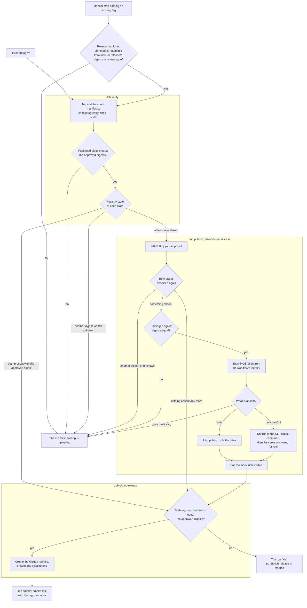

Common to all jobs:

- The workflow file sets no permissions at the top level; each job states its own.
- Runs for the same tag are serialized with a concurrency group named after the tag, whichever trigger started them, and are never canceled in progress.
- Every job checks out the tagged commit itself and installs the exact toolchain that this commit pins. It fails if that toolchain differs from the one recorded in the tag message. Every Cargo command uses the committed lock file with `--locked`.
- The approved digests are read from the tag message. They are the only reference for what may be published.
- **Registry lookups have four results**, used identically everywhere: *absent*; *present with the approved digest*; *present with another digest*; *unknown* (the lookup failed). An unknown result is retried a bounded number of times. While any result is unknown, nothing is uploaded.

**Job `verify`** — `permissions: contents: read`

1. Verify that the tag matches the version in both manifests and that the changelog has an entry for it.
2. Run the check suite. It contains the packaging checks of C.2.1 and no check that requires a version to be absent, so it passes whether or not the crates are already published.
3. Package both crates and compare their digests with the approved digests. A difference fails the run: what this commit builds is not what was approved.
4. Look up each crate and version in the registry index and classify it.
5. If either crate is *present with another digest*, or still *unknown* after the retries, fail. Nothing is uploaded and no release is created.
6. Publish the classification and the digests as job outputs, and store the release summary as a workflow artifact.

**Job `publish`** — runs only if at least one crate is *absent*; `environment: release`; `permissions: contents: read, id-token: write`

7. Wait for your approval of the `release` environment. Before approving, compare the tag, the commit and the digests shown by the run with what you approved at the go/no-go.
8. Classify both crates again, in full. Time has passed and another run may have acted. If either crate is now *present with another digest* or *unknown*, stop before any upload. If nothing is absent any more, end the job.
9. Package again on this runner and compare the digests with the approved ones, since this job starts from a fresh checkout.
10. `rust-lang/crates-io-auth-action@v1` exchanges the workflow's identity for a short-lived crates.io token.
11. Upload what is absent:
    - *Both absent:* `cargo publish --locked -p cc-media-probe -p cc-media-probe-cli`.
    - *Only the CLI absent:* the single-package route, in two steps with identical settings. First `cargo publish --dry-run --locked -p cc-media-probe-cli` with `CARGO_RESOLVER_INCOMPATIBLE_PUBLISH_AGE=allow` set for that command only. The CLI package this produces is compared with the approved CLI digest. Only if they are equal is the same command run without `--dry-run`. The cooldown is lifted because the library version is too young; `--locked` keeps every other dependency at its committed version, and the digest comparison proves it before anything is sent.
    - *Only the library absent while the CLI is present:* fail. That state cannot arise from this workflow.
12. After each upload, poll the index until the version is visible. A timeout leads to another lookup, never to another upload.
13. Record, for each crate uploaded in this run, that the upload was tokenless. The value goes into the release summary.

**Job `github-release`** — runs after `verify` and after `publish` succeeded or was skipped; `permissions: contents: write`

14. Look up both crates in the registry index and compare both checksums with the approved digests. This step runs on every path, including a manually published release, a retry, and a run in which nothing was uploaded.
15. Create the GitHub release from the changelog entry, attach the release summary, and mark it as a pre-release when the version has a pre-release suffix. If the release already exists, succeed without changing it.

**Job `smoke`** — runs last; `permissions: contents: read`

16. The smoke test of C.6 step 8, with the versions taken from the tag.

No long-lived secret is stored in the repository. The crates.io token cannot create a GitHub release, and the upload job cannot write to the repository.

### C.6 Every later release

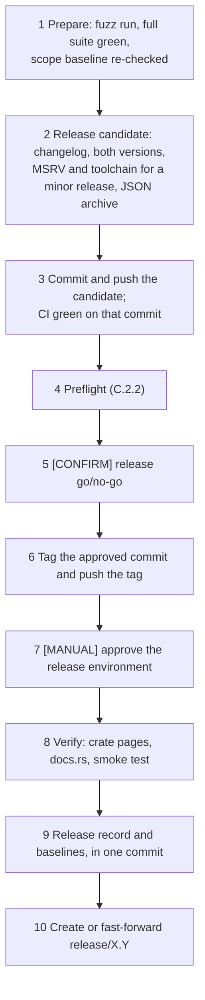

Steps 3, 6, 9 and 10 commit, tag, push or move a branch; each is done on your instruction (R10).

1. **Prepare.** Fuzz run for the phase; full suite green; scope baseline re-checked.
2. **Build the release candidate.** Update `CHANGELOG.md`, including "Changed output". Bump both versions together, and with them the CLI's exact requirement on the library. For a minor release, set `rust-version` to the stable version current that day and pin `rust-toolchain.toml` to that exact release; for a patch release, leave both unchanged. Archive the JSON fixtures for this crate release, whether or not the schema changed.
3. **Commit and push the candidate** to its branch. CI must be green on that exact commit, including the API compatibility check and the serialized-form tests against the baselines of its line.
4. **Preflight** as in C.2.2, on that commit.
5. **[CONFIRM]** release go/no-go. You approve the preflight summary: the candidate commit, the versions, the toolchain record, the approved digests, the file lists and the route.
6. **Tag the approved commit.** The annotated tag `vX.Y.Z` carries the approved digests and the toolchain record in its message. Push it.
7. **[MANUAL]** approve the pending `release` environment deployment in GitHub Actions, after the comparison of C.5 step 7.
8. **Verify.** The crates.io pages and the docs.rs build. The smoke test uses the exact versions of the tag: a new project outside the repository depends on `cc-media-probe = "=X.Y.Z"`, builds, and probes a file; `cargo install cc-media-probe-cli --version X.Y.Z --locked` installs a binary; the test asserts that this binary reports version X.Y.Z, that the generator version in its JSON output is X.Y.Z, that the library named in the installed package's lock file is X.Y.Z, and that it probes the sample.
9. **Release record and baselines,** in one commit on the release's branch:
   - `docs/releases/X.Y.Z.md`: the candidate commit, the tag's object ID, the toolchain record, the approved digests, the checksums the registry reported, the date, and for each crate whether the upload used Trusted Publishing or a token.
   - The API-check baseline is set to the new version, and the list of approved exceptions is emptied.
   - The retained old readers (section 8.8) are brought up to date: a reader workspace for the new release is added as "previous", with its exact requirement and its own lock file; a reader that is now neither the first of its schema major, nor the last of its minor line, nor the previous release is removed. The new version is younger than the cooldown, so its lock entry is created once with the cooldown lifted for that single command; from then on it is a locked entry.
10. **Mark the line.** The branch `release/X.Y` is created at that commit, or fast-forwarded to it. The branch therefore always points at the newest released state of line X.Y, with that release's baselines. Like every commit and branch operation, this is done on your instruction (R10).

**Maintenance lines.** Fixes go to the newest minor line. An older line gets a patch release only for a security problem, and only when you decide so (the maintainer's choice on 2026-11-24; `docs/guide/stability.md` section 1.2). A patch for an older minor line is prepared on `release/X.Y`. Step 10 keeps that branch at the latest shipped patch of the line together with its post-release baselines, so the branch contains every fix and every fixture the line has shipped, including patches that were released from `main` before work on the next minor version began. Before a maintenance candidate is built, a check asserts three things: the newest tag of the line is an ancestor of the branch; the API baseline and the "previous" reader both name that tag's version; and no commit that belongs to a later minor line is on the branch. For a maintenance release, everything is taken from its own line: the candidate commit and its green CI are on the branch; the MSRV and the pinned toolchain are the line's; the API baseline, the schema archive and the retained readers are those of the line; the tag points at the branch commit. The state of `main` plays no part. While `main` holds no work for the next minor version yet, `main` and `release/X.Y` are the same commit; a patch is then prepared on `main`, and step 10 moves the branch along. CI runs on `main` and on every `release/*` branch. This is the only use of branches in the project.

**Pre-releases.** Both crates carry the same pre-release version, and the CLI's exact requirement names it, for example `=1.0.0-rc.1`. The same steps and gates apply.

### C.7 If a release stops half-way — standing gate GS.6 [CONFIRM]

Nothing in this section is done without your confirmation of the route (GS.6).

First, in every case: do not repeat the publish command and do not move or delete a tag. Classify each crate and version with the four results of C.5.

**"Absent" must be earned.** An upload can be accepted before it becomes visible. A version counts as absent only after a bounded recheck: the registry index and the crate's version page are looked up once a minute for fifteen minutes, and the version appears in neither.

| Library | CLI | What it means | Action |
|---|---|---|---|
| Absent | Absent | Nothing was accepted. | The joint publish may be run once more. Manual route: repeat C.3 from step 1. Workflow route: run the workflow again. |
| Approved digest | Absent | The library is published and the CLI is not. | Publish the CLI alone by the single-package route of C.5 step 11: dry run with the cooldown lifted, compare the CLI package with the approved digest, then the same command without `--dry-run`. Manual route: on your machine, with the token of C.1. Workflow route: run the workflow again; it performs exactly these steps after your approval. |
| Approved digest | Approved digest | Both are published. | Manual route: continue at C.3 step 5. Workflow route: run the workflow again; it creates the GitHub release. |
| Another digest | Any | The published bytes are not the approved ones. | The version number is spent. See below. |
| Any | Another digest | The same. | The version number is spent. See below. |
| Absent | Present | Cannot arise: the CLI needs the library. | Stop and investigate. Nothing is uploaded. |
| Unknown | Any, or the reverse | The registry could not be read. | Wait and look up again. No action is taken on an unknown state. |

"Run the workflow again" means a re-run of the original run within GitHub's 30 days, or otherwise the manual start of C.5 for the same tag.

**A spent version.**

1. Yank what was published under that version (C.8), and only versions confirmed present.
2. The number is never reused. If no tag exists for it yet, none is created.
3. The next patch version becomes the candidate and goes through the preflight again.
4. Its registry states can now be mixed: one crate is registered with a spent version, the other was never published. C.2.2 step 1 accepts this and assigns the manual route. You create a token as in C.1, with `publish-new` for the unregistered crate and `publish-update` for the other, publish both with the one command of C.3, and revoke the token afterwards. Trusted Publishing is then configured, or checked, for each crate as in C.4.

### C.8 If a release is wrong

- **Yank, then fix forward.** Yanking stops new projects from selecting a version without breaking existing lock files. It deletes nothing. Only a version that the index shows as present is yanked. The crate is always named, because the workspace root has no package of its own:
  - `cargo yank cc-media-probe@X.Y.Z`
  - `cargo yank cc-media-probe-cli@X.Y.Z`
- **Credentials for a yank [MANUAL].** By this time the publishing token is revoked (C.4), and the workflow's short-lived token is for uploads. Two routes exist; which one you use is your choice at GS.6:
  - *On the website.* Signed in as an owner, use the yank action on the version's page, if crates.io offers one there. No credential is placed on any machine. Whether the site offers it is checked when the crate pages first exist (Phase 8 task 12) and noted in this runbook.
  - *With a dedicated token.* Create a token with the `yank` scope only, restricted to `cc-media-probe*`, with the shortest expiry. Run `cargo login`, then the commands above. Revoke the token and run `cargo logout` immediately afterwards. This route works before and after Trusted Publishing is required, because that setting concerns uploads.
- **Library and CLI are handled separately.** If only the CLI is broken, yank only the CLI version. If the library is broken, yank both, because the CLI of that version depends on exactly that library. The fix is a new patch version of both crates, published together.
- **A published secret** is revoked immediately; yanking does not remove it from the registry's storage.
- **Owners** are added per crate at your discretion: `cargo owner --add <github-user> cc-media-probe` and `cargo owner --add <github-user> cc-media-probe-cli`.

---

## Appendix D — Research log

Research performed on 2026-11-20 to support the decisions in this plan. The later groups were done for the revisions after reviews 01, 02 and 03.

| Topic | Finding | Source |
|---|---|---|
| RFC coverage | Relevant RFCs identified and verified against the index; obsoleted ones excluded. The list held 74 on 2026-11-20 (a snapshot). | [RFC index](https://www.rfc-editor.org/rfc-index.txt) |
| Matroska standardization | RFC 8794, RFC 9559 and RFC 9639 are published. Codec and tag specifications are still drafts; the chapter-codecs draft has expired. | [IETF CELLAR working group](https://datatracker.ietf.org/group/cellar/) |
| Redistributing RFC text | Whole, unmodified RFCs may be copied and distributed. | [IETF Trust Legal Provisions](https://trustee.ietf.org/documents/trust-legal-provisions/tlp-5/) |
| Current Rust | 1.100.0, released 2026-11-12; edition 2024 remains the latest edition. Cargo now warns on unused dependencies and supports a minimum publish age. | [Rust 1.100.0 announcement](https://blog.rust-lang.org/2026/11/12/Rust-1.100.0/) |
| Publishing | Account via GitHub, verified email, metadata fields, 10 MB limit, permanence, yanking, owners. | [Cargo Book: Publishing](https://doc.rust-lang.org/cargo/reference/publishing.html) |
| Trusted Publishing | First release must be manual; GitHub Actions supported; `id-token: write`; official auth action. | [crates.io docs](https://crates.io/docs/trusted-publishing) · [crates.io development update, July 2025](https://blog.rust-lang.org/2025/07/11/crates-io-development-update-2025-07/) · [auth action](https://github.com/rust-lang/crates-io-auth-action) |
| Crate names | `cc-media-probe` and `cc-media-probe-cli` unregistered, checked twice on 2026-11-20. | crates.io registry index queries |
| API evolution | Non-exhaustive types, private fields, sealed traits; automated SemVer checking in CI. | [Cargo SemVer reference](https://doc.rust-lang.org/cargo/reference/semver.html) · [API Guidelines: future proofing](https://rust-lang.github.io/api-guidelines/future-proofing.html) · [API Guidelines checklist](https://rust-lang.github.io/api-guidelines/checklist.html) |
| Sync and async from one code base | Three approaches compared: I/O-free state machines, write-once-async with a blocking driver, macro-generated variants. The second is proposed, validated by a spike. | [The case for sans-io](https://fasterthanli.me/articles/the-case-for-sans-io) · [Supporting both async and sync code in Rust](https://nullderef.com/blog/rust-async-sync/) · [async working group user story](https://github.com/rust-lang/wg-async/issues/49) |
| General-purpose crates and tools | All proposed crates and tools confirmed current and maintained (latest releases between 2026-02 and 2026-11). | crates.io registry queries |
| Documentation hosting | Build configuration for hosted API docs, including optional features. | [docs.rs metadata](https://docs.rs/about/metadata) |
| Non-RFC specification links | About 130 links checked for draft 1 and about 110 more for draft 2; results recorded in Appendix B. | Direct requests |
| **Revision after review 01** | | |
| RFC reconciliation | RFC 9649 (WebP) was missing; seven secondary references added (RFC 4629, 4352, 3558, 2658, 3625, 7903, 5484). | [RFC index](https://www.rfc-editor.org/rfc-index.txt) · [RFC 9649](https://www.rfc-editor.org/rfc/rfc9649.html) |
| Verified errata | Verified errata exist for RFC 8794, 9639, 3533, 6716, 6386 and 8486, among others. | [RFC 8794 with errata](https://www.rfc-editor.org/rfc/inline-errata/rfc8794.html) · [RFC 9639 with errata](https://www.rfc-editor.org/rfc/inline-errata/rfc9639.html) |
| Draft revisions | Codec mappings -21, tags -25, chapter codecs -05 (expired). | [IETF Datatracker](https://datatracker.ietf.org/group/cellar/documents/) |
| Pinned editions | Exact current editions for ETSI, ITU-T, ITU-R and 3GPP documents; ISO catalog pages located by search because the site blocks automated requests. | [ETSI deliverables](https://www.etsi.org/deliver/) · [ITU-T recommendations](https://www.itu.int/rec/T-REC-H) · [3GPP archive](https://www.3gpp.org/ftp/Specs/archive/26_series/) · [ISO/IEC 14496-14](https://www.iso.org/standard/79110.html) · [ISO/IEC 14496-15](https://www.iso.org/standard/89118.html) |
| Clean-room boundary | RFC 9043 defines FFV1 syntax through pseudocode with its own conventions section. | [RFC 9043 section 2.2.1](https://www.rfc-editor.org/rfc/rfc9043.html#section-2.2.1) |
| Fuzzing tool | Needs nightly and a C++ compiler. Builds every crate with `--cfg fuzzing`, which is not a well-known configuration name and must be declared. | [Rust Fuzz Book: setup](https://rust-fuzz.github.io/book/cargo-fuzz/setup.html) · [guide](https://rust-fuzz.github.io/book/cargo-fuzz/guide.html) · [rustc: checking conditional configurations](https://doc.rust-lang.org/rustc/check-cfg.html) |
| Async traits | Tokio and futures-io define separate `AsyncRead` traits; one module per runtime avoids ambiguity. | [Tokio AsyncRead](https://docs.rs/tokio/latest/tokio/io/trait.AsyncRead.html) · [futures-io AsyncRead](https://docs.rs/futures-io/latest/futures_io/trait.AsyncRead.html) |
| Serialized compatibility | Field defaults and catch-all variants are per-field and per-variant attributes; non-exhaustive Rust types do not cover the serialized form. | [Serde field attributes](https://serde.rs/field-attrs.html) · [Serde variant attributes](https://serde.rs/variant-attrs.html) |
| Documentation tests | Rustdoc tests cover documentation attached to crate items; standalone Markdown needs a harness. | [Rustdoc documentation tests](https://doc.rust-lang.org/rustdoc/write-documentation/documentation-tests.html) |
| Packaging and targets | A virtual manifest owns no targets. The `readme` is expected inside the package root; `license-file` is always included. | [Cargo targets](https://doc.rust-lang.org/cargo/reference/cargo-targets.html) · [Cargo manifest](https://doc.rust-lang.org/cargo/reference/manifest.html) · [cargo package](https://doc.rust-lang.org/cargo/commands/cargo-package.html) |
| MSRV | Guidance on declaring and verifying `rust-version`. | [Cargo: Rust version](https://doc.rust-lang.org/cargo/reference/rust-version.html) |
| Multi-package publishing | One command publishes several packages in dependency order and verifies them against each other; not atomic. An index timeout does not affect the upload. | [Rust 1.90.0 announcement](https://blog.rust-lang.org/2025/09/18/Rust-1.90.0/) · [cargo publish](https://doc.rust-lang.org/cargo/commands/cargo-publish.html) |
| Dependency cooldown | `registry.global-min-publish-age` and `resolver.incompatible-publish-age`; locked versions are exempt; no per-crate exemption is documented. | [Cargo configuration](https://doc.rust-lang.org/cargo/reference/config.html#resolverincompatible-publish-age) · [Cargo resolver](https://doc.rust-lang.org/cargo/reference/resolver.html) |
| Registry rules | Crate deletion conditions; enforcement setting for Trusted Publishing; publish time in the index; blocked workflow triggers. | [crates.io update, February 2025](https://blog.rust-lang.org/2025/02/05/crates-io-development-update/) · [crates.io update, January 2026](https://blog.rust-lang.org/2026/01/21/crates-io-development-update/) |
| Yank and owner commands | Both take the crate name explicitly. | [cargo yank](https://doc.rust-lang.org/cargo/commands/cargo-yank.html) · [cargo owner](https://doc.rust-lang.org/cargo/commands/cargo-owner.html) |
| Workflow permissions | Permissions are set per job; unspecified ones are withheld once any is specified; creating a release needs write access to contents. | [GitHub workflow syntax](https://docs.github.com/en/actions/reference/workflows-and-actions/workflow-syntax#permissions) · [GitHub releases API](https://docs.github.com/en/rest/releases/releases#create-a-release) |
| MP4 details | Sample-to-chunk selection of sample descriptions; initialization and media segments. | [Sample-to-chunk table](https://developer.apple.com/documentation/quicktime-file-format/sample-to-chunk_atom/sample-to-chunk_table) · [ISO BMFF byte stream format](https://www.w3.org/TR/mse-byte-stream-format-isobmff/) |
| F4V | F4V is based on the ISO base media file format; FLV is tag-based. | [Understanding video formats](https://airsdk.dev/docs/development/rich-media-content/working-with-video/understanding-video-formats) |
| **Revision after review 02** | | |
| Package provenance | The commit recorded in a tarball is a best-effort snapshot and is not verified; the registry's checksum identifies the published bytes. | [cargo package](https://doc.rust-lang.org/cargo/commands/cargo-package.html) |
| Packaging reproducibility | No official guarantee. Projects that tested it report identical bytes across machines with the same Cargo version and lock file, and build their release checks on that. | [cargo package](https://doc.rust-lang.org/cargo/commands/cargo-package.html) and published release workflows of other projects |
| Workspace boundaries | Cargo searches parent directories for a workspace root; `exclude` keeps a path out; a nested directory needs its own workspace table. | [Cargo workspaces](https://doc.rust-lang.org/cargo/reference/workspaces.html) |
| Dev-dependencies in packages | Path dependencies need a version to be published; an unpublished path-only dev-dependency is removed from the published manifest. | [Cargo: specifying dependencies](https://doc.rust-lang.org/cargo/reference/specifying-dependencies.html#development-dependencies) |
| Build scripts | A build script can run tools and emit link instructions without declaring a `links` key. | [Cargo build scripts](https://doc.rust-lang.org/cargo/reference/build-scripts.html) |
| Workflow jobs | Each job runs on a fresh runner; data passes through outputs and artifacts; runs can be serialized with a concurrency group. | [Runners](https://docs.github.com/en/actions/how-tos/write-workflows/choose-where-workflows-run/choose-the-runner-for-a-job) · [Artifacts](https://docs.github.com/en/actions/concepts/workflows-and-actions/workflow-artifacts) · [Concurrency](https://docs.github.com/en/actions/how-tos/write-workflows/choose-when-workflows-run/control-workflow-concurrency) |
| JSON numbers and paths | Numbers beyond the double-precision integer range are not interoperable; operating-system strings are not always valid Unicode. | [RFC 8259 section 6](https://www.rfc-editor.org/rfc/rfc8259.html#section-6) · [RFC 7493](https://www.rfc-editor.org/rfc/rfc7493.html) · [Rust OsStr](https://doc.rust-lang.org/std/ffi/struct.OsStr.html) |
| MP4 media types | `application/mp4` applies when a file has neither visual nor audio content. | [RFC 4337 section 2](https://www.rfc-editor.org/rfc/rfc4337.html#section-2) |
| Matroska details | Display units other than pixels; scope and order of content encodings; several tags elements, wildcard targets and value-less tag nodes; the WavPack mapping. | [RFC 9559 display unit](https://www.rfc-editor.org/rfc/rfc9559.html#section-5.1.4.1.28.14) · [content encodings](https://www.rfc-editor.org/rfc/rfc9559.html#section-5.1.4.1.31) · [tags](https://www.rfc-editor.org/rfc/rfc9559.html#section-5.1.8) · [pinned codec mappings](https://www.ietf.org/archive/id/draft-ietf-cellar-codec-21.html) |
| Composition time | Composition offsets separate decode time from presentation time. | [Composition offset atom](https://developer.apple.com/documentation/quicktime-file-format/composition_offset_atom) |
| Ogg multiplexing | Pages of concurrent logical streams interleave; the last page of a link belongs to one stream. | [Ogg stream multiplexing](https://xiph.org/ogg/doc/ogg-multiplex.html) |
| Missing sources | The MP4 carriage of WebVTT is in ISO/IEC 14496-30; ID3v2.4 frames are in a separate document. | [ISO/IEC 14496-30](https://www.iso.org/standard/75394.html) · [ID3v2.4 frames](https://github.com/id3/ID3v2.4/blob/master/id3v2.4.0-frames.txt) |
| Document files | Direct downloads work for some ITU editions and return a web page for others; W3C documents have dated versions. | Direct requests |
| **Revision after review 03** | | |
| Confined file access | The standard library documents the race between checking a path and using it, and has no stable way to open a path confined to a folder; its directory-handle type is still experimental. The best-known sandboxing crate resolves paths itself on macOS and Windows and had an escape advisory there in 2026. | [Rust std::fs](https://doc.rust-lang.org/std/fs/index.html#time-of-check-to-time-of-use-toctou) · [advisory](https://github.com/bytecodealliance/cap-std/security/advisories/GHSA-hp8f-xmx4-4qrg) |
| Build scripts of dependencies | Serde's build script starts the Rust compiler to read its version and emits only configuration flags. | [Build script of serde 1.0.229](https://docs.rs/crate/serde/1.0.229/source/build.rs) |
| Pairing of the two crates | Reproduced with Cargo 1.96 in a throw-away workspace. With a caret requirement, the CLI's packaged lock file named a newer registry release of the library. With an exact requirement it named the paired version, and its checksum equaled the digest of the library package built in the same run. Packaged alone, the CLI's lock file took that checksum from the registry. To be repeated with the pinned toolchain in Phase 8. | Local experiment · [Cargo: caret requirements](https://doc.rust-lang.org/cargo/reference/specifying-dependencies.html#caret-requirements) |
| Publishing options | `--locked` refuses a changed resolution; `--dry-run` performs all checks without uploading; an index timeout does not affect the upload. | [cargo publish](https://doc.rust-lang.org/cargo/commands/cargo-publish.html) |
| Rehearsing a publish | Small registry servers accept an unmodified `cargo publish` for testing. | [cargo-http-registry](https://github.com/d-e-s-o/cargo-http-registry) |
| API comparison level | The tool takes the allowed change from the version unless a release type is given. Lint levels can be configured; exceptions for single items are not built in. | [cargo-semver-checks](https://github.com/obi1kenobi/cargo-semver-checks#readme) · [its GitHub action](https://github.com/obi1kenobi/cargo-semver-checks-action#readme) |
| Running a workflow again | A run can be re-run for 30 days and uses the original commit and ref; a workflow can also be started manually; tags can be protected by a ruleset. | [Re-running workflows](https://docs.github.com/en/actions/how-tos/manage-workflow-runs/re-run-workflows-and-jobs) · [Events that trigger workflows](https://docs.github.com/en/actions/reference/workflows-and-actions/events-that-trigger-workflows) · [Rulesets](https://docs.github.com/en/repositories/configuring-branches-and-merges-in-your-repository/managing-rulesets/about-rulesets) |
| Yanking | Needs a token or a prior login; a separate `yank` token scope exists. Whether the website offers owners a yank action was not confirmed. | [cargo yank](https://doc.rust-lang.org/cargo/commands/cargo-yank.html) · [token scopes](https://rust-lang.github.io/rfcs/2947-crates-io-token-scopes.html) |
| Trusted Publishing triggers | Runs started by `pull_request_target` or `workflow_run` are refused. No official list of accepted triggers was found; a manual start is reported to work by other projects. | [crates.io update, January 2026](https://blog.rust-lang.org/2026/01/21/crates-io-development-update/) |
| Growing buffers | A reservation guarantees a minimum, the allocator may give more, and growth copies into a new allocation. | [Vec::try_reserve_exact](https://doc.rust-lang.org/std/vec/struct.Vec.html#method.try_reserve_exact) |
| End of input | A read that returns no bytes is the signal that a reader has ended. | [Read::read](https://doc.rust-lang.org/std/io/trait.Read.html#method.read) |
| Integration tests and examples | Tests under `tests/` link the library as an external crate and see only its public API. An example whose required features are off is skipped. | [The Rust Book: test organization](https://doc.rust-lang.org/book/ch11-03-test-organization.html#integration-tests) · [Cargo targets: required features](https://doc.rust-lang.org/cargo/reference/cargo-targets.html#the-required-features-field) |
| Errors and paths on the wire | An I/O error can wrap any error object; operating-system strings have no portable byte form. | [std::io::Error](https://doc.rust-lang.org/std/io/struct.Error.html) · [OsStr](https://doc.rust-lang.org/std/ffi/struct.OsStr.html#method.as_encoded_bytes) |
| Matroska rules | Encodings are undone from the highest order value down. Two seek heads must together reference every top-level element except the first seek head. A stream may hold several segments, and in a live stream later tags replace earlier ones. An ordered edition defines its own playback order. | [RFC 9559 section 5.1.4.1.31.2](https://www.rfc-editor.org/rfc/rfc9559.html#section-5.1.4.1.31.2) · [section 6.3](https://www.rfc-editor.org/rfc/rfc9559.html#section-6.3) · [section 23.2](https://www.rfc-editor.org/rfc/rfc9559.html#section-23.2) · [section 20.1.3](https://www.rfc-editor.org/rfc/rfc9559.html#section-20.1.3) |
| Pinned Matroska codec mapping | A USF track may carry a stream-wide header. Kate and TextST carry headers in private data. VC-1 uses the configuration structure of SMPTE RP 2025. The TTA header structure is in private data. There is no Speex identifier. | [Pinned codec mappings](https://www.ietf.org/archive/id/draft-ietf-cellar-codec-21.html#section-3.5.10) |
| Sources that were missing | RFC 8216 defines the timestamp-map header of WebVTT. The TrueHD carriage in MP4 is a separate document. PCM in MP4 is ISO/IEC 23003-5. The RIFF specification defines the character-set chunk. Chapter comments are a wiki convention. AV1 has a format of its own in transport streams. | [RFC 8216 section 3.5](https://www.rfc-editor.org/rfc/rfc8216.html#section-3.5) · [MP4RA references](https://mp4ra.org/references) · [ISO/IEC 23003-5](https://www.iso.org/standard/77752.html) · [RIFF specification](https://www.mmsp.ece.mcgill.ca/Documents/AudioFormats/WAVE/Docs/riffmci.pdf) · [AV1 in MPEG-2 TS](https://aomediacodec.github.io/av1-mpeg2-ts/) |
| WebVTT encoding | A WebVTT file must be UTF-8. | [WebVTT file structure](https://www.w3.org/TR/webvtt1/#file-structure) |
| Presentation and delivery clocks | Clock references describe delivery; presentation timestamps mark the start of an access unit. | [ITU-T H.222.0](https://www.itu.int/rec/T-REC-H.222.0-202504-I/en) |
| MP4 timing | An edit's media time is a position in the media, used for example to skip encoder delay; composition offsets reorder presentation. | [Edit lists and encoder delay](https://developer.apple.com/documentation/quicktime-file-format/using_track_structures_to_represent_encode_delay_explictly) · [Composition offset atom](https://developer.apple.com/documentation/quicktime-file-format/composition_offset_atom) |
| **Revision for the code rules (draft 5)** | | |
| Module layout lints | `self_named_module_files` makes `name/mod.rs` the only form of a module with submodules; its path handling was corrected in September 2025. `definition_in_module_root`, added in Clippy 1.99, rejects definitions in a `mod.rs`. It checks neither `lib.rs` nor `main.rs` nor inline module bodies, and it permits macro calls and exported macros. Both are restriction lints, off unless enabled. | [Clippy lint list](https://rust-lang.github.io/rust-clippy/master/index.html) · [`definition_in_module_root` source](https://github.com/rust-lang/rust-clippy/blob/master/clippy_lints/src/definition_in_module_root.rs) · [rust-clippy issue 14697](https://github.com/rust-lang/rust-clippy/issues/14697) |
| Coverage thresholds | `--fail-under-lines` fails only when coverage is below the threshold, so a result exactly at the threshold passes. There is no per-directory threshold; `--json --summary-only` reports per-file figures. Files named `tests.rs` and directories named `tests` are left out of the report by default. | [cargo-llvm-cov](https://github.com/taiki-e/cargo-llvm-cov) |
| Diagrams | GitHub renders Mermaid diagrams written in fenced `mermaid` blocks in Markdown files. Rustdoc does not; a proc-macro crate that embeds the Mermaid script would be needed for that. | [GitHub: creating diagrams](https://docs.github.com/en/get-started/writing-on-github/working-with-advanced-formatting/creating-diagrams) · [aquamarine](https://github.com/mersinvald/aquamarine) |
| **Revision for the code rules (draft 6)** | | |
| Magic numbers | Clippy has no lint for unnamed literals. Requests for one go back to 2017, and none was implemented; the closest lints only judge how a literal is written. The literal check of D23 fills the gap. | [rust-clippy issue 1539](https://github.com/rust-lang/rust-clippy/issues/1539) · [rust-clippy issue 2342](https://github.com/rust-lang/rust-clippy/issues/2342) |
| Short names | `min_ident_chars` (Clippy 1.72, restriction) rejects names no longer than its threshold, 1 by default, unless they are on `allowed-idents-below-min-chars`, whose default list allows `i`, `j`, `x`, `y`, `z`, `w` and `n`. It checks items, fields, variants and bindings, and skips names that follow a trait's own; it does not check generic parameters or lifetimes. `single_char_lifetime_names` covers lifetimes. No lint recognizes abbreviations. Reproduced on Clippy 0.1.96 in a disposable crate: with an empty allowed list, `i` and `'a` were rejected and a generic `T` was not. | [Clippy lint configuration](https://doc.rust-lang.org/clippy/lint_configuration.html) · [`min_ident_chars` source](https://github.com/rust-lang/rust-clippy/blob/master/clippy_lints/src/min_ident_chars.rs) |
| Format templates | The template of `format!` and `write!` must be a string literal, but it can name a constant in scope as an inline argument (`"{NAME}"`), so message text can live in a constant. Reproduced in the same crate. | [`std::fmt`](https://doc.rust-lang.org/std/fmt/index.html) |
| **Phase 1, gate G1.2 (revision 7)** | | |
| Latest toolchain | `rustup check` on 2026-11-21 offered `rustc 1.100.0 (0ef1bc386 2026-11-09)` as stable; nightly was `1.102.0-nightly (c7d5ba59d 2026-11-20)`. | [Rust 1.100.0 announcement](https://blog.rust-lang.org/2026/11/12/Rust-1.100.0/) · [Rust versions](https://releases.rs/) |
| Repository marker | Cargo uses the first of four sources of compiler flags; any `RUSTFLAGS` variable replaces `build.rustflags`. Reproduced on 1.100.0: a `--cfg` flag in `.cargo/config.toml` reached `cargo test` and `cargo llvm-cov`, and was lost under `RUSTFLAGS`. | [Cargo configuration: build.rustflags](https://doc.rust-lang.org/cargo/reference/config.html#buildrustflags) · local experiment |
| Coverage of embedded tests | `cargo-llvm-cov` counts the lines of `#[cfg(test)] mod tests` blocks as covered code. Its LCOV records equal its JSON summary line for line. `#[coverage(off)]` is still an unstable feature in 1.100.0. Reproduced locally. | [cargo-llvm-cov](https://github.com/taiki-e/cargo-llvm-cov) · local experiment |
| Lints | All four lints of D23 and the panic lints of section 7.6 exist on Clippy for 1.100.0. Denying the `warnings` group in `[lints.rust]` makes every warning fail without `RUSTFLAGS`. Clippy's configuration allows `unwrap`, `expect`, `panic` and indexing in tests. | [Clippy lint configuration](https://doc.rust-lang.org/clippy/lint_configuration.html) · local experiment |
| Dependency cooldown | `registry.global-min-publish-age` and `resolver.incompatible-publish-age` are stable from Cargo 1.100; the resolver setting defaults to `deny`. | [Cargo configuration](https://doc.rust-lang.org/cargo/reference/config.html) · [cargo pull request 17335](https://github.com/rust-lang/cargo/pull/17335) |
| Build directory | Cargo 1.100 writes a build script's output to `build/<package>/<hash>/run/stdout`, with the script's output directory `out/` beside it. Other units' `out/` directories hold the compiler's own objects. Observed locally. | local experiment |
| Operating-system libraries | A plain binary built by 1.100.0 on macOS links only `/usr/lib/libSystem.B.dylib`. Current `windows-sys` releases link through `windows-link` with `raw-dylib` and need no import-library crate. | `otool -L`, local · [windows-sys 0.61 change](https://github.com/sunfishcode/io-lifetimes/pull/79) · [Understanding windows-targets](https://kennykerr.ca/rust-getting-started/understanding-windows-targets.html) |
| License headers | Rust's own repository removed its per-file license headers in 2018. The REUSE specification asks for an SPDX header in every file. The maintainer chose a copyright header with the Apache-2.0 notice. | [compiler-team issue 519](https://github.com/rust-lang/compiler-team/issues/519) · [REUSE FAQ](https://reuse.software/faq/) |
| Package contents | `cargo package --list` refuses uncommitted changes unless `--allow-dirty` is given. On 1.100 the library package includes `Cargo.lock`. Observed locally. | [cargo package](https://doc.rust-lang.org/cargo/commands/cargo-package.html) · local experiment |
| **Phase 1, scripts rule (revision 8)** | | |
| Node.js releases | Node.js 26 became the Active LTS line on 2026-10-28 with 26.13.0; 26.13.1 followed on 2026-11-10. Node.js 24 is in Maintenance LTS. From Node.js 27, one major release a year, each of which becomes LTS. | [Node.js 26 becomes LTS](https://www.vilvaathiban.com/blog/nodejs-26-lts-october-2026-which-node-version-to-use-new-release-schedule) · [Node.js 26 is LTS](https://ciunkos.com/node-js-26-lts-whats-new-and-how-to-upgrade) |
| TypeScript in Node.js | Type stripping runs `.ts` files without flags from Node.js 22.18 and is stable from 24.12 and 25.2. It does not type-check, ignores `tsconfig.json`, and accepts only erasable syntax: enums, namespaces and parameter properties fail, and imports name their `.ts` extension. Node.js 26 removed `--experimental-transform-types`. Reproduced on 26.13.1, where an enum fails. | [Running TypeScript natively](https://nodejs.org/learn/typescript/run-natively) |
| Script tests | `node --test` with a glob runs `.ts` test files, and `--experimental-test-coverage` reports coverage, both built in. Reproduced on 26.13.1. | [Node.js test runner](https://nodejs.org/api/test.html) |
| **Phase 1, language rule (revision 9)** | | |
| Titles keep their spelling | RFC 4421 is titled "Additional Colour Sampling Modes" in the RFC itself, so Appendix A keeps that spelling. | [RFC 4421](https://www.rfc-editor.org/rfc/rfc4421.txt) |
| **Phase 1, gate G1.3 (revision 10)** | | |
| Versions under the cooldown | On 2026-11-21 the cooldown of 3 days held back clap 4.6.9, cargo-llvm-cov 0.9.2, cargo-deny 0.22.0 and pollster 1.0.3, each published in the previous 3 days. | crates.io registry queries |
| Tokio's I/O traits | With no features, `tokio::io::AsyncRead` and `AsyncSeek` are available and `tokio` depends only on `pin-project-lite`. Reproduced on 1.100.0. | [tokio::io](https://docs.rs/tokio/1.54.1/tokio/io/index.html) |
| `serde_derive` in every listing | `serde` and `serde_core` 1.0.229 name `serde_derive` under a configuration that is never true, to keep the versions together, so a graph over all targets lists it with its proc-macro crates even without `derive`. | Packaged manifest of serde 1.0.229 |
| Features in `cargo metadata` | Its resolve merges the features that development dependencies enable, so the inventory lists `bytes` and `tokio-macros`, which no build of the published crates compiles. `cargo tree -e normal,build` resolves them exactly. Reproduced on 1.100.0. | [cargo metadata](https://doc.rust-lang.org/cargo/commands/cargo-metadata.html) |
| Build scripts of the graph | `proc-macro2`, `quote`, `serde`, `serde_core` and `zmij` start only the Rust compiler, for its version or, in `proc-macro2`, for test compiles of Rust probes; `serde_json` starts nothing. All six emit only configuration and rerun instructions. | Packaged sources of the versions in the spike's lock file |
| Benchmarks need C | `criterion` 0.8.2 depends on `alloca`, whose build script compiles C through `cc`, also without default features. `divan` 0.1.21 needs no C but had its last release in 2025-04. | crates.io registry queries; reproduced |
| Allocation trackers | `peak_alloc` 0.3.0 reports current and peak bytes, can reset the peak, and allocates a reallocated block before freeing the old one. `cap` 0.1.2 keeps a peak only with its `stats` feature and cannot reset it. `stats_alloc` 0.1.10 keeps no peak. `dhat` 0.3.3 brings 33 crates. | Packaged sources |
| Local registries | `cargo-http-registry` 0.1.8 is GPL-3.0-or-later, serves a git index and records no publication time. Cargo's index format has an optional `pubtime` field, and the cooldown settings apply to every registry. | [Registry index](https://doc.rust-lang.org/cargo/reference/registry-index.html) · [Cargo configuration](https://doc.rust-lang.org/cargo/reference/config.html) |
| TypeScript releases | `typescript` 7.0.2, npm's `latest` since 2026-07-08, is the compiler rewritten in Go and ships it in one optional package per platform. 6.0.3 is the last release written in JavaScript. Both type-check the scripts with `strict` and `erasableSyntaxOnly`, in 0.09 and 0.54 seconds. | npm registry; reproduced |
| Advisories | The OSV database listed no vulnerability for the 78 crate versions of the spike's lock file or for the three npm packages, on 2026-11-21. | [OSV](https://osv.dev/) |
| **Phase 1, the specification set (revision 11)** | | |
| RFC Editor records | Each RFC has a metadata document at `https://www.rfc-editor.org/rfc/rfcNNNN.json` with its title, status, and the RFCs that obsolete and update it. Every erratum is in one list, `https://www.rfc-editor.org/api/v1/errata.json`, with its status, type and section. On 2026-11-21 no RFC of Appendix A was obsoleted, and every title and status matched. | [RFC 8794 metadata](https://www.rfc-editor.org/rfc/rfc8794.json) · [errata list](https://www.rfc-editor.org/api/v1/errata.json) |
| RFC texts | The plain-text copies are served as `text/plain` and total 6.7 MB for the 74 RFCs of 2026-11-20. 63 contain form feeds, and the newer ones start with a byte-order mark, so they are exempt from hygiene and stored without line-ending conversion. Each names its own number in a `Request for Comments:` line near the top. | RFC Editor downloads |
| Redistributing RFCs | Trust Legal Provisions 5.0, section 3.c.i, permits anyone to copy and distribute IETF documents in full and without modification. For the Independent Submission, IAB and IRTF streams, section 8.c.iii extends the license of section 3.a beyond the standards process instead. Earlier RFCs carry the notice of the Internet Society or the IETF Trust; RFC 1950 and 1951 carry their authors' copyright with permission to copy. | [TLP 5.0](https://trustee.ietf.org/documents/trust-legal-provisions/tlp-5/) · [TLP FAQ](https://trustee.ietf.org/documents/trust-legal-provisions/copyright-policy-and-tlp-faq/) |
| JSON strings | RFC 8259 erratum 5318, verified on 2026-05-28, removes U+002F from the `unescaped` rule of section 7. | [Erratum 5318](https://www.rfc-editor.org/errata/eid5318) |
| SMPTE documents | SMPTE made its whole catalog of standards, recommended practices, engineering guidelines and registered disclosure documents free on 2026-06-17. Each publication is a ZIP archive on its document library. | [TV Technology](https://www.tvtechnology.com/standards/smpte-makes-its-standards-freely-accessible-to-the-global-media-technology-community) · [IBC](https://www.ibc.org/connective-tech/news/smpte-opens-up-standards-catalogue-for-free/22794) |
| ITU downloads | The download address of H.264, H.265, H.266, H.263, H.273, T.871 and T.35 returns the PDF. For H.222.0 (04/2025), H.262, T.81, BT.2100-3 and BS.2088-2 it redirects an automated client to a login form. | Requests of 2026-11-21 |
| Internet Archive | Raw captures (`id_`) come back with the original media type, compressed in transfer, which Node.js's fetch undoes. The index refused connections after 16 queries 4 seconds apart. | Requests of 2026-11-21 |
| Pinned repository files | `raw.githubusercontent.com` serves a file at a commit as `text/plain`, or `application/octet-stream` for large and binary files, whatever its extension. | Requests of 2026-11-21 |
| Apple's QuickTime documentation | The page is a script application; its content is a tree of JSON documents under `tutorials/data/documentation/quicktime-file-format`, each naming its children in its topic sections. | Requests of 2026-11-21 |
| ISO's free standards | The list of publicly available standards is built by script, and the free 2015 edition of ISO/IEC 14496-12 is served only after a license page. | Requests of 2026-11-21 |
| **Phase 1, gate G1.4 (revision 12)** | | |
| Pinned drafts | On 2026-11-21 the datatracker still gives draft-ietf-cellar-codec at -21 in IESG evaluation, draft-ietf-cellar-tags at -25 in the RFC Editor queue, and draft-ietf-cellar-chapter-codecs at -05, expired. | [Datatracker](https://datatracker.ietf.org/doc/draft-ietf-cellar-tags/) |
| Updating RFCs | Of the RFCs that update listed ones, 2646 is obsoleted by 3676, 3798 by 8098 and 7320 by 8820. RFC 5761 is updated by 8035 and 8858, and RFC 4788 by 5188; nothing updates those three. | RFC Editor metadata of 2026-11-21 |
| VC-1 in MPEG-2 streams | SMPTE RP 227 (2010) gives a VC-1 elementary stream the stream type 0xEA and a registration descriptor with sub-descriptors (section 5.1), and applies them to program streams (section 6.1). ETSI TS 101 154 refers to it. | [SMPTE RP 227](https://pub.smpte.org/doc/rp227/) |
| Carriage in H.222.0 | The 06/2021 edition defines the carriage of ISO/IEC 14496 data (2.11), H.264 (2.14), HEVC (2.17) and VVC (2.23); its Amendment 1 adds LCEVC. | The stored texts |
| **Phase 1, tasks 18 and 19 (revision 20)** | | |
| Runner images | The standard runners include `ubuntu-26.04`, `macos-26` (arm64) and `windows-2025`. `ubuntu-latest` moved from 24.04 to 26.04 between 2026-10-19 and 2026-11-19, and the `-latest` labels move again whenever GitHub changes them. | [GitHub-hosted runners](https://docs.github.com/en/actions/reference/runners/github-hosted-runners) · [runner images](https://github.com/actions/runner-images) |
| Actions | On 2026-11-21 the current releases were checkout 7.0.1, setup-node 7.1.0 and cache 6.1.0. Each runs on Node.js 24, and `git ls-remote` resolves each tag to the commit the workflow pins. setup-node reads `lts/*` from a version file and caches npm only when asked to or when `package.json` names a package manager. | [checkout](https://github.com/actions/checkout/releases) · [setup-node](https://github.com/actions/setup-node) · [cache](https://github.com/actions/cache/releases) |
| Installing the toolchain | Since rustup 1.28, CI is told to run `rustup toolchain install` with no argument, which installs the toolchain of `rust-toolchain.toml`, with its components from 1.28.2. | [Rustup 1.28.0](https://blog.rust-lang.org/2025/03/02/Rustup-1.28.0/) · [rustup issue 4216](https://github.com/rust-lang/rustup/issues/4216) |
| Tool installs | `cargo install` of a crate from crates.io ignores the configuration of the current directory and starts at `$CARGO_HOME/config.toml`, so the repository's cooldown does not reach it. The cooldown keys have the environment variables `CARGO_REGISTRY_GLOBAL_MIN_PUBLISH_AGE` and `CARGO_RESOLVER_INCOMPATIBLE_PUBLISH_AGE`, which take precedence over files. | [cargo install](https://doc.rust-lang.org/cargo/commands/cargo-install.html) · [Cargo configuration](https://doc.rust-lang.org/cargo/reference/config.html) |
| Repository settings | **Settings → Actions → General** can allow only actions created by GitHub and require every action to be pinned to a full-length commit SHA; its **Workflow permissions** section sets the default token to read access. Private vulnerability reporting is enabled under **Settings → Advanced Security** and adds **Report a vulnerability** to the Security tab. | [Actions settings](https://docs.github.com/en/repositories/managing-your-repositorys-settings-and-features/enabling-features-for-your-repository/managing-github-actions-settings-for-a-repository) · [private vulnerability reporting](https://docs.github.com/en/code-security/security-advisories/working-with-repository-security-advisories/configuring-private-vulnerability-reporting-for-a-repository) |
| Changelog format | Keep a Changelog 1.1.0: an Unreleased section at the top, the kinds Added, Changed, Deprecated, Removed, Fixed and Security, ISO 8601 dates and linkable versions. | [Keep a Changelog](https://keepachangelog.com/en/1.1.0/) |
| Rustdoc warnings | Denying the `warnings` group in `[lints.rust]` also makes `cargo doc` fail on a rustdoc warning such as an unclosed HTML tag. Reproduced on 1.100.0. | local experiment |
| First runs of the CI tools | `cargo deny --locked check` 0.21.0 reports advisories, bans, licenses and sources ok, and `cargo hack build --locked --workspace --feature-powerset` 0.6.46 builds all six crates. Run on 2026-11-21. | local runs |
| **Phase 1, the first CI runs (revision 21)** | | |
| Coverage report | `cargo llvm-cov` writes the file of `--output-path` without creating its directory; only `--output-dir`, which the LCOV report does not take, creates one. A fresh checkout therefore fails with "No such file or directory" unless the directory is created first. | [cargo-llvm-cov](https://github.com/taiki-e/cargo-llvm-cov) · CI run of 2026-11-21 |
| Libraries on Linux | The CLI binary built by 1.100.0 on `ubuntu-26.04` needs `libc.so.6`, `ld-linux-x86-64.so.2` and `libgcc_s.so.1`, by `readelf --dynamic`; `ldd` of a Rust program on another current distribution shows the same libraries. | CI run of 2026-11-22 · [ldd of a Rust program](https://ruvi-d.medium.com/linux-binary-compatibility-explained-at-5-levels-of-difficulty-ffeab6235fc8) |
| Libraries on Windows | The same binary on `windows-2025` imports `KERNEL32.dll`, `ntdll.dll`, `api-ms-win-core-synch-l1-2-0.dll`, six `api-ms-win-crt-*` sets and `VCRUNTIME140.dll`. The `x86_64-pc-windows-msvc` target links the C runtime dynamically unless `crt-static` is set, and `crt-static` links the same runtime into the binary instead. | CI run of 2026-11-22 · [Rust Reference: linkage](https://doc.rust-lang.org/reference/linkage.html) · [RFC 1721](https://rust-lang.github.io/rfcs/1721-crt-static.html) |
| **After Phase 1: no duplicate code (revision 22)** | | |
| `cargo-dupes` | 0.2.1 of 2026-02-17, MIT, needs Rust 1.93, 93 crates in its lock file. It parses Rust with `syn` and normalizes each function, method and closure: names become positional placeholders and literal values are erased. It then reports exact copies by fingerprint and near copies by tree similarity, 0.8 by default. Its `check` command fails above `max_exact_duplicates` and `max_near_duplicates`, read from `dupes.toml`. Exclusions are substrings of the walked path, so the run starts at `.`; from an absolute root, a parent directory's name would match. `exclude_tests` leaves out `#[test]` functions and `#[cfg(test)]` modules, but not `tests.rs` files. | [crates.io](https://crates.io/crates/cargo-dupes) · [repository](https://github.com/mpecan/cargo-dupes) · local runs |
| Size threshold | `jscpd`'s defaults, a minimum of 5 lines and 50 tokens, are the usual floor for a clone. With `cargo-dupes`' own default of 10 syntax nodes, one-line functions that differ only in a constant count as copies. | [jscpd configuration](https://jscpd.dev/getting-started/configuration) · local runs |
| `jscpd` | 5.4.3 of 2026-11-08, MIT, with no dependencies and no install script. The engine is a native binary in one optional package per platform; the lock file records all eight, and npm installs the host's. `--similarity` compares the normalized syntax trees of functions, with test files left out. `exitCode` fails a run on any clone. Token-level renamed matching, `--ignore-identifiers` with `--ignore-literals`, also matches runs of constant declarations and import lists. Files with fewer tokens than the minimum are skipped, because they cannot hold a clone. | [npm](https://www.npmjs.com/package/jscpd) · [jscpd](https://jscpd.dev/) · local runs |
| The C runtimes of Windows | The Universal C runtime, `ucrtbase.dll` with its `api-ms-win-crt-*` forwarders, is part of the operating system from Windows 10 and Windows Server 2016 on. `VCRUNTIME140.dll`, the compiler-specific part, is not; it comes with Visual Studio and the Visual C++ Redistributable. | [Universal CRT deployment](https://learn.microsoft.com/en-us/cpp/windows/universal-crt-deployment?view=msvc-170) · [Introducing the Universal CRT](https://devblogs.microsoft.com/cppblog/introducing-the-universal-crt/) |

---

## Appendix E — Revision history

| Draft | Date | Summary |
|---|---|---|
| 1 | 2026-11-20 | First complete plan. |
| 2 | 2026-11-20 | Revised after review 01, which raised 52 findings. All were accepted; a per-finding record is kept beside the review. |
| 3 | 2026-11-20 | Revised after review 02, which raised 50 findings. All were accepted; a per-finding record is kept beside the review. |
| 4 | 2026-11-20 | Revised after review 03, which raised 64 findings. All were accepted; a per-finding record is kept beside the review. |
| 5 | 2026-11-20 | Revised for four code rules, an agent rule and a diagram rule, set together with `CLAUDE.md` and `AGENTS.md`. No review round. |
| 6 | 2026-11-21 | Revised for two more code rules, whole-word names and named constants, set together with `CLAUDE.md`. No review round. Approved by the maintainer's instruction to implement Phase 1. |
| 7 | 2026-11-21 | Amended at gate G1.2 and for the development log. |
| 8 | 2026-11-21 | Amended for the scripts rule (R34, D24) and the formatter settings. |
| 9 | 2026-11-21 | Amended for the language rule (R35). |
| 10 | 2026-11-21 | Amended for the choices of G1.3 and the dependency dossier. |
| 11 | 2026-11-21 | Amended for the specification set of Phase 1. |
| 12 | 2026-11-21 | Amended at gates G1.4, G1.5 and G1.6. |
| 13 | 2026-11-21 | Amended in task 17, the verification of the cited sections. |
| 14 | 2026-11-21 | Amended in task 17, for release 0.3.0. |
| 15 | 2026-11-21 | Amended in task 17, for release 0.4.0. |
| 16 | 2026-11-21 | Amended in task 17, for release 0.5.0. |
| 17 | 2026-11-21 | Amended in task 17, for release 0.6.0. |
| 18 | 2026-11-21 | Amended in task 17, for release 0.7.0. |
| 19 | 2026-11-21 | Amended in task 17, for release 0.8.0, which completes the task. |
| 20 | 2026-11-21 | Amended in tasks 18 and 19, the project documents and CI. |
| 21 | 2026-11-22 | Amended after the first CI runs. |
| 22 | 2026-11-22 | Amended at G1.9 and for R36, no duplicate code. |
| 23 | 2026-11-22 | Amended at the start of Phase 2, for the maintainer's choices on its documents. |
| 24 | 2026-11-22 | Amended in Phase 2, task 1: when an edit counts as encoder delay. |
| 25 | 2026-11-22 | Amended in Phase 2, task 1: playback of ordered editions, and Opus sample counts in any media timescale. |
| 26 | 2026-11-22 | Reconciled presentation timing and description selection, chapter flags, MPEG audio duration provenance and subtitle group inventory with the field review. |
| 27 | 2026-11-22 | Amended in Phase 2, task 1: chapters that link a whole edition, and Matroska defaults by document version. |
| 28 | 2026-11-22 | Matroska defaults in files older than their elements; clarified fragment timing, ordered chapter positions, FLAC timing and the source boundaries for MLP and WavPack. |
| 29 | 2026-11-22 | Amended in Phase 2, task 1: Matroska elements stored outside their versions. |
| 30 | 2026-11-22 | Clarified the source of AV1 dimensions and presentation timing, VP9 feature metadata, H.263 picture and rate fields, and Ogg endpoints. |
| 31 | 2026-11-22 | Amended at the review of the field guide: its six plan amendments (F9, F12, F15, F19, F20, F29), the AVI structure pages added through GS.2 (F13), and no thoroughness option in `0.1.0`. |
| 32 | 2026-11-22 | R8 amended through GS.4: test files generated with the ffmpeg and mkvmerge binaries, with the generator, its rules and its CI design; coverage stated for every implementation phase. |
| 33 | 2026-11-22 | Amended in Phase 2: Tokio's `fs` feature approved through GS.1 for the path-based async convenience; Ubuntu's own packages for the test-file tools in Linux CI; the naming list of R8 confirmed. |
| 34 | 2026-11-22 | Amended at the first review of the API specification: the attachment options by role, the companion-lookup options by kind of entry point, raw 64-bit values in JSON, paths rebuilt from their display string, and a reused async source. |
| 35 | 2026-11-22 | Amended at the second review of the API specification: lookup off without source-table entries, the built-in resolver on inputs without a path, unsupported Matroska compression, requested attachment payloads in completeness, protection states of sample descriptions, an unresolved ISO codec, and async cancellation. |
| 36 | 2026-11-22 | Amended at the third review of the API specification: the stem of a VobSub index and companion reasons per source, image headers of attachments, the scope of a tag set, the header status beside protected packets, what declares Matroska protection, a bounded table of sample descriptions, ISO codec candidates, H.264 candidate sets, defaults on cut-short track entries, and outcomes checked on reading. |
| 37 | 2026-11-22 | Amended at the fourth review of the API specification: G2.1 approved; the document written as it goes through the library's writer; nested versions set on writing and checked for every record; paths and identifiers in JSON; detection in the completeness record; headers out of a forward-only window; identity tokens of custom resolvers; and no fallback description for a probe that stopped. |
| 38 | 2026-11-22 | Amended at the fifth review of the API specification: a candidate's check stopped by a limit leaves a report's detection incomplete; the version of the partial report inside an error record; raw path data checked on reading; an output failure at the last byte; and the index of a known first-sample description that the probe could not keep. |
| 39 | 2026-11-23 | G2.2 approved, with the media types of F3 in section 8.2. Amended while the CLI contract was written: the text mode of the CLI, the reading order of help and version, and the reason "source failed" in the partial report of an error. |
| 40 | 2026-11-23 | Amended at the sixth review of the API specification: ranked detection candidates; the first reason of each part in the fixed-size record; header states after a source failure; an entry's index as its position; flat trees, enums that carry data and the reading rules for twins, rationals and paths in JSON; and the version check of a bare error record. |
| 41 | 2026-11-23 | Amended at the seventh review of the API specification: one completeness test for every reader of it; the outranked state of a candidate and the causes of an ambiguous error; what survives a full budget at each site; the primary H.264 set by observation only; companions refused before a request; catch-alls that keep their members, no null and no name twice in JSON; standalone chapters and tags; the third omitted count; sizes within the exact range; and 64-bit positions in the writer. |
| 42 | 2026-11-23 | Amended at the eighth review of the API specification and the CLI contract: the headers status in the fixed-size record; a check that the input's end cut short; external references beyond the retained data; reads of zero bytes; one rule for VobSub stems; H.264 activation at each link's own point; an entry of a newer outcome that keeps its members; the twin of a binary size; kinds without a value; what a catch-all keeps; and the CLI's messages, line order, warnings before an inventory and pipe failures. |
| 43 | 2026-11-23 | Amended at the ninth review of the API specification and the CLI contract: catch-all payloads bound to their enums; `with_outcome` for known outcomes only; no root record in a kept member; the checks a companion request needs before it is made; 64-bit source IDs; a Windows device name with trailing spaces; the readable scope of an encoding under a "next" encryption; the H.264 RBSP comparison and profile provenance; where a reader's input starts; the bytes needed as a total; trees in depth-first order only; one list of the types without a Serde form; the CLI's escaping, flush before warnings, warning locations and singular count; and the maintainer's rule of the last known good value. |
| 44 | 2026-11-23 | Amended at the tenth review of the API specification and the CLI contract: the first companion limit that failed kept beside a reference not listed; shortfalls of protection recorded by discovery with the stream; overlapping Matroska scopes and encoding fields kept as observed; tag lookups on the top level only; a provenance for each value of a high dynamic range; the exact end of a source of unknown length; the bytes needed as no read budget; the scope of a seekable reader's guarantee; the H.264 record when candidates disagree, and a reachable example; hard links by file numbers alone; a codec that the input never named; the statuses of an error; and the CLI's status on a failed standard error, a source in decimal, the output-failure status and the lossy-path marker. |
| 45 | 2026-11-23 | Amended at the eleventh review of the API specification and the CLI contract: the companions' first reason kept across companions; an alias of the primary input through the built-in resolver only; the diagram's references within the retained data; a source failure among the causes of a protection shortfall; settings that a "next" compression covers; an encryption algorithm of 0 read before the type; a codec never named limited to formats without sample descriptions; an observed primary H.264 set first, and each field's own fallback when candidates disagree; the error of an ambiguous detection without a reason; and the CLI's cause-chain lines, the order of a usage error's output failure and a companion's diagnostic tested through the formatter. |
| 46 | 2026-11-23 | Amended at the twelfth review of the API specification and the CLI contract: reasons that must agree with the record and the statuses; superseded tag sets of a live Matroska stream; the display of a codec of a newer version; a linked H.264 parameter-set track; a configuration record that differs from a set taken as no conflict; the primary set as the bitstream's evidence under each field's precedence; an encryption's declaration only with an algorithm read; undecoded settings apart from cut fields, with "damaged structure"; the picture parameter sets in the details; the record's one companion slot; a version on every root record; and the CLI's output failures tested in process. |
| 47 | 2026-11-23 | Amended at task 5 of Phase 2: the neutral form holds only the members written before a root record's version (section 8.8; the maintainer's choice); the error record's member `format` in the example of section 8.9; the review order and the prose form of the JSON contract (Phase 2, task 5); and a proposed position on RFC 8259 erratum 5318 (Appendix A.8). |
| 48 | 2026-11-23 | Amended at the thirteenth review, of the JSON contract with the API specification and the CLI contract: a nested record's version compared before its body; the reach of the version-first guarantee; a schema version in canonical decimal of 32 bits, and the version a rewritten root carries; every model type read by the same rules alone and nested, and no record as an array; raw codes spelled by their namespace and `IntegerValue` written by its owner (the maintainer's choices); binary data of its size; identifiers at their width; the default of a later field by its type; root records only in an entry's records and a partial report; and the CLI's status after an output failure and platform text in snapshots (sections 8.8 and 8.9). |
| 49 | 2026-11-24 | Amended at the fourteenth review: the scope of a read in its deserializer; the order of the failures of a bare and a nested root record, and the reach of a location; a version that is not a string; a `CodecID` without its terminating nulls; a known cut header beside a newer headers status; the record's stopped parts, limit reasons, declared order and first reasons without detail (the maintainer's choice); stream indexes; each detection outcome's members and a twin for bytes needed (the maintainer's choice); an error's two stopping points and its record; only values that JSON carries (the maintainer's choice); the `SubFormat` namespace (the maintainer's choice); exact rationals; defaults scoped to existing records; and the CLI's reading of its status and the order of its two outputs (sections 8.8 and 8.9). |
| 50 | 2026-11-24 | Amended at the fifteenth review: R21's status 1 for an output failure, through GS.4 (the maintainer's choice); a detection of a newer outcome and an error record of a newer kind that keep their unread members (the maintainer's choice); numbers of arbitrary precision read as numbers (the maintainer's choice); the record fixed-size as a probe builds it (the maintainer's choice); a member name that is not a string held before the version and refused after it; the checks of a record's own members alone too; candidates that name each format once; the members of each reason kind and the reason of insufficient data; the omitted count against the kept reasons; a partial report for a source failure only; and the direction of a migration across majors (R21, sections 7.5, 8.8 and 8.9). |
| 51 | 2026-11-24 | Amended for the draft of `docs/guide/stability.md`, as the maintainer chose: the schema major stays at 1 before 1.0; improvements and fixes, a shortfall newly found included, as the compatible kinds of output change; patch releases for fixes only; default limits raised in a minor release and lowered only for security; CLI options as stable as the API; and fixes for the newest minor line only (sections 7.5, 8.8, 8.9 and 8.10, Phase 2 task 5, Appendix C.6). |
| 52 | 2026-11-24 | Amended at the sixteenth review: R12's day of the MSRV, through GS.4, and D2 to match (the maintainer's choice); the private map of arbitrary precision a number only where no type is known, with its double correctly rounded (the maintainer's choices); tagged values and integers beyond 64 bits held before the version and refused after it, and a name that is not a string kept in its place; the members of a source failure for `source_failed` only; the omitted count for each first reason that the kept reasons lack or change; a deprecated option's warning on standard error in either mode (the maintainer's choice); no break of the serialized form in a `0.x` release, the required members of each schema major, a default lowered only for security, and dyn-compatible provided methods (sections 8.8, 8.9 and 8.10, Phase 2 task 5). |
| 53 | 2026-11-24 | Amended at the seventeenth review: no object of a known type with a member of the private map's name (the maintainer's choice); every value read as the format holds it, so a tag fails where a type is known too and a value that JSON does not carry before a nested version fails in either order; the omitted count checked by the limit record itself; a deprecated option's warning once each, in the order of the option table, and none beside help or a usage error (the maintainer's choice); and the trait rule scoped to type parameters (sections 8.8, 8.9 and 8.10, Phase 2 task 5). |
| 54 | 2026-11-24 | Amended at the eighteenth review: an entry, a detection and an error record hold a member that they do not read only until their outcome is known (the maintainer's choice); the outermost value and every value read alone asked for as the format holds it; a value kept before its type is known read into its type strictly; the private name before a nested version after the version error, and the value of such a member streamed; an omitted reference checked against the retained data and the part that found it; the double of a wide JSON integer, the depth of the flat trees and what passes through an older reader stated with their limits; the compatibility of a record that a later minor introduces; const parameters in the trait rule; the exit status of help and the version qualified in section 8.9; and the stub's one-member rule of an enum's object taken out of the contract tests (sections 8.8 to 8.10) |
| 55 | 2026-11-24 | Amended at the nineteenth review: the private map of a number at the root of a root record read as that number, so the root is no object in every build (the maintainer's choice); one way to read a type of the form, without the derive's inherent functions, and the values that Serde's value deserializers give read alone; the members of a kind read as they come once the kind is known; an integer within 64 bits read whatever its width; every member of the limit record, and the other lists and flags of version 1.0, required; a value and its provenance together; an omitted reference checked against its part's reason; the names of a kept payload kept as read; a minor version's new member told apart as dropped or kept; the trait rule stated as one test; and a source failure under `--detect` named in section 8.9 (sections 8.8 to 8.10) |
| 56 | 2026-11-25 | Amended at Phase 2, task 6, the Rust API Guidelines checklist: a breaking change marked **Breaking** in the changelog (section 10); the question of futures-io below 1.0 added to G16.1 (Phase 16); task 6 recorded as done, with the maintainer's choices to amend `api.md` for each shortfall and to rest each verdict on the specification's text (Phase 2). `api.md` renames `UnderivableOutcome` to `DeriveOutcomeError` (the maintainer's choice) |
| 57 | 2026-11-25 | Amended at G2.3 and at the start of Phase 2, task 11: section 8.8 says that every model type with its own serialized form implements Serde's traits, and that the six types of `api.md` section 3.3 are written by the values that hold them (G2.3); a spike stays until the permanent code that replaces it and its tests exist, and `spikes/api-scenarios/` and `spikes/cli-arguments/` stay until Phase 2, task 13 and Phase 3, task 21 (section 1.2, the maintainer's choice); task 11 comes in three reviewed slices, ports the spike's stub where it matches `api.md`, builds model values in tests through test-only constructors, and leaves the `zlib` feature to Phase 3, task 14 (Phase 2, the maintainer's choices); the public `source` module, the shared constants and the two enum macros join the tree of section 7.2; after the review of the first slice, a platform without an exact form of a path writes a lossy path's flag without a raw form, and Unix and WASI write their bytes (section 8.8, the maintainer's choice), and the diagram of section 1.1 keeps a spike until its replacement exists; after the second review, Hermit, SOLID and Xous write their bytes, the operating-system code is text, and the cause chain is bounded (section 8.8, the maintainer's choices); after the third review, a reader checks a lossy path's U+FFFD beside every raw form and an error's code in a record of any kind, and the cause chain stops at its bound (section 8.8) |
| 58 | 2026-11-26 | Amended at the review of revision 57 and in the second slice of Phase 2, task 11: the I/O spike of Phase 3 stays as the reference until the I/O layer and the toy format's source-parity tests exist, and is deleted with Phase 3, task 6, not at G3.1 (section 1.2, the diagram and tasks 2 and 6 of Phase 3, the maintainer's choice); a round trip of task 13 covers a sample description whose state `declared` was kept after its declaration was dropped; until the detection inventory of G3.5, detection gives "unknown", or "hint only" for a format hint, probing the "unknown format" error with that hint, and only the two file functions open their input (Phase 2, task 11, the maintainer's choice, in place of an "unsupported format" error); the legacy text encoding option comes with Phase 3, task 12, after G3.4 (the maintainer's choice) |
| 59 | 2026-11-26 | Amended at the review of the skeleton's second slice: before the I/O spike is deleted with Phase 3, task 6, every case that the permanent tests of tasks 5 and 6 do not take over moves into the test kit with its expected results, the header-assembly cases for task 16 and the two-file toy input for Phase 14, task 1 (section 1.2, the diagram and tasks 2, 6 and 16 of Phase 3, task 1 of Phase 14, the maintainer's choice); CI also documents every feature combination (section 9.8, the maintainer's choice); WebAssembly is not supported at all, so neither the `tokio` feature nor the tests are made to build there, nor the feature for UEFI (section 2, the maintainer's choice); a file-name hint is not consulted until G3.5 (Phase 2, task 11) |
| 60 | 2026-11-26 | Amended in the third slice of Phase 2, task 11: the third slice in two reviewed parts, its tests taking over every case of the API spike's tests, built from JSON documents and through the test-only constructors, and the rules of other formats shown with a self-describing reader of the tests' own (task 11, the maintainer's choices); the private module `form`, the strict reader, and the macro `form_record!` in the tree of section 7.2 |
| 61 | 2026-11-26 | Amended at the second review of the third slice's first part of Phase 2, task 11: section 8.8 counts `TimecodeLabel` among the types of `api.md` section 3.3 without a form of their own, computed from a `Timecode`, which has one, rather than serialized through a value that contains it (the maintainer's choice). |
| 62 | 2026-11-26 | Amended at the fifth review of the third slice's first part of Phase 2, task 11: section 7.5 records the activity that a counter stopped first only where it stopped one, so a report can be complete beside an exhausted counter that only kept a diagnostic or a reason from being stored; section 8.8 adds the round trip of such a report beside one that a limit cut short, and the records that the rule refuses, and section 9.2 the tool's case under `--strict` (the maintainer's choices). |
| 63 | 2026-11-26 | Amended at the sixth review of the third slice's first part of Phase 2, task 11: section 7.5 states that the diagnostics counter never stops an activity and is exhausted only beside a diagnostic that it kept from being stored, and that a counter which only one activity charges is not exhausted where the result shows that the activity never ran; section 8.8 replaces the rule of the first-stopped records that the fifth review superseded and lists the records that the new rules refuse (the maintainer's choices). |
| 64 | 2026-11-26 | Amended at the seventh review of the third slice's first part of Phase 2, task 11: section 7.5 states that a counter which only one activity charges stops only that activity, that a probe which ended at detection or failed before detection found a format never ran its later activities, and that the usage summary counts no companion request, no companion source opened and no payload retained where those activities never ran; section 8.8 qualifies its header-state rules with a header state known to the reader, and lists the records that the new rules refuse (the maintainer's choices). |
| 65 | 2026-11-26 | Amended in the second part of the third slice of Phase 2, task 11: section 8.8 states that a reader checks each entry of a document as soon as it has read it, so the read stops at the first broken entry and its error has a place in the input (the maintainer's choice). |
| 66 | 2026-11-27 | Amended at the review of the third slice's second part of Phase 2, task 11: section 8.8 states that an entry which stands before the document's version is checked once the version has been read, so its error has the place there. |
| 67 | 2026-11-27 | Amended in Phase 2, tasks 12 and 13, after the maintainer approved revision 66: section 8.10 gives every public enum and struct a compile-fail doc test with a twin that compiles, from one list per public module (the maintainer's choice); section 9.7 makes the quick start the `list_streams` example, which writes to any `io::Write` and whose tests compare its text, and section 8.2 shows it (the maintainer's choice); section 7.2 adds the private module `downstream`; section 10 adds `docs/design/deferred-cases.md`; tasks 12 and 13 record what was done, and Phases 4, 5 and 6 add the typed parts of the example `format_details` and the spike's deferred cases (the maintainer's choices). |
| 68 | 2026-11-27 | Amended in Phase 2 after the maintainer's review of tasks 12 and 13: D23 and section 8.10 add the structure check's rule that no field of the library is `pub` without a restriction, since a struct literal proves only one field private (the maintainer's choice); section 9.7 excludes `tests/` from the package, which had shipped them since task 11 (the maintainer's choice); section 9.8 builds every target of every feature combination; section 8.2 writes a title as a quoted string; section 10 and Phase 3 take the spike's source-protocol cases, which the library cannot run before Phase 3; task 13 records the review. |
| 69 | 2026-11-27 | Amended in Phase 2 after the maintainer's second review of tasks 12 and 13: section 9.7 tests the rendering half of `dump_tags` like the quick start's, since its targets were misreported a second time (the maintainer's choice); tasks 12 and 13 record the review. |
| 70 | 2026-11-27 | Amended in Phase 3, task 1, the I/O spike: task 1 runs the built-in resolver's check-then-open sequence on macOS alone, with no CI job, measures the overhead with Criterion against a bar of 10% on the in-memory cases, and builds the spike on the library's own source traits and `Limits`; task 5 starts from the spike's toy format (the maintainer's choices). |
| 71 | 2026-11-27 | Amended after the first review of the I/O spike: task 1 judges D8's bar by the median of each in-memory case in each of three runs, measured with one codegen unit, and its parser takes the representation and the context of section 7.4, with a toy codec of two representations (the maintainer's choices); the status line, which records that the async walker then missed the bar and the spike wrote the fallback's state machine. |
| 72 | 2026-11-27 | Amended after the second review of the I/O spike: section 7.4, a parser reports "malformed" as soon as the bytes that it was given establish it, and a stream's buffer that cannot be charged ends the stream only after the optional cache blocks were given back; section 7.5, a reservation that the allocator refuses stops the activity with working memory named, and the new rule "Optional memory gives way" for cache blocks beyond the first; section 7.7, the trusted root is resolved when the first request needs it, and a root or path that cannot be resolved fails the request with its error; the status line, which records that the async walker missed D8's bar again after the second review's fixes. |
| 73 | 2026-11-27 | Amended at G3.1: Phase 3, task 2, which records the approval of D9, D15 and D17 and of D8 with the async walker's measured overhead as a one-time exception to task 1's bar, and the spike's sizes and toy format as the starting points of tasks 5 to 7; the status line. |
| 74 | 2026-11-27 | Amended in Phase 3, task 3, with the maintainer's four choices for the proposal of G3.2: D19 and sections 7.2 and 9.5, `fuzzing_entry_points` compiled in repository builds too, so that the seed check is an ordinary test; section 9.1, lines of hex, quoted text and repeats with nothing computed, and expectations in the library's JSON form, split into the semantic and the adapter part; Phase 3, task 3, which records the choices and the proposal `docs/design/test-kit.md` with its spike; the status line. |
| 75 | 2026-11-27 | Amended at the review of the G3.2 proposal, with the maintainer's four choices: sections 7.1 and 9.4, a repository-only counter of the reads of every source that the library opens itself, so that the file adapter's reads are counted; section 9.1, a fixture's cases on `case:` lines of its header, each with expectations of its own; section 9.2, every adapter of a parity run given the same file name and resolver, a case that depends on the file's folder kept apart, and retained data net of the paths that the test handed the library; sections 7.1 and 9.5 and Phase 3, tasks 19 and 20, the seed check as the corpus tool, writing the corpus when asked, removing only its own stale files, and no seed beyond the run's input length; Phase 3, task 5, which retargets the citations of the I/O spike's README; task 20, a target of the full public probe; Phase 3, task 3, which records the choices; the status line. |
| 76 | 2026-11-27 | Amended at the second review of the G3.2 proposal, with the maintainer's approvals and three choices: section 9.1, the specification and section named in a heading above the lines of bytes, a fixture's file name that every platform can write, and a hint-only case for the names that no file can have; section 7.2, the hidden `Format::Toy` under the fuzzing and repository conditions; section 7.5, a path charged at the strings that keep it, held at their length, the primary input's first; section 9.2, lookup off by default, a custom resolver for every adapter that asks for it, the built-in resolver through the blocking `probe_file` alone, and the file adapters' retained-data limit raised by their path's charge in folders of a fixed length; section 9.5, no whole fixture routed to the target of the full public probe, and one prober for the golden tests, the seed check and the targets; Phase 3, tasks 3, 5 and 7, and Phase 14, task 1, which adds the companion cases; the status line. |
| 77 | 2026-11-27 | Amended at the third review of the G3.2 proposal, with the maintainer's two choices: section 7.5, a path that the retained-data limit cannot hold left out of its entry, with the limit exhausted and no part stopped; section 9.2, each case's folder of 512 bytes from components of a fixed width for the run and the case, and a built-in case without the file through the other adapters, which have no folder; section 9.5, every seed held to the input length before a later target is let through, a fixture beyond it marking at least one bounded region, and the seed check after the golden tests' pass; Phase 3, task 3, the review's choices; task 4, `fuzzing_entry_points::prober`, which the golden tests need first; task 5, the toy format added to it; task 7, a file probe tested at its own limit around its path's charge; task 20, a toy-container target for the whole toy fixtures; the status line. |

What changed in draft 2, by theme:

- **Requirements.** R3 now separates stream discovery from header parsing. R9 and R12 are clarified. R15 to R22 are new and record your decisions on the pure-Rust boundary, the clean-room rule, source decisions, companion files, source failures, unsupported formats, CLI JSON and button streams.
- **Gates.** A third marker, [OPTIONAL], replaces blocking "optional" steps. Every confirmation now precedes the work it authorizes: workspace decisions before the workspace, the dependency allow-list before any dependency, all source decisions in Phase 1. Each release has separate gates for the phase, the go/no-go and the publishing run. Four standing gates cover dependencies, sources, the crate name and requirement changes.
- **Scope.** F4V moved to the ISO base media phase. VobButtons, H.263, AMR and the 3GPP2 speech codecs have dispositions. A codec-by-carriage checklist, a per-release detection inventory and a cross-check against the scope baseline were added.
- **Sources.** 72 RFCs instead of 64 (the counts of those two drafts). Drafts are pinned to revisions. Verified errata are tracked. Appendix B names editions, artifacts and retrieval policies, and lists candidate sources for formats without a normative specification. A coverage table ties every planned component to a source.
- **Architecture.** A probe-wide budget; a codec parsing contract with explicit representations and outcomes; companion files off by default with fixed-pattern rules; a forward-only window that fails one range instead of the whole probe; every Cargo target assigned to a crate; fuzz access to private parsers without widening the API.
- **API.** An outcome table; a completeness model measured against discovery and requested sections; optional accessors with a quick start that compiles against incomplete reports; units, precedence and provenance for normalized values; identities for tags, chapters and attachments; five detection outcomes; one async module per runtime; a serialization contract tested in both directions; a CLI contract.
- **Formats.** Corrected algorithms for MP4 sample descriptions, fragmented durations and counts; Ogg chains and durations; FLAC duration on forward-only input; MPEG clock handling; behavior without `zlib`; FFV1, AAC and DV header limits; disc aggregation rules.
- **Testing and documentation.** Numeric resource and fuzz pass conditions; source parity by capability; regression fixtures across containers; tests for guide code blocks and packaged examples; an MSRV job.
- **Publishing.** Joint dry run and joint publish; one owner of the first tag; a release workflow that checks registry state and resumes; per-job permissions; Phase 8 no longer waits for 0.2.0; a release-candidate checkpoint; corrected recovery commands.

What changed in draft 3, by theme:

- **Requirements.** R3 now says what happens at a limit. R18 defines containment and ships lookup in `0.7.0`. R20 says when a report exists at all. R22 has a hint-only fallback. R15 and R19 are clarified. R23 to R25 are new: the meaning of "complete", numbers in JSON, and estimates in separate accessors.
- **One outcome per input.** An ordered procedure maps every detection outcome and every stopping point to exactly one result. A sixth detection outcome, "hint only", was added. The CLI has an outcome and exit status for every case, including detection-only runs.
- **Limits.** Read limits are exact. Working memory and requested payloads are counted. Buffers are charged before they are reserved. The parser contract keeps packet boundaries and bounds repeated scanning. Detection can no longer evict bytes a forward-only walker needs.
- **Companions.** A trusted root, containment after resolving links, five resolver results, and a source identity on every diagnostic and offset.
- **Values.** Display size exists only where pixels are defined. Estimates never fill normalized fields. Media type needs sufficient evidence. Tags keep wildcard targets and value-less nodes.
- **Formats.** Transport-stream discovery is complete only when every packet was examined. Fragmented MP4 duration uses each track's own endpoint. Matroska completeness needs evidence, and content encodings follow their scope. Ogg duration needs every stream's endpoints. FLV and Blu-ray rules were corrected. WavPack in Matroska is its own representation.
- **Sources and sequencing.** The codec checklist has one row per representation and phase. Coverage rows are active, deferred or dropped. Living pages have a recovery rule. Four missing sources were added. Phases 2 and 3 confirm each decision before permanent code. Phase 3 keeps a permanent toy format instead of relying on a deleted spike.
- **Verification.** The pure-Rust guarantee is checked in four layers. Fuzz seeds carry their routing and are checked. The quick start is tested in two parts. The schema compatibility rules are split by major version, and outputs are archived per crate release.
- **Publishing.** The package no longer has to run tests it cannot contain. The preflight runs on an exact candidate commit. Releases are accepted only against approved digests, on every path. Workflow jobs are self-contained. Maintenance lines have their own baselines. The smoke test uses exact versions. The old-reader baseline is set up in Phase 8.

What changed in draft 4, by theme:

- **Requirements.** R18 states the condition under which containment is guaranteed, and ships lookup with its first real consumer. R20 names the MP4 media segment as an error and covers formats without a declaring structure. R21 covers usage errors, `--version` and `--help`. R23 counts timing and companions as activities. R24 covers computed values and fields that cannot be omitted. R26 and R27 are new: a schema version on every root record, and the set of old readers kept under test.
- **Outcomes.** A media segment has one outcome. Ambiguous candidates are checked without consuming the input, and a candidate that cannot be checked stays a candidate. Stream inventories have three classes with stated thresholds. No shortfall can leave `is_complete()` true.
- **Limits.** A fixed-size record reports exhausted limits even when a limit is zero. Growth is bounded by design, and the real heap peak is measured. The end of an input is observed, never assumed. Companion requests are cached and limited, and every request has a source ID before anything is opened.
- **Parsing.** Packets are offered in pieces, so a header at the start of a large sample is enough. A continuation value carries what a parser has established. One traversal feeds every stream on a forward-only source.
- **Values.** An exact duration needs presentation intervals; clock references never fill a normalized field. Aspect ratios come from exact apertures. Edit lists separate a start offset from a media position. Ordered chapters have their own timeline.
- **Formats.** Matroska: the direction in which encodings are undone, several segments in one input, the role of the seek head, a header in USF private data. MP4: first-sample description, counts in fragmented files, proof of the presentation end, segment indexes, unknown track kinds. AVI: embedded DV audio and declared code pages. Ogg: streams of unknown timing. Transport streams: table completeness, PID reuse, shared streams. FLV: tracks and trailing tags. Subtitle files: encodings per format and a bounded XML contract.
- **Scope and sources.** Section 4.3 lists one representation per row with its exact carriages; each pair is a deliverable. A separate list of deliverables makes a missing coverage row visible, and cited sections are confirmed once the documents are in hand. Sources were added for the WebVTT timestamp map (RFC 8216, the 74th RFC), TrueHD and PCM in MP4, the VC-1 configuration structure, the RIFF character-set chunk, VBR headers and chapter comments. The Speex retrofit in Matroska was withdrawn because the pinned mapping defines no identifier for it.
- **API and serialization.** Entry points for custom sources and for async detection. A serializable error record beside the live error. A portable form for paths. Twin fields for quantities beyond the exact range.
- **Build and tests.** The build-script rule accepts queries to the Rust compiler and nothing else. One decision at G1.2 selects how a repository build is marked. Integration tests reach the toy walker through repository-only entry points. The tarball job covers every feature combination and every example. The API comparison always runs at the no-breaking-change level. Source parity separates what the input establishes from what the adapter contributes.
- **Publishing.** The CLI requires exactly its paired library. Packaging checks on every push no longer depend on registry state. Every lookup has four results and is repeated in full before an upload. A single-package upload is preceded by a dry run whose package is compared with the approved digest. The exact toolchain is pinned and recorded. The workflow can be started again for an existing tag after GitHub's re-run window. Maintenance branches follow each release. Recovery has an action for every combination of states, a route for a yank, and a standing confirmation. Token publishing is switched off only after both crates have a verified tokenless upload. Phase 16 has a phase gate and approves removals before they are made.

What changed in draft 5, by theme:

- **Requirements.** R28 to R31 are new: line coverage above 90% per published crate and per library area, a highly modularized library, module roots that only declare, and at most 500 lines per Rust file before its embedded tests. R10 now says that an agent commits, pushes, creates a branch or starts a sub-agent only when you ask for it in that session.
- **Architecture.** Section 7.2 states the four structure rules and replaces its single-file modules with directories. The probe functions moved out of `lib.rs` into `entry/`, and the async source trait and entry points out of `aio/`'s module root. A Matroska example shows how far a family is split.
- **Enforcement.** D23 adds two Clippy restriction lints, a structure check for what the lints miss, and a coverage check that reads the coverage tool's summary, because the tool's own threshold passes at exactly the threshold and knows no directories. G1.2 decides where the checks live and how coverage is measured; Phase 1 builds and tests both checks.
- **Testing and documentation.** Section 9.3, CI, the definition of done, Phases 1 to 3 and the documentation table follow the new rules. `CLAUDE.md` and `AGENTS.md` are listed, and `CLAUDE.md` changes in the same commit as any revision of a rule it summarizes.
- **Diagrams.** R14 now asks for Mermaid diagrams of workflows and processes in Markdown documents. This plan has them for gate handling, the order of a release phase, the data flow, companion lookup, the outcome procedure, the phase map, the gated task order of Phases 1, 2, 3 and 8, the release workflow and the steps of a later release. The data-flow sketch of section 7.3 was replaced by its diagram.

What changed in draft 6, by theme:

- **Requirements.** R32 and R33 are new. Every name in the code is made of whole words, with exemptions only for names that Rust, a dependency or a tool fixes and for proper names of formats, codecs, standards and products. Every literal outside tests, documentation, attribute arguments and the numbers 0 and 1 is a named constant in a constants module beside the code that uses it.
- **Names in this plan.** The plan's own names follow R32:
  - Modules: `input/` (was `io/`), `asynchronous/` (`aio/`, so `asynchronous::tokio` and `asynchronous::futures`), `utilities/` (`util/`), `repository_entry_points.rs` (`repo_api.rs`), `fuzzing_entry_points.rs` (`fuzz_api.rs`), `riff_information` (`riff_info`), and Matroska's `information.rs` (`info.rs`).
  - Types and accessors: `VideoInformation`, `AudioInformation`, `SubtitleInformation` and `CodecInformation` (`…Info`), and `segment_unique_identifier()` (`segment_uid()`).
  - Elsewhere: the `cc-media-probe-compatibility` crate (`cc-media-probe-compat`), the `spikes/input/` spike (`spikes/io/`), and the manifest columns `identifier` and `immutable_reference` (`id`, `immutable_ref`).
  - Format and codec names such as `mpegts`, `isobmff`, `h264` and `id3v2` are proper names and stay.
- **Enforcement.** D23 adds `min_ident_chars` and `single_char_lifetime_names` to its lints, and a name check and a literal check to the structure check, because Clippy has no lint for abbreviations, for single-letter generic parameters or for magic numbers. G1.2 also approves the first list of abbreviations and how data-table modules are recognized.
- **Traceability.** Section 5.5 keeps a specification's spelling of a field in its comment, and gives every constant whose value a specification defines a source of its own.
- **Testing and documentation.** Sections 7.2 and 9.3, the definition of done, Phase 1, the documentation table, the gate summary and `CLAUDE.md` follow the new rules.

What changed in revision 7, by theme:

- **Approval.** Draft 6 was approved, and the status line now reports the progress of the phases.
- **Development log.** Gate decisions and task progress go to `docs/plans/plan-init-project-log.md`, which replaces `docs/decisions.md` in section 1.2, the documentation table and Phase 1.
- **Decisions of G1.2.** The workspace gains a sixth member, `cc-media-probe-checks`, which holds the repository checks (D3, section 7.1). A flag in `.cargo/config.toml` marks repository builds (option A). The coverage check reads the LCOV report and leaves out embedded test blocks, so it needs no `serde_json` (D7, D23, section 9.3). The structure check verifies the copyright header of every Rust file.
- **Research.** Appendix D has a group for the evidence behind these decisions.

What changed in revision 8, by theme:

- **Scripts.** R34 makes every script TypeScript run by Node.js on a long-term-support release, with built-in modules only, the copyright header, and the Rust code rules where they fit. D24 records how: `.nvmrc` with `lts/*`, type stripping with no build step, `tsc` with `@types/node` as development tools from G1.3, the script structure check and the scripts' tests. `scripts/check.sh`, `fetch-rfcs.sh` and `fetch-specs.sh` became `check.ts`, `fetch-rfcs.ts` and `fetch-specs.ts`.
- **Portability.** The scripts and the Rust checks build file-system paths from components and assume no platform's separator, shell or executable suffix, at the maintainer's request (D24).
- **Formatter.** `rustfmt.toml` sets `max_width = 120` and `tab_spaces = 2`, at the maintainer's request; the scripts use the same width and indentation.

What changed in revision 9, by theme:

- **Language.** R35 makes American English the spelling of all text in the repository, at the maintainer's request. Titles, quoted text and a specification's field names keep their own spelling; identifiers do not (section 5.5). The plan, `CLAUDE.md`, the READMEs and the code comments were corrected: `license` for "licence", and likewise `behavior`, `color`, `signaling`, `labeled`, `analyzed`, `catalog`, `organized`, `honored`, `canceled`, `flavor`, `centimeters`, `equaled` and `math`.

What changed in revision 10, by theme:

- **Dependencies.** D5 to D7 name the crates that the maintainer chose for G1.3: `miniz_oxide` for `zlib`, `serde` with `derive`, `tokio` without features, `clap` with its builder API and no default features, `futures-lite`, `peak_alloc` and `criterion`. Tools are installed with `cargo install --locked` at exact versions, locally and in CI.
- **Rehearsal registry.** Appendix C.2.3 and Phase 8 use an in-house script, `scripts/rehearsal-registry.ts`, instead of a registry tool. It records publication times, so the rehearsal exercises the cooldown as well.
- **The dossier.** Task 5 identifies each reviewed build script by the checksum of its package instead of copying its text. It leaves the targets that the local toolchain cannot build, and the fourth layer on Linux and Windows, to the first CI run. The documentation table and the layout list the dossier and the npm files of the type check.
- **After the approval.** The reviewed build scripts, `deny.toml`, the npm files in `scripts/` with `.npmrc`, the type check and the coverage step are in place. `.npmrc` sets npm's `min-release-age` to the Cargo cooldown, an addition of the agent's that is open to change at G1.9.

What changed in revision 11, by theme:

- **Errata.** Section 5.3 and Appendix A.8: the errata table lists every verified erratum of the listed RFCs, and the held ones that affect parsing, each classified by its relevance. `node scripts/fetch-rfcs.ts` refreshes it against the RFC Editor's records. A.8 records the classification of 2026-11-21, including RFC 8259 erratum 5318, on which section 8.8 takes a position in Phase 2.
- **Table checks.** The offline checks of the specification tables are TypeScript in `scripts/checks/specifications/`, beside the fetch scripts (section 7.1), instead of being in `cc-media-probe-checks` as the G1.2 note had it.
- **Appendix A.** The roles of RFC 1951 and RFC 2119 no longer refer to the rows around them, so that they read correctly in the generated index.
- **The non-RFC manifest.** Section 5.2 adds a `folder` column, which stores each document under its topic and publisher, and a fifth retrieval, `tree`, for Apple's QuickTime documentation. A living page built from a public repository is stored as the file at a pinned commit; other living pages as an Internet Archive capture. Appendix B records how its open rows were resolved: SMPTE is free and leaves G1.6, five ITU documents need a browser, and several sources moved to archive captures.
- **Deliverables and coverage.** Section 5.2 names the form of keys and of sources, and the deliverables of sections 4.1, 4.3 and 4.4 are compared with those tables in the plan's own words. Two cells of section 4.1, Flash and ASF, were reworded so that each comma separates one format.
- **Fetching politely.** The fetch scripts pace their requests per site and back off when a site shows signs of blocking (the development log has the rule).
- **Paid standards and the RFC folder.** Section 5.2 adds `docs/specs/iso-iec/`, which describes the 16 paid standards from free sources, and lets coverage rows cite those descriptions, their `Gaps` sections included. The RFC texts and their tables moved from `docs/rfc/` to `docs/specs/rfc/`, beside the other specifications.

What changed in revision 12, by theme:

- **Gate G1.4.** The specification set is approved. Appendix A adds the 11 RFCs in force that update listed RFCs, directly or through another added one; the obsoleted RFCs 2646, 3798 and 7320 stay out. A.8 records the one new verified erratum.
- **VC-1 in MPEG-2 streams.** Appendix B.2 and Phase 10 add SMPTE RP 227, approved through GS.2, for the stream type and registration descriptor of VC-1 in transport and program streams.
- **Gate G1.5.** The source dossier's proposals are accepted. Appendix B.6 names the sources found during the gate: two patents for HDMV TextST, a readable capture of the article on the VBRI layout, and the page with the DVD sub-stream ranges. Task 16 applies the outcomes.
- **Gate G1.6.** Section 5.2, Appendix B and task 15 record that the 16 paid standards are substituted by their descriptions and listed as `link` rows, and that G1.7 places the free 2015 edition of ISO/IEC 14496-12 instead of a purchase.
- **Task 16.** Section 4 applies the outcomes of G1.5 and G1.6: OGM, raw LOAS and MPEG-4 Visual streams and the Blu-ray structures join the post-1.0 candidates; five detect-only types are marked dropped; the pairs without an approved source are marked "deferred to G17.n", and their codecs join the identification table; the ADIF and VBRI rows say what is read. Sections 4.5, 7.7 and 8.6 and Phases 4, 6, 9 to 15 and 17 follow, and Phase 15 covers DVD-Video only. With every row approved, the coverage check now requires an approved source for each active row (section 5.2).

What changed in revision 13, by theme:

- **Task 17, releases 0.1.0 and 0.2.0.** Appendix B.3 adds version 1.1 of EBU Tech 3306, approved through GS.2, for the RF64 structure that version 2 leaves to BS.2088. Appendix B.6, section 4.3 and Phase 6 identify VobSub in MP4 from the private codes that a community description reports. Phase 9 adds to the Ogg duration the frame-count correction for Theora streams older than bitstream version 3.2.1, and Phase 11 says that the RF64 and BW64 identifiers are written in capitals, which one field table of BS.2088-2 contradicts.

What changed in revision 14, by theme:

- **Task 17, release 0.3.0.** Appendix B.1 adds ETSI EN 300 421 for 204-byte transport packets, and Appendix B.6 the Blu-ray Disc Association's BD-J application definition for the 192-byte source packet and a published patent for the Blu-ray stream types, all approved through GS.2; Phase 10, tasks 1 and 7, says how they are read. The AV1 transport-stream row is pinned to the specification page, since the site's front page now lists preview builds. Section 4.3 and Phase 10 defer the Opus descriptor, whose tags the only draft leaves unassigned, and TrueHD in transport streams, whose Blu-ray stream type has no source. Appendix B.1 names the stored edition of H.222.0, 06/2021 with its Amendment 1, instead of the 04/2025 edition.

What changed in revision 15, by theme:

- **Task 17, release 0.4.0.** Appendix B.3 adds version 1.2.1 of ETSI TS 102 114, the only version that describes the byte-swapped and 14-bit DTS variants; Appendix B.5 the five APEv2 pages that the specification page links; and Appendix B.6 a published patent for TrueHD interleaved with AC-3, all approved through GS.2. Phase 11, tasks 8 and 9, says how they are read. No source was found for the chunk identifier of ID3v2 tags in WAVE, which task 3 now recognizes by content, or for the 15 standard WavPack sample rates; task 10 reads the rate from the WAVE header that a native file stores and otherwise leaves it unavailable (B.6). The article on the VBRI layout is also approved for where the Xing/Info header starts (task 5, B.6).

What changed in revision 16, by theme:

- **Task 17, release 0.5.0.** Appendix B.6 adds a published patent that marks Dolby Vision metadata units in HEVC byte streams, approved through GS.2; Phase 12, task 1, reads them in HEVC and defers H.264, H.266 and enhancement-layer units. No source other than implementation code gives the IVF codes for VP9 and AV1, so task 3 identifies an IVF codec other than VP8 from the content of the first frame (B.6). The Dirac in Ogg row of Appendix B.6 now links the approved mapping instead of the wiki page that points to it.

What changed in revision 17, by theme:

- **Task 17, release 0.6.0.** Appendix B.1 adds Adobe's SWF File Format Specification, version 19, whose chapter 14 gives the Sorenson H.263 picture header that the FLV specification refers to, and Microsoft's pages that give the codes of Windows Media Video, VC-1 and Windows Media Audio; Appendix B.5 adds Microsoft's list of ASF attributes for tags; and Appendix B.6 adds the community list of format tags for 0x0160. All were approved through GS.2, and Phase 13, tasks 1 to 3, says how they are read. The approved ASF specification describes the extra data of format tag 0x0161 (section 11.1.1), which section 4.3 had kept as raw bytes; task 3 now reads its three fields. No document gives the stored layout of ASF pictures, which stay binary tags, or where the code of a RealVideo stream is, so task 4 reports such a stream at container level (B.6). Appendix B.1 records the stored edition of the Dolby Vision document for ISO base media files, version 2.8, adopted through GS.2, and Phase 6 reads its configuration boxes.

What changed in revision 18, by theme:

- **Task 17, release 0.7.0.** Appendix B.4 adds W3C XML 1.0 (Fifth Edition), approved through GS.2, for the syntax of USF and the contract of G14.1, which names it. The specifications of Phase 14 name it, and section 5.1 of the pinned Matroska codec draft for the VobSub index file. No document gives the meaning of the PGS frame-rate byte, so task 9 no longer reports a frame rate, or the size of the TextST presentation timestamps, so task 10 reports an event count and no time range (B.6).

What changed in revision 19, by theme:

- **Task 17, release 0.8.0.** The pages on DVD information files and on how DVD differs from MPEG now come from the author's current site, approved through GS.2 (B.6). They correct the audio sample rate, an offset and the aspect values, and give DTS its own sub-stream range, 0x88 to 0x8F. Phase 15 gains its specifications and, in tasks 1 and 2, what is read: the title attribute tables, the title program chains, chapters with an angle block counted by its first cell, and the match of each attribute entry to its stream in the object files through the program chain's stream control. Phase 10 and Appendix B.6 name the new pages. With this release, task 17 is done.

What changed in revision 20, by theme:

- **Tasks 18 and 19.** The changelog and the contributing guide are in place, and `.github/workflows/ci.yml` runs the jobs of section 9.8 that apply to an empty workspace. The jobs are `node scripts/check.ts` on the three runners, the tests on current stable and on the declared `rust-version`, the feature combinations and the audit. `node scripts/check.ts` now also packages both crates in one command (Appendix C.2.1, step 3). Section 9.8 says how the workflow is built and when the other jobs join.
- **No SECURITY file.** At the maintainer's instruction, through GS.4, R14 drops `SECURITY.md`. Its content, how to report a vulnerability and what counts as one, is a section of `CONTRIBUTING.md`, and section 7.7 names that section as the third place that states the containment condition. Reports go through GitHub's private reporting, which G1.8 now turns on.
- **Contributions.** Contributions from outside the project come as issues, in line with section 1.2; there are still no pull requests.
- **No 32-bit targets.** At the maintainer's decision, 32-bit targets are a non-goal (section 2), and section 9.8 no longer has a 32-bit build. The three CI hosts are the targets on which the published crates are verified (task 5, section 9.8).
- **Actions and tools.** GitHub's checkout, Node.js setup and cache actions are approved through GS.1, pinned to full commit SHAs, and run on named runner images. G1.8 allows only GitHub's actions and requires SHA pinning. D7 now says how the cooldown reaches `cargo install`, which ignores the repository's configuration. Appendix D has a group for this research.

What changed in revision 21, by theme:

- **The first CI runs.** The first run failed at the coverage step on all three runners, because the coverage tool does not create the directory of its report; the check script now creates it. The second run measured the fourth pure-Rust layer on Linux and Windows. The Phase 1 progress line and task 5 record this.
- **The C runtime.** At the maintainer's decision, through GS.4, R15 allows the system libraries that the Rust standard library itself links: operating-system libraries and the C runtime. On Windows, the standard library links the Visual C++ runtime, which is not part of Windows. D4, the third layer and the layout use the same term. The allow-list `crates/cc-media-probe-checks/data/system-libraries.tsv` holds the measured libraries by exact name. Appendix D has a group for this research.

What changed in revision 22, by theme:

- **G1.9.** Phase 1 is complete. From the gate on, an active coverage row needs the date of its confirmation (section 5.2).
- **No duplicate code.** At the maintainer's instruction, R36 is new, and D7, D23, D24, the layout of section 7.1 and section 9.8 follow it. `cargo-dupes` 0.2.1 checks the Rust code and `jscpd` 5.4.3 the scripts, both approved through GS.1. The thresholds, set by the maintainer, are in `dupes.toml` and `scripts/jscpd.json`. The first run found two duplications in the checks crate, which were removed: the JSON reader's copy of the lexer's cursor, now one shared cursor, and a test of a token against a list of words or characters, written in 13 places, now methods of the token. Appendix D has a group for this research.

What changed in revision 23, by theme:

- **Phase 2 documents.** At the maintainer's choice, the field inventory of task 1 gives exact sources for the formats of `0.1.0` and the codecs of Phase 4, and a matrix of the fields each later format can fill; each format phase replaces its entry (sections 10 and 11). The API specification of task 2 fixes the conventions of the typed details, with Matroska and H.264 as worked examples, and the skeleton of task 11 ships both detail enums with their catch-all variant only; each format phase designs its own detail type. Each document is reviewed before the next one is started; the gates are unchanged.

What changed in revision 24, by theme:

- **Encoder delay.** The second review of `docs/guide/fields.md` showed that an edit list does not always mark priming: it can select the middle of a PCM recording. QuickTime places the edit at the end of AAC priming only when roll sample groups are present, and otherwise assumes an implicit delay. Section 8.4 and Phase 6, task 4 now report an edit's media time as encoder delay only where an approved source says that the edit marks the end of the codec's priming: the Opus binding to the ISO family, or AAC under QuickTime's complete roll convention, in QuickTime movies and related MPEG-4 files. Otherwise the edit stays in the details. The third and fourth reviews narrowed both rules: the Opus binding excludes QuickTime, an ordinary roll group for decoder recovery does not mark priming, the run must select the group, and the padding needs an edit end that is exact to the sample, while the delay does not. Section 8.4 gains the tests that tell these cases apart.

What changed in revision 25, by theme:

- **Ordered editions.** The seventh review of `docs/guide/fields.md` showed that RFC 9559 section 20.2.4 asks writers to leave a parent chapter's end unset and readers to ignore it for playback. Section 8.5 and Phase 5, task 9 now compute an ordered edition's playback duration and positions from the chapters at the lowest level of nesting, which must have both ends, instead of requiring an end on every chapter.
- **Opus sample counts.** Phase 6, task 10 now also accepts an Opus track's time-to-sample total in any media timescale, because the Opus binding defines its sample durations as 48 kHz samples scaled by that timescale.

What changed in revision 26, by theme:

- **ISO media timing.** The first output composition time, the selected description of the first sample and the end of the final displayed picture each need their own evidence. AAC priming uses the documented roll distance. Both an Opus final-sample duration and an explicit trimming edit can establish the valid end.
- **Other field mappings.** The guide and phase tasks agree on enabled chapter playback, the provenance of MPEG audio duration, and separate stream inventories for USF subtitle groups and VobSub index declarations. The API proposals in the field guide remain subject to their existing gates.

What changed in revision 27, by theme:

- **Linked chapters.** RFC 9559 section 17.2 links a chapter to another segment in two ways. A chapter that plays a stretch of that segment has its times on that segment's timeline, and its length is the one it states. A chapter that links an edition of that segment plays the whole edition in place of its own interval, and its end is optional. Section 8.5 and Phase 5, task 9 had counted every linked chapter by the length it states. Now a chapter that links a whole edition leaves the ordered edition's playback duration, and the positions after it, absent, because the other segment is never opened.
- **Matroska defaults.** An element's minimum version is "the first version of the docType to support the EBML Element" (RFC 8794 section 11.1.6.13). Phase 5, task 2 now records it in the schema table, and a default applies only in a file whose `DocTypeVersion` reaches it. Without this rule, a file of version 2 would report the default 0 of `CodecDelay`, which version 4 added, as a stated codec delay.

What changed in revision 28, by theme:

- **Timing.** Chapter positions use the known playback prefix. Fragment timing includes later base decode times and the scope of each composition-end declaration. A zero-rate FLAC stream supplies no audio duration.
- **Matroska defaults.** Phase 5 applies the backward-compatibility rule in RFC 8794 section 15.1 alongside the stored element's version range, superseding revision 27's blanket exclusion of older defaults.
- **Source coverage.** F27 and F28 identify two cases whose numeric interpretation needs a separate approved description. The current sources support FBA TrueHD and ordinary WavPack totals.

What changed in revision 29, by theme:

- **Matroska versions.** Phase 5, task 2 validated stored elements against the document version without saying what follows. An element above the file's version breaks RFC 9559 section 7, and is now read with a diagnostic. An element past its maximum version "SHOULD be discarded" (RFC 8794 section 15.2), and now supplies no field and stays in the typed details. The legacy `StereoMode` of version 2 keeps its exception. Two tests cover the new rules.

What changed in revision 30, by theme:

- **Codec and track declarations.** Phase 5 distinguishes AV1 sequence maxima from frame dimensions and per-eye display dimensions from the combined stereo raster. F29 proposes a Phase 5 deliverable and fixture for Matroska's optional VP9 feature list. Phase 6 uses ISO sample timing for AV1 and reads the 3GP H.263 bit-rate declaration and picture field indications.
- **Ogg endpoints.** Phase 9 requires a mapping from the final granule to the presentation end. The same clock and granule shift can describe either a frame start or a frame end, as the two Theora conventions demonstrate.

What changed in revision 31, by theme:

- **Field guide amendments.** The maintainer accepted the six plan amendments of the field guide on 2026-11-22. Phase 5, task 10 takes only `BPS` and `FPS` from the statistics tags (F9). Phase 6, task 13 reads chapter text tracks and leaves out the chapter list box, which has no source (F12). Phase 4 states that the AV1 sequence header gives the coded size only for a reduced still-picture header without super-resolution (F15). The Matroska codec registry holds the four WebVTT identifiers of WebM (F19). Phase 14 reports a subtitle time range only where an approved source gives the end of the last event, which neither the VobSub index nor the PGS description does (F20). Section 4.3 gains the VP9 feature list in Matroska private data as a pair of Phase 5, with its fixture (F29).
- **AVI sources.** Microsoft's pages for `AVIMAINHEADER`, `AVISTREAMHEADER` and `AVIOLDINDEX` join Appendix B and the manifest through GS.2, so the members that Phase 7 reads have a source (F13). The stream header still defines `wLanguage` only as "Language tag", so the AVI stream language stays absent.
- **Builder options.** Section 8.2 listed a thoroughness level that no section defined. The maintainer left it out of `0.1.0`; a release can add it when a format needs an opt-in deeper scan.

What changed in revision 32, by theme:

- **Test files (R8, GS.4).** The maintainer amended R8 on 2026-11-22. Wherever a tool can produce the case, test files are generated with the ffmpeg and mkvmerge binaries from recipes in the test kit, and they replace hex fixtures there. Hex fixtures and builders remain for what no tool writes. `scripts/generate-test-files.ts` writes the files into the git-ignored `target/test-files/<topic>/<format>/`. It generates each file once, keeps it while its identity holds, and removes the files that no recipe describes. Tests assert only what the recipe fixes and the specifications derive. No test compares results with what a tool reports. Section 9.1 states the rules, and `docs/guide/test-files.md` documents the generator.
- **Naming.** The two tools may be named only in the generator, its recipes, the CI workflow, this plan, the dependency dossier, the development log, the testing guide, `CLAUDE.md` and `CONTRIBUTING.md`. The library, its rustdoc, the other guides, the changelog and commit messages never name them.
- **Tools.** On a development machine the generator finds the tools on the system path or in their usual install locations, and stops with an error when it finds neither. In CI each platform installs them with its package manager, approved through GS.1, and caches its generated files. The CI steps join with the first recipes (section 9.8).
- **Coverage.** Section 12 and section 9.3 state that every implementation phase, 3 to 17, is covered by tests and meets R28 at its gate.

What changed in revision 33, by theme:

- **Async files (GS.1).** The maintainer approved Tokio's `fs` feature on 2026-11-22. D5 and section 8.7 now give `asynchronous::tokio` the path input `probe_file` and `detect_file`, which open the file with Tokio's file type. The feature adds no crate; the functions must run inside a Tokio runtime. G2.2 confirms them with the rest of the API.
- **Test-file tools in Linux CI.** Ubuntu's archive provides older releases than Homebrew and Chocolatey: ffmpeg 8.0.1 and mkvtoolnix 97.0 on `ubuntu-26.04`. The maintainer chose those packages over an upstream package source. Section 9.8 says so; the recorded versions and the rule on what a test asserts keep the expected values the same on every platform.
- **Naming.** The maintainer confirmed the list of R8, which includes this plan, the dependency dossier and the development log.

What changed in revision 34, by theme:

- **Builder options.** At the first review of `api.md` the maintainer chose on 2026-11-22 to split the attachments by role. Section 8.2 now says so: the attachment option governs every attachment that is not cover art, and the cover-art option governs cover art in any carriage, even inside tags that are not read. Companion lookup has an option for the blocking entry points and one for the async entry points, so a resolver never meets an entry point that cannot call it. Sections 7.7 and 8.7 and Phase 14, task 1 speak of the options in the plural.
- **Async sources.** Section 8.7 states that a request is repeated within one probe only. A dropped probe never calls again, so a source that outlives it keeps the range of its request in flight; a test reuses such a source.
- **Serialization.** Section 8.8 writes raw 64-bit values as strings, as the maintainer chose: detail integers of a 64-bit type and the two omitted counts as decimal strings, and floating-point values by their bits in hexadecimal. A path that was not lossy is rebuilt from its display string on every platform, because no raw form is written for it.

What changed in revision 35, by theme:

- **Companions.** At the second review of `api.md` the maintainer chose on 2026-11-22 that an expected companion is only an external reference while lookup is off. Section 8.3 had also listed it in the source table, against section 7.7, which numbers sources by request. Its row is now split, and section 7.7 says that no request is made. A request also carries the path of a file that the caller probed by path, so that one resolver serves concurrent probes. The built-in resolver declines when the input has no folder.
- **Header status.** A Matroska header under `bzlib` or `lzo1x`, which this version cannot undo, has the final status "identified" (sections 6.2 and 8.3, Phase 5, task 8). Like a pending parser it does not make a report incomplete, while `zlib` with the feature off still does. Phase 5 tests the case, and an encryption whose scope is the next encoding.
- **Completeness.** Attachments requested with their data are complete only when every embedded payload was kept (section 8.3).
- **MP4.** A stream reports no protection only when every sample description was examined, and each description is clear, declared or unknown (Phase 6, task 9; the maintainer's choice). When the candidate descriptions of an unproven first sample name different codecs, the codec is absent and the candidates are listed (Phase 6, task 7; the maintainer's choice).
- **Async cancellation.** Section 8.7 says what dropping a probe stops, and that a file operation on Tokio's blocking pool runs to its end.

What changed in revision 36, by theme:

- **Companions.** At the third review of `api.md` the maintainer chose on 2026-11-22 that a VobSub index takes its stem from the probed path, or else from the file-name hint. With neither, no request is made, and the data file is listed without a name (section 7.7, Phase 14, task 8). A source-table entry keeps the reason of its outcome, and the completeness reason names the entry, so two declined companions keep their reasons apart.
- **Attachments.** The image header of a listed picture is read within the per-stream header limit, also when its data is not kept, as the maintainer chose (section 7.5, Phase 4, milestone 4C).
- **Tags.** A tag set cut short before its targets has an incomplete scope, and the whole-file lookups never take it (section 8.5; the maintainer's choice). Phase 5 tests it.
- **Header status and protection.** A clear configuration beside protected packets has its parser's state (section 8.3). In Matroska only an encryption with a nonzero algorithm declares protection (Phase 5, task 8). The MP4 table of sample descriptions is bounded by the retained-data limit (Phase 6, task 9).
- **Codecs.** The fallback of an initialization segment leaves nothing unresolved, and each candidate description keeps its own identifiers (Phase 6, task 7). The primary H.264 set needs every candidate set before agreement counts, as `avc3` shows (Phase 4).
- **Matroska defaults.** A track entry cut short leaves an unread defaulted element absent; Phase 5 tests it.
- **Documents.** A reader checks that each entry's record warrants its outcome (section 8.9).

What changed in revision 37, by theme:

- **Gates.** At the fourth review of `api.md` the maintainer approved G2.1 on 2026-11-22 for the names of revision 36. The names added since are confirmed at G2.2 (section 8).
- **Documents.** The maintainer answered G2.3's open question: the CLI writes its document as it goes with the library's writer, whose output equals the in-memory document's and which stops taking inputs at the first output error (section 8.9). A document gives every nested record its own version when it is written, and a reader checks every record of every entry (section 8.8). Entry constructors refuse an outcome that this version cannot derive, with a way to give it (`api.md` section 12; the maintainer's choice).
- **JSON form.** A path is a display string under its own name, with `_lossy` and `_raw` members beside it for a lossy one, and the encodings are written `unix_bytes` and `windows_wide`, as every other enum value. Identifiers are strings at every coded width, before the rules for integers (section 8.8). New tests cover the entries of section 8.9 as written, a 32-bit identifier, and the version cases.
- **Completeness.** Detection is an activity of the fixed-size record, which only an error names (sections 7.5 and 8.3; the maintainer's choice). A header that has left the window of a forward-only source has the reason "range unavailable" (section 7.4).
- **Companions.** An identity token is bytes that the resolver chooses, and equal bytes name one source (section 7.7). Tests cover an alias by token and a token that working memory cannot hold.
- **MP4.** The fallback to the first declared description needs a track proven to have no sample; a probe that stopped before the first sample's selection leaves it unresolved. A description that the probe could not read or keep is a missing candidate, and the codec is absent unless every candidate is listed (Phase 6, task 7).

What changed in revision 38, by theme:

- **Completeness.** When a limit ends one candidate's validation check while another validates, the report's detection is incomplete, with the limit as the reason, and `is_complete()` is false (section 8.3; the maintainer's choice at the fifth review of `api.md`). The fixed-size record of a report names detection then, as an error's does (section 7.5). A Phase 3 test asserts it.
- **Documents.** The partial report inside an error record is a nested root record: both writers give it the document's version, and a reader checks it (section 8.8). The CLI fails at the last byte as it fails inside an entry, and a test covers it (section 8.9).
- **JSON form.** A reader checks the data of a raw path of a known encoding: whole units of lowercase hexadecimal digits, two a byte or four a unit (section 8.8). Phase 2, task 13 tests it.
- **MP4.** A first sample whose description is established keeps that index in the details, also when the probe could not read or keep the description. Its codec is then absent and no other description is a candidate. The test that combines a read limit with a retained-data limit now says so, and a new test covers the established index (Phase 6, task 7).

What changed in revision 39, by theme:

- **Gates.** The maintainer approved G2.2 on 2026-11-23 for revision 38 and `api.md` at `198991f`. The usage summary is public (section 7.5), and the path-based async convenience of Tokio is confirmed (section 8.7).
- **Media types.** The amendment that field guide F3 implies: a media type applies when the IANA registry holds it or an approved specification of the format names it, so WebM and AVI have one and F4V has none (section 8.2). The coverage table's row `rule.media-types` names RFC 2361 and the WebM container guidelines.
- **Completeness.** A part that a source failure stopped names the reason "source failed" in the error's partial report, with the source that failed, so every shortfall keeps its reason (section 8.3; the maintainer's choice on 2026-11-23).
- **CLI.** The text mode is a summary for people, which may change in a minor release, and an error that carries a partial report shows both the error and the report (section 8.9; the maintainer's three choices on 2026-11-23). Help and the version are read by the order of `cli.md` section 3, and text from media is escaped before it reaches a terminal. The stability guide says that the text layout is not a compatibility contract (section 8.10, Phase 2, task 5).

What changed in revision 40, by theme:

- **Detection.** Candidates are ranked by confidence, the format hint, the file-name hint and the order of the detection inventory, so none tie; `probe_*` checks them in that rank and uses the first that validates. Only a candidate ranked ahead of it that a limit or an unavailable range left unchecked makes detection incomplete (sections 8.3 and 8.6; the maintainer's choice at the sixth review). G3.5 confirms the order of the inventory with it.
- **Completeness.** The fixed-size record keeps the first reason of each part and the number of reasons not kept, so an incomplete report says why even when the retained-data limit is full (sections 7.5 and 8.3; the maintainer's choice). A header that a source failure interrupted keeps its byte-shortage state with the reason "source failed" (section 7.4).
- **Serialization.** An entry's index is its position in the document, which the document writes and a reader checks (the maintainer's choice). A tree of chapters or tags is one flat array with parent positions, so a document's depth is fixed by its schema (the maintainer's choice), and no operation on a tree recurses on its depth. An enum that carries data is a map of its kind and the member named after it. A reader takes a twin or a number each in its own range, a rational only in its reduced form, and a path only when its three members describe one path. A textual identifier stays its own text (section 8.8).
- **Tests.** Malformed archive records, a bare error record whose partial report has another version, the version error before and after a member that does not decode, a kind of a newer version in a tag value, trees beyond a reader's recursion limit, and the CLI's text when a full budget emptied the list of reasons (sections 8.5, 8.8 and 8.9). Phase 2, task 5 shows the neutral form that reads the version first.

What changed in revision 41, by theme:

- **Completeness.** `is_complete()` reads the statuses and the fixed-size record, never the list of reasons, and the report's display, the CLI and a document entry's outcome use the same test (section 8.3). Each site that promised a reason says what survives a full budget: the first reason of each part, while the list, detail text such as a resolver's decline and the diagnostics stay within their limits (section 7.5).
- **Detection.** A candidate ranked behind the one that validated is outranked, and leaves detection complete. An ambiguous "format not determined" gives each candidate its own cause, while insufficient data names the end of the input or the limit (section 8.3).
- **Codecs.** Only a chain that the probe followed from the first picture establishes the primary H.264 set; a sole candidate gives its values by agreement, and a reference to a set that no candidate has is a damaged stream (Phase 4; the maintainer's choice at the seventh review).
- **Companions.** A request that the request limit refuses gets no source ID and no entry, and an identifier that fails validation makes no request, so "declined" is never the outcome of a failed validation (section 7.7).
- **Serialization.** A catch-all of an enum that carries data, or of a typed detail, keeps its other members and writes them back unchanged (the maintainer's choice). No member holds null (the maintainer's choice), and no name appears twice. A standalone chapter or tag is the flat array of its subtree (the maintainer's choice). The third omitted count is a decimal string, a size stays within the exact range, and the writer counts positions in 64 bits (section 8.8).
- **Tests.** The full-budget report through every accessor, an outranked candidate, an ambiguous error without an end or a limit, the two H.264 cases, a request limit of zero and a stem that is not UTF-8, and the new malformed records (sections 7.7 and 8.8, Phases 3 and 4).

What changed in revision 42, by theme:

- **Completeness.** The fixed-size record keeps the status of the headers, which says whether every stream's header state is final, so `is_complete()` sees the header states without the streams. Reading a report checks the status against the states it knows; beside a state of a newer version it is the writer's verdict (section 8.3; the maintainer's choice at the eighth review).
- **Detection.** A candidate check that the input's end cut short leaves detection incomplete, with "truncated input" and no exhausted counter, so `--strict` fails (section 8.3; the maintainer's choice).
- **Budgets.** An external reference that the retained-data limit cannot hold is not listed; the record counts it, and the part that found it is incomplete with the limit named (section 7.5; the maintainer's choice). A read of zero bytes is never issued and never marks the end.
- **Companions.** One rule, the same on every platform, decides which VobSub stems are valid (section 7.7; the maintainer's choice).
- **Codecs.** Each H.264 link resolves where its activation happens, so a buffering-period SEI message's reference resolves at the message, and two chains that disagree are a damaged stream (Phase 4).
- **Serialization.** An entry of a newer outcome keeps and writes back the members it does not read. A binary tag's size has a twin. A kind without a value is its `kind` alone. A catch-all keeps each member's value and the order of the members, with `kind` first. The fourth omitted count is a decimal string, and a minor version adds only members that a reader may drop (section 8.8).
- **Command line.** An unknown long option is named with its value, the record's reasons print in the order of the parts, the warnings of an error before its inventory go to standard error, and status 1 is stated for a write or flush that fails (section 8.9).
- **Tests.** The new malformed records and the payload of a newer outcome (section 8.8); a check cut short by the input's end, a header state that is not final, and a source never asked for zero bytes (Phase 3); four H.264 activation cases (Phase 4); the stems and a companion beyond the retained data (section 7.7, Phase 14); and the command lines and outputs of section 8.9.

What changed in revision 43, by theme:

- **Values.** A property holds its last known good value: a damaged or truncated structure of a newer version of a specification establishes no value, so the older structure's value stands, and a suppression rule such as RFC 9559's for `Language` applies only to a newer value that reads (section 8.4; the maintainer's rule, stated during the ninth review). Phase 5 tests it on a Matroska track, and Phase 11 on ID3v2 beside ID3v1, whose tag sets come newest first.
- **Inputs.** A seekable reader is the input from its byte 0; a forward-only reader starts where it stands and is left after exactly the bytes read from it (section 8.2; the maintainer's choice). The bytes needed for detection are a total from the input's start (section 8.6; the maintainer's choice).
- **Companions.** A request is made only when the request limit, the sources-opened limit and the retained data for its source-table entry all allow it, so a resolver never opens a source the limit forbids. Source IDs are 64 bits wide. A stem whose part before the first period is a device name followed by spaces, such as `NUL .backup`, is invalid (section 7.7, Phase 14).
- **Serialization.** A catch-all's payload names its enum and has no form of its own, and an entry built by this version takes only an outcome it knows. A member that a catch-all keeps never holds a root record, so a rebuilt document has one version throughout (the maintainer's choice). A tree is read in depth-first order only, and an identifier in canonical decimal only (sections 8.8 and 8.10; Phase 2, task 5).
- **Codecs and protection.** The H.264 content comparison is of the RBSP, and the provenance of the profile and level is read together with the primary set (Phase 4). An encoding under a "next" encryption keeps its readable type and scope (Phase 5).
- **Command line.** A usage error's message is escaped only on standard error; standard output is flushed before an input's warnings; a warning's location names its source and both offsets; and one diagnostic not kept is counted in the singular (section 8.9).
- **Tests.** The bound catch-alls, `with_outcome`, the rebuilt versions, the tree order and the identifiers (section 8.8); the companion checks and the new stems (section 7.7); the RBSP copies and the provenance table (Phase 4); the "next" scope and the damaged `LanguageBCP47` (Phase 5); ID3v2 beside ID3v1 (Phase 11); and the command lines and outputs of section 8.9.

What changed in revision 44, by theme:

- **Completeness.** Discovery records every shortfall of protection, naming the stream: a structure that can declare protection and that was cut short, and a declaration that the retained data could not keep. A declaration that this version cannot read at all, such as one under a "next" encryption, is no shortfall (sections 7.5 and 8.3; the maintainer's choice at the tenth review). The statuses are a report's, so an error without a partial report has none, and its record names the first reason of each activity that the stop reached (section 7.5).
- **Inputs.** A read that returns no bytes beyond a gap establishes no length, no total and no clean end (section 7.5). A seekable reader gives the report of the same reader at byte 0, with no promise of equality with `probe_file` (section 8.2). The bytes needed for detection are a length and prescribe no read budget (section 8.6).
- **Values and tags.** Each coordinate, luminance and light level of a high dynamic range has its own provenance (section 8.4; the maintainer's choice). Every tag lookup sees the top level only, since a nested tag is an attribute of its parent (section 8.5; the maintainer's choice).
- **Companions.** The first limit that failed is the companions' first reason, and a reference that a full retained data cannot list is counted on its own. The built-in resolver's identity is the device and file numbers alone where the standard library gives them, and the resolved path alone otherwise (section 7.7).
- **Codecs and protection.** H.264 candidates that disagree leave the profile and the level to the record, and the primary set always has both (Phase 4). One Matroska declaration that covers the private data protects the configuration whatever another encoding hides, and an encoding cut short keeps each field it read (Phase 5).
- **Command line.** A failure to write standard error never changes the status, a usage error's included. An output failure gives 1 except in a usage error. A source is written in decimal, and a lossy path's marker stands wherever the input is named (section 8.9).
- **Tests.** Simultaneous companion limits and hard links (section 7.7); the gap at the end, the reader at byte 100 and an error's record (Phase 3); overlapping scopes, encodings cut short, a declaration not kept, a codec never named, mixed provenance and a nested title (Phase 5); and the new command lines and outputs of section 8.9.

What changed in revision 45, by theme:

- **Completeness.** The companions' first reason is the first recorded in the probe, whichever companion gave it; the order of the request checks decides between the limits of one companion only (section 7.7). An ambiguous "format not determined" has no reason of its own, and its record's first reason of detection is the first candidate's cause in rank (section 7.5).
- **Companions.** Only the built-in resolver can find a companion to be an alias of source 0, through the identity of the file that `probe_file` opened; a caller's tokens are compared with earlier companions' only (section 7.7; the maintainer's choice at the eleventh review). The diagram marks the references that are listed only within the retained data.
- **Protection.** A source failure is a cause of a shortfall, and its reason names the stream and the source (section 8.3). Settings that a "next" encoding covers are read once this build undoes it, wait for the disabled `zlib` feature as a shortfall, or stay unread by design under an encoding that this version cannot undo. An encryption algorithm of 0 read before an unread type settles that the encoding declares no protection (Phase 5).
- **Codecs.** A codec that the input never named is a rule of formats without sample descriptions; an ISO description cut off before its format code is a description that was not read (Phase 6). An observed primary H.264 set decides every field it holds, and candidates that disagree leave each field to its own next source, the container's coded size among them (Phase 4).
- **Command line.** A cause chain's lines carry neither the input's name nor its marker. A usage error whose document cannot be written has the output failure's line first. A companion's diagnostic is tested through the formatter until the CLI adds `--companions` (section 8.9; the maintainer's choices).
- **Tests.** Two companions with different reasons and an alias of source 0 (section 7.7); the ambiguous error's record (Phase 3); the observed primary set, the container's size and a primary cut short (Phase 4); the "next" compression, the zero algorithm and a source failure in the encodings (Phase 5); a description cut off before its format code (Phase 6); and the new outputs of section 8.9.

What changed in revision 46, by theme:

- **Completeness.** `is_complete()` reads the statuses and the record only, and reading refuses a report whose list of reasons, first reasons and statuses disagree part by part, alone, as a partial report or in a document (section 8.3; the maintainer's choice at the twelfth review).
- **Tags.** In a live Matroska segment, of unknown size, a tags element after a cluster supersedes the earlier ones: their sets stay in the report, marked, and no lookup sees them (section 8.5, Phase 5; the maintainer's choice).
- **Codecs.** A codec of a newer version displays the name that its version wrote, and "a codec that was not read" is only for an absent codec (Phase 3; the maintainer's choice). The parameter sets of a parameter-set track linked through `avcp` are H.264 candidates, read once a public source states which samples count; until then the track lacks candidates (Phase 6; the maintainer's choice). An observed primary set stands for the parsed header under each field's precedence, a record that differs from a set is no conflict, since no public source says how they must relate, and the details keep the picture parameter sets and what the first picture named (Phase 4).
- **Protection.** An encryption declares protection only with a nonzero algorithm that was read, a first encoding over "next" settings included; settings that stayed undecoded are kept apart from fields that a cut left unread, and data that do not inflate are "damaged structure" (Phase 5).
- **Serialization.** Each root record gives its version through `schema_version()` (section 8.8).
- **Command line.** The positions of an output failure, inside an entry and at the final line feed, are tested in process with a writer that fails at a chosen byte, beside the binary test with a closed pipe (section 8.9).
- **Tests.** The disagreeing reasons and records (section 8.3); the superseded sets (section 8.5, Phase 5); the root versions (section 8.8); the codec displays (Phase 3); a record that differs from the set and the three identifiers (Phase 4); undecoded settings and an unread algorithm (Phase 5); a linked parameter-set track (Phase 6); and the in-process output failures (section 8.9).

What changed in revision 47, by theme:

- **Serialization.** A root record's reader holds only the members written before its version, in the neutral form, and decodes the rest as they come; the version error still comes before any other failure, and a null or a repeated name fails at any depth (section 8.8; the maintainer's choice at task 5).
- **The JSON contract.** `docs/guide/json-output.md` is drafted first and reviewed for G2.3, and `stability.md` follows for G2.4; the contract is prose without a JSON Schema (Phase 2, task 5; the maintainer's choices). The example of section 8.9 names the error record's detected format `format`, as its accessor is named.
- **Sources.** The draft proposes the solidus unescaped, against the grammar of RFC 8259 erratum 5318 and with the prose of the RFC's section 7, for G2.3 (Appendix A.8).

What changed in revision 48, by theme:

- **Versions.** A nested root record compares its version with that of the record that holds it before it decodes anything after it, whatever the order of either record's members. A version is two canonical decimal numbers of 32 bits, and any other spelling is the version error. A record built by this version carries the current version, a root record read and written again on its own the one it was read with. The guarantee of the version first covers what the format's reader can represent, and a repeated name is refused only in a record read from the text (section 8.8, after the thirteenth review).
- **Records.** Every model type reads by the form's rules alone as nested, and no record is read from an array of its values. `IntegerValue` has no form of its own (the maintainer's choice). A raw code is spelled by its namespace: a code of bytes in lowercase hexadecimal, a text code as its text, a coded number in canonical decimal (the maintainer's choice). A binary tag value's data has exactly its size, a tag integer lies within 64 bits, and an integer identifier is canonical decimal at its own width (section 8.8).
- **Compatibility.** A field added later takes the default of its type, and a list or a plain flag is added only where that default holds for every older record. A new outcome carries a root record only in an entry's `report`, `detection` or `error`, and a new kind carries none (section 8.8).
- **CLI.** An output failure exits with 1 whatever reached the reader, since a whole document can precede a failed line break or flush, and `--json --help` writes help, not a document. A snapshot whose bytes hold the operating system's text fills it from an error that the test makes the same way (section 8.9).

What changed in revision 49, by theme:

- **Reading.** The scope of a read belongs to the deserializer, so an independent read inside a reader's callback has its own. The order of the failures is stated for a bare and a nested root record, and the reader's own failures come first only before the version. A version that is not a string is the version error, and a nested `null` there malformed input. Only an error raised while the input is consumed keeps its place (section 8.8, after the fourteenth review).
- **Values.** Only values that JSON carries read, in every format and in a catch-all (the maintainer's choice). A detection's bytes needed has a twin (the maintainer's choice). A Matroska `CodecID` is read without its terminating null octets, and the extensible WAVE `SubFormat` has a namespace in `0.1.0` (the maintainer's choice). An exact rational keeps its denominator, `"1"` for a whole one (section 8.8).
- **Agreement.** A known header state that is not final records a shortfall beside a headers status of a newer version. The record's stopped parts have first reasons, its limit reasons find their counters, its arrays keep the declared order, and its first reasons carry no detail (the maintainer's choice). A stream's index is its position; each detection outcome has its members; an error holds a partial report or observations, never both, and a partial report's record is the error's (section 8.8).
- **Compatibility.** The default of a later field applies to records that an earlier version defines; a new outcome or kind may require its own members (section 8.8).
- **CLI.** A program takes the completeness of its results from the JSON value and the run's outcome from the status, and the order of a report and its warning is tested through one ordered log and one shared pipe (section 8.9).

What changed in revision 50, by theme:

- **Requirements.** R21's status 1 also covers a standard output that could not be written, through GS.4, and the help's exit-status line says so (section 8.9; the maintainer's choice at the fifteenth review).
- **Reading.** A member name that is not a string, such as an integer key of CBOR, is held before the version like a value that JSON does not carry, and fails once the version is known, also in a member that no type reads. The private map of serde_json's `arbitrary_precision` feature reads as the number that a build without the feature reads (the maintainer's choice). Every check that needs only a record's own members runs alone too (section 8.8, after the fifteenth review).
- **Agreement.** The candidates name each format once; a reason of a known kind has the members of its kind; insufficient data names the input's end or a limit; the omitted count covers every first reason that the kept reasons lack, and with none omitted the first kept reason is the record's; only a source failure carries a partial report, and an error's limit reason finds its counter (section 8.8). The record is fixed-size as a probe builds it, and read back it keeps the values of a newer version as written (section 7.5; the maintainer's choice).
- **Compatibility.** A detection of a newer outcome and an error record of a newer kind keep and write back their unread members, so a new value may require members only where its record keeps them (section 8.8; the maintainer's choice). An older reader refuses a newer major version always, and only a newer reader may migrate an older one.

What changed in revision 51, by theme:

- **Process.** `docs/guide/stability.md` is drafted before the review of revision 50, and that review's findings are folded in when they arrive (Phase 2, task 5; the maintainer's choice on 2026-11-24).
- **Versions.** The schema keeps major version 1 through every `0.x` release; G16.1 decides whether 1.0 raises it, and from 1.0 it changes only with a major crate release (section 8.8). A patch release carries fixes only (section 8.10). Fixes go to the newest minor line, and an older line gets a patch release only for a security problem, at your decision (Appendix C.6).
- **Output.** The compatible kinds of output change are improvements and fixes, among them a fix that changes or removes a value and a shortfall newly found by reading further (section 8.10). A default limit is raised only in a minor release and lowered only to fix a security problem (section 7.5).
- **CLI.** The options are as stable as the Rust API, with a deprecation of at least one minor release that warns on standard error (section 8.9).

What changed in revision 52, by theme:

- **Requirements.** R12 fixes a minor line's MSRV at the stable Rust current on the day its release candidate is built, through GS.4, and D2 says the same (the maintainer's choice at the sixteenth review).
- **Reading.** The private map of serde_json's `arbitrary_precision` feature is held as written: a catch-all, a kept member and a member that no type reads take it as its number, the nearest double correctly rounded, and a typed member as the object it is (the maintainer's choices). A tagged value and an integer beyond 64 bits are held before the version and refused after it, also in a member that no type reads, and a held name that is not a string keeps its place (section 8.8).
- **Agreement.** Only `source_failed` holds the kind of a source failure and its operating-system code, and it always holds the kind. Each first reason that the kept reasons lack or change is counted on its own, and reasons omitted need a first reason (section 8.8).
- **Compatibility.** No `0.x` release breaks the serialized form, and the members that the first version of a schema major requires stay in that major (section 8.8). A shipped default limit is lowered only to fix a security problem, and a provided method keeps its trait dyn compatible (section 8.10).
- **CLI.** A deprecated option warns on standard error in either mode, before anything else (section 8.9; the maintainer's choice).

What changed in revision 53, by theme:

- **Reading.** No object of a known type has a member named `$serde_json::private::Number`, so a number of arbitrary precision held for a record fails as it does after the version (the maintainer's choice at the seventeenth review). The reader asks the format for every value as the format holds it, so a tag fails around a value of a known type too, a value that JSON does not carry before a nested record's version fails whatever the order of the parent's members, and an enum written as an object has one member, in either order (section 8.8).
- **Agreement.** The limit record checks that an omitted reason has a first reason, wherever it is read (section 8.8).
- **CLI.** A deprecated option writes one warning however often it is given, in the order of the option table, and none beside help or a usage error; help and the version exit with 0 only once their text is written (section 8.9; the maintainer's choice).
- **Compatibility.** A new method generic only over lifetimes keeps a trait dispatchable without `where Self: Sized` (section 8.10).

What changed in revision 54, by theme:

- **Reading.** An entry, a detection and an error record hold a member that they do not read only until their outcome, or the error record's kind, is known, then keep it for an outcome of a newer version and pass it by as it comes for one that this version knows (the maintainer's choice at the eighteenth review). A root record and every value read alone are asked for as the format holds them, so a tag around either fails. A value kept before its type is known is read into its type strictly once the type is known, so the private map of a number fails in a member of a known type there too. A member of the private name before a nested version comes after the version error, and its value streams to its type (section 8.8).
- **Agreement.** A limit record that counts an omitted reference has the retained data exhausted and the first reason of a part that finds references (section 8.8).
- **Limits of the guarantees.** A JSON integer beyond 64 bits is the nearest double only with `arbitrary_precision` or `float_roundtrip`; the flat trees bound the depth of what the schema defines, not of an unknown value kept unread; and an unknown enum string passes through an older reader, not the whole document (section 8.8).
- **Compatibility.** A member that a later minor adds to a record that an earlier minor of the same major defines is optional on input, a record that a later minor introduces included; a new method with const parameters carries `where Self: Sized` as one with type parameters does (sections 8.8 and 8.10).
- **CLI.** `--help` and `--json --version` exit with 0 once their text is written and flushed, and with 1 when it cannot be, as R21 says (section 8.9).
- **Tests.** The stub's rule that an enum's object has one member is no contract test, since the form writes no such object (section 8.8).

What changed in revision 55, by theme:

- **Reading.** At the root of a root record, alone or nested, the private map of a number is that number, so a number at the root fails as no object in every build (the maintainer's choice at the nineteenth review). A tag value and every other enum that carries data hold only the members before their `kind` and read the rest as they come. An integer within 64 bits reads whatever width a reader gives it in (section 8.8).
- **Entry points.** A type of the form has no other way in than its traits, and a value that Serde's own value deserializers give is read alone, so no input passes for a read already under way (section 8.8).
- **Required members and agreement.** Every member of the limit record is required, and so are the other lists and plain flags of version 1.0; a value and its provenance are present together; an omitted reference has its part's retained-data reason, kept, first or counted (section 8.8).
- **Names and compatibility.** The rules of names hold for what the schema defines, while a kept payload keeps the names it was written with; a minor version's new member is either an optional member of a known record, which a reader may drop, or a member of a new kind or outcome, which the catch-all keeps (section 8.8).
- **Traits.** A new method stays dispatchable only when it passes one test: no type or const parameter, a dispatchable receiver, no other use of `Self` and no opaque return type; every other method carries `where Self: Sized` (section 8.10).
- **CLI.** Under `--detect`, an input that cannot be opened or read has its error alone (section 8.9).
- **Tests.** The contract tests gain the nineteenth review's cases of malformed and well-formed input (section 8.8).

What changed in revision 56, by theme:

- **Process.** Phase 2, task 6 completed the Rust API Guidelines checklist against `api.md` while revision 55 waits for its review, amending `api.md` for each shortfall, for G2.3 to confirm (the maintainer's choices on 2026-11-25).
- **Names.** The error type of the entry constructors is `DeriveOutcomeError`, after the verb-object-error order of the standard library (the maintainer's choice), and a chromaticity's coordinates are spelled out under R32.
- **Release notes.** A breaking change begins its changelog entry with **Breaking** (section 10).
- **Stability.** G16.1 decides whether `asynchronous::futures` stays at 1.0 while futures-io is below 1.0 (Phase 16).
- **License.** R13 keeps Apache-2.0, which the guidelines' C-PERMISSIVE would make `MIT OR Apache-2.0`; the maintainer kept it.

What changed in revision 57, by theme:

- **Serialization.** Section 8.8 says that every model type with its own serialized form implements `Serialize` and `Deserialize`, and points to the six types of `api.md` section 3.3 that the values holding them write (G2.3).
- **Spikes.** A spike stays as a reference until the permanent code that replaces what it shows, and that code's tests, exist; `spikes/api-scenarios/` stays until Phase 2, task 13, and `spikes/cli-arguments/` until Phase 3, task 21 (section 1.2, the maintainer's choice).
- **Skeleton.** Task 11 comes in three slices, each reviewed before the next: the data model; the options, sources, entry points, detection and async surface; and the serialized form with its contract tests. It ports the spike's stub where it matches `api.md`, its tests build model values through test-only constructors, and the `zlib` feature is declared with its dependency in Phase 3, task 14 (Phase 2, the maintainer's choices).
- **Layout.** The public `source` module, the constants that several top-level modules share and the two enum macros join the tree of section 7.2.
- **Paths.** After the review of the first slice, Unix and WASI write a lossy path's bytes and Windows its units, the forms that their standard library specifies, and any other platform writes the flag without a raw form, which a reader takes beside a display string with U+FFFD (section 8.8, the maintainer's choice). After the second review, Hermit, SOLID and Xous write their bytes too, through conversions stable since Rust 1.0 (the maintainer's choice). After the third review, a reader checks the U+FFFD of every lossy path, beside a raw form of a newer encoding too.
- **Errors.** After the second review of the first slice, an error record's operating-system code is text in canonical decimal, since UEFI gives it as a `usize` where other platforms give an `i32`, and its cause chain is followed for at most 32 causes with a repeat left out, since the identity of a value behind `dyn Error` cannot be told for certain (section 8.8, the maintainer's choices). After the third review, the 32nd cause is never asked for its own, and a reader checks the code's form in a record of any kind, one of a newer version too.
- **Gates.** The diagram of section 1.1 keeps a spike as a reference until the permanent code that replaces it exists, as section 1.2 says, where it had deleted every spike with its gate decision.
