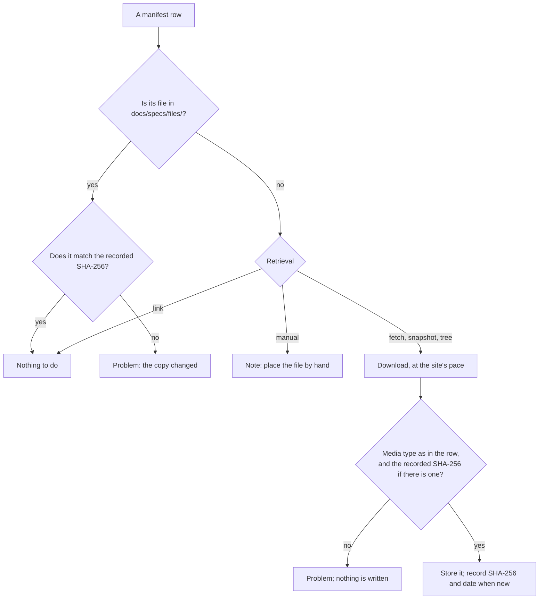

# Specifications other than RFCs

The documents that this project builds on besides the RFCs: standards, vendor specifications, registries, living documentation pages and the pinned Internet-Drafts, as Appendices A.7 and B of the [development plan](../plans/plan-init-project.md#appendix-b--non-rfc-specifications) list them. The RFCs are in [`rfc/`](rfc/README.md), and descriptions of the paid standards, written from free sources, in [`iso-iec/`](iso-iec/README.md).

## Why the documents are not committed

These documents are copyrighted by their publishers, and most may not be redistributed. Only [manifest.tsv](manifest.tsv) is committed: it names every document, its edition and where it comes from, and the SHA-256 of the copy that was approved. `node scripts/fetch-specs.ts` reproduces the local copies in `docs/specs/files/`, which Git ignores (plan section 5.2).

## Where the documents are

Each stored document is `files/<topic>/<publisher>/<identifier>.<extension>`, where the manifest's `folder` column gives the topic and the publisher. The topics follow Appendix B: `containers` (the pinned Matroska drafts included), `video`, `audio`, `subtitles` and `tags-and-registries`. The community descriptions proposed for G1.5 sit under their topic too, with the class `descriptive`.

```
files/
├── containers/
│   ├── apple/            apple-quicktime-file-format.json, apple-caf-*.html
│   ├── ietf/             the pinned drafts and the Matroska sources
│   ├── microsoft/        microsoft-avi-riff-reference.md, microsoft-dv-in-avi.md, …
│   └── …
├── video/
│   ├── itu/              itu-t-h-264.pdf, itu-t-h-265.pdf, …
│   └── smpte/
├── audio/
├── subtitles/
└── tags-and-registries/
```

## Fetching

```sh
node scripts/fetch-specs.ts                      # every row
node scripts/fetch-specs.ts itu-t-h-264 w3c-png-3  # only these rows
```

The script asks each site at most once every 2 seconds, and the Internet Archive at most once every 6 seconds. When a site answers with a sign of blocking (403, 429 or 503, or a refused connection), it waits longer for that site, as long as the site asks in `Retry-After` when it does, retries a few times, and keeps the longer interval for the rest of the run. A full run takes a while: Apple's QuickTime documentation alone is more than 800 pages.



## The manifest

| Column | Content |
|---|---|
| `identifier` | Stable short name; the stored file is named after it, with the extension of its source. |
| `folder` | The topic and the publisher, as `<topic>/<publisher>`; the stored file lies in `files/<folder>/`. |
| `title`, `publisher` | As printed on the document. |
| `edition` | Exact edition, version or draft revision; for a living page, the commit or capture date that was stored. |
| `landing_url` | The publisher's page for the document. |
| `artifact_url` | The document file itself, when one exists; empty for a paid document. |
| `immutable_reference` | For a `snapshot` row, the address that keeps returning the same bytes: a dated W3C version, a file at a pinned commit, or an Internet Archive capture. `none` marks a page that has none: the approved copy exists only locally. |
| `content_type` | The media type the stored file must have, so that an error page or a landing page is never stored as the document. |
| `availability` | `free`, `paid`, or `none`. |
| `retrieval` | `fetch`: the script downloads the artifact, whose address names its edition. `snapshot`: it stores a living page from its immutable reference, or once from the page when there is none. `tree`: it walks a documentation tree from the artifact and stores its pages as one file. `manual`: the maintainer places the file. `link`: not stored. |
| `applies_to` | The components that rely on it. |
| `class` | `normative`, `secondary`, or `descriptive` (a community description approved at G1.5). |
| `sha256`, `retrieved` | Filled in by the script when the file is first stored. |
| `approved` | The gate that approved the row; empty until then. |

Where a living page is built from files in a public Git repository, the row stores the documentation file at a pinned commit, and only that file is opened, never code in the repository (plan section 1.3).

## Manual rows

A `manual` row is a document that the script cannot download, because its site serves it only to a browser. Download it by hand from `artifact_url`, save it as `docs/specs/files/<folder>/<identifier>` with the extension of its `content_type` (`.pdf`, `.zip`), and run `node scripts/fetch-specs.ts <identifier>`, which records its SHA-256. Until then each run notes the file as missing.

## Deliverables and coverage

[deliverables.tsv](deliverables.tsv) lists everything that plan sections 4.1 to 4.4 promise, one key per detector entry, container prober, codec-by-carriage pair and codec identified only, in the plan's own words, together with the tag families, registry tables and rules that have a source of their own. [coverage.tsv](coverage.tsv) gives each key its status (`active` for a named release, `deferred` to a named gate, or `dropped`), its sources as `<document>: <section>`, where the document is an identifier of this manifest or `rfcNNNN`, the fixture that accepts it, and the date its section was confirmed in the stored document. An empty date marks the section as provisional; Phase 1 task 17 confirms each one.

Keys start with their kind: `detect.`, `probe.`, `pair.<codec>.<representation>.<carriage>`, `identify.<codec>.<carriage>`, `tags.`, `registry.` and `rule.`. From Phase 3 on, code registers against them.

## Checks

`node scripts/check.ts` checks the tables without the network:

- every manifest row follows the rules of its retrieval, and every draft of Appendix A.7 is fetched at its pinned revision;
- every document stored locally matches its recorded SHA-256, and every stored file belongs to a row;
- the deliverables have the same words as the tables of plan sections 4.1 and 4.3, in both directions;
- the keys of the two tables are the same set, every source names a document of a manifest, and every active row names at least one approved source: an RFC, a manifest row whose `approved` cell names a gate, or a description of a paid standard.

CI has no stored documents, so there it checks the tables alone.
